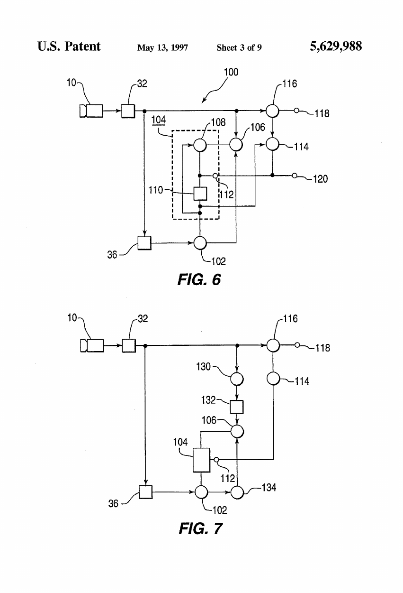
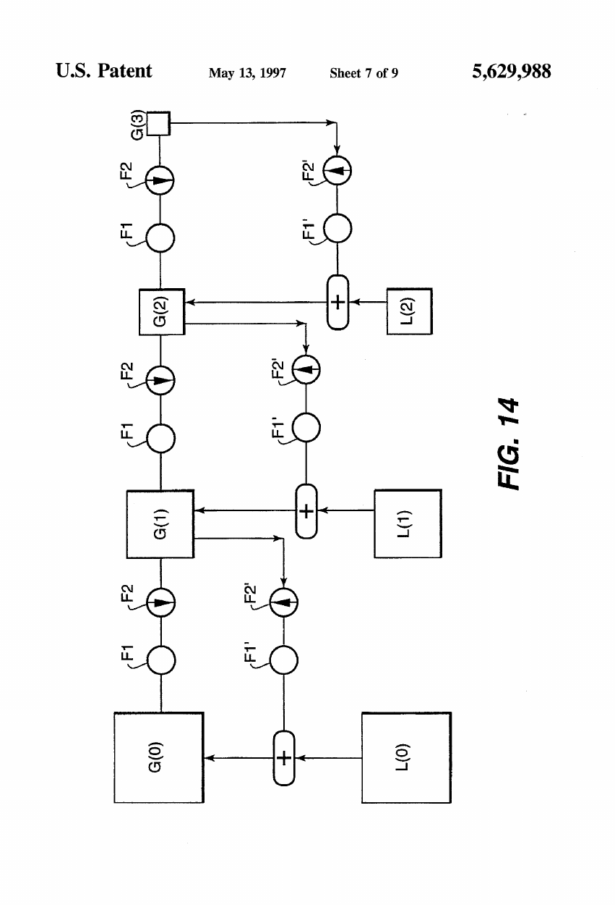
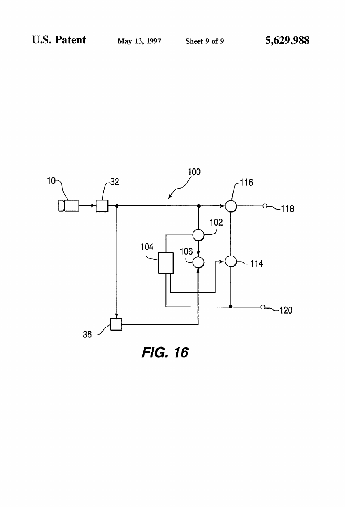

# US 5,629,988 A 번역: 전자식 영상 안정화 시스템과 방법

- 원문: 같은 폴더의 `US5629988A.pdf` (USPTO 등록 공보 17쪽, Google Patents PDF 링크에서 받음)
- 번역 범위: 전문(서지, 초록, 배경, 요약, 도면 설명, 상세 설명, 청구항 1~15). 인용 문헌은 원문 그대로 둔다.
- 본문은 `pdftotext -layout`으로 뽑았다. 낱자 인식 오류(예: "distal" → "digital", "?" → "fi")는 쪽 이미지를 보고 바로잡았다.
- 대괄호 [역주]는 번역자가 덧붙인 설명이다.

---

## 서지

| 항목 | 내용 |
|---|---|
| [11] 특허 번호 | 5,629,988 |
| [45] 등록일 | 1997-05-13 |
| [54] 발명의 명칭 | SYSTEM AND METHOD FOR ELECTRONIC IMAGE STABILIZATION (전자식 영상 안정화 시스템과 방법) |
| [75] 발명자 | Peter J. Burt, Keith J. Hanna (둘 다 Princeton, N.J.) |
| [73] 양수인 | David Sarnoff Research Center, Inc., Princeton, N.J. |
| [21] 출원 번호 | 328,783 |
| [22] 출원일 | 1994-10-28 |
| [63] 관련 출원 | Ser. No. 71,814 (1993-06-04 출원, 포기)의 계속출원 |
| [51] 국제 분류 | G06K 9/36 |
| [52] 미국 분류 | 382/276; 382/107 |
| [58] 검색 분야 | 382/276, 107, 382/215, 268, 302; 364/516; 348/135, 154 |
| 심사관 | Yon J. Couso |
| 대리인 | William J. Burke |
| 청구항 / 도면 | 청구항 15개, 도면 9장 |

### [56] 인용 문헌 (원문 그대로)

U.S. PATENT DOCUMENTS

- 4,692,806 9/1987 Anderson et al. 358/209
- 4,703,514 10/1987 Van Der Wal 382/41
- 4,835,532 5/1989 Fant 345/136
- 5,063,603 11/1991 Burt 382/37
- 5,067,014 11/1991 Bergen et al. 358/105
- 5,251,271 10/1993 Fling 382/54
- 5,259,040 11/1993 Hanna 382/41

FOREIGN PATENT DOCUMENTS

- WO9000334 1/1990 WIPO
- WO9307585 4/1993 WIPO

OTHER PUBLICATIONS

- Paik et al., IEEE Transactions On Consumer Electronics, v. 38, No. 3, Aug. 1992, pp. 607-615.
- S. F. Wu et al, Signal processing: Image Communication 2, vol. 1, No. 2, May 1990, pp. 69-80.
- G. S. van der Wal, P. J. Burt "A VLSI Pyramid Chip For Multiresolution Image Analysis" International Journal For Computer Vison Nov. 91 Special Issue.
- P. J. Burt, et al "Object Tracking With A Moving Camera An Application Of Dynamic Motion Analysis" Proceedings of the Workshop on Visual Motion, Irvine CA Mar. 20-22, 1989 pp. 1-12.
- G. S. van der Wal "The Sarnoff Pyramid Chip" Proceedings of Computer Architecture for Machine Perception (CAMP-91) Paris, Dec. 16, 1991.
- P. J. Burt, "The Pyramid As A Structure For Efficient Computation" Multiresolution Image Processing and Analysis, Springer-Verlag 1984.

---

## [57] 초록

이 발명은 전자 촬상 장치가 만든 영상을 전자식으로 안정화하는 시스템과 방법이다.
입력은 영상 프레임이 이어진 어떤 열이든 된다.
영상원은 비디오카메라, 적외선이나 X선 촬상기, 레이더일 수 있다.
컴퓨터 디스크 메모리, 비디오테이프, 컴퓨터 그래픽 생성기 같은 저장 매체일 수도 있다.
여러 영상원의 영상을 서로에 대해 안정화해야 할 때도 쓸 수 있다.

이 발명은 **되먹임 고리와 두 번째 영상 워프 단계**를 써서, 변위 추정 과정의 일부로 정밀한 영상 정렬을 얻는다.

안정화 시스템의 출력은 고친 영상 열이다.
이 영상 열에서는 원치 않는 영상 움직임 성분이 줄거나 없어진다.
또는 원하는 꼴의 새 움직임이 들어간다.
출력에는 입력 열에서 얻은 정보도 들어갈 수 있다.
예를 들면 프레임 사이 변위 벡터 추정값, 움직임 흐름장, 잡음을 줄이거나 변화를 강조한 파생 영상 열이다.

---

## 본문

이 출원은 1993-06-04에 낸 출원 Ser. No. 08/071,814(지금은 포기)의 계속출원이다.

이 발명은 디지털 영상 처리로 프레임 사이 움직임의 원치 않는 성분을 없애, 영상 열을 전자식으로 안정화하는 방법과 장치에 관한 것이다.

### 발명의 배경

영상 안정화는 여러 분야에서 필요하다.

- 영화 산업은 원본 영상의 이웃 프레임 사이 흔들림을 없애야 한다.
- 텔레비전 뉴스 촬영 기자는 현장 뉴스에서 손에 든 카메라 영상을 안정화해야 한다.
- 흔들리거나 도는 받침대, 또는 움직이는 차량에 단 감시 카메라 영상은 컴퓨터 분석이나 사람에게 보여 주기 전에 안정화해야 한다.
- 움직이는 차량의 영상은 압축하기 전, 원격 조작자(원격 조종)에게 보여 주기 전, 또는 자동 운전용 컴퓨터 비전 시스템에 넣기 전에 안정화해야 한다.

감시 분야에서는 여러 종류의 기계식 안정 받침대를 써서, 영상이 아니라 촬상기의 움직임을 보정한다.
도 1에서 촬상기 10은 기계식 안정 받침대 12에 달려 있다.
촬상기 10의 출력 I_in(t)는 선 14를 거쳐 모니터 16에 표시된다.
받침대 12는 보통 자이로스코프로 받침대 회전을 감지하고, 모터로 그 회전을 보정한다.
사용자는 전자 제어 신호 18과 받침대 12의 모터 구동으로 촬상기가 보는 방향(팬과 틸트)과 줌을 조정할 수 있다.

촬상기 움직임 센서를 쓰는 전자식 안정화는 촬상기 움직임은 보정하지만 영상 움직임은 보정하지 못한다.
도 2에서 기계식 안정 받침대 12에 단 촬상기 10은 선 14로 출력 I_in(t)를 낸다.
받침대 12에 남은 움직임은 센서 20으로 잰다.
감지한 변위 d(t)(선 22)는 변환 모듈 26에서 변환 매개변수 p(t)(선 24)로 바뀐다.
영상 워프 장치 28은 매개변수 p(t)로 촬상기 움직임을 보정한 안정 출력 영상 I_out(t) 30을 만들어 모니터 16에 표시한다.

도 3은 디지털 처리로 영상 움직임을 감지하는 전자식 안정화 시스템이다.
촬상기 10의 출력 I_in(t) 14는 영상 프레임 저장소 32에 들어간다.
알맞은 워프 매개변수를 계산해 영상 워프 장치 28로 보낼 때까지 영상을 잡아 둔다.
(한 프레임 시각의 워프를 앞 프레임 시각에 계산한 매개변수로 한다면 이 프레임 저장소는 필요 없다.)
메모리를 줄이려고 모듈 34가 원본 영상에서 특징 묶음을 뽑을 수 있다.
두 번째 영상 프레임 저장소 36은 앞 영상에서 뽑은 특징을 담아 현재 영상과 비교할 수 있게 한다.
시각 t의 특징 f(t)(선 38)와 시각 t-1의 특징 f(t-1)(선 40)을 변위 추정기 42에서 비교한다.
추정기는 디지털 영상 처리로 영상 사이 움직임을 구해 변위 d(t)(선 44)를 낸다.
시판 카메라 가운데 하나는 36화소 배열을 프레임 사이에서 비교하는 특징으로 쓴다.
감지한 변위 d(t)는 영상 워프 장치 28이 영상 움직임을 보정한 안정 출력 영상 I_out(t) 30을 만드는 데 쓰여 모니터 16에 표시된다.
발명자가 아는 이런 시스템은 줌, 회전, 시차, 렌즈 왜곡을 보정하지 못한다.

도 4에서 전자식 표적 추적 시스템은 상관으로 촬상기 시야 안의 표적을 찾는다.
그다음 촬상기를 돌려 표적을 가운데에 두고, 적어도 대략은 표적 무늬를 안정화한다.
이 시스템은 출력 영상 I_in(t) 14를 내는 촬상기 10을 가진다.
상관 모듈 46은 이 영상을 메모리 50에 저장한 기준 무늬와 비교한다.
기준 무늬는 영상 열 모듈 48에서 앞 프레임 가운데 골라 저장한다.
기준 무늬는 장면의 정지 물체일 수도, 움직이는 물체일 수도 있다.
영상 I_in(t)와 기준 무늬의 차이는 변환 모듈 26에 변위 정보를 준다.
변환 모듈은 이 정보를 바꾸어 받침대 12를 안정화하는 신호를 만든다.

도 5는 변화 검출을 쓰는 전자식 표적 추적 시스템이다.
현재 영상 I_in(t)와 프레임 저장소 60의 앞 영상 I_in(t-1)의 차이를 감산기 62로 구한다.
그리고 크게 변한 영역을 찾는다.
모듈 64가 준 위치 정보 x(t)로 촬상기 10의 방향을 다시 잡아, 표시 영상에서 영상이 특정한 점이나 특정한 궤적에 머물게 한다.
표적이 너무 작아 무늬 정합으로는 찾을 수 없지만 움직이고 있어서 움직임으로 찾을 수 있을 때는, 이 방식이 무늬 기반 방식보다 나을 수 있다.
기존 시스템은 표적 움직임을 찾을 수 있도록 배경 장면의 움직임이 작아야 한다.

Burt 외는 Proceedings Of The Workshop On Visual Motion(Irvine, Calif., 1989-03-20~22, 1~12쪽)에서 **반복 정제로 정밀한 영상 정렬을 얻는 절차**를 밝혔다.
이런 절차는 지형 모양 복원과 움직이는 표적 검출 같은 응용에 쓰였다.
줌, 회전, 시차, 렌즈 왜곡을 보정하면서 정확도도 높인 전자식 영상 안정화 방법과 시스템이 있으면 좋을 것이다.
또 개선한 안정화 과정에서 덤으로 생기는 정보를 써서, 잡음을 줄이거나 변화를 강조한 파생 영상 열까지 내도록 영상 안정화 시스템의 기능을 넓히면 좋을 것이다.

### 발명의 요약

이 발명은 영상을 전자식으로 안정화하는 장치와 방법이다.
입력은 영상 프레임이 이어진 어떤 열이든 된다.
영상원은 비디오카메라, 적외선이나 X선 촬상기, 레이더, 또는 컴퓨터 디스크 메모리, 비디오테이프, 컴퓨터 그래픽 생성기 같은 저장 매체다.
시스템의 출력은 고친 영상 열이다.
이 열에서는 원치 않는 영상 움직임 성분이 줄거나 없어지거나, 원하는 꼴의 새 움직임이 들어간다.
출력에는 입력 열에서 얻은 정보도 들어갈 수 있다.
예를 들면 프레임 사이 변위 벡터 추정값, 움직임 흐름장, 잡음을 줄이거나 변화를 강조한 파생 영상 열이다.

이 발명은 기준에 대해 영상을 안정화하는 방법이며, 다음 단계로 이루어진다.

- (a) 영상과 기준 사이 변위의 초기 추정값으로 기준을 워프한다.
- (b) 워프한 기준을 영상과 비교해 **남은 변위(잔차 변위)**를 얻는다.
- (c) 잔차 변위를 초기 추정값에 더해, 영상과 기준 사이 변위의 고친 추정값을 얻는다.
- (d) 고친 변위 추정값으로 기준을 다시 워프한다.
- (e) (b), (c), (d)를 K번 되풀이해 변위의 최종 추정값 d(t; K)를 만든다.
- (f) 최종 변위 추정값 d(t; K)로 출력 변환 매개변수 p(t)를 만든다.
- (g) 출력 변환 매개변수 p(t)로 영상을 워프해 출력 영상을 만든다.

이 발명은 기준에 대해 영상을 안정화하는 장치이기도 하다.
장치는 다음 수단을 가진다.

- 기준과 영상 사이 변위의 추정값에 따라 기준을 워프하는 수단
- 워프한 기준을 영상과 비교해 잔차 변위를 얻는 수단
- 잔차 변위를 추정값에 더해 영상과 기준 사이 변위의 고친 추정값을 얻는 수단
- 고친 변위 추정값으로 기준을 워프하는 수단
- 단계 (b), (c), (d)를 K번 되풀이해 최종 변위 추정값 d(t; K)를 만드는 수단
- 최종 변위 추정값 d(t; K)로 출력 변환 매개변수 p(t)를 만드는 수단
- 출력 변환 매개변수 p(t)로 영상 I_in(t)를 워프해 출력 영상을 만드는 수단

### 도면의 간단한 설명

여러 도면에 함께 나오는 요소는 모든 도면에서 같은 번호를 붙였다.

- 도 1: 종래 기술의 기계식 안정 받침대 개략도
- 도 2: 촬상기 움직임 센서를 쓰는 종래 기술의 전자식 안정화 시스템 개략도
- 도 3: 디지털 처리를 쓰는 종래 기술의 전자식 안정화 시스템 개략도
- 도 4: 종래 기술의 전자식 표적 추적 시스템 개략도
- 도 5: 변화 검출로 표적을 추적하는 종래 기술 시스템 개략도
- 도 6: 이 발명의 전자식 안정화 시스템 개략도
- 도 7: 이 발명의 다른 전자식 안정화 시스템 개략도
- 도 8: 움직임에 맞춘 프레임 사이 처리 시스템 개략도
- 도 9: 따로 둔 기준 무늬 R을 쓰는 다른 안정화 시스템 개략도
- 도 10: 두 영상 열을 쓰는 다른 안정화 시스템 개략도
- 도 11: 표적 위치를 찾는 시스템 개략도
- 도 12, 13: 변환 매개변수를 얻는 방법
- 도 14: 가우스 피라미드와 라플라스 피라미드를 만드는 방법
- 도 15: PYR-1 회로 개략도
- 도 16: 도 6 전자식 안정화 시스템의 다른 실시예 개략도

### 상세한 설명

이 발명은 전자 촬상 장치가 만든 영상을 전자식으로 안정화하는 시스템과 방법이다.
입력은 영상원에서 온 영상 프레임 열 I_in(t)이면 무엇이든 된다.
영상원은 비디오카메라, 적외선이나 X선 촬상기, 레이더, 또는 컴퓨터 디스크 메모리, 비디오테이프, 컴퓨터 그래픽 생성기 같은 저장 매체다.
여러 영상원의 영상을 서로에 대해 안정화해야 할 때도 쓸 수 있다.
이때 한 영상은 안정화 대상이 되고, 다른 영상은 기준이 된다.
이 발명은 되먹임 고리와 두 번째 영상 워프 단계를 써서, 변위 추정 과정의 일부로 정밀한 영상 정렬을 얻는다.
안정화 시스템의 출력은 고친 영상 열 I_out(t)이다.
이 열에서는 원치 않는 영상 움직임 성분이 줄거나 없어지거나, 원하는 꼴의 새 움직임이 들어간다.
출력에는 입력 열에서 얻은 정보도 들어갈 수 있다.
예를 들면 프레임 사이 변위 벡터 추정값, 움직임 흐름장, 잡음을 줄이거나 변화를 강조한 파생 영상 열이다.

*도 6(위): 이 발명의 전자식 안정화 시스템 100. 점선 상자 104가 되먹임 고리(가산기 108, 메모리 110)다. 102는 앞 프레임 워프기, 106은 변위 추정기, 114는 변환 매개변수 생성 수단, 116은 현재 영상 워프기다. 도 7(아래): 피라미드 처리기 130, 134를 넣은 다른 실시예.*

도 6에서 이 발명의 전자식 안정화 시스템 100은 다음으로 이루어진다.

- 출력 I_in(t)를 내는 촬상기 10
- 영상 I_in(t)를 저장하는 영상 프레임 저장소 32
- 앞 영상 I_in(t-1)을 저장하는 두 번째 프레임 저장소 36

프레임 저장소 36의 내용 I_in(t-1)은 앞 프레임 영상 워프기 102에서 워프된다.
이때 점선 상자로 그린 되먹임 고리 104가 주는 변위 초기 추정값 d(t; 0)를 쓴다.
그 결과가 워프한 앞 영상 I_in(t-1; k-1)이다.
변위 추정 수단 106은 워프한 앞 영상 I_in(t-1; k-1)을 원래 영상 I_in(t)와 비교해 잔차 변위 Δ(t; k)의 추정값을 얻는다.
이 값이 변위 추정기 106에서 되먹임 고리 104로 들어간다.
잔차 변위 Δ(t; k)는 가산기 108에서 앞 변위 추정값에 더해지고 메모리 110에 저장된다.
그래서 정제한 변위 추정값 d(t; k) = d(t; k-1) + Δ(t; k)가 나온다.
이 단계를 K번 되풀이한다.
**잔차 변위가 정한 값보다 작아질 때까지** 되풀이하거나, 조작자나 다른 수단이 고른 **고정 횟수**만큼 되풀이한다.
그렇게 변위의 최종 추정값을 만든다.

단자 112는 최종 변위 추정값 d(t; k)를 출력 변환 매개변수 p(t)로 바꾸는 수단 114에 이어진다.
여기에는 모형으로 나타낼 수 있는 모든 영상 변화가 들어간다.
줌, 대부분의 시차, 평행 이동, 회전, 확대, 렌즈 왜곡이다.
수단 114의 출력은 현재 영상 워프기 116에 이어진다.
현재 영상 워프기 116은 현재 영상 I_in(t)를 워프해 단자 118에 I_out(t)를 만든다.
되먹임 고리 104에서 K번 반복한 뒤의 정제한 변위 추정값 d(t; K)는 출력 단자 120에서도 얻을 수 있다.
영상과 기준(또는 영상) 사이 변위의 추정값은 **영상 영역의 일부에서만 계산한 변위 측정**에 바탕을 둘 수 있다.
예를 들면 표적 무늬가 있는 부분만 쓸 수 있다.

이 발명의 방법에서 반복 k는 I_in(t-1)에서 I_in(t)로의 변위의 앞 추정값 d(t; k-1)로 시작한다.
영상 I_in(t-1)을 d(t; k-1)만큼 워프해 워프 영상 I_warp(t-1; k-1)을 만든다.
현재 영상 I_in(t)와 워프 영상 I_warp(t-1; k-1)에 변위 추정 과정을 적용해 잔차 변위 Δd(t; k)를 추정한다.
잔차 변위 Δd(t; k)를 앞 변위 추정값에 더해 정제한 변위 추정값 d(t; k) = d(t; k-1) + Δd(t; k)를 얻는다.
그다음 영상 워프 단계를 되풀이해 I_in(t)에 더 정밀하게 정렬된 I_warp(t-1; k)를 만든다.
이 단계를 K번 되풀이해 프레임 I_in(t-1)에서 프레임 I_in(t)로의 변위의 최종 추정값 d(t; K)를 얻는다.
이 과정의 첫 반복에 쓰는 앞 추정값 d(t; 0)는 **앞 프레임 시각에 얻은 최종 추정값**을 바탕으로 할 수 있다.
예를 들면 d(t; 0) = d(t-1; K)다.
시각 t의 주기는 I_in(t)의 사본을 프레임 저장소 32에서 프레임 저장소 36으로 옮기면서 끝난다.

이 실시예에서는 앞 프레임, 곧 기준 프레임 I_in(t-1)을 현재 프레임 I_in(t)에 맞도록 워프해 변위 정보를 얻는다.
대신 같은 영상원이나 다른 영상원의 기준을 써서, 현재 프레임을 기준에 맞도록 워프할 변위 정보를 얻을 수도 있다.
보통 시각 t에 쓰는 변위 초기 추정값 d(t; 0)는 시각 t-1의 최종 추정값 d(t-1; K)와 같게 둔다.
프레임 사이 가속이 작으면 한 프레임 시각마다 추정 과정을 한 번만(K=1) 해도 차례로 정제하는 효과를 얻을 수 있다.

제안한 안정화 방법은 서로 다른 워프 단계 두 개를 쓰지만, 실제로는 워프기의 입력과 출력을 다중화해 같은 워프 하드웨어 하나로 둘 다 할 수 있는 경우가 많다.
예를 들어 프레임 저장소 36의 출력과 고리 104가 입력이 되고, 추정기 106으로 가는 워프기 출력이 출력이 된다.
다른 차례에는 현재 영상과 변환 매개변수가 입력이 되고, 워프기 출력은 출력 영상이 된다.

영상 I_in(t)와 I_warp(t-1; k-1)은 도 7처럼 변위 추정 전에 필터를 거치거나 다른 처리를 받을 수 있다.
바람직한 구현에서는 현재 입력 영상 I_in(t)의 **라플라스 피라미드**를 피라미드 처리기 130에서 만들어 메모리 32에 저장한다.
I_warp(t-1; k-1)의 라플라스 피라미드는 반복 k마다 워프 단계 뒤에 피라미드 처리기 134에서 다시 만든다.
그러면 추정 과정의 차례 정제 단계들이 **점점 더 높은 해상도의 피라미드 층**에서 잔차 변위를 추정할 수 있다.

도 8에서 움직임에 맞춘 프레임 사이 처리 시스템 150은 이 발명의 영상 안정화 시스템의 일부다.
이 시스템은 현재 영상 I_in(t)와 워프 영상 I_warp(t-1; k-1)을 화소마다 더하는 수단 152(시간 저역 통과)를 가진다.
그래서 잡음이 준 합성 영상을 얻는다.
시스템 150은 현재 영상과 워프 영상을 화소마다 빼는 수단 154(시간 고역 통과)도 가진다.
그래서 장면의 변화나 움직임을 드러내는 차 영상을 만든다(움직이는 표적 검출).

합 영상과 차 영상은 안정 출력 I_out(t)에 더해, 또는 그 대신에 안정화 시스템의 출력으로 바로 낼 수 있다.
파생 영상 열도 도 6에서 영상을 안정화한 것과 같은 방식으로 워프해 안정화할 수 있다.

두 장보다 많은 영상을 정렬해 잡음을 줄이거나(시간 저역 통과 필터) 변화를 검출(시간 고역 통과)할 수도 있다.
선택 사항으로 잡음을 줄인 영상을 더 개선할 수 있다(예: 선명화, 잡음 코어링).
또는 변화 영상을 더 처리할 수 있다(예: 변화 에너지 영상이나 피라미드 만들기).
영상 정렬과 시간 필터링 방법은 이미 알려져 있다는 점을 적어 둔다.
따라서 이 발명은 영상 안정화의 한 단계로서, 정렬한 영상의 프레임 사이 처리를 넣은 것이기도 하다.
특히 정렬한 입력 영상에 시간 저역 통과와 고역 통과 필터를 걸어 잡음을 줄인 영상 열과 변화를 강조한 영상 열을 만들고, 시스템에서 내보내기 전에 이 파생 영상 열을 안정화하는 것이다.

도 9의 시스템 160은 원본 열의 각 영상을 앞 영상 대신 **따로 둔 기준 무늬 R**에 맞춰 정렬한다.
기준 무늬는 여러 곳에서 얻을 수 있다.
보통 기준 무늬 R은 사용자 제어 아래 선택기 162가 원본 영상의 앞 프레임에서 고른다.
또는 원본 영상의 앞 영상이나 그 조각일 수 있다(예: n번째 프레임마다 골라 다음 n-1 프레임을 정렬하는 기준으로 쓴다).
또는 저장해 둔 표적 무늬 묶음에서 고른 것일 수 있다.
프레임 저장소 36에 저장한 무늬 R은 워프기 102에서 워프되어 R_warp(k-1)을 낸다.
이때 기준과 현재 영상 I_in(t) 사이 무늬 R의 변위 추정값을 쓴다.
시스템의 출력은 현재 영상 I_in(t)를 워프해, 기준 무늬와 맞은 영역을 정지시키거나 원하는 임의 궤적을 따라 움직이게 한 것이다.
또는 표적 무늬 하나를 찾는 대신 **구성 무늬 묶음을 찾을 수 있다**(예: 계층 구조 탐색을 쓴다).

도 10의 시스템 180은 다른 영상원(예: 적외선과 가시광 촬상기)의 영상을 안정화한다.
촬상기 10에서 만들어 프레임 저장소 32에 저장한 영상 I_1n(t)를 영상원 182의 두 번째 영상 열 I_2n(t)에 맞춰 정합하는데, 이에는 특별한 변위 추정 절차가 필요하다.
두 번째 영상 열 I_2n(t)는 프레임 저장소 184에 저장한다.
한 영상원의 영상을 다른 영상원의 영상에 맞춘다.
곧 한 영상원의 영상이 다른 영상원의 영상을 안정화하는 기준 무늬가 된다.
워프 영상 I_warp(t; k-1)을 변위 추정 수단 106에서 영상 I_1n(t)와 비교해 현재 차이 d(t; k)를 정한다.
이 값을 앞 추정값 d(t; k-1)에 더해 워프기 102에 새 추정값을 준다.
차이의 최종 추정값은 변환 매개변수 생성 수단 114가 워프기 116에 필요한 정보를 주는 데 쓴다.
워프기 116은 I_1n(t)를 안정화해 단자 118에 영상 I_out(t)를 만든다.
영상 I_2n(t)도 단자 186에서 시스템 출력으로 얻을 수 있다.

촬상기 시야 안 표적 물체의 위치는 여러 과정으로 찾을 수 있다.
상관 정합(예: 기준 무늬에 맞춘 정합), 움직임 흐름장에서 활동 영역 찾기, 시간 변화 영상에서 활동 영역 찾기 등이다.
종래 시스템은 전자식 표적 검출로 촬상기 방향을 돌린다.
이들은 상관 무늬 정합이나 프레임 사이 변화에 기대지만, 영상 움직임 흐름이나 전자식 정렬 뒤의 프레임 사이 변화는 쓰지 않는다.
그 결과 이런 시스템은 촬상기가 배경을 추적하고 배경 영상이 사실상 정지해 있을 때만 프레임 사이 변화로 움직이는 표적을 찾을 수 있다.

이 발명의 방법에서는 먼저 배경을 전자식으로 정렬하고, 그다음 표적을 찾는다.
그리고 표적 위치로 촬상기 방향과 전자식 안정화 과정 둘 다를 이끌어, 출력 영상 열에서 배경이 아니라 표적을 추적하고 안정화한다.
이 발명은 얻어 낸 변화나 움직임 정보로 배경에 대해 움직이는 표적을 찾는다.
그리고 표적 움직임과 배경 움직임을 둘 다 추정하며, 전자식으로 찾은 표적 위치와 배경 움직임 정보로 촬상기 방향과 출력 영상 열 안정화를 함께 제어한다.

도 11의 시스템 200은 차이 I_in(t) - I_warp(t-1)을 받는 고역 통과 필터 수단 202와, 표적(곧 영상에서 빠르게 변하는 물체)의 위치를 정하는 수단 204를 가진다.
수단 204의 출력은 위치 정보를 주며, 이 정보는 수단 106과 두 번째 변환 매개변수 생성 수단 206으로 들어간다.
수단 206의 출력은 촬상기 받침대 208을 제어해 촬상기 방향을 돌린다.
예를 들면 표적을 추적하거나 가운데에 두거나, 전자식으로 안정화하거나 가운데에 둔다.
수단 106으로 가는 입력은 영상에 오프셋 움직임을 주며, 이를 써서 예를 들어 빠르게 움직이는 물체를 출력 영상 가운데에 둘 수 있다.
더 일반적으로는 표적 위치 정보로 촬상기 방향을 돌리고, 남은 움직임은 전자식으로 보정할 수 있다.
이 경우 워프 매개변수는 프레임 사이 변위 d(t; K)와 표적 위치 매개변수 x(t) 둘 다에 바탕을 둔다.
필터 수단 202와 위치 수단 204의 조합은 공간과 시간에서 정렬한 다른 영상 쌍의 필터한 차이도 받아, 표적 검출을 개선하고 잡음을 줄일 수 있다.

영상 안정화 시스템의 기능은 입력 열의 움직임을 정하고, 관측한 움직임을 출력 열에서 원하는 움직임으로 바꾸는 것이다.
수단 114에서 관측한 변위 d(t)를 필요한 워프 매개변수 p(t)로 바꾸는 데 쓸 수 있는 변환은 여러 가지다.
여기서는 세 방법을 적는다.

도 12에서 x_in(t)를 t번째 입력 프레임의 위치라 하자.
일반적으로 이것은 x, y, θ, 배율(아래에 적을 모형 기반 안정화에서는 더 높은 차수의 매개변수)을 포함하는 벡터 양이다.
Δx_in(t) = d(t; K)를 관측한 프레임 사이 변위라 하자.
x_desired(t)를 어떤 원하는 출력 경로 P 위의 t번째 영상 위치라 하자.
수단 114는 관측한 입력 위치에서 원하는 출력 위치로 영상을 옮기는 데 필요한 변위 Δx_shift(t)를 정한다.
변환 모듈은 관측한 입력 변위로 원하는 경로 P도 정한다.
관측한 Δx_in에서 P(x_desired)를 얻는 방법은 다음과 같다.

*도 12: 추정한 입력 변위 Δx_in(t), 입력 영상 위치 x_in(t), 계산한 출력 이동 Δx_shift(t), 원하는 출력 경로 P. 도 13: 구간 A, 전이 구간 C, 구간 B로 이루어진 조각 연속 경로. 시각 t1에 A까지의 변위가 한계를 넘는다.* [역주] 도 12, 13은 공보 7쪽(시트 6)에 있다.

변위 추정값을 바꾸는 "저역 통과" 방법에서는 입력 위치 열을 그저 매끄럽게 해서 출력 위치 열을 얻는다.

> Δx_shift(t) = Δx_in(t) - w * Δx_in(t)

여기서 w는 보통 IIR 저역 통과 필터다.
움직임 매개변수마다 다른 필터를 쓸 수 있다.
예를 들어 회전 θ는 강하게 매끄럽게 하고, 평행 이동(x, y)은 중간 정도로, 배율은 전혀 매끄럽게 하지 않을 수 있다.
실제로는 비선형 저역 통과 필터를 쓸 수 있다.
예를 들어 변위 x_shift(t)가 얼마나 커져도 되는지에 한계를 둘 수 있다.
이 발명은 입력 위치 열에 저역 통과 필터를 걸어 원하는 출력 위치를 정하는 움직임 감쇠이기도 하다.

도 13의 조각 연속 방법에서는 출력 경로를 이어 붙인 직선(또는 다른 매끄러운) 구간의 열로 정한다.
이 구간들은 입력 영상 위치의 예상 추세를 따르도록 고른다.
모든 출력 프레임은 시각 t1까지 직선 구간 A로 옮겨진다.
t1에서 이 이동이 미리 정한 한계를 넘는다.
그러면 출력 영상을 출력 화면 가운데로 되돌리는 쪽으로 새 구간을 시작한다.
t1의 속도 추정값은 예를 들어 t1 앞 한동안의 관측 입력 변위 평균으로 정한다.
또는 원하는 경로를 밖에서 지정할 수도 있다.
이 속도와 프레임 I_in(t1)의 위치가 뒤따르는 입력 프레임의 위치를 예측하는 경로 B를 정한다.
그다음 출력 경로 P는 시각 t1-1의 구간 A 끝에서 t2의 구간 B까지 만든 전이 구간 C를 따른다.
그다음 P는 필요한 이동이 다시 미리 정한 한계를 넘을 때까지 B를 따른다.
이 방법은 입력 열의 높은 시간 주파수 움직임을 없애면서, 방향이 갑자기 바뀔 수 있는 입력 움직임의 추세는 출력이 따라가게 한다.

도 11처럼 표적 추적 과정을 영상 정렬 과정과 함께 쓸 때는, 찾은 표적 위치로 출력 경로 P를 정하고 영상 정렬 과정으로 영상을 그 경로로 옮길 수 있다.
표적이 작거나 장면에서 다소 불규칙하게 움직일 때는 이 두 과정 방식이 필요할 수 있다.
조각마다 매끄러운 영상 안정화는 배경 장면의 원치 않는 높은 주파수 움직임을 출력에서 없앤다.
표적 추적은 표적이 출력 화면 대체로 가운데에 머무는 경로를 정하는 데 쓴다.

표적 무늬는 조작자가 지정한 배경 장면의 일부일 수도, 관찰자가 지정하거나 움직임 검출 모듈이 찾은 장면 속 움직이는 물체일 수도 있다.
관찰자가 무늬를 지정한 경우, 시스템은 뒤따르는 추적에서 기준으로 쓸 무늬를 저장한다.
이 기준은 일정한 간격(예: n번째 프레임마다)으로 자동 갱신할 수 있다.
장면에서 기준 무늬와 가장 잘 맞는 위치를 찾으면, 그 위치의 무늬를 기준 대신 저장한다.
이렇게 하면 시스템이 표적 무늬의 서서히 일어나는 변화에 맞춰 갈 수 있다.
찾은 표적 무늬 위치를 그대로 출력 열 안정화에 쓰면, 기준 무늬를 갱신할 때마다 조금 튀는 일(출력 경로 P의 불연속)이 생기기 쉽다.
이 튐은 관측한 표적 무늬 위치로 경로 P의 구간을 정하고, 배경 정밀 정렬 과정으로 도 11의 이동 x(t)와 p(t)를 정해서 피한다.
이 발명은 안정화에서 배경 추적과 표적 추적 과정을 따로 쓰는 것이기도 하다.
배경 과정은 조각마다 매끄러운 안정화를 주고, 표적 추적 과정은 표적 무늬를 출력 화면의 원하는 위치로 매끄럽게 옮기도록 출력 움직임 경로의 구간을 정한다.

기존 기계식 안정화 장치는 촬상기 회전의 두세 축을 안정화한다.
기존 전자식 장치는 촬상기 시야 안의 영상 평행 이동을 보정한다.
여기서 제안하는 전자식 방식의 중요한 장점은 촬상기 제어로는 보정할 수 없는 움직임 성분도 보정할 수 있다는 것이다.
예를 들어 전자식 워프는 무늬가 촬상기 시야를 가로질러 움직일 때의 렌즈 왜곡을 보정할 수 있다.
더 중요하게는, 촬상기가 장면의 면에 대해 움직일 때 생기는 시차 움직임을 전자식 안정화로 보정할 수 있다.
안정화는 그 움직임의 수학 모형과, 위에 적은 정밀 정렬 방법으로 추정한 매개변수에 바탕을 둔다.
예를 들어 **2차 워프는 촬상기 시선 방향에 대해 기울어져 있을 수 있는 평면의 움직임을 보정할 수 있다.**

전자식 안정화로 장면에 있는 면(예: 자율 주행 차량 앞의 도로면)이나 촬상기에 대해 정의한 면(예: 움직이는 차량에서 미리 정한 거리에 있는 수직면)의 움직임을 보정할 수 있다.
앞의 방법은 장면 속 면까지의 움직임과 거리를 추정하면서 그 면을 안정화하는 수단을 준다.
뒤의 방법은 촬상기에서 정한 거리의 "보이지 않는 장벽"을 물체가 지날 때 그 물체를 찾는 수단을 준다.
(검출은 잔차 움직임에 바탕을 둘 수 있다. 움직이는 차량 앞의 면을 모형 기반으로 안정화한 뒤 시간 저역 통과 필터를 걸면, 그 면 가까이에 있지 않은 장면 속 모든 물체가 움직임 흐림을 보인다. 물체는 "보이지 않는 장벽"을 지날 때 선명하게 보인다.)

모형 기반 안정화로 도로면 자체 같은 장면 속 면을 안정화할 수 있다.
이 경우 촬상기에 대한 그 면의 움직임을 정해야 한다.
이는 알려진 모형 기반 변위 추정 절차로 할 수 있다.
이런 기법은 예전에 면의 모양과 거리를 정하는 수단으로 제안되었다.
여기서는 이 기법을 영상 열 안정화에 쓰자고 제안한다.

촬상 수단 10은 외부 복사원이 비춘 시야 안 물체에서 반사된 복사를 받는 구조일 수 있다.
또는 촬상 수단 10은 시야 안 물체를 복사로 비추는 수단과 그 물체에서 반사된 메아리를 받는 수단을 가진 구조일 수 있다(이 메아리는 물체 거리 정보도 줄 수 있다).
또 촬상 수단 10은 전자기파, 초음파, 또는 다른 어떤 파동 에너지 스펙트럼의 어떤 파장 부분의 복사에든 반응할 수 있다.
아날로그 디지털(A/D) 변환기가 각 프레임의 영상 자료를 디지털 꼴로 바꿔 디지털 처리기가 처리하게 한다.

영상 워프기 102와 116은 TRW, Inc.가 만든 TMC 2302 Image Manipulation Sequencer와 TMC 2246 Image Filter로 짜는 것이 바람직하다.
Image Manipulation Sequencer는 출력 영상의 주소가 주어지면 원본 영상의 주소를 만든다.
Image Filter는 지정한 입력 영상 주소 이웃의 입력 화소들로 출력 화소 값을 보간한다.
입력 영상은 보간기에 필요한 이웃 화소를 한꺼번에 읽을 수 있게 나눈 표준 메모리에 저장한다.

변환 장치는 관측한 영상 변위와 밖에서 지정한 제어 정보를 바꾼다.
변환 모듈은 Texas Instruments, Inc.(Dallas, Texas)가 만든 TMS 320 C 30 디지털 신호 처리 칩에 메모리를 붙인 범용 계산 장치일 수 있다.
변환 모듈은 여러 안정화 제어 모드를 가질 수 있으며, 모드마다 메모리에 저장한 컴퓨터 코드로 정한다.
예를 들어 감쇠 움직임 안정화, 조각 선형 안정화, 표적 가운데 두기를 합친 안정화가 있다.
어느 순간에 쓸 모드는 보통 시스템 밖의 입력으로 정한다.
변환 모듈의 다른 입력은 변위 추정기가 계산한 프레임 사이 변위와 위치 모듈이 계산한 표적 위치다.
변환 모듈은 프레임 시각마다 먼저 원하는 출력 움직임 경로를 정하고, 그다음 입력 프레임을 그 경로로 옮기는 데 필요한 변위를 정한다.
변위 매개변수는 시스템의 출력으로서 워프기에 주어진다.
입력에는 변위 추정기의 프레임 사이 변위 정보와 밖의 모드나 다른 제어 지정이 들어간다.

해상도가 비교적 높고 화소 수가 첫째 수인 영상을 처리해, 화소 수가 그보다 작은 둘째 수인 넓은 시야의 저해상도 영상을 얻는 영상 분해 분석은 Burt(Multiresolution Image Processing And Analysis, 16권, 20~51쪽, 1981)와 Anderson 외(U.S. Pat. No. 4,692,806, 영상 분해 기법에 관한 가르침을 위해 여기 참조로 포함한다)가 밝혔다.

라플라스 변환은 각 원본 영상을 여러 크기의 가우스 비슷한 기저 함수의 규칙 배열로 분해하는 데 쓴다.
이 기저 함수를 피라미드 변환의 기저 함수 또는 웨이블릿이라 부르기도 한다.
영상의 다중 해상도 피라미드는 **굵은 특징은 낮은 해상도에서, 가는 특징은 높은 해상도에서** 분석하게 해 준다.
피라미드의 각 표본 값은 그에 맞는 기저 함수의 진폭을 나타낸다.
도 14는 원본 영상의 가우스 피라미드와 라플라스 피라미드를 만드는 흐름도다.

*도 14(시트 7): 가우스 피라미드 G(0)~G(3)과 라플라스 피라미드 L(0)~L(2)를 만드는 흐름. F1은 저역 통과 필터, F2는 1/2 솎아내기, F2'과 F1'은 보간 복원이다.*

가우스 G(0)는 원본 영상이다.
이를 가우스 꼴로 줄어드는 저역 통과 필터 F1로 거르고 F2로 솎아(각 행의 화소를 하나 걸러, 행도 하나 걸러 없앤다) 첫째 층 가우스 G(1)을 만든다.
아래 층 가우스 G(n)도 같은 방식으로 차례로 만든다.
각 층 가우스에 맞는 라플라스 L(n)은 솎은 자료를 가우스 피라미드의 바로 아래 층으로 되돌린 뒤(주어진 표본 사이에 값 0인 표본을 넣고 F2', 그다음 보간 필터 F1'을 건다), 주어진 층의 가우스에서 빼서 만든다.
이렇게 만든 라플라스를 Reduce-Expand(RE) 라플라스라 한다.
또는 점선처럼 솎기와 다시 보간하기 없이 라플라스를 만들 수 있다.
이를 filter-subtract-decimate(FSD) 라플라스라 한다.

영상을 분해해 낮은 해상도 영상을 만드는 과정은 보통 가우스 꼴로 줄어드는, 대역폭이 서로 다른 여러 저역 통과 필터로 한다.
이는 U.S. 특허 출원 No. 07/805149(여기 참조로 포함)와 Workshop For Machine Vision(Paris, 1991년 12월), 그리고 대체로 U.S. Pat. No. 4,703,514에 적힌 PYR-1 회로로 효율 있게 구현할 수 있다.
이 회로는 Sensar, Inc.(P.O. Box, Princeton, N.J. 08540)가 판다.
PYR-1 피라미드 회로는 디지털 입력 신호를 셋까지 받고 출력 신호를 둘까지 낸다.
입력과 출력 자료 통로에는 파이프라인 처리를 제어하는 타이밍 신호가 들어 있다.
이 타이밍 신호는 회로의 처리 지연에 맞춰 자동으로 조정되어, 파이프라인 시스템에서 지연을 자동 제어할 수 있게 한다.
2차원 필터를 구현하는 데 쓰는 수평 지연선의 실효 길이는 타이밍 신호가 제어하므로 따로 프로그램할 필요가 없다.
이 회로는 수평과 수직 귀선 시간이 연속으로 바뀌는 신호를 받아 처리한다.
비디오카메라 영상에서는 수평과 수직 동기 신호가 타이밍 신호가 된다.
이 신호를 디지털로 바꾼 뒤 디지털 자료 신호와 합쳐 입력 신호를 만든다.
또는 디지털 자료 신호를 프레임 저장소가 만들 수 있으며, 이때는 프레임 저장소나 보조 장치가 타이밍 신호를 붙인다.
회로에는 평행 경로가 둘 있어, 입력 영상의 가우스 저역 통과 영상과 라플라스 함수(입력 영상과 가우스의 차이)를 동시에 계산할 수 있다.
두 평행 경로는 역 피라미드 변환 계산에도 쓴다.

도 15에서 예시 PYR-1 회로는 입력 신호 IN1, IN2, IN3을 셋까지 받고 출력 신호 OUT1, OUT2를 둘까지 낸다.
각 신호는 자료 비트 8개 이상과 타이밍 비트 2개를 가진 다중 비트 디지털 신호다.
타이밍 비트 둘은 각각 타이밍 신호를 나른다.
한 신호 HA는 한 줄의 자료가 유효할 때(곧 화면 표시 구간) 논리 높음이고, 그 밖(곧 수평 귀선 구간)에는 논리 낮음이다.
다른 신호 VA는 한 필드의 자료가 유효할 때 논리 높음이고, 그 밖(곧 수직 귀선 구간)에는 논리 낮음이다.

회로는 주요 요소 다섯으로 이루어진다.
입력 산술 논리 장치(ALU) 1104, 필터 1110(도 1의 점선 안), 다중화기 1120, 클립 처리기 1122, 출력 ALU 1124다.
[역주] 원문은 "도 1"이라 적었으나 문맥상 도 15를 뜻한다.
입력 지연 요소 102로 같게 지연한 신호 IN1과 IN2를 ALU 1104가 합쳐 필터 1110에 줄 신호 IN을 만든다.
이 신호는 IN1이나 IN2 가운데 하나일 수도, 그 합(IN1+IN2)이나 차(IN1-IN2)일 수도 있다.

필터 1110은 ALU 1104가 준 신호를 2차원 필터로 처리한다.
이 필터는 두 차원 각각에 탭을 1개에서 5개까지 두도록 설정할 수 있다.
필터에는 수직 가장자리 처리기 1106과 수평 가장자리 처리기 1108이 있어, 실제 영상 자료를 둘러싼 화소 값을 여러 방식으로 가정할 수 있다.
그 가운데에는 상수 값, 또는 첫째나 마지막 수평 또는 수직 줄의 반복이 있다.
처리기 1108은 입력 신호를 처리해 영상의 위아래 가장자리에 경계 화소 줄을 사실상 덧붙인다.
또 3상태 게이트 1112a~1112d와 메모리 1114와 함께 탭 지연선을 구현해, 줄 지연한 영상 신호 넷을 합성곱 처리기 1118의 수직 필터 부분에 준다.

메모리 1114는 2차원 필터의 수직 부분에 4줄 또는 8줄 지연을 준다.
지연한 줄들은 합성곱 처리기 1118에서 수직과 수평으로 합쳐져 필터 1110을 완성한다.
필터 1110의 출력 신호는 클립 처리기 1122가 처리한다.
클립 처리기는 단정밀도 신호의 반올림과 크기 조정을 하고, 걸러진 자료를 상위 비트(MSB) 자리로 하여 입력 IN3으로 들어온 하위 비트(LSB) 부분의 걸러진 자료와 합쳐 배정밀도 출력 신호를 만든다.
처리기 1122의 출력 신호, 또는 처리기 1106이 처리한 ALU 1104의 출력 신호를 출력 신호 OUT1로 고를 수 있다.
출력 신호 OUT2는 클립 처리기 1122의 출력 신호, 다중화기 1120의 출력 신호, 또는 이 둘을 합친 ALU 1124의 출력일 수 있다.
다중화기 1120이 주는 신호는 상수 값 K2, 입력 신호 IN2, 또는 수평 가장자리 처리기 1108이 준 지연 수평 줄 신호 가운데 하나일 수 있다.
다중화기 1120 안에는 보상 지연(그림에 없음)이 있어 각 입력 신호를 클립 처리기 1122가 준 신호에 맞춘다.
회로의 타이밍 신호는 타이밍 회로 1128이 2상 입력 클록 신호 CLK와 CLK2로 2상 메모리 클록과 시스템 클록 신호 CK를 만들어 낸다.

회로 기능은 제어 회로 1130이 제어한다.
제어 회로는 제어 입력 통로 CBUS로 사용자 명령을 받아, 출력 포트 CONT로 회로의 다른 요소에 제어 신호와 자료 값을 준다.

이 발명을 촬상 시스템으로 구현한 것으로 보이고 설명했지만, 보인 세부 사항으로 한정할 뜻은 없다.
예를 들어 이 발명에는 한 영상원의 영상 열과 여러 영상원의 영상이 함께 들어간다.
오히려 청구항의 범위와 균등 범위 안에서, 발명의 뜻을 벗어나지 않고 세부를 여러 가지로 고칠 수 있다.

또 이 발명을 영상의 변위 추정값을 정하려고 기준을 워프하는 것으로 설명했지만, 추정기에서 기준과 비교하려고 **영상 자체를 워프할 수도 있다**는 점은 분명하다.
이때 최종 변위 추정값으로 영상을 워프해 안정 출력 영상을 만든다.
도 16의 시스템은 도 6과 같되, 워프기 위치를 바꿔 기준 대신 현재 영상을 워프해 변위 추정값을 얻는다.

*도 16(시트 9): 도 6과 같되 워프기 102가 기준 대신 현재 영상 쪽에 놓인 다른 실시예.*

---

## 청구항

우리가 청구하는 것은 다음과 같다.

**1.** 디지털 꼴의 이웃한 영상 프레임 쌍의 열에 반응하는 전자식 영상 안정화 방법으로서, 이 방법은 다음 단계를 포함한다.

- (a) 첫째 영상 워프기, 변위 추정기, 가산기, 메모리로 이루어진 반복 동작 되먹임 고리를 써서, 열의 각 영상 프레임 쌍이 그린 영상 사이 변위의 가장 틀린 초기 추정값을 가장 덜 틀린 최종 변위 추정값으로 줄이는 단계
- (b) 최종 변위 추정값을 메모리에 저장하는 단계

개선점은 다음 단계를 더 포함하는 것이다.

- (c) 메모리에 저장한 최종 변위 추정값을, 줌, 시차 평행 이동, 회전, 확대, 렌즈 왜곡 가운데 적어도 하나를 포함하는 주어진 영상 변화 모형에 따라 출력 변환 매개변수로 바꾸는 단계
- (d) 둘째 영상 워프기를 써서, 이웃한 영상 프레임 쌍 각각의 어떤 영상 프레임을 출력 변환 매개변수에 따라 워프하는 단계

**2.** 청구항 1의 전자식 영상 안정화 방법으로서,

- 이웃한 영상 프레임 쌍 각각의 상기 어떤 영상 프레임은 열에서 그 쌍의 그때 현재 영상 프레임에 해당하고,
- 이웃한 영상 프레임 쌍 각각의 상기 어떤 영상 프레임이 아닌 영상 프레임은 열에서 그 쌍의 그때 현재 영상 프레임 바로 앞의 영상 프레임에 해당한다.

**3.** 청구항 1의 전자식 영상 안정화 방법으로서,

- 이웃한 영상 프레임 쌍 각각의 상기 어떤 영상 프레임은 열에서 그 쌍의 그때 현재 영상 프레임 바로 앞의 영상 프레임에 해당하고,
- 이웃한 영상 프레임 쌍 각각의 상기 어떤 영상 프레임이 아닌 영상 프레임은 열에서 그 쌍의 그때 현재 영상 프레임에 해당한다.

**4.** 청구항 1의 전자식 영상 안정화 방법으로서, 열의 이웃한 영상 프레임 쌍 각각은 주어진 가장 낮은 해상도에서 주어진 가장 높은 해상도까지 이어지는 여러 해상도로 주어지며, 단계 (a)는 다음 단계를 포함한다.

- (e) 주어진 가장 낮은 해상도의 영상 프레임에서 시작해, 차례로 더 높은 해상도의 영상 프레임 각각에 반복 동작 되먹임 고리를 써서, 주어진 가장 낮은 해상도 영상 프레임 쌍 각각이 그린 영상 사이 변위의 가장 틀린 초기 추정값을, 주어진 가장 높은 해상도 영상 프레임 쌍 각각이 그린 가장 덜 틀린 최종 변위 추정값으로 줄이는 단계

**5.** 청구항 1의 전자식 영상 안정화 방법으로서, 단계 (a)는 다음 단계를 포함한다.

- (e) 열에서 현재 영상 프레임 쌍보다 앞선 영상 프레임 쌍이 그린 영상 사이의 최종 변위 추정값을, 현재 영상 프레임 쌍의 변위 초기 추정값으로 쓰는 단계

**6.** 청구항 1의 전자식 영상 안정화 방법으로서, 단계 (c)는 다음 단계를 포함한다.

- (e) 메모리에 저장한 최종 변위 추정값을, 조각 선형 경로를 이루는 출력 변환 매개변수를 끌어내는 주어진 영상 변화 모형에 따라 출력 변환 매개변수로 바꾸는 단계

**7.** 청구항 1의 전자식 영상 안정화 방법으로서, 단계 (c)는 다음 단계를 포함한다.

- (e) 메모리에 저장한 최종 변위 추정값을, 영상 차이를 매끄럽게 하는 저역 통과 필터링을 적용하는 주어진 영상 변화 모형에 따라 출력 변환 매개변수로 바꾸는 단계

**8.** 디지털 꼴의 이웃한 영상 프레임 쌍의 열에 반응하는 전자식 영상 안정화 장치로서, 이 장치는 (a) 첫째 영상 워프기, 변위 추정기, 가산기, 메모리로 이루어지며 열의 각 영상 프레임 쌍이 그린 영상 사이 변위의 가장 틀린 초기 추정값을 가장 덜 틀린 최종 변위 추정값으로 줄이는 반복 동작 되먹임 고리와, (b) 최종 변위 추정값을 메모리에 저장하는 수단을 포함하며, 개선점은 다음을 포함하는 것이다.

- 메모리에 저장한 최종 변위 추정값을, 줌, 시차 평행 이동, 회전, 확대, 렌즈 왜곡 가운데 적어도 하나를 포함하는 주어진 영상 변화 모형에 따라 출력 변환 매개변수로 바꾸는 수단
- 둘째 영상 워프기를 써서, 이웃한 영상 프레임 쌍 각각의 어떤 영상 프레임을 출력 변환 매개변수에 따라 워프하는 수단

**9.** 청구항 8의 전자식 영상 안정화 장치로서, 다음을 더 포함한다.

- 이웃한 영상 프레임 쌍 각각의 상기 어떤 영상 프레임을 저장하는 첫째 영상 프레임 저장소
- 이웃한 영상 프레임 쌍 각각의 상기 어떤 영상 프레임이 아닌 영상 프레임을 저장하는 둘째 영상 프레임 저장소

**10.** 청구항 9의 전자식 영상 안정화 장치로서,

- 첫째 영상 프레임 저장소에 저장한, 이웃한 영상 프레임 쌍 각각의 상기 어떤 영상 프레임은 열에서 그 쌍의 그때 현재 영상 프레임에 해당하고,
- 첫째 영상 프레임 저장소에 저장한, 이웃한 영상 프레임 쌍 각각의 상기 어떤 영상 프레임이 아닌 영상 프레임은 열에서 그 쌍의 그때 현재 영상 프레임 바로 앞의 영상 프레임에 해당한다.

**11.** 청구항 9의 전자식 영상 안정화 장치로서,

- 첫째 영상 프레임 저장소에 저장한, 이웃한 영상 프레임 쌍 각각의 상기 어떤 영상 프레임은 열에서 그 쌍의 그때 현재 영상 프레임 바로 앞의 영상 프레임에 해당하고,
- 첫째 영상 프레임 저장소에 저장한, 이웃한 영상 프레임 쌍 각각의 상기 어떤 영상 프레임이 아닌 영상 프레임은 열에서 그 쌍의 그때 현재 영상 프레임에 해당한다.

[역주] 청구항 10, 11은 원문에서 둘째 항목도 "첫째 영상 프레임 저장소"라 적었다. 원문대로 옮겼다.

**12.** 청구항 8의 전자식 영상 안정화 장치로서, 다음을 더 포함한다.

- 열의 이웃한 영상 프레임 쌍 각각을, 주어진 가장 낮은 해상도에서 주어진 가장 높은 해상도까지 이어지는 여러 해상도로 주는 피라미드 수단

그리고 반복 동작 되먹임 고리는, 주어진 가장 낮은 해상도 영상 프레임에서 동작을 시작한 뒤 차례로 더 높은 해상도 영상 프레임 각각에서 동작해, 주어진 가장 낮은 해상도 영상 프레임 쌍 각각이 그린 영상 사이 변위의 가장 틀린 초기 추정값을, 주어진 가장 높은 해상도 영상 프레임 쌍 각각이 그린 가장 덜 틀린 최종 변위 추정값으로 줄이는 수단을 포함한다.

**13.** 청구항 8의 전자식 영상 안정화 장치로서, 다음을 더 포함한다.

- (e) 열에서 현재 영상 프레임 쌍보다 앞선 영상 프레임 쌍이 그린 영상 사이의 최종 변위 추정값을, 현재 영상 프레임 쌍의 변위 초기 추정값으로 반복 동작 되먹임 고리에 주는 수단

**14.** 청구항 9의 전자식 영상 안정화 장치로서, 메모리에 저장한 최종 변위 추정값을 주어진 영상 변화 모형에 따라 출력 변환 매개변수로 바꾸는 수단은, 조각 선형 경로를 이루는 출력 변환 매개변수를 끌어내는 수단을 포함한다.

**15.** 청구항 8의 전자식 영상 안정화 장치로서, 메모리에 저장한 최종 변위 추정값을 주어진 영상 변화 모형에 따라 출력 변환 매개변수로 바꾸는 수단은, 영상 차이를 매끄럽게 하는 데 효과 있는 출력 변환 매개변수를 끌어내는 저역 통과 필터 수단을 포함한다.
