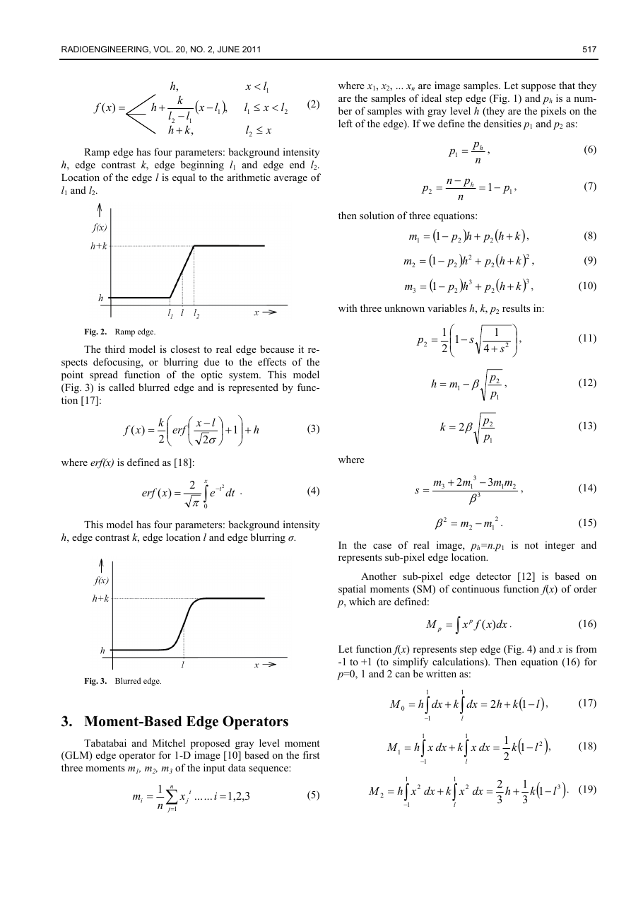
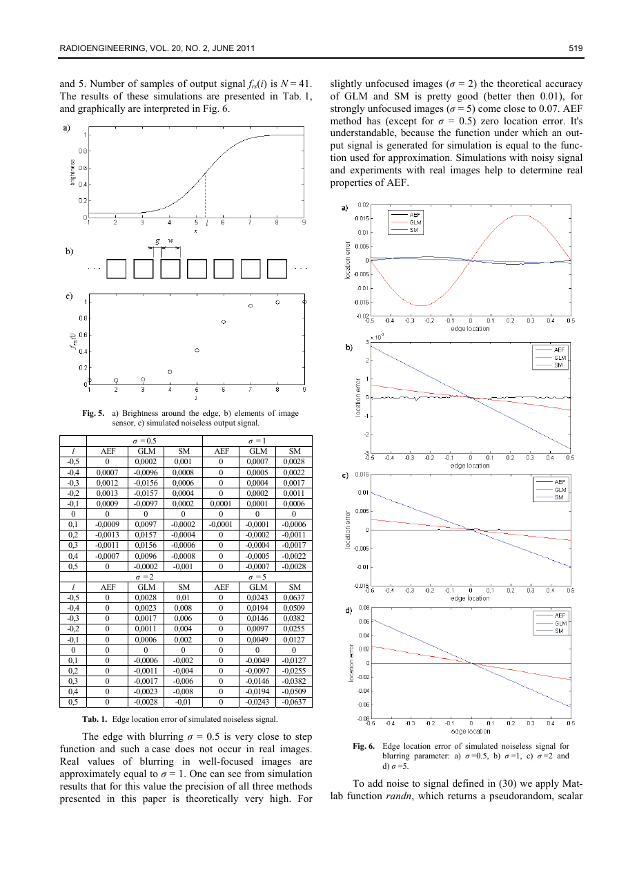
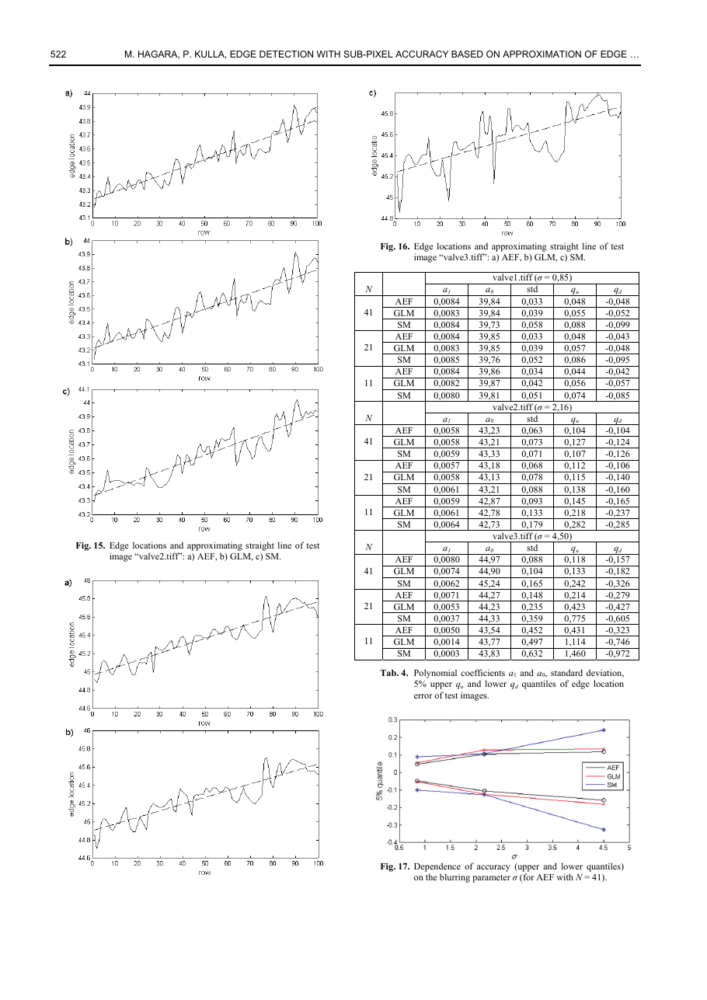

# 번역: Erf 함수로 에지를 근사한 부화소 정확도 에지 검출

- 원문: [Hagara2011_Radioeng_erf_edge_subpixel.pdf](Hagara2011_Radioeng_erf_edge_subpixel.pdf) (radioeng.cz 공개 PDF, 9쪽)
- 번역 범위: 전문 (초록, 본문, 그림과 표 캡션, 표 수치). 참고문헌은 원문 그대로 둔다.
- 원문의 소수점 쉼표(0,0121)는 점(0.0121)으로 바꿔 적었다. 값은 바꾸지 않았다.
- `[역주]`는 번역자가 덧붙인 설명이다. 원문 내용이 아니다.

---

Miroslav HAGARA, Peter KULLA
슬로바키아 공과대학교 무선전자공학과, Ilkovičova 3, 812 19 Bratislava, Slovakia

Radioengineering, Vol. 20, No. 2, June 2011, pp. 516-524

## 초록

에지 검출은 디지털 영상 처리에서 자주 쓰는 절차다. 실제 응용 가운데는 에지를 부화소 정확도로 검출해야 하는 경우가 있다. 이 논문에서는 실제 영상 함수를 Erf 함수로 근사하는, 1차원 영상용 에지 검출 방법을 제시한다. 이 방법은 모의 영상과 실제 영상에 대해, 여러 표본 수로 모의 실험과 실험을 해서 검증했다. 모의 실험과 실험의 결과로 제안한 검출 방식을, 자주 쓰는 부화소 정밀도의 모멘트 기반 에지 검출기 두 가지와 비교했다.

**핵심어**: 에지 검출, 부화소 정확도, 영상 처리.

## 1. 서론

물리적 윤곽은 물체의 가장 중요한 성질 가운데 하나다. 물체의 윤곽을 뽑으려면 그 물체를 이루는 에지를 검출해야 한다. 그래서 에지를 검출하는 방법이 많이 개발되었다. Sobel, Kirsch, Prewitt [1] 같은 단순한 에지 검출기, 더 정교한 Canny 에지 검출기 [2], 강건한 형태학적 에지 검출기 [3], [4]를 쓸 수 있다. 이 방법들은 모두 화소 단위 정확도로 에지를 검출한다.

때로는 에지를 부화소 정밀도로 검출하는 것이 쓸모 있다. 부화소 수준의 에지 검출기는 대부분 세 묶음으로 나뉜다. 적합(fitting) 방법, 모멘트 기반 방법, 보간 기반 방법이다. 첫 묶음은 쌍곡탄젠트 [5]나 B-스플라인 [6] 같은 연속 함수로 영상 함수의 표본을 맞춘다. 그 다음 연속 함수의 변곡점을 부화소 에지 위치로 삼는다. 다른 적합 방법은 국소 에너지 함수 [7]나 웨이브릿 [22]으로 에지 매개변수를 정한다. 보간 기반 방법은 영상 자료를 보간해 더 촘촘한 화소 격자를 얻어 부화소 정확도를 낸다. 그 다음 크기를 바꾼 영상에 Canny [8]나 LoG 연산자 [9] 같은 보통의 에지 검출기를 쓴다.

모멘트 기반 방법은 통계적 모멘트로 모르는 에지 모형 매개변수를 정한다. 밝기 모멘트 [10, 11], 공간 모멘트 [12, 13], Fourier-Mellin 모멘트 [14], Zernike 모멘트 [15, 16]를 쓸 수 있다.

높은 정밀도로 물체를 재는 일 같은 일부 산업 응용에서는 1차원 영상에서 에지를 부화소 정확도로 검출해야 한다. 이런 과제를 위해 이 논문에서는 실제 영상 함수를 Erf 함수로 근사하는 부화소 에지 검출 방법을 소개한다. 제안한 알고리즘을 자주 쓰는 부화소 에지 검출기 두 가지와 비교한다. 밝기 모멘트(gray level moment, GLM) 에지 연산자 [10]와 공간 모멘트(spatial moment, SM) 에지 검출기 [12]다.

이 논문의 구성은 다음과 같다. 2절은 에지 모형을 다룬다. 3절에서는 제안 알고리즘과 비교할 모멘트 기반 에지 검출 방법을 설명한다. 제안 알고리즘은 4절에서 소개한다. 5절과 6절은 모의 실험과 실험이다. 7절에서 결론을 낸다.

## 2. 에지 모형

제안한 에지 검출기를 분석하고 모의 실험으로 검증할 때는 주로 세 가지 기본 모형을 쓴다. 계단 에지(그림 1)는 가장 단순한 모형이며 계단 함수로 나타낸다 [12]:

$$f(x) = \begin{cases} h, & x < l \\ h + k, & x \ge l \end{cases} \tag{1}$$

이 모형은 매개변수 세 개로 정해진다. 배경 밝기 $h$, 에지 대비 $k$, 에지 위치 $l$이다.

> 그림 1. 계단 에지.

실제 영상에서는 밝기가 서서히 바뀌므로 경사 에지(그림 2)가 더 알맞다 [7]:

$$f(x) = \begin{cases} h, & x < l_1 \\ h + \dfrac{k}{l_2 - l_1}(x - l_1), & l_1 \le x < l_2 \\ h + k, & l_2 \le x \end{cases} \tag{2}$$

경사 에지는 매개변수가 네 개다. 배경 밝기 $h$, 에지 대비 $k$, 에지 시작 $l_1$, 에지 끝 $l_2$다. 에지 위치 $l$은 $l_1$과 $l_2$의 산술 평균이다.

> 그림 2. 경사 에지.

세 번째 모형은 실제 에지에 가장 가깝다. 초점이 어긋나거나, 광학계의 점 퍼짐 함수 때문에 흐려지는 효과를 반영하기 때문이다. 이 모형(그림 3)을 흐린 에지라고 하며 다음 함수로 나타낸다 [17]:

$$f(x) = \frac{k}{2}\left(\mathrm{erf}\left(\frac{x - l}{\sqrt{2}\,\sigma}\right) + 1\right) + h \tag{3}$$

여기서 $\mathrm{erf}(x)$는 다음과 같이 정의된다 [18]:

$$\mathrm{erf}(x) = \frac{2}{\sqrt{\pi}}\int_0^x e^{-t^2}\,dt \tag{4}$$

이 모형은 매개변수가 네 개다. 배경 밝기 $h$, 에지 대비 $k$, 에지 위치 $l$, 에지 흐림 $\sigma$다.

> 그림 3. 흐린 에지. (위 그림은 원문 517쪽 전체다. 왼쪽에 식 (2), (3), (4)와 그림 2, 3, 오른쪽에 GLM 식 (6)~(15)가 있다.)

## 3. 모멘트 기반 에지 연산자

Tabatabai와 Mitchell은 입력 자료열의 처음 세 모멘트 $m_1, m_2, m_3$에 바탕을 둔 1차원 영상용 밝기 모멘트(GLM) 에지 연산자를 제안했다 [10]:

$$m_i = \frac{1}{n}\sum_{j=1}^{n} x_j^{\,i}, \quad i = 1, 2, 3 \tag{5}$$

여기서 $x_1, x_2, \ldots, x_n$은 영상 표본이다. 이것이 이상적인 계단 에지(그림 1)의 표본이고, $p_h$는 밝기가 $h$인 표본의 수(에지 왼쪽 화소)라고 하자. 밀도 $p_1$, $p_2$를 다음과 같이 정의하면

$$p_1 = \frac{p_h}{n}, \tag{6}$$

$$p_2 = \frac{n - p_h}{n} = 1 - p_1, \tag{7}$$

다음 세 방정식

$$m_1 = (1 - p_2)h + p_2(h + k), \tag{8}$$

$$m_2 = (1 - p_2)h^2 + p_2(h + k)^2, \tag{9}$$

$$m_3 = (1 - p_2)h^3 + p_2(h + k)^3, \tag{10}$$

을 세 미지수 $h, k, p_2$에 대해 풀면 다음을 얻는다:

$$p_2 = \frac{1}{2}\left(1 - s\sqrt{\frac{1}{4 + s^2}}\right), \tag{11}$$

$$h = m_1 - \beta\sqrt{\frac{p_2}{p_1}}, \tag{12}$$

$$k = 2\beta\sqrt{\frac{p_2}{p_1}} \tag{13}$$

여기서

$$s = \frac{m_3 + 2m_1^3 - 3m_1 m_2}{\beta^3}, \tag{14}$$

$$\beta^2 = m_2 - m_1^2. \tag{15}$$

실제 영상에서는 $p_h = n \cdot p_1$이 정수가 아니며, 이것이 부화소 에지 위치를 나타낸다.

또 다른 부화소 에지 검출기 [12]는 연속 함수 $f(x)$의 $p$차 공간 모멘트(SM)에 바탕을 둔다. 공간 모멘트는 다음과 같이 정의된다:

$$M_p = \int x^p f(x)\,dx. \tag{16}$$

함수 $f(x)$가 계단 에지(그림 4)를 나타내고, 계산을 간단히 하려고 $x$가 $-1$에서 $+1$까지라고 하자. 그러면 $p = 0, 1, 2$일 때 식 (16)은 다음과 같이 쓸 수 있다:

$$M_0 = h\int_{-1}^{1}dx + k\int_{l}^{1}dx = 2h + k(1 - l), \tag{17}$$

$$M_1 = h\int_{-1}^{1}x\,dx + k\int_{l}^{1}x\,dx = \frac{1}{2}k(1 - l^2), \tag{18}$$

$$M_2 = h\int_{-1}^{1}x^2\,dx + k\int_{l}^{1}x^2\,dx = \frac{2}{3}h + \frac{1}{3}k(1 - l^3). \tag{19}$$

이 방정식들을 풀면 에지 위치 $l$은

$$l = \frac{3M_2 - M_0}{2M_1}, \tag{20}$$

에지 대비 $k$는

$$k = \frac{2M_1}{1 - l^2}, \tag{21}$$

배경 밝기 $h$는

$$h = \frac{1}{2}\left[M_0 - k(1 - l)\right] \tag{22}$$

이다.

> 그림 4. 공간 모멘트 에지 검출기의 에지 모형.

## 4. Erf 함수 근사 기반 에지 검출기 (AEF)

실제 영상 함수 $f_r(i)$를 함수 $f_a(i)$로 근사하는 부화소 에지 검출기를 제안한다. $f_a(i)$는 흐린 에지 모형 (3)과 같고 매개변수 $h, k, l, \sigma$ 네 개를 갖는다. 이 AEF 에지 검출기의 핵심은 실제 영상 함수 $f_r(i)$와 함수 $f_a(i)$의 차이를 최소화하는 매개변수 적합이다. 이 차이는 다음과 같이 정의한다:

$$E(h, k, l, \sigma) = \sum_{i=1}^{N}\left(f_r(i) - f_a(i)\right)^2 \tag{23}$$

여기서 $N$은 표본 수다. 차이 $E(h,k,l,\sigma)$를 최소화하면 부화소 에지 위치 $l$을 얻는다. 근사 기반 에지 검출 알고리즘은 세 단계로 이루어진다.

- 화소 정확도의 에지 검출.
- 매개변수 $h, k, l, \sigma$의 초기값 추정.
- 차이 함수 $E(h,k,l,\sigma)$를 최소화하는 매개변수 적합.

첫 단계는 화소 정확도의 어떤 에지 검출 방법으로도 할 수 있다. 우리는 가장 간단한 방법을 썼다. 함수 $f_r(i)$의 이산 미분

$$df_r(i) = f_r(i + 1) - f_r(i) \tag{24}$$

의 최댓값을 찾고, $df_r(i)$가 최대가 되는 $i_{max}$를 에지 위치로 둔다.

에지 위치의 초기값은 $l_0 = i_{max}$로 둔다. $\sigma$의 초기값을 추정하려고 연속 함수 $f_a(x)$의 도함수를 쓴다 [18]:

$$f_a'(x) = \frac{k}{\sqrt{2\pi}\,\sigma}\exp\left(-\left(\frac{x - l}{\sqrt{2}\,\sigma}\right)^2\right). \tag{25}$$

$x_{max} = l$, $x_d = (l - 2\sigma)$, $x_u = (1 + 2\sigma)$에 대해 다음을 유도할 수 있다:

$$\frac{f_a'(x_d)}{f_a'(x_{max})} = \frac{f_a'(x_u)}{f_a'(x_{max})} = \frac{\exp(-2)}{\exp(0)} \cong 0.135. \tag{26}$$

`[역주]` 원문은 $x_u = (1 + 2\sigma)$로 적었지만 식 (26)의 대칭과 앞의 $x_d$로 보아 $x_u = (l + 2\sigma)$의 오식으로 보인다.

$f_r(i)$에서 다음을 만족하는 $i_d < i_{max}$와 $i_u > i_{max}$를

$$\frac{df_r(i_d)}{df_r(i_{max})} \le 0.135 \tag{27}$$

그리고

$$\frac{df_r(i_u)}{df_r(i_{max})} \le 0.135 \tag{28}$$

$i_{max}$에 되도록 가깝게 찾으면, $\sigma_0 = 0.25(i_u - i_d)$, 그리고 $h_0 = f_r(i_d)$, $k_0 = f_r(i_u) - f_r(i_d)$를 추정할 수 있다.

차이 함수 $E(h,k,l,\sigma)$를 최소화하는 매개변수 적합에는 단체(simplex) 탐색법 [19]을 쓰는 Matlab 함수 `fminsearch`를 썼다.

## 5. 모의 실험

모든 모의 실험은 Matlab(버전 7.3.0.267)으로 했다. 폭이 $w$인 소자들이 소자 사이 틈 $g$를 두고 놓인 1차원 영상 센서가 있다고 하자(그림 5b). 에지 둘레의 밝기는 시간에 따라 일정하고, 식 (3)에 따라 $x$ 방향으로만 바뀐다고 하자(그림 5a). 그러면 $i$번째 센서 소자의 잡음 없는 모의 출력 신호 $f_{rs}(i)$(그림 5c)는 다음과 같이 계산할 수 있다:

$$f_{rs}(i) = cT_a\int_{i - w/2}^{i + w/2}\left[\frac{k}{2}\left(\mathrm{erf}\left(\frac{x - l}{\sqrt{2}\,\sigma}\right) + 1\right) + h\right]dx \tag{29}$$

여기서 $c$는 센서의 적분 감도, $T_a$는 노출(축적) 시간이다. 모의 실험에서는 $cT_a = 1$로 둘 수 있다. 두 센서 소자 사이의 틈은 아주 작으므로 $w = 1$로 둘 수 있다. 그러면 $i$번째 센서 소자의 잡음 없는 출력 신호 $f_{rs}(i)$는 다음과 같다:

$$f_{rs}(i) = \int_{i - 0.5}^{i + 0.5}\left[\frac{k}{2}\left(\mathrm{erf}\left(\frac{x - l}{\sqrt{2}\,\sigma}\right) + 1\right) + h\right]dx. \tag{30}$$

이 절의 모든 모의 실험에서 식 (30)의 배경 밝기는 $h = 0.1$, 에지 대비는 $k = 1$이다.

첫 모의 실험은 잡음 없는 신호에서, 흐림 매개변수 $\sigma = 0.5, 1, 2, 5$마다 에지 위치 오차가 에지의 실제 위치에 따라 어떻게 바뀌는지 살폈다. 출력 신호 $f_{rs}(i)$의 표본 수는 $N = 41$이다. 결과는 표 1에 있고, 그림 6에 그래프로 나타냈다.

> 그림 5. a) 에지 둘레의 밝기, b) 영상 센서의 소자, c) 잡음 없는 모의 출력 신호.

표 1. 잡음 없는 모의 신호의 에지 위치 오차 (단위: 화소).

| $l$ | AEF σ=0.5 | GLM σ=0.5 | SM σ=0.5 | AEF σ=1 | GLM σ=1 | SM σ=1 |
|---|---|---|---|---|---|---|
| -0.5 | 0 | 0.0002 | 0.001 | 0 | 0.0007 | 0.0028 |
| -0.4 | 0.0007 | -0.0096 | 0.0008 | 0 | 0.0005 | 0.0022 |
| -0.3 | 0.0012 | -0.0156 | 0.0006 | 0 | 0.0004 | 0.0017 |
| -0.2 | 0.0013 | -0.0157 | 0.0004 | 0 | 0.0002 | 0.0011 |
| -0.1 | 0.0009 | -0.0097 | 0.0002 | 0.0001 | 0.0001 | 0.0006 |
| 0 | 0 | 0 | 0 | 0 | 0 | 0 |
| 0.1 | -0.0009 | 0.0097 | -0.0002 | -0.0001 | -0.0001 | -0.0006 |
| 0.2 | -0.0013 | 0.0157 | -0.0004 | 0 | -0.0002 | -0.0011 |
| 0.3 | -0.0011 | 0.0156 | -0.0006 | 0 | -0.0004 | -0.0017 |
| 0.4 | -0.0007 | 0.0096 | -0.0008 | 0 | -0.0005 | -0.0022 |
| 0.5 | 0 | -0.0002 | -0.001 | 0 | -0.0007 | -0.0028 |

| $l$ | AEF σ=2 | GLM σ=2 | SM σ=2 | AEF σ=5 | GLM σ=5 | SM σ=5 |
|---|---|---|---|---|---|---|
| -0.5 | 0 | 0.0028 | 0.01 | 0 | 0.0243 | 0.0637 |
| -0.4 | 0 | 0.0023 | 0.008 | 0 | 0.0194 | 0.0509 |
| -0.3 | 0 | 0.0017 | 0.006 | 0 | 0.0146 | 0.0382 |
| -0.2 | 0 | 0.0011 | 0.004 | 0 | 0.0097 | 0.0255 |
| -0.1 | 0 | 0.0006 | 0.002 | 0 | 0.0049 | 0.0127 |
| 0 | 0 | 0 | 0 | 0 | 0 | 0 |
| 0.1 | 0 | -0.0006 | -0.002 | 0 | -0.0049 | -0.0127 |
| 0.2 | 0 | -0.0011 | -0.004 | 0 | -0.0097 | -0.0255 |
| 0.3 | 0 | -0.0017 | -0.006 | 0 | -0.0146 | -0.0382 |
| 0.4 | 0 | -0.0023 | -0.008 | 0 | -0.0194 | -0.0509 |
| 0.5 | 0 | -0.0028 | -0.01 | 0 | -0.0243 | -0.0637 |

흐림 $\sigma = 0.5$인 에지는 계단 함수에 아주 가깝고, 실제 영상에서는 이런 경우가 생기지 않는다. 초점이 잘 맞은 영상의 실제 흐림 값은 대략 $\sigma = 1$이다. 모의 실험 결과를 보면, 이 값에서 이 논문의 세 방법은 모두 이론적으로 정밀도가 매우 높다. 초점이 조금 어긋난 영상($\sigma = 2$)에서 GLM과 SM의 이론 정확도는 꽤 좋다(0.01보다 좋다). 초점이 많이 어긋난 영상($\sigma = 5$)에서는 0.07에 가까워진다. AEF 방법은 ($\sigma = 0.5$을 빼면) 위치 오차가 0이다. 모의 출력 신호를 만든 함수가 근사에 쓴 함수와 같으므로 당연하다. 잡음 있는 신호의 모의 실험과 실제 영상 실험이 AEF의 실제 특성을 정하는 데 도움이 된다.

> 그림 6. 잡음 없는 모의 신호의 에지 위치 오차. 흐림 매개변수 a) σ = 0.5, b) σ = 1, c) σ = 2, d) σ = 5. (가로축: 에지 위치, 세로축: 위치 오차. 위 그림은 원문 519쪽 전체로 그림 5, 표 1, 그림 6을 함께 담았다.)

신호 (30)에 잡음을 더하려고 Matlab 함수 `randn`을 썼다. 이 함수는 평균 0, 표준편차 1인 정규 분포에서 뽑은 의사 난수 스칼라 값을 돌려준다. `randn` 값에 0.008을 곱해서 신호 대 잡음비 37 dB를 얻었다. 잡음 있는 신호를 100번 계산했고, 각 잡음 신호마다 에지 둘레의 표본을 차례로 41개, 21개, 11개 써서 부화소 에지 위치를 찾았다. 그 다음 100번의 실현 모두에 대해 에지 위치 오차를 계산했다. 이 100개 오차의 표준편차와 위, 아래 5% 분위수 $q_u$, $q_d$를 구했다. 위 5% 분위수 $q_u$는 오차가 $q_u$보다 클 확률이 5%라는 뜻이다. 아래 5% 분위수 $q_d$는 오차가 $q_d$보다 작을 확률이 5%라는 뜻이다.

위 계산을 흐림 매개변수 $\sigma = 0.1, 1, 2, 5$마다 했다. 결과는 표 2와 표 3에 있고, 일부는 그림 7과 그림 8에 그래프로 나타냈다.

`[역주]` 본문은 σ = 0.1이라고 적었지만 표 2, 3과 그림 7, 8은 σ = 0.5다. 본문 쪽 오식으로 보인다. 또 대비 1에 잡음 표준편차 0.008이면 20 log10(1/0.008) ≈ 42 dB인데 원문은 37 dB라고 적었다. 정의(신호 전력 기준 등)는 원문에 없다.

표 2. 잡음 있는 모의 신호의 에지 위치 오차 표준편차 (단위: 화소).

| $N$ | AEF σ=0.5 | GLM σ=0.5 | SM σ=0.5 | AEF σ=1 | GLM σ=1 | SM σ=1 |
|---|---|---|---|---|---|---|
| 41 | 0.0121 | 0.0127 | 0.0442 | 0.0161 | 0.0167 | 0.0454 |
| 21 | 0.0123 | 0.0128 | 0.0327 | 0.0163 | 0.0169 | 0.0335 |
| 11 | 0.0129 | 0.0133 | 0.0236 | 0.0187 | 0.0187 | 0.0241 |

| $N$ | AEF σ=2 | GLM σ=2 | SM σ=2 | AEF σ=5 | GLM σ=5 | SM σ=5 |
|---|---|---|---|---|---|---|
| 41 | 0.0236 | 0.0244 | 0.0462 | 0.0438 | 0.0436 | 0.0482 |
| 21 | 0.0253 | 0.0262 | 0.0335 | 0.0714 | 0.0553 | 0.0431 |
| 11 | 0.0371 | 0.0318 | 0.0278 | 0.2377 | 0.0722 | 0.0447 |

표 3. 잡음 있는 모의 신호의 에지 위치 오차의 위 $q_u$, 아래 $q_d$ 5% 분위수 (단위: 화소).

| σ | $N$ | AEF $q_u$ | AEF $q_d$ | GLM $q_u$ | GLM $q_d$ | SM $q_u$ | SM $q_d$ |
|---|---|---|---|---|---|---|---|
| 0.5 | 41 | 0.022 | -0.0207 | 0.024 | -0.0239 | 0.091 | -0.0921 |
| 0.5 | 21 | 0.0225 | -0.0217 | 0.025 | -0.0242 | 0.0652 | -0.0639 |
| 0.5 | 11 | 0.0235 | -0.0234 | 0.0267 | -0.0249 | 0.0472 | -0.0471 |
| 1 | 41 | 0.0324 | -0.0326 | 0.0335 | -0.0323 | 0.0928 | -0.0867 |
| 1 | 21 | 0.0341 | -0.0327 | 0.0341 | -0.0329 | 0.0644 | -0.0695 |
| 1 | 11 | 0.0363 | -0.0354 | 0.037 | -0.0365 | 0.0445 | -0.0478 |
| 2 | 41 | 0.0452 | -0.0461 | 0.0473 | -0.0471 | 0.0993 | -0.0852 |
| 2 | 21 | 0.0523 | -0.0545 | 0.0509 | -0.0518 | 0.0649 | -0.0675 |
| 2 | 11 | 0.0722 | -0.0727 | 0.0616 | -0.061 | 0.0544 | -0.0538 |
| 5 | 41 | 0.0883 | -0.0858 | 0.0876 | -0.0816 | 0.1 | -0.097 |
| 5 | 21 | 0.1412 | -0.149 | 0.1026 | -0.109 | 0.081 | -0.0876 |
| 5 | 11 | 0.5017 | -0.5093 | 0.1369 | -0.1484 | 0.0865 | -0.0921 |

제시한 결과를 보면, 흐림 매개변수가 작을 때($\sigma = 0.5$와 $1$) 계산에 쓰는 표본 수는 중요하지 않다는 것이 분명하다. 이 경우 영상 함수가 에지 근처에서만 바뀌기 때문이다. 표본 수가 충분하면 AEF와 GLM 방법의 정밀도는 흐림 매개변수에만 달려 있다(그림 7과 그림 8 참고). 반면 SM 방법은 표본 수가 적을수록 정밀도가 좋다. 그러나 표본 수가 충분하면 AEF와 GLM이 SM보다 더 정밀하다.

> 그림 7. 잡음 있는 모의 신호의 에지 위치 오차 표준편차. (가로축 σ, 세로축 표준편차. AEF와 GLM은 σ에 거의 비례해 0.012에서 0.044로 늘고, SM은 약 0.044~0.048로 거의 평평하다.)

> 그림 8. 잡음 있는 모의 신호의 에지 위치 오차의 위 $q_u$, 아래 $q_d$ 5% 분위수.

## 6. 실험

> 그림 9. 시험 영상의 대상 (자동차 엔진 밸브).

실험 검증을 위해 자동차 엔진 밸브(그림 9)의 영상 몇 장을 찍었다. 배경으로 PC 모니터를 써서 에지 대비를 좋게 했다. 모니터는 밸브 바로 뒤에 두지 않았다. 초점이 흐려져 배경에 무늬가 없도록 하기 위해서다. 1200만 화소 Nikon D300 카메라를 썼다. 일부는 자동 초점으로, 일부는 수동 초점으로 찍어 흐림 매개변수가 다른 영상들을 얻었다. 무압축 영상을 원래 NEF 형식에서 24비트 컬러 TIFF 형식으로 바꿨다. 계산에는 에지 둘레의 150x80 화소 부분(그림 10)을 썼다. 영상의 초록 채널만 썼다.

> 그림 10. 시험 영상: a) "valve1.tiff", b) "valve2.tiff", c) "valve3.tiff".

AEF, GLM, SM 에지 검출 방법을 서로 붙어 있는 100개 행에 적용해 부화소 정확도로 에지 위치를 계산했다. 밸브는 완전히 곧아야 하므로, 계산한 부화소 에지 위치는 직선을 이뤄야 한다. 이 직선은 다항식 $p(x) = a_1 x + a_0$로 나타낼 수 있다. 자료에 맞는 다항식 $p(x)$의 계수 $a_1$, $a_0$을 Matlab 함수 `polyfit`으로 찾았다. 계산한 에지 위치와 다항식 값의 차이를 에지 위치 오차로 볼 수 있다. 이렇게 처리한 모든 행의 에지 위치 오차를 계산했다. 표준편차와 5% 분위수도 계산했다.

> 그림 11. 시험 영상 "valve1.tiff"의 36번 행.

> 그림 12. 시험 영상 "valve2.tiff"의 36번 행.

> 그림 13. 시험 영상 "valve3.tiff"의 36번 행.

예시로 시험 영상 "valve1.tiff", "valve2.tiff", "valve3.tiff"에서 고른 행을 그림 11, 그림 12, 그림 13에 실었다. 계산한 에지 위치와 근사 직선은 그림 14, 그림 15, 그림 16에 있다.

시험 영상의 각 행에서 에지 둘레 화소 수를 $N = 41, 21, 11$로 바꿔 가며 에지 위치를 계산했다. 계산한 다항식 계수 $a_1$, $a_0$, 표준편차, 시험 영상 에지 위치 오차의 위 $q_u$, 아래 $q_d$ 5% 분위수를 표 4에 실었다.

> 그림 14. 시험 영상 "valve1.tiff"의 에지 위치와 근사 직선: a) AEF, b) GLM, c) SM.

> 그림 15. 시험 영상 "valve2.tiff"의 에지 위치와 근사 직선: a) AEF, b) GLM, c) SM.

> 그림 16. 시험 영상 "valve3.tiff"의 에지 위치와 근사 직선: a) AEF, b) GLM, c) SM. (위 그림은 원문 522쪽 전체로 그림 15, 16, 표 4, 그림 17을 함께 담았다.)

표 4. 다항식 계수 $a_1$, $a_0$, 표준편차, 시험 영상 에지 위치 오차의 위 $q_u$, 아래 $q_d$ 5% 분위수 (위치 단위: 화소).

| 영상 | $N$ | 방법 | $a_1$ | $a_0$ | std | $q_u$ | $q_d$ |
|---|---|---|---|---|---|---|---|
| valve1 (σ = 0.85) | 41 | AEF | 0.0084 | 39.84 | 0.033 | 0.048 | -0.048 |
| | 41 | GLM | 0.0083 | 39.84 | 0.039 | 0.055 | -0.052 |
| | 41 | SM | 0.0084 | 39.73 | 0.058 | 0.088 | -0.099 |
| | 21 | AEF | 0.0084 | 39.85 | 0.033 | 0.048 | -0.043 |
| | 21 | GLM | 0.0083 | 39.85 | 0.039 | 0.057 | -0.048 |
| | 21 | SM | 0.0085 | 39.76 | 0.052 | 0.086 | -0.095 |
| | 11 | AEF | 0.0084 | 39.86 | 0.034 | 0.044 | -0.042 |
| | 11 | GLM | 0.0082 | 39.87 | 0.042 | 0.056 | -0.057 |
| | 11 | SM | 0.0080 | 39.81 | 0.051 | 0.074 | -0.085 |
| valve2 (σ = 2.16) | 41 | AEF | 0.0058 | 43.23 | 0.063 | 0.104 | -0.104 |
| | 41 | GLM | 0.0058 | 43.21 | 0.073 | 0.127 | -0.124 |
| | 41 | SM | 0.0059 | 43.33 | 0.071 | 0.107 | -0.126 |
| | 21 | AEF | 0.0057 | 43.18 | 0.068 | 0.112 | -0.106 |
| | 21 | GLM | 0.0058 | 43.13 | 0.078 | 0.115 | -0.140 |
| | 21 | SM | 0.0061 | 43.21 | 0.088 | 0.138 | -0.160 |
| | 11 | AEF | 0.0059 | 42.87 | 0.093 | 0.145 | -0.165 |
| | 11 | GLM | 0.0061 | 42.78 | 0.133 | 0.218 | -0.237 |
| | 11 | SM | 0.0064 | 42.73 | 0.179 | 0.282 | -0.285 |
| valve3 (σ = 4.50) | 41 | AEF | 0.0080 | 44.97 | 0.088 | 0.118 | -0.157 |
| | 41 | GLM | 0.0074 | 44.90 | 0.104 | 0.133 | -0.182 |
| | 41 | SM | 0.0062 | 45.24 | 0.165 | 0.242 | -0.326 |
| | 21 | AEF | 0.0071 | 44.27 | 0.148 | 0.214 | -0.279 |
| | 21 | GLM | 0.0053 | 44.23 | 0.235 | 0.423 | -0.427 |
| | 21 | SM | 0.0037 | 44.33 | 0.359 | 0.775 | -0.605 |
| | 11 | AEF | 0.0050 | 43.54 | 0.452 | 0.431 | -0.323 |
| | 11 | GLM | 0.0014 | 43.77 | 0.497 | 1.114 | -0.746 |
| | 11 | SM | 0.0003 | 43.83 | 0.632 | 1.460 | -0.972 |

> 그림 17. 흐림 매개변수 σ에 따른 정확도(위, 아래 분위수)의 변화 (AEF, $N = 41$). `[역주]` 그림에는 AEF, GLM, SM 세 곡선이 함께 그려져 있다.

> 그림 18. 계산에 쓴 화소 수에 따른 정확도(위 분위수)의 변화 (AEF).

얻은 결과를 보면 제시한 모든 방법(AEF, GLM, SM)의 정확도가 흐림 매개변수 σ가 커질수록 나빠진다(그림 16). 또 σ가 작으면 계산에 쓰는 화소 수가 중요하지 않다고 결론 내릴 수 있다(그림 17). σ가 크면 그렇지 않으며, 실험에 따르면 필요한 화소 수는 대략 8~10 σ와 같다고 말할 수 있다.

`[역주]` 이 문단의 그림 번호(16, 17)는 내용으로 보아 그림 17, 18을 가리키는 것으로 보인다. 원문의 "8÷10"은 "8에서 10"의 뜻으로 옮겼다.

## 7. 결론

이 논문에서는 실제 영상 함수를 Erf 함수로 근사하는 부화소 에지 검출 방법(AEF)을 제시했다. 이 방법을 모의 실험과 실험으로 검증했고 다른 두 방법 GLM, SM과 비교했다. 이 두 방법은 최근 방법이 아니지만 주로 1차원 영상용으로 설계되었기 때문에 비교 대상으로 골랐다. 서론에서 말한 더 새로운 방법들은 2차원 영상을 겨냥하며, 1차원 영상에서는 이만한 정확도를 내지 못한다. 1차원 영상만을 위해 설계한 방법도 몇 가지 있지만 [20], [21], 더 빠른 속도를 위해 하드웨어 쪽으로 맞춰져 있고 정확도가 아주 높지는 않다.

실험 결과는 흐림 매개변수가 작은 경우(σ ≈ 1), 곧 초점이 잘 맞은 영상에서 모의 실험 결과와 꽤 잘 맞는다. 실제 영상에서 얻은 에지 위치 정확도는 약 ±0.05 화소다. 초점이 조금(σ ≈ 2) 또는 많이(σ ≈ 5) 어긋난 실제 영상에서는 실험 결과가 모의 실험 결과와 더 다르다. 에지 둘레의 밝기가 사용한 Erf 함수에 정확히 맞지 않기 때문일 수 있다. 에지 오른쪽 영상이 왼쪽 영상과 다른 매개변수 σ를 갖는 것처럼 보인다. 아마 배경과 전경이 카메라에서 떨어진 거리가 다르기 때문일 것이다. 그러나 이것은 실제 상황에서 흔하다. 그래도 AEF 방법의 정확도는 GLM보다 약 15~20% 좋고, SM보다는 훨씬 좋다. 또 계산에 쓰는 화소 수가 모자라면 검출 정확도가 떨어질 수 있음을 알았다. 흐림 매개변수 σ의 8~10배 화소 수로 작업하기를 권한다. 이 매개변수를 추정하는 법은 4절에 있다.

물체의 비접촉 측정 같은 일부 산업 응용에서는 시스템의 분해능을 높이는 것이 바람직할 수 있다. 예로 용광로 내벽재로 쓰는 마그네사이트 벽돌이 있다. 이 벽돌은 압축해서 만들며, 가로 치수를 아주 정확하게 검사해야 한다. 설치된 하드웨어를 개선하는 것은 보통 비용과 구현 때문에 한계가 있다. 계산 비용이 중요한 속성이 아닌 경우, 제시한 부화소 에지 검출 방법이 이 문제의 알맞은 해법이 될 수 있다.

## 참고문헌 (원문 그대로)

[1] PRATT, W. K. Digital Image Processing. 4th ed. Hoboken: John Wiley & Sons, 2007.
[2] CANNY, J. A computational approach to edge detection. IEEE Transactions on Pattern Analysis and Machine Intelligence, 1986, vol. 8, no. 6, p. 679-698.
[3] LI, Z., YANG, Y., JIANG, W. Multi-scale morphologic tracking approach for edge detection. In Proceedings of the 4th International Conference on Image and Graphics. Chengdu (China), 2007, p. 358-362.
[4] BAI, X., ZHOU, F. Edge detection based on mathematical morphology and iterative thresholding. In Proceedings of International Conference on Computational Intelligence and Security. Guangzhou (China), 2006, p. 1849-1852.
[5] NALWA, V. S., BINFORD, T. O. On detecting edges. IEEE Transactions on Pattern Analysis and Machine Intelligence, 1986, vol. 8, no. 6, p. 699-714.
[6] BOUCHARA, F., BERTRAND, M., RAMDANI, S., HAYDAR, M. Sub-pixel edge fitting using B-spline. In Proceedings of the 3rd International Conference on Computer Vision. Berlin (Germany), 2007, p. 353-364.
[7] KISWORO, M., VENKATESH, S., WEST, G. Modeling edges at subpixel accuracy using the local energy approach. IEEE Transactions on Pattern Analysis Machine Intelligence, 1994, vol. 16, no. 4, p. 405-410.
[8] HERMOSILLA, T., BERMEJO, E., BALAGUER, A., RUIZ, L.A. Non-linear fourth-order image interpolation for subpixel edge detection and localization. Image and Vision Computing, 2008, vol. 26, no. 9, p. 1240-1248.
[9] PAP, L., ZOU, J. J. Sub-pixel edge detection for photogrammetry using laplace difference of Gaussian and 4th order ENO interpolation. In Proceedings of IEEE 17th International Conference on Image Processing. Hong Kong, 2010, p. 2841-2844.
[10] TABATABAI, A. J., MITCHELL, O. R. Edge location to subpixel values in digital imagery. IEEE Transactions on Pattern Analysis Machine Intelligence, 1984, vol. 6, no. 2, p. 188-201.
[11] DA, F. P., ZHANG, H. Sub-pixel edge detection based on an improved moment. Image and Vision Computing, 2010, vol. 28, no. 12, p. 1645-1658.
[12] LYVERS, E. P., MITCHELL, O. R., AKEY, M. L., REEVS, A. P. Subpixel measurements using a moment-based edge operator. IEEE Transactions on Pattern Analysis Machine Intelligence, 1989, vol. 11, no. 12, p. 1293-1309.
[13] LI, B., CUI, Y. Study on edge subpixel location of ellipse in computer vision measurement. In Proceedings of 3rd International Congress on Image and Signal Processing. Yantai (China), 2010, p. 1684-1688.
[14] BIN, T. J., LEI, A., CUI, J. W., KANG, W. J., LIU, D. D. Subpixel edge location based on orthogonal Fourier-Mellin moments. Image and Vision Computing, 2008, vol. 26, no. 9, pp. 563-569.
[15] LI, J. Q., WANG, J. W., CHEN, S. B., WU, L. Improved algorithm of subpixel edge detection using Zernike orthogonal moments. Optical Technique, 2003, vol. 29, no. 4, p. 500-504.
[16] ZHANG, B., BAI, L., ZENG, X. A novel subpixel edge detection based on the Zernike moment. Information Technology Journal, 2010, vol. 9, no. 1, p. 41-47.
[17] ZHANG, W., BERGHOLM, F. Multi-scale blur estimation and edge type classification for scene analysis. International Journal of Computer Vision, 1997, vol. 24, no. 3, p. 219 – 250.
[18] WEISSTEIN, E. W. Erf. [Online] Cited 2011-02-21. Available at: http://mathworld.wolfram.com/Erf.html
[19] LAGARIAS, J. C., REEDS, J. A., WRIGHT, M. H, WRIGHT, P. E. Convergence properties of the Nelder-Mead simplex method in low dimensions. SIAM Journal of Optimization, 1998, vol. 9, no. 1, p. 112-147.
[20] BABA, M., OHTANI, K. A novel subpixel edge detection system for dimension measurement and object localization using an analogue-based approach. Journal of Optics A: Pure and Applied Optics, 2001, vol. 3, p. 276-283.
[21] HUSSMANN, S., HO, T. H. A high-speed subpixel edge detector implementation inside a FPGA. Real-Time Imaging, 2003, vol. 9, no. 5, p. 361-368.
[22] HAGARA, M. Sub-pixel edge detection with wavelets. In Conf. Proc. of Radioelektronika 2006. Bratislava, 2006, p. 353-356.

## 저자 소개

**Miroslav HAGARA**는 1961년 체코슬로바키아 Handlová에서 태어났다. 1986년 브라티슬라바 슬로바키아 공과대학교에서 무선전자공학 석사 학위를 받았다. 1992년부터 같은 대학 전기공학정보기술학부 무선전자공학과의 조교이자 강사다. 연구 관심은 디지털 영상 처리, 디지털 영상의 에지 검출이다.

**Peter KULLA** (IET 펠로)는 1949년 체코슬로바키아 Šumiac에서 태어났다. 1973년 프라하 체코 공과대학교 전기공학부에서 전기공학 석사, 1980년 브라티슬라바 슬로바키아 공과대학교 전기공학부에서 무선전자공학 박사 학위를 받았다. 1984년부터 같은 대학 전기공학정보기술학부 무선전자공학과 부교수다. 평생의 연구와 교육 관심은 텔레비전 공학, CCD 영상 센서의 응용, 디지털 회로, 디지털 영상 처리와 부호화, 아날로그와 디지털 텔레비전이다.
