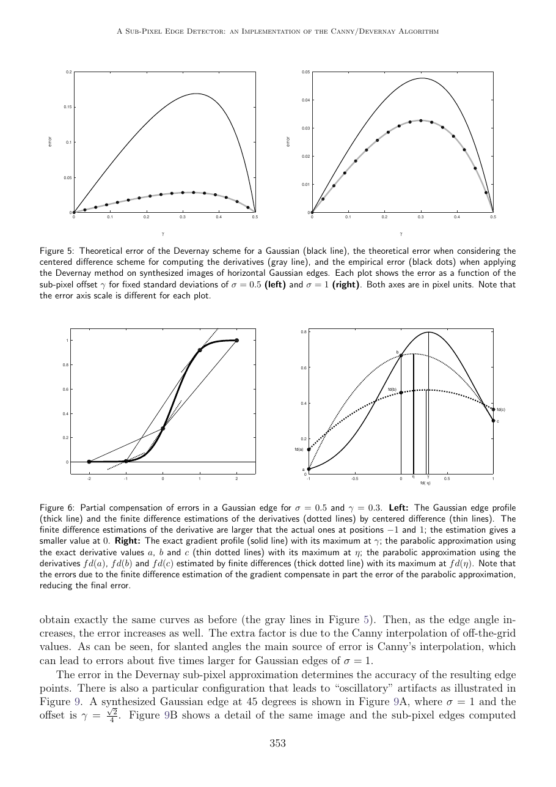
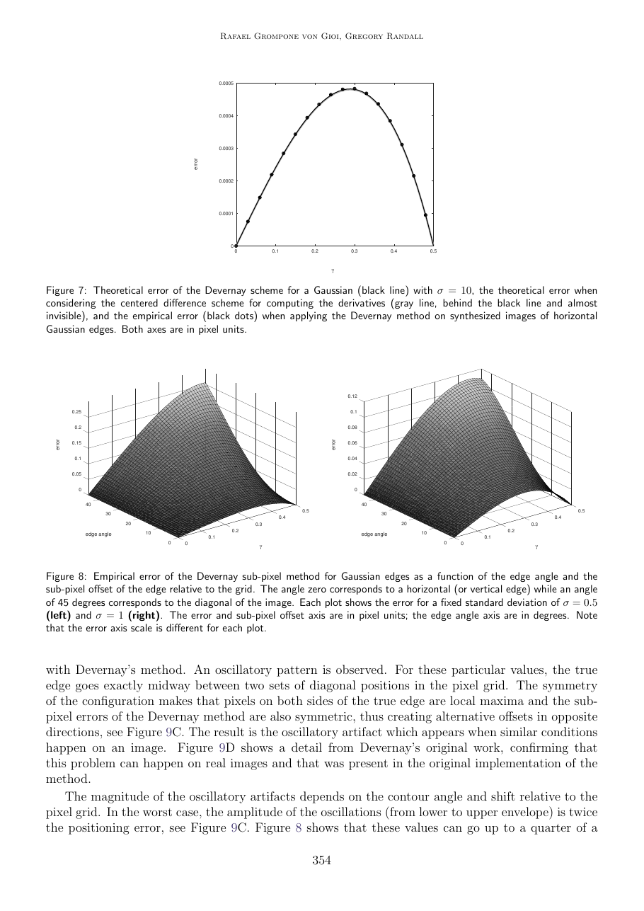
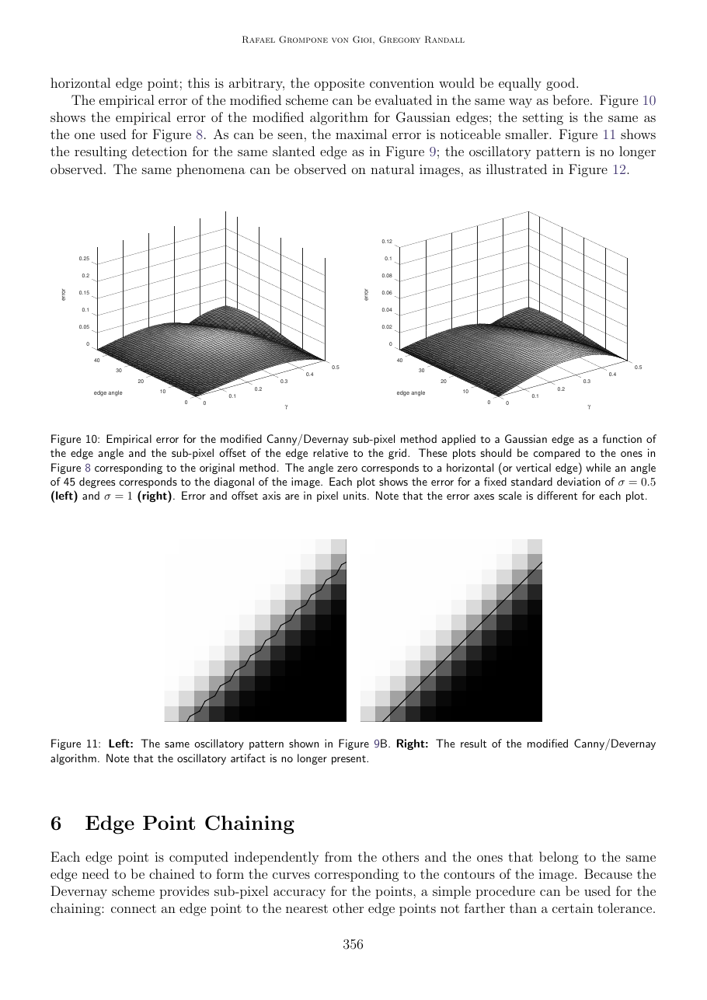

# 부화소 에지 검출기: Canny/Devernay 알고리즘의 구현 (번역)

번역 범위: 전문 (초록, 본문 1~10절, 그림 캡션, 알고리즘 1~5, 감사의 글. 참고문헌은 원문 그대로)
원문: [GromponeVonGioi2017_IPOL_CannyDevernay.pdf](GromponeVonGioi2017_IPOL_CannyDevernay.pdf)
원문 텍스트는 `pdftotext -layout`으로 뽑았다. 수식은 원문 기호를 따른다.
그림은 원문 쪽을 110 dpi로 옮긴 이미지다. 핵심 그림 3쪽만 넣고, 나머지 그림은 캡션만 번역했다.

---

Image Processing On Line, 2017-11-28 게재. 2017-08-18 투고, 2017-11-09 채택.
ISSN 2105-1232, (c) 2017 IPOL과 저자들, CC-BY-NC-SA.
보충 자료, 소프트웨어, 자료 집합, 온라인 데모: https://doi.org/10.5201/ipol.2017.216

저자
- Rafael Grompone von Gioi, CMLA, ENS Cachan, 프랑스
- Gregory Randall, IIE, UdelaR, 우루과이

담당 편집: Jose-Luis Lisani. 데모 편집: Rafael Grompone von Gioi.

## 초록

영상 에지 검출기 하나를 설명한다. 이 검출기는 부화소 정확도의 에지 점을 사슬로 이어 내놓는다.
방법은 고전적인 Canny 알고리즘과 Devernay 알고리즘의 주요 생각을 합친다.
분석 결과, 원래 수식을 조금 바꾸면 에지 점의 부화소 정확도가 좋아진다.

### 소스 코드

이 알고리즘의 ANSI C 소스 코드는 이 논문의 웹 페이지에서 받을 수 있다. 컴파일과 사용법은 README.txt에 있다.

핵심어: 에지 검출, 부화소 정확도, Canny, Devernay, 에지 점 사슬 잇기

## 1. 서론

디지털 영상의 에지 검출은 컴퓨터 비전에서 가장 오래된 문제 중 하나이고, 지금도 연구가 매우 활발하다 [9].
관련 문헌은 매우 많다. 영상 처리의 다른 어떤 문제보다 에지 검출 알고리즘이 더 많이 제안되었을 것이다.
관심 있는 독자는 Papari와 Petkov의 훌륭한 리뷰 [9]를 보라.

가장 유명한 방법은 Canny가 제안한 방법이다 [3]. Canny라는 이름은 에지 검출과 거의 같은 뜻이 되었다.
Canny는 에지 검출기의 세 가지 품질 척도를 정했다.
- 잘 검출할 것
- 에지 화소의 위치를 잘 잡을 것
- 필터 응답이 하나일 것

그리고 이 세 기준에서 최적인 필터를 찾았다. 이때 경계는 계단 신호에 잡음을 더한 것으로 모형화했다.
Canny는 이상적인 필터를 가우스 함수의 1차 도함수와 영상을 합성곱하는 것으로 근사하자고 했다.
그 다음 기울기 방향을 따라 기울기 크기가 최대가 아닌 화소를 지운다.(각주 2)

각주 1: https://doi.org/10.5201/ipol.2017.216

각주 2: Canny의 방법은 중요한 기여일 뿐 아니라, 그 전에 나온 에지 검출 생각들을 훌륭하게 종합한 것이기도 하다 [10].
최대가 아닌 점을 지우는 생각은 Marr와 Hildreth가 제안한 라플라시안 영교차 [8]와 관련된다. 1차원에서는 두 수식이 거의 같다.
2차원에서 Canny의 방법은 기울기 방향으로 잰 2차 방향 도함수의 영교차를 쓰자는 Haralick의 통찰 [7]을 따른다.

나중에 Canny 에지 검출기에 여러 개선이 더해졌다.
그 중 우리는 부화소 정확도를 얻으려고 Devernay [5]가 제안한 간단한 후처리에 관심이 있다.
요약하면, 에지 점의 위치를 기울기 크기 값을 보간한 곡선의 최댓값으로 추정한다.
보정은 아주 간단하다. 기울기 방향으로 이웃한 세 값 사이에서 기울기 크기를 2차식으로 보간하면 된다.
이 방법은 계산 비용이 낮으면서 정확도가 매우 좋다는 장점이 있다.

이 연구의 일부로 Devernay 부화소 단계의 정확도를 자세히 분석했다.
이 분석으로 가끔 보이는 진동 모양 결함을 설명할 수 있다.
같은 분석에서 결과를 조금 개선하는 Canny 알고리즘의 간단한 수정도 나온다.

부화소 에지 점을 다각형 곡선으로 잇는 알고리즘도 설명한다.

이 논문의 구성은 다음과 같다.
- 2절: Canny 방법의 주요 생각
- 3절: Devernay 부화소 보정
- 4절: 그 정확도 분석
- 5절: 분석에 따른 원래 수식의 수정
- 6절: 에지 점 사슬 잇기
- 7절: 전체 알고리즘의 자세한 설명
- 8절: 계산 복잡도
- 9절: 영상 실험으로 본 방법의 강점과 한계
- 10절: 결론

## 2. Canny 방법

Canny의 획기적인 연구 [3, 1, 2]의 상당 부분은 1차원 신호에서 에지를 검출하는 최적 필터를 찾는 데 집중한다.
찾는 필터는 국소 최대점을 실제 에지 중심에 가능한 한 가깝게 주어야 하고, 거짓 검출이나 중복 응답을 만들지 않아야 한다.
Canny는 이 요구를 수학으로 쓰고 최적화 문제를 풀어 최적 필터를 얻었다.
그리고 최적 필터가 가우스 함수의 1차 도함수로 잘 근사된다는 것을 보이고, 계산 효율을 위해 이것을 쓰자고 했다.

Canny는 2차원 신호(영상)에도 같은 필터를 쓰자고 했다. 경계에 수직인 방향 n을 따라 1차원 신호를 분석하는 방식이다.
그래서 에지 점은 방향 n으로 다음 값의 국소 최대점으로 정의된다.

  ∂/∂n (G ⋆ I)        (1)

여기서 G는 가우스 커널이고 I는 영상이다. 국소 최대점만 남기는 이 방법을 비최대 억제(non-maximum suppression)라 한다.
가우스 커널은 분리 가능하다. 그래서 G가 2차원 등방 커널이어도 방향 n의 1차원 직선으로 제한하면 1차원 경우와 정확히 같은 수식이 된다.
즉 방향 n으로 미분하는 것은 n을 따라 가우스 1차 도함수와 합성곱하는 것과 같다.

경계에 수직인 방향 n은 영상 기울기로 추정할 수 있다.

  n ≈ ∇(G ⋆ I) / |∇(G ⋆ I)|        (2)

방법은 잡음이 만든 가짜 응답과 진짜 경계를 나누는 절차로 완성된다. 에지 세기는 다음과 같다.

  |∇(G ⋆ I)|        (3)

이것은 방향 n의 도함수 크기에 해당한다. Canny는 두 문턱값 H와 L로 이력 현상(hysteresis)을 써서 진짜 에지를 가려내자고 했다.
세기가 높은 문턱 H보다 큰 국소 최대점은 바로 인정되어 출력에 들어간다.
인정된 점에 연결된 국소 최대점은 세기가 낮은 문턱 L보다 크면 인정된다.

그림 1: Canny 비최대 억제 연산자의 지지 영역. (화소 A~G와 기울기 방향 gx, gy, 에지 방향을 보인다.)

Canny는 잡음 추정, 여러 척도의 분석, 방향성 연산자도 논의했다.
흥미롭지만 이 중 어느 것도 구체적인 알고리즘으로 이어지지 않았고, 표준 Canny 에지 검출기에 들어 있지 않다.

방법을 정의하는 구현 세부가 둘 있다.
- 이산 격자에서 방향 n을 따라 최대점을 어떻게 고르는가
- 이력 문턱 단계에서 연결성을 어떻게 정의하는가

이 두 점은 Canny의 기술 보고서 [1]에 자세히 나온다. 이 보고서는 그의 석사 논문을 고친 판이다.
여기서는 앞의 것을 설명한다. 연결성은 6절에서 다룬다.

Canny는 2차원 격자에서 비최대 억제를 다음처럼 하자고 했다 [1, 5.3절].
||g||, gx, gy를 각각 영상 기울기 ∇(G ⋆ I)의 크기, x 성분, y 성분이라 하자.
화소 B가 영상 기울기 방향에서 ||g||의 국소 최대인지 판단하고 싶다고 하자(그림 1).
이를 위해 ||g(B)||를 ||g(A)||, ||g(C)||와 비교한다. ||g(B)|| > ||g(A)||이고 ||g(B)|| > ||g(C)||이면 B는 국소 최대다.
격자 위치(B, D, E, F, G)의 ||g||는 간단한 유한 차분으로 근사할 수 있다. 그러나 A, C의 값은 이렇게 계산할 수 없다.
Canny는 ||g(A)||, ||g(C)||를 가장 가까운 두 알려진 값의 단순 선형 보간으로 근사하자고 했다.

  ||g(A)|| ≈ (gx(B) − gy(B))/gx(B) ⋅ ||g(D)|| + gy(B)/gx(B) ⋅ ||g(E)||
  ||g(C)|| ≈ (gx(B) − gy(B))/gx(B) ⋅ ||g(G)|| + gy(B)/gx(B) ⋅ ||g(F)||        (4)

정리하면 Canny 방법은 세 매개변수에 의존한다.
- S: 가우스 커널 G의 표준편차
- H, L: 두 문턱값

화소 B가 Canny 비최대 억제와 이력 문턱 단계를 통과하면 Canny 에지 화소가 된다.

## 3. Devernay 부화소 보정

Canny 방법은 에지 화소를 찾는다. 다시 말해 에지 점을 화소 격자 정밀도까지만 뽑는다.
어떤 응용에서는 에지 점 위치를 더 정밀하게 알아야 한다.
이를 위해 Devernay [5]는 원래 Canny 알고리즘에 아주 우아한 추가 단계를 제안해 부화소 정확도의 에지 점을 얻었다.
에지 점의 위치를 기울기 크기 보간 곡선의 최댓값으로 다듬는다.
보정은 기울기 방향으로 이웃한 세 위치 사이에서 기울기 크기를 2차식으로 보간하는 것만큼 간단하다.

그림 2: 영상 기울기 방향(에지에 대략 수직)을 따라 잰 영상 기울기 크기의 단면. (A, η, B, C 위치와 ||g(A)||, ||g(B)||, ||g(C)||를 보인다.)

그림 2는 에지에 수직인 방향으로 잰 영상 기울기 크기 단면의 예다.
||g(B)|| > ||g(A)||이고 ||g(B)|| > ||g(C)||이므로 Canny 방법은 화소 B를 에지 화소로 남긴다.
그러나 A와 C 사이에 이 점들보다 기울기 크기가 더 큰 중간 위치 η가 있을 수 있다.
점 η가 에지 위치에 더 잘 맞는다.
Devernay는 그 위치를 추정하고, 방향 n을 따라 오프셋 벡터를 계산해 에지 화소 B 근처의 부화소 에지 위치를 주는 방법을 제안했다.

계산 비용을 줄이려고 Devernay는 Canny 연산자에서 쓰는 세 점 (A, ||g(A)||), (B, ||g(B)||), (C, ||g(C)||)으로 기울기 크기를 단순 2차 보간하자고 했다(그림 2).
최댓값을 풀면 오프셋은 다음과 같다.

  η = 1/2 ⋅ (||g(A)|| − ||g(C)||) / (||g(A)|| + ||g(C)|| − 2||g(B)||)        (5)

이 값은 벡터 BC에 대한 상대값이다.

Devernay 보정항의 장점은 Canny 연산자에서 이미 얻은 값만으로, 간단하고 값싼 계산으로 매우 좋은 부화소 정확도를 얻는다는 것이다.
얻는 정확도는 다음 절에서 분석하고, 5절에서 작은 개선을 제안한다.

## 4. Devernay 부화소 정확도

Devernay 부화소 보정에는 네 가지 오차 원인이 있다.
1. 기울기 단면을 포물선으로 가정해서 생기는 오차
2. 기울기를 유한 차분으로 계산해서 생기는 오차
3. 격자 밖 점의 기울기 크기를 Canny 방식으로 보간해서 생기는 오차
4. 수치 오차

이 오차들을 가우스 에지에 대해 분석한다. 가우스 에지의 단면은 α ⋅ Gσ ⋆ Y이다.
여기서 Gσ는 표준편차 σ인 가우스 커널, Y는 다음 계단 함수다.

  Y(t) = 1 (t ≥ 0), 0 (t < 0)        (6)

α는 에지의 계단 크기(회색조 값)다.
그림 3 왼쪽은 격자에 대해 부화소 오프셋 γ를 가진 가우스 에지 단면이다.
Devernay 방식은 그림 3 오른쪽처럼 포물선 근사로 에지 위치를 계산한다.
점 (−1, a), (0, b), (1, c) 사이의 2차 보간은 포물선 최댓값을 η = 1/2 ⋅ (a − c)/(a + c − 2b)에 놓는다.
가우스 에지의 도함수는 α ⋅ Gσ이므로 Devernay 방법에 쓰는 값은 다음과 같다.

  a = α ⋅ Gσ(−1 − γ),  b = α ⋅ Gσ(−γ),  c = α ⋅ Gσ(1 − γ)        (7)

그러면 부화소 오프셋 추정값은 다음과 같다.

  η(σ, γ) = 1/2 ⋅ (Gσ(−1 − γ) − Gσ(1 − γ)) / (Gσ(−1 − γ) + Gσ(1 − γ) − 2Gσ(−γ))        (8)

에지 계단 크기 α는 분자와 분모에 같이 곱해져 지워진다. 그래서 오차는 에지 계단 크기와 무관하다.
가우스 기울기를 포물선 기울기로 근사한 오차는 다음과 같다.

  ρ(σ, γ) = |η(σ, γ) − γ|        (9)

그림 3: 왼쪽: 격자에 대해 부화소 오프셋 γ를 가진 가우스 에지 단면. 오른쪽: 실제 단면(실선, 여기서는 가우스) 대신 포물선 기울기 단면(점선)을 가정해서 생기는 Devernay 부화소 보정항의 오차. 오차는 |η − γ|, 즉 실제 부화소 오프셋과 Devernay 방법으로 추정한 오프셋의 차이다.

그림 4는 이 이론 오차(정확한 가우스 함수 사용)를 σ와 γ의 함수로 그린 것이다.
예상대로, 에지가 화소 격자 중심에 있으면(γ = 0) 오차는 0이다.
에지가 격자의 정확히 중간점에 있어도(γ = 0.5) 오차는 0이다. 이때 b = c(또는 a = b)이고 포물선 보간이 맞는 오프셋을 준다.
오차는 오프셋이 0과 0.5 사이일 때 더 크고, σ가 커질수록 줄어든다. 아주 흐린 에지에서는 근사가 잘 맞아야 하므로 예상한 결과다.
날카로운 에지는 σ가 0.5에서 1 사이인 가우스 에지로 모형화할 수 있다.

그림 4: 에지 표준편차 σ와 격자에 대한 부화소 오프셋 γ의 함수로 본 가우스 에지 포물선 근사의 오차. 모든 축은 화소 단위다.

식 (8)로 두 번째 종류의 오차, 즉 도함수를 중심 차분으로 계산해서 생기는 오차도 볼 수 있다.
그러려면 Gσ(−1 − γ), Gσ(−γ), Gσ(1 − γ)를, 중심 차분 방식이 하듯이 가우스 에지 값의 유한 차분 절댓값으로 바꾸면 된다.
Devernay 방법의 경험적 평가는 가우스 에지를 담은 영상을 합성해서 할 수 있다.
화소 값에 부동소수점 변수를 쓰면 이 평가 결과는 부동소수점 기계 정밀도까지 정확하다.

첫 번째 실험 묶음은 합성한 수평 또는 수직 에지로 했다.
이 경우에는 Canny 방식이 격자 밖 점의 기울기 크기를 보간할 필요가 없다. 그래서 뒤에서 분석할 세 번째 종류의 오차를 피한다.



(위 이미지는 원문 353쪽이다. 그림 5, 그림 6이 들어 있다.)

그림 5는 서로 다른 두 흐림 σ = 0.5와 σ = 1의 가우스 에지에서, 오프셋 γ의 함수로 본 경험 오차(검은 점)다.
두 경우 모두 검은 선은 식 (9)로 계산한 이론 오차 ρ다.
회색 선은 같은 계산이지만 가우스 함수의 정확한 도함수 대신 중심 차분으로 도함수를 계산한 것이다.
수치 오차를 무시하면 회색 선은 경험 오차(검은 점)를 정확하게 예측한다.
경험 오차가 포물선 근사의 이론 오차(검은 선)보다 작다는 점에 주목하라.
직관에 어긋나는 이 사실은 가우스 에지에서 유한 차분 오차가 포물선 근사 오차를 일부 상쇄하기 때문이다(그림 6).
그림 7은 그림 5와 같은 그림을 σ = 10에 대해 그린 것이다.
에지가 더 흐리고 전이가 더 부드러우면 유한 차분이 도함수를 더 잘 근사한다. 그래서 이론 오차와 경험 오차가 매우 비슷하다(회색 선이 검은 선 뒤에 거의 가려 보이지 않는다).
또한 그림 5에서 본 덜 흐린 영상보다 오차가 훨씬 작다.

그림 5: 가우스에 대한 Devernay 방식의 이론 오차(검은 선), 도함수 계산에 중심 차분을 고려한 이론 오차(회색 선), 합성한 수평 가우스 에지 영상에 Devernay 방법을 적용한 경험 오차(검은 점). 각 그림은 고정 표준편차 σ = 0.5(왼쪽)와 σ = 1(오른쪽)에서 부화소 오프셋 γ의 함수로 본 오차다. 두 축 모두 화소 단위다. 오차 축의 눈금이 그림마다 다르다.

그림 6: σ = 0.5, γ = 0.3인 가우스 에지에서 오차의 부분 상쇄. 왼쪽: 가우스 에지 단면(굵은 선)과 중심 차분(가는 선)으로 추정한 도함수(점선). 유한 차분으로 추정한 도함수는 위치 −1과 1에서 실제보다 크고, 0에서는 더 작다. 오른쪽: 최댓값이 γ에 있는 정확한 기울기 단면(실선), 정확한 도함수 값 a, b, c를 쓴 포물선 근사(가는 점선, 최댓값 η), 유한 차분으로 추정한 도함수 fd(a), fd(b), fd(c)를 쓴 포물선 근사(굵은 점선, 최댓값 fd(η)). 기울기의 유한 차분 추정에서 생기는 오차가 포물선 근사 오차를 일부 상쇄해 최종 오차를 줄인다는 점에 주목하라.

두 번째 실험 묶음에서는 에지를 수평이나 수직으로 제한하지 않는다.
의미 있는 각도 범위는 0도에서 45도다(다른 각도는 대칭으로 같다).
그림 8은 σ = 0.5와 σ = 1의 가우스 에지에서, 에지 각도와 부화소 오프셋의 함수로 본 경험 오차다.



(위 이미지는 원문 354쪽이다. 그림 7, 그림 8이 들어 있다.)

에지 각도가 0이면 앞과 정확히 같은 곡선(그림 5의 회색 선)을 얻는다.
그리고 에지 각도가 커지면 오차도 커진다. 늘어난 부분은 격자 밖 값을 Canny 방식으로 보간한 데서 온다.
보듯이 기운 각도에서는 Canny 보간이 주된 오차 원인이고, σ = 1인 가우스 에지에서 오차가 약 다섯 배까지 커질 수 있다.

Devernay 부화소 근사의 오차가 결과 에지 점의 정확도를 정한다.
"진동" 결함을 만드는 특별한 배치도 있다(그림 9).
그림 9A는 45도로 합성한 가우스 에지로, σ = 1, 오프셋 γ = √2/4이다.
그림 9B는 같은 영상의 일부와 Devernay 방법으로 계산한 부화소 에지다. 진동 무늬가 보인다.
이 값들에서는 실제 에지가 화소 격자의 두 대각 위치 묶음 사이 정확히 가운데를 지난다.
이 대칭 때문에 실제 에지 양쪽의 화소가 모두 국소 최대가 되고, Devernay 방법의 부화소 오차도 대칭이 된다.
그래서 반대 방향으로 번갈아 오프셋이 생긴다(그림 9C).
그 결과가 진동 결함이며, 영상에서 비슷한 조건이 생기면 나타난다.
그림 9D는 Devernay의 원 논문에서 가져온 부분으로, 이 문제가 실제 영상에서도 생길 수 있고 원래 구현에도 있었음을 확인해 준다.

그림 7: σ = 10인 가우스에 대한 Devernay 방식의 이론 오차(검은 선), 도함수 계산에 중심 차분을 고려한 이론 오차(회색 선, 검은 선 뒤에 있어 거의 보이지 않음), 합성한 수평 가우스 에지 영상에 Devernay 방법을 적용한 경험 오차(검은 점). 두 축 모두 화소 단위다.

그림 8: 에지 각도와 격자에 대한 부화소 오프셋의 함수로 본, 가우스 에지에서 Devernay 부화소 방법의 경험 오차. 각도 0은 수평(또는 수직) 에지이고 45도는 영상의 대각선이다. 각 그림은 고정 표준편차 σ = 0.5(왼쪽)와 σ = 1(오른쪽)의 오차다. 오차와 부화소 오프셋 축은 화소 단위, 에지 각도 축은 도 단위다. 오차 축의 눈금이 그림마다 다르다.

진동 결함의 크기는 윤곽의 각도와 화소 격자에 대한 이동에 따라 달라진다.
최악의 경우 진동 진폭(아래 포락선에서 위 포락선까지)은 위치 오차의 두 배다(그림 9C).
그림 8은 이 값이 4분의 1 화소까지 갈 수 있음을 보여 준다. 그러면 진동 진폭은 약 0.5 화소가 된다.

그림 9: A 45도, σ = 1, 오프셋 γ = √2/4로 합성한 가우스 에지. B A에서 합성한 에지의 일부와 Devernay 방법으로 검출한 에지. 진동 무늬가 보인다. C 진동 무늬의 이유를 설명하는 그림. 실제 에지는 두 대각 격자점 묶음의 정확히 가운데에 있다. 대칭 때문에 점으로 표시한 모든 점이 국소 최대다. 화살표는 Devernay 방법으로 계산한 오프셋 η다. 오차가 번갈아 반대 방향으로 생겨 관찰된 진동을 만든다. D Devernay의 원 논문 [5] 그림 10의 오른쪽 위 부분. 원래 구현에서도 "진동" 무늬가 실제로 있었음을 보여 준다.

## 5. 수정한 부화소 방식

Devernay 방식의 오차에 기여하는 네 요인 중 하나는 방법을 간단히 고쳐 없앨 수 있다.
보간을 항상 수직선이나 수평선을 따라 하면, 격자 밖 위치의 기울기 값이 필요 없어지고 Canny 보간도 필요 없다.

Devernay 방식은 다듬을 가운데 점이 쓰는 세 값 중 국소 최대여야 한다.
그래서 이 조건을 만족하도록 에지 점과 보간 방향을 고르게 알고리즘을 고쳐야 한다.
화소 (x, y)는 다음 두 조건을 만족하면 수평 에지 점이 된다.
- 기울기 크기의 수평 국소 최대다: ||g(x − 1, y)|| < ||g(x, y)||이고 ||g(x, y)|| > ||g(x + 1, y)||
- 그 점에서 영상 기울기가 수직보다 수평에 가깝다: |gx(x, y)| > |gy(x, y)|

마찬가지로 화소 (x, y)는 다음 두 조건을 만족하면 수직 에지 점이 된다.
- 기울기 크기의 수직 국소 최대다: ||g(x, y − 1)|| < ||g(x, y)||이고 ||g(x, y)|| > ||g(x, y + 1)||
- 그 점에서 영상 기울기가 수평보다 수직에 가깝다: |gx(x, y)| < |gy(x, y)|

두 조건을 모두 만족하면(이는 |gx(x, y)| = |gy(x, y)|를 뜻한다) 수평 에지 점으로 분류하기로 한다.
이것은 임의의 약속이고, 반대 약속도 똑같이 좋다.

수정한 방식의 경험 오차도 앞과 같은 방법으로 평가할 수 있다.
그림 10은 가우스 에지에 대한 수정 알고리즘의 경험 오차다. 설정은 그림 8과 같다.
보듯이 최대 오차가 눈에 띄게 작다.
그림 11은 그림 9와 같은 기운 에지의 검출 결과다. 진동 무늬가 더 이상 보이지 않는다.
같은 현상을 자연 영상에서도 볼 수 있다(그림 12).



(위 이미지는 원문 356쪽이다. 그림 10, 그림 11이 들어 있다.)

그림 10: 가우스 에지에 적용한 수정 Canny/Devernay 부화소 방법의 경험 오차. 에지 각도와 격자에 대한 부화소 오프셋의 함수다. 원래 방법에 해당하는 그림 8과 비교해야 한다. 각도 0은 수평(또는 수직) 에지이고 45도는 영상의 대각선이다. 각 그림은 고정 표준편차 σ = 0.5(왼쪽)와 σ = 1(오른쪽)의 오차다. 오차와 오프셋 축은 화소 단위다. 오차 축의 눈금이 그림마다 다르다.

그림 11: 왼쪽: 그림 9B와 같은 진동 무늬. 오른쪽: 수정 Canny/Devernay 알고리즘의 결과. 진동 결함이 더 이상 없다.

## 6. 에지 점 사슬 잇기

각 에지 점은 다른 점과 독립적으로 계산된다. 같은 에지에 속하는 점들은 사슬로 이어 영상의 윤곽에 해당하는 곡선을 만들어야 한다.
Devernay 방식이 점에 부화소 정확도를 주므로 사슬 잇기는 간단한 절차로 할 수 있다.
일정한 허용 거리 안에서 가장 가까운 다른 에지 점과 잇는 것이다.

그림 12: 자연 영상 일부에서 관찰된 진동 무늬. 왼쪽: 원래 Devernay 부화소 보정항으로 만든 진동 무늬. 오른쪽: 수정 Canny/Devernay 알고리즘의 결과. 진동이 사라진다.

각 에지 점은 한 화소에 연결되어 있으므로, 이을 에지 점을 찾는 범위는 5 × 5 이웃의 화소로 줄어든다.
이것은 고전적인 8연결 화소를 한 단계 넓힌 것이다.
대부분의 에지 점은 8연결 이웃에 있는 다른 점과 이어진다.
그러나 잡음이 있어 곡선이 조각나면 넓힌 연결성이 맞는 곡선을 뽑는 데 도움이 된다.

먼저 확인하는 것은 이을 에지 점들의 기울기 방향이 비슷한지다.
A에서 B로 이으려면 g(A)와 g(B) 사이 각도가 90도보다 작아야 한다. 이는 조건 g(A) ⋅ g(B) > 0으로 확인한다. 여기서 ⋅는 내적이다.

영상 윤곽은 밝은 영역과 어두운 영역을 나눈다.
사슬 잇기는 일관되어야 한다. 즉 이어지는 사슬들이 어두운 영역을 곡선의 같은 쪽에 두어야 한다.
이를 강제하는 간단한 방법은, 에지 점 A에서 이을 에지 점 B로 가는 벡터가 A의 영상 기울기와 두 방향 중 한 방향으로 대략 수직인지 확인하는 것이다.
약속으로, 에지 점 A에서 B로의 앞방향 사슬은 AB ⋅ g(A)⊥ > 0인 것이라 부른다. 여기서 v⊥는 벡터 v를 90도 돌린 것이다.
(회전 방향이 약속을 정한다. 두 방향 중 어느 것을 써도 같지만 하나로 고정해야 한다.)
반대 방향은 뒷방향 사슬이라 부른다. A ⇀ B는 A에서 B로의 앞방향 사슬을 뜻한다.
물론 같은 연결을 B에서 A로의 뒷방향 사슬로도 쓸 수 있다.

이 간단한 설정에서 각 에지 점은 앞방향 사슬과 뒷방향 사슬을 각각 많아야 하나씩 가진다. 그래서 Y자 모양 배치는 허용되지 않는다.
에지 점 A를 B에 잇기 전에, A가 이미 앞방향 사슬을 가졌는지, B가 이미 뒷방향 사슬을 가졌는지 확인해야 한다.
어느 경우든 제안된 사슬의 거리를 이전 사슬의 거리와 비교한다.
제안된 사슬이 더 짧으면 이전 사슬을 끊고 제안된 사슬을 더한다. 그 뒤 에지 점 사이의 연결을 그에 맞게 고친다.

이 절차에는 바람직하지 않은 면이 있다. 결과가 탐색 순서와 무관하지 않다.
그림 13의 배치를 보자. 점 A, B, C, D 사이 거리는 ||A − B|| > ||B − C|| > ||C − D||를 만족한다. 두 가지 탐색 순서를 생각해 보자.
A, B, C 순서로 평가하면, 에지 점 A를 탐색할 때 먼저 A ⇀ B를 잇는다.
그 다음 B의 뒷방향 연결을 분석할 때 C ⇀ B를 더 선호하므로 A ⇀ B는 끊긴다.
마지막으로 C를 탐색할 때 C ⇀ D가 선호되어 C ⇀ B는 끊긴다. 결과는 C ⇀ D 하나뿐이다.

탐색 순서가 C, B, A이면, C를 탐색할 때 먼저 C ⇀ D를 잇는다.
그 다음 B의 뒷방향 연결을 탐색할 때 C ⇀ B가 선호된다. 그러나 C ⇀ D가 더 짧은 거리로 이미 이어져 있으므로 C ⇀ B는 이을 수 없다.
마지막으로 A를 탐색할 때 B에 더 나은 뒷방향 연결이 없으므로 A ⇀ B가 만들어진다. 결과는 C ⇀ D와 A ⇀ B 두 연결이다.

그림 13: 탐색 순서에 따라 다른 사슬 결과를 낼 수 있는 에지 점 배치. 점 A, B, C, D 사이의 가능한 사슬을 화살표로 그렸다. 거리는 ||A − B|| > ||B − C|| > ||C − D||를 만족한다. 탐색 순서가 A, B, C일 때의 결과는 C, B, A일 때와 다르다. 본문을 보라.

이 문제를 푸는 간단한 알고리즘은 아직 찾지 못했다.
간단하다는 것은 두 번 훑거나, 연결이 끊길 때 점들의 사슬을 다시 평가할 필요가 없다는 뜻이다.
대부분의 에지 점에는 가능한 사슬이 하나뿐이라 이 문제가 생기지 않는다.
그래도 탐색 순서 의존성은 가끔 실제로 생기며, 더 나은 해법이 있으면 좋겠다.

## 7. 알고리즘

알고리즘 1은 Canny/Devernay 에지 검출기를 네 단계로 설명한다.
- 영상 기울기 계산
- 에지 점 계산
- 에지 점 사슬 잇기
- Canny 이력 문턱 적용

자세한 의사 코드가 각 단계를 정한다.
전체로 보면 방법은 각 위치의 회색조 값 행렬로 나타낸 영상을 입력으로 받는다.
매개변수는 세 개다. 입력 영상을 흐리게 하는 가우스 필터의 표준편차 S, 영상 기울기 크기에 대한 두 문턱값 L과 H다.
결과는 부화소 정확도를 가진, 사슬로 이어진 에지 점 목록 E다.

영상 기울기 계산은 알고리즘 2에 있다. 두 단계다.
- 표준편차 S인 가우스 필터와 합성곱해 영상을 흐리게 한다.
- 중심 차분으로 영상 기울기의 x, y 성분을 계산한다.

가우스 합성곱을 계산하는 알고리즘은 많다 [6]. 이론 결과를 잘 근사하기만 하면 어느 것을 써도 된다.
또 두 연산을 합쳐 합성곱과 미분을 한 번에 하는 효율적인 연산자로 만들 수도 있다 [4].
우리 구현에서는 1차원 가우스 커널을 근사하는 FIR 필터로 수평, 수직 합성곱을 따로 해서 필터링한다.

알고리즘 3은 방법의 핵심이며, 에지 점을 정하는 수정된 기준과 부화소 보정항을 담는다.

```
알고리즘 1: Canny/Devernay 에지 검출기
  입력: 영상 I, 척도 매개변수 S, 두 문턱값 H와 L
  출력: 부화소, 사슬로 이어진 에지 점 목록 E
  1 g ← image_gradient(I, S)              /* 알고리즘 2 */
  2 E ← compute_edge_points(g)            /* 알고리즘 3 */
  3 chain_edge_points(E, g)               /* 알고리즘 4 */
  4 thresholds_with_hysteresis(E, g, H, L) /* 알고리즘 5 */
```

```
알고리즘 2: image_gradient(I, S)
  입력: 영상 I, 척도 매개변수 S
  출력: 영상 기울기 벡터장 g
  1 IS ← I ⋆ KS                           /* 가우스 커널과 합성곱 */
  2 for (x, y) ∈ IS do
  3    gx(x, y) ← IS(x + 1, y) − IS(x − 1, y)
  4    gy(x, y) ← IS(x, y + 1) − IS(x, y − 1)
  5 g ← (gx, gy)
```

```
알고리즘 3: compute_edge_points(g)
  입력: 영상 기울기 벡터장 g
  출력: 부화소 에지 점 목록 E
  1 E ← ∅
  2 for (x, y) ∈ g do
  3    θx ← 0
  4    θy ← 0
  5    if ||g(x−1, y)|| < ||g(x, y)|| ≥ ||g(x+1, y)|| and |gx(x, y)| ≥ |gy(x, y)| then
  6       θx ← 1                          /* 수평으로 보간할 에지 점 */
  7    else if ||g(x, y−1)|| < ||g(x, y)|| ≥ ||g(x, y+1)|| and |gx(x, y)| ≤ |gy(x, y)| then
  8       θy ← 1                          /* 수직으로 보간할 에지 점 */
  9    if θx ≠ 0 or θy ≠ 0 then
 10       a ← ||g(x − θx, y − θy)||       /* Devernay 부화소 보정 */
 11       b ← ||g(x, y)||
 12       c ← ||g(x + θx, y + θy)||
 13       λ ← (a − c) / (2(a − 2b + c))
 14       ex ← x + λθx
 15       ey ← y + λθy
 16       E ← E ∪ {(ex, ey)}              /* 에지 점 저장 */
```

한 화소의 영상 기울기 크기가 왼쪽, 오른쪽 화소의 기울기 크기보다 크면, 영상 기울기의 gx 성분이 gy 성분보다 크거나 같을 때 그 화소를 수평 에지 점이라 부른다.
마찬가지로 기울기 크기가 위, 아래 화소보다 큰 화소는 gy 성분이 gx 성분보다 크거나 같을 때 수직 에지 점이라 부른다.

이웃한 두 화소의 영상 기울기 크기가 같고 둘 다 최대일 수 있다. 예를 들어 에지가 두 화소의 정확히 가운데 있으면 그렇다.
이 경우 임의의 약속으로, 수직 에지는 왼쪽 화소에, 수평 에지는 아래 화소에 에지를 표시한다.
(여기서 아래 화소는 y 값이 더 작은 화소다. 그러나 보통 영상의 y축은 왼쪽 위 화소가 (0, 0)이고 아래로 갈수록 y가 커지게 잡는다. 이 약속에서는 에지가 아래가 아니라 위에 표시된다.)
이것은 화소가 수평 또는 수직 기울기 최대인지 정할 때 < 와 ≥ 비교를 비대칭으로 써서 얻는다.

마지막으로 Devernay 방식(다만 항상 수직 또는 수평 축을 따라)으로 에지 점의 부화소 위치를 계산한다. 에지 점은 출력 목록에 더해진다.

```
알고리즘 4: chain_edge_points(E, g)
  입력: 영상 기울기 벡터장 g와 부화소 에지 점 목록 E
  출력: 고친 목록 E
  1 foreach e ∈ E do
  2    NF ← {n ∈ NE(e, 2) : g(e)⋅g(n) > 0 and en ⋅ g(e)⊥ > 0}   /* 앞방향 이웃 */
  3    NB ← {n ∈ NE(e, 2) : g(e)⋅g(n) > 0 and en ⋅ g(e)⊥ < 0}   /* 뒷방향 이웃 */
  4    f ← argmin_{n∈NF} dist(e, n)                            /* 가장 좋은 앞방향 후보 */
  5    b ← argmin_{n∈NB} dist(e, n)                            /* 가장 좋은 뒷방향 후보 */
  6    if ∅ ⇀ f or (a ⇀ f and dist(e, f) < dist(a, f)) then
  7       ? ⇀ f 가 이어져 있으면 끊는다
  8       e ⇀ ? 가 이어져 있으면 끊는다
  9       e ⇀ f 를 잇는다
 10    if b ⇀ ∅ or (b ⇀ a and dist(b, e) < dist(b, a)) then
 11       b ⇀ ? 가 이어져 있으면 끊는다
 12       ? ⇀ e 가 이어져 있으면 끊는다
 13       b ⇀ e 를 잇는다
```

사슬 잇기 절차는 알고리즘 4에 자세히 있다. 목록 E의 각 에지 점 e를 평가한다.
각 경우에 에지 점 e의 이웃 집합 NE(e, 2)를 계산한다.
에지 점은 처음에 기울기 크기의 수직 또는 수평 국소 최대인 화소에 연결되어 있다.
이웃 집합은 5 × 5 이웃의 화소에 연결된 에지 점들이다. 다시 말해 좌표 차이의 최댓값이 2보다 크지 않은 화소들이다.
기호의 숫자 2는 이 이웃 거리를 뜻한다.

NE(e, 2)의 부분집합 두 개를 만든다.
첫째 NF는 g(e) ⋅ g(n) > 0이고 en ⋅ g(e)⊥ > 0인 에지 점 n을 담는다. 앞방향 사슬 후보다.
둘째 NB는 g(e) ⋅ g(n) > 0이고 en ⋅ g(e)⊥ < 0인 에지 점을 담는다. 뒷방향 사슬 후보다.
각 부분집합에서 에지 점 e까지 거리가 가장 짧은 원소를 앞방향, 뒷방향 사슬 후보로 고른다.
알고리즘의 마지막 여덟 단계는 이전 사슬을 확인하고, 새 사슬이 더 나으면 이전 사슬을 끊고, 새 연결을 만드는 일일 뿐이다.

방법 설명을 마치기 위해 알고리즘 5에 이력 문턱 단계를 자세히 쓴다.
각 에지 점에 이미 인정되었는지 아닌지 나타내는 표시를 둔다. 처음에는 모두 인정 안 됨으로 둔다.
그 다음 에지 점 목록을 돌며, 영상 기울기 크기가 높은 문턱 H 이상인 인정 안 된 점을 인정한다.
그 인정된 점에서 시작해, 사슬의 점들이 인정 안 됨이고 기울기 크기가 낮은 문턱 L보다 큰 동안 곡선을 따라간다. 먼저 앞방향, 다음 뒷방향이다.
과정의 각 단계에서 L 조건을 만족하는 새 점도 인정한다.
목록의 각 에지 점에서 시작해 모든 곡선을 다 돌면, 아직 인정 안 된 점들의 연결을 끊고 출력 목록 E에서 지운다.

```
알고리즘 5: thresholds_with_hysteresis(E, g, H, L)
  입력: 사슬로 이어진 에지 점 목록 E, 영상 기울기 벡터장 g, 두 문턱값 H와 L
  출력: 고친 목록 E
  1 foreach e ∈ E do
  2    e를 인정 안 됨으로 둔다
  3 foreach e ∈ E 이고 e가 인정 안 됨이고 ||g(e)|| ≥ H do
  4    e를 인정한다
  5    f ← e                              /* L 이상인 동안 사슬을 앞으로 따라간다 */
  6    while f ⇀ n 이고 n이 인정 안 됨이고 ||g(n)|| ≥ L do
  7       n을 인정한다
  8       f ← n
  9    b ← e                              /* L 이상인 동안 사슬을 뒤로 따라간다 */
 10    while n ⇀ b 이고 n이 인정 안 됨이고 ||g(n)|| ≥ L do
 11       n을 인정한다
 12       b ← n
 13 foreach e ∈ E 이고 e가 인정 안 됨 do  /* 인정 안 된 점의 연결을 끊고 지운다 */
 14    e ⇀ ? 가 이어져 있으면 끊는다
 15    ? ⇀ e 가 이어져 있으면 끊는다
 16    E에서 e를 지운다
```

## 8. 계산 복잡도

방법의 네 주요 단계는 알고리즘 1에 있다.
첫 단계는 영상 기울기 계산이다(알고리즘 2). 영상을 먼저 가우스 필터로 흐리게 하고, 각 화소에서 유한 차분으로 기울기를 계산한다.
두 연산 모두 화소 수에 비례하는 연산 수가 든다.
에지 점 계산(알고리즘 3)도 같다. 영상의 각 화소에서 기울기 조건을 평가하고, 그 중 일부에서 Devernay 보정을 한다.

사슬 잇기 단계(알고리즘 4)는 각 에지 점의 고정된 이웃을 평가한다. 에지 점 집합은 화소 집합보다 엄격히 작다.
그래서 이 단계의 복잡도도 화소 수로 제한된다.

마지막 문턱 단계(알고리즘 5)도 에지 점 집합을 돈다. 기울기가 높은 문턱보다 큰 에지 점은 곡선을 따라간다.
주 반복에서 한 화소는 많아야 세 번 방문된다.
- 에지 점 목록의 원소로서
- 뒷방향으로 이어진 점의 곡선을 따라갈 때
- 앞방향으로 이어진 점의 곡선을 따라갈 때

그래서 역시 계산량은 에지 점 수에 비례하고, 영상의 화소 수로 제한된다.

정리하면 전체 방법의 계산 복잡도는 화소 수에 비례한다.

  복잡도 = O(p)        (10)

여기서 p는 영상의 화소 수다. 현재 컴퓨터(2017년)에서 512 × 512 영상에 전체 알고리즘을 적용하는 데 1초의 일부가 걸린다.

## 9. 실험

이 절은 몇 가지 실험으로 방법의 동작을 보이고, 세 매개변수 각각의 영향을 보인다.
모든 예에서 영상 화소 값은 0에서 255 사이다.
약속으로(이 논문의 코드에서도 쓴다), 표준편차 값 S = 0은 가우스 필터링을 하지 않는다는 뜻이다.

가우스 필터링의 표준편차 S를 고르는 것은 잡음에 대한 강건성과 영상 윤곽에 대한 충실도 사이의 절충이다.
그림 14는 S가 0, 1, 2일 때 방법의 결과다.
잡음이 없으면, 필터링을 하지 않을 때(S = 0) 결과 곡선이 영상 윤곽을 따른다(첫 행의 예).
반면 필터링을 하면(S가 클수록 더) 곡선이 변형된다. 사각형의 둥근 모서리에서 볼 수 있다.

두 번째 영상은 강한 잡음으로 오염되어 있다.
계산된 에지 점은 무작위 무늬를 따른다(기울기 문턱을 0으로 두었다는 점에 주의). S = 0(가우스 필터링 없음)에서는 윤곽의 작은 부분만 검출되었다.
필터링을 쓰면 윤곽이 바르게 검출된다.

세 번째 예는 필터링이 변형된 출력을 낼 수도 있음을 보인다.
영상은 가는 선, 실제로는 폭 1화소인 선이다.
필터링을 하지 않으면 두 윤곽이 기대한 결과와 맞는다.
그러나 필터링을 하면 두 윤곽이 서로 영향을 주어 검출 위치가 밀린다.
이것은 합성되고 에일리어싱이 있는 영상이지만, 같은 효과를 자연 영상에서도 볼 수 있다. 그림 14 네 번째 예의 가운데 위쪽 대각선 두 줄을 보라.
이 예들은 S 선택이 결정적이며 가장 좋은 값이 영상마다 다르다는 것을 보여 준다.

그림 14: 가우스 필터링의 효과. 첫 번째 예(첫 행)는 모서리가 둥글어지는 것을 보인다. 두 번째 예(둘째 행)는 필터링이 영상 잡음 처리에 어떻게 도움이 되는지 보인다. 세 번째 예(셋째 행)는 가까운 윤곽이 가우스 필터링으로 서로 영향을 주어 에지 점이 옆으로 밀리는 것을 보인다. 마지막 예(넷째 행)는 자연 영상에서 같은 옆 밀림 효과를 보인다. 예를 들어 영상 가운데 위쪽의 대각선 두 줄을 보라. 모든 경우 문턱은 L = 0, H = 0으로 두었다. 영상 범위는 [0, 255]다. (영상 크기: 100 × 100, 256 × 256, 99 × 99, 333 × 250)

그림 15는 합성한 잡음 영상에서 같은 효과를 보인다.
가우스 필터링을 쓰지 않으면 결과 곡선이 불완전하고 조각난다. 가우스 필터링을 쓰면 알고리즘이 맞는 곡선을 뽑는다.
그림 16에서도 비슷한 동작이 보인다. 여기서는 방법을 자연 영상에 적용했다.
이 경우 잡음이 작아 필터링 없이도 받아들일 만한 결과를 얻는다. S 값이 크면 곡선의 세부가 둥글어진다는 점에 주목하라.

그림 15: 합성한 잡음 영상(500 × 500)에서 가우스 필터링 표준편차 S의 영향. (S = 0, 1, 2. L = 0, H = 0.) 영상 범위는 [0, 255]다.

그림 16: 자연 영상(512 × 512)에서 가우스 필터링 표준편차 S의 영향. (S = 0, 1, 2. L = 0, H = 0.) 영상 범위는 [0, 255]다.

그림 17의 실험에서는 Canny 이력 현상을 쓰지 않은 검출 출력을 보이려고 두 문턱 L과 H를 같은 값으로 두었다.
잘 고른 값은 잡음에서 생긴 에지 곡선을 지우는 데 효과적일 수 있다.
그러나 보편적인 값은 없다. 앞의 경우에 효과적이던 값이 그림 18의 예에서는 너무 엄격하다.

그림 17: 그림 15와 같은 합성 잡음 영상에서 영상 기울기 문턱의 영향. 여기서 L과 H를 같은 값으로 두었다. (S = 1. L = H = 5, 10, 15, 20.) 영상 범위는 [0, 255]다.

그림 18: 그림 16과 같은 자연 영상에서 영상 기울기 문턱의 영향. 여기서 L과 H를 같은 값으로 두었다. (S = 1. L = H = 5, 10, 15, 20.) 영상 범위는 [0, 255]다.

Canny의 이력 현상은 이 문제를 다루려고 고안되었다.
높은 문턱을 쓰면 알고리즘이 주요 윤곽의 일부를 찾을 수 있다.
그러나 높은 문턱은 대비가 덜 강한 윤곽 부분의 검출을 막는다.
강한 윤곽에 이어져 있으면 대비가 낮은 점도 검출하도록 허용하면 결과가 좋아진다.
그림 19와 20이 예다.
이력 현상을 쓰면 방법이 문턱 매개변수의 특정 값에 덜 민감해진다. 그래도 그 선택은 보편 규칙이 없는 문제로 남는다.

그림 19: 그림 16과 같은 자연 영상에서 Canny 이력 문턱의 효과. 여기서 L = 5로 고정하고 H를 여러 값으로 둔다. (S = 1. H = 5, 10, 15, 20.) 영상 범위는 [0, 255]다.

그림 20: 그림 16과 같은 자연 영상에서 Canny 이력 문턱의 효과. 여기서 H = 15로 고정하고 L을 여러 값으로 둔다. (S = 1. L = 0, 1, 3, 10.) 영상 범위는 [0, 255]다.

그림 21은 자연 영상의 결과를 더 보인다. 방법의 매개변수는 S = 1, L = 5, H = 15로 고정했다.
처음 두 예에서는 결과가 좋다.
그러나 두 번째 예에서 바닷가의 바위와 모래 질감이 잡음 같은 에지를 만드는 것을 볼 수 있다.
세 번째 예는 어두운 조명 때문에 카메라 잡음이 강하고, 그 결과 가짜 검출, 잡음 섞인 곡선, 곡선 조각남이 생긴다.

그림 21: 특정 매개변수 묶음 S = 1, L = 5, H = 15로 본 자연 영상의 예 더. 모든 영상은 [0, 255] 범위의 정수 화소 값을 가진다. (영상 크기: 682 × 512, 469 × 458, 512 × 512)

이 절을 결과의 부화소 성격에 관한 말로 마친다.
방법의 출력은 사슬로 이어진 에지 점으로 정의된 곡선 목록이다.
이것은 사슬로 이어진 에지 화소와 같지 않다는 점에 주의하라.
에지 점의 부화소 정확도 덕분에 결과 다각형 곡선은 윤곽의 벡터화가 된다.
결과 곡선은 영상보다 해상도가 훨씬 높다. 그림 22가 이 점을 보인다.
그리는 데 쓴 선 굵기는 임의다. 그래서 가는 선으로 그려 보면 곡선이 화소 해상도보다 훨씬 자세하다는 것을 알 수 있다.

그림 22: 알고리즘이 만든 부화소 곡선의 예. (51 × 51 영상, 부화소 사슬 에지 점, 둘의 겹침.) 곡선을 그리는 데 쓴 선 굵기는 임의라는 점에 주의하라. 방법의 결과는 다각형 곡선을 정하는 좌표일 뿐이다. 방법의 부화소 정확도 덕분에, 결과가 다각형 곡선이어도 영상의 기하를 잘 나타낸다.

## 10. 결론

부화소 정확도를 가진 영상 에지 검출기의 구현을 설명했다.
방법은 고전적인 Canny와 Devernay 알고리즘에 바탕을 둔다.
정확도를 분석하고 부화소 정확도를 높이는 수정을 제안했다.
자연 영상과 합성 영상을 포함한 여러 예에서 방법의 동작을 보였다.
실험은 방법의 세 매개변수의 효과도 보여 준다.

## 감사의 글

유익한 제안을 해 준 Jean-Michel Morel과 익명 심사자들에게 감사한다.
이 연구는 일부 다음의 지원을 받았다.
- BPIFrance와 Région Ile de France (FUI 18 Plein Phare 과제)
- 유럽 연구 위원회 (advanced grant Twelve Labours n. 246961)
- 미 해군 연구청 (ONR grant N00014-14-1-0023)
- ANR-DGA 과제 ANR-12-ASTR-0035
- Duke University, Universidad de la República의 CCDT

## 영상 출처

[5]의 그림 10 오른쪽 위 부분. 나머지 영상은 모두 저자들의 것이다.

## 참고문헌 (원문 그대로)

[1] J. Canny, Finding edges and lines in images, Tech. Report 720, MIT Artificial Intelligence Laboratory, 1983.

[2] J. Canny, A variational approach to edge detection, in AAAI-83 Proceedings, 1983, pp. 54–58.

[3] J. Canny, A computational approach to edge detection, IEEE Transactions on Pattern Analysis and Machine Intelligence, 8 (1986), pp. 679–698. http://dx.doi.org/10.1109/TPAMI.1986.4767851.

[4] R. Deriche, Using Canny's criteria to derive a recursively implemented optimal edge detector, International Journal of Computer Vision, 1 (1987), pp. 167–187. https://doi.org/10.1007/BF00123164.

[5] F. Devernay, A non-maxima suppression method for edge detection with sub-pixel accuracy, Tech. Report RR-2724, INRIA, 1995.

[6] P. Getreuer, A survey of Gaussian convolution algorithms, Image Processing On Line, 3 (2013), pp. 286–310. https://doi.org/10.5201/ipol.2013.87.

[7] R. M. Haralick, Zero-crossing of second directional derivative edge operator, in SPIE Proceedings on Robot Vision, 1982, pp. 91–99.

[8] D. Marr and E. Hildreth, Theory of edge detection, Proceedings of the Royal Society of London B: Biological Sciences, 207 (1980), pp. 187–217. http://dx.doi.org/10.1098/rspb.1980.0020.

[9] G. Papari and N. Petkov, Edge and line oriented contour detection: State of the art, Image and Vision Computing, 29 (2011), pp. 79–103. http://dx.doi.org/10.1016/j.imavis.2010.08.009.

[10] H. Spontón and J. Cardelino, A Review of Classic Edge Detectors, Image Processing On Line, 5 (2015), pp. 90–123. https://doi.org/10.5201/ipol.2015.35.
