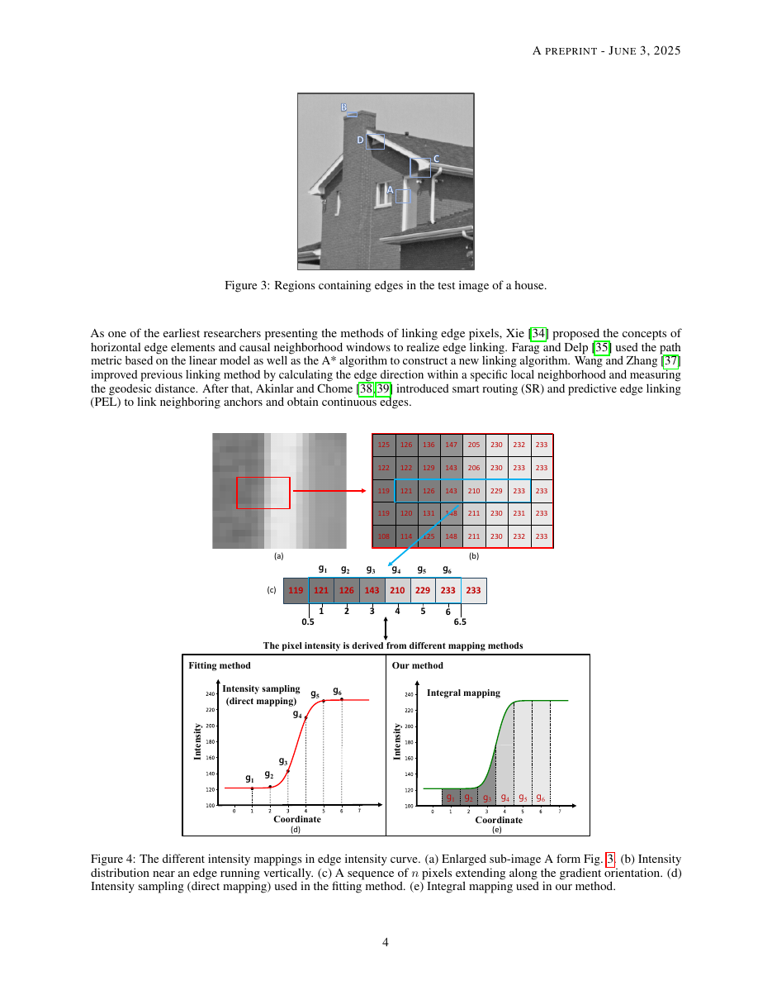
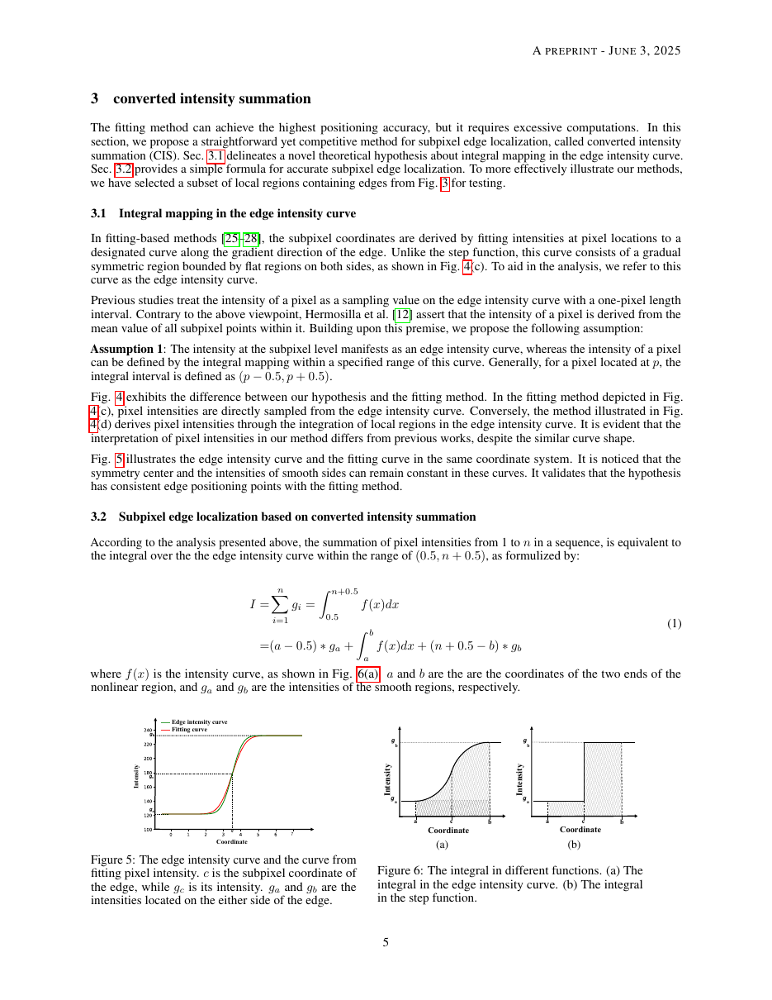
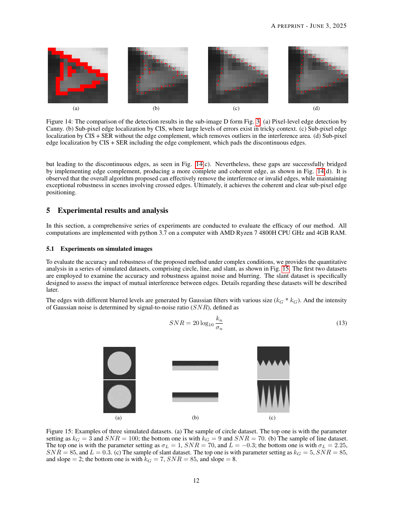

# 안정 에지 영역에서 변환 밝기 합에 기반한 부화소 에지 위치 추정 (번역)

번역 범위: 전문 (초록, 본문 1~6절, 그림과 표 캡션). 참고문헌은 원문 그대로 둔다.

- 원제: Subpixel Edge Localization Based on Converted Intensity Summation under Stable Edge Region
- 저자: Yingyuan Yang, Guoyuan Liang(교신), Xianwen Wang, Kaiming Wang, Can Wang, Xinyu Wu
- 소속: 중국과학원 선전선진기술연구원, 중국과학원대학, 광둥성 로봇 및 지능시스템 중점실험실, 구이린이공대학
- 출처: arXiv:2502.16502v2 [cs.CV], 2025-05-31 (본문 머리 날짜 2025-06-03). 동료 심사 전 사전 공개본(preprint)이다.
- 원문 파일: `Yang2025_arXiv_2502.16502_converted_intensity_summation.pdf` (20쪽)
- 번역 원칙: 원문 내용만 옮긴다. 역자가 덧붙인 말은 "역자 주"로 따로 표시한다.

---

## 초록

고정밀 측정에서 요구되는 엄격한 에지 검출 조건을 맞추기 위해, 이 논문은 부화소 에지 위치를 효율적으로 찾는 방법 여러 개를 제안한다.
적합 기반 방법은 화소 밝기를 특정 모델에서 뽑은 표본값으로 본다.
이와 달리 우리는 새로운 관점을 택한다. 화소 단위 밝기를, 부화소 위치 추정을 위한 밝기 모델 위의 국소 적분 사상으로 해석할 수 있다고 가정한다.
이에 따라 변환 밝기 합(Converted Intensity Summation, CIS)이라는 간단한 부화소 에지 위치 추정 방법을 제안한다.
개별 에지 점의 위치만 따지면 강건성이 약하다. 이를 보완하려고 안정 에지 영역(Stable Edge Region, SER) 기반 알고리즘을 제시해 에지 근처의 국소 간섭을 줄인다.
국소 영역 안에서 에지 통계가 일관된다는 관찰에 따라, 이 알고리즘은 에지 주변에서 서로 연관된 안정 영역을 찾아 강건한 매개변수를 얻고 더 높은 정밀도로 위치를 정한다.
또한 확장-조정(extension-adjustment)에 기반한 에지 보완 방법을 도입해, SER을 효율적으로 옮겨 불규칙한 에지를 바로잡는다.
흔한 에지 형태와 여러 실제 장면(산업용 PCB 영상, 원격 탐사 영상, 의료 영상)을 담은 합성 영상과 실제 영상 자료로 많은 실험을 했다.
CIS가 최신 방법보다 더 높은 정확도를 얻으면서 실행 시간은 더 짧다는 것을 확인했다.
또 SER을 CIS에 결합하면 간섭에 대한 저항력과 위치 정확도를 더 높이는 뛰어난 성능을 보인다.

핵심어: 부화소 정확도, 에지 위치 추정, 에지 연결, 밝기 합

## 1. 서론

에지 검출은 영상 처리의 기본 과제다. 물체 검출, 영상 분할 같은 상위 응용의 필수 전 단계다.
특히 Canny [1] 같은 효율적인 에지 검출기는 많은 시각 과제의 기본 도구가 되었다.
그러나 이런 방법은 산업 검사, 원격 탐사, 의료 영상처럼 높은 정밀도가 필요한 분야 [2-5]의 요구를 맞추지 못한다.
이에 연구자들 [6]은 측정 정확도를 높이는 데 초점을 두고 에지 검출을 부화소 위치 추정으로 넓혔다. 둘의 차이는 그림 1에 있다.
지난 10년 동안 딥러닝은 의미 정보 추출에서 큰 능력을 보였다. 그래서 합성곱 신경망(CNN) 기반 방법 [7-10]은 경계가 뚜렷한 화소 단위 에지를 찾는 데 큰 성공을 거두었다.
그러나 이 방법들은 부화소 수준의 정밀 위치 추정과 측정에는 한계가 있다. 부화소 위치 추정에서는 전통적 방법이 큰 장점을 가진다.

> 그림 1: 에지 검출과 부화소 에지 위치 추정의 차이. (a) 원본 영상. 윗줄은 인쇄회로기판(PCB) 영상, 아랫줄은 뼈 구조를 보여 주는 의료 영상이다. (b) 빨간 사각형 안 부분 영상의 확대. (c) Canny의 화소 단위 에지 검출. (d) 제안 방법의 부화소 에지 위치 추정.

> 그림 2: 제안 방법의 전체 구조. 원본 영상 → 영상 전처리(기울기 지도 계산, 에지 검출) → 강건 매개변수 획득(안정 에지 영역(SER) 찾기, 4-2절) → 매개변수 추정(4-3절), 확장-조정 기반 에지 보완(4-4절) → 부화소 에지 위치 추정, 변환 밝기 합(CIS)(3절).

이전 연구들은 기울기 방향을 따라 나타나는 에지의 규칙성을 써서 정교한 에지 모델을 설계했다. 대표 기법은 적합 [11]과 보간 [12]이다.
한편 다른 연구들은 에지 화소 하나와 그 주변 이산 영역의 관계를 써서 정밀 위치를 찾는다.
모멘트 기반 방법 [13]은 여러 차수의 모멘트 특징으로 위치에 필요한 에지 매개변수를 구한다.
Seo [14]는 밝기와 기울기의 퍼짐을 관찰해, 기울기에 적응 가중을 주어 에지 위치를 정밀하게 추정하는 비반복 방법을 제안했다.
부분 면적 효과(partial area effect) 방법 [15]은 부분 영역의 면적과 그 밝기값 사이의 상관을 최적 에지 곡선 적합의 제약으로 쓴다.
다양한 모델로 에지를 재구성하는 데 집중한 이전 연구와 달리, 우리는 화소 밝기와 부화소 수준 밝기 모델 사이의 관계를 탐구한다.
전통적으로 화소의 밝기는 주어진 모델에서 뽑은 이산 표본으로 다뤄졌다.
그러나 이 논문에서는 화소 밝기를 부화소 수준 밝기 모델의 특정 구간 위 적분 사상으로 볼 수 있다는 생각을 내놓는다.
이 생각을 발전시켜, 비선형 대칭 곡선과 계단 함수 사이의 적분 동치를 이용한 간단한 방법인 변환 밝기 합(CIS)을 구현해 부화소 에지 위치를 얻는다.

또한 이전 연구는 개별 에지 점의 정확한 위치에 주로 집중하고 점들 사이의 상관은 무시했다.
그래서 위치 결과가 에지 검출 결과에 크게 의존하고 국소 간섭에 매우 민감하다.
에지에 붙은 영역이 통계적으로 일관된 패턴을 보인다는 관찰에서, 우리는 안정 에지 영역(SER) 개념을 내놓는다.
SER은 유효한 상관을 가진 에지 화소 근처의 안정된 국소 영역으로 만든다. 잠재적 국소 간섭을 줄이고 더 강건한 통계 매개변수를 얻는 데 쓴다.
나아가 SER의 매개변수를 효율적으로 옮겨 불규칙 에지 영역을 바로잡는 확장-조정 기반 에지 보완 방법도 제안한다.

이 연구의 전체 구조는 그림 2와 같다.
영상은 먼저 전처리를 거쳐 기울기 지도를 만들고 초기 에지를 정한다.
그다음 SER 기반 알고리즘으로 에지 점 가까이의 안정 영역을 묶는다.
이어서 SER과 에지 보완 방법에서 강건한 매개변수를 얻는다.
마지막으로 제안한 CIS 방법이 정확한 부화소 에지 위치를 효율적으로 얻는다.

이 연구의 주요 새로움은 다음과 같다.

1. 변환 밝기 합이라는 간단하고 효과적인 부화소 에지 위치 추정 방법을 제안한다. 최신 방법보다 위치 정확도가 높고 계산 효율은 크게 높다.
2. 안정 에지 영역 기반 알고리즘을 제안해 부화소 에지 위치 추정의 강건성을 높인다. 국소 영역의 관련 화소를 더 넓게 포함해 안정된 통계 매개변수를 얻는다.
3. 확장-조정 기반 에지 보완 방법을 설계해 불규칙 에지 영역을 바로잡는다. SER과 결합해 CIS의 강건성을 높이고, 부화소 에지 위치 오차를 더 줄인다.

이 논문의 나머지 구성은 다음과 같다.
2절은 부화소 에지 위치 추정과 에지 연결에 대한 관련 연구를 정리한다.
3절은 변환 밝기 합에 기반한 간단한 부화소 위치 추정 방법을 설명한다.
4절은 안정 에지 영역과 에지 보완 방법, 그리고 CIS에 쓸 매개변수 추정을 자세히 다룬다.
5절은 합성 자료와 실제 자료의 실험 결과와 분석을 보인다.
6절에서 결론을 낸다.

## 2. 관련 연구

### 2.1 부화소 에지 위치 추정

고정밀 분야에서 부화소 에지 검출이 널리 쓰이므로 관련 알고리즘이 많이 제안되었다.
이 알고리즘들은 크게 세 부류로 나눌 수 있다 [16]. 모멘트 [17-20], 보간 [21-24], 적합 [25-28]이다.

Tabatabai와 Mitchell [17]은 에지 매개변수와 밝기 모멘트(GM) 사이의 관계를 써서, 부화소 에지 위치 추정의 가장 이른 모멘트 기반 방법을 만들었다.
회전 불변성을 얻으려고 Ghosal 등 [18]은 Zernike 직교 모멘트(ZOM)를 제안했다. 그러나 이 방법은 작은 물체를 정확히 검출하지 못한다.
이 문제를 다루려고 이후 직교 Fourier-Mellin 모멘트(OFMM) [19]가 제안되었다. 시험 정확도가 의료 영상 분석이나 위성 원격 탐사의 엄격한 요구를 맞춘다는 것이 입증되었다.
보간 기반 방법은 에지 화소의 밝기나 그 도함수를 보간해 에지 정보를 늘려 부화소 에지를 검출한다.
Jensen과 Anastassiou [21]는 처음으로 비선형 보간을 써서 부화소 에지를 찾았다. 이 방법은 선형 방법보다 눈에 띄게 날카로운 에지를 만들고 오차가 낮다.
이후 연구자들은 여러 보간 방식을 설계했다 [22-24].
적합 기반 방법은 보통 에지 밝기나 기울기 변화 곡선이 어떤 함수 모델을 따른다고 가정한다. 그다음 최소제곱으로 적합한 곡선에서 부화소 좌표를 얻는다.
Nalwa와 Binford [25]는 쌍곡탄젠트 함수를 모델로 한 첫 적합 기반 방법을 제안했다.
흐린 에지 모델 [11]도 부화소 좌표를 찾는 데 쓰였고, 실험에서 강건성과 정확도 모두 좋은 성능을 보였다.
비슷하게 Hagara와 Kulla [28]는 Erf 함수로 실제 에지를 근사했다. 이 방법은 계산 비용이 높지만 가장 정확한 방법으로 여겨진다.

최근 연구자들 [14, 15, 29, 30]은 위 세 전통 부류 밖의 방법에서 눈에 띄는 진전을 이뤘다.
부분 면적 효과 기반 방법 [15]은 여러 분야 [31-33]에 응용되었다. 이 방법은 에지 화소의 이산 특성과 영역 상관을 써서 유효한 밝기 방정식을 세운다.
Gioi [29]는 고전적인 Canny와 Devernay를 결합했다. 그러나 세 화소만 쓰므로 잡음에 민감하다.
또 Seo [14]는 기울기 적응 가중(AWG) 기반 부화소 에지 위치 추정 방법을 내놓았다. Erf 적합 방법보다 계산 비용이 적고 더 정확하다.
밝기 적분 문턱값(IIT) 기반 알고리즘 [30]은 밝기 적분이 문턱값에 이르는 부화소 점을 위치로 정한다.
이 연구들과 달리, 우리 연구는 부화소 수준과 화소 수준 밝기 사상의 관계를 깊이 파고들어 더 효율적이고 간결한 식을 제안한다.

### 2.2 에지 연결

다음 문헌들 [34-40]은 화소 수준 에지 연결의 대표 연구다. 이 연구들이 부화소 수준에서 우리 연구의 영감이 되었다.

> 그림 3: 집 시험 영상에서 에지를 포함한 영역들(A, B, C, D).

에지 화소를 연결하는 방법을 처음 내놓은 연구자 중 하나인 Xie [34]는 수평 에지 요소와 인과 이웃 창이라는 개념으로 에지 연결을 구현했다.
Farag와 Delp [35]는 선형 모델 기반 경로 척도와 A* 알고리즘으로 새 연결 알고리즘을 만들었다.
Wang과 Zhang [37]은 특정 국소 이웃 안에서 에지 방향을 계산하고 측지 거리를 재서 이전 연결 방법을 개선했다.
그 뒤 Akinlar와 Chome [38, 39]은 이웃 앵커를 연결해 연속 에지를 얻는 스마트 경로(SR)와 예측 에지 연결(PEL)을 도입했다.

> 그림 4: 에지 밝기 곡선에서 서로 다른 밝기 사상. (a) 그림 3의 부분 영상 A 확대. (b) 세로로 지나는 에지 근처의 밝기 분포. (c) 기울기 방향을 따라 늘어선 n개 화소의 열. (d) 적합 방법이 쓰는 밝기 표본화(직접 사상). (e) 우리 방법이 쓰는 적분 사상.

## 3. 변환 밝기 합

적합 방법은 가장 높은 위치 정확도를 얻을 수 있지만 계산이 지나치게 많다.
이 절에서는 간단하면서도 경쟁력 있는 부화소 에지 위치 추정 방법인 변환 밝기 합(CIS)을 제안한다.
3.1절은 에지 밝기 곡선에서의 적분 사상에 대한 새 이론 가정을 설명한다.
3.2절은 정확한 부화소 에지 위치를 위한 간단한 식을 제시한다.
방법을 더 잘 보이려고 그림 3에서 에지를 포함한 국소 영역 일부를 골라 시험한다.

### 3.1 에지 밝기 곡선에서의 적분 사상

적합 기반 방법 [25-28]에서는 에지의 기울기 방향을 따라 화소 위치의 밝기를 정해진 곡선에 적합해 부화소 좌표를 얻는다.
계단 함수와 달리, 이 곡선은 양쪽의 평평한 영역 사이에 완만하고 대칭인 영역으로 이루어진다(그림 4(c)).
분석을 돕기 위해 이 곡선을 에지 밝기 곡선이라 부른다.

이전 연구는 화소 밝기를 1화소 간격으로 에지 밝기 곡선에서 뽑은 표본값으로 다뤘다.
이와 반대로 Hermosilla 등 [12]은 화소 밝기가 그 안의 모든 부화소 점의 평균값에서 나온다고 주장한다.
이 전제를 바탕으로 다음 가정을 제안한다.

가정 1: 부화소 수준의 밝기는 에지 밝기 곡선으로 나타난다. 화소의 밝기는 이 곡선의 정해진 구간 위 적분 사상으로 정의할 수 있다. 일반적으로 위치 p에 있는 화소의 적분 구간은 (p − 0.5, p + 0.5)로 둔다.

그림 4는 우리 가정과 적합 방법의 차이를 보여 준다.
그림 4(c)의 적합 방법에서는 화소 밝기를 에지 밝기 곡선에서 직접 표본화한다.
반면 그림 4(d)의 방법은 에지 밝기 곡선의 국소 구간을 적분해 화소 밝기를 얻는다.
곡선 모양은 비슷하지만 우리 방법의 화소 밝기 해석이 이전 연구와 다르다는 것이 분명하다.
(역자 주: 본문은 적합 방법을 그림 4(c), 우리 방법을 그림 4(d)라고 적었지만, 캡션에서는 (d)가 적합 방법, (e)가 우리 방법이다. 캡션 쪽이 맞다.)

그림 5는 에지 밝기 곡선과 적합 곡선을 같은 좌표계에 그린 것이다.
이 두 곡선에서 대칭 중심과 양쪽 평평한 부분의 밝기가 일정하게 유지된다는 것을 볼 수 있다.
이는 이 가정이 적합 방법과 같은 에지 위치 점을 준다는 것을 뒷받침한다.

### 3.2 변환 밝기 합에 기반한 부화소 에지 위치 추정

위 분석에 따라, 한 열에서 1번부터 n번까지 화소 밝기의 합은 에지 밝기 곡선의 (0.5, n + 0.5) 구간 적분과 같다. 식으로 쓰면 다음과 같다.

$$I = \sum_{i=1}^{n} g_i = \int_{0.5}^{n+0.5} f(x)\,dx = (a - 0.5)\,g_a + \int_a^b f(x)\,dx + (n + 0.5 - b)\,g_b \quad (1)$$

여기서 f(x)는 밝기 곡선이다(그림 6(a)). a와 b는 비선형 영역 두 끝의 좌표이고, g_a와 g_b는 각각 평평한 영역의 밝기다.

> 그림 5: 에지 밝기 곡선과 화소 밝기를 적합한 곡선. c는 에지의 부화소 좌표이고 g_c는 그 점의 밝기다. g_a와 g_b는 에지 양쪽의 밝기다.

> 그림 6: 서로 다른 함수에서의 적분. (a) 에지 밝기 곡선에서의 적분. (b) 계단 함수에서의 적분.

> 그림 7: 국소 에지 영역과 밝기 곡선. (a) 그림 3의 부분 영상 B 확대. 빨간 사각형은 에지의 기울기 방향과 접선 방향을 따른 국소 영역이다. 검은 선은 에지 방향, 파란 선은 기울기 방향, 보라 선은 DD(이산 편향 방향)다. 초록 선으로 둘러싼 화소가 빨간 사각형과 관련된 화소다. (b) 기울기 방향과 DD를 따른 에지 밝기 곡선.

식 (1)의 적분 계산을 단순하게 하려고, 급변점이 에지 중심 c에 있고 아래와 위 경계가 각각 g_a, g_b에 맞춰진 계단 함수를 만든다(그림 6(b)).
곡선이 대칭이므로 a에서 b까지 곡선의 적분은 계단 함수의 적분과 같다. 식으로 쓰면 다음과 같다.

$$\int_a^b f(x)\,dx = (c - a)\,g_a + (b - c)\,g_b \quad (2)$$

여기서 c는 급변점이며 부화소 에지 위치를 나타낸다. 그러면 식 (7)은 다음과 같이 다시 쓸 수 있다.
(역자 주: 문맥상 "식 (7)"은 "식 (1)"의 오기로 보인다.)

$$I = (c - 0.5)\,g_a + (n + 0.5 - c)\,g_b \quad (3)$$

에지의 부화소 좌표는 다음과 같다.

$$c = \frac{I - n\,g_b}{g_a - g_b} - \frac{1}{2} \quad (4)$$

(역자 주, 역자 검산: 식 (3)을 c에 대해 직접 풀면 c = (I − n g_b)/(g_a − g_b) + 1/2이 나온다. 그림 4의 수치 g = 121, 126, 143, 210, 229, 233(n = 6, I = 1062)에 g_a ≈ 120, g_b ≈ 233을 넣으면 +1/2일 때 c ≈ 3.47로, 그림에서 143과 210 사이의 에지 위치와 맞는다. −1/2이면 c ≈ 2.47로 한 화소 어긋난다. 따라서 식 (4)의 부호는 오기이거나 다른 좌표 원점을 쓴 것으로 보인다. 원문은 이에 대해 설명하지 않는다.)

주어진 열에서 I와 n은 바로 정해진다.
간단한 계산에서는 g_a와 g_b를, 밝기 변화가 크지 않고 평평한 영역의 평균 밝기로 계산할 수 있다.
5.1절의 실험은 CIS가 적합 방법보다 정확도가 높으면서 계산 시간도 크게 줄인다는 것을 보여 준다.

## 4. 안정 에지 영역

CIS는 성능과 효율이 뛰어나지만 이전 방법들과 비슷한 뚜렷한 한계가 있다.
개별 에지 점에만 집중하고 에지 검출 결과에 크게 의존하므로 간섭에 매우 취약하다.
이를 위해 이 절에서는 안정 에지 영역을 도입한다. 관련 화소를 더 넓게 포함해 안정된 통계 매개변수를 얻고, 부화소 에지 위치 추정의 강건성을 높인다.

4.1절과 4.2절은 각각 관련 이론과 SER을 정하는 방법을 설명한다.
4.3절은 SER 위에서 CIS용 매개변수를 추정하는 방법을 제시한다.
안정된 매개변수를 얻기 어려운 복잡한 영역에 대해서는 4.4절에서 불규칙 에지를 바로잡는 확장-조정 알고리즘을 제안한다.

### 4.1 안정 에지 영역의 관련 이론

적합 방법과 마찬가지로, 가로나 세로 방향을 따른 밝기 분포도 에지 밝기 곡선에 맞출 수 있다.
이 논문에서는 기울기 방향에 가까운 가로 또는 세로 방향을 이산 편향 방향(Discrete Deflection, DD)이라 부른다.
그림 7은 기울기 방향과 DD를 따른 밝기 곡선을 보여 준다.
DD를 따라 에지 밝기 곡선을 담은 화소 열을 이산 편향 열(Discrete Deflective Sequence, DDS)이라 정의한다.
접선 방향으로 이웃한 에지 화소들이 비슷하다는 점에서 다음 가정을 끌어낸다.

> 표 1: 검증용 통계 결과

| 에지 종류 | 전체 에지 화소 수 | 에지를 포함한 국소 영역 수 | P > 95%인 국소 영역 수 | P > 95%인 국소 영역 비율 |
|---|---|---|---|---|
| 단순 에지 | 3828 | 880 | 854 | 97.04% |
| 가파른 에지 | 3131 | 707 | 672 | 95.05% |
| 복잡한 에지 | 4402 | 1025 | 933 | 91.03% |

P: 국소 영역 안의 DDS 쌍 사이 코사인 유사도가 0.9보다 큰 비율.

가정 2: 에지가 지나는 국소 영역 안에서 각 DDS는 에지 밝기 곡선의 일관성을 유지할 수 있다. 자세히 말하면, 평평한 영역에서 밝기가 비슷하고 비선형 영역의 길이가 비슷하다.

안정 에지 영역(SER)은 가정 2의 일관성을 따르는 국소 영역으로 정의한다.

이 가정과 SER 존재의 보편성을 확인하려고, BSDS500 자료 [41]에서 에지 복잡도가 다른 영상 몇 장을 무작위로 골랐다(그림 8). 구체적 계산 단계는 다음과 같다.
먼저 7x7 창으로 에지가 지나는 국소 영역을 뽑고, 이 영역에서 화소 7개로 된 DDS 여러 개를 얻는다.
그다음 국소 영역 안의 DDS 쌍마다 코사인 유사도가 0.9보다 큰 비율을 계산한다.
이 비율이 95%를 넘는 영역은 가정 2를 거의 만족한다고 보고, 전체 영상에서 이런 영역의 비율을 계산한다.
표 1에서 보듯 곡률이 높거나 간섭이 강한 영역을 빼면 대부분의 국소 영역이 DDS 사이 일관성을 보인다.

### 4.2 SER을 정하는 알고리즘

SER을 정하는 과정은 다음 세 단계다.

- 1단계: 전처리.
- 2단계: 자격 있는 에지 화소마다 안정 DDS를 얻는다.
- 3단계: DDS를 접선 방향으로 확장한다.

#### 4.2.1 전처리

Sobel 연산자로 각 화소의 세로, 가로 기울기를 계산한다. 그다음 기울기 문턱값과 비최대 억제로 에지 화소를 뽑는다. 각 에지 화소에서 기울기가 더 큰 방향을 DD로 정한다.

> 그림 8: BSDS500의 일부. (a) 원본 영상. (b) 추출한 에지. 첫 줄은 곡선과 일부 모서리로 된 단순 에지 영상, 둘째 줄은 가파른 에지, 마지막 줄은 복잡한 배경에서 교차가 많은 에지다.

#### 4.2.2 자격 있는 에지 화소의 안정 DDS 얻기

이 단계에서는 모든 에지 화소를 훑으며, DD의 양 방향으로 화소를 하나씩 늘려 자격 있는 에지 화소마다 안정 DDS를 만들려고 한다.
이 과정에서 평균 밝기와 방향 도함수 비로 안정성을 판단하고, 끝단 밝기 변화로 종료를 판단한다.
DDS 안의 밝기 곡선이 대칭이므로, 확장하는 동안 열 전체의 평균 밝기는 일정해야 한다.
그리고 방향 도함수 비로 열 안의 방향 안정성을 나타낼 수 있다. 식은 다음과 같다.

$$m_k = \frac{1}{2k+1}\sum_{i=-k}^{k} g_i, \qquad \theta_k = \frac{\sum_{i=-k_d}^{k_u} G_{y_i}}{\sum_{i=-k_d}^{k_u} G_{x_i}} \quad (5)$$

여기서 g_i는 화소 i의 밝기, k = max(k_u, k_d)는 최대 확장 횟수, k_u와 k_d는 DD의 두 방향으로 늘린 화소 수다. G_yi와 G_xi는 화소 i의 가로, 세로 기울기다.
k번째 확장에서의 안정성 제약은 다음과 같이 계산한다.

$$\Delta_s^k = \min\left(\frac{|m_k - m_{k-1}|}{th_m}, \frac{|\theta_k - \theta_{k-1}|}{th_\theta}\right) \quad (6)$$

여기서 th_m과 th_θ는 미리 정한 서로 다른 문턱값이다.
또 끝단 밝기 변화를 확장 종료 기준으로 쓴다.

$$\Delta_{ev} = \max\left(|g_{-k_d} - g_{-k_d+1}|,\ |g_{k_u} - g_{k_u-1}|\right) \quad (7)$$

확장할 때마다 관련 매개변수를 다시 계산한다.
확장 중 안정성 제약 Δs가 1.0보다 커지면 교란이 DDS의 안정성을 해쳤다고 본다. 그러면 이 에지 화소는 안정 DDS를 만들 조건을 더 만족하지 못하므로 버린다.
그런 일이 없으면 Δev가 미리 정한 문턱값 th_ev 아래로 떨어질 때까지 확장을 계속한다.
확장이 끝났다는 것은 DDS가 비선형 영역 전체를 덮었다는 뜻이다. 이때의 열을 이후 분석용 후보 집합에 넣는다.
그림 9는 그림 7(a)의 에지 화소 p0에 대해 DDS를 얻는 과정을 보여 준다.

#### 4.2.3 DDS를 접선 방향으로 확장

다음 단계에서는 얻은 안정 DDS를 접선 방향 양쪽으로 차례로 확장한다.
확장은 접선을 따라 양쪽으로 한 번에 한 화소씩 시작한다.
SER의 일관성 때문에, 접선을 따라 확장하는 동안 각 DDS의 길이는 바뀌지 않는다.
각 DDS가 에지 밝기 곡선의 비선형 영역을 가장 잘 덮도록, 확장 방향에 있는 화소 중 앞 에지 화소와 밝기 차이가 가장 작은 화소를 새 DDS의 초기 중심으로 고른다.
마지막으로 상대 도함수 비와 상대 평균에서 나온 판단으로 확장을 멈춘다.

> 그림 9: 처음 안정 DDS를 얻는 과정. 노란 사각형은 현재 DDS이며 DD의 양 방향으로 확장한다. 두 번째 확장(K = 2)에서 위쪽은 평평한 영역에 이르러 확장을 멈추고, 아래쪽은 계속 확장한다. K = 3에서 양쪽이 모두 평평한 영역에 들어가므로 확장 과정이 끝난다.

> 그림 10: 그림 9에서 접선 방향으로 확장하는 과정. 왼쪽 확장은 초록, 오른쪽 확장은 파랑으로 나타냈다.

높은 곡률 때문에 생기는 이상값을 막으려고 방향 도함수 비(식 (5))도 적용한다. 이를 θ_l로 쓰며, l은 l번째로 확장한 DDS다.
SER 안에서 전경과 배경 밝기가 고르게 분포하므로, 상대 평균으로 영역의 안정성을 평가한다.

$$r_l = \frac{m_l}{\max_l g - \min_l g} \quad (8)$$

여기서 m_l은 DDS의 평균 밝기, max_l g와 min_l g는 열 l의 최대, 최소 밝기다. 이 확장의 종료 제약은 다음과 같다.

$$\Delta_t^l = \min\left(\frac{|\theta_l - \theta_{l-1}|}{th_\theta}, \frac{|r_l - r_{l-1}|}{th_r}\right) \quad (9)$$

여기서 th_θ는 식 (6)의 값을 그대로 쓰고, th_r은 또 다른 문턱값이다.
Δt는 확장할 때마다 다시 계산한다.
값이 1.0을 넘으면 불안정이나 부분 어긋남이 SER 조건을 깨뜨렸다는 뜻이므로, 그 방향의 확장을 멈춘다.
두 방향 확장이 모두 끝나면 확장한 DDS와 원래 DDS를 포함한 영역을 SER로 정한다.
그림 10은 그림 9에서 노란색으로 표시한 DDS의 확장 과정을 보여 준다.

### 4.3 SER에서 CIS 매개변수 추정

높은 정밀도의 위치를 얻으려고, g_a와 g_b를 SER 전체 범위에서 구해 강건한 매개변수를 얻는다.
양쪽 강도 집단을 만들고, 두 집단 안의 분포 매개변수와 두 집단 사이의 상대적으로 안정된 강도 차이를 써서 안정된 양쪽 강도를 추정하고자 한다.

> 그림 11: 여러 방법의 위치 결과 비교. (a) 그림 3의 부분 영상 C. (b) Erf 기반 적합 방법 [28]의 부화소 에지 위치. (c) CIS의 부화소 에지 위치. (d) CIS + SER(에지 보완 없음)의 부화소 에지 위치. 에지 영역 주변의 이상값이 알맞게 정리되었다.

알고리즘 1: SER에서 CIS 매개변수 추정

- 입력: E_S, SER 안의 화소 집단. g_p, 화소 p의 밝기.
- 출력: g_a, g_b, 평평한 영역의 밝기.

1. E_S의 평균 m_0과 분산 v_0을 계산한다.
2. 에지 양쪽에 화소 집단 두 개를 만든다.
   E_a ← {p | g_i > m_0 + v_0, p ∈ E_S},
   E_b ← {p | g_i < m_0 − v_0, p ∈ E_S}.
3. 두 집단 사이의 안정 차이 D_0을 구한다.
   E_D ← {d | d = g_i − g_j, i ∈ E_a, j ∈ E_b},
   D_0은 E_D에서 가장 자주 나오는 값이다.
4. E_a의 평균 m_a와 분산 v_a를 계산한다.
5. E_b의 평균 m_b와 분산 v_b를 계산한다.
6. v_a < v_b이면
7. g_a = g_a0, g_b = g_a0 − D_0
8. 아니면
9. g_a = g_b0 + D_0, g_b = g_b0
10. 끝.

(역자 주: 알고리즘 1의 g_a0, g_b0은 정의되지 않았다. 4, 5행의 m_a, m_b를 뜻하는 것으로 보인다. 또 1, 2행은 "분산"을 문턱 폭으로 쓰는데, 밝기 단위와 맞추려면 표준편차여야 자연스럽다. 원문 표기를 그대로 옮겼다.)

SER에서 g_a와 g_b를 계산하는 과정은 다음과 같다.
먼저 밝기가 평균 더하기 분산 범위 밖에 있는 화소를 고밝기 집단과 저밝기 집단으로 나누고, 각각 E_a, E_b로 쓴다.
두 집단 사이의 안정 차이를 얻으려고, 두 집단의 원소를 모두 짝지어 만든 점 쌍의 차이를 계산한다.
가장 자주 나오는 값을 안정 차이 D_0으로 고른다.
마지막으로 E_a와 E_b의 분산 크기에 따라, 두 집단의 평균과 D_0으로 g_a와 g_b를 정한다. 자세한 내용은 알고리즘 1에 있다.

그림 11은 여러 방법의 위치 결과다.
CIS와 적합 기반 방법 모두 이상값이 몇 개 있다(그림 11(b), (c)).
그러나 SER을 넣으면 이런 이상 점을 없애고 에지 전이를 매끄럽게 해 위치의 강건성을 높인다(그림 11(d)).

### 4.4 확장-조정 기반 에지 보완

> 그림 12: 확장 과정의 개념도. (a) 그림 3의 부분 영상 D. (b) 확장할 화소의 이웃과 안내 열 L_a. (c)에서 (11, 10)을 중심으로 한다. (c) 확장 과정. 어두운 화소는 E_S에 속하고 회색 화소는 E_C에 속하며, 원은 확장된 화소를 표시한다.

여러 교란 때문에 모든 에지 화소가 안정 영역에 속하지는 않는다.
그림 12(c)에서 보듯, 전처리의 에지 검출 알고리즘으로 얻은 모든 에지 화소 집합 E에 대해, SER은 국소적으로 규칙적인 밝기 분포를 가진 안정 화소를 뽑아 SER 집합 E_S를 만든다.
이 소절은 SER을 불규칙 영역으로 옮기는 확장-조정 전략 기반의 새 에지 보완 방법을 제안한다.
후보 집합 E_C = {e_c | e_c ∈ E, e_c ∉ E_S}에서 e_c는 불규칙 에지 화소 후보이며, 주요 단계는 다음과 같다.

- 1단계, 확장: e_c가 SER의 끝점에 붙어 있으면 이를 골라 확장 에지 화소로 지정한다. 근처에 후보가 없을 때까지 확장을 계속한다.
- 2단계, 조정: SER의 관련 매개변수로 불규칙 영역을 조정하고, 마지막으로 부화소 점의 유효 매개변수를 얻는다.

#### 4.4.1 확장

4.2절에서는 SER의 안정성을 보장하려고 확장 가능한 방향과 각도 범위를 엄격히 제한했다.
불안정 영역에서는 에지 방향이 복잡하므로, 확장할 에지 화소와 확장 방향을 정하려고 안내 열 L_a를 만든다.
그림 12(b)에서 확장 방향이 에지 화소 O의 오른쪽이라고 하면, L_a는 A부터 E까지 연결된 화소 5개로 이루어진다.
확장될 수 있는 화소 B, C, D는 확장 방향 쪽 O의 8-이웃 안에 있다.
확장 과정에는 다음 기준을 쓴다(그림 12(b)).
A와 B가 모두 후보 e_c이면 B를 확장 화소로 고르고, 확장 방향은 위로 바뀐다.
D와 E가 후보 e_c이면 D를 확장 화소로 고르고, 확장 방향은 아래로 바뀐다.
그 밖의 경우에는 확장 방향을 그대로 두고 에지는 C로 확장된다.
L_a의 어떤 점이 집합 E에 속하지 않거나, 현재 확장 화소의 8-이웃에 E_S의 점이 있으면 확장을 멈춘다.
확장 과정의 개념도는 그림 12(c)에 있으며, 실제 상황의 여러 경우를 담고 있다.

> 그림 13: 여러 상황에서의 조정. 윗줄은 그림 12에서 가져온 원래 밝기 분포이고, 아랫줄은 조정한 밝기 그림이다. 빨간 숫자는 원래 밝기다. 노란 영역은 통계 매개변수로 밝기를 조정한 SER이고, 다른 색 숫자는 조정 결과다. (a) 독립적으로 조정하는 국소 영역 A. 파란 점선은 조정한 후보 열이다. (b) SER을 따라 조정하는 국소 영역 B. 초록 점선은 조정한 후보 열이다.

#### 4.4.2 조정

불규칙 영역을 효과적으로 바로잡으려면 원래 SER에서 핵심 정보를 뽑아야 한다. 열 길이 L과 SER의 두 평평한 영역 밝기 g_as, g_bs다.
먼저 확장 화소를 중심으로, 그 안내 열의 방향을 따라 길이 L인 후보 열을 얻는다.
열 양쪽에서 이웃 화소 사이 차이가 가장 작은 밝기를 뽑아 g_ac, g_bc로 쓴다.
그다음 밝기를 조정한다. 판단 기준은 다음과 같다.

$$D_c = \max\left(|g_{as} - g_{ac}|,\ |g_{bs} - g_{bc}|\right) \quad (10)$$

$$m_c = \frac{|(g_{as} + g_{bs}) - (g_{ac} + g_{bc})|}{2} \quad (11)$$

m_c가 정한 문턱값 th_c(기본값 5)보다 작으면 후보 열을 비교적 안정하다고 본다. 조정 전략은 두 가지로 나뉜다(그림 13).
(a) 독립 조정: D_a가 m_a보다 크면 후보 열을 안정 열로 근사할 수 있다고 보고, 양쪽 밝기를 g_l과 g_h로 정한다.
(b) SER을 따른 조정: D_a가 m_a 이하이면 후보 열의 평평한 영역이 원래 SER과 같다고 보고, 평평한 양쪽 밝기를 g_l0과 g_h0으로 둔다.
그 밖의 경우 후보 열은 안정 상태에 이르기 어렵다고 보고 버린다.
판단은 다음과 같이 쓸 수 있다.

$$\begin{cases} g_a = g_a^c,\ g_b = g_b^c & \text{if } D_c > m_c,\ m_c \le th_c \\ g_a = g_a^s,\ g_b = g_b^s & \text{if } D_c \le m_c,\ m_c \le th_c \\ \text{버림} & \text{if } m_c > th_c \end{cases} \quad (12)$$

(역자 주: 본문 문장은 D_a, m_a, g_l, g_h, g_l0, g_h0이라는 기호를 쓰지만, 식 (10)~(12)는 D_c, m_c, g_a^c, g_b^c, g_a^s, g_b^s를 쓴다. 같은 것을 가리키는 것으로 보인다.)

마지막으로 조정한 후보 열의 부화소 에지를 식 (4)로 정확히 찾는다.

그림 14는 우리 방법의 여러 전략에서 나온 검출 결과다.
그림 14(b)에서 보듯 CIS는 단순 에지를 잘 찾는다. 그러나 에지 검출 결과에 엄격히 의존하므로 교차점이나 교란에서 오차가 많다(그림 14(a)).
SER을 넣으면 간섭 점과 이상값이 모두 사라지지만 에지가 끊긴다(그림 14(c)).
그래도 에지 보완을 적용하면 이 틈이 잘 메워져 더 완전하고 일관된 에지가 나온다(그림 14(d)).
제안한 전체 알고리즘은 간섭이나 무효 에지를 잘 제거하고, 교차 에지 장면에서도 뛰어난 강건성을 유지한다.
결국 일관되고 깨끗한 부화소 에지 위치를 얻는다.

> 그림 14: 그림 3의 부분 영상 D에서 검출 결과 비교. (a) Canny의 화소 단위 에지 검출. (b) CIS의 부화소 에지 위치. 까다로운 맥락에서 큰 오차가 있다. (c) 에지 보완 없는 CIS + SER의 부화소 에지 위치. 간섭 영역의 이상값을 없앤다. (d) 에지 보완을 포함한 CIS + SER의 부화소 에지 위치. 끊긴 에지를 채운다.

## 5. 실험 결과와 분석

이 절에서는 방법의 효과를 평가하려고 폭넓은 실험을 한다. 모든 계산은 AMD Ryzen 7 4800H CPU, 4GB RAM 컴퓨터에서 Python 3.7로 구현했다.

### 5.1 모의 영상 실험

복잡한 조건에서 제안 방법의 정확도와 강건성을 평가하려고, 원, 직선, 경사의 세 모의 자료로 정량 분석을 한다(그림 15).
앞의 두 자료는 잡음과 흐림에 대한 정확도와 강건성을 본다.
경사 자료는 에지끼리 서로 간섭하는 영향을 보려고 특별히 설계했다.
자료의 자세한 내용은 뒤에서 설명한다.

흐림 수준이 다른 에지는 크기가 다른 가우스 필터(k_G × k_G)로 만든다. 가우스 잡음의 세기는 신호 대 잡음비(SNR)로 정하며, 다음과 같이 정의한다.

$$SNR = 20 \log_{10} \frac{k_n}{\sigma_n} \quad (13)$$

여기서 k_n은 전경과 배경의 밝기 차이, σ_n은 잡음의 표준편차다.
이 자료의 모든 표본 영상은 여러 에지 형태와 잡음 수준의 조합으로 만들었다.

> 그림 15: 세 모의 자료의 예. (a) 원 자료의 표본. 위는 k_G = 3, SNR = 100, 아래는 k_G = 9, SNR = 70이다. (b) 직선 자료의 표본. 위는 σ_L = 1, SNR = 70, L = −0.3, 아래는 σ_L = 2.25, SNR = 85, L = 0.3이다. (c) 경사 자료의 표본. 위는 k_G = 5, SNR = 85, 기울기 2, 아래는 k_G = 7, SNR = 85, 기울기 8이다.

(역자 주: 식 (13)을 그대로 쓰면 SNR 70 dB는 σ_n = k_n/3162로, k_n = 150일 때 σ_n ≈ 0.05 밝기 단위다. 그런데 그림 15의 표본에는 눈에 보이는 잡음이 있다. 원문은 영상을 8비트로 양자화했는지, 실제 σ_n이 얼마인지 밝히지 않는다. 따라서 이 SNR 수치를 실제 카메라 잡음과 바로 비교하기 어렵다.)

> 표 2: 검증용 통계 결과 (역자 주: 제목은 이렇지만 내용은 각 방법의 매개변수 설정이다)

| 방법 | 매개변수 |
|---|---|
| Canny | th_l = 80, th_h = 100 |
| Erf, CIS, 보간 | n_p = 7 |
| Zernike 모멘트 | medianBlur = true이면 nbsize = 7, th_k = 20.0, th_l = √2/nbsize |
| PAE | th = 10, iters = 0, order = 2 |
| Canny/Devernay | σ = 3.0, th_l = 2.0, th_h = 2.9 |
| CIS + SER | n_p = 7, th_m = 5, th_θ = π/40, th_ea = 10, th_r = 0.1, th_c = 10 |

부화소 에지 위치 실험에서는 고전 방법과 최신 방법 몇 개를 정량 비교에 쓴다.
Zernike 모멘트 [18], 다항식 보간 [22], Erf 기반 적합 [28], 부분 면적 효과(PAE) [15], Canny/Devernay [29], AWG [14]다.
또 3절에서 설명한 CIS와, 전체 구조를 포함한 복합 방법 CIS+SER도 비교에 넣는다.
일부 알고리즘의 주요 매개변수는 표 2에 있다.

#### 5.1.1 원 자료 분석

영상 크기는 221 × 221이고, 반지름 80인 원이 영상 가운데에 있다. 안쪽 밝기는 200, 바깥쪽 밝기는 50이다.
가우스 필터 크기 k_G는 3, 5, 7, 9의 네 수준이다. SNR은 70에서 100 dB까지 10 dB 간격으로 늘린다.
위 요인의 조합마다 표본 5장이 있다.
오차는 실제 반지름과 적합 반지름의 차이로 정의한다. 적합 반지름은 얻은 부화소 에지 좌표와 실제 중심에서 구한다.

표 4는 원 자료에서 여러 방법의 성능을 보여 준다.
모든 방법 가운데 CIS+SER의 편차가 가장 작다. 특히 CIS도 경쟁력 있는 결과를 내고, 대부분의 경우 두 번째로 좋은 위치 정확도를 유지한다.
SNR이 70일 때 다른 방법들의 정확도는 크게 떨어지지만 CIS+SER은 비교적 작은 오차를 유지한다. 이는 안정 영역의 효과를 보여 준다.

Zernike와 Canny/Devernay를 빼면, SNR ≥ 80일 때 방법들의 오차가 꾸준히 0.06 아래다. 그 결과를 상자 그림으로 그림 16에 보였다.
위 방법 가운데 PAE가 가장 강건하다. 그러나 중앙 오차가 0.0519화소에 머문다. 보간, Erf, CIS의 중앙 오차는 약 0.047화소다.
CIS+SER의 중앙 오차는 0.0259화소로 더 줄어든다.
그러나 이 향상에는 더 큰 분산이 따르며, 실제 효과에 불확실성이 있다는 뜻이다.
이 방법은 에지 영역의 밝기 분포에 의존하므로, k_G = 3이나 9일 때 잡음이 낮은 조건(SNR ≥ 90)에서 오차가 더 크게 나온다.
그래도 SER은 대부분의 경우 CIS에 이로운 영향을 준다는 것이 분명하다.

> 그림 16: 원 자료 결과의 상자 그림. SNR = 70을 뺀 표 4의 자료다. 숫자는 중앙값이다. (보간 0.0474, Erf 0.0469, PAE 0.0519, CIS 0.0459, CIS+SER 0.0259, 세로축 RMSE(화소))
>
> (역자 주: 본문은 "보간, Erf, CIS 약 0.047"이라고 쓰지만 그림의 CIS 중앙값은 0.0459다.)

> 표 3: 원 자료의 적합 반지름 오차 (SNR ≥ 80)

| k_G | SNR | Zernike | 보간 | Erf | PAE | Canny/Devernay | CIS | CIS+SER |
|---|---|---|---|---|---|---|---|---|
| 3 | 80 | 1.4197 | 0.0430 | 0.0406 | 0.0466 | 0.1118 | 0.0437 | 0.0280 |
| 3 | 90 | 1.4616 | 0.0422 | 0.0432 | 0.0529 | 0.0927 | 0.0428 | 0.0390 |
| 3 | 100 | 1.4787 | 0.0423 | 0.0451 | 0.0513 | 0.1031 | 0.0432 | 0.0413 |
| 5 | 80 | 1.5356 | 0.0462 | 0.0469 | 0.0516 | 0.1217 | 0.0443 | 0.0132 |
| 5 | 90 | 1.5492 | 0.0446 | 0.0437 | 0.0521 | 0.0936 | 0.0439 | 0.0156 |
| 5 | 100 | 1.5746 | 0.0448 | 0.0466 | 0.0532 | 0.1131 | 0.0470 | 0.0063 |
| 7 | 80 | 1.7526 | 0.0544 | 0.0472 | 0.0585 | 0.1110 | 0.0507 | 0.0193 |
| 7 | 90 | 1.9076 | 0.0489 | 0.0468 | 0.0516 | 0.1321 | 0.0448 | 0.0262 |
| 7 | 100 | 1.9607 | 0.0485 | 0.0482 | 0.0503 | 0.1284 | 0.0480 | 0.0237 |
| 9 | 80 | 1.9862 | 0.0568 | 0.0515 | 0.0568 | 0.0962 | 0.0570 | 0.0256 |
| 9 | 90 | 2.1611 | 0.0586 | 0.0542 | 0.0585 | 0.1041 | 0.0514 | 0.0447 |
| 9 | 100 | 2.1830 | 0.0527 | 0.0539 | 0.0489 | 0.0994 | 0.0477 | 0.0582 |
| 평균 | | 1.7476 | 0.0486 | 0.0474 | 0.0527 | 0.1089 | 0.0466 | 0.0284 |

굵은 기울임 숫자: 최솟값. 기울임 숫자: 두 번째로 작은 값.

> 표 4: 원 자료의 적합 반지름 오차 (SNR 70 포함)

| k_G | SNR | Zernike | 보간 | Erf | PAE | Canny/Devernay | CIS | CIS+SER |
|---|---|---|---|---|---|---|---|---|
| 3 | 70 | 1.5354 | 2.6864 | 2.3053 | 1.8185 | 0.4005 | 2.3333 | 0.5278 |
| 3 | 80 | 1.4197 | 0.0430 | 0.0406 | 0.0466 | 0.1118 | 0.0437 | 0.0280 |
| 3 | 90 | 1.4616 | 0.0422 | 0.0432 | 0.0529 | 0.0927 | 0.0428 | 0.0390 |
| 3 | 100 | 1.4787 | 0.0423 | 0.0451 | 0.0513 | 0.1031 | 0.0432 | 0.0413 |
| 5 | 70 | 1.5339 | 3.0131 | 2.6623 | 2.3043 | 1.0204 | 2.7992 | 0.1846 |
| 5 | 80 | 1.5356 | 0.0462 | 0.0469 | 0.0516 | 0.1217 | 0.0443 | 0.0132 |
| 5 | 90 | 1.5492 | 0.0446 | 0.0437 | 0.0521 | 0.0936 | 0.0439 | 0.0156 |
| 5 | 100 | 1.5746 | 0.0448 | 0.0466 | 0.0532 | 0.1131 | 0.0470 | 0.0063 |
| 7 | 70 | 1.6705 | 3.0398 | 2.3996 | 2.0371 | 1.6516 | 2.7415 | 0.2800 |
| 7 | 80 | 1.7526 | 0.0544 | 0.0472 | 0.0585 | 0.1110 | 0.0507 | 0.0193 |
| 7 | 90 | 1.9076 | 0.0489 | 0.0468 | 0.0516 | 0.1321 | 0.0448 | 0.0262 |
| 7 | 100 | 1.9607 | 0.0485 | 0.0482 | 0.0503 | 0.1284 | 0.0480 | 0.0237 |
| 9 | 70 | 1.8172 | 3.5815 | 2.3905 | 3.5174 | 1.1867 | 3.0019 | 0.7520 |
| 9 | 80 | 1.9862 | 0.0568 | 0.0515 | 0.0568 | 0.0962 | 0.0570 | 0.0256 |
| 9 | 90 | 2.1611 | 0.0586 | 0.0542 | 0.0585 | 0.1041 | 0.0514 | 0.0447 |
| 9 | 100 | 2.1830 | 0.0527 | 0.0539 | 0.0489 | 0.0994 | 0.0477 | 0.0582 |
| 평균 | | 1.7205 | 0.8065 | 0.6453 | 0.6443 | 0.3479 | 0.7150 | 0.1303 |

굵은 기울임 숫자: 최솟값. 기울임 숫자: 두 번째로 작은 값.

(역자 주: 원문에서 표 3과 표 4는 같은 제목이다. 표 3은 표 4에서 SNR 70 행을 뺀 것이다. 단위는 화소로 보인다.)

#### 5.1.2 직선 자료 분석

[14]의 설계를 따라, 직선 자료의 에지는 다음 식으로 만든다.

$$f_L(x) = \frac{D_L}{2}\left(\mathrm{erf}\left(\frac{x - L}{\sqrt{2}\,\sigma_L}\right) + 1\right) + I_L \quad (14)$$

여기서 f_L(x)는 에지 점 x의 밝기, L은 에지 위치, σ_L은 흐림 계수다. I_L은 한쪽 밝기이고 D_L은 양쪽 밝기 차이다. 우리 실험에서는 I_L = 50, D_L = 150이다.
표본 크기는 200 × 40이다. 영상의 에지는 흐림 계수, 잡음 수준, 에지 위치를 여러 가지로 조합해 만든다.
SNR은 70, 73, 76, 79, 85로 두고, σ_L은 1에서 2.25까지 0.25 간격으로 둔다.
에지 위치 L은 영상 세로 가운데에 두고, −0.5에서 0.5화소까지 0.1화소 간격으로 어긋나게 한다.
σ_L과 SNR이 같은 표본을 한 묶음으로 보고, L의 실제 좌표와 측정 좌표 사이의 평균제곱근오차(RMSE)를 계산한다.

표 5에서 보듯 우리 방법은 다른 방법과 비교해 가장 좋거나 두 번째로 좋은 정확도를 얻는다.
SNR = 85에서는 AWG가 가장 작은 위치 오차를 내지만, 잡음 간섭에 더 민감하다.
구체적으로, 우리 방법은 잡음이 낮을 때 두 번째지만, 다른 잡음 수준에서는 강한 간섭 저항력 덕분에 가장 낮은 평균 오차를 낸다.

전반적으로 이 방법들의 평균 정확도는 SNR보다 σ_L의 영향을 더 받는다. 그림 17은 σ_L별 평균 오차를 보여 준다.
우리 방법은 σ_L이 2 미만일 때 오차를 약 0.02화소로 유지한다.
또 SER을 넣으면 CIS가 더 좋아져, σ_L이 1과 1.25일 때 정확도가 다른 방법을 넘어선다.
SER에 의한 CIS의 정확도 향상이 원 자료만큼 크지 않다는 점도 눈여겨볼 만하다.
직선의 에지는 원보다 본래 덜 복잡하므로, CIS가 SER 없이도 비교적 최적에 가까운 측정을 얻기 때문이다.

> 그림 17: 직선 자료에서 σ_L별 각 방법의 평균 RMSE. (σ_L = 1, 1.25, 1.5, 1.75, 2, 2.25. 방법: PAE, 보간, AWG, CIS, CIS+SER. 세로축 RMSE(화소), 0~0.14)

> 표 5: 직선 자료의 RMSE (화소)

| σ_L | SNR | PAE | 보간 | AWG | CIS | CIS+SER |
|---|---|---|---|---|---|---|
| 1.00 | 85 | 0.0274 | 0.0257 | 0.0094 | 0.0183 | 0.0156 |
| 1.00 | 79 | 0.0275 | 0.0269 | 0.0189 | 0.0186 | 0.0148 |
| 1.00 | 76 | 0.0273 | 0.0271 | 0.0289 | 0.0194 | 0.0159 |
| 1.00 | 73 | 0.0272 | 0.0258 | 0.0378 | 0.0189 | 0.0149 |
| 1.00 | 70 | 0.0276 | 0.0258 | 0.0462 | 0.0198 | 0.0162 |
| 1.00 | 평균 | 0.0274 | 0.0263 | 0.0282 | 0.0190 | 0.0155 |
| 1.25 | 85 | 0.0480 | 0.0285 | 0.0105 | 0.0213 | 0.0162 |
| 1.25 | 79 | 0.0481 | 0.0293 | 0.0211 | 0.0207 | 0.0159 |
| 1.25 | 76 | 0.0480 | 0.0276 | 0.0314 | 0.0218 | 0.0167 |
| 1.25 | 73 | 0.0481 | 0.0280 | 0.0427 | 0.0209 | 0.0169 |
| 1.25 | 70 | 0.0480 | 0.0294 | 0.0522 | 0.0221 | 0.0172 |
| 1.25 | 평균 | 0.0480 | 0.0286 | 0.0316 | 0.0214 | 0.0166 |
| 1.50 | 85 | 0.0734 | 0.0342 | 0.0117 | 0.0243 | 0.0200 |
| 1.50 | 79 | 0.0742 | 0.0334 | 0.0235 | 0.0240 | 0.0221 |
| 1.50 | 76 | 0.0739 | 0.0349 | 0.0354 | 0.0241 | 0.0222 |
| 1.50 | 73 | 0.0737 | 0.0341 | 0.0474 | 0.0236 | 0.0220 |
| 1.50 | 70 | 0.0735 | 0.0340 | 0.0596 | 0.0244 | 0.0228 |
| 1.50 | 평균 | 0.0738 | 0.0341 | 0.0355 | 0.0241 | 0.0218 |
| 1.75 | 85 | 0.0961 | 0.0438 | 0.0130 | 0.0264 | 0.0239 |
| 1.75 | 79 | 0.0959 | 0.0422 | 0.0257 | 0.0266 | 0.0239 |
| 1.75 | 76 | 0.0961 | 0.0413 | 0.0392 | 0.0269 | 0.0243 |
| 1.75 | 73 | 0.0967 | 0.0443 | 0.0517 | 0.0270 | 0.0230 |
| 1.75 | 70 | 0.0957 | 0.0467 | 0.0661 | 0.0261 | 0.0250 |
| 1.75 | 평균 | 0.0961 | 0.0437 | 0.0391 | 0.0266 | 0.0240 |
| 2.00 | 85 | 0.1208 | 0.0560 | 0.0140 | 0.0408 | 0.0397 |
| 2.00 | 79 | 0.1213 | 0.0579 | 0.0286 | 0.0402 | 0.0397 |
| 2.00 | 76 | 0.1205 | 0.0597 | 0.0431 | 0.0382 | 0.0375 |
| 2.00 | 73 | 0.1213 | 0.0585 | 0.0536 | 0.0395 | 0.0403 |
| 2.00 | 70 | 0.1212 | 0.0593 | 0.0726 | 0.0412 | 0.0402 |
| 2.00 | 평균 | 0.1210 | 0.0583 | 0.0424 | 0.0400 | 0.0395 |
| 2.25 | 85 | 0.1380 | 0.0749 | 0.0152 | 0.0510 | 0.0501 |
| 2.25 | 79 | 0.1380 | 0.0838 | 0.0306 | 0.0505 | 0.0499 |
| 2.25 | 76 | 0.1381 | 0.0779 | 0.0458 | 0.0505 | 0.0493 |
| 2.25 | 73 | 0.1375 | 0.0806 | 0.0610 | 0.0505 | 0.0505 |
| 2.25 | 70 | 0.1381 | 0.0874 | 0.0798 | 0.0505 | 0.0498 |
| 2.25 | 평균 | 0.1379 | 0.0809 | 0.0465 | 0.0506 | 0.0499 |

굵은 기울임 숫자: 최솟값. 기울임 숫자: 두 번째로 작은 값.

#### 5.1.3 경사 자료 분석

표본 크기는 221 × 221이다. 가로 좌표 10부터 200까지 10화소 간격으로 선을 그었다.
선 아래쪽 밝기는 200, 반대쪽은 50이다.
이 자료에서 SNR은 85로 고정하고, k_G는 5와 7로 둔다.
기울기는 1부터 10까지 바뀐다. 두 선이 이루는 각이 날카로울수록 서로의 간섭이 커진다.
마찬가지로 각 묶음은 표본 5장이며, 각 에지 점의 실제 세로 좌표와 측정 세로 좌표 사이의 RMSE를 계산한다.

그림 18에서 보듯 제안 방법은 여러 기울기와 필터 반경에서 비교적 가장 좋은 정확도를 얻는다.
CIS는 상호 간섭과 흐림에 강한 저항력을 보인다.
기울기가 1에서 4까지 1씩 늘 때 오차는 0.2화소씩 늘고, 5에서 10까지 1씩 늘 때 0.3화소씩 는다.
SER은 CIS의 오차를 최대 0.25화소 줄일 수 있지만, 그 효과는 특정 조건에서 제한된다.
구체적으로 잡음이 높으면 영역 안 밝기 분포가 흐트러진다.
이 교란은 정확한 매개변수 추출을 해치고 SER의 이로운 효과도 줄일 수 있다.
그래도 대부분의 상황에서 SER은 주변 맥락의 나쁜 영향을 효과적으로 줄인다.

#### 5.1.4 실행 시간

원 자료에서 다섯 방법의 평균 실행 시간은 표 6과 같다.
특히 CIS는 영상 한 장 처리에 0.03초만 걸리는 뛰어난 성능을 보인다.
간섭 저항 능력은 비교적 약하지만, 그림 16에서 보듯 다른 방법과 비슷한 성능을 유지한다.
아쉽게도 CIS에 SER을 결합하면 실행 시간이 크게 늘어난다.
그러나 시간 비용이 10배여도, 큰 정확도 향상이 이 교환을 정당화한다.

결론적으로 CIS는 시간과 정확도의 균형이 좋은, 가장 비용 대비 효과가 큰 방법이다.
SER을 CIS에 결합하면 더 강건한 매개변수를 얻어 가장 높은 정밀도에 이를 수 있지만, 시간이 더 든다.

> 표 6: 평균 실행 시간

| 방법 | 보간 | Erf | PAE | CIS | CIS+SER |
|---|---|---|---|---|---|
| 평균 시간 (초) | 0.1531 | 0.89393 | 0.0365 | 0.02937 | 0.37211 |

> 그림 18: 경사 자료에서 다섯 방법의 부화소 에지 위치 정확도 비교. 기울기는 1부터 10까지 바꾸고 모든 자료에서 SNR = 85다. (a) k_G = 5. (b) k_G = 7. (방법: 보간, Erf, PAE, CIS, CIS+SER. 세로축 RMSE(화소), 0~5.0)

### 5.2 실제 영상 실험

이 절에서는 정답이 없는 실제 영상으로 정성 분석을 하고, 여러 응용에 대한 부화소 에지 위치 결과를 보인다.

#### 5.2.1 정성 분석

TID2013 [42] 자료에서 영상 몇 장을 골라 정성 분석을 한다(그림 19).
빨간 사각형 안 부분 영상을 확대해 분석을 돕는다. 또 Canny로 에지 화소의 초기 위치를 정한다.

그림 20은 위치 결과다.
끊긴 에지와 이상값 같은 뚜렷한 오차를 보이는 다른 알고리즘보다 CIS가 대부분의 경우 더 낫다.
그러나 고르지 않은 국소 밝기 분포에서 오는 간섭에 약해, 영상 1과 6의 가운데 로고에서 CIS는 흐트러진 결과를 낸다.
SER을 넣으면 국소 간섭의 영향을 무시해 어긋남을 효과적으로 줄이고 더 깨끗한 맥락을 준다(영상 1, 2, 5).
그러나 복합 방법은 약간의 무효 어긋남을 일으켜 곡선의 매끄러움을 어느 정도 해칠 수 있다(영상 3, 6).

#### 5.2.2 여러 응용의 실제 영상 분석

마지막으로 산업용 PCB 영상, 원격 탐사 영상, 의료 영상 등 여러 분야의 실제 영상으로 제안 복합 방법을 정성 평가한다.

그림 21(a-c)는 산업용 PCB와 원격 탐사 영상에서 제안 전체 구조의 시험 결과다.
기대한 대로, 이 방법은 산업 영상에 흔한 잡음과 흐림 같은 간섭에 강한 저항력을 보이고, 원격 탐사 영상의 에지 세부도 정확히 찾는 뛰어난 능력을 보인다.

관절과 모세혈관 의료 영상의 시험 결과는 그림 21(d-f)에 있다.
첫 줄 영상은 경계가 깨끗해 알고리즘이 잘 작동한다.
반면 둘째 줄은 장비 정확도 부족이나 시야 이동 효과로 생긴 흔한 흐린 영상인데, 에지 위치 결과는 전반적으로 만족스럽다.
모세혈관 영상에서는 뽑은 에지가 완벽히 매끄럽지는 않지만 모세혈관 에지의 변화를 대략 반영한다.
둘째 줄 영상의 뼈 내부 구조나 셋째 줄 영상의 모세혈관 교차점처럼 복잡한 영역에서는, 에지의 밝기 차이를 쓰는 전통 방법이 실패할 수 있다는 점도 눈여겨볼 만하다.
이 경우 의미 정보를 가진 딥러닝 모델로 초기 에지 윤곽을 찾고, 제안 방법으로 최적 부화소 에지 위치를 정하는 것이 더 나은 해법일 수 있다.

> 그림 19: TID2013의 영상. 빨간 사각형 안 부분 영상을 그림 20의 시험에 쓴다. (a) 간섭이 없는 영상. (b) 가우스 잡음을 더한 영상. (c) 가우스 필터로 평활한 영상.

> 그림 20: 그림 19 부분 영상의 부화소 위치 결과. (a) 원본 영상. (b) Canny가 검출한 화소 단위 에지. (c) PAE. (d) 다항식 보간. (e) Erf. (f) CIS. (g) CIS+SER.

> 그림 21: PCB, 원격 탐사 영상, 의료 영상의 부화소 에지 위치 결과. (a) PCB와 원격 탐사 원본 영상. (b) (a)의 빨간 사각형 안 부분 영상 확대. (c) (b)의 부화소 위치 결과. (d) 원본 영상. 위 두 줄은 사람 관절, 아래 두 줄은 안구 모세혈관이다. (e) (d)의 부분 영상 확대. (f) (e)의 부화소 에지 위치 결과.

## 6. 결론

이 논문에서는 변환 밝기 합에 기반한 간단하고 효과적인 부화소 에지 위치 추정 방법을 제안했다.
방법의 간섭 저항 능력을 높이려고 강건한 통계 매개변수를 얻는 안정 에지 영역을 제안했다.
그리고 불규칙 에지를 바로잡는 확장-조정 기반 에지 보완 방법을 제안했다.
모의 영상 실험에서 CIS는 현재 최신 방법보다 더 높은 위치 정확도를 얻으면서 가장 빠른 실행 속도를 유지함을 보였다.
SER을 넣으면 시간 비용은 늘지만 위치 성능이 눈에 띄게 좋아진다.
실제 영상 실험으로 제안 방법의 효과를 확인했고, 높은 에지 위치 정밀도가 필요한 응용에 알맞음을 보였다.
앞으로는 특정 응용 장면에 맞춰 복합 알고리즘을 최적화할 계획이다.

## 참고문헌 (원문 그대로)

[1] J. F. Canny, "A computational approach to edge detection," IEEE Trans. Pattern Anal. Mach. Intell., vol. 8, pp. 679–698, 1986.
[2] H. Zhang, C. Meng, X. Bai, and Z. Li, "Rock-ring detection accuracy improvement in infrared satellite image with sub-pixel edge detection," IET Image Process., vol. 13, pp. 729–735, 2019.
[3] S. Lu, Z. Liu, D. Li, and Y. Shen, "Automatic wear measurement of pantograph slider based on multiview analysis," IEEE Trans. Industr. Inform., vol. 17, pp. 3111–3121, 2021.
[4] J. Jing, S. Liu, G. Wang, W. Zhang, and C. Sun, "Recent advances on image edge detection: A comprehensive review," Neurocomputing, vol. 503, pp. 259–271, 2022.
[5] W. Liu, Y. Zhang, and X. Yu, "A novel subpixel industrial chip detection method based on the dual-edge model for surface mount equipment," IEEE Trans. Industr. Inform., vol. 19, pp. 232–242, 2023.
[6] C. Hu, K. Ding, D. Li, X. Wang, and J. Ge, "Canny sub-pixel edge detection method based on threshold segmentation and markov field correction," Lect. Notes Comput. Sci., pp. 1091–1096, 2022.
[7] G. Bertasius, J. Shi, and L. Torresani, "Deepedge: A multi-scale bifurcated deep network for top-down contour detection," in Proc. IEEE Conf. Comput. Vis. Pattern Recognit., 2014, pp. 4380–4389.
[8] Z. Su, W. Liu, Z. Yu, D. Hu, Q. Liao, Q. Tian, M. Pietikäinen, and L. Liu, "Pixel difference networks for efficient edge detection," in Proc. IEEE/CVF Int. Conf. Comput. Vis., 2021, pp. 5097–5107.
[9] C. Zhou, Y. Huang, M. Pu, Q. Guan, L. Huang, and H. Ling, "The treasure beneath multiple annotations: An uncertainty-aware edge detector," in Proc. IEEE Conf. Comput. Vis. Pattern Recognit., 2023, pp. 15 507–15 517.
[10] C. Zhou, Y. Huang, M. Pu, Q. Guan, R. Deng, and H. Ling, "Muge: Multiple granularity edge detection," in Proc. IEEE/CVF Conf. Comput. Vis. Pattern Recognit., 2024, pp. 25 952–25 962.
[11] J. Ye, G. Fu, and U. P. Poudel, "High-accuracy edge detection with blurred edge model," Image Vision Comput., vol. 23, no. 5, pp. 453–467, 2005.
[12] T. Hermosilla, E. Bermejo, A. Balaguer, and L. Ruiz, "Non-linear fourth-order image interpolation for subpixel edge detection and localization," Image Vision Comput., vol. 26, no. 9, pp. 1240–1248, 2008.
[13] A. Kaur and C. Singh, "Sub-pixel edge detection using pseudo zernike moment," Int. J. Signal Process., Image Process. Pattern Recognit., vol. 4, pp. 107–118, 2011.
[14] S. Seo, "Subpixel edge localization based on adaptive weighting of gradients," IEEE Trans. Image Process., vol. 27, pp. 5501–5513, 2018.
[15] A. Trujillo-Pino, K. Krissian, M. Alemán-Flores, and D. Santana-Cedrés, "Accurate subpixel edge location based on partial area effect," Image Vis. Comput., vol. 31, pp. 72–90, 2013.
[16] A. Fabijańska, "Subpixel edge detection in blurry and noisy images," Int. J. Comput. Sci. Appl., vol. 12, pp. 1–19, 2015.
[17] A. J. Tabatabai and O. R. Mitchell, "Edge location to subpixel values in digital imagery," IEEE Trans. Pattern Anal. Mach. Intell., no. 2, pp. 188–201, 1984.
[18] S. Ghosal and R. Mehrotra, "Orthogonal moment operators for subpixel edge detection," Pattern Recognit., vol. 26, pp. 295–306, 1993.
[19] T. J. Bin, A. Lei, J. Cui, W. Kang, and D. Liu, "Subpixel edge location based on orthogonal fourier-mellin moments," Image Vis. Comput., vol. 26, pp. 563–569, 2008.
[20] Q. Sun, Y. Hou, Q. Tan, C. Li, and M. H. Liu, "A robust edge detection method with sub-pixel accuracy," Optik, Int. J. Light Electron Opt., vol. 125, pp. 3449–3453, 2014.
[21] K. Jensen and D. Anastassiou, "Subpixel edge localization and the interpolation of still images," IEEE Trans. Image Process., vol. 4, no. 3, pp. 285–295, 1995.
[22] Q. Li, S. Zhang, Z. Li, Y. Bai, J. Jin, and Z. Gou, "A improved subpixel edge detecting algorithm based on polynomial interpolation," Chinese Journal of Engineering, vol. 25, no. 3, pp. 280–283, 2003.
[23] Y. Chen, Y. Li, and Y. Zhao, "Sub-pixel detection algorithm based on cubic b-spline curve and multi-scale adaptive wavelet transform," Optik, vol. 127, no. 1, pp. 11–14, 2016.
[24] T. Liu, G. Li, X. Nie, H. Wang, D. Zhang, J. Wu, and W. Liu, "Enhancement of contour smoothness by substitution of interpolated sub-pixel points for edge pixels," IEEE Access, vol. 9, pp. 44 236–44 246, 2021.
[25] V. S. Nalwa and T. O. Binford, "On detecting edges," IEEE Trans. Pattern Anal. Mach. Intell., vol. 8, no. 6, p. 699–714, 1986.
[26] Z. Duan, N. Wang, J. Fu, W. Zhao, B. Duan, and J. Zhao, "High precision edge detection algorithm for mechanical parts," Measurement Sci. Review, vol. 18, no. 2, pp. 65–71, 2018.
[27] W. Liu, X. Yang, H. Sun, X. Yang, X. Yu, and H. Gao, "A novel subpixel circle detection method based on the blurred edge model," IEEE Trans. Instrum. Meas., vol. 71, pp. 1–11, 2022.
[28] M. Hagara and P. Kulla, "Edge detection with sub-pixel accuracy based on approximation of edge with erf function," Telecommun. Radio Eng., vol. 20, no. 2, pp. 516–524, 2011.
[29] R. G. von Gioi and G. Randall, "A sub-pixel edge detector: an implementation of the canny/devernay algorithm," Image Process. On Line, vol. 7, pp. 347–372, 2017.
[30] M. Chu, W. Huang, M. Xu, S. Jia, X. Zhang, and Y. Lu, "Sub-pixel dimensional measurement algorithm based on intensity integration threshold," OSA Continuum, vol. 3, p. 2912, 2020.
[31] D. Li, Z. Ye, J. Tang, and X. Wang, "Visual measurement of valve opening area with improved subpixel edge location," Measurement, vol. 198, p. 111410, 2022.
[32] S. Lu, Z. Liu, Y. Chen, and Y. Gao, "A novel subpixel edge detection method of pantograph slide in complicated surroundings," IEEE Trans. Ind. Electron., vol. 69, pp. 3172–3182, 2022.
[33] A. G. Poyraz, M. Kaçmaz, H. Gürkan, and A. E. Dirik, "Sub-pixel counting based diameter measurement algorithm for industrial machine vision," Measurement, vol. 225, p. 114063, 2024.
[34] M. Xie, "Edge linking by using causal neighborhood window," Pattern Recognit. Lett., vol. 13, no. 9, pp. 647–656, 1992.
[35] A. A. Farag and E. J. Delp, "Edge linking by sequential search," Pattern Recognit., vol. 28, no. 5, pp. 611–633, 1995.
[36] O. Ghita and P. F. Whelan, "Computational approach for edge linking," J. Electron. Imaging, vol. 11, no. 4, p. 479–485, 2002.
[37] Z. Wang and H. Zhang, "Edge linking using geodesic distance and neighborhood information," Proc. IEEE/ASME Int. Conf. Adv. Intellig. Mechatron., pp. 151–155, 2008.
[38] C. Topal and C. Akinlar, "Edge drawing: A combined real-time edge and segment detector," J. Vis. Commun. Image Represent., vol. 23, pp. 862–872, 2012.
[39] C. Akinlar and E. Chome, "Pel: A predictive edge linking algorithm," J. Vis. Commun. Image Represent., vol. 36, pp. 159–171, 2016.
[40] S. Seo, "Subpixel line localization with normalized sums of gradients and location linking with straightness and omni-directionality," IEEE Access, vol. 7, pp. 180 155–180 167, 2019.
[41] P. Arbeláez, M. Maire, C. C. Fowlkes, and J. Malik, "Contour detection and hierarchical image segmentation," IEEE Trans. Pattern Anal. Mach. Intell., vol. 33, pp. 898–916, 2011.
[42] N. N. Ponomarenko, L. Jin, O. Ieremeiev, V. V. Lukin, K. O. Egiazarian, J. Astola, B. Vozel, K. Chehdi, M. Carli, F. Battisti, and C.-C. J. Kuo, "Image database tid2013: Peculiarities, results and perspectives," Signal Process. Image Commun., vol. 30, pp. 57–77, 2015.
