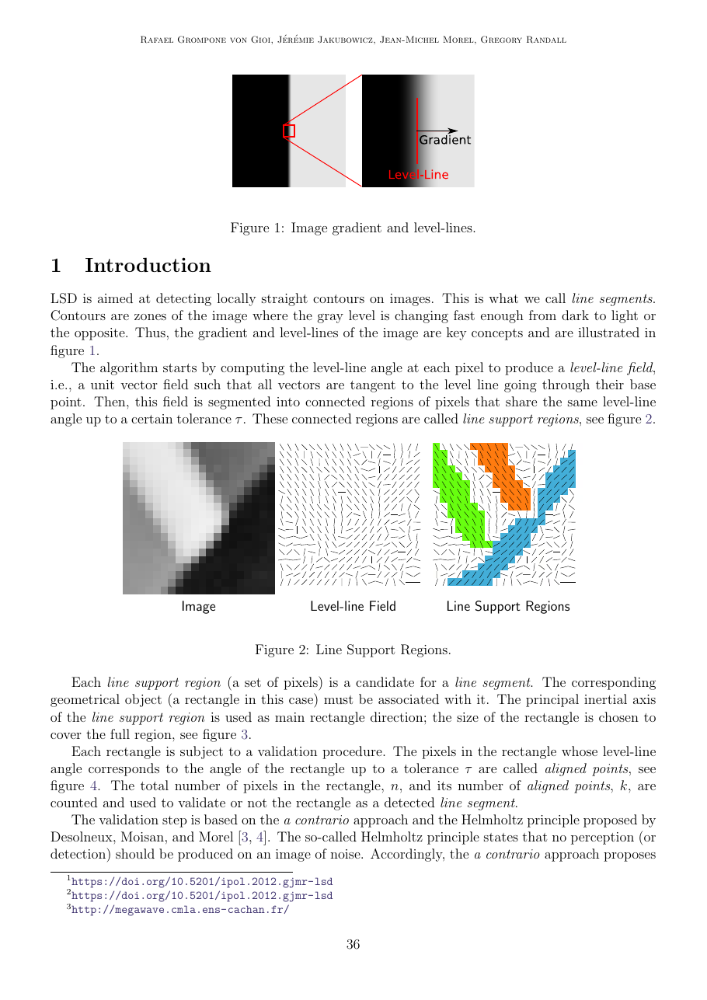
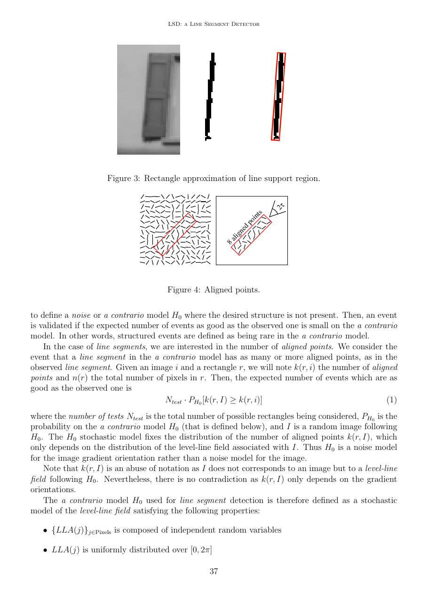
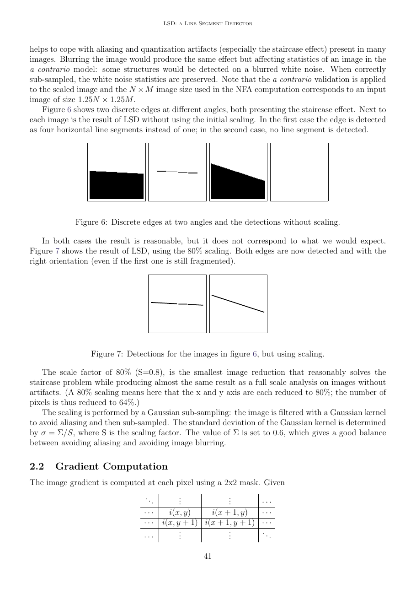

# LSD: 선분 검출기 (번역)

번역 범위: 전문 (초록, 본문 1~3절, 그림 캡션, 알고리즘 상자). 참고문헌은 원문 그대로 둔다.
원문: [GromponeVonGioi2012_IPOL_LSD.pdf](GromponeVonGioi2012_IPOL_LSD.pdf) (IPOL 공개 PDF, 21쪽, 2026-11-04 내려받음)
서지: Grompone von Gioi, R., Jakubowicz, J., Morel, J.-M., Randall, G. (2012). LSD: a Line Segment Detector. Image Processing On Line 2, 35-55. https://doi.org/10.5201/ipol.2012.gjmr-lsd

번역 메모

- level-line은 "등밝기선"으로 옮겼다. 영상 밝기가 같은 점을 잇는 선이며, 방향은 기울기 방향과 90도 차이다.
- a contrario는 원어를 그대로 쓴다. "구조가 없다고 가정한 잡음 모형에 비추어 판단한다"는 뜻이다.
- NFA(Number of False Alarms)는 "거짓 경보 수"로 옮겼다.
- 수식은 원문의 기호를 따른다. 쪽 번호는 학술지 쪽 번호(35~55)다.

---

## 표지 (35쪽)

Image Processing On Line에 2012-03-24 게재. ISSN 2105-1232, (c) 2012 IPOL과 저자, CC-BY-NC-SA.
이 글은 보충 자료, 소프트웨어, 자료 집합, 온라인 시연과 함께 https://doi.org/10.5201/ipol.2012.gjmr-lsd 에서 볼 수 있다.

저자

1. Rafael Grompone von Gioi, CMLA, ENS Cachan, 프랑스
2. Jérémie Jakubowicz, TELECOM ParisTech, 프랑스
3. Jean-Michel Morel, CMLA, ENS Cachan, 프랑스
4. Gregory Randall, IIE, UdelaR, 우루과이

담당 편집: Lionel Moisan. 시연 편집: Rafael Grompone.

### 초록

LSD는 선형 시간에 동작하는 선분 검출기이며 부화소 정확도의 결과를 낸다.
매개변수를 조정하지 않고 어떤 디지털 영상에도 쓰도록 설계했다.
거짓 검출의 수를 스스로 통제한다. 평균적으로 영상 한 장에 거짓 경보 하나를 허용한다 [1].
이 방법은 Burns, Hanson, Riseman의 방법 [2]을 바탕으로 하고, Desolneux, Moisan, Morel의 이론 [3, 4]에 따른 a contrario 검증 방식을 쓴다.
여기서 설명하는 판은 원래 논문 [1]에서 설명한 판보다 몇 가지가 더 개선되었다.

### 소스 코드

IPOL이 동료 심사를 거쳐 받아들인 것은 LSD 1.6판의 ANSI C 구현이다.
소스 코드, 코드 설명서, 온라인 시연은 이 글의 IPOL 웹 페이지에서 볼 수 있다.

### 보충 자료

이 글의 IPOL 웹 페이지에는 예전 구현인 LSD 1.0판과 1.5판, 그리고 동영상의 각 장면에 LSD를 적용한 예도 있다.
1.0판 코드는 원래 논문 [1]의 알고리즘에 더 가깝고, 여기서 설명하는 추가 개선은 들어 있지 않다.
두 판 모두 C 프로그램으로, 또는 Megawave2 틀에서 컴파일할 수 있다. 1.0판과 1.5판은 심사를 받지 않은 자료다.

핵심어: 선분 검출, a contrario 방법

---

## 1. 서론 (36쪽)

그림 1: 영상 기울기와 등밝기선.

LSD는 영상에서 국소적으로 곧은 윤곽을 찾는 것을 목표로 한다. 이것을 우리는 선분이라고 부른다.
윤곽은 밝기가 어두운 쪽에서 밝은 쪽으로(또는 반대로) 충분히 빠르게 바뀌는 영역이다.
따라서 영상 기울기와 등밝기선이 핵심 개념이며, 그림 1에 보였다.

알고리즘은 먼저 각 화소에서 등밝기선 각도를 계산해 등밝기선 장을 만든다.
등밝기선 장은 단위 벡터의 장이며, 각 벡터는 그 기준점을 지나는 등밝기선에 접한다.
다음으로 이 장을 연결된 화소 영역들로 나눈다. 한 영역 안의 화소는 허용 각도 τ 안에서 같은 등밝기선 각도를 갖는다.
이 연결 영역을 선 지지 영역이라고 부른다(그림 2).

그림 2: 선 지지 영역. (왼쪽부터 영상, 등밝기선 장, 선 지지 영역)

선 지지 영역(화소의 집합) 하나하나가 선분 후보다.
여기에 대응하는 기하 객체(여기서는 직사각형)를 붙여야 한다.
선 지지 영역의 주 관성축을 직사각형의 주 방향으로 쓰고, 직사각형 크기는 영역 전체를 덮도록 정한다(그림 3).

그림 3: 선 지지 영역의 직사각형 근사.

각 직사각형은 검증 절차를 거친다.
직사각형 안의 화소 중 등밝기선 각도가 직사각형 각도와 허용 각도 τ 안에서 일치하는 화소를 정렬점이라고 부른다(그림 4).
직사각형 안의 전체 화소 수 n과 정렬점 수 k를 세고, 이 둘로 직사각형을 선분 검출로 인정할지 정한다.

그림 4: 정렬점. (그림 속 예: 정렬점 8개, 허용 폭 2τ)

검증 단계는 Desolneux, Moisan, Morel [3, 4]이 제안한 a contrario 방식과 헬름홀츠 원리를 바탕으로 한다.
헬름홀츠 원리는 잡음 영상에서는 어떤 지각(또는 검출)도 나오면 안 된다는 것이다.
이에 따라 a contrario 방식은 찾으려는 구조가 없는 잡음 모형, 곧 a contrario 모형 H0를 정의한다.
그리고 a contrario 모형에서 관측한 사건만큼 좋은 사건의 기대 개수가 작으면 그 사건을 인정한다.
다시 말해 구조가 있는 사건은 a contrario 모형에서 드문 사건으로 정의된다.

선분의 경우 관심 대상은 정렬점의 수다.
a contrario 모형에서 어떤 선분이 관측한 선분만큼 또는 그보다 많은 정렬점을 갖는 사건을 생각한다.
영상 i와 직사각형 r에 대해, 정렬점 수를 k(r, i), r 안의 전체 화소 수를 n(r)이라고 쓴다.
그러면 관측한 것만큼 좋은 사건의 기대 개수는 다음과 같다.

  Ntest × P_H0[ k(r, I) ≥ k(r, i) ]      (1)

여기서 시험 수 Ntest는 고려하는 모든 가능한 직사각형의 수이고, P_H0는 a contrario 모형 H0(아래에서 정의)에서의 확률이며, I는 H0를 따르는 무작위 영상이다.
H0 확률 모형은 정렬점 수 k(r, I)의 분포를 정하며, 이 분포는 I에 딸린 등밝기선 장의 분포에만 달려 있다.
따라서 H0는 영상 자체의 잡음 모형이 아니라 영상 기울기 방향의 잡음 모형이다.

I는 영상이 아니라 H0를 따르는 등밝기선 장이므로 k(r, I)는 기호를 느슨하게 쓴 것이다.
그래도 k(r, I)는 기울기 방향에만 달려 있으므로 모순은 없다.

따라서 선분 검출에 쓰는 a contrario 모형 H0는 다음 성질을 만족하는 등밝기선 장의 확률 모형으로 정의한다.

- {LLA(j)}, j는 화소, 는 서로 독립인 확률 변수로 이루어진다.
- LLA(j)는 [0, 2π]에서 균등 분포를 따른다.

(38쪽) 여기서 LLA(j)는 화소 j의 등밝기선 각도다.
H0 아래에서 a contrario 모형의 한 화소가 정렬점일 확률은

  p = τ / π

이다. 확률 변수 LLA(j)들이 독립이므로 k(r, I)는 이항 분포를 따른다.
따라서 확률 P_H0[k(r, I) ≥ k(r, i)]는

  P_H0[ k(r, I) ≥ k(r, i) ] = B( n(r), k(r, i), p )

이고, B(n, k, p)는 이항 분포의 꼬리다.

  B(n, k, p) = Σ_{j=k}^{n} C(n, j) p^j (1 − p)^(n−j)

시험 수 Ntest는 정해진 정밀도에서 정렬을 보일 수 있는 직사각형 전체의 수에 해당한다.
직사각형에는 방향이 있다. 즉 시작점과 끝점의 순서가 임의가 아니며, 선분의 어느 쪽이 더 어두운지를 나타낸다.
따라서 점 A에서 점 B로 가는 직사각형과 B에서 A로 가는 직사각형은 서로 다른 시험이다.
빠짐없이 고르면 영상 화소에서 시작하고 끝나는 모든 직사각형을 택하게 된다.
N × M 영상에서는 이것이 NM × NM 가지 직사각형이 된다. 또 각 직사각형마다 √(NM) 가지 폭 값을 고려한다(그림 5).

그림 5: 시험 수 추정. (시작점 N × M 가지, 끝점 N × M 가지, 폭 √(NM) 가지)

따라서 고려하는 직사각형 수는

  (NM)^(5/2)

이다. 정밀도 p는 처음에 τ/π로 두지만, 관련 범위를 덮기 위해 다른 값도 시험한다. 이것은 2.9절에서 설명한다.
시도할 수 있는 서로 다른 p 값의 개수를 γ라고 쓴다. 각 직사각형과 각 p 값의 조합이 서로 다른 시험이다. 따라서 최종 시험 수는

  (NM)^(5/2) γ

이다. 마지막으로 영상 i의 직사각형 r에 대한 거짓 경보 수(NFA)를 다음과 같이 정의한다.

  NFA(r, i) = (NM)^(5/2) γ × B( n(r), k(r, i), p )

(39쪽) 이것은 H0 아래에서 r만큼 드물 정도로 많은 정렬점을 갖는 직사각형의 기대 개수에 해당한다.
어떤 영상 직사각형의 NFA가 크면, 그런 사건은 a contrario 모형에서도 흔히 기대된다는 뜻이다. 즉 흔한 사건이므로 의미가 없다.
반대로 NFA가 작으면 그 사건은 드물고 의미 있을 가능성이 크다.
문턱 ε을 정하고 NFA(r, i) ≤ ε인 직사각형을 ε-유의 직사각형이라고 부르며, 검출로 낸다.

**정리 1**

  E_H0[ Σ_{r∈R} 1_{NFA(r, I) < ε} ] ≤ ε

여기서 E는 기댓값 연산자, 1은 지시 함수, R은 고려하는 직사각형의 집합, I는 H0를 따르는 무작위 영상이다.

이 정리는 a contrario 모형 H0 아래에서 ε-유의 직사각형의 평균 개수가 ε보다 작다는 뜻이다.
따라서 잡음에서 생기는 검출 수는 ε으로 통제되고, 원하는 만큼 작게 만들 수 있다. 다시 말해 LSD는 헬름홀츠 원리를 만족한다.
원래 논문 [1]에는 증명이 없어서 여기에 싣는다.

**증명** k̂(r)를 다음과 같이 정의한다.

  k̂(r) = min{ κ ∈ N : P_H0[ k(r, I) ≥ κ ] ≤ ε / ((NM)^(5/2) γ) }

그러면 NFA(r, i) ≤ ε는 k(r, i) ≥ k̂(r)와 같다. 이제

  E_H0[ Σ_{r∈R} 1_{NFA(r, I) ≤ ε} ] = Σ_{r∈R} P_H0[ NFA(r, I) ≤ ε ] = Σ_{r∈R} P_H0[ k(r, I) ≥ k̂(r) ]

이다. 그런데 k̂(r)의 정의에 따라

  P_H0[ k(r, I) ≥ k̂(r) ] ≤ ε / ((NM)^(5/2) γ)

이고, #R = (NM)^(5/2) γ를 쓰면

  E_H0[ Σ_{r∈R} 1_{NFA(r, I) ≤ ε} ] ≤ Σ_{r∈R} ε / ((NM)^(5/2) γ) = ε

을 얻는다. 이로써 증명을 마친다.

Desolneux, Moisan, Morel [3, 4]을 따라 ε = 1로 한 번에 정한다.
이것은 a contrario 모형에서 영상 한 장당 평균 한 개의 거짓 검출을 허용한다는 뜻이며, 합리적이다.
또 검출 결과는 ε 값에 민감하지 않다.
실제로 검출 한계(ε-유의 직사각형이 될 수 있는 최소 정렬점 수)는 √(−log ε)처럼 변한다.
따라서 ε을 어떤 합리적인 값으로 두어도 결과는 매우 비슷하다.

---

## 알고리즘 1: LSD 선분 검출기 (40쪽)

입력: 영상 I. 출력: 직사각형 목록 out.

1. IS ← ScaleImage(I, S, σ = Σ/S)
2. (LLA, |∇IS|, OrderedListPixels) ← Gradient(IS)
3. Status ← |∇IS| ≤ ρ인 화소는 USED, 나머지는 NOT USED
4. OrderedListPixels의 각 화소 P에 대해
5. 　Status(P) = NOT USED이면
6. 　　region ← RegionGrow(P, τ)
7. 　　rect ← Rectangle(region)
8. 　　AlignedPixelDensity(rect, τ) < D인 동안
9. 　　　region ← CutRegion(region)
10. 　　　rect ← Rectangle(region)
11. 　　반복 끝
12. 　　rect ← ImproveRectangle(rect)
13. 　　nfa ← NFA(rect)
14. 　　nfa ≤ ε이면
15. 　　　rect를 out에 추가
16. 　　끝
17. 　끝
18. 반복 끝

## 2. 알고리즘

LSD는 회색조 영상을 받아 검출한 선분 목록을 돌려준다.
알고리즘 1이 의사 코드로 전체를 설명한다. 보조 영상 Status는 축소한 영상과 같은 크기이며, 이미 쓴 화소를 기록한다.

LSD는 자동 영상 분석 도구로 설계했다. 그래서 매개변수 조정 없이 동작해야 한다.
실제로는 알고리즘의 동작을 정하는 수가 몇 개 있지만, 그 값은 모든 영상에서 동작하도록 신중하게 정했다(아래 논의 참고).
따라서 이 값들은 LSD 설계의 일부인 내부 매개변수이며 사용자가 고르게 두지 않는다.
이 값을 바꾸는 것은 새 변형 알고리즘을 정의하는 것과 같다. 기울기 연산자를 바꾸거나, 영역 확장에서 8-이웃을 4-이웃으로 바꾸어 변형을 만드는 것과 마찬가지다.

다음 절들에서 알고리즘의 각 단계와 여섯 내부 매개변수 S, Σ, ρ, τ, D, ε을 정한 설계 기준을 설명한다.

### 2.1 영상 축소

영상을 다른 축척으로 분석하거나 영상 일부에만 알고리즘을 적용하면 LSD 결과가 달라진다.
이것은 자연스럽다. 멀리서 볼 때와 특정 부분에 주의를 기울일 때 보이는 세부가 다른 것과 같다.
a contrario 검증 단계 덕분에 검출 문턱은 영상 크기에 자동으로 맞춰진다. 영상 크기가 시험 수와 직접 관련되기 때문이다.
분석 축척은 사용자가 고를 수 있으며, 영상을 잘라서 고른다. 그렇지 않으면 LSD는 영상 전체를 자동으로 처리한다.

그럼에도 LSD의 첫 단계는 입력 영상을 크기의 80%로 줄이는 것이다.
(41쪽) 이 축소는 많은 영상에 있는 에일리어싱과 양자화 결함(특히 계단 현상)에 대처하는 데 도움이 된다.
영상을 흐리게 해도 같은 효과를 얻지만, 그러면 a contrario 모형에서 영상의 통계가 달라진다. 흐린 백색 잡음에서도 어떤 구조가 검출될 수 있다.
올바르게 축소하면 백색 잡음의 통계가 보존된다.
a contrario 검증은 축소한 영상에 적용되며, NFA 계산에 쓰는 영상 크기 N × M은 입력 영상 크기 1.25N × 1.25M에 해당한다.

그림 6은 서로 다른 각도의 이산 에지 두 개를 보여 준다. 둘 다 계단 현상이 있다.
각 영상 옆에는 처음의 축소 없이 LSD를 돌린 결과가 있다.
첫째 경우 에지가 한 선분이 아니라 수평 선분 네 개로 검출된다. 둘째 경우에는 아무 선분도 검출되지 않는다.

그림 6: 두 각도의 이산 에지와, 축소 없이 얻은 검출 결과.

두 경우 모두 결과가 틀렸다고는 할 수 없지만 우리가 기대하는 결과와는 다르다.
그림 7은 80% 축소를 쓴 LSD 결과다. 두 에지 모두 검출되고 방향도 맞다(첫째는 여전히 조각나 있지만).

그림 7: 그림 6의 영상에 대한 검출 결과. 단, 축소를 사용함.

축소 비율 80%(S = 0.8)는 계단 문제를 적당히 해결하면서도, 결함이 없는 영상에서는 원래 축척 분석과 거의 같은 결과를 내는 가장 작은 축소다.
(여기서 80% 축소는 x축과 y축을 각각 80%로 줄인다는 뜻이다. 따라서 화소 수는 64%로 준다.)

축소는 가우스 축소 표본화로 한다. 에일리어싱을 막기 위해 가우스 커널로 영상을 거른 뒤 표본을 줄인다.
가우스 커널의 표준편차는 σ = Σ/S로 정한다. 여기서 S는 축소 비율이다.
Σ 값은 0.6으로 두었다. 이것은 에일리어싱을 피하는 것과 영상을 흐리게 하지 않는 것 사이의 좋은 균형이다.

### 2.2 기울기 계산

영상 기울기는 각 화소에서 2x2 마스크로 계산한다. 다음 화소 배치에서

  i(x, y)        i(x+1, y)
  i(x, y+1)      i(x+1, y+1)

(42쪽) i(x, y)는 화소 (x, y)의 밝기 값이며, 영상 기울기는

  gx(x, y) = [ i(x+1, y) + i(x+1, y+1) − i(x, y) − i(x, y+1) ] / 2
  gy(x, y) = [ i(x, y+1) + i(x+1, y+1) − i(x, y) − i(x+1, y) ] / 2

로 계산한다. 등밝기선 각도는

  arctan( gx(x, y) / (−gy(x, y)) )

이고 기울기 크기는

  G(x, y) = √( gx²(x, y) + gy²(x, y) )

이다.

이 간단한 방식은 가능한 가장 작은 마스크를 쓴다. 그래서 계산한 기울기 값들 사이의 의존을 최대한 줄인다(잡음 영상의 경우 이론적인 독립에 가까워진다).

기울기와 등밝기선 각도는 에지의 방향, 즉 어두운 쪽에서 밝은 쪽으로 가는 전이의 각도를 나타낸다.
어두운 쪽에서 밝은 쪽으로의 전이와 밝은 쪽에서 어두운 쪽으로의 전이는 서로 다르며, 대응하는 기울기 각도나 등밝기선 각도가 180도 차이 난다.
따라서 LSD가 검출한 선분에는 방향이 있고, 시작점과 끝점의 순서는 임의가 아니라 선분의 어느 쪽이 더 어두운지를 나타낸다.
예를 들어 영상의 명암을 뒤집으면(검정을 흰색으로, 흰색을 검정으로) LSD 결과는 같지만 모든 선분의 시작점과 끝점이 바뀐다.

계산한 값은 (x, y)가 아니라 좌표 (x + 0.5, y + 0.5)에서의 영상 기울기에 해당한다는 점에 주의한다.
이 반 화소 차이는 출력 직사각형 좌표에 더해, 결과가 일관되게 한다.

a contrario 모형에서 등밝기선 장은 화소마다 독립인 확률 변수로 이루어진다.
그러나 실제로 계산한 등밝기선 장은 영상이 백색 잡음이라도 완전히 독립이 아니다.
이웃 화소 값이 기울기 계산에 함께 쓰이므로 기울기들이 (조금) 의존한다.
그래도 a contrario 방식을 쓰는 데는 문제가 없다.
실제로 수치 모의 [5]에서, 독립인 등밝기선 장에 대해 유도한 같은 문턱이 2x2 마스크로 계산한 경우에도 거짓 검출 수를 통제함을 보였다.

### 2.3 기울기 유사 정렬

LSD는 탐욕 알고리즘이므로 화소를 처리하는 순서가 결과에 영향을 준다.
기울기 크기가 큰 화소는 대비가 강한 에지에 해당한다. 에지에서는 보통 가운데 화소의 기울기 크기가 가장 크다.
그래서 기울기 크기가 가장 큰 화소부터 선분을 찾기 시작하는 것이 타당하다.

정렬 알고리즘은 보통 n개 값을 정렬하는 데 O(n log n) 연산이 든다. 그러나 간단한 화소 유사 정렬은 선형 시간에 할 수 있다.
이를 위해 0부터 영상에서 관측한 최대값까지 기울기 크기를 같은 간격으로 나눈 1024개 구간을 만든다.
화소를 기울기 크기에 따라 구간에 분류한다.
LSD는 먼저 기울기 크기가 가장 큰 구간의 화소를 씨앗으로 쓰고, 이어서 둘째 구간의 화소를 쓰며, 모든 구간을 다 쓸 때까지 계속한다.
밝기 값이 [0, 255] 정수 범위로 양자화되어 있을 때는 1024개 구간이면 기울기 값을 거의 엄밀하게 정렬할 수 있다.

### 2.4 기울기 문턱 (43쪽)

기울기 크기가 작은 화소는 평탄한 영역이나 느린 기울기에 해당한다.
또 이런 화소는 값의 양자화 때문에 기울기 계산 오차가 자연히 더 크다.
그래서 LSD는 기울기 크기가 ρ보다 작은 화소를 버리고, 선 지지 영역이나 직사각형을 만들 때 쓰지 않는다.

양자화 잡음 n과 이상적인 영상 i를 가정하면 관측은

  ĩ = i + n,     ∇ĩ = ∇i + ∇n

이다. 그러면 (그림 8 참고)

  |각도 오차| ≤ arcsin( q / |∇i| )

이며, q는 |∇n|의 상한이다.
쓰는 기준은 각도 오차가 영역 확장 알고리즘에 쓰는 허용 각도 τ보다 큰 화소를 버리는 것이다. 즉 |각도 오차| ≤ τ를 요구하면

  ρ = q / sin τ

를 얻는다. 문턱 ρ는 이 마지막 식으로 정한다. 여기서 q는 양자화 효과로 생길 수 있는 기울기 값 오차의 상한이고 [1], τ는 영역 확장 알고리즘에 쓸 허용 각도다.

그림 8: 양자화 잡음으로 생기는 각도 오차의 추정. (그림 속 ∇i, ∇n, 각도 오차)

보통은 화소 값이 {0, 1, ..., 255}의 정수로 양자화된다. 그러면 기울기의 최대 가능 오차는 1이다(이웃 화소의 양자화 오차가 0.5씩이고 서로 상쇄되지 않을 때).
경험적인 이유로 더 보수적인 상한을 택해 q = 2로 두었다.
그러나 영상 밝기 범위가 [0, 255] 구간과 크게 다르면 이 값은 좋은 결과를 내지 않는다.

### 2.5 영역 확장

쓰지 않은 화소의 정렬 목록에서 한 화소(씨앗)로 시작해, 영역 확장 알고리즘으로 선 지지 영역을 만든다.
이미 영역에 들어간 화소의 쓰지 않은 이웃을 차례로 검사하고, 등밝기선 각도가 영역 각도 θregion과 허용 각도 τ 안에서 같은 화소를 영역에 더한다.
처음 영역 각도 θregion은 씨앗의 등밝기선 각도이며, 화소를 하나 더할 때마다 영역 각도를 다음 값으로 갱신한다.

  θregion = arctan( Σ_j sin(level-line-angle_j) / Σ_j cos(level-line-angle_j) )

(44쪽) 여기서 j는 영역 안의 화소를 돈다.
영역 안의 각 화소에 그 등밝기선 각도를 가진 단위 벡터를 대응시키면, 이 식은 평균 벡터의 각도에 해당한다.
더 더할 화소가 없을 때까지 이를 반복한다. 알고리즘 2가 정확한 정의다.

알고리즘 2: RegionGrow

입력: 등밝기선 장 LLA, 씨앗 화소 P, 허용 각도 τ, 화소마다의 Status 변수. 출력: 화소 집합 region.

1. P를 region에 추가
2. θregion ← LLA(P)
3. Sx ← cos(θregion)
4. Sy ← sin(θregion)
5. region의 각 화소 P에 대해
6. 　Neighborhood(P)의 화소 Q 중 Status(Q) ≠ USED인 각 Q에 대해
7. 　　AngleDiff(θregion, LLA(Q)) < τ이면
8. 　　　Q를 region에 추가
9. 　　　Status(Q) ← USED
10. 　　　Sx ← Sx + cos(LLA(Q))
11. 　　　Sy ← Sy + sin(LLA(Q))
12. 　　　θregion ← arctan(Sy / Sx)
13. 　　끝
14. 　반복 끝
15. 반복 끝

8-연결 이웃을 쓴다. 즉 화소 i(x, y)의 이웃은 i(x−1, y−1), i(x, y−1), i(x+1, y−1), i(x−1, y), i(x+1, y), i(x−1, y+1), i(x, y+1), i(x+1, y+1)이다.

허용 각도 τ는 22.5도, 즉 π/8 라디안으로 둔다. 이것은 45도 범위, 곧 전체 방향 범위의 1/8에 해당한다.
"직사각형과 같은 방향의 화소"라고 부를 수 있는 가장 큰 값에 가깝기 때문에 골랐다.
중요한 것은 정확한 값이 아니라 크기의 정도이며, p = 1/8이 되도록 정했다.
그림 9는 전형적인 예다. 왼쪽은 잡음이 낀 에지의 일부다. 그 옆은 τ를 11.25도, 22.5도, 45도로 두었을 때 영역 확장 결과다.
첫째는 너무 엄격해서 영역이 너무 작다. 45도에서는 영역이 에지에서 너무 멀리 퍼지는 일이 잦다. 22.5도가 좋은 절충이다.

그림 9: 맨 위 가운데 화소에서 시작한 영역 확장의 예. 허용 각도 세 가지. 왼쪽부터 영상, τ = 11.25, τ = 22.5, τ = 45.

더 작은 값으로 얻을 수 있는 영역도 이 방법으로 얻어진다.
(45쪽) 검증 과정에서는 더 작은 정밀도 p 값도 시험하므로, τ 값은 영역 확장 알고리즘에만 영향을 주고 검증에는 영향을 주지 않는다.

### 2.6 직사각형 근사

선분은 기하 사건, 곧 직사각형에 대응한다. 선 지지 영역을 평가하기 전에 그에 맞는 직사각형을 찾아야 한다.
화소 영역을 고체로 보고, 각 화소의 기울기 크기를 그 점의 "질량"으로 쓴다.
그러면 영역의 질량 중심을 직사각형의 중심으로 택하고, 영역의 첫째 관성축을 직사각형의 주 방향으로 둔다.
끝으로 직사각형의 폭과 길이는 선 지지 영역 전체를 덮는 가장 작은 값으로 정한다.

직사각형의 중심 (cx, cy)는

  cx = Σ_{j∈Region} G(j) × x(j) / Σ_{j∈Region} G(j)
  cy = Σ_{j∈Region} G(j) × y(j) / Σ_{j∈Region} G(j)

로 둔다. 여기서 G(j)는 화소 j의 기울기 크기이고, j는 영역 안의 화소를 돈다.
직사각형의 주 각도는 다음 행렬의 가장 작은 고윳값에 대응하는 고유벡터의 각도로 둔다.

  M = [ mxx  mxy ; mxy  myy ]

여기서

  mxx = Σ_{j∈Region} G(j) × (x(j) − cx)² / Σ_{j∈Region} G(j)
  myy = Σ_{j∈Region} G(j) × (y(j) − cy)² / Σ_{j∈Region} G(j)
  mxy = Σ_{j∈Region} G(j) × (x(j) − cx)(y(j) − cy) / Σ_{j∈Region} G(j)

이다.

### 2.7 NFA 계산

직사각형 검증의 핵심 개념은 p-정렬점이다. 곧 직사각형 안의 화소 중 등밝기선 각도가 허용 pπ 안에서 직사각형의 주 방향과 같은 화소다.
정밀도 p는 처음에 τ/π로 두지만, 2.9절에서 설명하듯 다른 값도 시험한다. 시도하는 p 값은 모두 γ가지다.
직사각형 안 전체 화소 수를 n, p-정렬점 수를 k로 쓴다(r과 i가 분명할 때는 생략해 표기를 단순하게 한다).
그러면 직사각형 r에 대한 거짓 경보 수(NFA)는

  NFA(r) = (NM)^(5/2) γ × B(n, k, p)

이다. 여기서 N과 M은 (축소 후) 영상의 열과 행의 수이고, B(n, k, p)는 이항 꼬리

  B(n, k, p) = Σ_{j=k}^{n} C(n, j) p^j (1 − p)^(n−j)

이다.

(46쪽) 정리하면, 평가하는 직사각형마다 정밀도 p를 정하고 k와 n을 센 뒤 NFA 값을

  NFA(r) = (NM)^(5/2) γ × Σ_{j=k}^{n} C(n, j) p^j (1 − p)^(n−j)

로 계산한다. NFA(r) ≤ ε인 직사각형을 검출로 인정한다.

앞에서 말했듯 Desolneux, Moisan, Morel [3, 4]을 따라 ε = 1로 한 번에 정한다.
여기서는 ε 값에 대한 결과의 안정성을 보여 주는 실험 하나만 싣는다.
그림 10은 입력 영상과, ε = 1, ε = 10⁻¹, ε = 10⁻²일 때의 LSD 결과다. 짧은 선분 몇 개만 사라진다.

그림 10: 왼쪽 영상에 대해 서로 다른 세 ε 값(ε = 1, ε = 10⁻¹, ε = 10⁻²)으로 얻은 LSD 결과.

구현에서 이항 꼬리 계산은 감마 함수와의 다음 관계를 이용한다.

  C(n, k) = Γ(n + 1) / ( Γ(k + 1) × Γ(n − k + 1) )

감마 함수는 효율적으로 계산할 수 있다. http://www.rskey.org/gamma.htm 에 설명된 Lanczos와 Windschitl의 방법을 쓴다.
계산을 빠르게 하려고, 오차가 10% 미만으로 묶일 수 있을 때 이항 꼬리의 합을 중간에서 자른다.

### 2.8 정렬점 밀도

τ-허용 각도 방법이 틀린 해석을 낳는 경우가 있다.
이 문제는 영상에 두 곧은 에지가 허용 τ보다 작은 각도로 만날 때 생길 수 있다.
그림 11은 찾아낸 선 지지 영역(회색)과 그에 대응하는 직사각형의 예다.

그림 11: 영역 확장 과정에서 생길 수 있는 문제.

(47쪽) 이 선 지지 영역은 둔각을 이루는 더 가는 두 직사각형(하나가 다른 하나보다 긴)으로 해석하는 것이 낫다.

LSD는 문제가 있는 선 지지 영역을 찾아 더 작은 두 영역으로 자르는 방식으로 이 문제를 다룬다. 올바른 자리에서 잘라 문제가 풀리기를 기대한다.
자른 영역이 받아들여지면 대응하는 직사각형을 다시 계산하고 알고리즘을 이어 간다.

이 "각도 문제"는 직사각형 안 정렬점의 밀도로 찾아낸다.
문제가 없으면 직사각형이 선 지지 영역에 잘 맞고 정렬점 밀도가 높다.
반면 앞 그림처럼 "각도 문제"가 있으면 정렬점 밀도가 낮다.
또 약간 휜 에지를 곧은 에지의 이음으로 국소 근사할 때, 근사의 정도(곡선의 일부를 몇 개의 선분으로 덮는지)는 정렬점 밀도와 관련된다.
따라서 정렬점 밀도는 곡선을 선분으로 근사하는 정밀도와도 관련된다.

직사각형의 정렬점 밀도는 정렬점 수(앞 표기의 k)를 직사각형 넓이로 나눈 값이다.

  d = k / ( length(r) × width(r) )

문턱 D를 정하고, 밀도 d가 D 이상인 직사각형만 받아들인다.
D는 0.7(70%)로 두었다. 이 값은 "각도 문제"를 해결하는 것, 곡선을 매끄럽게 근사하는 것, 선분을 지나치게 자르지 않는 것 사이에서 좋은 균형을 준다.

영역을 자르는 방법은 실제로 두 가지를 시도한다. 허용 각도 줄이기와 영역 반지름 줄이기다.
두 방법 모두 영역의 화소 일부는 남기고, 나머지는 다시 NOT USED로 표시해 이후 다른 선 지지 영역에 쓸 수 있게 한다.
두 방법을 차례로 설명한다.

#### 2.8.1 허용 각도 줄이기

첫째 방법인 허용 각도 줄이기는 영역에 잘 맞는 새 허용 각도 τ'을 추측하고, 같은 씨앗에서 새로 추정한 허용 각도로 영역 확장 알고리즘을 다시 돌린다.
둔각을 이루는 곧은 두 영역이 있을 때, 이 방법은 둘 중 씨앗을 포함한 영역 하나만 얻는 허용 각도를 찾을 것으로 기대한다.

영역의 모든 화소를 허용 각도 추정에 쓰면, 새 값도 모든 화소를 여전히 받아들이게 될 것이다.
그래서 씨앗 근처의 화소만 쓴다. 실제로는 씨앗까지 거리가 처음 계산한 직사각형의 폭보다 작은 화소만 쓴다.
이렇게 하면 τ' 추정에 쓰는 이웃의 크기가 영역 크기에 맞춰진다.

씨앗 점의 이 이웃에 있는 화소를 모두 평가하고, 새 허용 각도 τ'을 이 화소들의 등밝기선 각도 표준편차의 두 배로 둔다.
이 새 값으로 같은 씨앗에서 같은 영역 확장 알고리즘을 적용한다.
그 전에 원래 영역의 모든 화소를 NOT USED로 되돌려, 알고리즘이 다시 쓸 수 있게 하고 버려진 화소도 다른 영역에 쓸 수 있게 한다.

#### 2.8.2 영역 반지름 줄이기

앞의 허용 각도 줄이기는 한 번만 시도한다. 그 결과 선 지지 영역이 밀도 기준을 만족하지 못하면 둘째 방법을 반복해서 시도한다.
이 방법의 생각은 씨앗에서 먼 화소를 차례로 빼서
(48쪽) 기준을 만족하거나 영역이 너무 작아져 버려질 때까지 가는 것이다.
이 방법은 선 지지 영역이 곡선에 해당해서, 밀도 기준을 만족할 때까지(보통 곡선에 대한 어느 정도의 근사를 얻을 때까지) 영역을 줄여야 할 때 가장 잘 동작한다.

씨앗 점에서 영역 안 가장 먼 화소까지의 거리를 영역의 반지름이라고 부른다.
이 방법은 반복할 때마다 영역의 가장 먼 화소들을 빼서 반지름을 원래 값의 75%로 줄인다.
밀도 기준을 만족하거나, 의미 있는 직사각형을 만들 만큼 화소가 남지 않을 때까지 반복한다.
이것은 기준을 만족할 때까지 영역을 점진적으로 줄이는 한 방법일 뿐이다. 한 화소씩 줄여도 되지만 그러면 더 느려진다.

### 2.9 직사각형 개선

선 지지 영역을 의미 없다고(NFA > ε) 버리기 전에, LSD는 처음 찾은 직사각형 배치의 몇 가지 변형을 시도해 유효한 것을 얻으려 한다.

시험하는 요인은 사용하는 정밀도 p와 직사각형의 폭이다.

처음 정밀도는 영역 확장 허용 각도 τ에 대응하며 충분히 크므로, 더 작은 값만 시험하는 것이 의미 있다.
화소들이 잘 정렬되어 있으면 더 가는 정밀도를 써도 정렬점 수는 같고, p가 작아져 NFA가 더 작아(곧 더 좋아)진다.

같은 이치로 직사각형 폭은 줄이는 것만 의미 있다. 처음 폭이 선 지지 영역 전체를 덮도록 골라졌기 때문이다.
폭을 한 화소 줄이면 정렬점 수는 몇 개만 줄면서 전체 화소 수는 직사각형 길이만큼 줄어드는 경우가 많다(그림 12).
이것은 이항 꼬리와 따라서 NFA를 크게 줄일 수 있다.

LSD의 직사각형 개선 루틴은 다음 단계로 이루어진다.

1. 더 가는 정밀도 시도
2. 폭 줄이기 시도
3. 직사각형의 한쪽 변 줄이기 시도
4. 직사각형의 다른 쪽 변 줄이기 시도
5. 더욱 가는 정밀도 시도

의미 있는 직사각형(NFA ≤ ε)을 찾으면 개선 루틴은 그것을 찾은 단계 다음에 멈춘다.

1단계는 정밀도 값 p/2, p/4, p/8, p/16, p/32를 시도한다. 여기서 p는 처음 정밀도 값이다. 가장 좋은(가장 작은) NFA를 내는 값을 남긴다.

2단계는 직사각형 폭을 0.5 화소씩 최대 다섯 번 줄여 본다. 즉 시험하는 폭 값은 W, W − 0.5, W − 1, W − 1.5, W − 2, W − 2.5이며 W는 처음 폭이다. 이번에도 가장 좋은 NFA를 내는 값을 남긴다.

그림 12: 최적보다 큰 직사각형을 만들게 되는 선 지지 영역.

(49쪽) 3단계는 직사각형의 한쪽 변만 0.5 화소씩 다섯 번 줄여 본다.
이것은 직사각형 폭을 0.5 화소 줄이는 동시에, 다른 쪽 변의 위치를 유지하기 위해 직사각형 중심을 0.25 화소 옮기는 것이다.
따라서 시험하는 변 이동은 0.5, 1, 1.5, 2, 2.5 화소다. 이번에도 가장 좋은 NFA를 내는 값을 남긴다.

4단계는 직사각형의 다른 쪽 변에 3단계와 같은 일을 한다.

5단계는 정밀도를 더 줄여 본다. 이 단계는 정밀도 값 p̂/2, p̂/4, p̂/8, p̂/16, p̂/32를 시험한다. p̂는 이 단계를 시작할 때의 정밀도다. 가장 좋은 NFA를 내는 값을 남긴다.

처음 정밀도 p = τ/π에 더해, 1단계에서 다섯 값, 5단계에서 다시 다섯 값을 시험할 수 있다. 따라서 γ = 11이다.
덮는 정밀도 범위는 p = τ/π에서 p = τ/(1024π)까지이며, 관련된 모든 경우를 덮기에 충분하고도 남는다. 가장 가는 정밀도는 약 0.02도다.
1도 정밀도에 이르는 다섯 단계면 충분하겠지만, 이 세분화는 때로는 폭 세분화 앞에서, 때로는 뒤에서 더 잘 동작하므로, 둘 다 하는 데 큰 문제는 없다.

### 2.10 계산 복잡도

가우스 축소 표본화와 영상 기울기 계산은 모두 영상 화소 수에 비례하는 연산으로 할 수 있다.
다음으로 화소를 구간 분류로 유사 정렬하며, 이것도 선형 시간에 할 수 있다.
선 지지 영역을 찾는 알고리즘의 계산 시간은 방문한 화소 수에 비례하며, 이 수는 모든 영역의 화소 수에 각 영역의 경계 화소를 더한 것과 같다.
따라서 방문 화소 수는 영상 전체 화소 수에 비례한다.
나머지 처리는 두 종류로 나눌 수 있다.
첫째 종류(예: 영역 질량 합, 정렬점 세기)는 모든 영역에 관련된 전체 화소 수에 비례한다.
둘째 종류(예: 관성 모멘트 계산, 정렬점 수에서 NFA 값 계산)는 영역 수에 비례한다.
관련 화소 수와 영역 수는 모두 많아야 화소 수와 같다.
결국 LSD의 실행 시간은 영상의 화소 수에 비례한다.

## 3. 예제 (49~54쪽)

다음 예제들은 LSD로 얻는 결과(좋은 것과 나쁜 것 모두)가 어떤지 보여 주려는 것이다.

그림 13: 의자, 512 × 512 화소. 좋은 결과. 검출된 선분은 영상에서 경험적으로 곧은 구조에 해당한다. 검출 결과는 지각적으로 기대하는 결과와 대략 일치한다.

그림 14: 분자 LSD, 305 × 274 화소. LSD는 국소적으로 곧은 에지를 찾으므로, 검정 획 하나마다 흰색에서 검정으로 가는 전이 하나씩, 검출이 두 개 나온다. 또 선분에는 최소 길이가 있어서 그보다 짧은 것은 검출되지 않는다(예: 숫자 '2'의 밑변). 검출 최소 크기는 영상 크기에 달려 있다. 영상 크기가 커지면 NFA가 커지기 때문이다.

그림 15: 원, 249 × 249 화소. 곡선이 있으면 LSD는 국소적으로 곧은 곡선 부분에 해당하는 짧은 선분들을 낸다. 결과는 곡선의 다각형 근사다. 곡률이 너무 크면 당연히 LSD는 실패한다.

그림 16: 잡음, 256 × 256 화소. LSD는 거짓 검출을 잘 통제하도록 설계했다. 거짓 검출 통제는 잡음 영상에서 우연히 생길 수 있는 검출을 막는 검출 문턱을 자동으로 주는 데 바탕을 둔다. 그래서 이 영상에서는 검출이 없다.

그림 17: 그림자와 잡음, 260 × 264 화소. 보이는 곧은 구조의 상당 부분이 검출되지 않는다. 그림자 속의 느린 기울기와 잡음 때문이다. 그러나 그림 18처럼 다른 축척에서는 LSD가 이 구조를 검출할 수 있다.

그림 18: 그림자와 잡음, 축소 표본화, 130 × 132 화소. 앞 영상을 축소 표본화한 예. 가우스 축소 표본화를 하면 잡음이 일부 제거되고 구조가 알맞은 축척에서 분석된다. 기대한 선분이 검출된다.

그림 19: 작은 것, 417 × 417 화소. LSD는 거짓 검출 수를 통제하려고 a contrario 틀을 쓰므로 결과가 영상 크기에 달려 있다. 시험 수가 영상 크기에 달려 있기 때문이다. 그 결과 LSD 결과는 영상 전체에 적용할 때와 일부를 잘라 적용할 때 국소적으로 다를 수 있다. 이 영상에는 검출 한계 바로 아래의 작은 정사각형이 있다. 그래서 검출이 나오지 않는다. 그러나 그림 20의 다음 예는 이 영상의 잘린 부분이며, 정사각형이 실제로 검출된다. 이것은 LSD의 자연스러운 동작이며, 세부 수준이 분석하는 자료 전체의 크기에 달려 있다는 뜻이다. 사람의 지각도 비슷하다. 작은 세부는 주의를 끌지 않으면 흔히 눈에 띄지 않는다.

그림 20: 작은 것, 잘라낸 부분, 28 × 28 화소. 그림 19 예제에서 정사각형을 중심으로 자른 부분. 이제 정사각형이 검출된다.

그림 21: 하늘, 179 × 179 화소. 어떤 영역은 일부는 비등방이고 일부는 곧다. 이런 영역은 예상하지 못한 검출을 낼 수 있다.

그림 22: 깁스, 100 × 100 화소. 영상 압축에서 생기는 깁스 효과가 예상하지 못한 검출을 많이 만든다.

그림 23: 색, 254 × 254 화소. LSD는 회색조 영상에 쓰도록 설계했다. 색 영상에 LSD를 적용하려면 먼저 회색조로 바꿔야 한다. 그러나 이 변환에서 어떤 색 에지는 사라질 수 있다. 예를 들어 왼쪽 영상에는 분명한 에지가 있지만, 표준 회색조 변환(가운데) 뒤에는 에지가 사라진다. 빨강 값과 초록 값이 같은 회색 값으로 바뀌기 때문이다. 그래서 LSD는 검출을 내지 않는다(오른쪽). LSD의 입력(가운데)에 에지가 없기 때문이다. 에지는 LSD가 아니라 색에서 회색조로의 변환에서 사라진다. 이런(비교적 드문) 경우를 다루도록 LSD를 확장할 수 있지만 현재 구현에는 넣지 않았다.

그림 24: 피레우스, 600 × 600 화소. 실제 장면 예. 대체로 LSD는 실제 영상에서 합리적인 결과를 낸다.

## 영상 출처

모든 영상은 저자들이 만들었다.

## 참고문헌 (원문 그대로)

[1] Rafael Grompone von Gioi, Jérémie Jakubowicz, Jean-Michel Morel, Gregory Randall, LSD: A Fast Line Segment Detector with a False Detection Control, IEEE Transactions on Pattern Analysis and Machine Intelligence, vol. 32, no. 4, pp. 722-732, April 2010. http://doi.ieeecomputersociety.org/10.1109/TPAMI.2008.300

[2] J. Brian Burns, Allen R. Hanson, Edward M. Riseman, Extracting Straight Lines, IEEE Transactions on Pattern Analysis and Machine Intelligence, vol. 8, no. 4, pp. 425-455, 1986.

[3] Agnès Desolneux, Lionel Moisan, Jean-Michel Morel, Meaningful Alignments, International Journal of Computer Vision, vol. 40, no. 1, pp. 7-23, 2000. http://dx.doi.org/10.1023/A:1026593302236

[4] Agnès Desolneux, Lionel Moisan, Jean-Michel Morel, From Gestalt Theory to Image Analysis, a Probabilistic Approach, Springer 2008. ISBN: 0387726357

[5] Rafael Grompone von Gioi, Jérémie Jakubowicz, Jean-Michel Morel, Gregory Randall, On Straight Line Segment Detection, Journal of Mathematical Imaging and Vision, vol. 32, no. 3, pp. 313-347, November 2008. http://dx.doi.org/10.1007/s10851-008-0102-5
