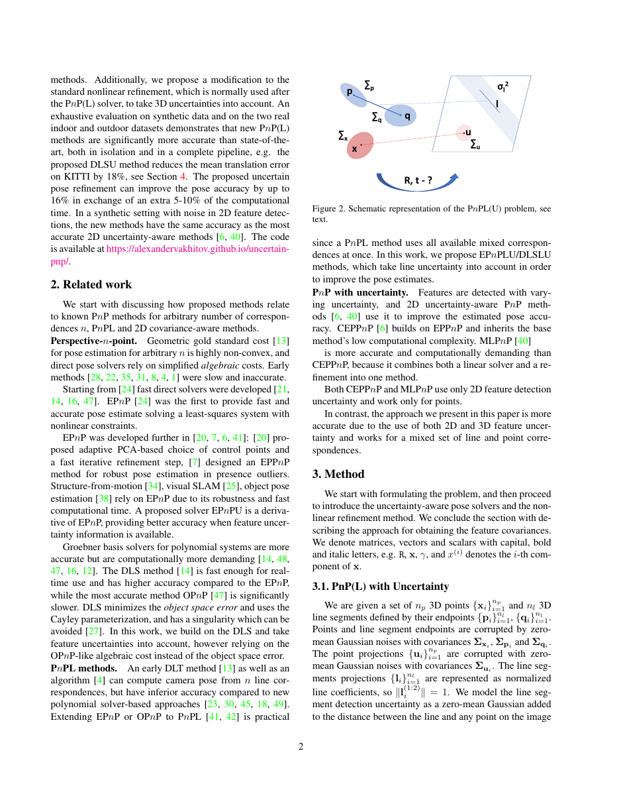
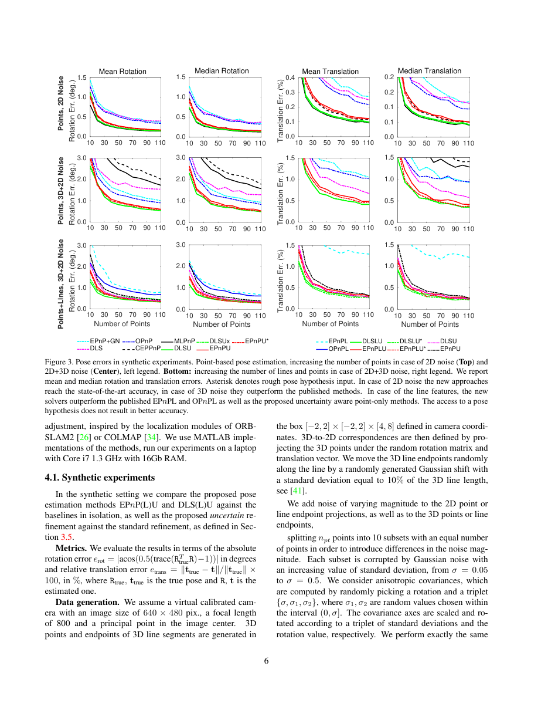
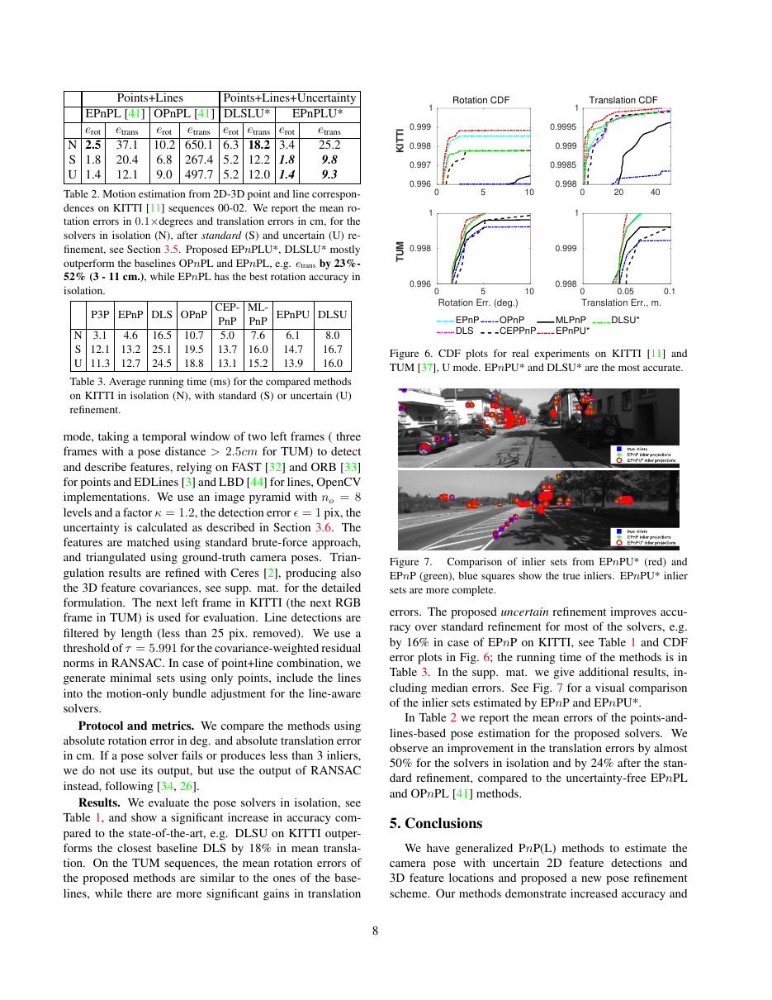

# 점과 선으로부터 불확도를 고려한 카메라 자세 추정 (번역)

- 원제: Uncertainty-Aware Camera Pose Estimation from Points and Lines
- 저자: Alexander Vakhitov (SLAMcore, 영국), Luis Ferraz Colomina (Kognia Sports Intelligence, 스페인), Antonio Agudo, Francesc Moreno-Noguer (Institut de Robòtica i Informàtica Industrial, CSIC-UPC, 스페인)
- 원문: arXiv:2107.03890v1 [cs.CV], 2021-07-08. 같은 폴더 `Vakhitov2021_arXiv_2107.03890.pdf` (10쪽)
- 번역 범위: 전문(초록, 본문, 그림과 표 캡션). 이 PDF에는 부록이 없다. 본문이 가리키는 보충 자료(supp. mat.)는 별도 파일이며 받지 않았다. 참고문헌은 원문 그대로 둔다.
- 번역 메모: 수식 기호는 원문을 따른다. 원문에서 pdftotext로 깨진 수식은 쪽 이미지를 보고 다시 적었다.

---

## 초록

PnPL(Perspective-n-Point-and-Line) 알고리즘은 2D-3D 특징 대응으로부터 3D 모델에 대한 카메라 위치를 빠르고, 정확하고, 강건하게 구하려는 방법이다. 현대 로봇과 AR/VR 시스템의 주요 부분이다.
현재 점 기반 자세 추정 방법은 2D 특징 검출의 불확도만 쓴다. 선 기반 방법은 불확도를 전혀 고려하지 않는다.
우리 설정에서는 특징의 3D 좌표와 2D 투영을 모두 불확실한 값으로 본다.
불확도를 고려한 자세 추정을 위해 EPnP [20]와 DLS [14]를 바탕으로 한 PnP(L) 풀이기를 제안한다.
또 움직임만 다루는 번들 조정(motion-only bundle adjustment)을 고쳐 3D 불확도를 반영한다.
두 시각 주행거리(visual odometry) 자료로 합성 실험과 실측 실험을 폭넓게 했다.
새 PnP(L) 방법은 실측 자료에서 단독으로도 최신 방법보다 낫다. KITTI의 대표 부분집합에서 평균 이동 정확도가 18% 올랐다.
새 불확도 정제는 대부분의 풀이기에서 자세 정확도를 높였다. 예를 들어 같은 자료에서 EPnP의 평균 이동 오차를 표준 정제보다 16% 줄였다.
코드는 https://alexandervakhitov.github.io/uncertain-pnp/ 에 있다.

> 그림 1. 2D와 3D 불확도 전체를 활용하는, 전역 수렴하는 PnP(L) 풀이기를 제안한다. 희소 특징으로 된 3D 장면 모델을 자세를 아는 영상들(오른쪽 카메라들)로 복원했고, 왼쪽 카메라의 자세를 찾아야 한다. 점에는 2D 검출 불확도(파란 타원체)와 3D 모델 불확도(장면 안의 빨간 타원체)가 있다.

## 1. 서론

희소 특징 대응을 쓰는 카메라 위치 추정은 증강 현실, 가상 현실, 로봇 시스템의 주요 부분이다.
PnP(L) 방법은 희소 특징 대응으로부터 보정된 카메라의 자세를 구하는 데 잘 쓰인다.
선 특징은 독특한 질감이 없는, 사람이 만든 자기 유사 환경에서 위치 정확도를 높일 수 있다 [36, 43, 15, 29]. 그래서 PnP(L) 방법을 쓰게 된다 [41].

자동으로 복원한 희소 특징 지도를 기준으로 한 영상 기반 위치 추정은 현재 로봇과 AR/VR 시스템의 중요한 부분이다. 그런데 흔히 쓰는 PnP 방법은 특징을 완전히 정확하다고 본다 [47, 14, 20, 16].
더 최근의 2D 공분산 고려 방법은 이 가정을 완화한다 [40, 6]. 하지만 특징 검출에만 그렇다. 3D 특징 좌표는 여전히 완전히 정확하다고 가정한다.

구조 복원(structure-from-motion)으로 만든 지도에서는 3D 특징 좌표의 정확도가 들쭉날쭉하다.
스테레오 삼각측량 오차는 물체와 센서 사이 거리의 제곱으로 커진다. 그래서 점 깊이 추정 정확도는 몇 자릿수만큼 다를 수 있다.
선의 스테레오 삼각측량 정확도는 선 방향과 기준선 사이 각도에 달려 있다.
그럼에도 우리가 아는 한, 3D와 2D 불확도를 모두 고려하도록 설계된 PnP(L) 방법은 지금까지 없었다.

우리는 특징 불확도를 PnP(L) 방법에 넣는 것을 제안한다(그림 1). 이것이 주된 기여다.
고전적인 DLS [14]와 EPnP [20] 방법을 바탕으로 한다.
또 PnP(L) 풀이기 뒤에 보통 쓰는 표준 비선형 정제를 고쳐 3D 불확도를 반영하게 한다.
합성 자료와 실내외 실측 자료 두 가지로 폭넓게 평가했다. 새 PnP(L) 방법은 단독으로나 전체 처리 과정 안에서나 최신 방법보다 훨씬 정확하다. 예를 들어 제안한 DLSU 방법은 KITTI에서 평균 이동 오차를 18% 줄였다(4절).
제안한 불확도 자세 정제는 계산 시간을 5~10% 더 쓰는 대신 자세 정확도를 최대 16% 높일 수 있다.
2D 특징 검출에만 잡음이 있는 합성 설정에서는, 새 방법이 가장 정확한 2D 불확도 고려 방법 [6, 40]과 정확도가 같다.
코드는 https://alexandervakhitov.github.io/uncertain-pnp/ 에 있다.

> (각주) 이 연구는 스페인 정부 과제 HuMoUR TIN2017-90086-R, ERA-Net Chistera 과제 IPALM PCI2019-103386, María de Maeztu Seal of Excellence MDM-2016-0656의 일부 지원을 받았다.

## 2. 관련 연구

먼저 제안 방법이 임의 대응 개수 n에 대한 기존 PnP 방법, PnPL 방법, 2D 공분산 고려 방법과 어떻게 관련되는지 다룬다.

**Perspective-n-point.** 임의의 n에 대한 자세 추정의 기하적 기준 비용(gold standard cost) [13]은 매우 비볼록하다. 그래서 직접 자세 풀이기는 단순화한 대수적(algebraic) 비용에 기댄다.
초기 방법 [28, 22, 35, 31, 8, 4, 1]은 느리고 부정확했다.
[24]부터 빠른 직접 풀이기가 개발되었다 [21, 14, 16, 47]. EPnP [24]는 비선형 제약이 있는 최소제곱 연립식을 풀어 빠르고 정확한 자세를 처음으로 제공했다.
EPnP는 [20, 7, 6, 41]에서 더 발전했다. [20]은 PCA 기반으로 제어점을 적응적으로 고르고 빠른 반복 정제 단계를 제안했다. [7]은 이상치가 있을 때 강건한 자세 추정을 위한 EPPnP 방법을 설계했다.
구조 복원 [34], 시각 SLAM [25], 물체 자세 추정 [38]은 강건성과 빠른 계산 시간 때문에 EPnP에 기댄다.
제안한 풀이기 EPnPU는 EPnP에서 파생되었고, 특징 불확도 정보가 있을 때 더 나은 정확도를 낸다.

다항식 연립을 푸는 그뢰브너 기저 풀이기는 더 정확하지만 계산이 더 무겁다 [14, 48, 47, 16, 12].
DLS 방법 [14]은 실시간에 쓸 만큼 빠르고 EPnP보다 정확하다. 가장 정확한 OPnP [47]는 훨씬 느리다.
DLS는 물체 공간 오차(object space error)를 최소화하고 케일리(Cayley) 매개화를 쓴다. 피할 수 있는 특이점이 하나 있다 [27].
이 연구에서는 DLS를 바탕으로 특징 불확도를 고려한다. 다만 물체 공간 오차 대신 OPnP와 비슷한 대수적 비용에 기댄다.

**PnPL 방법.** 초기 DLT 방법 [13]과 알고리즘 [4]는 n개의 선 대응으로 카메라 자세를 계산할 수 있다. 그러나 새로운 다항식 풀이기 기반 방법 [23, 30, 45, 18, 49]보다 정확도가 떨어진다.
EPnP나 OPnP를 PnPL로 확장하는 것 [41, 42]이 실용적이다. PnPL 방법은 가진 점과 선의 섞인 대응을 한꺼번에 모두 쓰기 때문이다.
이 연구에서는 선 불확도를 고려해 자세 추정을 개선하는 EPnPLU, DLSLU 방법을 제안한다.

**불확도를 쓰는 PnP.** 특징은 서로 다른 불확도로 검출된다. 2D 불확도를 고려하는 PnP 방법 [6, 40]은 이를 이용해 추정 자세의 정확도를 높인다.
CEPPnP [6]는 EPPnP를 바탕으로 하며 기반 방법의 낮은 계산 복잡도를 물려받는다.
MLPnP [40]는 선형 풀이기와 정제를 한 방법으로 합쳤기 때문에 CEPPnP보다 정확하고 계산이 더 무겁다.
CEPPnP와 MLPnP는 모두 2D 특징 검출 불확도만 쓰고 점에만 동작한다.
반면 이 논문의 방법은 2D와 3D 특징 불확도를 모두 써서 더 정확하고, 선과 점이 섞인 대응에도 동작한다.

## 3. 방법

먼저 문제를 정식화하고, 불확도를 고려한 자세 풀이기와 비선형 정제 방법을 소개한다. 마지막으로 특징 공분산을 얻는 방법을 설명한다.
행렬, 벡터, 스칼라는 각각 대문자, 굵은 글씨, 기울인 글씨로 적는다(예: R, **x**, γ). x(i)는 **x**의 i번째 성분이다.

### 3.1. 불확도를 고려한 PnP(L)

n_p개의 3D 점 {x_i}와, 끝점 {p_i}, {q_i}로 정의한 n_l개의 3D 선분이 주어진다.
점과 선분 끝점에는 공분산 Σ_xi, Σ_pi, Σ_qi인 평균 0의 가우스 잡음이 있다.
점 투영 {u_i}에는 공분산 Σ_ui인 평균 0의 가우스 잡음이 있다.
선분 투영 {l_i}는 정규화한 직선 계수로 나타낸다. 즉 ‖l_i(1:2)‖ = 1이다.
선분 검출 불확도는, 영상 평면 위 임의의 점과 그 직선 사이 거리에 더해지는 분산 σ²_l,i인 평균 0의 가우스 잡음으로 모형화한다(그림 2).
내부 매개변수를 아는 카메라를 생각하며, 카메라 보정 행렬 K는 단위행렬이라고 가정한다.

> 그림 2. PnPL(U) 문제의 개념도. 본문 참고. (그림: 3D 점 x와 공분산 Σx, 3D 선분 끝점 p, q와 공분산 Σp, Σq, 영상의 점 투영 u와 공분산 Σu, 영상의 직선 l과 법선 방향 분산 σ²_l. 구할 값은 R, t.)

문제는 카메라 좌표계를 세계 좌표계에 맞추는 회전 행렬 R과 이동 벡터 t를 추정하는 것이다.
평균 장면 깊이의 추정값 d̄를 안다고 가정한다. 대략적인 초기 가설 R̂, t̂가 있는 경우도 고려한다.

### 3.2. 자세 추정 풀이기를 위한 불확도

이 절에서는 불확도를 고려한 자세 추정 방법을 유도한다.
대수적 특징 투영 잔차의 불확도를 구하고, 이를 잔차 공분산의 형태로 자세 풀이기에 넣는다.
점 특징부터 시작해 선으로 넘어간다.

**점 잔차.** 카메라 좌표계의 점을 x̂(θ, x) = Rx + t로 매개화한다. θ는 카메라 매개변수 R, t를 나타낸다.
대수적 점 잔차는 원근 점 투영에 기반한다.

$$ r^{pt}(\theta, x, u) = \hat{x}^{(1:2)}(\theta, x) - u\,\hat{x}^{(3)}(\theta, x) \quad (1) $$

여기서 u는 투영된 점이다.
가정에 따라 x와 u에는 공분산 Σx, Σu인 평균 0의 가산 가우스 잡음이 있다. 즉 x̂(θ, x) = E x̂ + ξ, u = E u + ζ이고, ξ, ζ는 평균 0의 가우스 잡음 벡터다.
x̂(θ, x)의 공분산은 다음과 같다.

$$ \Sigma_{\hat{x}} = R\Sigma_x R^T = \begin{bmatrix} S & w \\ w^T & \gamma \end{bmatrix} \quad (2) $$

이를 (1)에 대입하면

$$ r^{pt} = E\{\hat{x}^{(1:2)} - u\hat{x}^{(3)}\} + \xi^{(1:2)} - u\xi^{(3)} - \zeta\hat{x}^{(3)} - \xi^{(3)}\zeta \quad (3) $$

이다(간결하게 함수 인자를 뺐다).
(3)의 공분산을 E r^pt (r^pt)^T로 적고 ξ와 ζ의 독립성을 쓰면 잔차 공분산을 얻는다.

$$ \Sigma_{r^{pt}} = S + \gamma u u^T + (\hat{x}^{(3)})^2\Sigma_u - (u w^T + w u^T) \quad (4) $$

Σ_r^pt를 계산하려면 R과 x̂(3)을 알아야 한다.
모델 점 공분산을 Σx ≈ σ²I로 근사하면(I는 단위행렬), (2)에서 Σx̂ ≈ σ²I도 성립한다.
대략적인 자세 가설 R̂, t̂가 있으면 이를 대신 써서 Σ_r^pt를 근사할 수 있다.
새 풀이기를 두 가지로 제안한다.
첫째는 풀이기가 평균 장면 깊이 추정값 d̄로 점 깊이를 근사하고, 3D 점 공분산을 등방으로 근사한다(아래 3.6절). 이를 EPnPU, DLSU라 부른다.
둘째는 풀이기가 자세 가설(보통 RANSAC 반복의 출력으로 얻는다)로 점 깊이를 근사하고 3D 점 공분산 추정값을 계산한다. 이를 DLSU*, EPnPU*라 적는다.

**선 잔차.** 정규화한 2D 선분 계수 l과 선분의 3D 끝점 p, q가 주어진다. [41]을 따라 대수적 선 잔차를 생각한다.

$$ r^{ln}(\theta, p, q, l) = \begin{bmatrix} l^T \hat{p}(\theta, p) \\ l^T \hat{q}(\theta, q) \end{bmatrix} \quad (5) $$

여기서 p̂(θ, p), q̂(θ, q)는 카메라 좌표계의 3D 끝점이고, ln은 '선(line)'을 뜻한다.
끝점을 p̂(θ, p) = E p̂(θ, p) + η_p로 분해하자. η_p의 공분산은 Σ_p̂ = RΣ_pR^T다.
선 검출 잡음 모형에 따르면, 잡음이 섞인 부호 있는 선과 점 사이 거리는 l^T y_h = E{l^T} y_h + ν_y다. ν_y는 분산 σ²_l인 평균 0의 가우스이고, y_h는 동차 좌표로 쓴 영상의 임의 점이다.
y_h가 깊이 λ_y인 점 y = λ_y y_h의 투영이면, l^T y = E{l^T y} + λ_y ν_y다.
따라서

$$ l^T\hat{p}(\theta, p) = E\{l^T\hat{p}(\theta, p)\} + \lambda_p\nu_p + l_i^T\eta_{P_i} \quad (6) $$

이고, 여기서 ν_Pi는 선 검출 잡음이다. 분산은

$$ E(l^T\hat{p} - E\,l^T\hat{p})^2 = \lambda_p^2\sigma_l^2 + l^T\Sigma_{\hat{p}}\,l \quad (7) $$

이다(간결하게 함수 인자를 뺐다).
우리 모형에서 p, q의 잡음과 선 검출 잡음은 서로 독립이라고 가정한다.
이것이 단순화라는 점은 인정한다. 하지만 계산이 빨라지고, 실험에서 보이듯 실제로 잘 동작한다.
또 다른 연구들(예: [29])도 이런 모형에 기댄다. 오프라인 설정이라면 [10]처럼 선에 더 정교한 잡음 모형을 쓸 수도 있다.
선 잔차의 공분산은

$$ \Sigma_{r^{ln}} = \sigma_l^2\,\mathrm{diag}(\lambda_p^2, \lambda_q^2) + \mathrm{diag}(l^T\Sigma_{\hat{p}}l,\; l^T\Sigma_{\hat{q}}l) \quad (8) $$

이다.
이 공분산을 계산하려면 R과 점 깊이 λ_p, λ_q가 필요하다.
EPnPLU와 DLSLU에서는 문제 정식화에서 주어진 d̄로 점 깊이를 근사하고 공분산 Σ_P̂i, Σ_Q̂i를 등방으로 근사한다. EPnPLU*와 DLSLU*에서는 자세 가설 R̂, t̂로 이 값들을 계산한다.

지금까지 우리 잡음 모형 아래에서 점 특징과 선 특징의 잔차 공분산의 일반형을 얻었다. 다음으로 이를 PnP(L) 풀이기에서 어떻게 쓰는지 보인다.

### 3.3. 불확도를 쓰는 EPnP

EPnP [20]와 EPnPL [41]을 일반화해 자세 예측에 2D와 3D 불확도를 활용한다.
EPnP는 먼저 점 x의 SE3 불변 무게중심 표현 α를 계산한다.

$$ x = C\alpha \quad (9) $$

여기서 C = [c1, ..., c4]는 세계 좌표계에서 특별히 고른 네 제어점의 행렬이다.
[20]은 첫 점 c1을 x_i의 평균으로, c2, c3, c4를 주성분 분석(PCA)으로 구한 최대 분산 방향으로 고르자고 제안했다.
예비 실험에서, x에 3D 잡음을 더하면 PCA 방식의 정확도가 떨어졌다.
그래서 제어점 선택이 3D 불확도를 쓰도록 고쳤다.
3D 점 공분산을 등방 근사 Σx ≈ σ²_x I(σ²_x = trace(Σx)/3)로 두면, 이론적으로 탄탄한 PCA의 일반화를 곧바로 얻을 수 있다.
고전 PCA는 j번째 주방향을 얻기 위해 다음 문제를 푼다.

$$ \sum_i (z^T\tilde{x}_i)^2 \rightarrow \max_z \quad \text{s.t. } \|z\| = 1 \quad (10) $$

여기서 x̃_i는 중심을 뺀 점에서 앞의 j−1개 성분으로의 투영까지 뺀 것이고, z는 구하려는 주방향이다.
‖z‖ = 1을 쓰면 공분산은 cov(z^T x̃) = z^T x̃ x̃^T z = z^T Σ_x̃ z = σ²_x다.
그래서 문제를 다음과 같이 고친다.

$$ \sum_i \sigma_{x,i}^{-2}(z^T\tilde{x}_i)^2 \rightarrow \max_z \quad \text{s.t. } \|z\| = 1 \quad (11) $$

자세한 내용은 보충 자료를 보라.

EPnPL에서 카메라 자세는 카메라 좌표계의 제어점으로 나타낸다. 즉 θ_EPnP = Ĉ = [ĉ1, ..., ĉ4]이고 ĉ_i = Rc_i + t다.
카메라 좌표계의 점은 x̂(θ_EPnP, x) = Ĉα(x)다.
EPnP(L)은 선과 점의 대수적 잔차 (1, 5)를 써서 다음 문제를 푼다.

$$ \|M\,\mathrm{vec}(\hat{C})\|^2 \rightarrow \min_{\hat{C}} \quad (12) $$

vec(.)는 행렬을 벡터로 편 것이다. 해는 12×12 행렬 M^T M의 고유분해로 얻는다.
그다음 M^T M의 가장 작은 고유값들에 해당하는 고유벡터의 부분공간에서 Ĉ를 찾는다.

제안하는 EPnP(L)U 방법도 같은 전략을 따르되, 불확도를 더한 행렬 M_U를 만든다.
앞 절에서, 점과 선의 대수적 잔차 (1, 5)의 공분산을 추정하려면 R과 t를 알아야 한다고 했다.
그러나 점 공분산을 등방 공분산 행렬 Σx ≈ σ²_x I, Σp ≈ σ²_p I, Σq ≈ σ²_q I(σ² = trace(Σ)/3)로 근사하면 잔차가 R에 의존하지 않게 된다.
점 깊이를 대략적인 장면 깊이 d̄로 바꾸면, 점 잔차 (1)과 선 잔차 (5)의 공분산은 다음과 같다.

$$ \Sigma^{EPnP}_{r^{pt}} = \sigma_x^2 I + \bar{d}^2\Sigma_u + \sigma_x^2 u u^T \quad (13) $$

$$ \Sigma^{EPnP}_{r^{ln}} = \sigma_l^2\bar{d}^2 I + \|l\|^2\mathrm{diag}(\sigma_p^2, \sigma_q^2) \quad (14) $$

대략적인 자세 가설이 주어지는 경우도 고려한다. 이때도 불확도는 등방으로 근사하지만, 자세를 써서 점 깊이를 추정한다. 방법은 기본형과 같이 진행한다.
다음으로 DLS 기반 방법을 설명한다.

### 3.4. 불확도를 쓰는 DLS

DLS 방법 [14]은 케일리 회전 매개화를 써서, 점 대응의 대수적 잔차로 된 최소제곱 다항식 연립을 그뢰브너 기저 기법으로 푼다.
이 방법은 이른바 물체 공간 오차 PnP에 기댄다. 즉 점 검출의 역투영 광선과 3D 점 사이 거리를 최소화한다.
그러나 우리는 대수적 잔차 (1)을 쓰기로 했다. 이렇게 하면 계산이 더 빠르고 정확도는 비슷하다(비교는 보충 자료).
DLS는 27×27 행렬의 고유분해를 한다.
DLS의 케일리 매개화는 그대로 두되 식을 다시 세우고, [19]의 생성기로 같은 차원의 새 풀이기를 만든다.
DLS는 카메라 좌표계의 점을 x̂(θ, x) = R(s)x + t로 매개화한다. 따라서 θ_DLS = [s^T, t]^T이고, s ∈ R³는 케일리 회전 매개변수 벡터다.

$$ R(s) = \frac{1}{1 + \|s\|^2}\left((1 - s^T s)I + 2[s]_\times + 2 s s^T\right) \quad (15) $$

[s]× 는 외적 행렬이다.
선과 점의 잔차 (5, 1)을 카메라 매개화 θ_DLS로 쓴다.
잔차 공분산은 EPnP의 경우처럼 얻는다.
점 또는 선 잔차 r_k(s, t)는 DLS 매개화로 다음과 같이 나타낼 수 있다.

$$ r_k(s, t) = A_k\,\mathrm{vec}(R(s)) + T_k t \quad (16) $$

그 공분산을 Σ_rk로 적는다. 이 방법의 비용 함수는

$$ \frac{1}{2}\sum_{k=1}^{n} r_k^T(s, t)\,\Sigma_{r_k}^{-1}\,r_k(s, t) \rightarrow \min_{s,t} \quad (17) $$

이다.
t에 대한 비용의 기울기를 0으로 두고, t를 나머지 미지수로 표현해 R(s)에만 의존하는 비용을 얻는다.
DLS를 따라 이 비용에 (1 + ‖s‖²)²를 곱하면 s의 다항식이 된다.
s에 대한 기울기를 0으로 두면 미지수 셋인 3차 다항식 연립을 얻는다.
이를 생성한 풀이기로 풀고, 앞서 얻은 식으로 t를 구한다. 유도 상세는 보충 자료에 있다.

정확도를 높이기 위해, 풀이기 출력에서 출발해 뉴턴 방법으로 비용 (17)을 다듬는 선택적 비선형 정제 단계도 쓴다. 헤시안은 해석적으로 계산한다.

자세 풀이기의 출력은 흔히 특징 재투영 오차의 기준 비용을 비선형 최소화해 다듬는다 [13].
다음 절에서는 특징 불확도 전체를 고려하는 새 정제 방법의 정식화를 제안한다.

### 3.5. 불확도를 고려한 자세 정제

구조가 고정되어 있으면, 카메라 자세의 최적 추정을 얻기 위해 움직임만 다루는 번들 조정 [39]을 쓴다. 이는 비선형 최소제곱 기반의 로그우도 최대화로 정식화된다.
특징 기반 자세 추정에서는 이것을 자세 풀이기의 출력으로 초기화한 마지막 정제 단계로 돌린다.
움직임만 다루는 번들 조정의 표준적인 2D 공분산 고려 비용은 다음과 같다.

$$ L(\theta) = \sum_{i=1}^{n_p}\|\bar{r}^{pt}_i\|^2_{\Sigma_{\bar{r}^{pt}_i}} + \sum_{i=1}^{n_l}\|\bar{r}^{ln}_i\|^2_{\Sigma_{\bar{r}^{ln}_i}} \rightarrow \min_\theta \quad (18) $$

여기서 θ는 카메라 자세, r̄^pt_i, r̄^ln_i는 점과 선 특징의 기준(gold standard) 잔차이고, ‖.‖_Σ는 공분산 Σ에 대한 마할라노비스 거리다.
점의 '기준' 잔차 [13]는

$$ \bar{r}^{pt}(x, R, t) = u - \pi(Rx + t) \quad (19) $$

이다. 투영 함수 π는 π(x̂) := x̂(1:2) / x̂(3), x̂ = Rx + t로 정의한다.
선의 '기준' 잔차는

$$ \bar{r}^{ln}(p, q, R, t) = \begin{bmatrix} l^T\pi(Rp + t) \\ l^T\pi(Rq + t) \end{bmatrix} \quad (20) $$

이다.

시각 주행거리 시스템(예: [25, 26])은 특징 검출의 2D 공분산을 잔차 공분산으로 쓴다.
이는 Σ_r̄pt = Σu, Σ_r̄ln = σ²_l I로 두는 것에 해당한다. 이 방식을 표준 정제(standard refinement)라 부르겠다.
보통 빠르고 효율적인 레벤버그-마쿼트(Levenberg-Marquardt) 방법으로 구현한다.

우리는 2D와 3D 불확도를 모두 포함한 전체 잔차 공분산을 쓰고자 한다.
점 잔차에 대해서는

$$ \Sigma_{\bar{r}^{pt}} = \Sigma_u + J(\hat{x})R\Sigma_x R^T J^T(\hat{x}) \quad (21) $$

이다. J는 x̂에 대한 π의 야코비안이다. 선 잔차의 공분산은

$$ \Sigma_{\bar{r}^{ln}} = \sigma_l^2 I + \mathrm{diag}(l^T\Sigma^\pi_{\hat{p}}l,\; l^T\Sigma^\pi_{\hat{q}}l) \quad (22) $$

이다. 여기서 f̂ = {p̂, q̂}, f = {p, q}에 대해 Σ^π_f̂ = J(f̂)RΣ_f R^T J^T(f̂)다.

(21, 22) 형태의 공분산은 카메라 자세에 대해 상수가 아니다. 그래서 고전적인 가우스-뉴턴 방식에는 쓸 수 없다.
비용 (18)은 비선형 최소화로 줄일 수 있으며, 이를 완전 불확도 정제(full uncertain refinement)라 정의한다.

그러나 완전 불확도 정제는 표준 정제보다 계산 효율이 떨어진다는 단점이 있다.
그래서 반복 재가중 최소제곱(IRLS)과 비슷한 기법을 제안한다. 가우스-뉴턴 반복을 하되, 매 단계 공분산 (21, 22)의 추정값을 갱신한다.
이를 (반복) 불확도 정제라 부른다.
아래 실험 절에서 보이듯, 이 기법은 완전 불확도 정제와 비슷한 정확도를 내면서 계산 효율은 표준 정제와 비슷하다.
다음 절에서는 점과 선의 불확도를 얻는 방법을 설명한다.

### 3.6. 불확도 얻기

2D 특징 불확도는 특징 검출기에서 얻을 수 있다. 예를 들어 크기 단계가 κ인 다중 크기 피라미드 검출기라면 Σu = σ²_o I, σ²_l = σ²_o로 추정한다. 여기서 σ_o = κ^(o−1) ε이고, o는 특징이 속한 영상 피라미드 층, ε은 특징 검출 정확도다.

3D 점의 불확도는 삼각측량 뒤 표준 오차 전파 기법으로 추정할 수 있다(예: [13] 5장).
3D 점에는 자연스러운 매개화가 하나 있지만, 선 특징은 사정이 덜 분명하다.
선 공분산의 정식화는 선 삼각측량에 쓴 표현에 달려 있고, 알려진 선 매개화가 여럿 있다 [5, 46, 29].
3D 선을 어떤 3D 선분의 끝점으로 나타내는 한, 이 끝점과 그 공분산을 정확히 찾는 방법이 필요하다.
끝점을 미지수로 두고 복원한다. 첫 카메라에는 점 기반 재투영 잔차를 쓰고, 나머지 카메라에는 선 기반 잔차를 쓴다(보충 자료).
이렇게 하면 선을 삼각측량한 뒤 오차 전파로 선 끝점 불확도를 얻을 수 있다.

3D 점의 임의의 양의 준정부호 공분산 Σx가 있으면, 등방 근사는 σ²_x I(σ²_x = trace(Σx)/3)다.
이 근사는 프로베니우스 노름 의미에서 최적이다. ‖Σx − σ²_x I‖²_F = Σ_{i=1}^{3}(ρ²_i − σ²_x)²이고, ρ_i는 Σx의 특이값이다.

새 방법을 설명했으니, 이제 합성 설정과 실측 설정에서 평가한다.

## 4. 실험

제안한 불확도 고려 자세 풀이기를 경쟁력 있는 자세 추정 방법들과 비교한다. 단독으로, 그리고 표준 정제나 불확도 정제(3.5절)와 결합해 비교한다.
별표(*)는 자세 가설을 받는 방법을 뜻한다.
비교 대상은 EPnP [20], DLS [14], 2D 공분산 고려 방법 CEPPnP [6]와 MLPnP [40], 점의 경우 최신 PnP 방법 OPnP [47], 점과 선이 섞인 경우 EPnPL과 OPnPL [41]이다.

풀이기에 넣기 전에 P3P [17]를 쓴 RANSAC [9]으로 인라이어를 추정한다. PnP 자세 풀이기를 쓰지 않는 P3P 기준선과도 비교한다.
풀이기 뒤에는, 선택적으로 얻은 자세로 인라이어를 거르고, ORB-SLAM2 [26]나 COLMAP [34]의 위치 추정 모듈에서 착안한 움직임만 다루는 번들 조정을 한다.
방법들은 MATLAB 구현을 쓰고, Core i7 1.3 GHz, 16 GB RAM 노트북에서 실험했다.

### 4.1. 합성 실험

합성 설정에서 제안한 자세 추정 방법 EPnP(L)U와 DLS(L)U를 기준선과 단독으로 비교하고, 제안한 불확도 정제를 3.5절에서 정의한 표준 정제와 비교한다.

**지표.** 결과는 절대 회전 오차 e_rot = |acos(0.5(trace(R_true^T R) − 1))|(도)와 상대 이동 오차 e_trans = ‖t_true − t‖ / ‖t_true‖ × 100(%)으로 평가한다. R_true, t_true는 참 자세, R, t는 추정 자세다.

**자료 생성.** 영상 크기 640×480 화소, 초점거리 800, 주점이 영상 중앙인 가상의 보정된 카메라를 가정한다.
3D 점과 3D 선분 끝점은 카메라 좌표로 정의한 상자 [−2, 2]×[−2, 2]×[4, 8] 안에 만든다.
그다음 임의의 회전 행렬과 이동 벡터로 3D 점을 투영해 3D-2D 대응을 정의한다.
[41]처럼, 3D 선 끝점을 선을 따라 임의로 옮긴다. 옮기는 양은 표준편차가 3D 선 길이의 10%인 가우스 난수다.

2D 점 또는 선 끝점 투영과 3D 점 또는 선 끝점에 크기가 다른 잡음을 더한다.
잡음 크기에 차이를 주려고 n_pt개 점을 같은 개수의 부분집합 10개로 나눈다.
각 부분집합은 표준편차가 σ = 0.05부터 σ = 0.5까지 커지는 가우스 잡음으로 오염시킨다.
비등방 공분산을 고려하며, 임의의 회전과 세 값 {σ, σ1, σ2}를 뽑아 계산한다. σ1, σ2는 구간 (0, σ] 안에서 고른 난수다.
공분산 축을 세 표준편차와 회전 값에 따라 각각 늘이고 돌린다.
3D 선분 끝점에도 똑같이 잡음을 더한다.
점과 선 끝점 투영에는 같은 방식으로, 표준편차를 σ = 1부터 σ = 10까지 키우며 분산이 다른 잡음을 더한다.

시뮬레이션은 400회 시행한다. 실험 설정은 [47, 7, 6, 41]과 맞춘다.
자세 풀이기를 단독으로, 점만 쓰는 설정과 점+선 설정에서 평가한다. '*' 표시 방법에는 임의로 고른 점 세 개의 부분집합에서 P3P [17]로 계산한 자세 가설을 준다.
n_pt = 10부터 110까지 바꾸며 두 가지 설정을 둔다. 투영한 2D 특징에만 잡음을 넣는 경우와, 3D 점이나 끝점에도 잡음을 넣는 경우다.
선과 점 실험에서는 점에 더해 n_l = n_pt개의 선 대응을 만든다.

> 그림 3. 합성 실험의 자세 오차. 점 기반 자세 추정에서 점 개수를 늘릴 때, 2D 잡음인 경우(위)와 2D+3D 잡음인 경우(가운데). 왼쪽 범례. 아래: 2D+3D 잡음에서 선과 점의 개수를 늘릴 때. 오른쪽 범례. 회전과 이동 오차의 평균과 중앙값을 보인다. 별표는 대략적인 자세 가설 입력을 뜻한다. 2D 잡음에서 새 방법은 최신 정확도에 이른다. 3D 잡음에서는 발표된 방법들보다 낫다. 선 특징의 경우, 새 풀이기는 발표된 EPnPL, OPnPL보다, 그리고 제안한 불확도 고려 점 전용 방법보다도 낫다. 자세 가설을 받아도 정확도가 더 좋아지지는 않는다.

**결과.** 그림 3에 실험 결과를 요약했다.
점에 2D 잡음만 있는 실험(위 줄)에서 제안 방법은 2D 방법들과 비슷하다. 다만 n_pt < 30에서는 MLPnP가 조금 더 낫다. 아마 이 방법에만 있는 재투영 오차 정제 단계 때문일 것이다.
점에 3D와 2D 잡음을 모두 쓰는 경우(가운데 줄), 제안 방법이 가장 정확하고, 그다음이 고전 PnP 풀이기, 그다음이 2D 공분산 기반 방법이다.
점+선 실험에서는 새 방법이 기준선보다 뚜렷이 낫다.
그림 4는 계산 비용 분석이다. 가장 빠른 것은 EPnPU, EPnP, CEPPnP, MLPnP이고, 그다음이 DLSU, DLS, OPnP다.

> 그림 4. 실행 시간(ms). 점 기반 방법(왼쪽)과 점과 선 기반 방법(오른쪽). 범례는 그림 3을 보라. (세로축 중앙값 실행 시간 0~15 ms, 가로축 점 개수 10~110.)

그림 5에서 제안한 불확도 정제를 점 특징의 표준 방법과 비교한다(3.5절).
인라이어 거르기에는 표준 정제나 불확도 정제에 해당하는 공분산 가중 제곱 잔차 (19)에 문턱값 τ² = 6²을 쓴다.
자료는 3D와 2D 잡음 실험과 같이 만든다.
EPnP, MLPnP, EPnPU*를 고려한다.
불확도 정제는 고려한 모든 풀이기에 도움이 된다. 정제 뒤 풀이기 사이 차이는 줄지만 남아 있다. 더 정확한 자세 풀이기가 마지막 정제 단계에 더 나은 인라이어 집합을 줄 수 있기 때문이다. 실행 시간과 완전 불확도 정제와의 비교에 대한 추가 결과는 보충 자료를 보라.

> 그림 5. 그림 3 가운데 줄과 같은 2D+3D 잡음 설정에서, 표준 정제(+SRef)와 불확도 정제(+URef)를 쓴 방법 비교. 불확도 정제는 정확도를 높이고, 불확도를 고려한 EPnPU*가 다른 방법보다 조금 낫다.

정리하면, 새 방법은 합성 설정에서 기준선보다 낫다. 다음 절에서 실측 상황에서도 같다는 것을 보인다.

### 4.2. 실측 실험

**자료.** 방법 평가에 KITTI 자료 [11]의 단안 RGB 시퀀스 00-02와 TUM-RGBD 자료 [37]의 처음 세 'freiburg1' 단안 RGB 시퀀스를 쓴다.
KITTI는 단안 모드로 쓰며, 왼쪽 프레임 두 장의 시간 창(TUM은 자세 거리 > 2.5 cm인 세 프레임)으로 특징을 검출하고 기술한다. 점은 FAST [32]와 ORB [33], 선은 EDLines [3]와 LBD [44]의 OpenCV 구현을 쓴다.
영상 피라미드는 n_o = 8층, 배율 κ = 1.2, 검출 오차 ε = 1 화소로 두고, 불확도는 3.6절대로 계산한다.
특징은 표준 전수 대조로 짝짓고, 참 카메라 자세로 삼각측량한다.
삼각측량 결과는 Ceres [2]로 다듬으며, 이때 3D 특징 공분산도 얻는다. 상세한 정식화는 보충 자료를 보라.
KITTI의 다음 왼쪽 프레임(TUM은 다음 RGB 프레임)을 평가에 쓴다.
선 검출은 길이로 거른다(25 화소 미만은 버린다).
RANSAC에서 공분산 가중 잔차 노름의 문턱값으로 τ = 5.991을 쓴다.
점+선 조합에서는 최소 집합을 점만으로 만들고, 선을 아는 풀이기에서는 선을 움직임만 다루는 번들 조정에 넣는다.

**절차와 지표.** 절대 회전 오차(도)와 절대 이동 오차(cm)로 방법을 비교한다.
자세 풀이기가 실패하거나 인라이어가 3개 미만이면 그 출력을 쓰지 않고, [34, 26]을 따라 RANSAC의 출력을 대신 쓴다.

**표 1.** KITTI [11]와 TUM [37]에서 2D-3D 점 대응으로 한 움직임 추정. 평균 절대 회전 오차 e_rot(0.1×도)와 이동 오차 e_trans(cm). 제안한 완전 불확도 고려 방법을, 점 기반 PnP와 2D 불확도 고려 방법과 비교한다. 단독(N), 표준 정제(S), 제안한 불확도 정제(U). '*' 방법은 RANSAC에서 자세를 받는다. 자료별 최고는 굵은 기울임, 각 절차(N, S, U)별 최고는 굵게 표시(원문). 새 방법은 대부분의 지표에서 기준선보다 낫다. 예를 들어 DLSU 단독은 KITTI에서 가장 좋은 기준선 DLS보다 e_trans를 3 cm(18%) 줄였다. 불확도 정제(U)는 제안 방법에서 대체로 표준 정제(S)보다 낫다. 예를 들어 KITTI에서 EPnPU*의 e_trans를 2 cm(16%) 줄였다.

| 자료 | 절차 | P3P | EPnP | DLS | OPnP | CEPPnP | MLPnP | EPnPU* | EPnPU | DLSU* | DLSU |
|---|---|---|---|---|---|---|---|---|---|---|---|
| KITTI 00-02 | N | 8.6 / 35.2 | 4.5 / 24.0 | 5.5 / 18.1 | 7.8 / 277.6 | 8.2 / 49.5 | 5.8 / 27.2 | 4.2 / 22.2 | 5.1 / 23.9 | 5.6 / 32.2 | 6.0 / 14.9 |
| | S | 5.1 / 14.4 | 4.0 / 12.8 | 5.0 / 12.2 | 7.2 / 242.2 | 5.3 / 20.6 | 5.3 / 14.4 | 3.7 / 12.6 | 3.9 / 13.1 | 5.1 / 25.5 | 5.1 / 12.1 |
| | U | 5.0 / 14.0 | 3.5 / 13.2 | 5.0 / 12.9 | 7.6 / 325.5 | 5.1 / 17.4 | 6.3 / 35.3 | 3.3 / 10.6 | 3.5 / 13.4 | 5.0 / 12.6 | 5.0 / 10.9 |
| TUM freiburg1 | N | 15.7 / 3.3 | 9.5 / 1.5 | 9.3 / 1.4 | 10.0 / 1.5 | 10.0 / 1.7 | 10.0 / 1.6 | 9.3 / 1.3 | 9.4 / 1.4 | 9.3 / 1.3 | 9.1 / 1.2 |
| | S | 9.2 / 1.2 | 9.0 / 1.2 | 9.0 / 1.2 | 9.7 / 1.3 | 9.4 / 1.3 | 9.2 / 1.2 | 9.0 / 1.2 | 9.0 / 1.2 | 9.0 / 1.2 | 9.0 / 1.2 |
| | U | 9.1 / 1.2 | 9.0 / 1.2 | 9.0 / 1.2 | 10.3 / 1.3 | 9.2 / 1.2 | 9.6 / 2.0 | 9.0 / 1.1 | 9.0 / 1.2 | 9.0 / 1.1 | 9.0 / 1.1 |

(칸 안은 e_rot / e_trans. 앞 6열은 원문 분류로 '점'(P3P~OPnP)과 '점 + 2D 불확도'(CEPPnP, MLPnP), 뒤 4열은 '점 + 완전 불확도, 제안'.)

**결과.** 표 1에서 자세 풀이기를 단독으로 평가했다. 최신 방법보다 정확도가 크게 올랐다. 예를 들어 KITTI에서 DLSU는 가장 가까운 기준선 DLS보다 평균 이동 오차가 18% 낮다.
TUM 시퀀스에서는 제안 방법의 평균 회전 오차가 기준선과 비슷하고, 이동 오차에서 더 의미 있는 이득이 있다.
제안한 불확도 정제는 대부분의 풀이기에서 표준 정제보다 정확도를 높인다. 예를 들어 KITTI의 EPnP에서 16%다(표 1, 그림 6의 CDF 오차 그림).
방법들의 실행 시간은 표 3에 있다.
보충 자료에 중앙값 오차를 포함한 추가 결과를 실었다.
EPnP와 EPnPU*가 추정한 인라이어 집합의 시각적 비교는 그림 7을 보라.

**표 2.** KITTI [11] 시퀀스 00-02에서 2D-3D 점과 선 대응으로 한 움직임 추정. 풀이기 단독(N), 표준 정제(S), 불확도 정제(U) 뒤의 평균 회전 오차(0.1×도)와 이동 오차(cm). 3.5절 참고. 제안한 EPnPLU*, DLSLU*는 대체로 기준선 OPnPL, EPnPL보다 낫다. 예를 들어 e_trans가 23%~52%(3~11 cm) 좋다. 단독 회전 정확도는 EPnPL이 가장 좋다.

| 절차 | EPnPL [41] | OPnPL [41] | DLSLU* | EPnPLU* |
|---|---|---|---|---|
| N | 2.5 / 37.1 | 10.2 / 650.1 | 6.3 / 18.2 | 3.4 / 25.2 |
| S | 1.8 / 20.4 | 6.8 / 267.4 | 5.2 / 12.2 | 1.8 / 9.8 |
| U | 1.4 / 12.1 | 9.0 / 497.7 | 5.2 / 12.0 | 1.4 / 9.3 |

(칸 안은 e_rot / e_trans. 앞 2열은 원문 분류 '점+선', 뒤 2열은 '점+선+불확도'.)

**표 3.** KITTI에서 비교한 방법들의 평균 실행 시간(ms). 단독(N), 표준 정제(S), 불확도 정제(U).

| 절차 | P3P | EPnP | DLS | OPnP | CEPPnP | MLPnP | EPnPU | DLSU |
|---|---|---|---|---|---|---|---|---|
| N | 3.1 | 4.6 | 16.5 | 10.7 | 5.0 | 7.6 | 6.1 | 8.0 |
| S | 12.1 | 13.2 | 25.1 | 19.5 | 13.7 | 16.0 | 14.7 | 16.7 |
| U | 11.3 | 12.7 | 24.5 | 18.8 | 13.1 | 15.2 | 13.9 | 16.0 |

> 그림 6. KITTI [11]와 TUM [37]의 실측 실험 CDF 그림, U 모드. EPnPU*와 DLSU*가 가장 정확하다. (왼쪽 회전 오차 CDF, 오른쪽 이동 오차 CDF.)

> 그림 7. EPnPU*(빨강)와 EPnP(초록)의 인라이어 집합 비교. 파란 사각형은 참 인라이어다. EPnPU*의 인라이어 집합이 더 완전하다.

표 2에 제안 풀이기의 점과 선 기반 자세 추정 평균 오차를 실었다.
불확도를 쓰지 않는 EPnPL, OPnPL [41]과 비교해, 풀이기 단독에서 이동 오차가 거의 50%, 표준 정제 뒤에서 24% 좋아졌다.

## 5. 결론

불확실한 2D 특징 검출과 3D 특징 위치로 카메라 자세를 추정하도록 PnP(L) 방법을 일반화했고, 새 자세 정제 방식을 제안했다.
제안 방법은 합성 실험과 실측 실험 모두에서 정확도와 강건성이 높아졌다.

## 참고문헌 (원문 그대로)

- [1] Y. Abdel-Aziz, H. Karara, and M. Hauck. Direct linear transformation from comparator coordinates into object space coordinates in close-range photogrammetry. Photogrammetric Engineering & Remote Sensing, 81(2):103–107, 2015. 2
- [2] S. Agarwal and K. Mierle. Ceres solver: Tutorial & reference. Google Inc, 2:72, 2012. 8
- [3] C. Akinlar and C. Topal. EDLines: A real-time line segment detector with a false detection control. Pattern Recognition Letters, 32(13):1633–1642, 2011. 8
- [4] A. Ansar and K. Daniilidis. Linear pose estimation from points or lines. Pattern Analysis and Machine Intelligence, IEEE Transactions on, 25(5):578–589, 2003. 2
- [5] A. Bartoli and P. Sturm. Structure-from-motion using lines: Representation, triangulation, and bundle adjustment. Computer vision and image understanding, 100(3):416–441, 2005. 5
- [6] L. Ferraz, X. Binefa, and F. Moreno-Noguer. Leveraging feature uncertainty in the PnP problem. In Proceedings of the BMVC 2014 British Machine Vision Conference, pages 1–13, 2014. 1, 2, 5, 7
- [7] L. Ferraz, X. Binefa, and F. Moreno-Noguer. Very fast solution to the PnP problem with algebraic outlier rejection. In Computer Vision and Pattern Recognition (CVPR), 2014 IEEE Conference on, pages 501–508. IEEE, 2014. 2, 7
- [8] P. D. Fiore. Efficient linear solution of exterior orientation. IEEE Transactions on Pattern Analysis & Machine Intelligence, (2):140–148, 2001. 2
- [9] M. A. Fischler and R. C. Bolles. Random sample consensus: a paradigm for model fitting with applications to image analysis and automated cartography. Communications of the ACM, 24(6):381–395, 1981. 5
- [10] W. Förstner and B. P. Wrobel. Photogrammetric computer vision. Springer, 2016. 3
- [11] A. Geiger, P. Lenz, and R. Urtasun. Are we ready for autonomous driving? the KITTI vision benchmark suite. In 2012 IEEE Conference on Computer Vision and Pattern Recognition, pages 3354–3361. IEEE, 2012. 7, 8
- [12] S. Hadfield, K. Lebeda, and R. Bowden. HARD-PnP: PnP optimization using a hybrid approximate representation. IEEE Transactions on Pattern Analysis and Machine Intelligence, 41(3):768–774, 2019. 2
- [13] R. Hartley and A. Zisserman. Multiple view geometry in computer vision. Cambridge university press, 2003. 2, 4, 5
- [14] J. A. Hesch and S. I. Roumeliotis. A direct least-squares (DLS) method for PnP. In Computer Vision (ICCV), 2011 IEEE International Conference on, pages 383–390. IEEE, 2011. 1, 2, 4, 5, 7
- [15] T. Holzmann, F. Fraundorfer, and H. Bischof. Direct stereo visual odometry based on lines. In Proceedings of the 11th International Joint Conference on Computer Vision, Imaging and Computer Graphics Theory and Applications, 2016, pages 1–11, 2016. 1
- [16] L. Kneip, H. Li, and Y. Seo. UPnP: An optimal O(n) solution to the absolute pose problem with universal applicability. In Computer Vision–ECCV 2014, pages 127–142. Springer, 2014. 1, 2
- [17] L. Kneip, D. Scaramuzza, and R. Siegwart. A novel parametrization of the perspective-three-point problem for a direct computation of absolute camera position and orientation. In Computer Vision and Pattern Recognition (CVPR), 2011 IEEE Conference on, pages 2969–2976. IEEE, 2011. 5, 7
- [18] Y. Kuang, Y. Zheng, and K. Astrom. Partial symmetry in polynomial systems and its applications in computer vision. In Proceedings of the IEEE Conference on Computer Vision and Pattern Recognition, pages 438–445, 2014. 2
- [19] V. Larsson, K. Astrom, and M. Oskarsson. Efficient solvers for minimal problems by syzygy-based reduction. In Proceedings of the IEEE Conference on Computer Vision and Pattern Recognition, pages 820–829, 2017. 4
- [20] V. Lepetit, F. Moreno-Noguer, and P. Fua. EPnP: An accurate O(n) solution to the PnP problem. International Journal of Computer Vision, 81(2):155–166, 2009. 1, 2, 3, 4, 5, 7
- [21] S. Li, C. Xu, and M. Xie. A robust O(n) solution to the perspective-n-point problem. Pattern Analysis and Machine Intelligence, IEEE Transactions on, 34(7):1444–1450, 2012. 2
- [22] C.-P. Lu, G. D. Hager, and E. Mjolsness. Fast and globally convergent pose estimation from video images. Pattern Analysis and Machine Intelligence, IEEE Transactions on, 22(6):610–622, 2000. 2
- [23] F. M. Mirzaei, S. Roumeliotis, et al. Globally optimal pose estimation from line correspondences. In Robotics and Automation (ICRA), 2011 IEEE International Conference on, pages 5581–5588. IEEE, 2011. 2
- [24] F. Moreno-Noguer, V. Lepetit, and P. Fua. Accurate noniterative O (n) solution to the PnP problem. In 2007 IEEE 11th International Conference on Computer Vision, pages 1– 8. IEEE, 2007. 2
- [25] R. Mur-Artal, J. Montiel, and J. D. Tardos. ORB-SLAM: a versatile and accurate monocular SLAM system. Robotics, IEEE Transactions on, 31(5):1147–1163, 2015. 2, 5
- [26] R. Mur-Artal and J. D. Tardós. ORB-SLAM2: An opensource slam system for monocular, stereo, and RGB-D cameras. IEEE Transactions on Robotics, 33(5):1255–1262, 2017. 5, 6, 8
- [27] G. Nakano. Globally optimal DLS method for PnP problem with cayley parameterization. In British Machine Vision Conference 2015, Proceedings of. BMVA, 2015. 2
- [28] D. Oberkampf, D. F. DeMenthon, and L. S. Davis. Iterative pose estimation using coplanar feature points. Computer Vision and Image Understanding, 63(3):495–511, 1996. 2
- [29] A. Pumarola, A. Vakhitov, A. Agudo, A. Sanfeliu, and F. Moreno-Noguer. PL-SLAM: real-time monocular visual SLAM with points and lines. In Robotics and Automation (ICRA), 2017 IEEE International Conference on, pages 4503–4508. IEEE, 2017. 1, 3, 5
- [30] B. Přibyl, P. Zemčík, et al. Camera pose estimation from lines using Pluecker coordinates. In British Machine Vision Conference 2015, Proceedings of. BMVA, 2015. 2
- [31] L. Quan and Z. Lan. Linear n-point camera pose determination. Pattern Analysis and Machine Intelligence, IEEE Transactions on, 21(8):774–780, 1999. 2
- [32] E. Rosten and T. Drummond. Machine learning for highspeed corner detection. In Computer Vision–ECCV 2006, pages 430–443. Springer, 2006. 8
- [33] E. Rublee, V. Rabaud, K. Konolige, and G. Bradski. ORB: an efficient alternative to SIFT or SURF. In Computer Vision (ICCV), 2011 IEEE International Conference on, pages 2564–2571. IEEE, 2011. 8
- [34] J. L. Schonberger and J.-M. Frahm. Structure-from-motion revisited. In Proceedings of the IEEE Conference on Computer Vision and Pattern Recognition, pages 4104–4113, 2016. 2, 6, 8
- [35] G. Schweighofer and A. Pinz. Globally optimal O(n) solution to the PnP problem for general camera models. In BMVC, pages 1–10, 2008. 2
- [36] J. Sola, T. Vidal-Calleja, J. Civera, and J. M. M. Montiel. Impact of landmark parametrization on monocular EKF-SLAM with points and lines. International journal of computer vision, 97(3):339–368, 2012. 1
- [37] J. Sturm, N. Engelhard, F. Endres, W. Burgard, and D. Cremers. A benchmark for the evaluation of RGB-D SLAM systems. In Proc. of the International Conference on Intelligent Robot Systems (IROS), Oct. 2012. 7, 8
- [38] B. Tekin, S. N. Sinha, and P. Fua. Real-time seamless single shot 6d object pose prediction. In Proceedings of the IEEE Conference on Computer Vision and Pattern Recognition, pages 292–301, 2018. 2
- [39] B. Triggs, P. F. McLauchlan, R. I. Hartley, and A. W. Fitzgibbon. Bundle adjustment - a modern synthesis. In International workshop on vision algorithms, pages 298–372. Springer, 1999. 5
- [40] S. Urban, J. Leitloff, and S. Hinz. Mlpnp - a real-time maximum likelihood solution to the perspective-n-point problem. ISPRS Annals of Photogrammetry, Remote Sensing and Spatial Information Sciences, III-3:131–138, 2016. 1, 2, 5, 7
- [41] A. Vakhitov, J. Funke, and F. Moreno-Noguer. Accurate and linear time pose estimation from points and lines. In European Conference on Computer Vision, pages 583–599. Springer, 2016. 1, 2, 3, 5, 6, 7, 8
- [42] C. Xu, L. Zhang, L. Cheng, and R. Koch. Pose estimation from line correspondences: A complete analysis and a series of solutions. IEEE Transactions on Pattern Analysis and Machine Intelligence, 39(6):1209–1222, 2017. 2
- [43] G. Zhang, J. H. Lee, J. Lim, and I. H. Suh. Building a 3-D line-based map using stereo SLAM. IEEE Transactions on Robotics, 31(6):1364–1377, 2015. 1
- [44] L. Zhang and R. Koch. An efficient and robust line segment matching approach based on LBD descriptor and pairwise geometric consistency. Journal of Visual Communication and Image Representation, 24(7):794–805, 2013. 8
- [45] L. Zhang, C. Xu, K.-M. Lee, and R. Koch. Robust and efficient pose estimation from line correspondences. In Asian Conference on Computer Vision, pages 217–230. Springer, 2012. 2
- [46] Y. Zhao and P. A. Vela. Good line cutting: towards accurate pose tracking of line-assisted VOVSLAM. In Proceedings of the European Conference on Computer Vision (ECCV), pages 516–531, 2018. 5
- [47] Y. Zheng, Y. Kuang, S. Sugimoto, K. Astrom, and M. Okutomi. Revisiting the PnP problem: a fast, general and optimal solution. In Computer Vision (ICCV), 2013 IEEE International Conference on, pages 2344–2351. IEEE, 2013. 1, 2, 5, 7
- [48] Y. Zheng, S. Sugimoto, I. Sato, and M. Okutomi. A general and simple method for camera pose and focal length determination. In Computer Vision and Pattern Recognition (CVPR), 2014 IEEE Conference on, pages 430–437. IEEE, 2014. 2
- [49] L. Zhou, Y. Yang, M. Abello, and M. Kaess. A robust and efficient algorithm for the PnL problem using algebraic distance to approximate the reprojection distance. In AAAI Conference on Artificial Intelligence, AAAI, Honolulu, Hawaii, USA, Jan. 2019. 2
