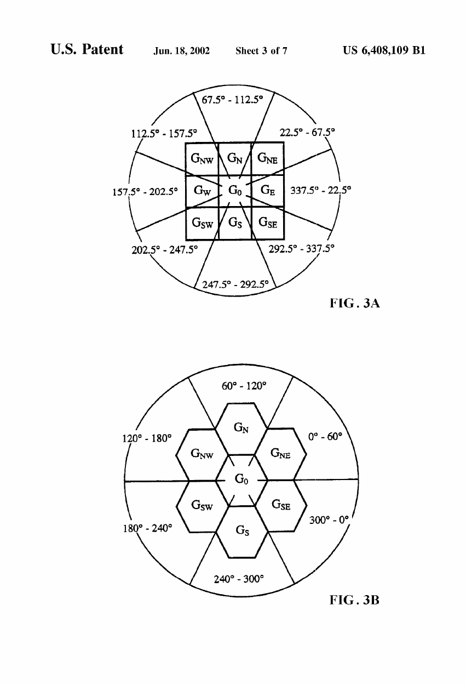
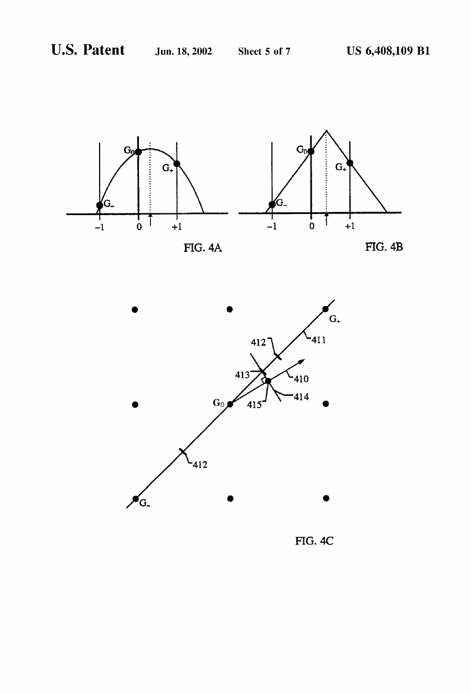
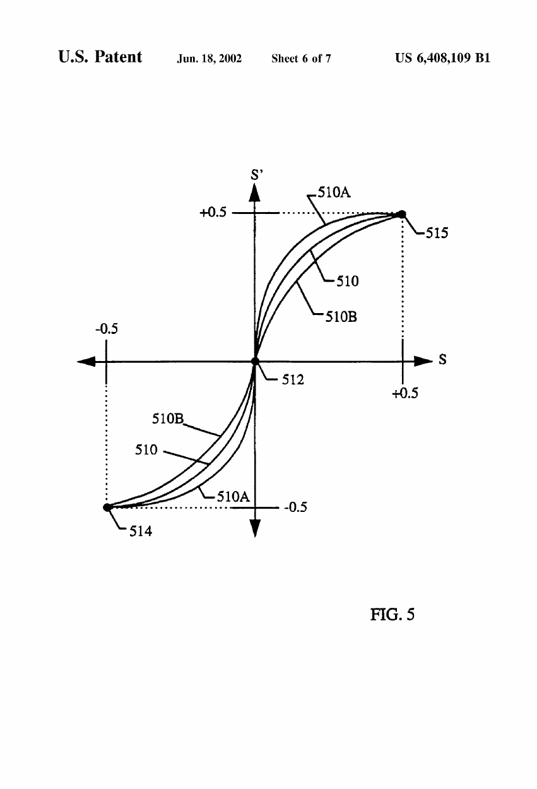

# 디지털 영상에서 에지를 검출하고 부화소 위치를 찾는 장치와 방법 (US 6,408,109 B1, 번역)

번역 범위: 전문 (서지, 초록, 발명의 분야, 배경, 요약, 도면의 간단한 설명, 상세한 설명, 표 1~5, 청구항 1~34. 인용 문헌 목록은 원문 그대로)
원문: [US6408109B1_Cognex_subpixel_edge.pdf](US6408109B1_Cognex_subpixel_edge.pdf) (USPTO 공보 PDF, 21쪽: 표지 2쪽, 도면 7장, 명세서 12쪽)
원문 텍스트는 `pdftotext -layout`으로 뽑았다. 공보가 2단 조판의 OCR 문서라 단이 섞인 곳은 쪽 이미지를 보고 바로잡았다. 식 3~5와 표 1, 2, 4, 5는 쪽 이미지(110 dpi)에서 직접 읽었다. 표 1, 2의 이진 값은 해상도가 낮아 한두 자리가 틀렸을 수 있다.
도면은 원문 쪽을 110 dpi로 옮긴 이미지다. 핵심 도면 3장(시트 3, 5, 6)만 넣고, 나머지는 도면 설명만 번역했다.
기호: 원문의 $G_0$(봉우리 후보의 기울기 크기), $G_\theta$(기울기 방향), $G_+$, $G_-$(기울기 방향 양쪽 이웃의 크기)를 그대로 쓴다.

---

## 서지 (표지)

- (12) 미국 특허, Silver 외
- (10) 특허 번호: US 6,408,109 B1
- (45) 등록일: 2002년 6월 18일 (*)
- (54) 발명의 명칭: Apparatus and method for detecting and sub-pixel location of edges in a digital image (디지털 영상에서 에지를 검출하고 부화소 위치를 찾는 장치와 방법)
- (75) 발명자: William Silver (Weston), Arman Garakani (Wellesley), Aaron Wallack (Natick), 모두 미국 매사추세츠주
- (73) 권리자: Cognex Corporation, Natick, MA (US)
- (*) 고지: 이 특허는 37 CFR 1.53(d)에 따른 계속 심사 출원(CPA)으로 등록되었고, 35 U.S.C. 154(a)(2)의 20년 존속기간 규정을 따른다. 권리 포기 조건을 따르며, 35 U.S.C. 154(b)에 따른 존속기간 연장이나 조정은 0일이다.
- (21) 출원 번호: 08/727,721
- (22) 출원일: 1996년 10월 7일
- (51) 국제 특허 분류: G06K 9/82
- (52) 미국 분류: 382/300; 382/190; 382/199; 382/266
- (58) 검색 분야: 382/263, 266, 269, 199, 189, 190, 203, 281
- 심사관: Leo Boudreau (주심사관), Sheela Chawan (보조 심사관)
- (74) 대리인: Russ Weinzimmer
- 청구항 34개, 도면 7장

### (56) 인용 문헌 (원문 그대로)

U.S. PATENT DOCUMENTS

```
4,499,598 A  *  2/1985  Chittineni ........ 382/266
5,054,100 A  * 10/1991  Tai ............... 382/47
5,212,740 A     5/1993  Paek et al. ....... 382/22
5,392,365 A     2/1995  Steinkirchner ..... 382/22
5,398,292 A     3/1995  Aoyama ............ 382/199
5,602,942 A     2/1997  Takemoto et al. ... 382/22
5,692,072 A  * 11/1997  Hashimoto ......... 382/200
5,694,487 A  * 12/1997  Lee ............... 382/199
5,754,710 A  *  5/1998  Sekine et al. ..... 382/300
5,940,538 A  *  8/1999  Spiegel et al. .... 382/236
6,005,978 A    12/1999  Garakani .......... 382/218
```

OTHER PUBLICATIONS

- Ramesh Jain, Rangachar Kasturi and Brian G. Schunck, Chapter 5, Edge Detection, Machine Vision, pp 140-181, McGraw-Hill, Inc., 1995.
- A. Ikonomopoulos, "An Approach to Edge Detection Based on the Direction of Edge Elements," Computer Graphics and Image Processing 19, 1982, pp. 179-195.
- S. Kimura and S. Ozawa, "A method for subpixel address generation," Transactions of the Institute of Electronics, Information and Communications Engineers D-II, vol. J72D-II, No. 5, pp. 831-833.
- J.S. Chen and G. Medioni, "Detection, Localization, and Estimation of Edges." IEEE Transactions on Pattern Analysis and Machine Intelligence, vol. 11, No. 2, Feb. 1989, pp. 191-198.
- Hin Leong Tan, Saul B. Gelfand, and Edward J. Delp, "A Cost Minimization Approach to Edge Detection Using Simulated Annealing." IEEE Transactions on Pattern Analysis and Machine Intelligence, vol. 14, No. 1, Jan. 1991, pp. 3-18.
- Ali J. Tabatabai and O. Robert Mitchell, "Edge Location to Subpixel Values in Digital Imagery," IEEE Transactions on Pattern Analysis and Machine Intelligence, vol. PAMI-6, No. 2, Mar. 1984, pp. 188-201.
- Todd Law, Hidenori Itoh, and Hirohisa Seki, "Image Filtering, Edge Detection, Edge Tracing Using Fuzzy Reasoning." IEEE Transactions on Pattern Analysis and Machine Intelligence, vol. 18, No. 5, May 1996, pp. 481-491.
- P.J. MacVicar-Whelan, T.O. Binford, "Line finding with subpixel precision," SPIE vol. 281 Techniques and Applications of Image Understanding (1981), pp. 211-216.
- Vishvjit S. Nalwa and Thomas O. Binford, "On Detecting Edges," IEEE Transactions on Pattern Analysis and Machine Intelligence, vol. PAMI-8, No. 6, Nov. 1986, pp. 699-714.
- K. Raghunath Rao and Jezekiel Ben-Arie, "Optimal Edge Detection Using Expansion Matching and Restoration." IEEE Transactions on Pattern Analysis and Machine Intelligence, vol. 16, No. 12, Dec. 1994, pp. 1169-1182.
- Maria Petrou and Josef Kittler, "Optimal Edge Detectors for Ramp Edges," IEEE Transactions on Pattern Analysis and Machine Intelligence, vol. 13, No. 5, May 1991, pp. 483-491.
- Sudeep Sarkar and Kim L. Boyer, "On Optimal Infinite Impulse Response Edge Detection Filters," IEEE Transactions on Pattern Analysis and Machine Intelligence, vol. 13, No. 11, Nov. 1991, pp. 1154-1171.
- Edward P. Lyvers and O. Robert Mitchell, "Precision Edge Contrast and Orientation Estimation." IEEE Transactions on Pattern Analysis and Machine Intelligence, vol. 10, No. 6, Nov. 1988, pp. 927-937.
- Yi Lu and Ramesh C. Jain, "Reasoning about Edges in Scale Space," IEEE Transactions on Pattern Analysis and Machine Intelligence, vol. 14, No. 4, Apr. 1992, pp. 450-468.
- Edward P. Lyvers, Owen Robert Mitchell, Mark L. Akey, and Anthony P. Reeves, "Subpixel Measurements Using a Moment-Based Edge Operator." IEEE Transactions on Pattern Analysis and Machine Intelligence, vol. 11, No. 12, Dec. 1989, pp. 1293-1309.
- Vinciane Lacroix, "A Three-Module Strategy for Edge Detection," IEEE Transactions on Pattern Analysis and Machine Intelligence, vol. 10, No. 6, Nov. 1988, pp. 803-810.
- \* cited by examiner

(표지의 대표 도면은 도 6의 장치 구성도다: 기울기 크기와 방향, 이웃 선택과 봉우리 검출, 보간, 편향 조정, 평면 위치 요소 610~620.)

## (57) 초록

이 발명은 디지털 영상의 에지를 빠르고, 계산 비용이 적고, 매우 정확하게 검출하는 방법과 장치를 제공한다. 에지가 화소 격자의 축과 거의 평행하지 않은 경우에도 그렇다. 이를 위해 계산이 싼 기울기 크기와 방향 추정을 이용한다.

구체적으로 방법은 다음 단계를 포함한다.

- 영상 안의 규칙적인 간격의 여러 화소 점에서 기울기 크기와 방향을 추정한다. 각 추정은 규칙적인 간격의 기울기 격자의 한 기울기 점에 대응한다.
- 각 기울기 점의 기울기 방향으로 이웃 기울기 점 집합을 고른다.
- 각 기울기 점의 기울기 크기를 이웃 점들의 기울기 크기와 비교해, 어느 기울기 크기가 대략 기울기 방향으로 국소 최대인지 정한다.
- 국소 최대 기울기 크기와 이웃 기울기 크기들로 1차원 기울기 크기 프로파일을 따라 보간한 에지 위치를 정한다.

2차원 에지 위치를 보간하는 다른 측면에서는, 국소 최대 기울기 점의 기울기 방향에 수직이고 보간한 에지 위치를 지나는 "평면 위치선"을 정하는 단계를 더 포함한다. 이 평면 위치선 위에서 에지의 2차원 보간 위치를 적어도 하나 정할 수 있다.

---

## 발명의 분야

이 발명은 일반적으로 디지털 영상 처리에 관한 것이고, 특히 디지털 영상의 에지 검출에 관한 것이다.

## 발명의 배경

디지털 영상은 여러 장치로 만들 수 있고 여러 실용 목적에 쓰인다. 영상 형성 장치에는 가시광이나 적외선으로 동작하는 TV 카메라, 라인 스캔 센서, 비행 점 스캐너, 전자 현미경, CT 스캐너 같은 X선 장치, 자기 공명 영상 장치 등이 있다. 응용 분야에는 산업 자동화, 의료 진단, 위성 영상, 사진 처리, 감시, 교통 감시, 문서 처리 등이 있다.

이런 응용을 위해, 영상 형성 장치가 만든 영상은 영상 처리 소프트웨어를 실행하는 범용 컴퓨터 같은 디지털 정보 처리 장치에서 처리되어 쓸모 있는 정보를 뽑아낸다. 매우 흔한 영상 처리 형태 하나가 에지 검출이다. 에지 검출은 밝기가 서로 다르고 대략 고른 영상 영역 사이의 경계 위치를 정하는 과정이라고 대략 정의할 수 있다. 더 정확히는, 에지를 "영상 기울기 크기가 기울기 방향으로 국소 최대가 되는 점", 같은 말로 "밝기의 2차 미분이 기울기 방향으로 0을 지나는 점"으로 정의하고, 영상에서 이런 에지의 위치를 찾는 과정이 에지 검출이다. 작은 이웃 안에서 영상이 1차원이나 2차원의 이상적인 계단 경계에 가장 잘 맞는 점을 에지로 정의하는 것도 쓸모가 있다. (어떤 저자는 이런 점들의 집합을 에지라 하고, 점 하나를 에지 요소라 부른다. 여기서는 구별할 필요가 없으므로 점을 그냥 에지라 부른다.)

이 분야에서는 기울기 크기의 국소 최대(또는 2차 미분의 영점 교차) 가운데 많은 것이 영역 경계가 아니라 영상 잡음이나 다른 영상 결함 때문에 생긴다는 것이 알려져 있다. 그래서 기울기 크기가 어떤 잡음 문턱보다 작은 에지 점은 버리는 것이 관례다. 문턱은 미리 정할 수도 있고, 영상 특성에 따라 적응적으로 계산할 수도 있다. 점마다 다를 수도 있고 영상 전체에서 같을 수도 있다. Canny의 이력 문턱(hysteresis thresholding) 같은 더 정교한 에지 점 걸러내기도 알려져 있다.

또한 밝기가 다르고 대략 고른 영역 사이 경계의 존재와 성질은 영상을 처리하는 축척(해상도)에 따라 달라진다는 것도 알려져 있다. 작고 공간 주파수가 높은 영역 사이 경계는 거친 저해상도로 보면 드러나지 않을 수 있고, 훨씬 크고 공간 주파수가 낮은 영역 사이 경계는 고해상도로 자세히 보면 드러나지 않을 수 있다(나무만 보고 숲을 못 보는 것). 그래서 응용에 맞게 여러 공간 주파수나 길이 축척에서 에지 검출을 하는 방법이 알려져 있다.

기울기 크기와 방향에 기초한 위 에지 정의는 정확하지만, 영상을 두 연속 변수의 함수로 볼 수 있다는 비현실적인 가정에 기초한다. 실제로는 영상 형성 장치로 얻은 영상은 불연속이고 양자화되어 있다. 영상은 화소 배열이고, 각 화소는 정수 좌표에 있으며 정수 밝기 값을 가진다. 그래서 실제로는 기울기 크기와 방향을 추정할 수밖에 없고, 기울기 최대나 영점 교차의 위치도 추정할 수밖에 없다. 게다가 실제로는 이런 추정의 계산 비용과 속도를 따져야 하므로, 정확하면서도 계산이 싸고 빠른 기울기 추정법을 쓰는 것이 바람직하다. 그러나 정확도가 높은 기울기 계산과 그에 기초한 에지 위치는 대개 비용이 크거나 느리다. 반대로 싸고 빠른 기울기 계산과 그에 기초한 에지 위치는 대개 정확도가 낮다.

기울기 크기와 방향의 추정기는 많이 알려져 있고, 정확도, 계산 비용, 속도 사이에서 적당한 균형을 잡으려 한다. 비용을 낮추거나 속도를 높이기 위해, 알려진 기울기 추정기 대부분은 기울기 크기와 방향을 매우 거칠게 추정한다. 이 경우 기울기 방향이 화소 격자 축과 거의 평행하지 않으면, 평행한 경우보다 기울기 크기 정확도가 떨어지는 경향이 있다. 기울기 방향은 보통 3비트 정밀도(곧 N, NE, E 같은 8개 방향 중 하나로 근사)로만 계산된다. 3비트 정확도는 비교적 싸지만, 3비트를 넘으면 비용이 크게 늘기 때문이다.

영상 기울기로 가장 가까운 정수 화소까지 에지를 검출하는 것은 대개 간단하고 효율적이지만, 영상 기울기로 빠르고, 싸고, 정확한 부화소 에지 검출을 하는 것은 어렵다. 대안으로, 이상적인 계단 경계를 국소적으로 맞추는 에지 검출은 두 연속 변수 가정에 기초한 중간 계산 없이 정확한 부화소 에지 위치를 바로 줄 수 있다. 그래서 정확한 부화소 에지 검출이 필요한 응용에서는 이런 국소 적합법이 주류다. 그러나 국소 적합법은 비교적 비싸거나 느려서, 높은 정확도와 함께 낮은 비용이나 높은 속도도 필요한 응용에는 실용적이지 않다. 따라서 싸거나 빠르면서도 정확도가 높은 부화소 에지 검출 방법이 필요하다.

## 발명의 요약

이 발명은 영상 기울기 크기와 방향의 빠르고 싼 추정에 기초한, 정확한 부화소 에지 검출 장치와 방법을 제공한다. 영상을 만드는 방법은 무엇이든 좋다. 영상 형성 장치로 얻은 영상이든, 합성한 영상이든 상관없다. 어느 경우든 영상은 광학적이거나 전자적인 영상 처리를 포함해(이에 한정되지 않음) 어떤 성질의 처리 단계를 하나 이상 거칠 수 있다.

이 발명은 기울기 크기와 기울기 방향 추정의 배열을 써서, 검출한 에지의 정확한 부화소 위치를 정하는 에지 검출 방법과 장치를 제공한다.

영상 기울기 크기와 방향은 영상 안의 규칙적인 간격의 위치에서 추정한다. 기울기 방향 정확도가 3비트보다 높은 어떤 기울기 추정법이든 쓸 수 있고, 여기서 설명하는 추정법도 그중 하나다. 바람직한 실시예에서는 크기와 방향을 약 7비트 이상 주는 싼 기울기 추정기를 쓴다. 추정은 응용에 맞는 축척(공간 해상도)에서 한다. 필요하면 같은 영상에서 여러 축척으로 에지 검출을 할 수 있다. 주어진 축척에서 기울기를 추정하는 점은 영상 화소 위치와 일치할 수도 있고 아닐 수도 있다.

선택 단계로, 실제 영상 특징에 대응하지 않는다고 판단된 기울기 추정은 알려진 방법으로 버린다. 예를 들어 기울기 크기가 잡음 문턱 아래면 버린다. 이 선택 단계는 따로 할 수도 있고 다음 처리 단계와 합칠 수도 있다.

크기 $G_0$, 방향 $G_\theta$인 각 기울기 추정 $G$에 대해, 대략 $G_\theta$ 방향을 따라 $G$ 양쪽에서 이웃 추정을 하나 이상 고른다. 추정이 정사각 격자 위에 있는 바람직한 실시예에서는 $G$ 양쪽에서 이웃을 하나씩 고른다. 이웃은 N-S, E-W, NE-SW, NW-SE 나침반 방향 중 $G_\theta$와 각도가 가장 가까운 방향에 놓인다. 기울기 양의 방향 쪽 이웃의 크기를 $G_+$, 음의 방향 쪽 이웃의 크기를 $G_-$라 한다.

추정한 기울기 크기 $G_0$를 고른 이웃의 크기 $G_+$, $G_-$와 비교해, $G_0$가 기울기 크기의 국소 최대(봉우리)인지 정한다. 바람직한 실시예에서는 $G_0 > G_+$이고 $G_0 \ge G_-$이면 봉우리다. 봉우리이면서 선택적인 잡음 문턱 단계를 통과한 모든 기울기 추정을 에지로 본다.

바람직하지는 않지만 $G_0 \ge G_+$이고 $G_0 > G_-$일 때 봉우리로 보는 것도 쓸모 있을 수 있다. 또 예를 들어 기울기 추정이 육각 격자 같은 비정사각 격자 위에 있을 수도 있고, 이웃 간격이 격자 단위가 아닐 수도 있으며, 위 8개 나침반 방향 말고 다른 방향을 기준으로 이웃을 고를 수도 있다.

위 단계로 검출한 각 에지에 대해, $G_0$와 위에서 고른 이웃들의 크기(예: $G_+$, $G_-$)로 이루어진 기울기 크기 추정 집합은 에지의 표본화된 1차원 프로파일을 이룬다. 이 1차원 프로파일은 대략 기울기 방향을 따른다. 그러나 기울기 추정 격자가 이산적이므로 일반적으로 정확히 기울기 방향을 따라 이웃을 고를 수는 없다. 또 같은 이유로 어떤 실시예에서는 고른 이웃이 한 직선 위에 있지 않을 수도 있다.

이 발명은 1차원 에지 프로파일로 부화소 에지 위치를 정하는 방법과 장치를 제공한다. 프로파일을 따라 고른 기울기 크기 추정들이 한 직선 위에 있는 실시예에서는, 곡선 적합 보간으로 프로파일을 따라 기울기 크기 봉우리의 부화소 위치를 추정한다. 기울기 방향에 수직인 방향으로는 에지 위치 정보가 없으므로, 보간한 에지 위치는 기울기 방향에 거의 수직인 방향을 따라 어디로 골라도 에지 위치 정보를 크게 잃지 않는다. 예를 들어 바람직한 실시예에서는 보간한 에지 위치가 $G_0$를 지나는 기울기 방향의 선 위에 놓이도록 골라, 에지 위치가 $G_0$에 최대한 가깝게 한다.

프로파일을 따라 고른 기울기 크기 추정들이 한 직선 위에 있지 않은 실시예에서는, 먼저 각 추정을 기울기 방향에 수직으로 옮겨 어떤 정한 직선 위에 놓이게 한다. 바람직한 실시예에서 그 직선은 $G_0$를 지나는 기울기 방향의 선이다. 이렇게 맞춘 뒤 곡선 적합 보간으로 맞춘 프로파일을 따라 기울기 크기 봉우리의 부화소 위치를 추정한다. 바람직한 실시예에서는 맞춘 프로파일 위 기울기 크기 봉우리의 부화소 추정 위치를 보간한 에지 위치로 삼는다.

위와 같이 크기가 $G_+$, $G_-$인 두 이웃을 쓰는 바람직한 실시예에서는, 점 $G_0$, $G_+$, $G_-$에 포물선을 맞춰 기울기 봉우리의 부화소 보간 위치를 얻는다. 포물선의 최대, 곧 기울기 봉우리를 프로파일 위 기울기 크기 봉우리의 위치로 삼는다.

다른 바람직한 실시예에서는 평면 위치선을 따라 에지의 2차원 보간 위치를 적어도 하나 정할 수 있다. 평면 위치선은 기울기 크기 국소 최대에 대응하는 기울기 점의 기울기 방향에 수직이고, 프로파일 위의 보간 에지 위치를 지나는 선이다.

또 다른 바람직한 실시예에서는 에지의 2차원 보간 위치를 두 선의 교점으로 정한다. 첫째 선은 기울기 크기 국소 최대에 대응하는 기울기 점에서 그 점의 기울기 방향으로 뻗는 기울기 방향선이다. 둘째 선은 기울기 방향에 수직이고 보간 에지 위치를 지나는 평면 위치선이다.

어떤 곡선 적합법이든 정확도는, 고른 이웃을 포함하는 작은 영역에서 기울기 방향으로의 기울기 크기 변화가 곡선 모양과 얼마나 맞는지에 달려 있다. 격자가 이산적이므로 고른 이웃의 배치는 반드시 기울기 방향에 따라 달라진다. 이 발명은 어떤 이웃 배치에 잘 맞는 곡선이 다른 배치에는 잘 맞지 않는다는 점을 인식했다. 이 발명은 기울기 방향에 따라 에지마다 곡선을 따로 골라 이 문제를 푼다.

바람직한 실시예에서는 모든 기울기 방향에 보간 곡선 하나를 쓰고, 기울기 방향의 함수인 매개변수를 가진 편향 함수로 보간 결과를 조정한다. 이렇게 하면 매개변수 하나를 바꿔 매우 다양한 보간 곡선 모양을 흉내 낼 수 있다. 더 바람직한 실시예에서 편향 함수는 거듭제곱 함수이고 매개변수는 지수다. 다른 바람직한 실시예에서는 거듭제곱 편향 함수를 포물선 보간 곡선에 적용한다. 또 다른 바람직한 실시예에서 장치는 보간 결과의 조정량을 정하는 조회표(lookup table)를 포함한다.

이 발명은 종래 기술보다 정확도가 높은, 빠르고 계산이 싼 에지 검출 방법과 장치를 제공한다. 또 종래 기술보다 빠르고 계산이 싼, 정확한 에지 검출 방법과 장치를 제공한다.

더 나아가 이 발명은 계산이 싼 기울기 크기와 방향 추정을 이용해 정확하고 싸고 빠른 에지 위치 추정을 얻는다. 그래서 에지가 화소 격자 축과 거의 평행하지 않아도 정확한 에지 검출을 빠르고 싸게 할 수 있다.

## 도면의 간단한 설명

이 발명은 아래 상세한 설명과 첨부 도면을 함께 보면 더 잘 이해된다.

- 도 1a~1d: 이 발명에 쓸 수 있는 기울기 추정 커널 집합 몇 가지. 도 1a는 Roberts Cross 커널, 도 1b는 Sobel 커널, 도 1c는 육각 화소 격자용 과결정(overdetermined) 커널 집합, 도 1d는 최소제곱 의미에서 도 1c와 동등한 더 작은 커널 집합.
- 도 2a~2c: 기울기 크기와 방향을 계산하는 방법 몇 가지. 도 2a는 부동소수점 장치로 계산하는 컴퓨터 프로그램의 일부, 도 2b는 조회표 기반 방법, 도 2c는 CORDIC 알고리즘 기반 방법.
- 도 3a~3c: 이웃 기울기 추정을 고르는 방법 몇 가지. 도 3a는 3x3 정사각 격자에 쓰는 간단한 방법, 도 3b는 육각 격자에 쓸 수 있는 방법, 도 3c는 5x5 정사각 격자용 방법.
- 도 4a~4c: 에지 위치를 보간하는 방법. 도 4a는 기울기 크기 프로파일을 따라 보간하는 포물선 보간, 도 4b는 기울기 크기 프로파일을 따라 보간하는 선형 보간, 도 4c는 기울기 크기 프로파일 위의 보간으로 평면 안 에지 위치를 정하는 방법.
- 도 5: 기울기 방향에 따라 골라, 기울기 크기 프로파일 점들에 맞추는 곡선의 모양을 조정하는 데 쓸 수 있는 거듭제곱 곡선 세 개의 그래프.
- 도 6: 이 발명에 따른 부화소 에지 검출 장치 전체.

## 도면의 상세한 설명

### 도 1: 기울기 성분 추정 커널

도 1은 디지털 영상에서 기울기 성분을 추정하는 데 쓸 수 있는 알려진 합성곱 커널 집합 몇 가지를 보여 준다. 디지털 영상은 규칙적인 화소 배열이다. 각 화소에는 화소 값이라는 수치가 붙어 있다. 그래서 영상은 규칙적인 수치 배열로 정의할 수 있다. 디지털 영상의 화소 값은 보통 어떤 장치로 잰 물리량을 나타낸다. 예를 들어 비디오 카메라로 잰 한 점의 장면 밝기다. 또는 가상 현실이나 컴퓨터 그래픽 시스템처럼, 잰 물리량 없이 컴퓨터 프로그램이 화소 값을 만들 수도 있다. 또 어떤 응용에서는 컴퓨터가 만든 영상이나 비디오 카메라 영상을 수학적으로 변환해 디지털 처리 영상을 만들 수 있다. 아래에서는 출처와 관계없이 화소 값을 밝기 값이라 부른다.

디지털 영상은 보통 정사각 화소의 정사각 배열이지만, 직사각 화소의 직사각 배열이나 육각 화소의 육각 배열 같은 어떤 규칙적인 평면 분할이든 쓸 수 있다.

기울기는 먼저 영상을 정해진 방향의 기울기 성분을 추정하도록 설계한 커널 집합과 합성곱해서 추정한다. 커널은 영상 화소와 같은 격자 배치로 놓인 작은 수치 배열이다. 영상을 커널과 합성곱하려면, 기울기를 추정할 각 위치에서 커널을 영상 화소 집합에 맞춰 놓는다. 이 위치들은 영상 위의 규칙적인 간격의 격자를 이룬다. 기울기를 추정하는 위치의 격자는 영상 화소 격자와 같을 수 있고(이 경우 영상의 모든 위치에서 기울기를 추정한다), 가능한 모든 영상 위치를 옮기거나 규칙적으로 솎아 낸 부분 집합일 수도 있다.

영상과 커널의 합성곱은, 기울기를 추정할 각 위치에서 커널 값 하나하나와 그 위치에 대응하는 영상 화소 값을 곱하고, 그 곱을 모두 더해 그 위치의 기울기 성분 하나의 추정을 만드는 것이다. 그 위치는 대개 영상에 대한 커널 중심 위치에 해당한다. 디지털 영상과 커널의 합성곱 방법과 장치는 수십 년 동안 쓰였고 잘 알려져 있다.

주어진 방향의 영상 기울기 성분은 밝기의 1차 미분이므로, 도 1의 커널들은 모두 어떤 방향의 1차 미분을 추정하도록 만들어졌다. 기울기를 정하려면 평행하지 않은 성분이 적어도 두 개 필요하므로, 각 집합은 커널을 적어도 두 개 가진다.

도 1a는 Roberts cross 커널 집합 111, 112를 보여 준다. 이 집합은 화소 격자 축과 45° 기운 방향의 기울기를 추정한다. Roberts cross 커널은 아마 가장 싼 기울기 추정기지만 영상 잡음에 가장 민감하다.

도 1b는 Sobel 커널 집합 121, 122를 보여 준다. 이것도 비교적 싸지만, 성분 방향에 수직으로 더하기 때문에 Roberts cross 커널보다 잡음에 덜 민감하다. Sobel 커널은 화소 격자 축과 평행한 방향의 기울기를 추정한다.

도 1c는 육각 분할 영상에 쓸 수 있는 커널 세 개 131, 132, 133을 보여 준다. 여기서는 격자의 자연스러운 세 방향, 곧 60° 간격의 세 방향으로 기울기를 추정한다. 기울기의 자유도는 둘뿐이므로 이 집합은 과결정이다. 추정이 정확하다면 세 성분 중 어느 하나는 나머지 둘로 정해질 것이다. 그러나 세 성분은 추정일 뿐이므로, 과결정 집합으로 전체 기울기 추정의 정확도를 높일 수 있다.

과결정 집합을 쓰는 한 방법은 각 점에서 가장 약한 성분(절댓값이 가장 작은 것)을 버리고 가장 강한 둘로 기울기를 추정하는 것이다. 다른 방법은 도 1d에 있다. 여기서는 도 1c의 대칭 커널 세 개 131, 132, 133으로 직교 커널 쌍 141, 142를 만들어, 자연스러운 직교 방향이 없는 격자에 쓴다. 직교 쌍 141, 142는 도 1c의 커널 131, 132, 133이 추정한 기울기 성분과, 같은 세 방향이지만 직교 쌍 141, 142에서 유도한 성분 사이의 차이 제곱합이 최소가 되도록 만든다(도 1d의 집합은 그림을 간단히 하려고 임의의 배율을 포함한다).

도 1의 네 커널 집합은 모든 영상 위치에 적용할 수 있고, 세밀한 축척, 곧 고해상도 에지 검출에 알맞다. 더 거친 축척에서 에지를 검출하려면 기울기 추정 단계를 두 가지로 바꿀 수 있다. 먼저 알맞은 저역 통과 필터로 영상을 "평활"하고, 그다음 영상 위치의 규칙적인 부분 집합(부분 격자)에서만 기울기를 추정한다. 곧 기울기 추정을 "솎아 내기(subsampling)"한다.

필요한 평활과 솎아 내기를 하는 방법과 장치는 여러 가지가 알려져 있다. 평활은 기울기 추정 전에 영상을 가우스 커널 같은 평활용 커널과 합성곱해서 할 수 있다. 또는 평활 기능을 기울기 추정 커널에 넣을 수도 있다. 솎아 내기는 평활 뒤 영상 값을 버리거나 기울기 추정을 버려서 할 수 있다. 또는 원하는 위치에만 알맞은 커널을 적용해 솎아 내기를 평활이나 기울기 추정 단계에 넣을 수도 있다.

이 발명을 실시하기 위해 기울기 성분을 추정하는 방법과 장치가 매우 다양하게 쓰일 수 있다는 것은 이 분야 기술자에게 자명하다. 영상은 정사각, 직사각, 육각, 또는 다른 규칙적인 평면 분할에 기초할 수 있다. 커널은 이웃 화소의 단순 차이를 계산할 수도 있고, 잡음 억제를 위해 평활 기능을 기울기 추정과 함께 넣을 수도 있다. 과결정 커널 집합은 어떤 영상 분할 방식에도 쓸 수 있고, 각 점에서 가장 약한 성분을 버린다. 자연스러운 직교 방향이 없는 분할에는 직교 커널 쌍을 설계할 수 있다. 거친 축척의 에지를 위해 평활과 솎아 내기 단계를 더할 수 있다.

바람직한 실시예에서는 도 1b의 Sobel 커널 121, 122를 정사각 분할에 쓴다. 각 정사각 화소의 영상 밝기 값은 8비트 수이고, 기울기 성분은 11비트 정밀도로 추정한다. 필요하면 거친 축척 에지 검출은 2차원 가우스 함수를 근사하는 저역 통과 필터 커널에 기초한 별도의 평활, 솎아 내기 단계로 시작할 수 있다.

### 도 2: 기울기 성분을 크기와 방향으로 바꾸기

도 2는 기울기 성분 쌍을 기울기 크기와 방향으로 바꾸는 여러 방법을 보여 준다. 각 방법은 직교 좌표에서 극좌표로 바꾸는 표준식을 근사하도록 만들었다.

$$G_0 = \sqrt{G_x^2 + G_y^2}, \qquad G_\theta = \mathrm{atn2}(G_y, G_x) \qquad \text{(식 1A, 1B)}$$

여기서 $G_0$는 기울기 크기, $G_\theta$는 기울기 방향, $(G_x, G_y)$는 직교 기울기 성분, atn2는 네 사분면 역탄젠트 함수다.

도 2a는 기울기를 근사하는 일반 언어(예: C 언어) 컴퓨터 프로그램을 보여 준다. 이 프로그램을 컴파일해 표준 수학 라이브러리와 함께 일반 CPU의 메모리에 올려 실행하면, CPU의 부동소수점 장치로 입력 기울기 성분에서 기울기 크기와 기울기 각도를 근사한다. 전용 부동소수점 하드웨어로도 같은 연산을 할 수 있다.

도 2a의 그림 안 코드:

```
gradient magnitude = sqrt (gradient x * gradient x +
                           gradient y * gradient y) ;
gradient direction = atan2 (gradient y, gradient x) ;
```

부동소수점 방법도 이 발명에 쓰기에 충분하지만, 더 싸고 빠른 방법이 바람직하다. 게다가 부동소수점 방법은 기울기 추정의 성질로 보아 의미 있는 정도보다 훨씬 높은 정밀도를 주는 것이 보통이고, 이 불필요한 정밀도는 낭비라고 볼 수 있다.

도 2b는 조회표 기반 방법과 장치를 보여 준다. 빠르고, 싸고, 기울기 추정에 알맞은 정밀도를 준다. 이 방식에서는 각 기울기 성분을 나타내는 이진수를 대응하는 부호기 221에 넣는다. 부호기는 각 성분을 나타내는 비트 수를 줄여 조회표 223의 크기를 줄인다. 부호기 221이 내놓은 부호화된 성분은 표 색인 생성기 222에서 합쳐져 표 색인이 되고, 이 색인이 조회표 223의 주소로 쓰여 입력 기울기 성분에 대응하는 미리 저장한 기울기 크기와 방향 근사값을 꺼낸다. 이 방법의 장치는 전용 하드웨어로 만들 수도 있고, 일반 CPU 메모리의 일부를 조회표 223으로 쓰는 컴퓨터 프로그램의 일부로 만들 수도 있다.

부호기 221은 응용에 맞게 여러 형태를 가질 수 있다. 메모리가 넉넉하면 부호기 221은 아무것도 하지 않고 성분을 그대로 표 색인 생성기 222에 넘길 수 있다. 다른 형태에서는 각 기울기 성분의 상위 비트 몇 개를 고를 수 있다. 바람직한 실시예에서 부호기 221은 기울기 성분 값을 로그 압축한다. 이 로그 압축이나 다른 부호화는 작은 조회표로 구현할 수 있다.

표 색인 생성기 222는 부호화된 두 성분의 비트를 단순히 이어 붙일 수 있다. 다른 형태에서는 일반 2차원 배열 주소 방식을 쓴다.

조회표 방법에 기초한 바람직한 실시예에서, 기울기 성분은 부호 있는 11비트 수이고, 부호기는 8비트로 로그 압축하는 2048바이트 조회표이며, 표 색인은 두 8비트 부호로 된 16비트 주소이고, 주 조회표는 65,536 x 16비트 표로서 기울기 성분 부호의 조합마다 기울기 크기 정보 8비트와 기울기 방향 정보 8비트를 저장한다. 기울기 방향은 이진 각도로 나타낸다. 최상위 비트가 180°, 그다음 비트가 90°, 그다음이 45°이며, 이런 식으로 최하위 비트는 약 1.4°에 해당한다.

많은 경우 부동소수점 하드웨어나 큰 조회표는 실용적이지 않거나 너무 비싸다. 예를 들어 장치를 주문형 반도체(ASIC)의 일부로 만들고 싶을 수 있는데, 이때 부동소수점 장치나 큰 조회표에 드는 트랜지스터 수는 감당할 수 없다. 또 다른 예로, 정수 디지털 신호 처리기(DSP) 같은 CPU로 장치를 만들고 싶은데 그 부동소수점 장치가 에지 검출 같은 응용에 충분히 빠르지 않거나, 주 메모리 임의 접근이 너무 느릴 수 있다. 이런 경우의 바람직한 실시예가 도 2c다. 도 2c는 CORDIC 알고리즘으로 기울기 성분을 크기와 각도로 바꾸는 방법과 장치를 보여 준다.

도 2c의 CORDIC 방법과 장치는 빠르고, 싸고, 기울기 추정 문제에 알맞은 정밀도, 곧 크기와 각도 정보가 7비트가 조금 안 되는 정밀도를 준다. 이는 충분하면서 낭비가 없다. 알맞은 소프트웨어를 실행하는 CPU로도, 전용 하드웨어로도 구현할 수 있다. 전용 하드웨어의 경우 이 방법은 파이프라인 처리에 잘 맞아 매우 빠르게 동작한다.

도 2c에서 기울기 성분 $(G_x, G_y)$는 팔분면 장치 270에 들어간다. 이 장치 270은 기울기 방향이 어느 팔분면에 있는지 나타내는 3비트 부호 260과, 아래와 같이 정의되는 $R_0$, $S_0$를 내놓는다.

$$R_0 = \max(|G_x|, |G_y|), \qquad S_0 = \min(|G_x|, |G_y|) \qquad \text{(식 2A, 2B)}$$

팔분면 장치 270에는 절댓값 요소 231이 두 개 있다. 각 요소는 입력의 절댓값과, 입력 부호를 나타내는 부호 비트 244를 내놓는다. 예를 들어 입력 > 0이면 0, 입력 < 0이면 1이다. 곧 부호 비트는 절댓값 요소 231이 입력 부호를 뒤집었는지를 나타낸다. $G_y$의 부호 비트 244가 팔분면 부호 260의 180° 비트이고, $G_x$의 부호 비트 244가 90° 비트다.

팔분면 장치 270에는 정렬 요소 232가 있다. 이 요소는 입력을 정렬해 큰 것을 $R_0$로, 작은 것을 $S_0$로 내보낸다. 정렬 요소 232는 어느 입력이 컸는지 나타내는 비트 235도 내놓는다. $|G_x| \ge |G_y|$이면 0, 아니면 1이다. 아래 표 1처럼 이 비트 235가 팔분면 부호 260의 45° 비트다.

표 1은 팔분면 부호 260과 이진 각도의 상위 3비트의 관계를 보여 준다. 아래 부호기 요소 234 설명에서 쓸, 가장 가까운 사분면에 해당하는 8비트 이진 각도 Q도 함께 보인다. 이진 각도의 45° 비트 235는 아래 부호기 요소 설명을 위해 B로 표시했다.

**표 1** (쪽 이미지 판독)

| 팔분면 부호 180° | 90° | 45° | 이진 각도 180° | 90° | 45° (B) | 가장 가까운 사분면 Q |
|---|---|---|---|---|---|---|
| 0 | 0 | 0 | 0 | 0 | 0 | 00000000 |
| 0 | 0 | 1 | 0 | 0 | 1 | 01000000 |
| 0 | 1 | 0 | 0 | 1 | 1 | 10000000 |
| 0 | 1 | 1 | 0 | 1 | 0 | 01000000 |
| 1 | 0 | 0 | 1 | 0 | 0 | 10000000 |
| 1 | 0 | 1 | 1 | 0 | 1 | 11000000 |
| 1 | 1 | 0 | 1 | 1 | 1 | 00000000 |
| 1 | 1 | 1 | 1 | 1 | 0 | 11000000 |

도 2c를 보면, 팔분면 부호 260과 $R_0$, $S_0$는 CORDIC 장치 280에 들어간다. CORDIC 장치 280은 CORDIC 블록 233을 하나 이상 가질 수 있고, 도 2c의 실시예에서는 CORDIC 블록을 네 개 쓴다. 각 CORDIC 블록은 입력 벡터 $(R_{N-1}, S_{N-1})$를 x축 쪽으로 $\tan^{-1}(2^{-N})$만큼 회전해 회전한 입력 벡터를 만들고, 회전한 벡터의 y성분에 절댓값을 취해 그 벡터가 첫째 팔분면 안에 오도록 변환한다. CORDIC 블록 233을 하나씩 거칠 때마다 R 값은 기울기 크기(벡터 길이)에 더 가까워지고 S 값은 0에 더 가까워진다.

각 입력 벡터의 회전은 오른쪽 자리 이동 요소 241, 가산기 242, 감산기 243으로 한다. 위에서 말한 절댓값 함수는 절댓값 요소 231로 한다.

마지막 CORDIC 블록 233의 R 출력은 기울기 크기 $G_0$의 좋은 근사다. 다만 쓰인 CORDIC 블록 수에 따라 달라지는 임의 배율이 곱해져 있다. $N \ge 3$이면 배율은 약 1.16이다.

각 CORDIC 블록 233은 요소 231의 절댓값 함수 전에 회전한 벡터의 y성분이 음수였는지를 나타내는 부호 비트 244도 내놓는다. 이 부호 비트 244는 앞에서 설명한 팔분면 장치 270의 같은 번호 절댓값 요소와 같은 절댓값 요소 231에서 나온다. 이 부호 비트들("방향 비트" 244라고도 한다)은 팔분면 장치 270이 처음 낸 기울기 방향 근사를 다듬는 데 쓰인다. CORDIC 블록 233을 하나씩 거칠 때마다 기울기 방향 정밀도가 약 1비트씩 늘어난다.

CORDIC 블록이 만든 방향 비트 244와 기울기 방향의 관계는 표 2와 같다.

**표 2** (쪽 이미지 판독)

| CORDIC 방향 비트 1~4 | 기울기 방향 범위(도) | 8비트 이진 각도 C |
|---|---|---|
| 0111 | 0.00-1.82 | 00000001 |
| 0110 | 1.82-5.40 | 00000011 |
| 0100 | 5.40-8.98 | 00000101 |
| 0101 | 8.98-12.53 | 00001000 |
| 0001 | 12.53-16.08 | 00001010 |
| 0000 | 16.08-19.66 | 00001101 |
| 0010 | 19.66-23.25 | 00001111 |
| 0011 | 23.25-26.57 | 00010010 |
| 1011 | 26.57-29.90 | 00010100 |
| 1010 | 29.90-33.48 | 00010111 |
| 1000 | 33.48-37.06 | 00011001 |
| 1001 | 37.06-40.61 | 00011100 |
| 1101 | 40.61-44.16 | 00011110 |
| 1100 | 44.16-45.00 | 00011111 |
| 1110 | >45 | 00011111 |
| 1111 | >45 | 00011111 |

CORDIC 장치 280은 부호기 요소 234로 팔분면 부호 260과 CORDIC 방향 비트 244에서 기울기 방향 $G_\theta$를 계산한다. 부호기 234는 응용에 맞게 조회표, 논리 요소, 산술 요소를 써서 컴퓨터 프로그램으로도, 전용 하드웨어로도 구현할 수 있다. 부호기 234는 예를 들어 표 조회나 불 논리로, 팔분면 부호 260을 써서 표 1의 가장 가까운 사분면의 8비트 이진 각도 Q와 45° 이진 각도 비트의 값 B를 정한다. 180°와 90° 이진 각도 비트는 완전성을 위해 표에 넣었다. 부호기 234는 또 예를 들어 표 조회로 표 2처럼 CORDIC 방향 비트에서 8비트 이진 각도 C를 정한다. 부호기가 계산한 최종 각도는 B가 0이면 Q+C, B가 1이면 Q-C다.

이 발명을 실시하기 위해 기울기 성분 추정에서 기울기 크기와 방향을 근사하는 데, 도 2c의 CORDIC 방법과 장치를 여러 가지로 바꿔 쓸 수 있다는 것은 이 분야 기술자에게 자명하다. 또 기울기 성분 추정에서 기울기 크기와 방향을 근사하는 방법과 장치가 도 2의 세 방식에 한정되지 않으며, 충분한 정밀도로 근사하는 방법과 장치라면 무엇이든 괜찮다는 것도 자명하다.

여기서 쓰는 용어에 대해 말하면, "근사(approximation)"는 원하는 만큼 정밀하게 할 수 있는 순수 계산 과정을 말한다. "추정(estimation)"은 부분적으로 물리적인 과정을 말하며, 그 정확도는 측정 능력에 의해 제한된다. 이 물리적 제한은 광학, 전자 해상도, 신호 잡음, 화소 격자 효과 등 여러 요인에서 온다. 그래서 평행하지 않은 기울기 성분에서 기울기 크기와 방향을 계산하는 것은 (알맞은 수식의) 근사지만, 그 결과인 기울기 크기와 방향 값 자체는 추정된 성분에 기초하므로 추정이다.

위에서 설명한 도 2의 방법과 장치는 정규 직교 커널 쌍으로 기울기 성분을 추정했다고 가정한다. 이 방법과 장치는, 예를 들어 과결정 기울기 성분 집합을 쓰고 가장 강한 두 성분만 남기는 경우처럼 정규 직교가 아닌 쌍에도 쉽게 맞게 바꿀 수 있다. 가장 간단한 해법은 도 2의 방법을 적용하기 전에 각 기울기 성분에 2x2 행렬을 곱해 정규 직교 기저로 바꾸는 것이다. 도 2b의 조회표 방법에서는, 고른 성분들의 상대 방향이 고정된 흔한 경우 행렬 곱의 효과를 조회표에 넣어 행렬 곱 연산을 없앨 수 있다. 도 2c의 CORDIC 방법과 장치도 대개 부호기 요소 234가 행렬 곱의 효과를 포함하도록 바꿔, 행렬 곱 없이 정규 직교가 아닌 경우를 다룰 수 있다.

충분히 큰 과결정 커널 집합을 쓰면, 도 2 같은 직교-극좌표 변환식을 근사하는 장치 없이도 그 집합이 준 기울기 성분에서 기울기 크기와 방향의 근사를 얻을 수 있다. 이런 실시예에서는 가장 강한 기울기 성분, 곧 절댓값이 가장 큰 성분의 절댓값이 기울기 크기 $G_0$의 좋은 근사이고, 가장 강한 성분의 방향(그 성분을 얻은 커널의 알려진 성질)이 기울기 방향 $G_\theta$의 좋은 근사다. 더 다듬은 실시예에서는 가장 강한 성분과 방향이 가장 가까운 두 이웃 성분에 포물선 같은 곡선을 맞춰 기울기 크기와 방향을 보간한다.

### 도 3: 이웃 기울기 추정 고르기

이 발명은 기울기 추정의 규칙적인 배열을 써서 검출할 에지의 정확한 부화소 위치를 정한다. 각 기울기 추정은 기울기 크기 추정과 기울기 방향 추정으로 이루어진다. 이 발명에 따르면 규칙 격자의 규칙적인 간격의 여러 위치에서 기울기 추정을 하는 것이 쓸모 있다. 이 격자를 여기서 기울기 격자라 부른다. 기울기 격자는 바탕 화소 격자에 대해 화소의 몇 분의 1만큼 어느 방향으로든 옮겨져 있을 수 있다. 또 기울기 격자는 화소 격자의 부분 집합일 수 있다. 예를 들어 화소 점 4개 묶음마다 기울기 점 하나를 둘 수 있다. 각 기울기 추정을 그 격자 위치와 함께 "기울기 추정 격자 요소"라 부르면 편하다. 규칙적인 간격의 여러 기울기 추정 격자 요소를 "기울기 추정 격자"라 부르면 편하다. 도 3에서는 설명을 위해 기울기 추정 격자 요소를 타일로 그렸고, 일부 타일에는 바탕 격자 요소의 기울기 크기 추정을 이름으로 붙였다.

기울기 격자의 여러 위치 각각에서 대략 기울기 방향으로 기울기 크기의 표본 프로파일을 얻기 위해, 각 위치마다 이웃 기울기 추정 격자 요소 집합을 고른다. 각 이웃 집합의 격자 요소는 표본 프로파일 위 특정 위치의 기울기 크기를 나타내는 기호로 이름 붙일 수 있다. 예를 들어 도 3처럼, 이웃 집합의 중심 격자 요소에 $G_0$라는 이름을 붙일 수 있다.

도 3은 기울기 방향의 함수로, 중심 기울기 추정 격자 요소의 이웃인 기울기 추정 격자 요소 집합을 고르는 여러 방법을 보여 준다. 어느 방법이든 목표는 대략 기울기 방향으로 기울기 크기의 표본 프로파일을 얻는 것이다. 기울기 추정 격자가 이산적이고, 고른 이웃이 대개 $G_0$ 중심 요소에서 격자 요소 한두 개 떨어져 있을 뿐이므로, 표본 프로파일은 기울기 방향과 정확히 일치하지 않는다. 또 프로파일 위의 기울기 추정 격자 요소들이 한 직선 위에 있지 않을 수도 있다.

바람직한 실시예가 도 3a에 있다. 여기서는 도면에 보인 $G_0$의 8개 이웃 중에서 $G_+$, $G_-$로 이름 붙인 두 이웃을 고른다. 도 3a는 각 이웃이 $G_+$로 뽑히는 기울기 방향 범위를 보여 준다. 어느 경우든 180° 반대편 이웃이 $G_-$로 뽑힌다. 예를 들어 기울기 방향이 112.5°~157.5° 범위이면 $G_+$는 $G_{NW}$, $G_-$는 $G_{SE}$가 된다. 기울기 방향 범위는 22.5° 경계에 놓이도록 정했으므로, 이진 각도로 나타낸 기울기 방향 정밀도가 적어도 4비트 필요하다.



*도 3a, 3b (시트 3): 3x3 정사각 격자(도 3a)와 육각 격자(도 3b)에서 기울기 방향 구간에 따라 $G_+$ 이웃을 고르는 규칙. 도 3a의 구간은 337.5°~22.5°, 22.5°~67.5°, 67.5°~112.5°(위), 112.5°~157.5°, 157.5°~202.5°, 202.5°~247.5°, 247.5°~292.5°, 292.5°~337.5°다. 도 3b의 구간은 60° 폭이다.*

도 3a 방법에 기초한 장치의 바람직한 실시예에서는, 기울기 크기 추정을 임의 접근 메모리에 규칙적인 2차원 배열로 저장한다. 어떤 기울기 크기 추정에서 주어진 나침반 방향 이웃까지의 주소 차이는 상수이고, 180° 반대편 이웃까지의 주소 차이는 그 상수의 음수다. 이 주소 차이 상수들은 기울기 방향의 상위 4비트로 색인하는 작은 조회표에 저장한다. 각 $(G_0, G_\theta)$ 쌍에 대해 $G_\theta$로 $G_0$에서 이웃까지의 주소 차이를 조회한다. 이 차이를 $G_0$의 주소에 더하고 빼서 $G_+$, $G_-$ 이웃을 각각 가져올 주소를 만든다.

위 장치는 컴퓨터 메모리를 기울기 추정 저장과 주소 차이 조회표 양쪽에 쓰는 알맞은 소프트웨어로 구현할 수 있다. 또는 전용 하드웨어로 구현할 수 있다. 어느 경우든 기울기 크기 추정 배열 전체를 동시에 메모리에 둘 필요는 없다. 기울기 크기와 방향을 래스터 순서로 계산하는 바람직한 실시예에서는, 주소 차이 조회 기반 장치가 동작하는 데 기울기 크기 추정의 마지막 세 행만 메모리에 있으면 된다.

도 3b는 육각 격자에서 이 발명을 실시할 때 이웃을 고르는 방법을 보여 준다. 이 방법에 기초한 장치는 위 도 3a의 장치와 비슷하다.

도 3c는 5x5 격자에서 이웃 기울기 추정 격자 요소 네 개를 고르는 방법을 보여 준다. 가능한 12개 배치 중 7개만 보였고, 나머지는 보인 것들의 대칭이다. 이 방법에 기초한 장치는 위 도 3a의 장치와 비슷하지만, 이 경우 기울기 방향이 적어도 5비트 필요하다.

(도 3c의 구간 표기: 348.75°~11.25°, 11.25°~22.5°, 22.5°~33.75°, 56.25°~67.5°, 67.5°~78.75°, 78.75°~101.25°.)

### 봉우리 판정

이 발명은 기울기 추정 $G$가 에지(기울기 방향으로 기울기 크기의 국소 최대)에 해당하는지를, 기울기 추정의 이산 격자가 주는 검출 한계 안에서 정하는 방법과 장치를 포함한다. 이 방법과 장치는 기울기 추정 $G_0$를 방향 $G_\theta$에 따라 고른 이웃들의 기울기 추정과 비교하는 데 기초한다.

이웃 격자 요소 $G_+$, $G_-$ 두 개를 고르는 바람직한 실시예에서는, $G_0 > G_+$이고 $G_0 \ge G_-$이면 $G$가 봉우리다. 어느 기울기 크기($G_+$ 또는 $G_-$)를 ">"로 비교하고 어느 것을 "≥"로 비교할지는 임의다. 그러나 비대칭 비교는, 프로파일 위 이웃 기울기 추정 둘 이상의 크기가 같을 때 정확히 격자 요소 하나만 봉우리로 뽑히게 해 준다. 두 비교에 모두 ">"를 쓰면, 이웃 격자 요소 둘 이상의 크기가 같을 때 봉우리가 하나도 뽑히지 않는다. 두 비교에 모두 "≥"를 쓰면, 크기가 같은 이웃 격자 요소가 모두 봉우리로 뽑힌다. 이 비교 방법 중 무엇으로도 발명을 실시할 수 있지만, 크기가 같은 이웃 격자 요소가 있을 때 정확히 봉우리 하나를 고르는 것이 바람직하다.

크기가 같은 이웃 격자 요소가 둘이면 어느 쪽을 봉우리로 고르든 상관없다. 아래에 설명할 보간 방법이 실제 에지 위치를 두 격자 요소의 한가운데에 놓기 때문이다. 크기가 같은 이웃이 둘보다 많으면 에지 위치가 다소 불확정이고, 여기서 설명하는 방법은 그런 이웃 중 처음이나 마지막 것을 고른다. 중심에 더 가까운 것을 고르는 편이 낫다고 볼 수도 있지만, 실제로 이 경우는 매우 드물어서 바람직한 실시예는 그렇게 하지 않는다. 얻는 이득이 계산 비용만 못하다고 본다.

이웃을 둘보다 많이 고르는 실시예에서는 비교 방법이 훨씬 다양해진다. 위의 이웃 둘 방법을 변형해, $G_0$ 양쪽의 이웃들을 합쳐 $G_+$, $G_-$ 값을 만들 수 있다. 이런 형태의 어떤 실시예는 양쪽에서 가장 가까운 것, 가장 먼 것, 가운데 것처럼 이웃 하나씩을 그냥 고른다. 다른 실시예는 이웃들을 합쳐 평균이나 중앙값을 만든다.

또 다른 변형에서는 $G_0$ 양쪽의 이웃들을 가장 큰 값을 골라 합친다. 그러면 $G_0$가 한쪽 이웃 모두보다 크고 다른 쪽 이웃 모두보다 크거나 같아야 한다. 그래서 지나치게 국소적인 봉우리가 버려진다. 이 분야 기술자는 이 발명을 실시하기 위해 알맞은 변형을 틀림없이 많이 만들 수 있다.

잡음 문턱을 쓰는 실시예에서는 크기가 잡음 문턱 아래인 기울기 봉우리는 에지로 보지 않는다.

여기까지 설명한 방법의 단계들의 결과, 그리고 대응하는 장치 요소들의 출력은 에지 목록이다. 곧 기울기 방향으로 국소 최대이고 잡음 문턱 아래가 아닌, 기울기 추정 격자 위의 모든 점이다. 목록의 각 에지에 대해 다음 정보를 기록한다: 기울기 크기 $G_0$와 방향 $G_\theta$, 에지의 정수 격자 위치, 그리고 고른 이웃들의 크기 값.

### 도 4: 프로파일을 따라 부화소 보간

도 4a와 4b는 각각, 표본 기울기 크기 프로파일을 따라 부화소 보간 에지 위치를 얻는 방법을 보여 준다. 표본 기울기 크기 프로파일은 봉우리 크기 추정 $G_0$와 고른 이웃 $G_+$, $G_-$를 포함하고, $G_0$, $G_+$, $G_-$로 표시한 점은 각 기울기 추정 격자 요소의 위치를 나타낸다(격자 요소는 그리지 않았다). 도 4c는 예를 들어 도 4a나 4b로 얻은 부화소 보간 에지 위치에 기초해, 기울기 추정 격자 요소의 평면 안에서 2차원 에지 위치를 정하는 방법을 보여 준다. 기울기 추정 격자 요소의 평면은 화소 격자 요소의 평면과 같은 평면이다.



*도 4a (시트 5 위 왼쪽): 세 점 $G_-$, $G_0$, $G_+$(가로 위치 -1, 0, +1)를 지나는 포물선의 최대 위치(점선 화살표)를 에지 위치로 삼는다. 도 4b (위 오른쪽): $G_0$와 작은 쪽 이웃을 지나는 직선과, 다른 이웃을 지나며 기울기 부호가 반대인 직선의 교점을 에지 위치로 삼는다. 도 4c (아래): 기울기 방향 410이 약 30°일 때 대각 이웃 $G_+$ = $G_{NE}$, $G_-$ = $G_{SW}$를 지나는 프로파일선 411, 보간 한계 ±0.5 단위 412, 보간 위치 413, 기울기 방향에 수직인 평면 위치선 414, 최종 에지 점 415.*

도 4a는 같은 간격으로 한 직선 위에 있는 두 이웃에 기초한 바람직한 실시예를 보여 준다. $G_0$, $G_+$, $G_-$에 해당하는 점들을 그래프에 찍는다. 가로축은 표본 기울기 크기 프로파일을 따른 거리, 세로축은 기울기 크기다. 가로 거리 축척은 $G_+$와 $G_-$가 $G_0$에서 1단위 떨어지도록 임의로 정한다. 세 점을 지나는 포물선을 만들고, 그 최대 위치를 표본 기울기 크기 프로파일 위의 에지 위치로 삼는다.

비대칭 비교 $G_0 > G_+$, $G_0 \ge G_-$를 쓰면 포물선이 퇴화하지 않으므로 그 최대가 항상 존재한다. 게다가 최대 위치는 항상 $G_0$에서 ±0.5단위 안에 놓인다. 이는 합리적이다. 봉우리가 $G_0$보다 이웃 하나에 더 가깝다면, $G_0$ 대신 그 이웃이 봉우리로 뽑혔을 것이기 때문이다.

보간한 봉우리 위치를 얻는 식은 다음과 같다.

$$s = \frac{G_+ - G_-}{4G_0 - 2(G_+ + G_-)} \qquad \text{(식 3)}$$

여기서 $s$는 임의 단위로 잰, $G_0$에서 $G_+$ 방향으로의 거리다. (역주: 원문 이미지의 아래첨자가 흐려 $G_-$ 방향으로도 읽히지만, 식의 부호로 보면 $G_+ > G_-$일 때 $s > 0$이므로 $G_+$ 방향이 맞다. 식 4 설명은 분명히 $G_+$ 방향이다.) $s$ 값에 $G_0$와 이웃 사이의 실제 거리를 곱하면, 예를 들어 화소 단위로 프로파일 위 보간 에지 위치를 얻는다.

도 4b는 선형 보간에 기초한 대안 방법을 보여 준다. 이 방법은 기울기 크기가 에지 양쪽으로 직선적으로, 같은 비율로 떨어진다고 가정한다. $G_0$와, 두 이웃 중 크기가 작은 이웃을 지나는 첫째 직선을 만든다. 다른 이웃을 지나고 기울기가 첫째 직선의 음수인 둘째 직선을 만든다. 두 직선의 교점이 프로파일 위 보간 에지 위치다.

도 4a의 포물선 방법처럼 비대칭 비교를 쓰면 해가 항상 존재하고, 해는 $G_0$에서 ±0.5단위 안에 놓인다. 선형 보간 식은 다음과 같다.

$$s = \frac{G_+ - G_-}{2\,[G_0 - \min(G_+, G_-)]} \qquad \text{(식 4)}$$

여기서도 $s$는 임의 단위로 잰, $G_0$에서 $G_+$ 방향으로의 거리다. $s$ 값에 $G_0$와 이웃 사이의 실제 거리를 곱하면, 예를 들어 화소 단위로 프로파일 위 보간 에지 위치를 얻는다.

바람직한 실시예에서, 도 4a의 포물선 방법이나 도 4b의 선형 방법에 따른 장치는 일반 CPU와 알맞은 소프트웨어로 위 식들을 근사한다.

이 발명은 표본 기울기 크기 프로파일 위의 위치로부터 기울기 추정 평면 안의 에지 위치를 정하는 방법과 장치를 포함한다. 도 3a의 이웃 선택법에 기초한 바람직한 실시예가 도 4c에 있다.

도 4c의 예에서 기울기 방향 410은 약 30°이므로, $G_+$ 이웃은 $G_{NE}$, $G_-$ 이웃은 $G_{SW}$로 뽑힌다. $G_0$, $G_+$, $G_-$로 이루어진 표본 기울기 크기 프로파일은 선 411 위에 놓인다. 도 4a나 4b, 또는 다른 알맞은 방법으로 정한 표본 기울기 프로파일 위의 보간 에지 위치 413은 선 411 위에서 ±0.5단위 한계 412 사이에 놓인다. 이 경우 위 보간식들의 임의 단위는 격자 간격의 $\sqrt2$배라는 점에 주의한다. 기울기 방향 때문에 대각이 아닌 이웃이 뽑혔다면, 임의 단위는 격자 간격과 같다.

에지 위치는 주어진 방향의 선 위의 한 점으로 정의되므로, 에지 위치를 정하는 데 자유도 하나가 남는다. 곧 주어진 방향에 수직인 방향의 에지 위치다. 더 구체적으로, 에지는 기울기 방향으로는 위치를 정할 수 있지만, 기울기 방향에 수직인 방향의 에지 위치에 대한 정보는 없다. 그래서 에지가 보간 위치 413 근처, 예를 들어 보간 위치 413을 지나고 기울기 방향 410에 수직인 평면 위치선 414 위의 어딘가에 있다고 보는 것이 쓸모 있다. 바람직한 실시예에서는 보간 위치 413을 지나고 기울기 방향 410에 수직인 평면 위치선 414와, $G_0$를 지나는 기울기 방향 410의 선이 만나는 점 415를 에지 위치로 정한다. 점 415는 평면 위치선 414 위에서 $G_0$에 가장 가까운 점이다.

도 4c 방법에 따른 장치의 바람직한 실시예에서는 일반 CPU와 알맞은 소프트웨어를 쓴다. 이 소프트웨어는 프로파일 411 위의 보간 위치 413을 위에서 말한 임의 단위로 읽는다. 이 위치에 격자 간격을 곱하고, 기울기 방향 때문에 대각 이웃이 뽑혔다면 $\sqrt2$를 더 곱한다. 이 계산 결과에 기울기 방향 410과 프로파일선 411 사이 각도의 코사인을 곱해, 기울기 방향으로 $G_0$에서 에지 점 415까지의 거리를 출력한다.

이웃을 둘보다 많이 고르는 실시예에서는 도 4의 3점 보간 대신 여러 대안을 쓸 수 있다. 일반 최소제곱 적합 기법으로 포물선이나 선형 방법과 비슷한 방법을 쓸 수 있다.

프로파일 위 기울기 크기 표본이 한 직선 위에 있지 않은 실시예에서는(예: 도 3c의 실시예에서 어떤 기울기 방향일 때), 보간 단계 전에 표본들을 기울기 방향에 수직으로 옮겨 $G_0$를 지나는 기울기 방향의 선 위에 놓는다. 이는 도 4c에서 보간 위치 413을 기울기 방향 410에 수직으로 옮겨 $G_0$의 기울기 방향 위에 놓는 것과 비슷하지만, 보간 단계 뒤가 아니라 앞에서 한다는 점이 다르다.

프로파일 위 기울기 크기 표본의 간격이 같지 않은 실시예에서는, 곡선 적합식에서 상대 간격을 반영할 수 있다. 그런 곡선 적합식은 이 분야에서 오래전부터 많이 알려져 있다.

### 도 5: 기울기 방향에 따른 보간 곡선 조정 (편향 함수)

도 5를 보면, 어떤 곡선 적합 보간이든 정확도는 고른 이웃을 포함한 작은 영역에서 기울기 방향의 실제 기울기 크기 변화가 모형 곡선 모양과 얼마나 맞는지에 달려 있다. 실제 기울기 크기 변화는 에지 근처의 영상 밝기 프로파일, 기울기 성분 추정에 쓴 특정 합성곱 커널, 보간에 고른 이웃 배치, 화소 격자 축에 대한 기울기 방향의 정렬에 따라 달라진다고 예상할 수 있다. 경험으로 보면 커널과 이웃 배치는 효과가 크고, 화소 격자에 대한 기울기 방향 정렬은 이웃 배치 선택이라는 주된 결과를 빼면 효과가 비교적 작다.

영상 밝기 프로파일의 효과는 특징짓기가 더 어렵다. 밝기 프로파일을 마음대로 바꿀 수 있다면 매우 다양한 기울기 크기 프로파일을 만들 수 있을 것으로 예상할 수 있다. 그런데도 합성 영상과 실측 영상 모두의 경험으로 보면, 주어진 합성곱 커널과 이웃 배치에서 기울기 크기 프로파일의 모양은 에지 "날카로움"의 넓은 범위에서 놀랄 만큼 일정하다. 이 발명이 인식한 대로, 커널은 영상 전체에서 일정하고 이웃 배치는 기울기 방향에만 달려 있으므로, 이 경험은 검출한 각 에지에서 기울기 방향에 따라 보간에 쓸 곡선 모양을 골라야 한다는 것을 시사한다.

이 발명은 에지의 기울기 방향의 함수로 에지마다 독립적으로 보간 곡선을 고르는 방법과 장치를 제공한다. 이 발명은 고른 이웃 배치의 효과, 화소 격자에 대한 기울기 방향 정렬의 효과, 또는 둘 다로 인해 달라지는 기울기 크기 프로파일 모양을 보상하는 데 쓸 수 있다. 이 발명의 방법과 장치는 정성적이거나 정량적으로 나타낼 수 있는 영상의 어떤 특성에 기초해서도 보간 곡선을 고르는 데 쓸 수 있다.

도 1b의 Sobel 커널과 도 3a의 이웃 선택법에 기초한 바람직한 실시예에서는, N-S나 E-W 이웃이 뽑히는 기울기 방향에는 도 4a의 포물선 보간 곡선을 쓰고, NE-SW나 SE-NW 이웃이 뽑히는 기울기 방향에는 도 4b의 선형 보간 곡선을 쓴다.

도 5는 간단하고, 싸고, 유연한 방법의 바람직한 실시예를 보여 준다. 이 실시예에서는 모든 기울기 방향에 보간 곡선 하나를 쓰고, 그 결과 $s$는 임의 단위로 ±0.5 범위에 있다. 도 5처럼 "S"자 함수 510으로 $s$에서 조정된 보간 값 $s'$(역시 ±0.5 범위)을 얻는다. 기울기 방향의 함수인 편향 매개변수로 "S" 함수의 모양을 조정하면, 매개변수 하나만 바꿔 510A, 510B 같은 매우 다양한 보간 곡선 모양을 흉내 낼 수 있다.



*도 5 (시트 6): 보간 값 $s$(가로축, ±0.5)를 조정 값 $s'$(세로축, ±0.5)으로 바꾸는 "S"자 거듭제곱 곡선 510, 510A, 510B. 중심점 512(0, 0)과 끝점 514(-0.5, -0.5), 515(+0.5, +0.5)는 편향 값과 관계없이 고정이다.*

이 방법의 한 실시예에서 "S" 함수는 거듭제곱 함수이고, 편향 매개변수 $b$가 지수다.

$$s' = s\,|2s|^{b}, \qquad b > -1 \qquad \text{(식 5)}$$

이 방법에는 몇 가지 중요한 성질이 있다. 첫째, 편향 값 $b$와 관계없이 중심점 512와 끝점 514, 515에서 $s' = s$다. 이 성질은 보간에 대한 우리 직관을 반영한다. 곧 기울기 크기 프로파일 모양과 관계없이 표 3의 관계가 성립해야 한다.

**표 3**

| 조건 | 에지 위치 | 보간 값 s | 도 5의 점 |
|---|---|---|---|
| $G_+ = G_-$ | $G_0$ 위치 | 0.0 | 중심점 512 |
| $G_0 = G_+$ | $G_0$와 $G_+$의 한가운데 | +0.5 | 끝점 515 |
| $G_0 = G_-$ | $G_0$와 $G_-$의 한가운데 | -0.5 | 끝점 514 |

편향 매개변수의 효과는 표 4로 요약할 수 있다.

**표 4**

| 편향 | s'와 s의 관계 | 보간 에지에 대한 효과 |
|---|---|---|
| b = 0 | s' = s | 없음 |
| b > 0 | \|s'\| ≤ \|s\| | $G_0$ 쪽으로 당겨짐 |
| -1 < b < 0 | \|s'\| ≥ \|s\| | $G_0$에서 밀려남 |

도 5 방법에 따른 장치의 바람직한 실시예는 일반 CPU와 알맞은 소프트웨어로, 기울기 방향의 함수로 편향 값을 고르고 그 결과 함수 510을 보간 값 $s$에 적용한다. 그 결과 값 $s'$이 다음 요소의 입력으로 $s$를 대신하며, 도 4c에서 설명한 대로 보통 이웃 간격 계수를 곱한다.

이 실시예의 한 형태에서는 가능한 이웃 배치마다 미리 정한 편향 값을 쓴다. 각 이웃 배치는 기울기 방향의 일정 범위에 대응한다. 각 편향 값에 대응하는 "S" 함수의 $s'$ 값을 $s$에 대해 알맞은 해상도의 조회표에 저장한다. 이 분야 기술자가 잘 이해하듯이, 알맞은 소프트웨어로 기울기 방향에 따라 조회표를 고르고, 보간 값 $s$로 조정 값 $s'$을 조회할 수 있다.

도 3a의 이웃 선택법에 기초한 몇몇 바람직한 실시예에 쓰는 편향 값은 아래 표 5와 같다.

**표 5**

| 합성곱 커널 | 보간 곡선 | N-S, E-W 이웃의 편향 | NE-SW, SE-NW 이웃의 편향 |
|---|---|---|---|
| Sobel | 포물선 | 0.0 | -0.5 |
| Sobel | 선형 | +0.5 | -0.2 |
| Roberts | 포물선 | -0.7 | -0.7 |
| Roberts | 선형 | -0.6 | -0.6 |

도 5의 방법과 장치를 여러 응용에 맞게 다양하게 바꿀 수 있다는 것은 이 분야 기술자에게 자명하다.

### 도 6: 장치 전체

도 6은 이 발명에 따른 장치의 완전한 실시예를 보여 준다. 디지털 영상이 기울기 성분 추정 요소 610에 들어간다. 요소 610은 예를 들어 도 1의 합성곱 커널에 기초하며, 규칙 격자의 모든 점에 대해 기울기 성분 출력 $G_x$, $G_y$를 만든다. 각 격자점에서 기울기 성분 출력 $G_x$, $G_y$는 예를 들어 도 2의 방법에 기초한 직교-극좌표 요소 612에 들어가, 그 격자점의 기울기 크기 추정 $G_0$와 기울기 방향 추정 $G_\theta$를 만든다. 기울기 크기와 방향 추정 $G_0$, $G_\theta$는 요소 614에 들어간다. 요소 614는 예를 들어 도 3의 방법에 따라 이웃 기울기 크기 추정을 고르고, 잡음 문턱 아래가 아닌 기울기 크기 봉우리에 해당하는 에지를 검출해, 에지 목록을 내놓는다. 각 에지는 정수 격자 위치 $(x, y)$, 기울기 크기 $G_0$와 방향 $G_\theta$, 이웃 기울기 크기 $G_+$, $G_-$를 가진다.

에지 목록의 각 에지에 대해, $G_0$, $G_+$, $G_-$를 포함한 기울기 크기 프로파일이 보간 요소 616에 들어간다. 요소 616은 예를 들어 도 4a나 4b의 방법에 따라 프로파일 위 에지 위치 $s$를 임의 단위로 내놓는다. 보간 에지 위치와 기울기 방향 $G_\theta$는 에지 위치 편향 요소 618에 들어가고, 요소 618은 예를 들어 도 5의 방법에 따라 조정된 에지 위치 $s'$을 내놓는다. 조정된 에지 위치 $s'$과 기울기 방향 $G_\theta$는 평면 위치 결정 요소 620에 들어가고, 요소 620은 예를 들어 도 4c의 방법에 따라 기울기 방향으로 $G_0$에서 에지까지의 거리 $r$을 내놓는다.

도 6 장치의 최종 출력은 에지 목록이다. 각 에지는 정수 격자 위치 $(x, y)$, 기울기 크기 $G_0$, 방향 $G_\theta$, 그리고 $(x, y)$에서 방향 $G_\theta$로 에지까지의 거리 $r$을 가진다.

도 6 장치를 구현하는 최선의 형태는 도 1b, 2c, 3a, 4a, 4c, 5의 실시예를 포함한다.

이 분야 기술자는 청구된 발명의 정신과 범위를 벗어나지 않고 다른 변형과 구현을 떠올릴 것이다. 따라서 위 설명은 아래 청구항에 나타낸 것 외에는 발명을 한정하지 않는다.

---

## 청구항

**1.** 디지털 영상에서 에지를 검출하고 부화소 위치를 찾는 장치로서, 상기 디지털 영상은 여러 화소 값을 포함하고 각 화소 값은 규칙적인 간격의 화소 격자의 한 화소 점에 대응하며, 상기 장치는 다음을 포함한다.
- 상기 디지털 영상 안의 규칙적인 간격의 여러 기울기 점에서 기울기 크기와 기울기 방향을 추정해, 기울기 크기와 기울기 방향의 여러 추정을 제공하는 기울기 추정기. 각 추정은 규칙적인 간격의 기울기 격자의 한 기울기 점에 대응한다.
- 상기 기울기 추정기와 협동하는 봉우리 검출기. 각 기울기 점의 기울기 방향을 써서 이웃 기울기 점 집합을 고르고, 각 기울기 점의 기울기 크기를 그 이웃 집합의 각 기울기 크기와 비교해, 어느 기울기 크기가 대략 상기 기울기 방향으로 기울기 크기의 국소 최대인지 정하도록 동작한다.
- 상기 봉우리 검출기와 협동하는 부화소 보간기. 상기 기울기 크기 국소 최대와 이웃 기울기 크기 집합을 써서, 상기 국소 최대에 대응하는 기울기 점과 상기 이웃 기울기 크기 집합에 대응하는 각 기울기 점을 포함하는 1차원 기울기 크기 프로파일을 따라 보간 에지 위치를 정하도록 동작한다.

**2.** 청구항 1의 장치로서, 상기 보간기 및 상기 기울기 추정기와 협동하는 평면 위치 결정기를 더 포함한다. 평면 위치 결정기는 상기 기울기 크기 국소 최대에 대응하는 기울기 점의 기울기 방향에 수직인 평면 위치선을 정하도록 동작한다. 상기 평면 위치선은 상기 보간 에지 위치도 지나며, 이 선을 따라 에지의 2차원 보간 위치를 적어도 하나 정할 수 있다.

**3.** 청구항 2의 장치로서, 상기 평면 위치 결정기는 에지의 상기 적어도 하나의 2차원 보간 위치를 다음 두 선의 교점으로 정하도록 동작한다.
- 상기 기울기 크기 국소 최대에 대응하는 기울기 점에서 그 기울기 점의 기울기 방향을 따라 뻗는 기울기 방향선
- 상기 기울기 방향에 수직이고 상기 보간 에지 위치도 지나는 상기 평면 위치선

**4.** 청구항 1의 장치로서, 상기 보간기는 보간 함수를 적어도 하나 포함한다.

**5.** 청구항 1의 장치로서, 상기 보간기는 여러 보간 함수를 포함하고, 각 보간 함수는 상기 기울기 크기 국소 최대 각각의 기울기 방향에 따라 골라 쓰인다.

**6.** 청구항 1의 장치로서, 상기 보간기와 협동해 상기 보간기가 준 에지 위치를 조정하도록 동작하는 에지 위치 편향 요소를 더 포함한다.

**7.** 청구항 6의 장치로서, 상기 에지 위치 편향 요소는 상기 기울기 크기 국소 최대 각각의 기울기 방향에 따라 상기 보간기가 준 에지 위치를 조정한다.

**8.** 청구항 1의 장치로서, 상기 기울기 추정기는 CORDIC 알고리즘을 구현하는 장치를 포함한다.

**9.** 청구항 1의 장치로서, 상기 기울기 추정기는 직교 기울기 성분을 제공하는 직교 기울기 성분 추정기와, 이와 협동해 상기 직교 기울기 성분으로 기울기 크기와 기울기 방향의 근사를 제공하는 기울기 크기 및 방향 근사기를 포함한다.

**10.** 청구항 1의 장치로서, 상기 봉우리 검출기는 상기 이웃 기울기 점 집합이 한 직선 위에 있도록 동작한다.

**11.** 디지털 영상에서 에지를 검출하고 부화소 위치를 찾는 장치로서, 상기 디지털 영상은 여러 화소 값을 포함하고 각 화소 값은 규칙적인 간격의 화소 격자의 한 화소 점에 대응하며, 상기 장치는 다음을 포함한다.
- 상기 디지털 영상 안의 규칙적인 간격의 여러 기울기 점에서 기울기 크기와 기울기 방향을 추정해 여러 추정을 제공하는 기울기 추정 수단. 각 추정은 규칙적인 간격의 기울기 격자의 한 기울기 점에 대응한다.
- 상기 기울기 추정 수단과 협동해, 각 기울기 점의 기울기 방향으로 이웃 기울기 점 집합을 고르고, 각 기울기 점의 기울기 크기를 그 이웃 집합의 각 기울기 크기와 비교해 어느 기울기 크기가 대략 상기 기울기 방향으로 국소 최대인지 정하는 봉우리 검출 수단.
- 상기 봉우리 검출 수단과 협동해, 상기 국소 최대와 이웃 기울기 크기 집합으로, 국소 최대의 기울기 점과 이웃 기울기 점들을 포함하는 1차원 기울기 크기 프로파일을 따라 보간 에지 위치를 정하는 부화소 보간 수단.

**12.** 청구항 11의 장치로서, 상기 보간 수단 및 상기 기울기 추정 수단과 협동하는 평면 위치 수단을 더 포함한다. 평면 위치 수단은 상기 기울기 크기 국소 최대에 대응하는 기울기 점의 기울기 방향에 수직이고 상기 보간 에지 위치도 지나는 평면 위치선을 정하며, 이 선을 따라 에지의 2차원 보간 위치를 적어도 하나 정할 수 있다.

**13.** 청구항 12의 장치로서, 상기 평면 위치 수단은 에지의 상기 적어도 하나의 2차원 보간 위치를 두 선, 곧 상기 국소 최대의 기울기 점에서 그 기울기 방향으로 뻗는 기울기 방향선과, 상기 기울기 방향에 수직이고 상기 보간 에지 위치를 지나는 상기 평면 위치선의 교점으로 정하는 수단도 포함한다.

**14.** 청구항 11의 장치로서, 상기 보간 수단은 보간 함수를 적어도 하나 포함한다.

**15.** 청구항 11의 장치로서, 상기 보간 수단은 여러 보간 함수와, 상기 기울기 크기 국소 최대 각각의 기울기 방향에 따라 상기 여러 보간 함수 중 하나를 고르는 선택 수단을 포함한다.

**16.** 청구항 11의 장치로서, 상기 보간 수단과 협동해 상기 보간 수단이 준 에지 위치를 조정하는 에지 위치 편향 수단을 더 포함한다.

**17.** 청구항 16의 장치로서, 상기 에지 위치 편향 수단은 상기 기울기 크기 국소 최대 각각의 기울기 방향에 따라 상기 보간 수단이 준 에지 위치를 조정한다.

**18.** 청구항 11의 장치로서, 상기 기울기 추정 수단은 CORDIC 알고리즘 수단을 포함한다.

**19.** 청구항 11의 장치로서, 상기 기울기 추정 수단은 직교 기울기 성분을 제공하는 직교 기울기 성분 추정 수단과, 이와 협동해 상기 직교 기울기 성분으로 기울기 크기와 기울기 방향의 근사를 제공하는 기울기 크기 및 방향 근사 수단을 포함한다.

**20.** 청구항 11의 장치로서, 상기 봉우리 검출기는 상기 이웃 기울기 점 집합이 한 직선 위에 있도록 동작한다.

**21.** 디지털 영상에서 에지를 검출하고 부화소 위치를 찾는 방법으로서, 상기 디지털 영상은 여러 화소 값을 포함하고 각 화소 값은 규칙적인 간격의 화소 격자의 한 화소 점에 대응하며, 상기 방법은 다음 단계를 포함한다.
- 상기 디지털 영상 안의 규칙적인 간격의 여러 기울기 점에서 기울기 크기와 기울기 방향을 추정해 여러 추정을 제공하는 단계. 각 추정은 규칙적인 간격의 기울기 격자의 한 기울기 점에 대응한다.
- 각 기울기 점의 기울기 방향으로 이웃 기울기 점 집합을 고르고, 각 기울기 점의 기울기 크기를 그 이웃 집합의 각 기울기 크기와 비교해, 어느 기울기 크기가 대략 상기 기울기 방향으로 국소 최대인지 정하는 단계.
- 상기 국소 최대와 이웃 기울기 크기 집합으로, 국소 최대의 기울기 점과 이웃 기울기 점들을 포함하는 1차원 기울기 크기 프로파일을 따라 보간 부화소 에지 위치를 정하는 단계.

**22.** 청구항 21의 방법으로서, 상기 기울기 크기 국소 최대에 대응하는 기울기 점의 기울기 방향에 수직이고 상기 보간 에지 위치도 지나는 평면 위치선을 정하는 단계를 더 포함한다. 이 선을 따라 에지의 2차원 보간 위치를 적어도 하나 정할 수 있다.

**23.** 청구항 22의 방법으로서, 에지의 상기 적어도 하나의 2차원 보간 위치를 두 선, 곧 상기 국소 최대의 기울기 점에서 그 기울기 방향으로 뻗는 기울기 방향선과, 상기 기울기 방향에 수직이고 상기 보간 에지 위치를 지나는 상기 평면 위치선의 교점으로 정하는 단계를 더 포함한다.

**24.** 청구항 21의 방법으로서, 상기 보간 에지 위치를 정하는 단계는 보간 함수를 쓰는 단계를 더 포함한다.

**25.** 청구항 24의 방법으로서, 상기 보간 함수를 쓰는 단계는 상기 기울기 크기 국소 최대 각각의 기울기 방향에 따라 여러 보간 함수 중 하나를 고르는 단계를 포함한다.

**26.** 청구항 21의 방법으로서, 거듭제곱 곡선에 따라 상기 보간 에지 위치를 조정하는 단계를 더 포함한다.

**27.** 청구항 26의 방법으로서, 상기 기울기 크기 국소 최대 각각의 기울기 방향에 따라 에지 위치를 조정하는 단계를 더 포함한다.

**28.** 디지털 영상에서 에지를 검출하고 부화소 위치를 찾는 방법으로서, 상기 디지털 영상은 여러 화소 값을 포함하고 각 화소 값은 규칙적인 간격의 화소 격자의 한 화소 점에 대응하며, 상기 방법은 다음 단계를 포함한다.
- 상기 디지털 영상 안의 규칙적인 간격의 여러 기울기 점에서 기울기 크기와 기울기 방향을 추정해 여러 추정을 제공하는 단계. 각 추정은 규칙적인 간격의 기울기 격자의 한 기울기 점에 대응한다.
- 각 기울기 점의 기울기 방향으로 이웃 기울기 점 집합을 고르고, 각 기울기 점의 기울기 크기를 그 이웃 집합의 각 기울기 크기와 비교해, 어느 기울기 크기가 대략 상기 기울기 방향으로 국소 최대인지 정하는 단계.
- 상기 국소 최대와 이웃 기울기 크기 집합으로, 국소 최대의 기울기 점과 이웃 기울기 점들을 포함하는 1차원 기울기 크기 프로파일을 따라 보간 에지 위치를 정하는 단계.
- 상기 기울기 크기 국소 최대에 대응하는 기울기 점의 기울기 방향에 수직이고 상기 보간 에지 위치도 지나는 평면 위치선을 정하는 단계. 이 선을 따라 에지의 2차원 보간 위치를 적어도 하나 정할 수 있다.
- 에지의 상기 적어도 하나의 2차원 보간 위치를 두 선, 곧 상기 국소 최대의 기울기 점에서 그 기울기 방향으로 뻗는 기울기 방향선과, 상기 기울기 방향에 수직이고 상기 보간 에지 위치를 지나는 상기 평면 위치선의 교점으로 정하는 단계.

**29.** 청구항 28의 방법으로서, 상기 보간 에지 위치를 정하는 단계는, 상기 기울기 크기 국소 최대 각각의 기울기 방향에 따라 여러 보간 함수 중 하나를 골라 보간 함수를 쓰는 단계를 더 포함한다.

**30.** 청구항 29의 방법으로서, 상기 여러 보간 함수는 포물선 함수와 선형 함수를 포함한다.

**31.** 청구항 28의 방법으로서, 거듭제곱 곡선에 따라 상기 보간 에지 위치를 조정하는 단계를 더 포함한다.

**32.** 청구항 28의 방법으로서, 상기 기울기 크기 국소 최대 각각의 기울기 방향에 따라 에지 위치를 조정하는 단계를 더 포함한다.

**33.** 디지털 영상에서 에지를 검출하고 부화소 위치를 찾는 장치로서, 상기 디지털 영상은 여러 화소 값을 포함하고 각 화소 값은 규칙적인 간격의 화소 격자의 한 화소 점에 대응하며, 상기 장치는 다음을 포함한다.
- 상기 디지털 영상 안의 규칙적인 간격의 여러 기울기 점에서 기울기 크기와 기울기 방향을 추정해 여러 추정을 제공하는 기울기 추정기. 각 추정은 규칙적인 간격의 기울기 격자의 한 기울기 점에 대응한다. 상기 기울기 추정기는 Sobel 에지 검출을 구현하는 장치와 CORDIC 알고리즘을 구현하는 장치를 포함한다.
- 상기 기울기 추정기와 협동하는 봉우리 검출기. 각 기울기 점의 기울기 방향으로 이웃 기울기 점 집합을 고르고, 각 기울기 점의 기울기 크기를 그 이웃 집합의 각 기울기 크기와 비교해 어느 기울기 크기가 대략 상기 기울기 방향으로 국소 최대인지 정하며, 상기 이웃 기울기 점 집합이 한 직선 위에 있도록 동작한다.
- 상기 봉우리 검출기와 협동하는 보간기. 상기 국소 최대와 이웃 기울기 크기 집합으로, 국소 최대의 기울기 점과 이웃 기울기 점들을 포함하는 1차원 기울기 크기 프로파일을 따라 보간 에지 위치를 정하도록 동작하며, 포물선 보간 함수를 포함한다.
- 상기 보간기와 협동해, 상기 보간기가 준 에지 위치를 조정하도록 동작하는 에지 위치 편향 요소.
- 상기 에지 위치 편향 요소 및 상기 기울기 추정기와 협동하는 평면 위치 결정기. 상기 국소 최대에 대응하는 기울기 점의 기울기 방향에 수직이고 상기 보간 에지 위치도 지나는 평면 위치선을 정하도록 동작하며, 이 선을 따라 에지의 2차원 보간 위치를 적어도 하나 정할 수 있다. 상기 평면 위치 결정기는 에지의 상기 적어도 하나의 2차원 보간 위치를 두 선, 곧 상기 국소 최대의 기울기 점에서 그 기울기 방향으로 뻗는 기울기 방향선과, 상기 기울기 방향에 수직이고 상기 보간 에지 위치를 지나는 상기 평면 위치선의 교점으로 정하도록 동작한다.

**34.** 청구항 33의 장치로서, 상기 에지 위치 편향 요소는 상기 기울기 크기 국소 최대 각각의 기울기 방향에 따라 상기 보간기가 준 에지 위치를 조정한다.
