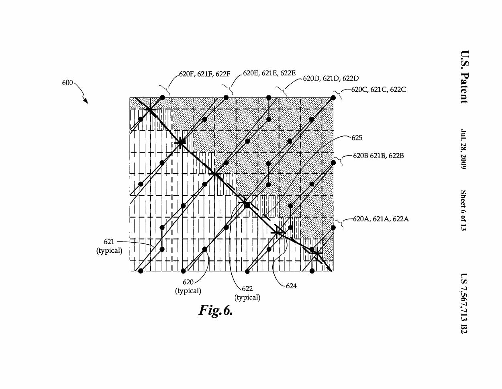
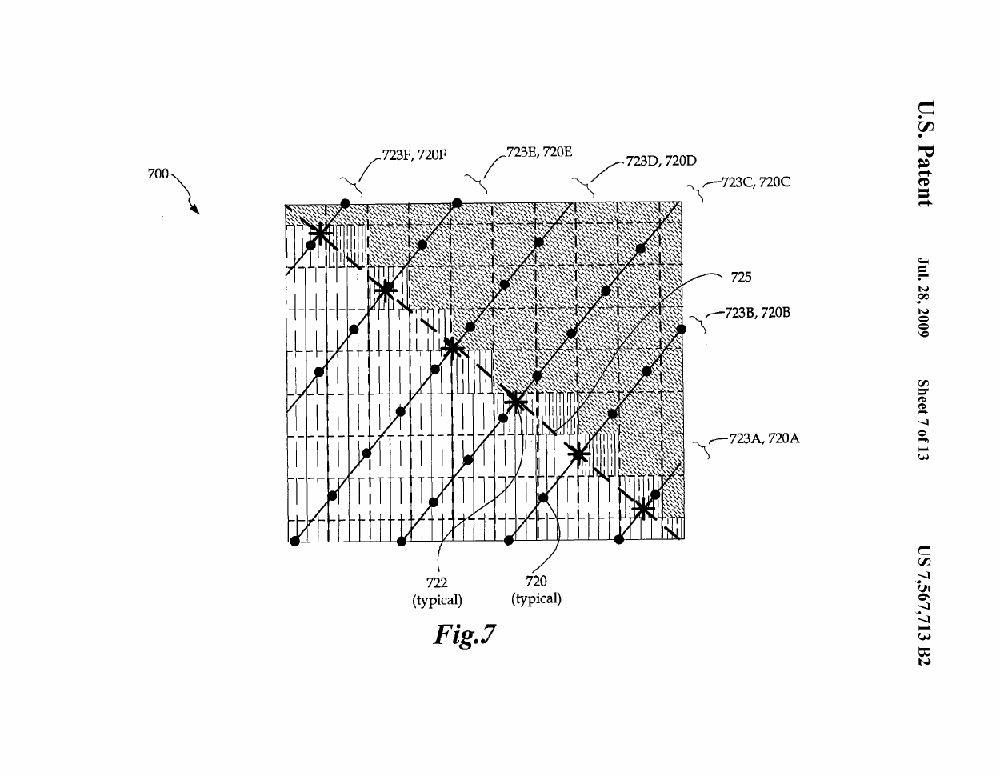
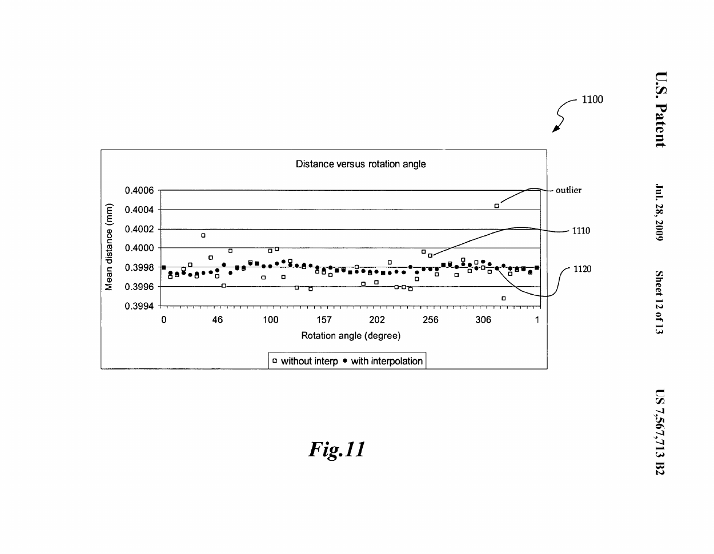

# US 7,567,713 B2 번역: 고정밀 머신비전 검사 시스템에서 밝기 보간을 써서 에지 위치를 재는 방법

- 번역 범위: 전문(서지 면, 초록, 발명의 설명 전체, 도면 설명, 청구항 1~17). 인용 문헌 목록은 원문 그대로 둔다.
- 원문: 같은 폴더의 `US7567713B2_Mitutoyo_intensity_interpolation_edge.pdf` (USPTO 공보 PDF, 21쪽, 텍스트 층 없는 스캔본).
- 본문 추출: `pdftotext -layout`로는 글자가 나오지 않아(스캔 영상), 150 dpi로 영상화한 뒤 tesseract(eng)로 OCR 했다. OCR이 깨진 곳(분수 "1/10 to 1/50", 식 1)은 300 dpi 영상을 직접 보고 확인했다.
- 도면은 13장 중 3장을 `도면/`에 넣었다(pdftoppm -r 110, 가로 보기로 90도 회전).
- 대괄호 [역주]는 번역자가 덧붙인 설명이다.

---

## 서지 면 (원문 1쪽)

- (10) 특허 번호: US 7,567,713 B2
- (45) 등록일: 2009년 7월 28일
- (54) 발명의 명칭: Method utilizing intensity interpolation for measuring edge locations in a high precision machine vision inspection system (고정밀 머신비전 검사 시스템에서 밝기 보간을 써서 에지 위치를 재는 방법)
- (75) 발명자: Yuhua Ding, Kirkland, WA (US)
- (73) 권리자: Mitutoyo Corporation, Kawasaki-shi (JP)
- (*) 고지: 35 U.S.C. 154(b)에 따라 존속기간이 730일 연장됨.
- (21) 출원 번호: 11/350,590
- (22) 출원일: 2006년 2월 8일
- (65) 공개: US 2007/0183666 A1, 2007년 8월 9일
- (51) 국제 분류: G06K 9/48 (2006.01), G06K 9/00 (2006.01)
- (52) 미국 분류: 382/199; 382/141
- (58) 검색 분야: 382/199, 382/195, 201, 203, 298, 141-152; 348/86-95, 348/125-134
- 심사관: Sherali Ishrat. 대리인: Christensen O'Connor Johnson Kindness PLLC
- 청구항 17개, 도면 13장

### (56) 인용 문헌 (원문 그대로)

U.S. PATENT DOCUMENTS

- 6,002,793 A * 12/1999 Silver et al. 382/152
- 6,061,467 A 5/2000 Michael
- 6,175,644 B1 * 1/2001 Scola et al. 382/141
- 7,003,161 B2 2/2006 Tessadro
- 7,030,351 B2 4/2006 Wasserman et al.
- 2003/0095700 A1 5/2003 Yu et al.
- 2003/0206667 A1 11/2003 Wang et al.
- 2005/0031191 A1 2/2005 Venkatachalam
- 2005/0213807 A1 9/2005 Wasserman et al.
- 2006/0023937 A1 2/2006 Tessadro
- 2006/0093205 A1 5/2006 Bryll et al.

OTHER PUBLICATIONS

- U.S. Appl. No. 11/185,561, filed Jul. 20, 2005, Blanford et al. [not yet published].
- QVPAK 3D CNC Vision Measuring Machine Operation Guide, Version 2.0, Manual No. 4911GB, Series No. 359, Mitutoyo Corporation & Micro Encoder Inc., Kanagawa, Japan, Sep. 1996.
- QVPAK 3D CNC Vision Measuring Machine User's Guide, Version 7.0, 1st ed., Manual No. 99MCB225A, Series No. 359, Mitutoyo Corporation & Micro Encoder Inc., Kanagawa, Japan, Jan. 2003.
- Rockett, P., "The Accuracy of Sub-Pixel Localisation in the Canny Edge Detector," Proceedings of the British Machine Vision Conference 1999, Nottingham, United Kingdom, Sep. 13-16, 1999, pp. 392-400.

\* cited by examiner

### (57) 초록

영상에서 정밀하게 에지를 검출하도록 비디오 도구를 동작시키는 방법이다. 이 방법은 정해 둔 주사선(scan line) 방향에 맞춘 직선 위의 위치들에 해당하는 밝기 값을 추정한다. 그리고 추정한 밝기 값과 그 직선 위 위치를 바탕으로 직선 위의 에지 점 위치를 정한다. 이 방법은 그렇게 하지 않으면 에지 측정에 생길 수 있는, 방향에 따른 부화소 변동을 줄인다. 밝기 값은 가장 가까운 이웃 화소들의 밝기를 보간해 추정할 수 있다. 직선 위의 위치를 화소 행이나 화소 열과 겹치도록 고르면, 인접한 두 화소의 밝기만으로 선형 보간을 할 수 있다.

[서지 면 대표 도면: FIG. 8의 흐름도. 810 검사 영상을 준비한다, 820 영상의 에지 특징을 찾는다, 830 에지 위치를 정할 주사선 방향을 정한다, 840 정한 방향에 맞춘 곧은 주사선 위 위치들의 추정 밝기 값을 여러 개 구한다, 850 보간 밝기 값과 그 위치로 곧은 주사선 위 에지 위치를 정한다.]

---

## 발명의 설명

### 발명의 분야

이 발명은 일반적으로 머신비전 검사 시스템에 관한 것이다. 더 구체적으로는 고정밀 머신비전 검사 시스템에서 밝기 보간을 써서 에지 위치를 재는 방법에 관한 것이다.

### 발명의 배경

정밀 머신비전 검사 시스템은 검사 대상의 정밀한 치수를 재고, 그 밖의 여러 특성을 검사하는 데 쓸 수 있다. 이런 시스템의 사용자 화면에는 여러 비디오 도구가 있다. 사용자는 에지 검출에 필요한 영상처리를 거의 몰라도, 이 도구를 놓아 작업물 영상의 에지 위치를 찾을 수 있다. 이런 기능을 가진 종래 시스템의 예로, 범용 "오프라인" 정밀 비전 검사 시스템이라 부를 수 있는 것이 있다. Mitutoyo America Corporation(MAC, 일리노이주 Aurora)이 파는 QUICK VISION™ 시리즈 비전 검사기와 QVPAK™ 소프트웨어다. 이 시리즈와 소프트웨어의 기능과 동작(사용자 화면과 여러 비디오 도구 포함)은 2003년 1월 발행 QVPAK 3D CNC Vision Measuring Machine Users Guide와 1996년 9월 발행 QVPAK 3D CNC Vision Measuring Machine Operation Guide에 설명되어 있으며, 두 문서는 전체가 참조로 포함된다. 예를 들어 QV-302 Pro 모델은 정밀 위치결정 장치, 조절 가능한 조명, CCD 배열 등과 현미경형 광학계를 써서 여러 배율로 작업물 검사 영상을 만든다.

이런 범용 오프라인 정밀 비전 검사 시스템은 다재다능한 것이 특징이다. 사용자나 자동 프로그램이 구성과 촬상 조건을 빠르게 바꿔, 여러 종류의 대상이나 한 작업물의 여러 부분을 검사할 수 있다. 이런 시스템은 동작이 단순하고 강건해서, "비전문가"도 정밀 검사를 믿을 만하게 할 수 있는 기능과 비디오 도구를 갖추는 것이 바람직하다.

그런데 사용자는 정밀 비전 검사 시스템에서 점점 더 높은 측정 정확도를 기대한다. 전에는 알려지지 않았거나 무시할 만했던 오차 원인이 중요해지고 있다. 그러면서도 정확도를 높인 시스템과 비디오 도구는 경제적이어야 하고, 처리량이 높아야 하며, 비전문가도 믿고 쓸 수 있도록 단순하고 강건해야 한다. 이런 요구를 채우는 시스템과 비디오 도구가 필요하다.

### 발명의 요약

기존의 일부 시스템은 같은 특징이라도 시야 안에서 그 특징이 놓인 방향에 따라 측정값이나 위치 결과를 다르게 낸다는 것이 밝혀졌다. 그래서 이런 측정 변동과 그에 따른 오차를 없애는 개선된 시스템이 필요하다. 이 발명은 고정밀 머신비전 검사 시스템에서 에지 위치를 재도록 비디오 도구를 동작시키는 개선된 방법에 관한 것이다. 특히 검사 영상 안에서 에지가 특정 방향일 때 생기는 부화소 에지 위치 오차를 줄이거나 없애는 방법에 관한 것이다. 이 방법은 다음과 같이 구현할 수 있다.

- 보정이나 참조표(look-up table)가 필요 없다.
- 처리량이 높다.
- 이미 쓰고 있는 에지 검출 알고리즘을 그대로 쓸 수 있다.
- 사용자가 오차를 만드는 조건을 알아채거나 그것을 피하려고 따로 조작할 필요가 없다.

또한 기존 머신비전 검사 시스템도 소프트웨어를 조금만 고치면("개조") 이 발명의 여러 실시예를 쓸 수 있다.

이 발명의 다른 측면에 따르면, 에지 위치를 정하는 데 쓰는 명목상 "주사선"에 해당하는 밝기 프로파일을 만들 때 보간 방법을 쓴다. 각 명목 주사선의 방향이나 위치는 비디오 도구의 방향이나 구성 매개변수로 정할 수 있다. 각 주사선의 밝기 프로파일은 지정한 보간 방법으로 만든다. 이 방법에서는 밝기 프로파일의 자료점이 명목 주사선과 매우 높은 정도로 겹치거나, 명목 주사선과 적어도 대략 평행하고 가까운 직선과 겹친다. 그런 다음 에지 검출 알고리즘으로 밝기 프로파일을 분석해 그 아래 특징의 에지 위치를 높은 정밀도로 정한다. 중요한 점은, 이 방법을 기존 머신비전 검사 소프트웨어에 넣을 때 명목 주사선 위치를 만드는 알고리즘도, 에지 위치를 찾는 알고리즘도 고칠 필요가 없다는 것이다.

다른 측면에 따르면, 한 실시예에서 주사선의 밝기 프로파일 자료점을 만드는 보간 방법은 쌍선형(bilinear) 보간이다. 프로파일 위 각 자료점의 밝기는 가장 가까운 이웃 화소 네 개의 밝기로 쌍선형 보간해 계산한다.

다른 측면에 따르면, 한 실시예에서는 밝기 프로파일을 만들 때 적어도 한 좌표 방향으로는 선형 보간만 쓰면 되도록 자료점(위치)을 고른다. 예를 들어 각 자료점의 두 좌표 중 적어도 하나가 정수가 되도록(곧 화소 행이나 열과 맞도록) 자료점을 고른다. 그러면 한 좌표축을 따라 화소 밝기를 선형 보간하는 것으로 높은 정확도를 얻는다. 이 구현에서는 주사선 방향에 따라 자료점 사이 간격이 달라질 수 있다. 이런 구현은 에지 검출 정확도를 해치지 않으면서 계산 효율을 높인다.

### 도면의 간단한 설명

이 발명의 앞서 말한 측면과 여러 장점은 첨부 도면과 함께 아래 상세 설명을 읽으면 더 쉽게 이해될 것이다.

- FIG. 1은 범용 머신비전 검사 시스템의 한 예를 보인 도면이다.
- FIG. 2는 영상의 에지 위에 놓인 점 도구(point tool)의 예다.
- FIG. 3은 영상의 에지 위에 놓인 상자 도구(box tool)의 예다.
- FIG. 4는 영상의 원형 에지 위에 놓인 원 도구(circle tool)의 예다.
- FIG. 5는 화소 밝기 값 집합으로 에지 위치를 정하는 한 방법의 예다.
- FIG. 6은 에지 위치를 정하려고 명목 주사선 집합에 대응하는 밝기 프로파일 자료점 값을 정하는 종래 방법의 하나다.
- FIG. 7은 같은 일을 하는 이 발명의 개선된 방법의 한 예다.
- FIG. 8은 FIG. 7의 개선 방법을 구현하는 루틴의 한 실시예를 보인 흐름도다.
- FIG. 9는 FIG. 7과 8의 방법에서 밝기 값을 정하는 데 쓸 수 있는 보간 방법의 한 실시예다.
- FIG. 10A는 FIG. 7과 8의 방법에서, 쌍선형 보간으로 곧은 주사선 위 밝기 프로파일 자료점 값을 정하고 그 결과 에지 점을 정하는 루틴의 첫째 실시예 흐름도다.
- FIG. 10B는 FIG. 7과 8의 방법에서, 자료점 위치에 제약을 두고 적어도 한 좌표 방향으로 선형 보간해 곧은 주사선 위 밝기 프로파일 자료점 값을 정하고 그 결과 에지 점을 정하는 루틴의 실시예 흐름도다.
- FIG. 11은 FIG. 6의 종래 방법과 FIG. 7, 8, 9의 방법으로 얻은 점과 직선 사이 거리 측정 결과를 비교한 도면이다.
- FIG. 12는 FIG. 6의 종래 방법과 FIG. 7, 8, 9의 방법으로 얻은 원 측정 결과를 비교한 도면이다.

### 바람직한 실시예의 상세 설명

FIG. 1은 이 발명에 쓸 수 있는 머신비전 검사 시스템(10)의 한 예를 보인 블록도다. 머신비전 검사 시스템(10)은 비전 측정기(12)를 포함하며, 측정기는 제어 컴퓨터(14)와 자료 및 제어 신호를 주고받는다. 제어 컴퓨터(14)는 다시 모니터나 디스플레이(16), 프린터(18), 조이스틱(22), 키보드(24), 마우스(26)와 자료 및 제어 신호를 주고받는다. 모니터나 디스플레이(16)는 머신비전 검사 시스템(10)의 동작을 제어하거나 프로그래밍하는 사용자 화면을 보여 줄 수 있다.

비전 측정기(12)는 움직이는 작업물 스테이지(32)와 광학 촬상계(34)를 포함한다. 광학 촬상계에는 줌 렌즈나 교환 렌즈가 있을 수 있다. 줌 렌즈나 교환 렌즈는 광학 촬상계(34)가 만드는 영상에 여러 배율을 준다. 머신비전 검사 시스템(10)은 대체로 앞서 말한 QUICK VISION® 시리즈 비전 시스템과 QVPAK® 소프트웨어, 그리고 비슷한 최신 상용 정밀 머신비전 검사 시스템과 비교할 만하다. 머신비전 검사 시스템(10)은 함께 계류 중이며 같은 권리자에게 양도된 미국 특허출원 10/978,227에도 설명되어 있고, 그 전체가 참조로 포함된다. 비전 측정기와 제어계의 여러 측면은 함께 계류 중이며 같은 권리자에게 양도된 미국 특허출원 10/808,948(2004년 3월 25일 출원)과 10/632,823(2003년 8월 4일 출원)에도 더 자세히 설명되어 있고, 그 전체가 참조로 포함된다.

'948 출원과 '823 출원에 더 자세히 설명한 것처럼, 머신비전 검사 시스템(10)은 제어계 부분을 포함할 수 있다. 이 부분은 찍어서 저장한 작업물 검사 영상을 불러오고, 그 영상 속 작업물 특징을 검사하고 분석하며, 검사 결과를 저장하거나 출력하는 데 쓴다. 이런 분석과 검사 방법은 보통 메모리의 비디오 도구 부분에 있는 여러 비디오 도구로 구현된다. 에지 검출 도구, 치수 측정 도구, 자동 초점 도구 같은 일부 도구는 앞서 말한 QUICK VISION® 시리즈와 QVPAK® 소프트웨어 등 여러 상용 머신비전 검사 시스템에서 흔히 쓸 수 있다. 여러 비디오 도구는 함께 계류 중이며 같은 권리자에게 양도된 미국 특허출원 09/987,986(2001년 11월 16일 출원), 10/719,210(2003년 11월 24일 출원), 10/903,714(2004년 7월 30일 출원), 11/185,561(2005년 7월 20일 출원)에도 설명되어 있으며, 각각 전체가 참조로 포함된다. 아래에서 더 자세히 설명하듯이, 이 발명은 여러 비디오 도구(예: 점, 상자, 원 도구 등)와 함께 쓰여 그 측정의 정확도와 일관성을 높인다.

FIG. 2는 영상(200)에서 더 어둡거나 그늘진 영역(208)의 경계에 있는 에지(205) 위에 놓인 점 도구(210)의 예다(예: 영상 표시 장치 위). FIG. 2와 아래 도면들에서 그늘진 영역(208) 같은 음영 영역은, 영상에서 상대적으로 밝기가 낮은 화소를 나타내려고 그린 것이다. 아래에서 더 설명하듯이, 점 도구(210)는 영상의 에지 점 하나의 위치를 정하도록 구성할 수 있다. 여러 에지 점을 찾는 다른 도구(예: 상자형 에지 도구)의 동작도 비슷한 연산에 바탕을 둘 수 있다. 점 도구(210)의 그래픽 사용자 화면은 본체(211), 에지 선택기(212), 극성 표시 화살촉(214)을 포함할 수 있다. 화살촉(214)은 대개 에지를 가로질러 밝은 쪽에서 어두운 쪽, 또는 어두운 쪽에서 밝은 쪽을 가리키며, 참조로 포함한 문헌에서 설명하듯이 어떤 상황에서 에지 찾기의 신뢰도를 높인다. FIG. 2에서는 본체(211)가 명목 주사선(220)을 가리고 있다. 이 주사선은 본체(211)가 정하며 본체와 명목상 겹친다. 주사선은 FIG. 3과 4를 참조해 아래에서 더 자세히 그리고 설명한다.

동작에서 사용자는 점 도구(210)를 고르고(예: 화면 가장자리의 비디오 도구 막대에서), 본체(211)를 에지 특징 위에 놓고 에지 선택기(212)를 원하는 에지 위치에 최대한 가깝게 놓아 검출할 에지 특징을 지정한다. 점 도구 본체(211)의 방향으로, 에지를 가로지르는 원하는 주사선 방향을 정하고 표시할 수 있다. 이는 FIG. 2 오른쪽 위 x-y 좌표계의 각 A로 나타낸다. FIG. 2와 이 문서의 다른 도면에서 영상 화소는 x 좌표 방향으로 행을, y 좌표 방향으로 열을 이룬다. 따라서 각 A는 영상의 화소 행에 대한 명목 주사선 방향각이다. 화살표(214)는 에지 검출에 쓸 기준 방향 또는 극성을 가리킨다. 점 도구(210)의 구성이 끝나면, 그 아래의 에지 점 찾기 루틴 명령이 실행된다. 이 루틴은 점 도구(210)의 본체(211)와 명목상 겹치는 주사선에 대응하는 밝기 프로파일 자료점(예: 화소 밝기 자료)을 분석하고, 여러 연산으로 그 아래 특징의 에지 위치를 검출한다. FIG. 5를 참조해 아래에서 더 설명하듯이, 여러 실시예에서 점 도구(210)의 에지 점 찾기 루틴은 주사선 밝기 프로파일의 기울기 크기로 에지 위치를 정할 수 있다.

FIG. 3은 영상(300)에서 그늘진 영역(308)의 경계에 있는 에지(305) 위에 놓인 상자 도구(310)의 예다(예: 영상 표시 장치 위). 상자 도구(310)의 그래픽 사용자 화면은 관심영역(ROI) 표시(311), 옆면의 극성 표시 화살표(314), 검출할 에지에 놓는 에지 선택기(312)를 포함할 수 있다. 상자 도구(310) 안에는 명목 주사선(320)이 표시될 수 있다. 상자 도구(310)는 이 주사선을 만들어 에지 점을 정하는 데 쓴다. 상자 도구는 각 명목 주사선(320)을 따라, 앞서 FIG. 2의 점 도구(210) 주사선(220)에서 설명한 것처럼 그 아래 특징의 에지 점을 정한다. FIG. 3에 보이고 아래에서 더 설명하듯이, 정한 에지 점 집합에 직선(325)을 맞춰 에지(305)의 측정 위치와 방향을 정할 수 있다.

동작에서 상자 도구(310)를 고르고, 검출할 에지 특징을 지정하도록 구성한다. 작업자는 ROI 표시(311)의 위치, 크기, 회전을 조정해 측정 ROI가 검출할 에지 특징 부분을 포함하게 하고, 에지 선택기(312)로 원하는 에지 위치를 더 정확히 지정할 수 있다. 화면 위 ROI 표시(311)의 방향으로, 에지를 가로지르는 원하는 주사선 방향을 정하고 표시할 수 있다. 이는 FIG. 3 오른쪽 위 x-y 좌표계의 각 A로 나타낸다. 더 일반적으로는 ROI 표시(311) 전체의 방향, 화살표(314)가 있는 부분의 방향, 또는 명목 주사선(320)의 방향 중 어느 것으로든 주사선 방향을 정하거나 표시할 수 있다. 화살표(314)는 에지 검출에 쓸 극성을 정한다. 상자 도구(310)의 구성이 끝나면, 그 아래 에지 점 찾기 루틴이 실행되어 각 주사선의 밝기 프로파일 자료를 분석해 에지 점을 검출하고, 아래에서 자세히 설명하듯이 검출한 에지 점에 직선을 맞춘다.

FIG. 4는 영상(400)에서 더 어둡거나 그늘진 영역(408)의 경계에 있는 원형 에지(405) 위에 놓인 원 도구(410)의 예다(예: 영상 표시 장치 위). 원 도구(410)의 그래픽 사용자 화면은 ROI 바깥 원(411A)과 ROI 안쪽 원(411B)으로 된 ROI 표시, 에지 선택기(412), 원 도구(410)의 에지 검출 극성을 나타내는 화살표(414)를 포함할 수 있다. 원 도구(410)가 만들어 에지 점을 정하는 데 쓰는 명목 주사선(420)은 ROI 안쪽 원(411B)과 바깥 원(411A) 사이에 표시될 수 있다. 원 도구는 각 명목 주사선(420)마다, 앞서 FIG. 2의 주사선(220)에서 설명한 것처럼 그 아래 특징의 에지 점을 찾는다. 정한 에지 점에 원(425)을 맞춰 원형 에지(405)의 측정 위치와 반지름을 정할 수 있다.

원 도구(410)의 여러 기능의 동작은, 설명이나 문맥상 달리 밝히지 않는 한 FIG. 3에서 설명한 상자 도구(310)의 비슷한 기능과 같다. 동작에서 원 도구(410)를 고르고, 검출할 에지 특징을 지정하도록 구성한다. 작업자는 ROI 표시의 위치와 크기를 조정해 ROI 안쪽 원(411B)과 바깥 원(411A) 사이에 검출할 에지 특징이 들어오게 하고, 에지 선택기(412)로 원하는 에지 위치를 더 정확히 지정할 수 있다. 화살표(414)는 에지 검출 극성을 정한다. 원 도구(410)의 구성이 끝나면 그 아래 에지 점 찾기 루틴이 실행된다. 이 루틴은 ROI 둘레의 여러 각도에 분포한, 반지름 방향의 곧은 주사선 여러 개 각각의 방향을 정한다. 그런 다음 아래에서 설명할 직선 에지 결정 연산과 비슷한 방식으로 각 주사선의 밝기 프로파일 자료 값을 분석해 에지 점을 검출하고, 검출한 에지 점에 원을 맞춘다. 앞서 말한 도구들과 달리, 원 도구(410)가 정해 쓰는 명목 반지름 주사선의 방향은 주사선마다 다르다.

정리하면, 일반적으로 여러 비디오 도구가 에지 점을 정하고, 에지 점에 기하 형상을 맞춰 그 아래 영상 특징을 잰다. 비디오 도구를 동작시키는 한 종래 방법에서는, 도구 종류(예: 점, 상자, 원 등)에 따라 정해진 도구 매개변수로 ROI 안에 명목 주사선을 하나 이상 정하거나 만든다. 도구는 각 명목 주사선마다 그 주사선을 근사하는 밝기 프로파일 자료점 위치 집합을 정하거나 고른다. 그 자료점 위치들의 밝기 값을 정해, 명목 주사선의 밝기 프로파일을 정의한다. 그런 다음 한 실시예에서는 에지 검출 알고리즘이 밝기 프로파일의 기울기를 분석해, 기울기 크기가 최대인 프로파일 위 위치를 찾는다. 이는 FIG. 5를 참조해 아래에서 더 자세히 설명한다. 프로파일 위 최대 기울기 위치로 명목 주사선에 대응하는 영상의 에지 점 위치를 정한다. 이 종래 방법의 한 구현은 FIG. 6을 참조해 아래에서 더 자세히 설명한다.

FIG. 5는 밝기 프로파일로 에지 위치를 정하는 한 방법의 예를 보인 그래프(500)다. FIG. 5에 보이듯이, 밝기 프로파일(510)은 주사선(예: FIG. 2, 3, 4의 주사선 220, 320, 420 중 하나)을 나타내는 위치들에 대응하는 영상 화소 밝기(회색) 값(525)의 집합이다. 주사선을 나타내는 자료점이나 위치는 가로축에 0~50의 "화소 번호"로 표시되어 있다. 자료점 0부터 밝기 값은 처음에 대략 자료점 23까지 상대적으로 어두운 영역을 나타내고, 그 뒤 자료점 50까지 상대적으로 밝은 영역이 이어진다.

기울기 크기 값(526)은 밝기 값(525)에서 유도하며 FIG. 5에 함께 보인다. 여러 종래 알고리즘은 기울기 크기의 봉우리에 해당하는 가로축 위치를 찾아 그것을 에지 위치로 삼는다. 기울기 크기 봉우리가 여럿이면, 비디오 도구의 에지 선택기나 방향 표시(예: 점 도구 210의 에지 선택기 212나 극성 표시 214)가 알고리즘이 원하는 봉우리를 고르는 데 도움을 줄 수 있다. FIG. 5에서는 최대 기울기 기준(곧 기울기 봉우리)이 에지가 대략 자료점 23에 있음을 가리킨다. 곡선 맞춤, 무게중심 계산 같은 방법을 쓰면 기울기 크기 봉우리를 밝기 프로파일 자료점 사이에서 비교적 정밀하게 찾을 수 있다. 이것이 영상에서 해당 에지 위치를 정할 때 대체로 부화소 측정 분해능과 반복성을 뒷받침한다.

FIG. 6은 명목 주사선을 나타내는 밝기 프로파일(예: FIG. 5의 밝기 프로파일 510)을 정하고 그 결과 에지 위치를 정하는 종래 방법의 하나를 보인 도면(600)이다. FIG. 6에는 에지의 작은 부분과 그 주변 영상 화소가 크게 확대되어 있다. FIG. 6은 더 큰 ROI(도시하지 않음)의 작은 부분이다. 영상 화소는 점선으로 둘러싼 상자로 나타낸다. 화소의 명목 위치는 화소의 중심이다. 각 화소의 밝기는 상자 안 음영의 정도로 대략 나타내며, 음영이 많을수록 밝기가 낮다. FIG. 6에는 주사선 영상 화소 집합(620A~620F)이 있다. 각 집합은 하나 이상의 실선 선분으로 이은 화소 중심 점들로 나타내며, 주사선 영상 화소 집합 620B가 그 전형이다. FIG. 6의 실시예에서 집합 620A~620F의 각 주사선 영상 화소는 명목 주사선에 가장 가까운 화소라는 이유로 그 명목 주사선을 대표하도록 골라졌다. 명목 주사선은 FIG. 6에 그리지 않았지만, 같은 영상을 보이는 FIG. 7의 명목 주사선 723A~723F와 같을 수 있다. FIG. 6은 ROI의 일부만 보이므로, 그려진 주사선 영상 화소 집합 620A~620F는 "불완전한" 집합이다. 곧 ROI 안 전형적인 주사선에 들어가는 화소를 다 보이지 않으며, 정확한 에지 검출에 충분한 수의 화소도 보이지 않는다. 그러나 그 일반 구조는 종래 방법을 대표하며 설명에는 충분하다.

주사선 영상 화소 집합은 FIG. 5의 밝기 프로파일(510)과 비슷한 밝기 프로파일을 준다. 이것도 같은 방식으로 분석해 프로파일 위 에지 위치를 정할 수 있다. FIG. 6에는 각 최적 맞춤 직선(621A~621F)도 있다. 이 경우 이 직선들은 원래 명목 주사선과 평행하며, 각 주사선 영상 화소 집합에 가장 잘 맞도록 놓인다. 이 예에서는 밝기 프로파일의 인접한 화소 번호 사이에서 에지 위치를 부화소 분해능으로 정한 다음, 대응하는 주사선 영상 화소 사이의 대응(예: 비례) 위치를 해당 최적 맞춤 직선(621A~621F 중 하나)에 투영해 검출 에지 점(622) 하나를 정한다. 검출 에지 점(622)은 꺾인 실선(624)으로 이은 십자 표시로 나타낸다. FIG. 6에는 검출 에지 점(622)에 맞춘 점선 최적 맞춤 직선(625)도 있다. 최적 맞춤 직선(625)의 위치가 영상 속 직선 에지 특징의 측정 위치다. 다른 실시예에서는, 밝기 프로파일의 인접 화소 번호 사이에서 에지 위치를 정한 뒤, 대응하는 주사선 영상 화소들을 잇는 선 위의 대응 위치를 그대로 검출 에지 점(622)으로 쓴다.

설명을 위해 FIG. 6은 에지 검출에 쓰는 보통의 ROI보다 화소 수를 크게 줄이고 크게 확대해서 보였다는 점을 알아야 한다. 그래서 FIG. 6은 주사선 영상 화소 집합 620A~620F가 직선에서 벗어난 정도를 크게 과장한다. FIG. 6의 화소를 보통 디스플레이에 띄우면 해당 표시 영역의 폭은 대략 2 mm(0.1인치)보다 작다. 따라서 실제로는 ROI가 FIG. 6의 화소 묶음보다 훨씬 크고, 실제 주사선 영상 화소 집합에는 훨씬 많은 화소가 들어가며, 각 집합의 화소는 디스플레이에서 매우 곧은 선으로 보일 것이다. 화소 영상에서 직선을 나타낼 때는, 주사선 영상 화소 집합 620A~620F처럼 직선을 가장 잘 근사하는 영상 화소를 고르거나, 잘 알려진 Bresenham 알고리즘 같은 방법을 쓰는 것이 관례였다. 앞서 말한 종래 방법들은 좋은 측정 분해능과 반복성, 예를 들어 영상 화소 간격의 1/10에서 1/50 정도를 주었기 때문에 만족스러웠다.

그러나 전에는 알려지지 않았거나 무시할 만했던 오차 원인이 최근 시스템과 응용에서 중요해지고 있다. 종래 에지 검출 방법은 같은 특징이라도 시야 안에서 특징이 놓인 방향에 따라 측정 결과가 달라질 수 있음이 알려졌다. 예를 들어 이런 방향 의존 측정 결과는 잘 알려진 Canny 에지 검출기에서 발견되었다. 이는 Peter Rocket[역주: 인용 목록 표기는 Rockett], "The Accuracy of Sub-Pixel Localisation in the Canny Edge Detector", BMVC99, pp. 392-401[역주: 인용 목록에는 pp. 392-400]에 설명되어 있다. Rocket은 Canny 에지 검출기의 이런 오차를 참조표로 고칠 수 있다고 제안한다. 그러나 Canny 에지 검출기와 그 보정 방법은 범용 정밀 머신비전 검사 시스템의 비디오 도구에서는 쉽게 쓸 수 없거나 바람직하지 않다.

방향에 따른 부화소 측정 변동은 이제 FIG. 5를 참조해 설명한 종래 방법에서도 확인되었다. 이런 측정 변동은 FIG. 11과 12에 보인다. 이제 이런 측정 변동을 일으키는 오차를 줄이거나 없애는 방법을 설명한다.

FIG. 7은 명목 주사선을 나타내는 밝기 프로파일을 정하고 그 결과 에지 위치를 정하는, 이 발명의 개선된 방법의 한 예를 보인 도면(700)이다. FIG. 7의 개선 방법은 범용 정밀 머신비전 검사 시스템의 비디오 도구에서 효율적이고 강건하다. FIG. 7에는 명목 주사선 723A~723F가 있다. 여러 실시예에서 명목 주사선은 FIG. 2의 점 도구(210) 본체(211)와 평행하게, 또는 FIG. 3의 상자 도구(310)의 명목 중심선에 수직으로, 또는 FIG. 4의 원 도구(410)처럼 반지름 방향으로 정할 수 있다. 여러 실시예에서 명목 주사선은 비디오 도구 ROI 전체에 지정한 개수만큼 같은 간격으로 놓거나, 화소 간격 단위나 밀리미터, 도 같은 절대 측정 단위로 정한 거리만큼 떨어뜨려 놓을 수 있다. 더 일반적으로, 명목 주사선은 쓸 만한 개수의 주사선을 만들고 검출할 에지를 가로질러 쓸 만하거나 바람직한 방향(예: 에지에 대략 수직)으로 놓을 수 있는, 지금 알려졌거나 앞으로 개발될 어떤 방법으로든 정할 수 있다.

각 주사선 자료점 집합 720A~720F는 명목 주사선 723A~723F를 따라 놓인 점들로 나타낸다. FIG. 7에 보이듯이, 각 주사선 자료점 집합 720A~720F 안에서 자료점은 명목 주사선과 겹치고 서로 한 직선 위에 있도록 골라진다. 주사선 자료점 집합 720A~720F는 "불완전한" 집합이다. 곧 정확한 에지 검출에 충분한 화소를 포함하지 않는다. 그러나 설명에는 충분하다. 주사선 자료점은 영상 화소 위치와 겹치는 대신 한 직선 위에 있도록 제약되므로, 각 자료점의 밝기는 아래에서 자세히 설명하듯이 인접 화소 밝기로 추정(예: 보간)해야 한다. 그렇게 얻은 주사선 자료점 집합은 FIG. 5의 밝기 프로파일(510)과 비슷한 밝기 프로파일을 준다. 이 프로파일도 같은 방식으로 분석해 프로파일 위 에지 위치(예: 최대 기울기 크기 위치)를 정할 수 있다.

위 방법으로, 2차원(2D) 영상을 지나는 직선(이 경우 명목 주사선)을 따른 밝기 프로파일에 대응하는 1차원(1D) 밝기 프로파일을 만들 수 있음을 알아야 한다. 따라서 1D 밝기 프로파일에서 찾은 에지 위치를 큰 근사나 오차 없이 2D 영상을 지나는 직선 위로 바로 되돌려 놓을 수 있다. 검출 에지 점(722)이 최적 맞춤 직선(725)에 매우 잘 맞는다는 점에 주목한다.

반면 FIG. 6에서 설명한 종래 방법은, 2D 영상을 지나는 곧은(1D) 선을 따른 밝기 프로파일과 꼭 같지는 않은 밝기 자료로 1D 밝기 프로파일을 만든다. 그래서 1D 밝기 프로파일에서 찾은 에지 위치를 2D 영상으로 되돌릴 때 어느 정도의 근사나 오차가 들어간다. 주사선 영상 화소 집합이 검출할 에지 근처에서 "2D 꺾임"을 포함하면 이 근사나 오차가 더 나빠진다. FIG. 6에서 주사선 영상 화소 집합 620A~620C에 대응하는 에지 점(622)의 직선 맞춤이 나쁜 것이 그 예다.

FIG. 8은 FIG. 7의 개선 방법을 구현하는 루틴(800)의 한 실시예를 보인 흐름도다. FIG. 8에서 블록 810에서 검사 영상을 준비한다. 블록 820에서 영상에 들어 있는 에지 특징을 찾는다. 블록 830에서 에지 특징의 위치를 정하는 데 쓸 주사선 방향을 정한다. 블록 840에서 정한 주사선 방향에 맞춘 곧은 주사선 위 위치들에 대응하는 보간 영상 밝기 값 여러 개를 추정한다. 블록 850에서 보간 영상 밝기 값 여러 개와 곧은 주사선 위 그 대응 위치로 곧은 주사선 위 에지 특징의 위치를 정한다. 루틴(800)은 여기서 설명한 비디오 도구 아래에 있는(그 안에 포함된) 하나 이상의 에지 찾기 루틴의 명령으로 구현할 수 있다. 이 명령은 비디오 도구 동작 중에 실행되어, 머신비전 검사 시스템이 해당 연산을 하도록 제어한다.

FIG. 9는 FIG. 7과 8의 방법에서 직선 위 위치의 밝기 값을 추정하는 데 쓸 수 있는 보간 방법의 한 실시예를 보인 도면(900)이다. FIG. 9에서 가장 가까운 이웃 화소 중심 P1, P2, P3, P4가 밝기를 추정할 자료점 Ii를 둘러싸는 정사각형을 이룬다. 주사선 끝점 S1과 S2가 직선 SL을 정한다. 밝기 자료점 Ii는 주사선 SL 위에서 화소 P1으로부터 가로 거리 dx, 세로 거리 dy만큼 떨어져 있다.

여러 점의 위치와 화소 밝기는 다음과 같이 정의한다.

- 화소 P1: 위치 (X_LB, Y_LB), 밝기 I(X_LB, Y_LB)
- 화소 P2: 위치 (X_LB, Y_LB+1), 밝기 I(X_LB, Y_LB+1)
- 화소 P3: 위치 (X_LB+1, Y_LB), 밝기 I(X_LB+1, Y_LB)
- 화소 P4: 위치 (X_LB+1, Y_LB+1), 밝기 I(X_LB+1, Y_LB+1)
- 주사선 끝점 S1: 위치 (Xscan 1, Yscan 1), 끝점 S2: 위치 (Xscan N, Yscan N)
- 밝기 자료점 Ii: 위치 (Xscan i, Yscan i)

[역주: LB는 lower bound, 곧 좌표의 정수 부분을 뜻한다(FIG. 10A 설명 참고).]

FIG. 9에 보이고 FIG. 10A와 10B를 참조해 아래에서 더 설명하듯이, 밝기 자료점 Ii에 줄 밝기 값을 추정하는 데 보간을 쓸 수 있다. 보간 방법의 한 실시예에서, 주사선 SL 위 각 자료점 Ii(i = 1, 2, 3, ...)의 추정 밝기는 가장 가까운 네 이웃의 밝기로 다음 식처럼 계산한다.

$$I_{(X_{scan\,i},\,Y_{scan\,i})} = d_x\left[d_y I_{(X_{LB}+1,\,Y_{LB}+1)} + (1-d_y) I_{(X_{LB}+1,\,Y_{LB})}\right] + (1-d_x)\left[d_y I_{(X_{LB}+1,\,Y_{LB}+1)} + (1-d_y) I_{(X_{LB},\,Y_{LB})}\right] \quad \text{(식 1)}$$

[역주: 300 dpi 영상으로 확인한 원문 그대로다. 두 번째 대괄호의 첫 항은 원문에 $I_{(X_{LB}+1, Y_{LB}+1)}$로 인쇄되어 있으나, 쌍선형 보간이 되려면 $I_{(X_{LB}, Y_{LB}+1)}$ (화소 P2)이어야 한다. FIG. 10A 블록 1025의 동등한 식은 P2를 바르게 쓴다. 원문 오식으로 본다.]

여기서 dx와 dy는 밝기를 추정하는 그 자료점에 대한 값임을 알 수 있다. 식 1 대신 쓸 수 있는 동등한 형태가 FIG. 10A의 단계 1025에 있다.

FIG. 10A는 FIG. 7과 8의 방법에서, 쌍선형 보간으로 곧은 주사선 위 밝기 프로파일 자료점 값을 추정하고 그 결과 에지 점을 정하는 루틴(1000)의 한 실시예를 보인 흐름도다. FIG. 10A에서

- 블록 1010: 비디오 도구의 명목 주사선을 정하고, 주사선을 따라 밝기 프로파일 자료점 위치 (Xscan 1, Yscan 1) ~ (Xscan N, Yscan N)을 정하고, i = 1로 초기화한다.
- 블록 1015: X_LB = Xscan i의 정수 부분, Y_LB = Yscan i의 정수 부분으로 둔다.
- 블록 1020: dy = Yscan i − Y_LB, dx = Xscan i − X_LB를 구한다.
- 블록 1025: $I_{(X_{scan\,i}, Y_{scan\,i})} = I_{(X_{LB}, Y_{scan\,i})} + d_x \left[I_{(X_{LB}+1, Y_{scan\,i})} - I_{(X_{LB}, Y_{scan\,i})}\right]$ 를 구한다. 여기서 $I_{(X_{LB}, Y_{scan\,i})} = I_{(X_{LB}, Y_{LB})} + d_y\left[I_{(X_{LB}, Y_{LB}+1)} - I_{(X_{LB}, Y_{LB})}\right]$, $I_{(X_{LB}+1, Y_{scan\,i})} = I_{(X_{LB}+1, Y_{LB})} + d_y\left[I_{(X_{LB}+1, Y_{LB}+1)} - I_{(X_{LB}+1, Y_{LB})}\right]$ 이다.
- 블록 1030: i를 i+1로 늘린다.
- 판단 블록 1035: i = N인지 본다. 아니면 블록 1015로 돌아간다. 맞으면 블록 1040으로 간다.
- 블록 1040: 주사선을 따라 자료 $I_{(X_{scan\,1}, Y_{scan\,1})}, \ldots, I_{(X_{scan\,N}, Y_{scan\,N})}$ 중 적어도 일부로, 예를 들어 앞서 설명한 밝기 프로파일 위 에지 위치 찾기 방법으로 주사선 위 에지 위치를 정한다.

[역주: 블록 1025의 식은 OCR이 깨져 본문(10단) 300 dpi 영상을 보고 옮겼다. 도면 FIG. 10A(시트 10)의 상자 안 식과는 대조하지 않았다.]

FIG. 10B는 FIG. 7과 8의 방법에서, 자료점 위치에 제약을 두고 적어도 한 좌표 방향으로 선형 보간해 곧은 주사선 위 밝기 프로파일 자료점 값을 추정하고 그 결과 에지 점을 정하는 루틴(1050)의 한 실시예를 보인 흐름도다. FIG. 10B에서

- 블록 1055: 비디오 도구의 명목 주사선을 정하고, 모든 Xscan i가 화소 열 위치와 맞도록(곧 dx = 0) 주사선을 따라 밝기 프로파일 자료점 위치 (Xscan 1, Yscan 1) ~ (Xscan N, Yscan N)을 정하고, i = 1로 초기화한다.
- 블록 1060: X_LB = Xscan i, Y_LB = Yscan i의 정수 부분으로 둔다.
- 블록 1065: dy = Yscan i − Y_LB를 구한다.
- 블록 1070: $I_{(X_{scan\,i}, Y_{scan\,i})} = I_{(X_{LB}, Y_{LB})} + d_y\left[I_{(X_{LB}, Y_{LB}+1)} - I_{(X_{LB}, Y_{LB})}\right]$ 를 구한다.
- 블록 1075: i를 i+1로 늘린다.
- 판단 블록 1080: i = N인지 본다. 아니면 블록 1060으로 돌아간다. 맞으면 블록 1085로 간다.
- 블록 1085: 주사선을 따라 자료 $I_{(X_{scan\,1}, Y_{scan\,1})}, \ldots, I_{(X_{scan\,N}, Y_{scan\,N})}$ 중 적어도 일부로 주사선 위 에지 위치를 정한다.

루틴(1050)은 루틴(1000)과 비슷한 대안이지만, 직선 위에 놓인 자료점의 밝기를 추정하는 보간 연산의 효율을 높인다는 것을 알 수 있다. 비슷한 이점을 주는 다른 실시예에서는 루틴(1050)에서 x와 y 좌표의 역할을 바꿔, 모든 Yscan i가 화소 행 위치와 맞도록(곧 dy = 0) 할 수 있다. 또 다른 실시예에서는 주사선을 따라 자료점 위치를 번갈아 골라, 한 자료점은 dx = 0, 다음 자료점은 dy = 0, 이런 식으로 할 수 있다. 위에서 설명한 루틴이나 연산은 모두 여기서 설명한 비디오 도구 아래에 있는(그 안에 포함된) 하나 이상의 에지 찾기 루틴의 명령으로 구현할 수 있다. 이 명령은 비디오 도구 동작 중에 실행되어, 머신비전 검사 시스템이 해당 연산을 하도록 제어한다.

FIG. 11은 에지 점과 직선 에지 사이 거리의 치수 측정을, FIG. 6의 종래 에지 검출 방법 구현과, FIG. 7, 8, 9에서 설명한 직선 위 위치의 밝기 프로파일을 추정하는 개선 방법으로 각각 구해 비교한 도면(1100)이다. 종래 방법("보간 없음") 결과는 네모 자료점(1110), 개선 방법("보간 있음") 결과는 동그라미 자료점(1120)으로 나타낸다. FIG. 11에 보이듯이, 360도 범위의 여러 방향에서 이 치수 측정의 최대최소 차(peak-to-peak) 변동이 종래 방법에서는 대략 0.6 µm(이상치 1개 제외)였으나, 이 발명의 개선 방법에서는 대략 0.15 µm로 줄었다. 상당한 개선이다.

FIG. 12는 FIG. 6의 종래 에지 검출 방법 구현으로 얻은 치수 측정 결과와, FIG. 7, 8, 9에서 설명한 직선 위 위치의 밝기 프로파일을 추정하는 개선 방법으로 얻은 결과를 비교한 도면(1200)이다. 원 비디오 도구로 지름 500 µm인 원 16개를 쟀다. 원마다 에지 점 360개를 검출한 뒤 원에 맞췄다. 각 에지 점에서 맞춘 원 중심까지의 거리를 보였다. 종래 방법("보간 없음") 결과는 십자 자료점(1210), 개선 방법("보간 있음") 결과는 점 자료점(1220)이다. 에지 점 360개는 각각 다른 반지름 주사선 방향으로 검출된다는 점을 알 수 있다. 보듯이, 이 발명의 개선 방법으로 얻은 거리 측정의 변동이나 오차는 종래 방법보다 상당히 줄었다.

[역주: FIG. 12(시트 13)의 세로축은 원 중심까지 거리 0.246~0.254 mm, 가로축은 에지 점 번호 1~360이다. 두 방법 모두 대략 0.249~0.2515 mm 사이에서 점 번호에 따라 물결 모양으로 오르내리며, 보간 없음(십자)은 그 띠 밖으로 0.247~0.2535 mm까지 튀는 점이 여럿 있다. 본문은 수치 요약을 주지 않는다.]

설명을 분명히 하려고 앞의 내용은 단색 영상을 다뤘지만, 색 화소가 섞인 영상(예: 빨강, 초록, 파랑 채널 화소로 된 영상)의 에지 검출도 같은 방식으로 할 수 있다. 한 예로, 서로 다른 색 채널 영상을 공유하는 전체 좌표계 안의 단색 영상으로 다룰 수 있다. 각 색 채널 영상을 앞서 설명한 대로 분석하고, 각 채널의 측정 결과를 전체 좌표계에서 평균이나 다른 알맞은 방법으로 합칠 수 있다. 다른 예로, 알려진 방법으로 색 채널을 합쳐 알맞은 "단색" 유사 영상을 만들고 앞의 방법으로 분석할 수 있다.

이 발명의 바람직한 실시예를 보이고 설명했지만, 보이고 설명한 기능 배치와 연산 순서의 여러 변형이 이 공개 내용을 본 통상의 기술자에게 분명할 것이다. 따라서 이 발명의 정신과 범위를 벗어나지 않고 여러 변경을 할 수 있음을 알 수 있다.

---

## 청구항

배타적 재산권이나 특권을 청구하는 이 발명의 실시예는 다음과 같이 정의된다.

**1.** 머신비전 검사 시스템이 얻은 작업물 검사 영상에서 에지 특징의 위치를 정하는 방법으로서, 컴퓨터를 써서 다음 단계를 수행하는 것을 포함하는 방법:

a) 영상에 포함된 에지 특징을 찾는 단계;

b) 에지 특징의 적어도 한 에지 점의 위치를 정하는 데 쓸 주사선 방향을 정하는 단계;

c) 정한 주사선 방향에 맞춘 직선 위의 위치들에 대응하는 추정 영상 밝기 값을 여러 개 정하는 단계; 그리고

d) 여러 추정 영상 밝기 값과 직선 위 그 대응 위치를 바탕으로 직선 위 에지 점의 위치를 정하는 단계.

**2.** 청구항 1의 방법에 있어서, 여러 추정 영상 밝기 값을 정하는 것은 쌍선형 보간으로 영상 밝기 값을 추정하는 것을 포함하는 방법.

**3.** 청구항 2의 방법에 있어서, 직선 위 각 위치에 대해, 쌍선형 보간은 그 위치에 가장 가까운 이웃 화소 네 개의 영상 밝기 값을 써서 수행되는 방법.

**4.** 청구항 1의 방법에 있어서, 직선 위 위치 중 적어도 하나는 화소 행이나 화소 열과 명목상 겹치도록 정해지는 방법.

**5.** 청구항 4의 방법에 있어서, 직선 위 위치 하나가 화소 행과 명목상 겹치도록 정해지면, 그 위치에 대응하는 영상 밝기 값의 추정은 같은 화소 행에서 가장 가까운 이웃 화소 두 개의 영상 밝기 값 사이의 선형 보간을 포함하는 방법.

**6.** 청구항 4의 방법에 있어서, 직선 위 위치 하나가 화소 열과 명목상 겹치도록 정해지면, 그 위치에 대응하는 영상 밝기 값의 추정은 같은 화소 열에서 가장 가까운 이웃 화소 두 개의 영상 밝기 값 사이의 선형 보간을 포함하는 방법.

**7.** 청구항 1의 방법에 있어서, 단계 a)와 b)는 영상의 디스플레이에 표시된 비디오 도구를 구성해 수행하고, 단계 c)와 d)는 비디오 도구의 에지 점 찾기 루틴이 수행하며, 그 루틴은 다음을 포함하는 방법:

정한 주사선 방향에 맞춘 직선 위 위치들에 대응하는 추정 영상 밝기 값 여러 개를 정하는 연산, 그리고 곧은 주사선 위 각 위치에 가장 가까운 이웃 영상 화소들의 영상 밝기 값 사이를 보간해 영상 밝기 값을 추정하는 연산을, 머신비전 검사 시스템이 수행하도록 제어하는 명령; 그리고

여러 추정 영상 밝기 값과 직선 위 그 대응 위치를 바탕으로 직선 위 에지 점의 위치를 정하는 연산을 머신비전 검사 시스템이 수행하도록 제어하는 명령.

**8.** 청구항 7의 방법에 있어서, 영상에 포함된 에지 특징을 찾는 것은 비디오 도구 그래픽 사용자 화면의 에지 식별 요소를 영상 디스플레이 위에 놓는 것을 포함하는 방법.

**9.** 청구항 8의 방법에 있어서, 비디오 도구는 점 도구와 상자 도구 중 하나이고, 에지 특징의 적어도 한 에지 점의 위치를 정하는 데 쓸 주사선 방향을 정하는 것은 비디오 도구 그래픽 사용자 화면의 주사선 방향 표시 요소를 영상 디스플레이 위에서 방향 잡는 것을 포함하는 방법.

**10.** 청구항 8의 방법에 있어서,

비디오 도구는 원 도구이고;

에지 점 찾기 루틴은, 관심영역 둘레 여러 각도에 분포한 반지름 방향 곧은 주사선 여러 개 각각의 방향을 정하는 연산을 머신비전 검사 시스템이 수행하도록 제어하는 주사선 결정 명령을 포함하고;

에지 특징의 적어도 한 에지 점의 위치를 정하는 데 쓸 주사선 방향을 정하는 것은 주사선 결정 명령을 실행하는 것을 포함하며;

정한 주사선 방향에 맞춘 직선 위 위치들에 대응하는 추정 영상 밝기 값 여러 개를 정하는 연산은, 반지름 방향 곧은 주사선 여러 개 각각을 따른 위치들에 대응하는 추정 영상 밝기 값 여러 개를 정하는 연산을 포함하는 방법.

**11.** 머신비전 검사 시스템이 얻은 작업물 검사 영상에서 에지 특징의 위치를 정하는 비디오 도구로서, 다음을 포함하는 비디오 도구:

영상에 포함된 에지 특징을 찾도록 영상 디스플레이 위에 놓을 수 있는 그래픽 사용자 화면 수단;

에지 특징의 적어도 한 에지 점의 위치를 정하는 데 쓸 주사선 방향을 정하는 수단; 그리고

에지 점을 찾는 수단으로서, 다음을 포함하는 수단:

정한 주사선 방향에 맞춘 직선 위 위치들에 대응하는 추정 영상 밝기 값 여러 개를 정하는 연산을 머신비전 검사 시스템이 수행하도록 제어하는 수단; 그리고

여러 추정 영상 밝기 값과 직선 위 그 대응 위치를 바탕으로 직선 위 에지 점의 위치를 정하는 연산을 머신비전 검사 시스템이 수행하도록 제어하는 수단.

**12.** 청구항 11의 비디오 도구에 있어서, 직선 위 위치들에 대응하는 추정 영상 밝기 값 여러 개를 정하는 연산은 쌍선형 보간으로 영상 밝기 값을 추정하는 연산을 포함하는 비디오 도구.

**13.** 청구항 11의 비디오 도구에 있어서, 직선 위 위치들에 대응하는 추정 영상 밝기 값 여러 개를 정하는 연산은 다음을 포함하는 비디오 도구:

직선 위 위치 중 적어도 하나가 화소 행과 명목상 겹치도록 정하는 연산; 그리고

직선 위 위치 하나가 화소 행과 겹치면, 같은 화소 행에서 가장 가까운 이웃 화소 두 개의 영상 밝기 값 사이의 선형 보간으로 그 위치의 영상 밝기 값을 추정하는 값 추정 연산.

**14.** 청구항 11의 비디오 도구에 있어서, 직선 위 위치들에 대응하는 추정 영상 밝기 값 여러 개를 정하는 연산은 다음을 포함하는 비디오 도구:

직선 위 위치 중 적어도 하나가 화소 열과 명목상 겹치도록 정하는 연산; 그리고

직선 위 위치 하나가 화소 열과 겹치면, 같은 화소 열에서 가장 가까운 이웃 화소 두 개의 영상 밝기 값 사이의 선형 보간으로 그 위치의 영상 밝기 값을 추정하는 값 추정 연산.

**15.** 청구항 11의 비디오 도구에 있어서,

비디오 도구는 점 도구이고;

그래픽 사용자 화면 수단은 점 도구 본체와 에지 선택기 중 적어도 하나를 포함하고;

주사선 방향을 정하는 수단은 영상 디스플레이 위에서 방향 잡힌 점 도구 본체를 포함하며;

정한 주사선 방향에 맞춘 직선 위 위치들에 대응하는 추정 영상 밝기 값 여러 개를 정하는 연산은, 직선이 점 도구 본체와 한 직선 위에 있도록 정하고 직선 위 각 위치에 가장 가까운 이웃 영상 화소들의 영상 밝기 값 사이를 보간해 영상 밝기 값을 추정하는 연산을 포함하는 비디오 도구.

**16.** 청구항 11의 비디오 도구에 있어서,

비디오 도구는 상자 도구이고;

그래픽 사용자 화면 수단은 관심영역 표시와 에지 선택기 중 적어도 하나를 포함하고;

주사선 방향을 정하는 수단은 영상 디스플레이 위에서 방향 잡힌 관심영역 표시, 영상 디스플레이 위에서 방향 잡힌 상자 도구 방향 표시, 영상 디스플레이 위의 주사선 표시 중 적어도 하나를 포함하며;

정한 주사선 방향에 맞춘 직선 위 위치들에 대응하는 추정 영상 밝기 값 여러 개를 정하는 연산은 다음을 포함하는 비디오 도구:

정한 주사선 방향과 평행하게 맞추고 관심영역 안에 분포한 곧은 주사선 여러 개를 정하는 연산; 그리고

곧은 주사선 각각을 따른 위치들에 대응하는 추정 영상 밝기 값 여러 개를 정하고, 각 곧은 주사선 위 각 위치에 가장 가까운 이웃 영상 화소들의 영상 밝기 값 사이를 보간해 영상 밝기 값을 추정하는 연산.

**17.** 청구항 11의 비디오 도구에 있어서,

비디오 도구는 원 도구이고;

그래픽 사용자 화면 수단은 관심영역 표시와 에지 선택기 중 적어도 하나를 포함하고;

주사선 방향을 정하는 수단은, 에지 점을 찾는 수단에 포함된 것으로서, 관심영역 둘레 여러 각도에 분포한 반지름 방향 곧은 주사선 여러 개 각각의 방향을 정하는 연산을 머신비전 검사 시스템이 수행하도록 제어하는 수단을 포함하며;

정한 주사선 방향에 맞춘 직선 위 위치들에 대응하는 추정 영상 밝기 값 여러 개를 정하는 연산은, 반지름 방향 곧은 주사선 여러 개 각각을 따른 위치들에 대응하는 추정 영상 밝기 값 여러 개를 정하고, 각 곧은 주사선 위 각 위치에 가장 가까운 이웃 영상 화소들의 영상 밝기 값 사이를 보간해 영상 밝기 값을 추정하는 연산을 포함하는 비디오 도구.
