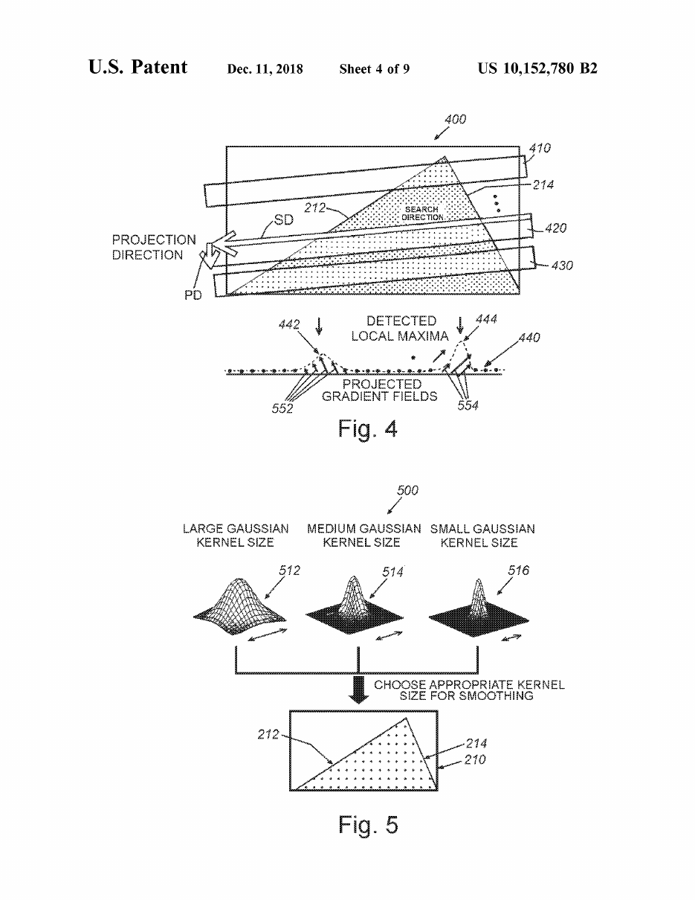
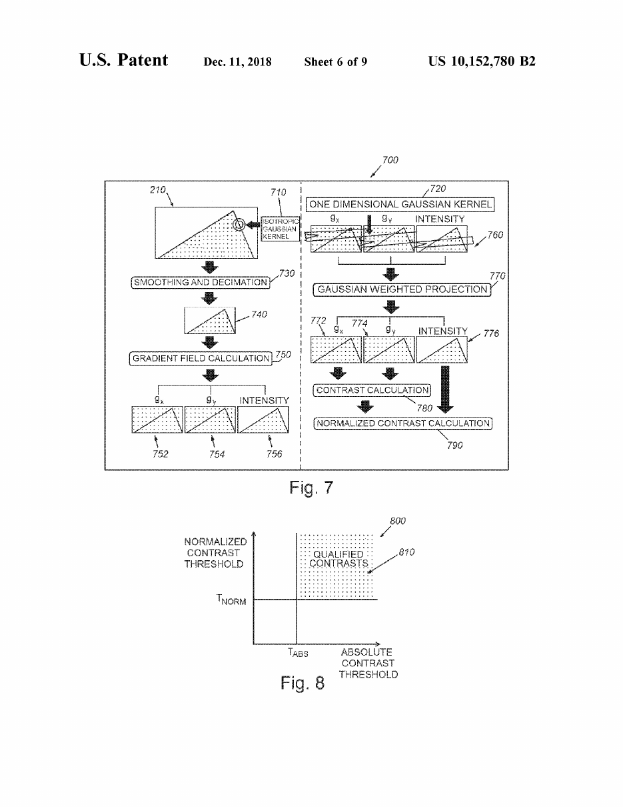
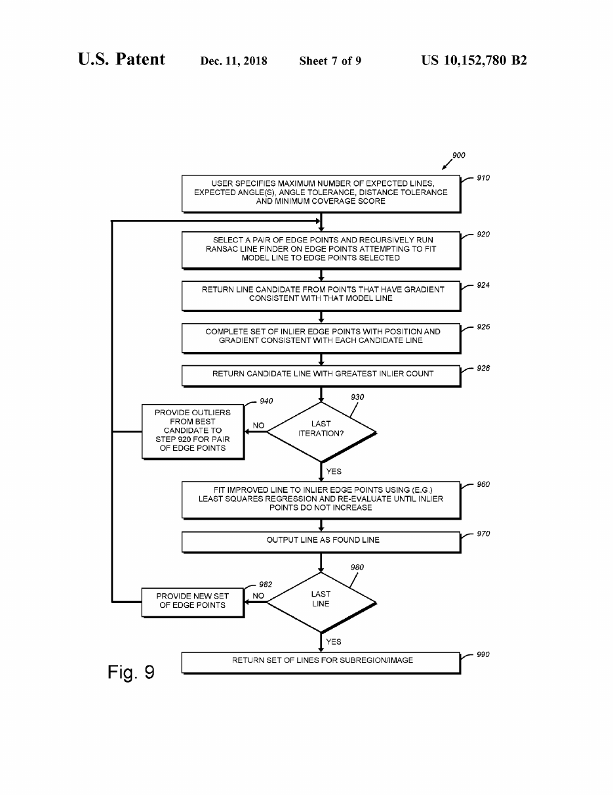

# US 10,152,780 B2 번역: 비전 시스템으로 영상에서 직선을 찾는 시스템과 방법

번역 범위: 전문(서지 사항, 요약, 관련 출원, 발명의 분야, 배경, 요약, 도면 설명, 상세 설명, 청구항 23개). 참고문헌(인용 문헌)은 원문 그대로 둔다.

- 원문: 같은 폴더의 `US10152780B2_Cognex_line_finding.pdf` (USPTO 등록 공보, 18쪽, Google Patents PDF 링크와 같은 파일 크기 1,611,337 바이트 확인)
- 본문 텍스트: 공보 PDF를 `pdftotext -layout`으로 뽑았으나 2단 조판이 섞여서, 문장 순서는 Google Patents 본문 텍스트(https://patents.google.com/patent/US10152780B2/en)로 맞췄다. 두 텍스트의 내용은 같다.
- 도면 번호와 참조 부호(예: 400, 920)는 원문 그대로 쓴다.
- 번역자 메모는 [메모: ...]로 따로 표시한다.

---

## 서지 사항 (공보 첫 쪽)

- (12) 미국 특허, (10) 특허 번호 US 10,152,780 B2, (45) 등록일 2018년 12월 11일
- (54) 발명의 명칭: SYSTEM AND METHOD FOR FINDING LINES IN AN IMAGE WITH A VISION SYSTEM (비전 시스템으로 영상에서 직선을 찾는 시스템과 방법)
- (71) 출원인: Cognex Corporation, Natick, MA (US)
- (72) 발명자: Yu Feng Hsu, Chupei (TW); Lowell D. Jacobson, Grafton, MA (US); David Y. Li, West Roxbury, MA (US)
- (73) 권리자: COGNEX CORPORATION, Natick, MA (US)
- (*) 고지: 존속 기간은 35 U.S.C. 154(b)에 따라 0일 연장 또는 조정
- (21) 출원 번호 15/338,445, (22) 출원일 2016년 10월 31일
- (65) 선공개: US 2017/0236258 A1, 2017년 8월 17일
- (60) 가출원: 62/249,918, 2015년 11월 2일
- (51) Int. Cl.: G06K 9/48, G06T 5/20, G06T 7/13, G06T 7/143
- (52) CPC: G06T 5/20; G06T 7/13; G06T 7/143; G06T 2207/20076
- 심사관: Yosef Kassa. 대리인: Loginov IP
- 청구항 23개, 도면 9장

### (56) 인용 문헌 (원문 그대로)

U.S. PATENT DOCUMENTS

```
4,910,786 A     3/1990  Eichel
5,559,695 A     9/1996  Daily
6,005,984 A    12/1999  Kawakami et al.
6,460,127 B1   10/2002  Akerib
6,621,924 B1 *  9/2003  Ogino ............ G06T 7/12
6,778,688 B2 *  8/2004  Aggarwal ......... G06F 21/305
6,778,699 B1 *  8/2004  Gallagher ........ G06K 9/4604
7,190,832 B2    3/2007  Frost et al.
7,212,672 B2 *  5/2007  Fujieda .......... G06T 7/0006
7,400,770 B2 *  7/2008  Keaton ........... G06K 9/0063
7,636,455 B2 * 12/2009  Keaton ........... G06K 9/0063
8,194,953 B2 *  6/2012  Xie .............. G01N 23/04
8,213,679 B2 *  7/2012  Yao .............. G06K 9/00785
8,385,644 B2 *  2/2013  Stojancic ........ G06F 17/30799
8,565,536 B2 * 10/2013  Liu .............. G06K 9/00577
8,740,958 B2 *  6/2014  Anderson ......... A61B 5/0059
8,805,083 B1 *  8/2014  Sieracki ......... G06K 9/723
9,025,866 B2 *  5/2015  Liu .............. G06K 9/00577
2005/0286767 A1 12/2005 Hager et al.
2006/0285755 A1 12/2006 Hager et al.
2008/0292194 A1 11/2008 Schmidt et al.
2009/0009513 A1  1/2009 van de Hengel et al.
2010/0080469 A1  4/2010 Liu et al.
2010/0189354 A1  7/2010 de Campos et al.
2011/0299770 A1 12/2011 Vaddadi et al.
2015/0055821 A1  2/2015 Fotland
```

FOREIGN PATENT DOCUMENTS

```
JP 61120002 A     6/1986
JP 07229717 A     8/1995
JP 2012514252 A   6/2012
JP 2013084221 A   5/2013
JP 2014092922 A   5/2014
WO 1997021188 A1  6/1997
WO 2001078005 A2 10/2001
* cited by examiner
```

[메모: 공보 PDF의 OCR 문자가 일부 깨져 있어(예: "GO6T") 분류 기호의 O와 0은 맞게 고쳐 적었다.]

## (57) 요약

이 발명은 영상에서 여러 직선 특징을 찾는 시스템과 방법을 제공한다. 직선 특징을 찾는 데 서로 연결된 두 단계를 쓴다.

첫째, 영상의 각 위치에서 기울기장(gradient field)의 x 성분과 y 성분을 계산한다. 이 기울기장을 여러 부분 영역에 걸쳐 투영하고, 여러 기울기 극값을 검출한다. 그 결과 위치와 기울기를 가진 에지점이 여럿 나온다.

다음으로, 에지점 두 개를 골라 모델 직선을 맞추는 일을 반복한다. 에지점의 기울기가 모델과 맞으면, 위치와 기울기가 그 모델과 맞는 내점(inlier) 전체를 계산한다. 내점 수가 가장 많은 후보 직선을 남기고, 나머지 외점(outlier) 집합을 구한다. 그다음 이 외점 집합과 이후의 외점 집합에 직선 맞춤을 되풀이해 직선 결과를 여럿 얻는다. 이 과정은 전수 탐색일 수도 있고 RANSAC 기반일 수도 있다.

[도면 대표도: FIG. 2. 입력 영상 210, 에지점 230, 찾은 직선 252, 254]

---

## 관련 출원

이 출원은 2015년 11월 2일 출원한 미국 가출원 62/249,918(명칭: SYSTEM AND METHOD FOR FINDING LINES IN AN IMAGE WITH A VISION SYSTEM)의 이익을 주장한다. 그 내용은 참조로 여기에 포함된다.

## 발명의 분야

이 발명은 머신 비전 시스템에 관한 것이다. 더 구체적으로는 촬영한 영상에서 직선 특징을 찾는 비전 시스템 도구에 관한 것이다.

## 발명의 배경

머신 비전 시스템(이 글에서는 줄여서 "비전 시스템")은 제조, 물류, 산업의 여러 작업에 쓰인다. 표면과 부품 검사, 조립 중 물체 정렬, 패턴과 ID 코드 판독처럼 시각 자료를 얻어 해석하고 이후 공정에 쓰는 모든 작업이 여기에 든다. 비전 시스템은 보통 관심 물체나 대상이 있는 장면을 찍는 카메라를 하나 이상 쓴다. 대상은 멈춰 있을 수도 있고 상대적으로 움직일 수도 있다. 로봇이 부품을 다루는 경우처럼, 움직임을 비전 시스템이 얻은 정보로 제어할 수도 있다.

비전 시스템의 흔한 작업은 영상에서 직선 특징을 찾고 그 성질을 재는 것이다. 이런 직선 특징을 찾고 분석하는 도구가 여럿 있다. 보통 이 도구들은 영상 일부에 생기는 뚜렷한 대비 차이에 의존한다. 이 대비 차이를 예를 들어 캘리퍼(caliper) 도구로 분석해, 대비 차이가 있는 영상 속 개별 점들을 직선 모양 특징으로 모을 수 있는지 판단한다. 모을 수 있으면 영상에서 직선을 찾았다고 본다.

눈여겨볼 점은 에지점을 찾는 도구와 그 점들에 직선을 맞추려는 도구가 서로 독립으로 동작한다는 것이다. 이 때문에 처리 부담은 늘고 신뢰성은 떨어진다. 영상에 직선이 여럿 있으면 이런 도구는 그것들을 정확히 찾아내는 능력에 한계가 있을 수 있다. 또 영상에서 직선 하나를 찾도록 만든 전통적인 직선 찾기 도구는, 방향과 극성이 비슷한 직선 여러 개가 가깝게 붙어 있는 영상에서 쓰기 어려울 수 있다.

## 발명의 요약

이 발명은 영상에서 직선 특징을 찾는 시스템과 방법을 제공해 종래 기술의 단점을 극복한다. 이 방법은 여러 직선을 효율적이고 정확하게 찾아내고 그 성질을 잴 수 있게 한다.

먼저, 영상의 각 위치에서 기울기장의 x 성분과 y 성분을 계산한다. 이 기울기장을 영상의 여러 부분 영역에 걸쳐 투영하고, 부분 영역마다 기울기 극값을 여럿 검출한다. 그 결과 위치와 기울기를 함께 가진 에지점이 여럿 나온다.

다음으로, 에지점 두 개를 골라 모델 직선을 맞추는 일을 반복한다. 두 에지점의 기울기가 모델 직선과 맞으면, 위치와 기울기가 그 모델 직선과 맞는 내점 전체를 계산한다. 내점 수가 가장 많은 후보 직선을 직선 결과로 남기고, 나머지 외점 집합을 구한다. 그다음 이 외점 집합과 이후의 외점 집합에 직선 맞춤을 되풀이해 직선 결과를 여럿 얻는다. 직선 맞춤 과정은 전수 탐색일 수도 있고, RANSAC(random sample consensus) 기법에 기반할 수도 있다.

예시 실시예에서는 촬영한 영상에서 직선 특징을 찾는 시스템을 제공한다. 비전 시스템 프로세서가 직선 특징이 있는 장면의 영상 자료를 받는다. 에지점 추출기가 영상 자료에서 밝기 기울기 영상을 만들고, 이 기울기 영상을 바탕으로 에지점을 찾는다. 그다음 직선 찾기기가 에지점의 밝기 기울기를 바탕으로 에지점들을 하나 이상의 직선에 맞춘다.

예시로, 직선 찾기기는 RANSAC 기반 과정으로 내점 에지점을 새 직선에 맞춘다. 앞서 정한 직선에 대한 외점 에지점으로 직선을 반복해서 정하는 것도 포함한다. 에지점 추출기는 밝기 기울기 영상에서 직선 특징이 있는 영역에 기울기장 투영을 한다.

예시로, 기울기장 투영은 하나 이상의 직선 특징의 예상 방향에 따라 정한 방향으로 놓인다. 기울기장 투영은 가우스 커널에 기반한 세분도(granularity)를 정할 수 있다. 영상 자료는 여러 카메라로 찍은 여러 영상의 자료를 공통 좌표 공간으로 변환한 것일 수 있다. 영상 자료는 평활화(가중) 커널로 부드럽게 할 수도 있다. 이 커널은 1차원 가우스 커널이나 다른 가중 함수일 수 있다. 에지점은 절대 대비와, 영상 자료의 평균 밝기로 정규화한 대비로 정한 문턱에 따라 고를 수 있다.

예시로, 직선 찾기기는 평행한 직선이나 교차하는 직선의 일부를 나타내는 에지점을 서로 교환해 잘못된 방향을 바로잡도록 구성할 수 있다. 또 에지점의 기울기 값을 바탕으로 극성이 바뀌는 직선, 곧 한 직선 특징 안에 극성이 섞인 직선을 찾도록 구성할 수 있다.

또 예시로, 에지점 추출기는 각 기울기 투영 부분 영역에서 기울기 크기 극대값을 여럿 찾도록 구성된다. 이 극대값들은 각각 에지점의 일부로 정해지며, 위치 벡터와 기울기 벡터로 기술할 수 있다. 덧붙여 직선 찾기기는 추출한 에지점 중 적어도 하나와 찾은 직선 중 적어도 한 후보 직선 사이의 일치 정도를 척도를 계산해 정할 수 있다. 이 척도는 에지점과 후보 직선 사이 거리, 그리고 에지점의 기울기 방향과 후보 직선의 법선 방향 사이 각도 차에 기반할 수 있다.

## 도면의 간단한 설명

아래 발명 설명은 첨부 도면을 참조한다.

- FIG. 1은 예시 실시예에 따라, 여러 에지 특징을 가진 물체의 영상을 찍는 예시 비전 시스템 배치와, 에지 찾기 도구(모듈)를 가진 비전 시스템 프로세서를 보인 그림이다.
- FIG. 2는 예시 실시예에 따라, 촬영한 영상에서 에지점을 뽑고 직선을 찾는 시스템과 방법의 개요를 보인 그림이다.
- FIG. 3은 FIG. 2의 시스템과 방법에 따른 에지점 추출 절차의 흐름도다.
- FIG. 4는 에지 특징이 있는 영상 영역에 대한 장(field) 투영을 보인 그림으로, FIG. 3의 에지점 추출 절차의 일부다.
- FIG. 5는 FIG. 3의 에지점 추출 절차에 쓰기 위해, 영상을 부드럽게 하려고 가우스 커널을 적용하는 모습을 보인 그림이다.
- FIG. 6은 FIG. 3의 에지점 추출 절차에 쓰기 위해, 투영을 부드럽게 하는 가우스 커널 적용을 포함한 장 투영을 보인 그림이다.
- FIG. 7은 FIG. 3의 에지점 추출 절차를 그림으로 요약한 것이다. 가우스 커널 적용과, 에지점의 절대 대비 문턱과 정규화 대비 문턱 계산을 포함한다.
- FIG. 8은 절대 대비 문턱과 정규화 대비 문턱을 모두 넘는 에지점의 "자격 있는 대비" 영역을 보인 그래프다.
- FIG. 9는 예시 실시예에 따라 예시 RANSAC 과정을 써서, FIG. 3에서 찾은 에지점을 바탕으로 직선을 찾는 절차의 흐름도다.
- FIG. 10과 11은 가깝게 붙은 평행 직선 특징에 대한 에지점의 잘못된 배정과 올바른 배정을 각각 보인 그림이다.
- FIG. 12와 13은 교차하는 직선 특징에 대한 에지점의 올바른 배정과 잘못된 배정을 각각 보인 그림이다. 예시 시스템과 방법의 직선 찾기기로 해결할 수 있다.
- FIG. 14~17은 각각 밝음에서 어두움 극성, 어두움에서 밝음 극성, 둘 중 어느 극성, 섞인 극성을 보이는 직선의 예다. 예시 시스템과 방법의 직선 찾기기로 해결할 수 있다.
- FIG. 18은 사용자 정의 마스크를 고려해 찾은 직선의 커버리지 점수를 바꾸는 모습을 보인 그림이다.

## 상세 설명

### 시스템 구성 (FIG. 1)

예시 실시예에 쓸 수 있는 예시 비전 시스템 배치 100을 FIG. 1에 보인다. 시스템 100은 비전 시스템 카메라 110을 적어도 하나 포함하고, 선택 사항인 추가 카메라 112(점선으로 표시)를 하나 이상 포함할 수 있다. 예시 카메라 110, 112는 영상 센서(이미저) S와, 영상 프레임을 얻어 비전 시스템 프로세스(프로세서) 130으로 보내는 전자 장치를 포함한다. 프로세서 130은 독립 프로세서나 컴퓨팅 장치 140 안에 구현될 수 있다.

카메라 110(과 112)은 검사 대상 물체 150이 있는 장면에 초점을 맞춘 적절한 렌즈(광학계) 116을 포함한다. 카메라 110(과 112)은 영상 취득 과정에 맞춰 동작하는 내부 조명이나 외부 조명(표시하지 않음)을 포함할 수 있다. 컴퓨팅 장치 140은 예시 실시예에 따라 영상 자료를 저장하고 다룰 수 있는 프로세서 기반 시스템이면 무엇이든 된다. 예를 들어 PC(그림에 보인 것), 서버, 노트북, 태블릿, 스마트폰 같은 장치일 수 있다. 컴퓨팅 장치 140은 카메라와 연결하는 버스 기반 영상 캡처 카드 같은 주변 장치를 포함할 수 있다. 다른 실시예에서는 비전 프로세서의 일부나 전부가 카메라 몸체 안에 들어 있고, 영상 자료를 함께 처리하는 다른 PC, 서버, 카메라 기반 프로세서와 네트워크로 연결될 수 있다.

컴퓨팅 장치 140은 선택적으로 디스플레이 142를 포함한다. 디스플레이 142는 비전 시스템 프로세스 130에 있는 비전 시스템 도구와 프로세서 132에 맞춰 동작하는 그래픽 사용자 인터페이스(GUI)를 지원할 수 있다. 여러 실시예에서 디스플레이는 빼거나, 설정과 정비 기능에만 둘 수 있다. 비전 시스템 도구는 물체 검사에 쓸 수 있는 소프트웨어나 하드웨어 패키지의 일부일 수 있다. 예를 들어 Cognex Corporation(Natick, Mass.)이 판매하는 것들이다. 컴퓨팅 장치는 키보드 144, 마우스 146, 디스플레이 142 안의 터치스크린 같은 사용자 인터페이스(UI) 부품도 포함할 수 있다.

카메라 110(과 112)은 장면 안에 있는 물체 150의 일부나 전부를 찍는다. 각 카메라는 광축 OA를 가지며, 광학계 116과 초점 거리 등에 따라 광축 둘레에 시야가 정해진다. 물체 150은 서로 다른 방향으로 놓인 에지 152, 154, 156을 포함한다. 예를 들어 물체 에지는 스마트폰 몸체에 끼운 커버 유리의 에지일 수 있다. 예시로 카메라는 물체 전체를 찍을 수도 있고, 특정 위치(예: 유리와 몸체가 만나는 모서리)만 찍을 수도 있다. 물체, 카메라 하나, 또는 다른 기준점(예: 물체 150을 올린 이동 스테이지)을 기준으로 (공통) 좌표 공간을 정할 수 있다. 그림에서 좌표 공간은 축 158로 나타낸다. 이 축들은 예시로 서로 직교하는 x, y, z 축과 x-y 평면에서 z 축 둘레의 회전 θz를 정한다.

예시 실시예에 따라 비전 시스템 프로세스 130은 컴퓨팅 장치 140에서 도는 하나 이상의 응용(프로세스)과 함께 동작한다. 이 응용들이 모여 비전 시스템 도구(프로세스) 132를 이룬다. 이 도구들은 영상 자료를 처리하는 여러 일반 응용과 전용 응용을 포함할 수 있다. 예를 들어 여러 보정 도구와 아핀 변환 도구로 촬영한 영상 자료를 정해진(예: 공통) 좌표계로 변환할 수 있다. 영상의 회색조 밝기 자료를 정해진 문턱으로 이진 영상으로 바꾸는 도구도 포함할 수 있다. 마찬가지로 이웃 화소(와 부화소) 사이 밝기 기울기(대비)를 분석하는 도구도 둘 수 있다.

### 전체 흐름 (FIG. 2)

비전 시스템 프로세스(프로세서) 130은 예시 실시예에 따라 촬영 영상에서 여러 직선을 찾는 직선 찾기 프로세스(도구, 모듈) 134를 포함한다. 그래서 FIG. 2를 참조한다. FIG. 2는 예시 실시예에 따른 직선 찾기 절차 200의 개요를 그림으로 보인다. 절차 200은 크게 두 부분으로 이뤄진다.

입력 영상 210이 프로세서에 들어온다. 그림처럼 영상에는 서로 만나는 에지 212와 214가 있다. 이것은 앞에서 설명한 물체 150의 모서리 영역일 수 있다. 에지점 추출기 220은 입력 영상 210을 처리해 후보 에지점 집합 230을 얻는다. 여기에는 에지 212와 214 위에 각각 놓인 에지점 232와 234가 포함된다. 에지점 232, 234와 그 부속 자료(예: 아래에서 설명할 밝기 기울기 정보)는 재귀 직선 찾기기 240에 전달된다. 직선 찾기기 240은 고른 에지점들에 대해 일련의 반복 과정을 수행한다. 반복 과정의 목표는 찾은 다른 에지점들을 후보 직선 특징에 맞추는 것이다. 직선 찾기 과정 240의 결과로 그림처럼 찾은 직선 252와 254가 나온다. 이 결과는 정렬, 로봇 조작, 검사, ID 판독, 부품과 표면 검사 같은, 이 정보를 쓰는 다른 후속 과정 260에 전달될 수 있다.

### 에지점 추출 (FIG. 3~8)

FIG. 3을 참조한다. FIG. 3은 한 실시예에 따른 에지점 추출 절차를 설명한다. 찾을 에지 특징이 있는 물체나 표면이 담긴 장면의 영상을 하나 이상 얻는다(단계 310). 영상은 카메라 하나로 얻을 수도 있고 여러 카메라로 얻을 수도 있다. 어느 경우든 단계 320에서 영상 화소를 적절한 보정 매개변수로 새로운 좌표 공간이나 공통 좌표 공간으로 (선택적으로) 변환할 수 있다. 이 단계에는 아래에서 설명할 영상 평활화도 포함될 수 있다. 어떤 실시예에서는 여러 카메라가 장면의 떨어진 영역을 찍는다. 예를 들어 큰 물체의 모서리 영역에 각각 초점을 맞추는 경우다. 이때 공통 좌표 공간은 카메라 시야 사이의 빈 영역까지 고려할 수 있다. 아래에서 설명하듯, 이런 시야들 사이에 걸친 직선(예: 찾은 두 모서리 영역을 잇는 물체 에지)은 예시 실시예의 시스템과 방법으로 연장해 구할 수 있다.

직선을 찾는 데 필요한 에지점은 단계 330에서 에지점 추출기가 기울기장 투영을 써서 적절한 좌표 공간의 영상에서 뽑는다. 먼저 화소마다 기울기 값을 계산해, x 기울기 성분 영상과 y 기울기 성분 영상 두 장을 만든다. 그다음 기울기장을 캘리퍼 같은 영역 여러 개에 걸쳐 투영해 영상을 더 처리한다. 밝기 값을 투영하는 종래 캘리퍼 도구와 달리, 이 실시예처럼 기울기장을 투영하면 기울기 방향이 보존된다. 이것이 아래에서 설명할 이후 직선 찾기 과정을 쉽게 한다.



*FIG. 4와 FIG. 5 (도면 4쪽). FIG. 4: 영역 400에서 탐색 방향(SD)으로 여러 투영 410, 420, 430을 하고, 투영 방향(PD)으로 투영을 반복한다. 투영된 기울기장 440에서 국소 극대(442, 444)를 검출한다. 552, 554는 기울기 벡터다. FIG. 5: 큰, 중간, 작은 가우스 커널(512, 514, 516) 가운데 평활화에 알맞은 크기를 고른다.*

단계 340에서, 그리고 FIG. 4의 그림을 함께 보면, 후보 에지 특징이 담긴 영상 일부(캘리퍼 같은 영역) 400에 기울기장 투영을 한다. 투영은 여러 투영 410, 420, 430으로 나타낸다. 이 투영들은 에지의 (대략) 예상 방향을 가로지르는 탐색 방향(화살표 SD)으로 탐색하며, 이에 직교하는 투영 방향(화살표 PD)으로 영역 400 전체에 걸쳐 반복한다. 각 투영(예: 투영 420)에서 에지는 그 투영에 대응하는 기울기장 440의 국소 극대로 나타난다. 일반적으로 한 에지에 속하는 투영 안 에지점들은 에지가 뻗는 방향에 직교하는 밝기 기울기(벡터 552, 554)를 보인다. 아래에서 설명하듯 사용자는 예상 직선 방향을 바탕으로 투영 방향을 정할 수 있다. 다른 방법으로, 기본값이나 다른 수단(예: 영상 특징 분석)으로 정할 수도 있다.

위의 기울기 투영 단계에는 세분도 매개변수 두 개가 관여한다. 기울기장을 계산하기 전에 사용자는 등방 가우스 커널로 영상을 부드럽게 할지 고를 수 있다. 첫째 세분도는 이 가우스 평활화 커널의 크기를 정한다. FIG. 5의 그림 500처럼, 알맞은 크기의 가우스 커널(예: 큰 512, 중간 514, 작은 516)을 영상 210에 적용해 부드럽게 한다. 따라서 첫째 세분도 매개변수는 장 계산 전의 등방 가우스 평활화 커널 크기를 정한다.

기울기장을 계산한 뒤에는, 종래 캘리퍼 도구의 균일 가중 대신 가우스 가중 투영을 한다. 따라서 둘째 세분도 매개변수는 장 투영 중에 쓰는 1차원(1D) 가우스 커널의 크기를 정한다. FIG. 6에 보인 것처럼 영역 600에 가우스 평활 커널 610, 620, 630을 적용한다.

[메모: FIG. 6은 도면 5쪽에 있다. 이 번역에는 넣지 않았다. 내용은 영역 600 위 세 투영 띠에 1D 가우스 가중을 거는 그림이다.]

보통 운용에서 사용자는 GUI로 영상 위에 겹친 추출 에지 전부를 확인한다. 그다음 찾을 직선을 따라 추출한 에지 수가 충분해 보이면서도 영상 배경 잡음 때문에 에지가 지나치게 많아지지 않을 때까지 세분도와 대비 문턱을 조정한다. 바꿔 말하면 이 단계에서 영상 특성에 맞게 신호 대 잡음비를 최적화할 수 있다. 여러 실시예에서 이 조정은 기본값을 써서 시스템이 자동으로 할 수도 있다. 가우스 가중 함수는 투영 가중 방식 여러 가지(예: 균일 가중 포함) 가운데 하나일 뿐이다.

기울기장 추출과 투영의 전체 흐름은 FIG. 7의 그림 700에 보인다. 두 세분도 매개변수, 곧 등방 가우스 커널 710과 1D 가우스 커널 720이 전체 그림의 양쪽 절반에 각각 나온다. 그림처럼 촬영한 영상 210마다 평활화와 솎아내기(decimation) 730을 한다. 그 결과 영상 740에 위에서 설명한 기울기장 계산 750을 해서 기울기 영상 752와 754 두 장을 만든다. 이 기울기 영상은 공통 좌표 공간의 직교하는 두 축을 나타내는 gx와 gy로도 표시한다. 기울기 영상 두 장 외에, 밝기 영상 756도 보통 평활화, 솎아내기, 투영 과정 760(1D 가우스 커널 720에 기반한 가우스 가중 투영 770 사용)을 거친다. 아래에서 설명하듯 한 실시예에서는 처리된 밝기 정보도 정규화 대비 계산에 쓰기 때문이다. 결과로 기울기 영상의 투영 프로파일 772(gx), 774(gy)와 밝기 영상의 투영 프로파일 776이 나온다.



*FIG. 7과 FIG. 8 (도면 6쪽). FIG. 7: 왼쪽은 등방 가우스 커널 710, 평활화와 솎아내기 730, 기울기장 계산 750으로 gx 752, gy 754, 밝기 756을 만든다. 오른쪽은 1D 가우스 커널 720으로 가우스 가중 투영 770을 해서 투영 프로파일 772, 774, 776을 얻고, 대비 계산 780과 정규화 대비 계산 790을 한다. FIG. 8: 가로축 절대 대비 문턱 T_ABS, 세로축 정규화 대비 문턱 T_NORM. 둘 다 넘는 오른쪽 위 사분면 810이 "자격 있는 대비"다.*

FIG. 3 절차 300의 단계 350도 함께 보면, 자격 있는 에지점은 x 기울기 영상과 y 기울기 영상의 1D 투영 프로파일을 합쳐 뽑는다. 이는 원시 대비 계산 780과, 밝기 영상에 기반한 정규화 대비 계산 790으로 한다. 구체적으로, 원시 투영 기울기 크기와 정규화 투영 기울기 크기가 각각의 문턱을 모두 넘는 국소 봉우리를 이후 직선 찾기의 후보 에지점으로 본다. 예시 식은 다음과 같다.

```
(gx^2 + gy^2)^(1/2) > T_ABS
(gx^2 + gy^2)^(1/2) / I > T_NORM
```

여기서 gx와 gy는 한 화소 위치에서 x 기울기 투영 값과 y 기울기 투영 값, I는 밝기, T_ABS는 원시 투영 기울기 크기에 대한 절대 대비 문턱, T_NORM은 밝기로 정규화한 투영 기울기 크기에 대한 정규화 대비 문턱이다.

특히, 어떤 점은 절대 대비와 정규화 대비가 둘 다 각각의 문턱을 넘을 때만 후보 에지점으로 본다. 이것은 정규화 대비 문턱 T_NORM 대 절대 대비 문턱 T_ABS의 예시 그래프 800에서 오른쪽 위 사분면 810으로 나타낸다. 이중(절대와 정규화) 문턱을 쓰는 것은 보통 절대 대비 문턱 하나만 쓰는 기존 방식과 다르다.

이중 대비 문턱의 이점은 예를 들어 영상에 어두운 영역과 밝은 영역이 함께 있고 둘 다 관심 에지를 담고 있을 때 분명해진다. 어두운 영역의 에지를 검출하려면 대비 문턱을 낮게 잡는 것이 좋다. 그러나 낮은 대비 설정은 밝은 영역에서 가짜 에지를 검출하게 만들 수 있다. 반대로 밝은 영역의 가짜 에지 검출을 피하려면 대비 문턱을 높게 잡는 것이 좋다. 그러나 높은 대비 설정에서는 어두운 영역의 에지를 제대로 검출하지 못할 수 있다. 전통적인 절대 대비 문턱에 정규화 대비 문턱을 하나 더 쓰면, 어두운 영역과 밝은 영역 모두에서 에지를 알맞게 검출하고 밝은 영역의 가짜 에지 검출도 피할 수 있다. 따라서 관련 에지는 검출하고 엉뚱한 에지는 피하게 해 주므로, 이중 대비 문턱은 전체 과정 중 이후 직선 찾기 단계의 속도와 강건성을 최대로 높이는 데 기여한다.

다시 절차 단계 350(FIG. 3)을 보면, 에지점을 모두 뽑은 뒤 이후 직선 찾기기가 다루기 편한 자료 구조로 나타내고 저장한다. 예를 들어 다음 튜플을 보자.

```
p = (x, y, gx, gy, gm, go, I, gm/I, m, n)
```

여기서 (x, y)는 에지점 위치, (gx, gy)는 그 점의 x 기울기 투영 값과 y 기울기 투영 값, (gm, go)는 (gx, gy)로 계산한 기울기 크기와 방향, I는 에지점 위치의 밝기, gm/I는 기울기 크기 gm을 밝기 I로 나눈 밝기 정규화 대비, m은 영상 번호, n은 투영 영역 번호다. 표준 캘리퍼 도구처럼, 에지점 위치는 정확도를 높이려고 보간할 수 있다.

에지점 추출 과정은 보통 예상 직선 각도와 거의 같은 한 방향으로 장 투영을 한다는 점에 유의한다. 그래서 이 도구는 이 각도의 에지에 가장 민감하고, 다른 각도의 에지에 대해서는 민감도가 서서히 떨어진다. 떨어지는 속도는 세분도 설정에 달려 있으며, 세분도 설정이 장 투영 길이를 간접적으로 정한다. 그 결과 이 과정은 사용자가 정한 각도 범위 안에서 예상 직선 각도에 "가까운" 각도의 직선만 찾을 수 있다. 이 과정은 직교하지 않는 직선을 찾도록 만들어졌지만, 여러 방향(직교 방향 포함)으로 투영을 해서 360도 어느 각도의 직선이든 찾도록(전방향 직선 찾기) 여러 실시예에서 일반화할 수 있다고 본다.

### 직선 찾기 (FIG. 9)

이제 절차 300의 단계 360(FIG. 3)을 보면, 문턱을 넘은 에지점 후보가 예시 실시예에 따른 직선 찾기기에 전달된다. 예로, 직선 찾기기는 재귀적으로 동작하며 (예를 들어) RANSAC(RANdom SAmple Consensus) 기반 기법을 쓴다. FIG. 9의 직선 찾기 절차 900도 참조한다.



*FIG. 9 (도면 7쪽). 910 사용자가 예상 직선 최대 개수, 예상 각도, 각도 허용치, 거리 허용치, 최소 커버리지 점수를 정한다. 920 에지점 한 쌍을 골라 RANSAC 직선 찾기를 재귀로 돌린다. 924 그 모델 직선과 기울기가 맞는 점에서 후보 직선을 돌려준다. 926 위치와 기울기가 후보 직선과 맞는 내점 전체를 구한다. 928 내점 수가 가장 많은 후보를 돌려준다. 930 마지막 반복인가? 아니면 940 최선 후보의 외점을 920으로 돌려준다. 960 내점에 (예: 최소제곱 회귀로) 개선 직선을 맞추고, 내점이 더 늘지 않을 때까지 다시 평가한다. 970 찾은 직선으로 출력한다. 980 마지막 직선인가? 아니면 982 새 에지점 집합을 준다. 990 부분 영역(영상)의 직선 집합을 돌려준다.*

단계 910에서 사용자는 영상에서 예상하는 직선의 최대 개수와 함께 예상 각도, 각도 허용치, 거리 허용치, 그리고 (예시로) 최소 커버리지 점수(아래에서 대략 정의)를 (예를 들어) GUI로 정한다. 직선 찾기기는 이 매개변수로 아래 과정을 수행한다. 영상의 부분 영역마다 RANSAC 직선 찾기를 재귀로 돌려 직선을 찾는다. 한 단계의 외점 에지점이 다음 단계의 입력 점이 된다.

그래서 단계 920에서 절차 900은 에지 찾기 과정에서 극값으로 정한 에지점 무리 가운데 에지점 한 쌍을 고른다. 절차 900은 (정한 허용 범위 안에서) 모델 직선과 맞는 기울기 값을 바탕으로, 고른 에지점에 모델 직선을 맞추려 한다. 단계 924에서 단계 922의 후보 직선 하나 이상을 돌려준다. 직선 찾기 단계마다 후보 직선 하나와 그 내점, 외점을 돌려준다. 돌려준 직선에 대해, 위치와 기울기가 그 후보 직선과 맞는 내점 에지점을 계산한다(단계 926). 단계 928에서 내점 수가 가장 많은 후보 직선을 정한다.

[메모: 원문은 "단계 922"를 언급하지만 FIG. 9 도면에는 922 상자가 없다. 원문 그대로 옮겼다.]

위의 직선 찾기 단계(단계 920~928)는 허용된 RANSAC 최대 반복 수에 이르면 끝난다(판정 단계 930). 각 직선 찾기 단계 안의 최대 반복 수는, 내부에서 계산한 최악의 외점 비율과 사용자가 정한 보증 수준(assurance level)으로 자동 계산한다. 각 직선 찾기 단계는 모든 반복 가운데 잡아낸 에지점이 가장 많은 직선을 돌려준다. 이때 사용자가 정한 맞춤 허용치, 기하 제약, 극성을 따른다. 각 에지점은 한 직선의 내점 목록에만 들어갈 수 있고, 각 직선은 투영 영역마다 에지점을 많아야 하나만 가질 수 있다. 에지점이 후보 직선의 내점 목록에 들어갈지는 위치와 함께 기울기 방향으로 정한다. 특히 에지점의 기울기 방향은 후보 직선의 각도와 맞아야 한다.

판정 단계 930에서 반복이 더 허용되면, 최선 내점 후보의 외점을 RANSAC 과정(단계 920)에 돌려주어(단계 940) 후보 직선 찾기에 쓴다.

RANSAC 반복마다 서로 다른 투영 영역에 속한 에지점 두 개를 무작위로 골라 그 두 점에 직선을 맞춘다. 결과 후보 직선은, 그 각도가 점 쌍 두 에지의 기울기 각도와 맞고, 또 사용자가 정한 불확실 범위와 맞을 때만 더 검토한다. 일반적으로 에지점의 기울기 방향은 명목상 직선에 직교하지만, 사용자가 정한 각도 허용치만큼 어긋나도 된다. 후보 직선이 이 첫 시험을 통과하면 내점 에지점 수를 평가하고, 통과하지 못하면 새 RANSAC 반복을 시작한다. 에지점은 사용자가 정한 기울기 각도 허용치와 거리 허용치를 기준으로, 기울기 방향과 위치가 둘 다 직선과 맞을 때만 후보 직선의 내점으로 본다.

RANSAC 반복이 최대에 이르면(판정 단계 930), 찾은 최선 후보 직선의 내점에 (예를 들어) 최소제곱 회귀나 다른 알맞은 근사 기법으로 개선 직선 맞춤을 한다. 그리고 내점 에지점 집합을 다시 평가한다. 이 단계들을 최대 N번(예: 3번 이상), 내점 수가 더 늘거나 줄지 않을 때까지 반복한다(단계 960). 이것이 단계 970에서 찾았다고 표시하는 직선이다.

판정 단계 980은 (예를 들어 다른 부분 영역을 더 탐색하는 것이나 다른 기준에 따라) 직선을 더 찾을지 정한다. 더 찾으면 과정은 단계 920으로 돌아가 새 에지점 집합으로 동작한다(단계 982). 점을 다 쓰거나 최대 반복 수에 이르면, 절차 900은 단계 990에서 영상에서 찾은 (곧 여러 개의) 직선 집합을 돌려준다.

### 평행 직선과 교차 직선의 점 교환 (FIG. 10~13)

다중 직선 찾기기는, 두 직선 결과가 검사 영역 안에서 서로 만나는 경우 기존 결과를 마지막으로 조정하도록 만들어졌다. FIG. 10과 11에 대략 보인 것처럼, 가깝게 붙은 평행 직선 1010과 1020에 대해 RANSAC 절차의 통계적 성질 때문에 가끔 잘못된 직선 결과(곧 FIG. 10)가 나올 수 있다. 그러나 이런 오류가 생기면 내점 무리를 교환해서(FIG. 11의 무리 1110 안 화살표 1120) 커버리지 점수는 높고 맞춤 잔차는 작은 올바른 직선을 찾을 수 있는 경우가 있다. 점 교환은 그림처럼 영상에 가깝게 붙은 평행 직선이 있을 때 가장 효과적이다. 반대로 FIG. 12와 13처럼 영상에 실제로 교차하는 직선 1210과 1220이 있으면, 점 교환 뒤 커버리지 점수가 떨어진다(FIG. 12의 무리 1240 안 화살표 1230). 그래서 이 과정은 교환 전에 얻은 원래 결과를 유지해 교차 직선을 제대로 검출한다.

[메모: FIG. 10~13은 도면 8쪽에 있다. 이 번역에는 넣지 않았다.]

RANSAC 절차는 직선 찾기기가 점들을 직선에 맞추는 여러 기법 가운데 하나일 뿐이다. 다른 실시예에서는 후보 점을 정해진 간격으로 고르거나, (예를 들어) 전수 탐색 기법으로 영상을 처리할 수 있다. 따라서 이 글에서 RANSAC 기법이라고 하면 비슷한 여러 점 맞춤 기법을 넓게 포함하는 것으로 본다.

### 추가 기능: 극성, 이동 불변성, 마스크, 정렬, 다중 시야, 왜곡 (FIG. 14~18)

이 시스템과 방법에 기능을 더할 수 있다. 섞인 극성 지원, 투영 영역 폭 자동 계산, 다중 시야 직선 찾기 지원, 그리고 광학 왜곡을 없애는 사전 왜곡 보정 없이 입력 영상을 쓰는 것이다. 이 기능들을 아래에서 더 설명한다.

FIG. 14~16의 예를 함께 보면, 예시 실시예의 직선 찾기 시스템과 방법은 찾는 에지 사이 대비에 대해 표준 LightToDark(밝음에서 어두움), DarkToLight(어두움에서 밝음), Either(둘 중 하나) 극성 설정을 (각각) 지원한다. 그 밖에 한 직선 안에 밝음에서 어두움과 어두움에서 밝음 성질이 함께 나타나는 섞인 극성 설정(FIG. 17)도 지원할 수 있다. 네 설정의 직선 찾기 결과를 다음 그림에 보인다. 예시 실시예에서 이 시스템과 방법은 반대 극성의 에지점을 함께 담은 직선 하나를 찾게 하는 섞인 극성 설정을 포함할 수 있다. 이것은 한 직선의 에지점이 모두 같은 극성이어야 하는(극성은 둘 중 무엇이든 되지만 하나만) 종래 "Either" 설정과 다르다. 섞인 극성 설정은 (예를 들어) 보정판의 밝고 어두운 체커보드를 분석할 때 등에서 유리하다.

[메모: FIG. 14~17은 도면 8쪽, FIG. 18은 도면 9쪽에 있다. 이 번역에는 넣지 않았다. FIG. 18 그림 안 식은 "COVERAGE SCORE = NUMBER OF INLIERS / MAXIMUM POSSIBLE NUMBER OF INLIERS"로 적혀 있다.]

사용자는 직선 찾기의 이동 불변성(shift invariance)을 높이는 쪽을 고를 수 있다. 이 경우 에지점 추출기는 서로 많이 겹치는 투영 영역을 써서 결과 안정성을 높인다. 영역이 겹치지 않으면, 영상이 옮겨질 때 고려 중인 화소가 투영 영역 밖으로 나갈 수 있어서 직선 찾기 결과의 이동 불변성이 나빠진다. 겹치는 투영 영역은 고려 중인 화소가 투영 영역에 계속 덮이도록 보장한다. 겹치는 투영 영역을 쓰면, 속도를 유지하려고 증분 계산을 하고 저수준 최적화도 할 수 있다.

사용자는 촬영 영상이나 촬영 표면의 일부를 직선 특징 분석에서 빼는 마스크를 줄 수 있다. 표면에 관심 없는 알려진 직선 특징이 있을 때 이것이 바람직할 수 있다. 예를 들어 다른 수단으로 분석하는 바코드, 글자, 그리고 직선을 찾는 목적과 관계없는 구조들이다. 그래서 에지점 추출기는 영상 마스킹을 지원한다. 영상의 "관심 없음(don't care)" 영역은 가리고, "관심(care)" 영역은 남긴다. 마스킹을 하면, 찾은 직선의 커버리지 점수는 예시로 마스크 안에 드는 에지점 수에 따라 다시 가중한다.

FIG. 18의 예시 영상 영역 1800을 참조한다. FIG. 18은 영상 마스크가 있을 때의 커버리지 점수와 마스킹이 커버리지 점수에 주는 영향을 보인다. 에지점 추출기는 영상의 "관심 없음 영역"을 가리는 영상 마스킹을 지원한다. 그림처럼 찾은 직선 1810은 ("관심" 마스크 영역 1820을 바탕으로) 관심 에지점으로 특징지어진다. 관심 에지점은 직선 1810에 대한 관심 에지점 내점 1830과 관심 에지점 외점 1840으로 이뤄진다. 직선 1810 위의 관심 없음 에지점 1850은 이 예처럼 마스크의 관심 영역 1820 사이에 있으며, 직선 위의 내점이더라도 커버리지 점수 계산에 넣지 않는다. 그림처럼 직선 1810을 따라 에지점이 있을 수 있는 잠재 위치 1860도 정한다. 이 잠재 위치는 찾은 점들의 간격을 바탕으로, 알려진 점들 사이에 예측 가능한 간격으로 놓인다. 예시로 찾은 직선의 커버리지 점수는 마스크 안에 드는 에지점 수에 따라 다시 가중한다. 그래서 커버리지 점수는 다음처럼 바뀐다.

```
커버리지 점수 = 직선에 대한 관심 에지점 내점 수
              / (직선에 대한 관심 에지점 내점 수 + 직선에 대한 관심 에지점 외점 수 + 관심 잠재 에지점 위치 수)
```

이 글의 시스템과 방법으로 직선 찾기 과정을 돌린 뒤, 찾은 직선은 사용자가 (예를 들어 GUI로) 정한 정렬 기준에 따라 여러 방식으로 정렬할 수 있다. 사용자는 내점 커버리지 점수, 밝기, 대비 같은 내재 정렬 척도 가운데서 고를 수 있다. 부호 있는 거리나 상대 각도 같은 외재 정렬 척도 가운데서도 고를 수 있다. 외재 정렬 척도를 쓸 때 사용자는 찾은 직선의 외재 척도를 계산할 기준 선분을 정할 수 있다.

앞에서 대략 설명했듯, 이 시스템과 방법은 다중 시야(MFOV, Multi-Field-of-View) 오버로드를 포함할 수 있다. 서로 다른 시야의 영상 벡터를 과정에 넣을 수 있다. 영상들은 모두 보정에 기반한 공통 클라이언트 좌표 공간에 있어야 한다. 앞에서 말했듯 이 기능은 카메라 여러 대가 한 부품의 일부 영역씩 찍는 응용 상황에서 매우 유용할 수 있다. 에지점이 기울기 정보를 가지고 있으므로, 시야 사이 빈틈에 걸쳐 투영되는 직선 특징도 (각 시야에서 주어진 직선 방향과 정렬에 대해 두 시야의 기울기가 맞을 때) 여전히 풀 수 있다.

특히 이 시스템과 방법은, 왜곡이 심하지 않다고 가정하면, 비선형 왜곡을 없애는 왜곡 보정(곧 영상 펴기)을 요구하지 않는다(영상이 펴지지 않은 채여도 된다). 영상을 펴지 않아도 이 시스템과 방법은 후보 에지점을 검출하고, 점 위치와 기울기 벡터를 비선형 변환으로 옮길 수 있다.

이 글에서 제공한 시스템과 방법, 그리고 여러 다른 실시예와 개선에 따른 직선 찾기기는 여러 조건에서 여러 직선 특징을 정하는 효과적이고 강건한 도구임이 분명하다. 일반적으로 직선 특징을 찾는 데 쓸 때 이 시스템과 방법은 영상에서 찾을 직선의 최대 개수에 특별한 한계가 없다. 메모리와 계산 시간만이 찾을 수 있는 직선 수에 실제 한계를 둔다.

### 맺음 (권리 범위에 관한 일반 문구)

이상은 발명의 예시 실시예를 자세히 설명한 것이다. 이 발명의 정신과 범위를 벗어나지 않고 여러 변경과 추가를 할 수 있다. 위에서 설명한 여러 실시예의 특징은 적절히 다른 실시예의 특징과 합쳐, 관련된 새 실시예에서 여러 특징 조합을 낼 수 있다. 또 위에서 이 발명의 장치와 방법의 별도 실시예 여러 개를 설명했지만, 여기 설명한 것은 이 발명 원리의 응용을 예시한 것에 불과하다.

예를 들어 이 글에서 "프로세스"와 "프로세서"라는 말은 여러 전자 하드웨어와 소프트웨어 기반 기능과 부품을 넓게 포함하는 것으로 보아야 한다(다른 말로 기능 "모듈"이나 "요소"라고도 할 수 있다). 또 그림에 보인 프로세스나 프로세서는 다른 프로세스나 프로세서와 합치거나 여러 하위 프로세스나 프로세서로 나눌 수 있다. 이런 하위 프로세스와 하위 프로세서는 여기 실시예에 따라 여러 방식으로 조합할 수 있다. 마찬가지로 여기의 어떤 기능, 프로세스, 프로세서든 전자 하드웨어, 프로그램 명령을 담은 비일시적 컴퓨터 판독 매체로 된 소프트웨어, 또는 하드웨어와 소프트웨어의 조합으로 구현할 수 있음을 명시적으로 고려한다.

또 여기서 쓰는 "수직", "수평", "위", "아래", "바닥", "꼭대기", "옆", "앞", "뒤", "왼쪽", "오른쪽" 같은 방향과 배치 용어는 상대적 관례로만 쓰며, 중력 작용 방향처럼 고정된 좌표 공간에 대한 절대 방향이나 배치가 아니다. 또 어떤 측정값, 값, 특성에 "실질적으로"나 "대략"이라는 말을 쓸 때는, 원하는 결과를 얻는 정상 운용 범위 안의 양을 뜻하되, 시스템 고유의 부정확성과 허용 오차 안의 오차로 인한 변동(예: 1~5퍼센트)을 포함한다. 따라서 이 설명은 예로만 받아들여야 하며, 이 발명의 범위를 달리 제한하지 않는다.

---

## 청구항

청구하는 것은 다음과 같다.

1. 촬영한 영상에서 직선 특징을 찾는 시스템으로서,
   직선 특징이 있는 장면의 영상 자료를 받는 비전 시스템 프로세서를 포함하고, 이 프로세서는 에지점 추출기를 가지며, 에지점 추출기는
   (a) 영상 자료에서 기울기 벡터장을 계산하고,
   (b) 기울기 벡터장을 여러 기울기 투영 부분 영역에 걸쳐 투영하고,
   (c) 투영된 기울기 자료를 바탕으로 각 기울기 투영 부분 영역에서 에지점을 여럿 찾으며,
   영상에서 뽑은 에지점과 맞는 직선을 여럿 만드는 직선 찾기기를 포함하는 시스템.

2. 청구항 1에 있어서, 직선 찾기기는 RANSAC 기반 과정으로 내점 에지점을 새 직선에 맞추며, 이는 앞서 정한 직선에 대한 외점 에지점으로 직선을 반복해서 정하는 것을 포함하는 시스템.

3. 청구항 1에 있어서, 기울기장 투영은 하나 이상의 직선 특징의 예상 방향에 따라 정한 방향으로 놓이는 시스템.

4. 청구항 1에 있어서, 기울기장 투영은 가우스 커널에 기반한 세분도를 정하는 시스템.

5. 청구항 1에 있어서, 에지점 추출기는 각 기울기 투영 부분 영역에서 기울기 크기 극대값을 여럿 찾도록 구성되고, 기울기 크기 극대값은 각각 에지점의 일부로 정해지며 위치 벡터와 기울기 벡터로 기술되는 시스템.

6. 청구항 1에 있어서, 직선 찾기기는 추출한 에지점 가운데 적어도 하나와 찾은 직선 가운데 적어도 한 후보 직선 사이의 일치를, 그 에지점과 후보 직선 사이 거리와, 그 에지점의 기울기 방향과 후보 직선의 법선 방향 사이 각도 차에 기반한 척도를 계산해 정하도록 구성되는 시스템.

7. 청구항 1에 있어서, 영상 자료는 여러 카메라로 얻은 여러 영상의 자료를 포함하고, 그 영상들은 공통 좌표 공간으로 변환되는 시스템.

8. 청구항 1에 있어서, 영상 자료를 부드럽게 하는 평활화 커널을 더 포함하는 시스템.

9. 청구항 8에 있어서, 평활화 커널은 가우스 커널을 포함하는 시스템.

10. 청구항 1에 있어서, 에지점은 절대 대비와, 영상 자료의 평균 밝기로 정규화한 대비로 정한 문턱에 따라 선택되는 시스템.

11. 청구항 1에 있어서, 직선 찾기기는 추출한 에지점 가운데, 찾은 직선 가운데 평행 직선이나 교차 직선의 일부를 나타내는 에지점 적어도 일부를 교환해 잘못된 방향을 바로잡도록 구성되는 시스템.

12. 청구항 1에 있어서, 직선 찾기기는 찾은 직선 가운데 극성 변화가 있는 직선을 정하도록 구성되는 시스템.

13. 청구항 12에 있어서, 정한 직선은, 추출한 에지점의 기울기 값을 바탕으로, 찾은 직선의 직선 특징 안에서 섞인 극성으로 정의되는 직선인 시스템.

14. 촬영한 영상에서 직선 특징을 찾는 방법으로서, 다음 단계를 포함하는 방법.
   - 비전 시스템 프로세서로 직선 특징이 담긴 장면의 영상 자료를 받는 단계
   - 영상 자료에서 기울기 벡터장을 계산하는 단계
   - 기울기 벡터장을 여러 기울기 투영 부분 영역에 걸쳐 투영하는 단계
   - 투영된 기울기 자료를 바탕으로 각 기울기 투영 부분 영역에서 에지점을 여럿 찾는 단계
   - 영상에서 뽑은 에지점과 맞는 직선을 여럿 만드는 단계

15. 청구항 14에 있어서, RANSAC 기반 과정으로 내점 에지점을 새 직선에 맞추는 단계를 더 포함하며, 이는 앞서 정한 직선에 대한 외점 에지점으로 직선을 반복해서 정하는 것을 포함하는 방법.

16. 청구항 14에 있어서, 기울기장 투영은 하나 이상의 직선 특징의 예상 방향에 따라 정한 방향으로 놓이는 방법.

17. 청구항 14에 있어서, 기울기장 투영은 1D 가우스 커널에 기반한 세분도를 정하는 방법.

18. 청구항 14에 있어서, 각 기울기 투영 부분 영역에서 기울기 크기 극대값을 여럿 찾는 단계를 더 포함하고, 기울기 크기 극대값은 각각 에지점의 일부로 정해지며 위치 벡터와 기울기 벡터로 기술되는 방법.

19. 청구항 14에 있어서, 추출한 에지점 가운데 적어도 하나와 찾은 직선 가운데 적어도 한 후보 직선 사이의 일치를, 그 에지점과 후보 직선 사이 거리와, 그 에지점의 기울기 방향과 후보 직선의 법선 방향 사이 각도 차에 기반한 척도를 계산해 정하는 단계를 더 포함하는 방법.

20. 청구항 14에 있어서, 영상 자료는 여러 카메라로 얻어 공통 좌표 공간으로 변환한 여러 영상의 자료를 포함하는 방법.

21. 청구항 14에 있어서, 평활화 커널로 영상 자료를 부드럽게 하는 단계를 더 포함하는 방법.

22. 청구항 14에 있어서, 절대 대비와, 영상 자료의 평균 밝기로 정규화한 대비로 정한 문턱에 따라 에지점을 고르는 단계를 더 포함하는 방법.

23. 청구항 14에 있어서, (a) 평행 직선이나 교차 직선의 일부를 나타내는 에지점을 교환해 잘못된 방향을 바로잡는 것과, (b) 직선 특징에서 극성 변화가 있는 직선, 곧 에지점의 기울기 값을 바탕으로 극성이 섞인 직선을 정하는 것 가운데 적어도 하나를 더 포함하는 방법.
