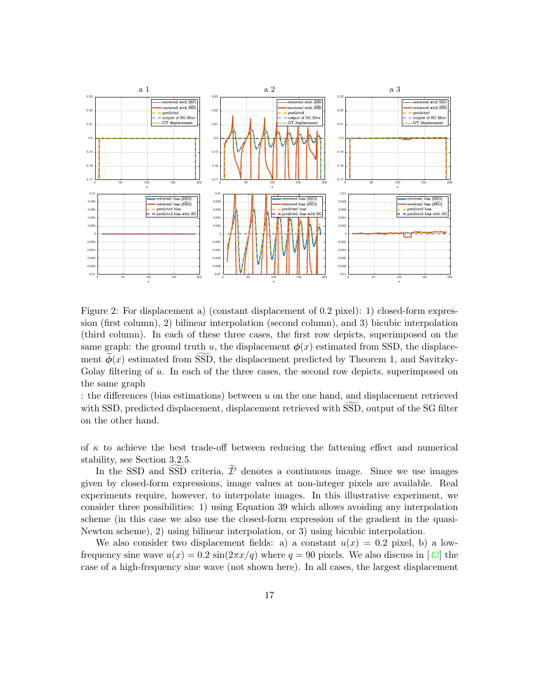
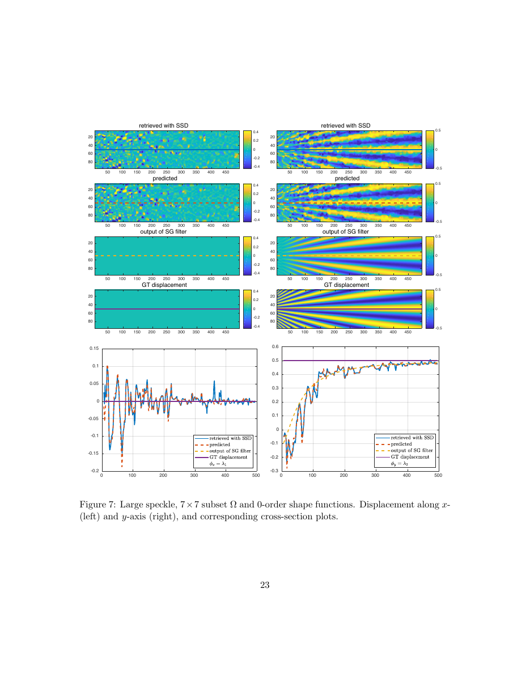
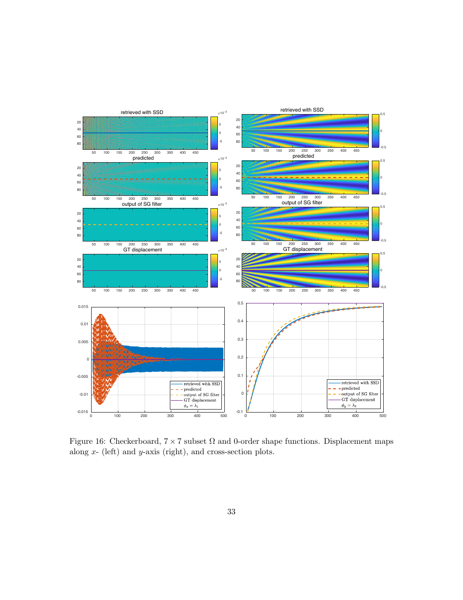

# 영상 정합의 변위 추정 편향, 광역학을 중심으로 (번역)

번역 범위: 전문(초록, 본문, 그림 캡션, 각주). 참고문헌은 원문 그대로 두었다.

- 원제: On Biases in Displacement Estimation for Image Registration, with a Focus on Photomechanics
- 저자: Frédéric Sur(LORIA, Université de Lorraine, CNRS, INRIA, Nancy), Benoît Blaysat, Michel Grédiac(Institut Pascal, Université Clermont Auvergne, SIGMA, CNRS, Clermont-Ferrand)
- 서지: Journal of Mathematical Imaging and Vision 63(7), pp. 777-806, 2021. doi:10.1007/s10851-021-01032-4
- 원문 파일: [Sur2021_JMIV_biases_displacement_estimation.pdf](Sur2021_JMIV_biases_displacement_estimation.pdf). HAL hal-03226201v1 저자 원고판(45쪽, 2021-05-17 등록). 학술지 쪽 번호와 그림 번호는 같고, 쪽 배치는 학술지판과 다르다.
- 텍스트 추출: `pdftotext -layout`. 수식은 추출 결과와 PDF 그림을 대조해 LaTeX로 옮겼다.
- 그림: PDF 18, 24, 34쪽을 `pdftoppm -r 110 -png`로 그림화했다(그림 2, 7, 16). 나머지 그림은 캡션만 번역했다.
- 용어
  - subset: 부분 영역(정합 창). Ω로 쓴다.
  - shape function: 형상 함수. 부분 영역 안의 변위 모양을 정하는 기저 함수다.
  - pattern-induced bias(PIB): 무늬 유발 편향
  - fattening effect: 비대 효과(스테레오에서 전경이 실제보다 뚱뚱해 보이는 현상)
  - undermatching: 형상 함수 부족 맞춤(실제 변위를 형상 함수가 다 표현하지 못하는 것)
  - Savitzky-Golay(SG) filter: 사비츠키-골레이 필터
  - speckle pattern: 얼룩 무늬

---

## 초록

작은 변위에서의 영상 정합은 여러 영상 분석 작업의 핵심이다.
광류 추정, 스테레오 영상, 광역학의 전 영역 변위 측정이 그 예다.

널리 쓰는 방법은 두 영상 사이의 변위장을 국소적으로 매개변수 변환으로 모델링하고, 그다음 최소제곱 추정을 하는 것이다.
이 절차는 광역학을 포함한 여러 분야에서 "디지털 영상 상관(DIC)"이라고 부른다.
이 논문은 이 접근을 다룬다.

첫째, 추정한 변위가 다음 원인 때문에 편향된다는 것을 보인다.

- 부화소 정확도에 필요한 보간 방식
- 영상 기울기의 분포
- 가정한 매개변수 변환과 실제 변위의 차이

추정값과 실제값의 차이를 정량으로 추정하는 것은, 스테레오나 광역학처럼 계측을 중시하는 분야에서 중요하다.

둘째, 이 편향을 얼마나 없애거나 줄일 수 있는지 따져 본다.
광역학 맥락에서 우리의 예측식을 수치로 평가한 결과도 제시한다.
결과를 재현하는 소프트웨어 코드는 무료로 공개했다.
이 논문은 광역학이라는 특정 분야에 초점을 두지만, 영상 정합을 다루는 여러 과학 분야에 관련이 있다.

핵심어: 영상 정합, 디지털 영상 상관, 비대 효과, 사비츠키-골레이 필터링, 실험 역학, 스테레오 영상, 광류

(원고 표지 문구) 이 글은 저자 원고판이다. F. Sur, B. Blaysat, M. Grédiac. On biases in displacement estimation for image registration, with a focus on photomechanics. Journal of Mathematical Imaging and Vision, 2021. DOI: 10.1007/s10851-021-01032-4.
이 연구는 프랑스 국립연구청(ANR)의 과제 ANR-18-CE08-0028-01(ICAReS)의 일부 지원을 받았다.

---

## 1. 서론

두 영상 $I$와 $I'$이 주어졌을 때, 영상 정합은 한 영상의 화소를 다른 영상의 대응 화소로 옮기는 2차원 변위장 $\phi$를 추정하는 것이다.
대응 화소의 밝기가 같다고 가정하면, 모든 화소 $x$에서 $I(x) = I'(x + \phi(x))$가 성립한다.

작은 변위(보통 1화소 미만)를 찾을 때는, $I$와 $I'$의 대응하는 부분 영역에서 이 관계를 강제해 변위장을 국소적으로 추정하는 경우가 많다.
영상 정합은 많은 영상 분석 작업의 첫 단계다.
작은 변위는 특히 다음에서 중요하다.

- 광류 추정 [11, 12]
- 스테레오 영상의 시차 추정 [9, 31, 33, 34]
- 실험 역학의 변형 측정 [20, 43]

이 논문은 광역학의 변위 추정에 초점을 둔다.
광역학은 영상으로 전 영역을 측정하는 실험 고체역학의 한 갈래다.
그래도 이 논문에서 다루는 문제의 많은 부분은 일반적으로 의미가 있다.
다만 광역학에는 스테레오나 광류와 달리 가려짐(occlusion)이 없다.

### 1.1 문제 정의

광역학에서 디지털 영상 상관(DIC) [20, 43]은 열이나 기계 하중을 받는 재료의 표면이나 내부 변위장을 재는 핵심 방법이다.
DIC라는 말은 교차상관(CC), 제곱차 합(SSD), 정규화한 CC나 SSD에 기반한 방법을 모두 가리킨다 [27].

DIC는 시편 표면을 변형 전과 후에 찍은 두 영상 $I$, $I'$을 쓴다.
시편에는 미리 대비가 큰 무작위 무늬(얼룩 무늬, speckle pattern)를 칠한다(3절 참조).
목표는 모든 $x$에서 $I(x) = I'(x + u(x))$를 만족하는 변위장 $u$를 찾는 것이다.
그다음 미분해서 변형률장을 얻는다.

이 장들은 변형된 시편 표면에서 생기는 여러 현상을 관찰하는 데 쓴다.
그 현상은 변위나 변형률의 불균일로 드러난다.
나아가 구성 방정식의 매개변수를 식별하는 데 쓰고, 그 식으로 구조 부품을 설계한다 [19].
그래서 식별한 매개변수가 믿을 만하도록, 측정 오차가 가장 작은 변위와 변형률 지도를 얻는 것이 매우 중요하다.
변위장은 보통 1화소보다 훨씬 작은 값을 가진다.

이른바 국소 부분 영역 DIC는, 영상 영역의 부분 영역마다 위에서 말한 CC나 SSD 같은 기준을 최적화해 $I'$을 $I$에 맞춘다.
가벼운 가정 아래 이 기준들은 서로 같으므로 [27], 여기서는 제곱차 합(SSD)을 다룬다.
SSD는 스테레오의 블록 정합에도 쓴다 [31].

$I$와 $I'$은 정수 화소 좌표에서만 알려져 있고, $u$는 부화소 정확도로 찾아야 하므로 보간이 필요하다.
화소 $x$에서 변위 $u$를 추정하려면, $x$를 중심으로 하는 시편 영상의 부분 영역 $\Omega_x$에서 다음 SSD를 $\Omega_x$ 위의 변위 $\phi_x$에 대해 최소화한다.

$$\sum_{x_i \in \Omega_x} \left( I(x_i) - \tilde I'(x_i + \phi_x(x_i)) \right)^2 \tag{1}$$

여기서 $\tilde I'$은 $I'$(정수 좌표에서 표본화된 영상)의 연속 보간이다.
$\Omega_x$는 $M$개 화소 $(x_1, \dots, x_M)$의 집합이다.
최소화는 $\Omega_x$에서 실제 미지 변위 $u$를 근사할 것으로 기대하는 변위장 $\phi_x$에 대해 한다.
가중 SSD 기준은 다루지 않지만, 이 논문의 식들은 쉽게 그쪽으로 바꿀 수 있다.

시편 표면 전체의 변위장 추정 $\phi(x)$는, 모든 화소 $x$에서 부분 영역 $\Omega_x$ 중심의 $\phi_x$ 값을 택해 얻는다.

변위 추정은 미지수가 부족해 잘 정의되지 않은(ill-posed) 문제다.
화소마다 2차원 변위를 찾아야 하기 때문이다.
또 영상 기울기에 수직인 변위 성분의 정보는 사라진다.
이것이 이른바 조리개 문제(aperture problem) [11, 12]다.

그래서 실험 역학에서는(일반 응용에서도 [7]) 보통 변위 $\phi_x$를 $N$개의 형상(기저) 함수 $(\phi_j)_{1 \le j \le N}$의 선형 결합으로 찾는다.
매개변수 $(\lambda_j)$는 다음을 최소화한다.

$$\mathrm{SSD}(\lambda_1, \dots, \lambda_N) = \sum_{x_i \in \Omega_x} \left( I(x_i) - \tilde I'\Big(x_i + \sum_{j=1}^{N} \lambda_j \phi_j(x_i)\Big) \right)^2 \tag{2}$$

조리개 문제를 다루는 고전적인 방법은 두 가지다.

- $\Omega_x$에서 변위를 상수로 두고 위 식을 1차 테일러 전개한다. 이것이 Lucas-Kanade 방식의 빠른 방법이다 [25].
- 정규화 제약으로 전역 평활화를 건다. 이것이 Horn-Schunck 방식이다 [21].

실험 역학에서는 SSD를 수치적으로 최소화하는 쪽을 더 선호한다.
정확한 $\phi$가 필요하고, 정규화에 들어가는 초매개변수를 정하기가 쉽지 않아서 그런 방법을 배제하기 때문이다.

이제부터 $\Lambda = (\lambda_1, \dots, \lambda_N)^T$가 식 2의 SSD를 최소화하고, $\phi = \sum_{j=1}^N \lambda_j \phi_j$가 그에 해당하는 국소 변위장이라고 둔다.
예를 들어 [5]에 정리된 대로 형상 함수는 다음과 같다.

- 0차: $N = 2$, $\phi_1(x) = (1\ 0)^T$, $\phi_2(x) = (0\ 1)^T$. $\Omega_x$에서 상수 변위다.
- 1차: $N = 6$. $\phi_1$, $\phi_2$에 $\phi_3(x) = (x\ 0)^T$, $\phi_4(x) = (0\ x)^T$, $\phi_5(x) = (y\ 0)^T$, $\phi_6(x) = (0\ y)^T$를 더한다.
- 2차: $N = 12$. 다음을 더 넣는다. $\phi_7(x) = (x^2, 0)^T$, $\phi_8(x) = (xy, 0)^T$, $\phi_9(x) = (y^2, 0)^T$, $\phi_{10}(x) = (0, x^2)^T$, $\phi_{11}(x) = (0, xy)^T$, $\phi_{12}(x) = (0, y^2)^T$.

좌표 원점은 보통 부분 영역 $\Omega_x$의 중심이다.
그래서 $\Omega_x$에서 SSD를 최소화해 $x$에서 추정한 변위는 차수와 상관없이 $\phi(x) = \phi_x(0,0) = (\lambda_1, \lambda_2)^T$다.
또 1차와 2차 형상 함수는 $\partial \phi_x / \partial x (0,0) = (\lambda_3, \lambda_4)^T$, $\partial \phi_x / \partial y (0,0) = (\lambda_5, \lambda_6)^T$를 만족한다.

변위장은 $u$를 $\phi$로 근사하는 것이 말이 될 만큼 매끄럽다고 가정한다.
특히 가려짐(스테레오에서 한 물체가 다른 물체 일부를 가리는 것)이나 빠진 부분(기계적 파단 같은 것)은 허용하지 않는다.
역함수 정리에 따라, $x$에서 $x + \phi(x)$로 가는 사상의 야코비 행렬이 특이하지 않으면 변위는 국소적으로 가역이다.
다항식 형상 함수에서 부분 영역 중심의 이 행렬식은 $(1+\lambda_3)(1+\lambda_6) - \lambda_4\lambda_5 = 1 + \lambda_3 + \lambda_6 + \lambda_3\lambda_6 - \lambda_4\lambda_5$다.
0차 형상 함수(단순 평행이동)는 당연히 가역 변위를 준다. 이때는 $i \in \{3,4,5,6\}$에서 $\lambda_i = 0$이고 행렬식이 0이 아니기 때문이다.
고차 형상 함수도 $\lambda_i$가 1에 비해 작으면 국소 가역 변위장을 준다. 광역학의 고전적인 작은 변형률 가정에서는 이것이 성립한다.

### 1.2 동기

이 연구의 동기는, 광역학에서 변위장이 작은 가짜 요동에 자주 오염된다는 관찰이다.
이 분야에서는 이 요동이 센서 잡음, 보간 편향, DIC 기준을 최소화하는 수치 방식 때문이라고 흔히 믿는다.

그런데 최근 연구들은 이 원인들에 더해 시편 표면의 무작위 표식(무늬)도 고려한다 [14, 24, 45].
[10]의 저자들은 "무늬 유발 편향(pattern-induced bias)"이라는 말을 만들었다.

다른 관점에서는, 변위장의 국소 매개변수 추정이 본질적으로 편향되어 있다고 알려져 있다.
찾은 변위는 실제 변위에 사비츠키-골레이 필터를 합성곱한 것에 불과하다는 것이다 [36].
이 관점에서는 시편 표식이 아무 역할을 하지 않는다.
이것은 무늬 유발 편향이 있다는 것과 모순된다.
그래서 이 연구의 주된 동기는 이 모순을 풀 수 있는지 보는 것이다.

### 1.3 기여

이 논문의 목표는 이 서로 다른 관점에 이론 바탕을 주어, 둘이 함께 성립할 수 있음을 보이는 것이다.
더 정확히는, 임의의 부분 영역 $\Omega_x$에서 찾은 $\Lambda$(따라서 찾은 변위 $\phi$)와 실제 미지 변위 $u$의 관계를 제시한다.

스테레오 시차 추정 논문들 [1, 9, 31, 34]을 다시 살펴, 2절에서 $\Lambda$의 추정이 주로 두 항의 합임을 보인다.

- 미지 변위 $u$와 형상 함수가 만드는 근사에 의존하는 항
- 보간 오차가 만드는 항

이 두 항을 특성화한다. 두 항은 실제로 찍힌 시편의 기울기 분포에 의존한다.
이로써 스테레오의 관점(비대 효과)과 광역학의 관점(무늬 유발 편향)을 하나로 묶는다.

3절에서는 수치 실험으로 이론 결과를 확인하고 한계를 평가한다.
논문 분량을 줄이려고, 센서 잡음이 영상에서 추정 변위장으로 퍼지는 문제는 별도의 동반 연구 보고서 [42]에서 다룬다.

### 1.4 관련 연구

스테레오와 광역학은 변위장을 아주 정확히 추정한다는 같은 목표를 가진다.
이 기여는 두 분야의 여러 논문과 맞닿아 있다.

먼저 이 접근은 스테레오 시차 추정 맥락에서 [31](어느 정도는 [9]도)에 제시된 계산에 기반한다.
이 분야에서는 시차가 이 논문의 변위장 역할을 한다.

한편 시차는 스테레오 영상 쌍에서 뽑은 작은 조각 사이의 1차원 상수 변위로 화소마다 추정할 수 있다.
영상을 평행화해 에피폴라 선이 서로 평행하므로, 시차는 정해진 방향과 같은 선 위에 있다.
이 맥락에서 [9, 31]의 저자들은 비대 효과, 즉 영상 기울기 분포 때문에 생기는 시차 추정 편향을 정량화하는 예측식을 준다.

다른 한편, 실험 역학에서는 국소적으로 상수가 아닌 변위를 형상 함수의 선형 결합으로 추정하며, 정해진 방향으로 제한하지 않는다.
시차와의 주된 차이는 변위장이 보통 매끄럽고 아주 작은 요동만 가진다는 점이다.
많은 재료와 하중 크기에서 변형률 성분(변위의 편미분으로 정의)은 $10^{-2}$ 미만이다.
기울기 분포도 변위 추정에 영향을 주어 무늬 유발 편향을 만들 수 있다.
광역학에서 이 편향을 특성화한 첫 시도는 [24]에 있다.

무늬 유발 편향이나 비대 효과 외에, 정합에 필요한 보간 방식도 분명한 오차 원인이다.
스테레오에서는 입력 영상이 섀넌-나이퀴스트 표본화 조건을 만족한다고 흔히 가정한다 [9, 31, 34].
그러면 연속 영상을 푸리에 계수로부터 보간 편향 없이 완벽하게 보간할 수 있다.
그러나 [29, 40]에 따르면, 원본 입력 영상에서 맨눈으로는 거의 보이지 않는 엘리어싱이 광역학의 변위와 변형률 추정에 크게 영향을 줄 수 있다.
그래서 이 분야에서는 푸리에 보간 대신 쌍선형이나 쌍삼차 보간을 쓴다 [43].
단점은 $\tilde I'$이 정수 화소 좌표에서만 $I'$과 일치한다는 것이다. 정수가 아닌 좌표에는 보간 오차가 생기며, [6]에서 수치로 보였다.
[35]의 저자들은 보간을 합성곱 필터로 보고 보간 편향을 특성화해, 유명한 "S자 곡선"을 얻었다.
[38]의 저자들은 부분 영역 $\Omega$를 정수가 아닌 화소에서 표본화해 보간 편향을 줄였다.

서론에서 말했듯, 실험 역학에서 가장 널리 쓰는 접근은 변위장을 국소적으로 형상 함수의 선형 결합으로 근사하는 것이다.
이것은 실제 변위를 덜 맞출(undermatch) 수 있다.
이것이 [36]에서 다룬 또 다른 오차 원인이다.
[36]은 찾은 변위장이 실제 변위와 사비츠키-골레이 필터의 합성곱이며, 이 필터가 형상 함수의 차수와 부분 영역 크기로 정해짐을 보였다.
이 특성화는 [14]와 [46]에서 계측 매개변수를 정의하는 데 쓰였고, [16]에서는 전용 역합성곱 절차로 변위장을 복원하는 데 쓰였다.

### 1.5 표기와 기초

$\langle \cdot, \cdot \rangle$과 $|\cdot|$은 각각 2차원 유클리드 내적과 노름이다.
2차원 함수의 기울기는 $\nabla$로 쓴다.
모든 벡터는 해당 열 행렬과 같게 보고 굵은 글씨로 쓴다.
행렬 $A$의 전치는 $A^T$다.

변수가 0으로 갈 때의 란다우 "빅오"를 $O$로 쓴다.
$f$와 $g$가 2차원 값 함수일 때, $f = O(|g|)$는 어떤 $K > 0$에 대해 충분히 작은 모든 $x$가 $|f(x)| \le K |g(x)|$를 만족한다는 뜻이다.
$f = O(|g|)$이고 $A$가 2열 행렬이면 $Af = O(|g|)$이고, 특히 임의의 상수 2차원 벡터 $h$에 대해 $\langle h, f \rangle = O(|g|)$다.

이후 보간한 2차원 함수의 편미분을 쓴다.
쌍선형 보간처럼 정수 화소 좌표에서 미분을 주지 않는 보간 방식도 있다.
하지만 보간 함수의 미분은 $x_i + \phi(x_i)$ 같은 점에서 계산한다($x_i$는 정수 화소 좌표).
대부분의 경우 $\phi(x_i)$는 부화소 값이라 $x_i + \phi(x_i)$는 정수가 아니므로 미분이 잘 정의된다.

---

## 2. SSD 최소화로 변위 추정하기

이 절은 SSD 기준(식 2)을 최소화해 추정한 변위 $\phi$를 실제 미지 변위 $u$의 함수로 닫힌 꼴로 나타낸다.
영상 질감과 보간 방식이 만드는 계통 오차의 역할을 드러내는 것이 목적이다.
이 절에서는 잡음 없는 영상을 다룬다.
신호 의존 잡음이 있는 영상은 별도 연구 보고서 [42]에서 다룬다.

이 절은 주어진 화소 $x$에서의 최소화를 다루므로, 표기를 줄이려고 부분 영역이 $x$ 중심이라는 첨자 $x$를 생략하고 $\Omega$, $\phi$로 쓴다.

### 2.1 찾은 변위장과 실제 변위장의 관계

목표는 $\Lambda$를 영상 $I$, $I'$, 보간한 연속 영상 $\tilde I'$, 미지 변위장 $u$의 함수로 나타내는 것이다.

정의상 $\Lambda = (\lambda_1, \dots, \lambda_N)^T$는 식 2 SSD의 정류점이다.
각 $j \in \{1, \dots, N\}$에 대해 $\lambda_j$로 미분하면 다음을 얻는다.

$$\sum_{x_i \in \Omega} \left( I(x_i) - \tilde I'(x_i + \phi(x_i)) \right) \left\langle \nabla \tilde I'(x_i + \phi(x_i)), \phi_j(x_i) \right\rangle = 0 \tag{3}$$

$\delta$를 미지 변위장과 찾은 변위장의 차이로 둔다. 즉 모든 $x_i \in \Omega$에서 $\delta(x_i) = u(x_i) - \phi(x_i)$다.
이것은 [36]에서 말한 형상 함수의 부족 맞춤을 나타낸다.

첫째,

$$I(x_i) - \tilde I'(x_i + \phi(x_i)) = \left( I(x_i) - I'(x_i + \phi(x_i)) \right) + \left( I'(x_i + \phi(x_i)) - \tilde I'(x_i + \phi(x_i)) \right) \tag{4}$$

$u$의 정의에 따라,

$$I(x_i) - I'(x_i + \phi(x_i)) = I'(x_i + u(x_i)) - I'(x_i + \phi(x_i)) \tag{5}$$

1차 테일러 전개로 다음을 쓸 수 있다.

$$I(x_i) - I'(x_i + \phi(x_i)) = \left\langle \nabla I'(x_i + u(x_i)), \delta(x_i) \right\rangle + O(|\delta(x_i)|^2) \tag{6}$$

보간 오차를 $D_{I'} = I' - \tilde I'$로 두면(정수 좌표에서 0), 식 4로부터

$$I(x_i) - \tilde I'(x_i + \phi(x_i)) = \left\langle \nabla I'(x_i + u(x_i)), \delta(x_i) \right\rangle + D_{I'}(x_i + \phi(x_i)) + O(|\delta(x_i)|^2) \tag{7}$$

둘째, 또 한 번 테일러 전개를 하면,

$$\nabla I'(x_i + \phi(x_i)) - \nabla I'(x_i + u(x_i)) = -\delta(x_i)^T H_{I'}(x_i + \phi(x_i))\, \delta(x_i) + O(|\delta(x_i)|^3) = O(|\delta(x_i)|^2) \tag{8}$$

여기서 $H_{I'}(x_i + \phi(x_i))$는 $x_i + \phi(x_i)$에서 $I'$의 헤세 행렬이다.

따라서

$$\begin{aligned}\nabla \tilde I'(x_i + \phi(x_i)) &= \nabla I'(x_i + u(x_i)) + \left( \nabla \tilde I'(x_i + \phi(x_i)) - \nabla I'(x_i + \phi(x_i)) \right) + \left( \nabla I'(x_i + \phi(x_i)) - \nabla I'(x_i + u(x_i)) \right) \\ &= \nabla I'(x_i + u(x_i)) - D_{\nabla I'}(x_i + \phi(x_i)) + O(|\delta(x_i)|^2)\end{aligned} \tag{9}$$

여기서 $D_{\nabla I'} = \nabla I' - \nabla \tilde I'$는 기울기 보간 오차다.

식 7과 9를 식 3에 넣으면,

$$\sum_{x_i \in \Omega} \left( \langle \nabla I'(x_i + u(x_i)), \delta(x_i) \rangle + D_{I'}(x_i + \phi(x_i)) + O(|\delta(x_i)|^2) \right) \times \left\langle \nabla I'(x_i + u(x_i)) - D_{\nabla I'}(x_i + \phi(x_i)) + O(|\delta(x_i)|^2), \phi_j(x_i) \right\rangle = 0 \tag{10}$$

모든 $i \in \{1, \dots, M\}$, $j \in \{1, \dots, N\}$에 대해 $L^u_{i,j} = \langle \nabla I'(x_i + u(x_i)), \phi_j(x_i) \rangle$로 두자. $L^u$는 $M \times N$ 행렬이다.
그러면 결국 다음을 얻는다.

$$\begin{aligned}\sum_{x_i \in \Omega} \Big( & L^u_{i,j} \langle \nabla I'(x_i + u(x_i)), \delta(x_i) \rangle + L^u_{i,j} D_{I'}(x_i + \phi(x_i)) + O(|\delta(x_i)|^2) \\ &+ O\big(|D_{\nabla I'}(x_i + \phi(x_i))| \, |\delta(x_i)|\big) + O\big(|D_{I'}(x_i + \phi(x_i))| \, |D_{\nabla I'}(x_i + \phi(x_i))|\big) \\ &+ O\big(|D_{I'}(x_i + \phi(x_i))| \, |\delta(x_i)|\big) \Big) = 0\end{aligned} \tag{11}$$

더 간단히 쓰면,

$$\sum_{x_i \in \Omega} L^u_{i,j} \langle \nabla I'(x_i + u(x_i)), \delta(x_i) \rangle + \sum_{x_i \in \Omega} L^u_{i,j} D_{I'}(x_i + \phi(x_i)) + O(|\delta|^2) + O(|D_{I'}| \, |D_{\nabla I'}|) + O(|D_{I'}| \, |\delta|) + O(|D_{\nabla I'}| \, |\delta|) = 0 \tag{12}$$

여기서 $O(|f|)$는 $\sum_{x_i \in \Omega} O(|f(x_i)|)$를 뜻한다.

$\delta(x_i) = u(x_i) - \phi(x_i) = u(x_i) - \sum_{k=1}^N \lambda_k \phi_k(x_i)$이므로 위 식은 다음이 된다.

$$\sum_{x_i \in \Omega} L^u_{i,j} \langle \nabla I'(x_i + u(x_i)), u(x_i) \rangle - \sum_{x_i \in \Omega} L^u_{i,j} \sum_{k=1}^N \lambda_k L^u_{i,k} + \sum_{x_i \in \Omega} L^u_{i,j} D_{I'}(x_i + \phi(x_i)) + O(|\delta|^2) + O(|D_{I'}| \, |D_{\nabla I'}|) + O(|D_{I'}| \, |\delta|) + O(|D_{\nabla I'}| \, |\delta|) = 0 \tag{13}$$

모든 $i \in \{1, \dots, M\}$에 대해 성분이 $G_i = \langle \nabla I'(x_i + u(x_i)), u(x_i) \rangle$인 벡터를 $G$로 쓰면, 식 13에서 다음 행렬 관계를 얻는다.

$$(L^u)^T L^u \Lambda = (L^u)^T G + (L^u)^T D_{I'} + O(|\delta|^2) + O(|D_{I'}| \, |D_{\nabla I'}|) + O(|D_{I'}| \, |\delta|) \tag{14}$$

행렬 $(L^u)^T L^u$는 $L^u$의 열이 선형 독립이면 가역이다(그람 행렬이다).
이것은 $\phi_j$가 올바른 기저이고, 부분 영역 $\Omega$ 전체에서 기울기가 0이 아니면 성립한다.
이후 이 가정이 성립한다고 둔다.

이로써 다음 정리를 증명했다.

**정리 1.** $\Lambda$가 영상 $I'$을 $I$에 정합하는 식 2의 SSD 기준을 최소화하면, 다음 등식이 성립한다.

$$\Lambda = ((L^u)^T L^u)^{-1} (L^u)^T G + ((L^u)^T L^u)^{-1} (L^u)^T D_{I'} + O(|\delta|^2) + O(|D_{I'}| \, |D_{\nabla I'}|) + O(|D_{I'}| \, |\delta|) \tag{15}$$

여기서 $u$는 실제 변위장이다. 모든 $i \in \{1,\dots,M\}$, $j \in \{1,\dots,N\}$에 대해 다음 표기를 쓴다.
$L^u_{i,j} = \langle \nabla I'(x_i + u(x_i)), \phi_j(x_i) \rangle$, $G_i = \langle \nabla I'(x_i + u(x_i)), u(x_i) \rangle$, $D_{I'} = I' - \tilde I'$, $D_{\nabla I'} = \nabla I' - \nabla \tilde I'$.
$\tilde I'$은 정수가 아닌 좌표에서 $I'$의 보간이고, $\delta = u - \phi$다.

이 형태로는 $\Lambda$의 추정이 계통 오차에 어떻게 영향을 받는지 바로 보이지 않는다.

이제 미지의 실제 변위 $u$를 기저 함수 $(\phi_k)$ 위로 분해하자(예를 들어 최소제곱 의미로).
$N$차원 벡터 $\Lambda^u = (\lambda^u_1, \dots, \lambda^u_N)^T$를 $u = \sum_{k=1}^N \lambda^u_k \phi_k + \epsilon$이 되게 도입한다.
$\epsilon$은 기저 $(\phi_k)_{k \in \{1,\dots,N\}}$ 위로 $u$를 분해했을 때의 잔차다.
따라서 모든 $i \in \{1, \dots, M\}$에 대해

$$G_i = \sum_{k=1}^N \lambda^u_k \langle \nabla I'(x_i + u(x_i)), \phi_k(x_i) \rangle + \langle \nabla I'(x_i + u(x_i)), \epsilon(x_i) \rangle \tag{16}$$

성분이 $E_i = \langle \nabla I'(x_i + u(x_i)), \epsilon(x_i) \rangle$인 벡터를 $E$라 하면 $G = L^u \Lambda^u + E$다.
따라서 정리 1에서 다음 따름정리를 얻는다.

**따름정리 1.** $\Lambda$가 영상 $I'$을 $I$에 정합하는 식 2의 SSD 기준을 최소화하면, 다음 등식이 성립한다.

$$\Lambda = \Lambda^u + ((L^u)^T L^u)^{-1} (L^u)^T E + ((L^u)^T L^u)^{-1} (L^u)^T D_{I'} + O(|\delta|^2) + O(|D_{I'}| \, |D_{\nabla I'}|) + O(|D_{I'}| \, |\delta|) \tag{17}$$

정리 1의 표기에 더해, 모든 $i \in \{1,\dots,M\}$에 대해 $E_i = \langle \nabla I'(x_i + u(x_i)), \epsilon(x_i) \rangle$이고, $\epsilon$은 기저 $(\phi_k)$ 밖에 있는 $u$의 성분이다.

### 2.2 논의

정리 1에서 2차 항을 버리면,

$$\Lambda = ((L^u)^T L^u)^{-1} (L^u)^T G + ((L^u)^T L^u)^{-1} (L^u)^T D_{I'} \tag{18}$$

따름정리 1에서는,

$$\Lambda = \Lambda^u + ((L^u)^T L^u)^{-1} (L^u)^T E + ((L^u)^T L^u)^{-1} (L^u)^T D_{I'} \tag{19}$$

보간이 완벽하고($D_{I'} = 0$), 함수 기저가 실제 변위 $u$를 완벽하게 나타낼 만큼 풍부하거나($E = 0$) 적어도 다항식 기저의 차수가 충분히 크면($E \simeq 0$), $\Lambda$는 찾고자 하는 $\Lambda^u$와 같다는 것을 쉽게 볼 수 있다.

하지만 이 가정들은 낙관적이다.
이 절의 나머지에서 이를 논의한다.

#### 2.2.1 보간 편향

식 18에서 항 $((L^u)^T L^u)^{-1} (L^u)^T D_{I'}$는 부화소 보간 오차의 영향을 나타낸다.
바탕 영상 $I'$을 모르므로, 추가 정보가 없으면 이 오차의 한계를 미리 정할 수 없다.
예를 들어 섀넌-나이퀴스트 조건을 만족하는 잘 표본화된 영상은 [31, 44]처럼 푸리에 보간을 쓰면 보간 오차가 없고, 이때 $D_{I'} = 0$이다.
서론에서 말했듯, 광역학 실험의 실제 영상은 아마 이 가정을 만족하지 않는다.

대부분의 영상 보간 방식(푸리에, 쌍선형, 쌍삼차, Lanczos 보간 등)은 실제로 선형이라는 점에 주목하자.
보간 값이 정수 화소 좌표 영상 값의 가중 평균이라는 뜻이다 [13, 23].
모든 $x \in \mathbb{R}^2$에 대해, 크기 $M$의 행 행렬 $P(x)$가 있어서 $x$에서 $I'$의 보간이 $\tilde I'(x) = P(x) I'$로 주어진다.
여기서 잠시 $I'$은 영상 값 행렬을 열 벡터로 편 것이다.
예를 들어 행 벡터 $P(x)$는 쌍선형 보간에서 0 아닌 원소가 4개, 쌍삼차나 쌍삼차 스플라인 보간에서 16개다 [13, 23]. 이 둘이 광역학에서 가장 많이 쓰는 방식이다.

따라서 보간 편향은 다음과 같이 쓴다.

$$((L^u)^T L^u)^{-1} (L^u)^T (I - P(x)) I' \tag{20}$$

이것은 [2]에서 다른 방법으로 유도되었고([30, 43]을 다듬은 것), [3]에서 실험으로 평가되었다.
영상 기울기가 $L^u$에 들어가 보간 편향에 영향을 준다는 점에 주목할 수 있다.
보간 오차는 무시할 수도 있다(섀넌-나이퀴스트 조건이 성립한다고 가정하거나 고차 보간 방식을 써서).
다음 절은 무늬 유발 편향을 만들 수 있는, 이른바 "부족 맞춤 부분 영역 형상 함수"를 다룬다.

#### 2.2.2 부족 맞춤 형상 함수와 무늬 유발 편향

식 18에서 항 $((L^u)^T L^u)^{-1} (L^u)^T G$는 $\Lambda$를 $I'$의 기울기와 실제 변위 $u$에 연결한다.
모든 $i \in \{1,\dots,M\}$, $j \in \{1,\dots,N\}$에 대해 다시 쓰면,

$$L^u_{i,j} = \langle \nabla I'(x_i + u(x_i)), \phi_j(x_i) \rangle \tag{21}$$

$$G_i = \langle \nabla I'(x_i + u(x_i)), u(x_i) \rangle \tag{22}$$

그리고

$$E_i = \langle \nabla I'(x_i + u(x_i)), \epsilon(x_i) \rangle \tag{23}$$

잘 알려진 조리개 문제가 다시 나타난다. $G_i$에는 영상 기울기와 같은 방향의 변위 성분만 들어간다.
또 정리 1(따름정리 1)은 $\Lambda$의 각 성분(각 성분의 오차)이 $G_i$(부족 맞춤 오차 $E$)의 가중 평균임을 보여 준다.
가중치는 형상 함수 방향 기울기 성분의 제곱에 비례한다(여기서 $((L^u)^T L^u)^{-1}$이 정규화 역할을 한다).

이해를 돕기 위해, 단순하지만 현실적인 경우로 관계를 풀어 쓴다.
변위를 $x$ 방향 순수 평행이동으로 찾는 경우다.
이것은 평행화한 영상의 스테레오 시차 추정에 해당한다.
$u(x_i) = (u(x_i)\ 0)^T$, $N = 1$, $\phi_1(x) = (1\ 0)^T$이다.
이때 $L^u = (I'_x(x_i + u(x_i)))_{1 \le i \le M}$은 열 벡터이고,

$$((L^u)^T L^u)^{-1} (L^u)^T G = \frac{\sum_{i=1}^M (I'_x(x_i + u(x_i)))^2 u(x_i)}{\sum_{i=1}^M (I'_x(x_i + u(x_i)))^2} \tag{24}$$

여기서 $I'_x$는 $I'$의 $x$ 방향 편미분이다.

이 경우 보간 오차 항은 다음으로 줄어든다.

$$((L^u)^T L^u)^{-1} (L^u)^T D_{I'} = \frac{\sum_{i=1}^M I'_x(x_i + u(x_i))\, D_{I'}(x_i)}{\sum_{i=1}^M (I'_x(x_i + u(x_i)))^2} \tag{25}$$

$u = (u, 0)$이 상수 변위이면 식 24는 $u$가 된다.
이것은 따름정리 1과 맞다. 이 경우 모든 $x$에서 $u(x) = u\,\phi_1(x)$이므로 변위가 기저 함수 $\phi_1$로 완벽히 표현되기 때문이다.

식 24가 [1, 31]에 나온 관계와 정확히 같다는 점에 주목하자.
찾는 변위가 $\Omega$에서 상수가 아니면, 결과는 실제 변위의 가중 평균이고 가중치는 영상 미분의 제곱이다.
이것이 스테레오에서 잘 알려진 비대 효과([9]에서는 부착 효과라고도 부른다)를 설명한다.
에지 근처의 점은 기울기가 큰 에지 점이 시차를 거의 정한다.
비대 효과는 예를 들어 [31, 34]에서 볼 수 있다. 전경 물체(배경보다 시차가 큼)는 에지 근처 배경 화소가 전경의 시차를 물려받아 실제보다 뚱뚱해 보인다.

실험 역학에서 적절한 식은 정리 1이다.
$\Lambda$가 주는 추정 변위장은 편향되어 있다. 부분 영역에 속한 화소들에서 실제 변위의 가중 합이고, 가중치는 그 화소의 기울기 제곱(더 정확히는 형상 함수와 같은 방향 기울기 성분의 제곱)에 따라 커지기 때문이다.
특히 부분 영역 중심에서 나오는 변위는, 그 점의 실제 변위가 달라도, 기본적으로 기울기가 큰 점들에서의 실제 변위 평균이다.
이것은 직관과 맞지만, 실험 역학 맥락에서 이 현상을 엄밀히 기술한 이전 논문을 우리는 알지 못한다.
그래서 [10]을 따라 이 현상을 계속 "무늬 유발 편향"이라 부른다. 실험 역학에서는 실제로 "뚱뚱해지는" 것이 없으므로 "비대 효과"라는 말이 맞지 않아 보이기 때문이다.

정리 1의 $\Lambda$와 $G$의 관계는 공간적으로 변하는 커널을 가진 일반화 합성곱으로 볼 수 있다.

### 2.3 무늬 유발 편향에서 사비츠키-골레이 필터링으로

[36]의 저자들은 추정 변위가 단지 실제 변위와 사비츠키-골레이(SG) 커널(저역 통과 필터 [32, 26])의 합성곱이며, 이것이 이른바 정합 편향(matching bias) [14]을 만든다고 주장한다.
SG 필터는 다항식 형상 함수의 차수와 부분 영역 $\Omega$의 크기에만 의존한다 [32].
특히 바탕 영상의 기울기에 의존하지 않는다.
그런데 2.2.2절의 논의는 추정 변위와 실제 변위의 관계를 공간적으로 변하는 커널과의 합성곱으로 볼 수 있다고 결론지었다.
그래서 [14]나 [16]의 결과가 뒷받침하는 [36]의 주장은 정리 1과 앞 절의 무늬 유발 편향에 모순되는 것처럼 보인다.
이 절의 나머지에서 두 관점이 어떻게 양립하는지 설명한다.

#### 2.3.1 정상(stationary) 무작위 무늬의 경우

SG 필터와의 관계를 세우려고, [36]의 바탕 가정은 우리 표기로 $\phi$가 모든 $x$에 대해 $x$ 중심 부분 영역 $\Omega_x$에서 다음을 최소화한다는 것이다.

$$\sum_{x_i \in \Omega_x} |u(x_i) - \phi(x_i)|^2 \tag{26}$$

잠시 $\phi$의 $x$, $y$ 성분을 다음과 같이 쓰자.

$$\phi_x(x) = \sum_{0 \le i+j \le d} \alpha_{i,j} x^i y^j \tag{27}$$

$$\phi_y(x) = \sum_{0 \le i+j \le d} \beta_{i,j} x^i y^j \tag{28}$$

$d$는 형상 함수의 최대 차수다.
그러면 $\lambda_1 = \alpha_{0,0}$, $\lambda_2 = \beta_{0,0}$, $\lambda_3 = \alpha_{1,0}$, $\lambda_4 = \beta_{1,0}$, $\lambda_5 = \alpha_{0,1}$, $\lambda_6 = \beta_{0,1}$ 등이다.

$J_x = (1, x, \dots, x^d, y, \dots, y x^{d-1}, y^2, \dots, y^2 x^{d-2}, \dots, y^d)^T$, 그리고 같은 순서로 쌓은 계수 벡터 $\alpha$, $\beta$를 쓰면, 식 26은 다음과 같다.

$$\sum_{x_i} \left( u_1(x_i) - J_{x_i}^T \alpha \right)^2 + \left( u_2(x_i) - J_{x_i}^T \beta \right)^2 \tag{29}$$

따라서 식 26을 $\alpha$, $\beta$에 대해 최소화하는 것은 정규 방정식 $J^T \alpha = u_1$, $J^T \beta = u_2$를 푸는 것과 같다. 행렬 $J$는 모든 열 벡터 $J_x$를 모은 것이다.
즉 $\alpha = (JJ^T)^{-1} J u_1$, $\beta = (JJ^T)^{-1} J u_2$다.
부분 영역 $\Omega$에서 추정한 변위는 단지 $(\lambda_1, \lambda_2) = (\alpha_{0,0}, \beta_{0,0})$이므로, 찾은 변위의 각 성분은 $u$의 성분을 사비츠키-골레이 필터 [32]와 합성곱한 것이다. 이 필터의 차수는 형상 함수의 차수와 같고, 지지 영역은 $\Omega$의 크기다.
1차와 2차 형상 함수에서는 변위장의 편미분이 $(\lambda_3, \lambda_4, \lambda_5, \lambda_6)$로 주어지므로, [26, 32]에서 설명하듯 이것들도 SG 필터로 주어진다.

[36]에서 $\phi$가 식 26을 최소화한다는 근거는 경험적 논리뿐이다.
실험 역학에서 쓰는 얼룩 무늬의 매우 특수한 성질이 이 주장을 정당화할 수 있음을 보이겠다.

$I(x_i) = I'(x_i + u(x_i))$이므로, 보간 오차를 무시하고 $\tilde I'$을 $I'$과 같게 보면, 식 6처럼 다음 1차 근사를 얻는다.

$$I(x_i) - \tilde I'(x_i + \phi(x_i)) = \langle \nabla I'(x_i + u(x_i)), u(x_i) - \phi(x_i) \rangle \tag{30}$$

이 1차 근사가 성립하면(예를 들어 해의 초기 추정이 있어서), SSD 기준을 최소화하는 것은 다음을 최소화하는 것과 같다.

$$\sum_{x_i \in \Omega} g_i^2 \cos^2(\theta_i) |u(x_i) - \phi(x_i)|^2 \tag{31}$$

$g_i$는 $\nabla I'(x_i + u(x_i))$의 노름이고, $\theta_i$는 $\nabla I'(x_i + u(x_i))$와 오차 $u(x_i) - \phi(x_i)$ 사이 각이다.
보다시피 이것은 식 26이 아니다.
$I'$의 기울기에 수직인 $u - \phi$ 성분은 아무 역할을 하지 않는다. 이것은 앞의 조리개 문제 논의와 맞다. [24]에서도 언급되었다.

서론에서 말했듯 실험 역학에서 시험하는 시편에는 무작위 얼룩 무늬를 칠하며, 이것은 정상 질감으로 모델링할 수 있다.
그래서 기울기 노름 $(g_i)_{x_i \in \Omega}$가 같은 분포를 따르는 확률 변수이고, 각 $(\theta_i)_{x_i \in \Omega}$도 그렇고, 각 화소 $x_i$에서 $g_i$와 $\theta_i$가 독립이라고 안전하게 가정할 수 있다.
그래도 이 확률 변수들은 공간적으로 상관되어 있다.
흔한 가정은 자연 영상처럼 화소 사이 거리가 멀어지면 공간 상관이 사라진다는 것이다 [37].

모든 $1 \le i \le M$에 대해 $X_i = g_i^2 \cos^2(\theta_i) |u(x_i) - \phi(x_i)|^2$로 두자.
공간 상관 때문에 고전적인 큰 수의 법칙은 여기서 성립하지 않는다.
하지만 번스타인의 약한 큰 수의 법칙 [8, 연습문제 254, 67쪽] 같은 일반화는 여전히 성립한다.
$X_i$의 분산이 유계, 즉 어떤 $c > 0$에 대해 $\mathrm{Var}(X_i) \le c$이고, 공간 상관이 거리에 따라 사라진다, 즉 $|x_i - x_j| \to +\infty$일 때 $\mathrm{Cov}(X_i, X_j) \to 0$이라고 가정하면, 다음을 얻는다(각주 1).

$$\mathrm{Var}\Big(\sum_{i=1}^M X_i\Big) = \sum_{i=1}^M \mathrm{Var}(X_i) + 2 \sum_{i=1}^M \sum_{j \in [1,M] \setminus V_i} \mathrm{Cov}(X_i, X_j) + 2 \sum_{i=1}^M \sum_{j \in [1,M] \cap V_i} \mathrm{Cov}(X_i, X_j) \tag{32}$$

각주 1: 이 계산은 https://math.stackexchange.com/questions/245327/ 에서 가져와 고쳤다.

여기서 임의의 $\varepsilon > 0$에 대해, $V_i$는 모든 $i$와 $j \in V_i$에 대해 $\mathrm{Cov}(X_i, X_j) \le \varepsilon$인 지표 $j$의 집합이다.
$B \setminus A$는 $B$에 대한 $A$의 여집합이다.
$N_i$를 $\mathbb{N} \setminus V_i$의 원소 수라 하자. $|x_i - x_j| \to +\infty$일 때 $\mathrm{Cov}(X_i, X_j) \to 0$이므로 유한 집합이다. 그리고 $N = \max_i N_i$로 둔다.

코시-슈바르츠 부등식에 따라 모든 $i, j$에서 $\mathrm{Cov}(X_i, X_j) \le c$이므로 다음 상한이 성립한다.

$$\mathrm{Var}\Big(\sum_{i=1}^M X_i\Big) \le Mc + 2MNc + 2M^2\varepsilon \tag{33}$$

따라서

$$\mathrm{Var}\Big(\frac{1}{M}\sum_{i=1}^M X_i\Big) \le c/M + 2Nc/M + 2\varepsilon \tag{34}$$

체비쇼프 부등식에 따라 확률 변수 $\frac{1}{M}\sum_{i=1}^M X_i - \frac{1}{M}\sum_{i=1}^M \mathbb{E}(X_i)$는 $M \to +\infty$일 때 확률적으로 0에 수렴한다.

다시 말해, 영역 $\Omega$의 크기 $M$이 "충분히 크면" 식 31을 최소화하는 것은 다음을 최소화하는 것과 같다는 것이 정당화된다.

$$\sum_{i=1}^M \mathbb{E}(X_i) = \mathbb{E}(g^2)\,\mathbb{E}(\cos^2(\theta)) \sum_{x_i \in \Omega} |u(x_i) - \phi(x_i)|^2 \tag{35}$$

식 34는 주어진 $M$에서, 분산의 상한 $c$가 작을수록, 또는 영상 기울기의 공간 상관이 빨리 사라져 $N$이 작을수록 근사가 더 정확하다는 것을 말한다.

#### 2.3.2 무늬 유발 편향 측면에서 최적인 무늬를 향하여?

앞 절의 결과는 다음과 같이 해석할 수 있다.
부분 영역 $\Omega$의 크기 $M$이 충분히 크면, $\phi$를 추정하려고 식 31을 최소화하는 것은 식 26을 최소화하는 것과 비슷하다.
식 34에 따르면, 얼룩 무늬가 고울수록(공간 상관이 빨리 사라져 주어진 $\varepsilon$에서 $N$이 작음), 그리고 $X_i$의 분산이 작을수록($c$가 작음) 이것이 더 잘 성립한다.

$\mathrm{Var}(X_i)$는 $\mathrm{Var}(g_i^2 \cos^2(\theta_i)) = \mathbb{E}(g_i^4)\mathbb{E}(\cos^4(\theta_i)) - \mathbb{E}^2(g_i^2)\mathbb{E}^2(\cos^2(\theta_i)) = 3\mathbb{E}(g_i^4)/8 - \mathbb{E}^2(g_i^2)/4$에 비례한다.
여기서 $\theta_i$가 구간 $(0, 2\pi)$에서 균등 분포라고 가정했다. 등방성 얼룩 무늬에서는 타당하며, 실제로 $\mathbb{E}(\cos^2(\theta)) = 1/2$, $\mathbb{E}(\cos^4(\theta)) = 3/8$을 얻는다.
따라서

$$\mathrm{Var}(g_i^2 \cos^2(\theta_i)) = 3\,\mathrm{Var}(g_i^2)/8 + \mathbb{E}^2(g_i^2)/8 \tag{36}$$

이 양을 최소화하는 고운 무늬는 무늬 유발 편향이 더 낮을 것이다.
기울기 분포가 몰려 있고 기울기 평균이 낮은 것이 좋다는 것을 알 수 있다.
그러나 그런 얼룩 무늬는 아직 설계되지 않았다.

#### 2.3.3 스테레오 영상의 비대 없는 기준과의 연결

스테레오 영상의 시차는 1차원 변위이므로, 식 31에서 $\theta_i = 0$이고 $g_i = \tilde I'_x(x_i + u(x_i))$다. $\tilde I'_x$는 에피폴라 선 방향의 $\tilde I'$ 편미분이다.

이 점에 착안해 [1]의 저자들은 다음 가중 SSD 기준(이후 $\widetilde{\mathrm{SSD}}$로 씀)을 최소화해 $\phi$를 추정했다.

$$\sum_{x_i \in \Omega_x} \frac{\left( I(x_i) - \tilde I'(x_i + \phi(x)) \right)^2}{\max(|\tilde I'_x(x_i + u(x_i))|^2, \kappa)} \tag{37}$$

$\kappa > 0$은 0으로 나누는 것을 막는다.

스테레오에서 $\phi$는 상수 변위로 찾는다.
$\widetilde{\mathrm{SSD}}$의 해는 $\sum_i |u(x_i) - \phi|^2$를 최소화하며 영상 기울기에 의존하지 않는다.
[1]에서는 모든 화소에서 $\widetilde{\mathrm{SSD}}$를 최소화해 $\phi$를 추정하면, $x$에서의 추정 변위가 $\Omega_x$ 위 $u(x_i)$의 평균이 됨을 보였다.
흥미롭게도 이것은 앞 절과 맞다. 0차 사비츠키-골레이 필터는 정의역에서 상수인 커널을 가진 단순 이동 평균이기 때문이다.

---

## 3. 수치 평가

이 절의 목표는 독자에게 설명용 실험을 보여 주고, 정리 1과 따름정리 1이 주는 예측식의 타당성을 평가하는 것이다.
무늬 유발 편향(PIB)을 얼마나 없애거나 줄일 수 있는지도 논의한다.
제안한 수치 평가에서는 실제 변위장을 알고 있어, 추정 변위를 이 참값과 비교할 수 있다.

부분 영역에서 SSD 기준(식 2)을 실제로 최소화하는 수치 방식(예: [28])은 여기서 중요하지 않다.
다만 2절의 바탕인 정류성 가정이 성립하도록 멈춤 기준을 조심해서 정해야 한다.
실제로는 Matlab `fminunc` 함수에 구현된, 3차 선 탐색을 쓰는 BFGS(Broyden-Fletcher-Goldfarb-Shanno) 준뉴턴 방법을 쓴다.

예측식은 미분이 필요한 이상적인 연속 영상 $I$와 $I'$에 기반한다.
그래서 3.1절에서는 먼저 간단한 닫힌 식으로 표현한 영상과 변형장을 다룬다.
회색조 양자화의 영향도 평가한다.
물론 양자화한 영상의 참 미분은 알 수 없다.
3.2절은 실험 고체역학에서 쓰는 실제 영상을 흉내 낸 합성 얼룩 영상을 다룬다.

이 절의 수치 실험은 다음 주소의 자료와 Matlab 코드로 재현할 수 있다.
https://members.loria.fr/FSur/software/PIB/
관심 있는 독자는 매개변수와 자료를 쉽게 바꿔 더 조사할 수 있다.

> 그림 1: 식 39로 정의한 변형 상태의 합성 영상(식 38로 정의한 기준 상태 영상은 맨눈으로 구별되지 않는다).

### 3.1 닫힌 식으로 주어진 영상 쌍

이 절에서는 닫힌 식으로 정의한 영상을 써서 통제된 실험 조건에서 제안한 식을 평가한다.

#### 3.1.1 변위 추정

좌표 $(x, y)$인 모든 화소에서 기준 상태 영상 $I$와 변형 상태 영상 $I'$을 다음 사인파로 정의한다.

$$I(x, y) = 2^{b-1}\left(1 + \gamma \sin\left(2\pi (x + u(x))^{1.5} / p^{1.5}\right)\right) \tag{38}$$

$$I'(x, y) = 2^{b-1}\left(1 + \gamma \sin\left(2\pi x^{1.5} / p^{1.5}\right)\right) \tag{39}$$

- $(x, y)$는 200 x 15 화소 영역을 덮는다.
- $b = 8$이다(두 영상의 회색조가 8비트 범위에 걸치도록).
- $\gamma = 0.9$는 대비다.
- $p = 50$ 화소가 사인파의 변하는 주기를 정한다.
- $u(x)$는 참 변위장이며 $x$축 방향으로만 있다고 둔다.

그림 1을 보라.
이 절에서는 영상을 $b$비트로 양자화하지 않는다.

$x$축을 따라 놓인 15 x 15 화소(원문 표기 pixels², 면적 단위) 부분 영역 $\Omega_x$마다 상수 변위장 $(\phi, 0)$을 찾는다.
부분 영역 크기는 영상 $I$와 $I'$을 만드는 변조 사인파의 특성 척도에 맞춰 골랐다.
이런 상수 변위는 0차 형상 함수에 해당한다.
그래서 모든 가로 좌표 $x$에서 다음 SSD 기준을 최소화하는 $\phi(x) = (\phi(x), 0)$을 계산한다.

$$\sum_{x_i \in \Omega_x} \left( I(x_i) - \tilde I'(x_i + \phi(x)) \right)^2 \tag{40}$$

이 절의 수치 평가는 $x$축으로만 변하는 영상에서 $x$축 방향 1차원 변위를 다룬다.
그래서 기울기는 늘 변위와 같은 방향이다.
따라서 조리개 문제는 영상 기울기가 0이 되는 곳에서만 나타난다. 일반 2차원 경우처럼 기울기에 수직인 방향의 정보 손실은 없다.

여기서 다루는 1차원 변위는 스테레오가 관심을 두는 경우다.
2.3.3절에 정리한 [1]의 $\widetilde{\mathrm{SSD}}$ 기준도 구현할 수 있다.
$\kappa$ 값은 비대 효과 줄이기와 수치 안정성 사이의 가장 좋은 절충이 되게 정한다(3.2.5절 참조).

> 그림 2: 변위 a)(0.2화소 상수 변위)에 대해, 1) 닫힌 식(첫째 열), 2) 쌍선형 보간(둘째 열), 3) 쌍삼차 보간(셋째 열). 세 경우마다 첫째 줄은 한 그래프에 겹쳐 그린 다음을 보여 준다. 참값 $u$, SSD로 추정한 변위 $\phi(x)$, $\widetilde{\mathrm{SSD}}$로 추정한 변위 $\tilde\phi(x)$, 정리 1이 예측한 변위, $u$의 사비츠키-골레이 필터링. 세 경우마다 둘째 줄은 한 그래프에 겹쳐 그린 차이(편향 추정)를 보여 준다. 한쪽은 $u$, 다른 쪽은 SSD로 찾은 변위, 예측 변위, $\widetilde{\mathrm{SSD}}$로 찾은 변위, SG 필터 출력이다.

SSD와 $\widetilde{\mathrm{SSD}}$ 기준에서 $\tilde I'$은 연속 영상을 뜻한다.
닫힌 식으로 주어진 영상을 쓰므로 정수가 아닌 화소의 영상 값을 알 수 있다.
그러나 실제 실험에서는 영상을 보간해야 한다.
이 설명용 실험에서는 세 가지를 비교한다.

1. 식 39를 그대로 쓴다. 이러면 보간 방식이 필요 없다(이때 준뉴턴 방식에도 기울기의 닫힌 식을 쓴다).
2. 쌍선형 보간을 쓴다.
3. 쌍삼차 보간을 쓴다.

또 두 변위장을 다룬다.

- a) 상수 $u(x) = 0.2$화소
- b) 낮은 주파수 사인파 $u(x) = 0.2 \sin(2\pi x / q)$, $q = 90$화소

높은 주파수 사인파의 경우는 [42]에서 다룬다(여기서는 보이지 않음).
모든 경우 최대 변위 값은 0.2화소다.

> 그림 3: 변위 b)(진폭 0.2화소, 주기 90화소인 사인파)에 대해, 1) 닫힌 식(첫째 열), 2) 쌍선형 보간(둘째 열), 3) 쌍삼차 보간(셋째 열). 세 경우마다 첫째 줄은 한 그래프에 겹쳐 그린 다음을 보여 준다. 참값 $u$, SSD로 추정한 변위 $\phi(x)$, $\widetilde{\mathrm{SSD}}$로 추정한 변위 $\tilde\phi(x)$, 정리 1이 예측한 변위, $u$의 사비츠키-골레이 필터링. 둘째 줄은 $u$와 SSD로 찾은 변위, 예측 변위, $\widetilde{\mathrm{SSD}}$로 찾은 변위, SG 필터 출력 사이의 차이(편향 추정)를 겹쳐 그린 것이다.

> 그림 4: 회색조 양자화의 영향. 왼쪽부터 8비트, 10비트, 12비트, 14비트 영상. 첫째 줄: 변위. 둘째 줄: 편향(예측하거나 찾은 변위와 참 변위의 차이).

그림 2와 3은 여러 그래프를 보여 준다.
각 그림은 위쪽에 변위장을, 아래쪽에 편향(계통 오차)을 보간 방식별로 보여 준다(왼쪽부터 닫힌 식, 쌍선형 보간, 쌍삼차 보간).

변위 그래프에는 다음을 그렸다.

- 참값 $u$(가는 초록 선)
- SSD 기준을 최소화해 찾은 변위 $\phi(x)$(파랑)
- 식 37의 수정 기준 $\widetilde{\mathrm{SSD}}$로 찾은 변위 $\tilde\phi(x)$(빨강)
- 예측 변위(정리 1 참조, 노랑)
- 차수 0, 창 길이 15인 사비츠키-골레이 필터로 참 변위를 거른 것(보라)

편향 그래프에는 참 변위와 다음 각각의 차이를 그렸다. SSD로 찾은 변위, 예측 변위, $\widetilde{\mathrm{SSD}}$로 찾은 변위, SG 필터 출력.

그림 2의 상수 변위 a)는 0차 형상 함수로 표현할 수 있으므로, 따름정리 1의 오차 $\epsilon$(따라서 $E$)은 0이다. 표식(무늬) 편향이 보이지 않아야 한다.
영상 $I'$의 닫힌 식을 쓰면(경우 1) 보간 오차 $D_{I'}$도 0이다.
실제로 이 경우 모든 곡선이 겹친다.

쌍선형 보간(경우 2)에서는 정리 1이 보간 오차가 만드는 오차 항을 예측한다.
찾은 변위가 예측과 잘 맞는다. 파랑과 노랑 곡선이 겹친다.
또 표식 편향(여기서는 존재하지 않음)을 보정하면 보간 오차가 크게 증폭되어 불규칙한 빨간 곡선이 된다는 것도 볼 수 있다.
편향 곡선을 자세히 보면 찾은 편향과 예측한 편향 사이에 작은 차이가 있다. 아마 이 계산의 1차 항보다 높은 차수의 오차 항으로 설명될 것이다.

쌍삼차 보간(경우 3)에서는 보간 오차가 매우 작아 모든 곡선이 서로 가깝다.
여기서 다룬 상수 변위에서, 보간은 여전히 추정에 아주 작은 표류를 만들어 편향이 점점 커지는 것을 볼 수 있다.
$\widetilde{\mathrm{SSD}}$로 표식 편향을 보정하면 불규칙한 빨간 곡선은 나오지 않지만, 몇몇 가짜 추정이 보인다.
보간 오차가 증폭되는 것으로 보인다.

그림 3의 낮은 주파수 사인 변위 b)는 0차 형상 함수로 표현할 수 없으므로, 표식 편향이 찾은 변위에 영향을 주어야 한다. 정리 1의 오차 항 $E$가 0이 아니다.
닫힌 식(경우 1), 즉 보간 오차가 없을 때는 찾은 변위가 예측과 완벽히 맞는다. 파랑과 노랑 곡선이 겹친다.
표식 편향은 참 변위에서 벗어남을 만들고, 그 크기는 바탕 영상의 기울기가 정한다. 그래서 편향 곡선이 꽤 어지럽다.
$\widetilde{\mathrm{SSD}}$ 기준으로 표식 편향은 완벽히 제거된다. 이론의 예측대로 찾은 변위가 SG 필터 출력과 맞는다.
쌍선형 보간(경우 2)에서는 정리 1이 추가 보간 오차를 예측하지만, 파랑과 노랑 곡선의 차이를 보기 어렵다.
찾은 변위는 전체적으로 예측과 맞는다.
쌍삼차 보간(경우 3)에서는 곡선들이 경우 1과 가깝다.
$\widetilde{\mathrm{SSD}}$ 기준을 쓰면 경우 1과 3이 예측한 사비츠키-골레이 필터링과 잘 맞는다(초록과 빨강 곡선이 겹침). 하지만 변위 a)처럼 쌍선형 보간 오차(경우 2)가 증폭되어 불규칙한 빨간 곡선이 된다.

#### 3.1.2 양자화의 영향

앞 절에서는 영상 밝기를 양자화하지 않았다.
이제 예측식에 미치는 영향을 보려고 양자화한 영상으로 실험한다.
앞에서 보인 대로 보간 편향을 최소화하려고 쌍삼차 보간을 쓴다.
그림 3에 설명한 것과 같은 실험을 한다.

그림 4는 SSD와 $\widetilde{\mathrm{SSD}}$를 최소화한 변위 추정 결과를 보여 준다.
앞의 추정은 예측과 맞아야 하고, 뒤의 추정은 SG 필터 출력과 맞아야 한다.
양자화가 10비트 이상이면 제안한 예측식이 꽤 정확하다(노랑과 파랑 곡선이 겹침).
$\widetilde{\mathrm{SSD}}$로 SG 필터 출력을 되찾으려면 영상 밝기를 12비트로 양자화해야 한다(빨강과 보라 곡선이 겹치도록).

### 3.2 얼룩 무늬: 무늬 유발 편향 예측의 평가

앞 절은 매끄러운 영상과 단순한 참 변위장으로 수치 평가를 했다.
이 절은 실험 역학의 전형적인 사용 사례에 해당하는 얼룩 무늬 영상으로 수치 평가를 한다.

> 그림 5: 두 얼룩 영상(크기 500 x 100 화소)과 부과한 변위장의 $y$ 성분 $u_y$. $x$ 방향 변위는 없다($u_x = 0$). 첫째 영상은 3.2.2절에서 다루는 큰 얼룩 무늬, 둘째는 3.2.3절의 고운 얼룩 무늬다.

BSpeckleRender 소프트웨어(각주 2) [41]로 500 x 100 화소 합성 얼룩 영상을 만든다. 하나는 기준 상태, 다른 하나는 변형 상태다.
얼룩은 예를 들어 [22, 38, 39]에서 볼 수 있는 실제 무늬를 흉내 내도록 설계했다.
변위장 $u = (u_x, u_y)$는 다음 닫힌 식으로 준다.

$$\begin{cases} u_x = 0 \\ u_y = 0.5 \cos\left(2\pi \dfrac{y - 50}{5 + 45x/500}\right) \end{cases} \tag{41}$$

얼룩 무늬는 $y$ 방향으로 변형된다. 부과한 변위는 $x$ 방향을 따라 최대 진폭 0.5화소인 사인파이고, 주기는 5화소($x = 0$)에서 50화소($x = 500$)까지 변한다.
이런 변형장은 SG 필터의 주파수 응답을 드러내는 데 적절하다. 예를 들어 [10, 16, 17, 18]을 보라.

각주 2: BSpeckleRender를 쓴다. 이 프로그램은 흰 바탕 위 무작위 검은 원판 대신, 화소 $x$의 밝기가 $\exp(-4|x - x_0|^2/R^2)$로 변하는 무늬를 만든다. 중심 $x_0$는 푸아송 점 과정으로, 반지름 $R$은 무작위로 정한다. 그래서 영상 기울기가 매끄러운 함수가 된다. Matlab 코드는 https://members.loria.fr/FSur/software/BSpeckleRender/ 에 있다.

3.1.2절의 처방에 따라 12비트 양자화를 쓴다.
이 영상들은 최근 연구 [14, 15, 17, 18]의 평가 자료보다 작다. 12비트 영상을 만드는 데 시간이 걸리고, 그래프를 읽기 쉽게 하려고 그렇게 했다.
만든 얼룩 영상은 이산적이므로 보간도 필요하다.
3.1.1절에 따라 쌍삼차 보간을 쓴다.
따라서 추정 오차는 따름정리 1의 $((L^u)^T L^u)^{-1}(L^u)^T E$ 항만이 만들 가능성이 크다.

그림 5는 두 얼룩 영상과 부과한(참) 변위장을 보여 준다.
큰 얼룩 무늬 영상(변형 전후)은 3.2.2절에서, 고운 얼룩 무늬 영상은 3.2.3절에서 다룬다.
여기서 목표는 SSD 최소화로 찾은 변위장을 무늬 유발 편향(PIB) 예측식이 주는 변위장과 비교하는 것이다.
설명을 위해 부분 영역 크기와 형상 함수 차수를 여러 값으로 시험한다.
이 절의 나머지에서는 SSD 최소화로 찾은 (방향별) 변위 지도, 정리 1이 예측한 지도, 참(GT) 변위, 참 변위를 사비츠키-골레이로 거른 출력을 보여 준다.
또 참 변위가 일정한 중앙선 $y = 50$을 따라 자른 단면 그래프도 보여 준다. 그 선에서 참 변위는 $x$ 방향으로 0, $y$ 방향으로 0.5화소다.

#### 3.2.1 부분 영역 크기의 영향

> 그림 6: 고운 얼룩, 0차 형상 함수. 왼쪽부터 7 x 7, 19 x 19, 31 x 31, 43 x 43 부분 영역 $\Omega$. 위는 $x$축 방향 변위, 아래는 $y$축 방향 변위(찾은 변위장과 SG 필터 출력의 차이, 그리고 $y = 50$ 선을 따른 단면).

그림 6은 스테레오에서 쓰는 0차 형상 함수에서, 찾은 변위와 사비츠키-골레이 필터 출력의 차이가 부분 영역 크기에 따라 어떻게 변하는지 보여 준다.
1차 형상 함수의 결과(보이지 않음)도 비슷하다.
여기서는 고운 얼룩 무늬 영상을 쓴다.
다음 절들에서 논의하듯, 찾은 변위에 대한 예측식은 꽤 정확하다.
이 그림들은 2.3절의 예측대로 찾은 변위가 SG 필터 출력으로 수렴하는 것을 보여 준다.
또 PIB는 변위 기울기가 큰 영역(여기서는 $u_y$ 변위장의 왼쪽)에서 진폭이 크다는 것도 보여 준다.
큰 부분 영역은 매우 매끄러운 변위장을 준다는 것도 볼 수 있다. 해당 저역 통과 SG 필터의 지지 영역이 부분 영역과 같기 때문이다([14, 36] 참조).
이렇게 큰 부분 영역은 실제로는 쓰지 않는다.
큰 사비츠키-골레이 평활화를 피하려면 작은 부분 영역이 필요하지만, 작은 부분 영역은 PIB가 클 수 있다.

#### 3.2.2 큰 얼룩 무늬

> 그림 7: 큰 얼룩, 7 x 7 부분 영역 $\Omega$, 0차 형상 함수. $x$축(왼쪽)과 $y$축(오른쪽) 방향 변위, 그리고 해당 단면 그래프.

그림 7은 7 x 7 부분 영역 $\Omega$와 0차 형상 함수(즉 부분 영역마다 상수 변위를 추정)의 결과를 보여 준다.
찾은 변위장에서 무작위처럼 보이는 요동은 실제로는 PIB가 만든 것이며(따라서 센서 잡음이 아니다), 우리 식이 이를 잘 예측한다.
특히 변위 지도의 단면 그래프에서 찾은 곡선과 예측 곡선이 겹친다. 이것은 참 변위의 SG 필터링 주변에서 추정 변위가 무작위처럼 요동하는 것이 PIB 때문임을 확인해 준다.
흥미롭게도 $x$ 방향 참 변위가 0인데도 찾은 변위의 $x$ 성분은 여전히 PIB의 영향을 받는다.
PIB의 진폭이 참 변위에 비해 꽤 크다는 것을 볼 수 있다.
PIB는 변위 기울기가 큰 곳(즉 변위장의 왼쪽)에서 크다.
찾은 변위가 해당 부분 영역 안 참 변위의 가중 평균이므로, 부분 영역 안에서 변위가 크게 변하면 PIB도 실제로 커지기 쉽다.

> 그림 8: 큰 얼룩, 13 x 13 부분 영역 $\Omega$, 1차 형상 함수. 단면 그래프는 왼쪽에서 오른쪽, 위에서 아래로 $\lambda_1, \lambda_3, \lambda_5, \lambda_2, \lambda_4, \lambda_6$을 보여 준다. 부분 영역의 변위 $x$ 성분(왼쪽 위 장)은 $\lambda_1 + \lambda_3 x + \lambda_5 y$이고, $y$ 성분(오른쪽 위)은 $\lambda_2 + \lambda_4 x + \lambda_6 y$다.

그림 8은 13 x 13 부분 영역과 1차 형상 함수의 결과를 보여 준다.
고차 형상 함수는 더 큰 부분 영역이 필요하다는 것이 드러난다. 작은 부분 영역에서는 수치 문제가 생기기 때문이다(보이지 않음).
1차 형상 함수에서 $\Lambda$는 6개 성분을 가진다.
처음 두 성분은 부분 영역 $\Omega_x$ 중심의 변위 $\phi(x)$에 해당하므로, 참 변위와 SG 필터의 합성곱과 비교할 수 있다.
나머지 네 성분은 변위장의 편미분에 해당한다(각주 3). 2.3절에서 정리했듯, 이것들도 (다른) SG 필터의 출력에 해당한다.

각주 3: 이 네 성분은 $\Omega_x$에서 추정한 국소 변위장 $\phi_x$의 미분이라는 점에 주의하자. 광역학에서는 변형률 성분과 관련된 변위장의 미분을 보통 전역 변위 $\phi$의 미분으로 계산한다.

> 그림 9: 큰 얼룩, 19 x 19 부분 영역 $\Omega$, 2차 형상 함수. $x$축(왼쪽)과 $y$축(오른쪽) 방향 변위.

모든 경우에서 추정 변위가 SG 필터 출력 주변에서 요동하는 것을 볼 수 있고, 이 요동은 PIB 때문이다.
SG 필터의 전달 함수 때문에, 찾은 변위장은 특정 값에서 0이 된다.
[14]에서 자세히 논의했듯, 부호가 틀리기까지 한다.
PIB가 이렇게 큰 가짜 측정을 만든다는 것은 꽤 놀랍다.

그림 9와 10은 19 x 19 부분 영역과 2차 형상 함수의 결과를 보여 준다.
2차 형상 함수는 실험 역학용 상용 DIC 소프트웨어에서 거의 쓰지 않지만, 이 경우에도 예측식이 성립함을 볼 수 있다.

> 그림 10: 큰 얼룩, 19 x 19 부분 영역 $\Omega$, 2차 형상 함수. 왼쪽에서 오른쪽, 위에서 아래로: $x$ 변위에 관한 $\lambda_1, \lambda_3, \lambda_5, \lambda_7, \lambda_9, \lambda_{11}$, 그리고 $y$ 변위에 관한 $\lambda_2, \lambda_4, \lambda_6, \lambda_8, \lambda_{10}, \lambda_{12}$.

#### 3.2.3 고운 얼룩 무늬

그림 11부터 14는 앞 절과 같은 실험을 고운 얼룩 무늬로 한 결과다.
이런 무늬는 영상 기울기를 믿을 만하게 추정하기 어렵게 하지만, 그래도 PIB가 정확히 예측됨을 볼 수 있다.
같은 형상 함수와 부분 영역 크기에서, 2.3절에서 논의한 대로 고운 얼룩 무늬의 PIB 진폭이 더 작다.

> 그림 11: 고운 얼룩, 7 x 7 부분 영역 $\Omega$, 0차 형상 함수. $x$축(왼쪽)과 $y$축(오른쪽) 방향 변위 지도와 단면 그래프.

> 그림 12: 고운 얼룩, 13 x 13 부분 영역 $\Omega$, 1차 형상 함수. $x$축(왼쪽)과 $y$축(오른쪽) 방향 변위 지도. 단면 그래프는 왼쪽에서 오른쪽, 위에서 아래로 $\lambda_1, \lambda_3, \lambda_5, \lambda_2, \lambda_4, \lambda_6$.

> 그림 13: 고운 얼룩, 19 x 19 부분 영역 $\Omega$, 2차 형상 함수. $x$축(왼쪽)과 $y$축(오른쪽) 방향 변위 지도.

> 그림 14: 고운 얼룩, 19 x 19 부분 영역 $\Omega$, 2차 형상 함수. 왼쪽에서 오른쪽, 위에서 아래로: $x$ 변위에 관한 $\lambda_1, \lambda_3, \lambda_5, \lambda_7, \lambda_9, \lambda_{11}$, 그리고 $y$ 변위에 관한 $\lambda_2, \lambda_4, \lambda_6, \lambda_8, \lambda_{10}, \lambda_{12}$.

#### 3.2.4 체커보드 무늬에 대한 언급

> 그림 15: 체커보드 무늬.

광역학에서는 무작위 얼룩 무늬가 매우 널리 쓰이지만, 아주 최근 논문들은 체커보드 무늬가 찾은 변위의 무작위 잡음을 더 작게 한다고 보인다 [4, 18].
그 이유는 부분 영역 안 평균 기울기 노름이 전형적인 무작위 얼룩 무늬보다 크기 때문이다.
그림 15는 간격(pitch) 6인 체커보드 무늬를 보여 준다(즉 너비 3화소인 검정과 흰 정사각형을 나란히 놓은 것).
이 무늬는 [15, 18]의 실험 평가에 쓰였다.
그 논문들에서는 체커보드가 무작위 얼룩보다 변위의 가짜 요동이 적었다.

이것은 그림 16과 17로 확인된다. 이 그림들은 큰 얼룩의 그림 7-8, 고운 얼룩의 그림 11-12와 같은 설정으로 체커보드 무늬에서 $\Lambda$ 매개변수를 추정한 것이다.

> 그림 16: 체커보드, 7 x 7 부분 영역 $\Omega$, 0차 형상 함수. $x$축(왼쪽)과 $y$축(오른쪽) 방향 변위 지도와 단면 그래프.

여기서는 예측식이 완전히 맞지는 않아 곡선이 완벽히 겹치지는 않는다. 그래도 가짜 요동의 진폭이 얼룩 무늬보다 훨씬 작다는 것을 알 수 있다.
변위 $x$ 성분의 높은 주파수 가짜 변위 진폭은 $5 \times 10^{-3}$ 미만으로, 얼룩보다 한 자릿수 작다.
이 높은 주파수 현상은 엘리어싱 때문이다. 체커보드 간격이 크면 보이지 않는다(보이지 않음).
또 이렇게 고운 무늬에서는 예측식에 필요한 기울기의 수치 추정이 분명히 일관되지 않다.
무작위 얼룩 무늬가 만드는 요동과 달리 가짜 요동은 보이지 않지만, PIB는 여전히 역할을 한다. 그래서 그림 16과 17의 단면 그래프에서 보듯 변위장이 SG 필터 출력과 맞지 않는다.
그래도 PIB가 만드는 차이는 무작위 얼룩 무늬보다 작은 값에 이른다.

이 실험은 체커보드처럼 주기적이고 고운 무늬가 고전적인 얼룩 무늬보다 SG 필터 출력과의 차이를 더 작게 한다는 것을 보여 준다.

> 그림 17: 체커보드, 13 x 13 부분 영역 $\Omega$, 1차 형상 함수. $x$축(왼쪽)과 $y$축(오른쪽) 방향 변위 지도. 단면 그래프는 왼쪽에서 오른쪽, 위에서 아래로 $\lambda_1, \lambda_3, \lambda_5, \lambda_2, \lambda_4, \lambda_6$.

#### 3.2.5 PIB 없는 SSD 기준을 향하여?

이 절은 Blanchet 등의 접근 [1]을 따라 PIB를 얼마나 없앨 수 있는지 논의한다.
2.3.3절에서, $\phi$가 다음 GT-$\widetilde{\mathrm{SSD}}$ 기준을 최소화하면

$$\sum_{x_i \in \Omega_x} \frac{1}{\max(g_i^2 \cos^2(\theta_i), \kappa)} \left( I(x_i) - \tilde I'(x_i + \phi(x)) \right)^2 \tag{42}$$

(2.3.3절의 표기) 그것은 $\Omega$ 위 $u$의 최소제곱 추정이기도 하다는 것을 알 수 있다.
이 절에서 $\kappa$는 큰 얼룩 무늬에서 $10^{-2}$, 고운 무늬에서 $10^{-4}$다.

> 그림 18: 큰 얼룩, 19 x 19 부분 영역 $\Omega$, 0차 형상 함수, GT-$\widetilde{\mathrm{SSD}}$ 기준으로 한 변위 추정($x$축 왼쪽, $y$축 오른쪽).

그림 18은 큰 얼룩 무늬에서 얻은 결과의 대표 예다.
이 기준으로 찾은 변위는 PIB가 만드는 가짜 요동의 영향을 훨씬 덜 받는다.
여기서는 참 변위를 알기 때문에 $g_i^2 \cos^2(\theta_i)$를 추정할 수 있다.
그러나 그림 19는 고운 얼룩 무늬에서는 이 접근이 훨씬 덜 효과적임을 보여 준다.
GT-$\widetilde{\mathrm{SSD}}$ 기준은 기울기 $g_i$와 각 $\theta_i$의 추정이 필요한데, 고운 얼룩에서는 매끄럽고 부드럽게 변하는 얼룩 무늬보다 이 추정이 덜 정확하기 때문이다.
같은 이유로 3.2.4절의 체커보드 무늬에서도 비슷한 결과를 얻는다.

> 그림 19: 고운 얼룩, 19 x 19 부분 영역 $\Omega$, 0차 형상 함수, GT-$\widetilde{\mathrm{SSD}}$ 기준으로 한 변위 추정($x$축 왼쪽, $y$축 오른쪽).

이제 참 변위 $u$를 알 필요가 없는, PIB 없는 추정의 두 접근을 논의한다.
이 실험에서 $u$는 실제로 $x$축 방향 1차원 변위다.
그래서 Blanchet 등의 비대 없는 블록 정합 접근을 쓸 수 있다. 다음 1D-$\widetilde{\mathrm{SSD}}$ 기준을 (다시 Matlab `fminunc`로) 최소화해 $\Omega_x$에서 $\phi$를 추정한다.

$$\sum_{x_i \in \Omega_x} \frac{\left( I(x_i) - \tilde I'(x_i + \phi(x)) \right)^2}{\max(|\tilde I'_x(x_i + \phi(x))|^2, \kappa)} \tag{43}$$

$\tilde I'_x$는 보간 영상 $I'$의 $x$ 방향 편미분이고, $\phi$의 초기 추정은 고전 SSD 기준으로 준다.

결과는 그림 20과 21에 있다(그림 18, 19와 비교하라).
PIB가 크게 줄어든다. 1D-$\widetilde{\mathrm{SSD}}$는 SG 필터 출력을 대략 따르는 변위를 준다.

> 그림 20: 큰 얼룩, 19 x 19 부분 영역 $\Omega$, 0차 형상 함수, 1D-$\widetilde{\mathrm{SSD}}$ 기준으로 한 변위 추정($x$축 방향). 그림 18과 비교하라.

> 그림 21: 고운 얼룩, 19 x 19 부분 영역 $\Omega$, 1차 형상 함수, 1D-$\widetilde{\mathrm{SSD}}$ 기준으로 한 변위 추정($x$축 방향). 그림 19와 비교하라.

그렇지만 실험 역학의 현실적인 변위는 2차원이다.
그래서 다음 2D-$\widetilde{\mathrm{SSD}}$ 기준도 도입해 시험한다.

$$\sum_{x_i \in \Omega_x} \frac{\left( I(x_i) - \tilde I'(x_i + \phi(x)) \right)^2}{\max(|\nabla \tilde I'(x_i + \phi(x))|^2, \kappa)} \tag{44}$$

그림 22는 일반적으로 얻는 결과의 대표 예다. 1D-$\widetilde{\mathrm{SSD}}$와 달리, 이 접근은 PIB를 아주 조금만 줄인다.
PIB 진폭이 약간 줄어든 것을 볼 수 있다.
앞서 1차원 경우에서 말했듯, 변위 정보는 영상 미분이 0이 되는 점에서만 사라진다.
반면 2차원 경우에는 기울기에 수직인 변위 성분이 늘 사라지므로, 조리개 문제가 모든 화소에서 나타난다.
이것이 아마 여기서 기준이 불완전하게 보정되는 이유일 것이다.

> 그림 22: 큰 얼룩, 19 x 19 부분 영역 $\Omega$, 0차 형상 함수, 2D-$\widetilde{\mathrm{SSD}}$ 기준으로 한 변위 추정($x$축 왼쪽, $y$축 오른쪽).

---

## 4. 결론과 열린 질문

이 논문은 제곱차 합 기준으로 국소 매개변수 추정을 하는 영상 정합의 여러 편향 원인을 광역학을 중심으로 논의한다.
보간과 부족 맞춤 형상 함수가 만드는 편향에 대해 정리 1의 예측식을 제안했다.
이 오차 원인들은 모두 바탕 영상의 기울기 분포에 의존한다.
특히 스테레오에서 비대 효과로 알려진 무늬 유발 편향(PIB)은 기울기 분포, 그리고 실제 변위장과 형상 함수에 의한 국소 근사의 차이가 만든다.
이 편향들에 더해, 찾은 변위는 센서 잡음 전파가 만드는 공간 상관된 무작위 요동의 영향도 받는다.
이 점은 [42]에서 논의한다.

문헌의 여러 결과를 확장하거나 하나로 묶어 제시했다.
2.3절에서는 [36]의 기여를 보완해, 추정 변위와 실제 변위 사이를 사비츠키-골레이(SG) 필터로 엄밀히 연결했다. 이 필터의 매개변수는 형상 함수의 차수와 분석 부분 영역의 크기로 정해진다.
이 연결은 얼룩 영상이 매우 무작위이기 때문에 성립한다.

예측식의 수치 평가도 논의했다.
첫째, 쌍선형 보간과 달리 쌍삼차 보간은 PIB보다 훨씬 작은 편향을 준다는 것을 확인했다.
둘째, 0차(스테레오에서 사용) 또는 1차와 2차(실험 역학용 DIC에서 사용) 형상 함수를 쓰면 PIB의 진폭이 클 수 있음을 보였다.
이 편향 항은 실제 변위의 SG 필터 출력 주변에 요동을 만든다.
이 요동의 진폭이 실제 변위의 두 배에 이를 수 있다는 것은 놀랍다.
2.3절에서 말했듯 PIB의 영향은 공간적으로 변하는 합성곱과 같다.
이 문제를 잘 이해하면, 측정 편향을 줄이려고 [16]에서 제안한 역합성곱 절차를 넘어설 수 있을 것이다.

실험 역학 응용에서 관련 계측 기준에 대해 최적인 표식 무늬를 정하는 것은 여전히 열린 문제다.
몇 가지 지침을 3.2.5절에 주었다.
또 [18]의 첫 결과는 체커보드가 DIC에서 쓰는 고전 얼룩 무늬보다 측정 편향이 작음을 보이고, 체커보드가 실제로 무작위 얼룩 무늬보다 PIB가 낮음을 시사한다.
이것은 3.2.4절에서 수치로 확인하고 보였다.

한편 국소 변위를 매개변수화하는 형상 함수 집합도 역할을 한다. PIB에는 영상 기울기와, 실제 변위와 찾은 변위의 차이의 내적이 들어간다는 것을 보였다.
[7]에서 논의한 것 같은 통계 기준을 개선해, PIB를 최소화하는 형상 함수를 고르는 것도 의미가 있을 것이다.

PIB를 없애도록 제곱차 합 기준을 고치는 문제에 대해, Blanchet 등 [1]이 제안한 접근이 스테레오의 1차원 변위에서 효과적인 방법임을 확인했다.
우리 수치 실험은 이것이 [1]에서 다룬 국소 상수 변위보다 높은 차수의 형상 함수에서도 유효한 접근임을 보인다.
결과로 나오는 비대 없는 추정이 SG 필터 출력을 근사함을 보였고, 이것은 [1]을 일반화한다.
그러나 2차원 변위의 경우는 조리개 문제 때문에 훨씬 복잡하다. 조리개 문제는 모든 화소에서 변위 정보를 버린다.
이 경우 PIB 없는 추정은 아직 설계되어야 한다.

## 이해 상충

저자들은 이해 상충이 없다고 밝힌다.

---

## 참고문헌 (원문 그대로)

- [1] Blanchet, G., Buades, A., Coll, B., Morel, J.M., Rougé, B.: Fattening free block matching. Journal of Mathematical Imaging and Vision 41(1), 109–121 (2011)
- [2] Blaysat, B., Grédiac, M., Sur, F.: Effect of interpolation on noise propagation from images to DIC displacement maps. International Journal for Numerical Methods in Engineering 108(3), 213–232 (2016)
- [3] Blaysat, B., Grédiac, M., Sur, F.: On the propagation of camera sensor noise to displacement maps obtained by DIC - An experimental study. Experimental Mechanics 56(6), 919–944 (2016)
- [4] Bomarito, G., Hochhalter, J., Ruggles, T., Cannon, A.: Increasing accuracy and precision of digital image correlation through pattern optimization. Optics and Lasers in Engineering 91, 73–85 (2017)
- [5] Bornert, M., Brémand, F., Doumalin, P., Dupré, J.C., Fazzini, M., Grédiac, M., Hild, F., Mistou, S., Molimard, J., Orteu, J.J., Robert, L., Surrel, Y., Vacher, P., Wattrisse, B.: Assessment of digital image correlation measurement errors: Methodology and results. Experimental Mechanics 49(3), 353–370 (2009)
- [6] Bornert, M., Doumalin, P., Dupré, J.C., Poilâne, C., Robert, L., Toussaint, E., Wattrisse, B.: Shortcut in DIC error assessment induced by image inerpolation used for subpixel shifting. Optics and Lasers in Engineering 91, 124–133 (2017)
- [7] Bouthemy, P., Toledo-Acosta, B., Delyon, B.: Robust model selection in 2D parametric motion estimation. Journal of Mathematical Imaging and Vision 61(7), 1022–1036 (2019)
- [8] Cacoullos, T.: Exercices in probability. Springer (1989)
- [9] Delon, J., Rougé, B.: Small baseline stereovision. Journal of Mathematical Imaging and Vision 28(3), 209–223 (2007)
- [10] Fayad, S., Seidl, D., Reu, P.: Spatial DIC errors due to pattern-induced bias and grey level discretization. Experimental Mechanics 60, 249–263 (2020)
- [11] Fleet, D., Weiss, Y.: Optical flow estimation. In: Handbook of mathematical models in computer vision, pp. 237–257. Springer (2006)
- [12] Fortun, D., Bouthemy, P., Kervrann, C.: Optical flow modeling and computation: A survey. Computer Vision and Image Understanding 134, 1–21 (2015)
- [13] Getreuer, P.: Linear methods for image interpolation. Image Processing On Line 1, 238–259 (2011)
- [14] Grédiac, M., Blaysat, B., Sur, F.: A critical comparison of some metrological parameters characterizing local digital image correlation and grid method. Experimental Mechanics 57(6), 871–903 (2017)
- [15] Grédiac, M., Blaysat, B., Sur, F.: Extracting displacement and strain fields from checkerboard images with the Localized Spectrum Analysis. Experimental Mechanics 59(2), 207–218 (2019)
- [16] Grédiac, M., Blaysat, B., Sur, F.: A robust-to-noise deconvolution algorithm to enhance displacement and strain maps obtained with local DIC and LSA. Experimental Mechanics 59(2), 219–243 (2019)
- [17] Grédiac, M., Blaysat, B., Sur, F.: Comparing several spectral methods used to extract displacement fields from checkerboard images. Optics and Lasers in Engineering 127, 105,984 (2020)
- [18] Grédiac, M., Blaysat, B., Sur, F.: On the optimal pattern for displacement field measurement: random speckle and DIC, or checkerboard and LSA? Experimental Mechanics 60(4), 509–534 (2020)
- [19] Grédiac, M., Hild, F. (eds.): Full-field measurements and identification in solid mechanics. Wiley (2012)
- [20] Hild, F., Roux, S.: Digital image correlation: from displacement measurement to identification of elastic properties: a review. Strain 42(2), 69–80 (2006)
- [21] Horn, B., Schunck, B.: Determining optical flow. Artificial Intelligence 17(1-3), 185–203 (1981)
- [22] Lavatelli, A., Balcaen, R., Zappa, E., Debruyne, D.: Closed-loop optimization of DIC speckle patterns based on simulated experiments. IEEE Transactions on Instrumentation and Measurement 68(11), 4376–4386 (2019)
- [23] Lehmann, T., Gonner, C., Spitzer, K.: Survey: interpolation methods in medical image processing. IEEE Transactions on Medical Imaging 18(11), 1049–1075 (1999)
- [24] Lehoucq, R., Reu, P., Turner, D.: The effect of the ill-posed problem on quantitative error assessment in digital image correlation. Experimental Mechanics (2017)
- [25] Lucas, B., Kanade, T.: An iterative image registration technique with an application to stereo vision. In: Proceedings of the 7th International Joint Conference on Artificial Intelligence (IJCAI), pp. 674–679. Vancouver (BC, Canada) (1981)
- [26] Luo, J., Ying, K., He, P., Bai, J.: Properties of Savitzky-Golay digital differentiators. Digital Signal Processing 15(2), 122–136 (2005)
- [27] Pan, B., Xie, H., Wang, Z.: Equivalence of digital image correlation criteria for pattern matching. Applied Optics 49(28), 5501–5509 (2010)
- [28] Passieux, J.C., Bouclier, R.: Classic and inverse compositional Gauss-Newton in global DIC. International Journal for Numerical Methods in Engineering 119(6), 453–468 (2019)
- [29] Reu, P.: All about speckles: Aliasing. Experimental Techniques 38(5), 1–3 (2014)
- [30] Réthoré, J., Besnard, G., Vivier, G., Hild, F., Roux, S.: Experimental investigation of localized phenomena using digital image correlation. Philosophical Magazine 88(28-29), 3339–3355 (2008)
- [31] Sabater, N., Morel, J.M., Almansa, A.: How accurate can block matches be in stereo vision? SIAM Journal on Imaging Sciences 4(1), 472–500 (2011)
- [32] Savitzky, A., Golay, M.: Smoothing and differentiation of data by simplified least-squares procedures. Analytical Chemistry 36(3), 1627–1639 (1964)
- [33] Scharstein, D., Hirschmüller, H., Kitajima, Y., Krathwohl, G., Nesic, N., Wang, X., Westling, P.: High-resolution stereo datasets with subpixel-accurate ground truth. In: Proceedings of the 36th German Conference on Pattern Recognition (GCPR), pp. 31–42. Münster (Germany) (2014)
- [34] Scharstein, D., Szeliski, R.: A taxonomy and evaluation of dense two-frame stereo correspondence algorithms. International Journal of Computer Vision 47(1), 7–42 (2002)
- [35] Schreier, H., Braasch, J., Sutton, M.: Systematic errors in digital image correlation caused by intensity interpolation. Optical Engineering 39(11), 2915–2921 (2000)
- [36] Schreier, H., Sutton, M.: Systematic errors in digital image correlation due to undermatched subset shape functions. Experimental Mechanics 42(3), 303–310 (2002)
- [37] Su, Y., Gao, Z., Fang, Z., Liu, Y., Wang, Y., Zhang, Q., Wu, S.: Theoretical analysis on performance of digital speckle pattern: uniqueness, accuracy, precision, and spatial resolution. Optics Express 27(16), 22,439–22,474 (2019)
- [38] Su, Y., Zhang, Q., Fang, Z., Wang, Y., Liu, Y., Wu, S.: Elimination of systematic error in digital image correlation caused by intensity interpolation by introducing position randomness to subset points. Optics and Lasers in Engineering 114, 60–75 (2019)
- [39] Su, Y., Zhang, Q., Xu, X., Gao, Z.: Quality assessment of speckle patterns for DIC by consideration of both systematic errors and random errors. Optics and Lasers in Engineering 86, 132–142 (2016)
- [40] Sur, F., Blaysat, B., Grédiac, M.: Determining displacement and strain maps immune from aliasing effect with the grid method. Optics and Lasers in Engineering 86, 317–328 (2016)
- [41] Sur, F., Blaysat, B., Grédiac, M.: Rendering deformed speckle images with a Boolean model. Journal of Mathematical Imaging and Vision 60(5), 634–650 (2018)
- [42] Sur, F., Blaysat, B., Grédiac, M.: On biases in displacement estimation for image registration, with a focus on photomechanics - Extended version. Tech. Rep. hal-02862808, HAL (2020). URL https://hal.archives-ouvertes.fr/hal-02862808
- [43] Sutton, M., Orteu, J.J., Schreier, H.: Image Correlation for Shape, Motion and Deformation Measurements. Springer (2009)
- [44] Szeliski, R., Scharstein, D.: Sampling the disparity space image. IEEE Transactions on Pattern Analysis and Machine Intelligence 26(3), 419–425 (2004)
- [45] Wang, Y., Lava, P., Reu, P., Debruyne, D.: Theoretical analysis on the measurement errors of local 2D DIC: Part I temporal and spatial uncertainty quantification of displacement measurements. Strain 52(2), 110–128 (2016)
- [46] Xu, X., Su, Y., Zhang, Q.: Theoretical estimation of systematic errors in local deformation measurements using digital image correlation. Optics and Lasers in Engineering 88, 265–279 (2017)
