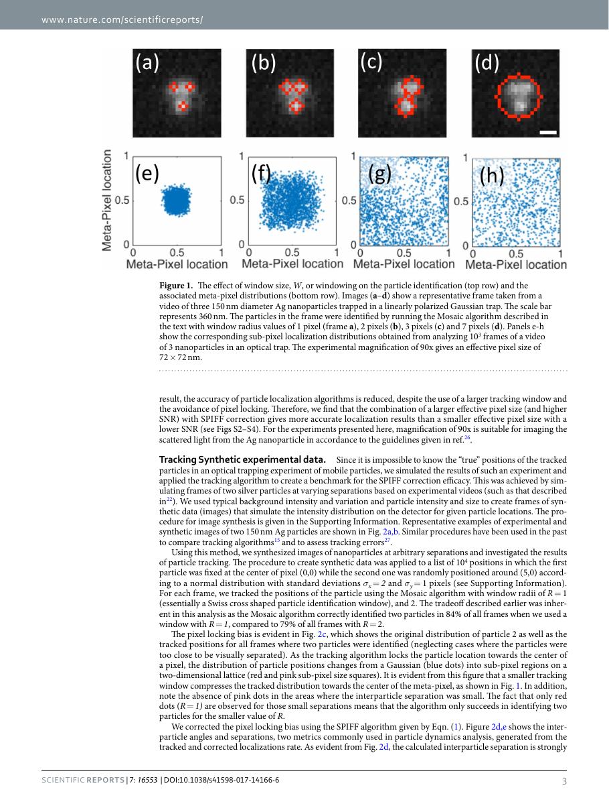
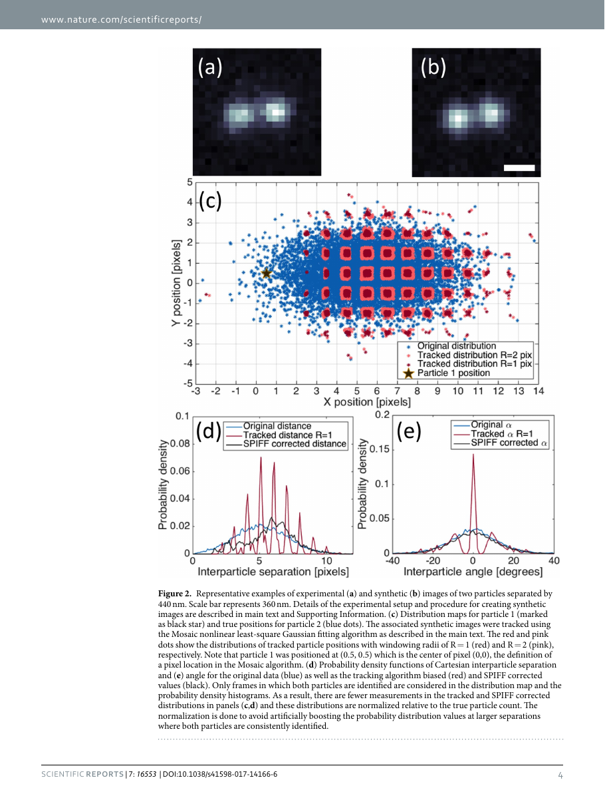
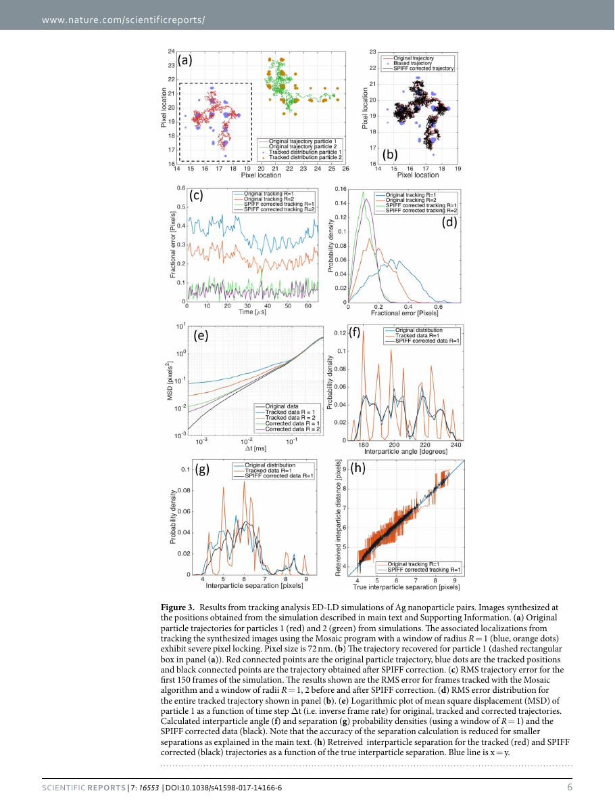

# 번역: 단일 화소 내부 채움 함수(SPIFF) 알고리즘으로 나노 입자 추적 오차를 분석하고 보정하기

- 원제: Analysis and correction of errors in nanoscale particle tracking using the Single-pixel interior filling function (SPIFF) algorithm
- 저자: Yuval Yifat, Nishant Sule, Yihan Lin, Norbert F. Scherer
- 서지: Scientific Reports 7:16553, 2017. doi:10.1038/s41598-017-14166-6 (CC BY 4.0)
- 번역 범위: 전문
  - 본문, 그림 캡션: 학술지판 [Yifat2017_SciRep_SPIFF_학술지판.pdf](Yifat2017_SciRep_SPIFF_학술지판.pdf) 기준
  - 부록(보충 자료): arXiv 1705.07789 v1 [프리프린트](Yifat2017_arXiv1705.07789v1_SPIFF_프리프린트.pdf)에 붙은 보충 자료 기준. 학술지판 본문은 그림 S2~S4, S15 같은 번호를 쓰는데, v1 보충 자료의 번호(S1~S9)와 다르다. 학술지판 보충 자료 파일은 따로 받지 않았다.
  - 참고문헌: 원문 그대로 둔다.
- 번역 메모: pixel locking은 "화소 잠김", meta-pixel은 "메타 화소"로 옮겼다. 메타 화소는 모든 위치의 소수부(화소 안 위치)를 한 화소 안에 모아 놓은 그림이다.

---

## 초록

입자 추적은 여러 과학 분야의 필수 도구다. 추적 알고리즘은 입자의 중심을 화소보다 작은 정확도로 찾는다. 그런데 입자가 검출기에서 화소 몇 개만 차지하거나, 다른 입자와 가깝거나, 배경 잡음이 있는 영상에서는 계통 오차가 생긴다. 입자의 부화소 위치가 화소 중심 쪽으로 치우친다. 이 "화소 잠김(pixel locking)" 효과는 추적 정확도를 크게 떨어뜨린다. 이 보고에서는 광학 집게로 잡은 은 나노 입자와 단일 형광 단백질의 실험 영상(그리고 모사 영상)을 추적해 이 오차가 얼마나 심한지 보인다. 입자 사이 거리, 각도, 평균 제곱 변위(MSD)의 오차가 보정용 단일 화소 내부 채움 함수(SPIFF) 알고리즘을 적용하면 크게 줄어듦을 보인다. 이 연구는 이런 오차가 어디에나 있을 수 있고, SPIFF 보정을 많은 실험 분야에 일반적으로 쓸 수 있음을 보여 준다.

## 서론

영상은 과학 연구에서 점점 더 중요해졌다. 생물학(1), 재료 과학(2,3), 천체 물리학(4)의 돌파구는 영상 장치(5)와 기법의 발전 덕분이다. 이 기법들은 분해능 한계보다 작은 물리 현상을 빠르게 잴 수 있게 한다(6~9). 광학 영상 장치에서는 대상에서 온 빛이 검출기에 모이고, 전자로 바뀌어 디지털화된다. 이것은 공간에서 위치에 따른 밝기 지도를 나타내는 2차원 배열(화소)로 저장된다(동영상이면 세 번째 차원으로 시간이 붙는다). 영상을 얻으면 수학 알고리즘으로 각 프레임의 입자 위치를 정하고 추적한다. 궤적을 만들려면 프레임 사이에서 각 입자가 누구인지 정해야 한다.

많은 입자 추적 알고리즘은 화소 밝기 분포와 장치의 점 확산 함수(PSF) 지식을 함께 써서 입자를 부화소 정확도로 찾는다. 널리 쓰는 방법은 다음과 같다.

- "Crocker-Grier" 알고리즘(10): 화소 밝기의 "질량 중심"으로 입자 위치를 추정한다.
- Raghuveer 알고리즘(11): 입자 둘레의 최대 반지름 방향 기울기를 계산해 중심을 추정한다.
- 화소 밝기 분포에 가우스 함수를 비선형으로 맞추는 방법(12,13).

알고리즘이 계속 발전하고 서로 비교한 연구(14~16)도 있지만, 정확도와 효율 문제는 여전하다. 특히 신호 대 잡음비가 낮거나, 가까운 물체가 많거나, 물체가 아주 작을 때 그렇다.

그런 문제 하나는, 대부분의 알고리즘이 정도의 차이는 있어도 추적한 물체의 부화소 위치를 계산된 화소의 중심 쪽으로 치우치게 만든다는 것이다. 이를 "화소 잠김" 또는 "화소 편향"이라 한다(17~19). 최근 Burov 등(20)은 단일 화소 내부 채움 함수(SPIFF) 알고리즘을 발표했다. 이 방법은 실제 추적을 비공개 방법으로 해서 그 내용을 모를 때도 이 편향을 보정한다. 화소 잠김 보정은 다음처럼 한다.

1. 영상 묶음을 분석해, 추적한 위치의 소수부를 "메타 화소"에 모은다.
2. 그 분포가 메타 화소 안에서 고른지 본다.
3. SPIFF 알고리즘은 이 분포를 써서, 확률 분포가 메타 화소 전체를 고르게 덮도록 늘려 참 위치를 추정한다.

추정한 입자 중심의 부화소 값 집합 {X̂_E}가 주어지면, 참 위치 X̂_T는 다음 적분을 수치로 풀어 구한다(20).

$$\hat X_T = \pm \int_0^{\hat X_E} P(\hat X_E')\, d\hat X_E' \qquad (1)$$

즉 (0, X̂_E) 구간에 든 추정값의 비율을 구한다. 여기서 P(X̂_E′)는 SPIFF 밀도 함수, 곧 집합 {X̂_E}의 확률 밀도다(참고문헌 20과 보충 자료 참고).

이 보고에서는 SPIFF 알고리즘이 왜 중요한지 보인다. 다음을 보인다.

- 화소 잠김 오차가 흔한 실험 장치에서 널리 나타난다(참고문헌 20이 다룬 콜로이드 입자 밖에서도).
- 이 오차가 실험 결과를 해친다.
- 이 오차를 찾아내고 보정하는 방법.

나노 입자와 단일 분자의 추적 오차를 연구하고, SPIFF 보정이 이 계들의 통계적, 동역학적 성질에 주는 영향을 정량으로 보인다. 흔한 실험 조건에서 편향된 추적이 얼마나 심한 오차를 만드는지 보인다. 그 조건은 입자(또는 추적 창)가 작아 검출기에서 2×2~4×4 화소를 차지하고, 표본 추출 속도가 높아 프레임당 입자 움직임이 1화소보다 작은 경우다. 또 SPIFF 알고리즘이 이 오차를 줄이고, 입자 궤적이나 MSD 같은 실험 값의 충실도를 높이는 것을 보인다. "전역" SPIFF 보정의 한계도 보이고, 보충 자료에 2단계 오차 보정 전략을 더 제시한다. 전체적으로, 넓은 범위의 실험 측정에 들어 있는 흔한 편향에서 오는 화소 잠김 오차를 쉽게 찾고 보정할 수 있음을 보인다.

## 결과

### 나노 입자 영상

나노 입자는 흔히 광학 현미경의 PSF보다 작아서, 분해능 한계보다 가까이 붙어 있을 수 있다. 그래서 위치 오차가 심할 수 있다. 그래서 가까이 붙은 나노 입자 여러 개를 추적하는 일반 문제를 살폈다. 홀로그램 광학 집게로 잡고 다루는 지름 150 nm 은(Ag) 나노 입자의 영상 자료를 분석한다. 실험 장치는 보충 자료에 있다. 광학 집게는 마이크로미터, 나노미터 크기 물체를 다룰 수 있어 넓은 분야에서 쓰였다(21,22). 입자 사이 동역학과 거동(22), 빛과 물질의 상호작용(23)을 이해하려고 쓴다. 이 실험의 목표는 포획 빔의 편광 상태에 따라 나노 입자 무리에 걸리는 힘과 토크를 이해하는 것이다. 그래서 입자 위치 추적에서 입자 사이 거리와 각도를 정확히 뽑는 것이 아주 중요하다.

그림 1은 이런 실험의 대표 프레임이다. 그림처럼 둘 이상의 입자가 전기 역학적 근접장에 묶일 수 있다. 즉 중심 간 거리가 약 200 nm로 떨어져 있어, 검출기에서 각 입자의 상이 겹쳐 추적이 어렵다. 나노 입자의 크기와 가까움 때문에, 추적에 쓰는 창 함수는 폭이 몇 화소뿐이어야 한다. 그래야 입자 2개를 하나로 잘못 알아보지 않는다. 이렇게 작은 창은 표본 부족 오차를 만들고 강한 화소 잠김을 일으킨다(20). 화소 잠김을 줄이거나 피하려면, (예상되는) 가우스 밝기 분포에 맞출 때 쓰는 추적 창 W를 키울 수 있다. 입자가 PSF보다 크거나 멀리 떨어져 있으면 실제로 효과가 있다. 그러나 작은 입자가 가까이 있으면 상이 겹친다. 그러면 입자 중심 위치가 필연적으로 틀리고, 잘못 알아보는 입자 비율이 늘어난다. 잘못 알아보기(그리고 덜 세기)는 SPIFF로 보정할 수 있는 오차가 아니다. 대신 사전 정보로 여러 입자를 모형화하는 더 특화된 방법을 쓸 수 있다(24). 여기서는 화소 잠김 오차와 SPIFF 보정만 다룬다.



추적 창 크기와 잘못 알아보기 사이의 맞바꿈을 그림 1에 보였다. 은 나노 입자 실험 동영상에서 1000 프레임을 ImageJ용 Mosaic 추적 소프트웨어(25)로 추적했다. 이 소프트웨어는 중심을 정할 때 비선형 최소 제곱 가우스 맞춤을 쓴다. 그림 1에서는 반지름 R = 1, 2, 3, 7 화소인 "원형" 창을 썼다(창 크기는 W = 2R + 1). 그림의 1행(a~d)은 창 크기별 대표 위치 찾기 영상이다. 2행(e~h)은 그에 대응하는 메타 화소 안 부화소 위치 분포다. 또 창 반지름별로 찾은 입자 수를 세어, 입자 3개를 찾은 프레임 비율을 계산했다. 각각 93%, 83%, 58%, 33%였다. 그림 1e, f에서 밀도가 메타 화소 중심 쪽으로 압축된 것은 작은 창이 만든 화소 잠김 오차의 표지다. 즉 나이퀴스트 표본 추출 오차, 또는 편향이다(20).

작은 창을 쓰면 매 프레임에서 거의 모든 입자를 찾아 추적한다. 그러나 화소 잠김 오차가 뚜렷하고, 입자 추적에서 얻는 모든 지표(거리, 각도, MSD 등)가 편향된다. 창이 크면 오차는 덜 뚜렷하지만, 입자를 잘못 알아보고(그리고 놓치는) 대가를 치른다. 극단까지 밀고 가면 그림 1d, h의 결과가 된다. 창이 세 입자를 모두 품을 만큼 크면, 추적 알고리즘은 셋을 하나로 다루고 화소 잠김 오차는 사라진다. 그러나 추적한 "입자"는 실제 실험 결과와 거의 관계가 없다.

광학계의 배율은 검출기에서 입자 크기(입자가 차지하는 화소 수)를 바로 정한다. 배율이 장치의 실효 화소 크기를 정하기 때문이다. 그래서 배율을 높이면 실효 화소가 작아지고 입자 상이 커져, 추적 창을 키우고 화소 잠김 문제를 피할 수 있다고 생각할 수 있다. 그러나 배율을 높이면 대상에서 온 광자가 더 많은 화소에 퍼진다. 그러면 장치의 신호 대 잡음비(SNR)가 떨어진다. 고속 동영상이나 단일 형광 입자 영상처럼 광자가 부족한 응용에서 특히 문제다. 여러 배율에서 영상 장치와 SPIFF 보정의 거동을 분석한 것은 보충 자료 2절에 있다. 거기서 배율 60x, 90x, 150x, 225x의 SNR을 비교했다. 배율이 클수록 SNR이 떨어졌다. 그 결과 더 큰 추적 창을 쓰고 화소 잠김을 피해도 입자 위치 찾기 알고리즘의 정확도는 떨어진다. 그래서 더 큰 실효 화소(그리고 더 높은 SNR)에 SPIFF 보정을 더한 조합이, 더 작은 실효 화소와 낮은 SNR보다 더 정확한 위치를 준다는 것을 알았다(그림 S2~S4 참고). 여기 실험에서는 참고문헌 26의 지침에 따라 은 나노 입자의 산란광을 찍는 데 90x 배율이 알맞다.

그림 1 캡션. 창 크기 W(창 씌우기)가 입자 찾기(위 행)와 그에 따른 메타 화소 분포(아래 행)에 주는 영향. 영상 (a~d)는 선 편광 가우스 포획 안에 잡힌 지름 150 nm 은 나노 입자 3개 동영상의 대표 프레임이다. 축척 막대는 360 nm다. 프레임의 입자는 본문에 설명한 Mosaic 알고리즘으로 찾았다. 창 반지름은 1화소(a), 2화소(b), 3화소(c), 7화소(d)다. (e~h)는 광학 포획 안 나노 입자 3개 동영상의 10³ 프레임을 분석해 얻은 부화소 위치 분포다. 실험 배율 90x에서 실효 화소 크기는 72 × 72 nm다.

### 합성 실험 자료 추적

움직이는 입자의 광학 포획 실험에서는 추적한 입자의 "참" 위치를 알 수 없다. 그래서 이런 실험의 결과를 모사하고 추적 알고리즘을 적용해, SPIFF 보정 효과의 기준을 만들었다. 실험 동영상(예: 참고문헌 22)을 바탕으로, 거리를 바꿔 가며 은 입자 2개의 프레임을 모사했다. 일반적인 배경 밝기와 그 변동, 입자 밝기와 크기를 써서 합성 자료(영상)를 만들었다. 이 영상은 주어진 입자 위치에서 검출기의 밝기 분포를 모사한다. 영상 합성 절차는 보충 자료에 있다. 150 nm 은 입자 2개의 실험 영상과 합성 영상 예를 그림 2a, b에 보였다. 비슷한 절차가 예전에도 추적 알고리즘 비교(15)와 추적 오차 평가(27)에 쓰였다.

이 방법으로 임의 거리에 놓인 나노 입자 영상을 합성하고 입자 추적 결과를 살폈다. 합성 절차를 10⁴개 위치 목록에 적용했다. 첫 입자는 화소 (0,0)의 중심에 고정했다. 둘째 입자는 (5,0) 둘레에 정규 분포(표준 편차 σx = 2, σy = 1 화소)로 무작위로 놓았다(보충 자료 참고). 각 프레임에서 Mosaic 알고리즘으로 입자 위치를 추적했다. 창 반지름은 R = 1(사실상 스위스 십자 모양 찾기 창)과 2였다. 앞에서 말한 맞바꿈이 이 분석에도 들어 있다. R = 1 창에서 Mosaic는 전체 프레임의 84%에서 입자 2개를 바르게 찾았고, R = 2에서는 79%였다.



화소 잠김 편향은 그림 2c에서 뚜렷하다. 그림 2c는 입자 2의 원래 분포와, 입자 2개를 찾은 모든 프레임의 추적 위치를 보여 준다(입자가 너무 가까워 눈으로 나눌 수 없는 경우는 뺐다). 추적 알고리즘이 입자 위치를 화소 중심 쪽으로 잠그면서, 입자 위치 분포가 가우스(파란 점)에서 2차원 격자 위의 부화소 영역(빨강, 분홍의 부화소 크기 네모)으로 바뀐다. 이 그림에서 작은 추적 창이 추적 분포를 메타 화소 중심 쪽으로 압축한다는 것이 분명하다. 그림 1과 같다. 또 입자 사이 거리가 작은 곳에 분홍 점이 없다는 것에 주목하자. 작은 거리에서 빨간 점(R = 1)만 보인다는 것은, 작은 R에서만 알고리즘이 입자 2개를 찾는 데 성공한다는 뜻이다.

화소 잠김 편향을 식 (1)의 SPIFF 알고리즘으로 보정했다. 그림 2d, e는 추적한 위치와 보정한 위치에서 만든 입자 사이 각도와 거리다. 이 둘은 입자 동역학 분석에서 흔히 쓰는 지표다. 그림 2d에서 보듯, 계산한 입자 사이 거리는 나이퀴스트 표본 추출 오차 때문에 작은 창 크기가 만든 편향에 크게 영향을 받는다. 추적 위치가 화소 중심에 잠기므로, 계산한 직교 좌표 거리는 불연속이 되어 빨간 뾰족 봉우리로 나타난다. 패널의 검은 분포인 SPIFF 보정 위치는 화소 잠김 오차를 줄인다. 보정은 거리가 클 때가 작을 때보다 잘 된다. 한 가지 이유는 거리가 작으면 밝기 분포가 더 많이 겹쳐 중심 결정 정확도가 떨어지기 때문이다(20). 또 작은 거리에서는 점이 적어서, 식 (1)을 풀어 얻은 보정이 이 점들을 덜 대표하고 기울어진다. 이 문제는 보충 자료에서 다룬다.

계산한 입자 사이 각도(그림 2e의 빨간 분포)는 또 다른 두드러진 오차를 보인다. ±5° 둘레 각도는 화소 잠김 위치의 불연속 때문에 "금지"된다. 추적 결과에 SPIFF 알고리즘을 적용하면 이 각도 오차가 보정된다. 원래 각도와 SPIFF 보정 각도를 나타내는 파란 분포와 검은 분포를 비교하면 보정이 분명하다. 각도 분포의 개선은 거리 분포의 개선보다 낫다. SPIFF 보정이 모든 불연속을 "채워", 원래 추적 분포에서 빠진 각도 값을 되찾기 때문이다. 반면 SPIFF 보정은 입자 사이 거리 분포를 개선하지만, 입자가 너무 가까워 따로 찾지 못한 경우를 되찾을 수는 없다. 그래서 입자 사이 거리가 약 5화소(약 360 nm)보다 작은 프레임은 대부분 찾지 못하고, 그림 2d 분포에 나타나지 않는다. 여기서 분석한 지표는 입자 2개를 추적해야 하지만, SPIFF 알고리즘은 입자 2개 실험에만 쓰는 것이 아니다. 이 알고리즘은 추적한 입자 각각의 위치를 따로 보정하므로, 입자가 몇 개든 결과를 개선할 수 있다. 뒤에서 단일 입자 궤적(MSD의 경우, "모사 입자 궤적 분석" 절)과 입자 2개 넘는 경우(입자 3개, "실험 자료의 SPIFF 보정" 절)로 보인다.

그림 2 캡션. 440 nm 떨어진 입자 2개의 실험 영상(a)과 합성 영상(b) 대표 예. 축척 막대는 360 nm다. 실험 장치와 합성 영상 만드는 절차는 본문과 보충 자료에 있다. (c) 입자 1(검은 별)과 입자 2의 참 위치(파란 점) 분포 지도. 대응하는 합성 영상을 본문에 설명한 Mosaic 비선형 최소 제곱 가우스 맞춤 알고리즘으로 추적했다. 빨간 점과 분홍 점은 창 반지름 R = 1(빨강), R = 2(분홍)로 추적한 입자 위치의 분포다. 입자 1은 (0.5, 0.5)에 놓였다. 이것이 Mosaic 알고리즘에서 화소 위치의 정의인 화소 (0,0)의 중심이다. (d) 직교 좌표 입자 사이 거리와 (e) 각도의 확률 밀도 함수. 원래 자료(파랑), 추적 알고리즘으로 편향된 값(빨강), SPIFF 보정 값(검정)이다. 분포 지도와 확률 밀도 막대그래프에는 두 입자를 모두 찾은 프레임만 넣었다. 그래서 (c, d)의 추적 분포와 SPIFF 보정 분포에는 측정이 더 적고, 이 분포는 참 입자 수에 대해 정규화했다. 두 입자를 늘 찾는 큰 거리에서 확률 분포 값이 인위적으로 커지지 않게 하려는 정규화다.

### 모사 입자 궤적 분석

다음으로, 물리적으로 현실적인 모사의 결과를 분석한다. 이 모사는 유한 차분 시간 영역(FDTD) 전기 역학 모사와 랑주뱅 동역학을 합친 것이다(ED-LD라 부른다). ED-LD 모사의 입자 궤적 자료를 쓰면, 입자 위치의 확률 분포 P(X̂_E′)가 실험 결과와 맞을 때 편향과 SPIFF 보정을 분석할 수 있다(28). ED-LD 모사 자료로 입자의 MSD도 살필 수 있다. 앞서 기술한 방법과 파라미터(28)로, x축으로 선 편광된 집속 가우스 빔에 잡힌 지름 150 nm 은 입자 2개의 궤적을 모사했다. 모사 위치에서 입자 영상을 합성하고 추적했다. 그 결과 궤적은 시간 간격 0.5 μs의 3,200 프레임이다. 이 시간 간격은 실험으로 얻을 수 있는 것보다 훨씬 작다. 그래도 프레임당 입자 변위가 1화소보다 작을 때 추적 알고리즘과 SPIFF 보정의 거동을 재는 데 쓸모가 있다.

그림 3은 전기 역학적으로 상호작용하는 입자 2개의 궤적과, 추적과 SPIFF 보정의 효과 분석을 보여 준다(동영상은 보충 자료). 그림 3b는 왼쪽 입자의 원래 궤적(빨강)과 추적 위치(파란 점)다. 추적 위치는 화소 중심 쪽으로 치우쳐 있다(즉 입자 위치가 몇몇 화소의 중심에 묶인다). 편향된 분포에서 실제 입자 동역학 정보가 많이 사라진 것이 분명하다. 반면 그림 3b의 SPIFF 보정 궤적(검정)은 원래 입자 경로를 높은 충실도로 재구성한다. SPIFF 보정 자료의 충실도는 그림 3c, d에서 더 드러난다. 여기서 RMS 오차는 입자의 참 위치와 추적 위치 사이 직교 좌표 차이의 제곱근으로 정의하며, SPIFF 보정 전(파랑, 빨강)과 후(초록, 보라)를 보였다. 그림 3c는 모사의 처음 150 프레임 동안 이 오차의 시간 변화를, 그림 3d는 전체 모사에서 그 확률 밀도를 보여 준다. 추적 자료(Mosaic 프로그램)의 평균 오차는 창 반지름 R = 1, 2에서 각각 0.3, 0.19 화소였고 표준 편차는 0.13, 0.09였다. SPIFF 보정 알고리즘을 적용한 뒤에는 두 창 크기(R = 1, 2) 모두 평균 0.11, 표준 편차 0.05 화소로 나아졌다.



SPIFF 보정 알고리즘은 입자의 평균 제곱 변위(MSD) 같은 물리적으로 중요한 성질을 더 정확히 재게 한다. MSD는 다음과 같이 정의한다.

$$\mathrm{MSD}(\tau) = \langle (x(t+\tau) - x(\tau))^2 \rangle \qquad (2)$$

여기서 x(τ)는 시간 τ의 입자 위치, x(t + τ)는 시간 t 뒤의 위치다. 이 척도는 입자 추적 알고리즘과 함께 입자 운동의 성질을 확인하는 데 쓰인다. 생물 물리학(29)과 유체 역학(30)처럼 확산하거나 구동되는 입자의 통계 역학적 성질이 중요한 넓은 분야에서 쓴다. SPIFF 보정 알고리즘의 힘은 그림 3e에서 분명하다. SPIFF 보정 MSD의 오차는 추적 자료보다 거의 한 자릿수 줄어, 측정 결과가 원래 궤적과 동역학에 더 충실해진다. 예전에 보인 것처럼(17,27), 짧은 지연 시간의 MSD 계산은 유한 노출 시간 때문에 입자가 번지는 것 같은 원인에서 오는 오차에 약하다. 참고문헌 27이 보고한 겉보기 초확산 거동은, 그림 3e와 Burov 등(20)의 연구에서 보이는 겉보기 아확산 거동과 반대라는 점은 짚어 둘 만하다.

입자 사이 거리와 각도 분석을 그림 3f, g에 보였다. 그림 2와 비슷하게, 확률 분포의 불연속에서 오는 큰 오차가 보이고 SPIFF 보정이 이를 줄인다. 보정은 입자 사이 거리가 클 때(5화소 초과)가 작을 때보다 잘 된다. 앞서 설명했듯, 거리가 작으면 추적 알고리즘이 입자 2개를 찾기 어렵고, 거리가 줄수록 메타 화소 분포가 화소 중심에서 점점 더 기울기 때문이다. 이는 그림 3h에서 분명하다. 그림 3h는 참 입자 사이 거리(검은 연결 점)와 추적 자료(빨강)와 SPIFF 보정 자료(검정, R = 1 창)에서 계산한 거리의 관계를 보여 준다. 패널에서 보듯, 계산한 거리의 오차는 일정하지 않고 참 거리에 따라 바뀐다. 이 거리 의존 오차를 써서 거리 계산 정확도를 더 높일 수 있다. 간단한 방법은 그림 3h의 오차 곡선을 3차 함수로 맞추고, 그 맞춤을 2단계 보정으로 써서 SPIFF 보정 거리를 개선하는 것이다. 이 생각은 보충 자료에서 자세히 다루며, 특히 거리가 작을 때 거리 결과의 정확도를 더 높임을 보인다.

그림 3 캡션. 은 나노 입자 쌍의 ED-LD 모사에 대한 추적 분석 결과. 본문과 보충 자료에 설명한 모사에서 얻은 위치로 영상을 합성했다. (a) 모사의 원래 입자 궤적, 입자 1(빨강)과 입자 2(초록). 반지름 R = 1 창의 Mosaic 프로그램으로 합성 영상을 추적한 위치(파랑, 주황 점)는 심한 화소 잠김을 보인다. 화소 크기는 72 nm다. (b) 입자 1(패널 (a)의 점선 네모)의 되찾은 궤적. 빨간 연결 점은 원래 궤적, 파란 점은 추적 위치, 검은 연결 점은 SPIFF 보정 뒤 궤적이다. (c) 모사의 처음 150 프레임의 RMS 궤적 오차. Mosaic 알고리즘과 반지름 R = 1, 2 창으로 추적한 프레임의 SPIFF 보정 전후 RMS 오차다. (d) 패널 (b)의 전체 추적 궤적에 대한 RMS 오차 분포. (e) 원래, 추적, 보정 궤적에서 입자 1의 MSD를 시간 간격 Δt(프레임률의 역수)에 대해 로그로 그린 것. 계산한 입자 사이 각도(f)와 거리(g)의 확률 밀도(R = 1 창)와 SPIFF 보정 자료(검정). 본문에서 설명했듯 거리가 작을수록 거리 계산 정확도가 떨어진다. (h) 참 입자 사이 거리에 대해 추적(빨강) 궤적과 SPIFF 보정(검정) 궤적에서 되찾은 입자 사이 거리. 파란 선은 x = y다.

### 실험 자료의 SPIFF 보정

모사 자료에서 얻은 이해를 가지고, 선 편광 가우스 포획에 은 입자 3개가 잡힌 실험 자료에 SPIFF 보정 알고리즘을 적용했다. 포획이 단단하고 입자 사이 전자기 상호작용이 있어서, 두 입자는 집속 빔 중심 근처에서 근접장 거리로 잡혔다. 중심 간 거리는 약 250 nm(약 3~4 화소)였다. 셋째 입자는 광학 결합 거리(22,31,32) 근처에 잡혔고 중심 간 거리는 약 470 nm(약 6~7 화소)였다. 입자들은 같은 레이저 빔으로 잡혔다. 레이저 상대 세기(33,34)나 위치의 흔들림(레이저나 광학 장치 변화 때문, 35)이 입자를 함께 움직이게 할 수 있다. 그래도 이것이 입자 추적과 SPIFF 보정에 영향을 주지는 않아야 한다. 1000FPS로 찍고 780 프레임을 분석했다. 세 입자를 모두 찾은 프레임만 썼다(동영상 S2 참고). 그림 4는 동영상의 대표 프레임과, R = 1 창의 Mosaic 프로그램으로 얻은 입자 위치 분포를 보여 준다. 추적한 입자 위치 분포는 큰 화소 잠김을 보인다.

그림 4b, c는 앞의 분석에서 작은 거리의 입자에 보인 것과 같은 오차를 보인다. 입자 사이 각도 θ12의 분포(자홍 곡선)는 그림 2e, 3g의 모사 자료와 비슷한 각도 모양을 보인다. 가까운 입자에서 일부 각도가 빠지는 것은 전적으로 화소 잠김의 결과다. SPIFF 보정은 브라운 운동에 맞는 연속 각도 분포를 되찾는다. 모사에서 본 오차는 입자 사이 거리 d12에서도 보인다. 거리가 더 큰 입자(d13, 청록 곡선)에서는 각도와 거리 오차 분포가 덜 두드러지고 SPIFF 보정도 약하다. 그러나 그림 4a처럼 입자 3에도 화소 잠김은 있다. 시계열이 비교적 짧은데도 SPIFF 보정이 잘 되는 것은, 메타 화소가 세 입자 모두의 메타 화소 자료를 합쳐 약 3000개 자료점으로 이뤄졌기 때문이다. 보충 자료에서는 더 긴 실험 동영상을 분석해 더 촘촘한 메타 화소를 얻고, 널리 쓰는 여러 알고리즘의 추적 결과를 비교한다.

그림 4 캡션. 선 편광 가우스 포획에 잡힌 입자 3개의 실험 동영상 분석. 화소 크기는 72 nm다. (a) 세 입자의 SPIFF 보정 전후 추적 위치. 빨강, 초록, 파랑으로 표시한 입자를 각각 입자 1, 2, 3으로 정의한다. 삽입 그림은 동영상의 대표 프레임이다(전체 동영상은 보충 자료, 축척 막대 360 nm). 세 입자의 입자 사이 거리(b)와 각도(c). 옅은 연결 점과 짙은 연결 점은 각각 원래 값과 추적 후 SPIFF 보정 값이다. SPIFF 보정 전 분포 모양이 근접장으로 묶인 입자(자홍 연결 점, d12)와 광학적으로 묶인 입자(청록, d31) 사이에 다르다는 데 주목하자.

### 단일 분자 실험의 화소 잠김 오차와 SPIFF 보정

단일 분자의 위치와 동역학을 정하는 일은 생물 물리학과 세포 생물학의 필수 실험 방법이 됐다(36,37). 단일 분자 영상은 크기가 작고, SNR이 낮거나 중간이며(즉 계수가 낮거나 배경 잡음이 크며), 붐빌 수 있다. 이 모두가 화소 잠김으로 나타나는 추적 오차를 만들 수 있다. Lin 등(38)이 발표한 자료를 다시 살폈다. 그 연구에서는 단백질에 형광체를 붙이고, 여러 흐름 조건에서 흐름으로 늘인 이중 가닥 DNA를 따라 움직이는 모습을 찍었다. 논문의 MSD 값은 DiaTrack 3.0(39) 소프트웨어의 가우스 맞춤 방법으로 동영상을 추적해 얻었다.

보고된 입자 궤적을 다시 분석했고, 궤적 자료에서 화소 잠김을 찾았다(그림 5a). 놀랍게도 SPIFF 보정은 결과를 개선하지 않았다. 이 무효 결과는 낮은 프레임률(20FPS)과, 그에 따라 50 msec 동안 단일 분자가 크게 움직인 탓으로 본다. 즉 얻은 MSD 값(그림 5b)은 화소 잠김 오차(그림 5c)보다 적어도 두 자릿수 크다.

이 해석을 시험하려고, Lin 등(38)의 수송 성질을 바탕으로 합성 입자 궤적을 만들었다. 이를 써서 더 높은 프레임률(2000 FPS)에서 입자 위치와 영상을 만들고 Mosaic로 추적했다(보충 자료 참고). 나노 입자 결과와 비슷하게, 추적 궤적과 MSD 값에서 참(원래) 값 대비 오차가 보인다. 그림 5d~f에서 보듯 이 오차는 SPIFF 보정으로 줄고, 개선은 반지름 R = 1 창에서 가장 크다. 원래 저 프레임률 동영상에서 SPIFF 보정이 MSD 오차를 줄이지 못한 것은, 입자 운동이 효과적인 SPIFF 보정을 하기에는 표본 부족이었기 때문으로 이해할 수 있다. 즉 연속 프레임 사이 입자 변위가 부화소 SPIFF 보정의 크기보다 훨씬 컸다. 합성 자료의 프레임률을 낮췄을 때 이것을 확인했다(보충 자료 그림 S15와 S7절).

그림 5 캡션. 본문에 설명한, 흐름으로 늘인 ds-DNA를 따라 움직이는 단일 분자의 추적 자료 분석. (a) 추적한 단일 분자 위치의 x 좌표로 얻은 부화소 위치 분포. 분포가 고르지 않은 것이 화소 잠김 오차다. (b) Lin 등(38)이 보고한 궤적에 바탕한 원래 MSD와 SPIFF 보정 MSD. 삽입 그림은 대표 실험 영상이다. (c) 시간 차에 따른 원래 MSD와 SPIFF 보정 MSD의 차. 뚜렷한 경향이 없고, 차가 MSD 값보다 두 자릿수 작다는 데 주목하자. (d) 약한 밝기 필터를 넣은 합성 영상에서 얻은 원래 궤적(검은 연결 점), 추적 자료(황갈 점선), SPIFF 보정 결과(황갈 실선). 합성 자료 생성과 필터 처리는 보충 자료에 있다. (e) 모사한 고속 프레임 궤적으로 합성한 영상을 추적해 얻은 MSD. 비교를 위해 분홍 별은 패널 (a)에 보인 처음 두 실험 MSD 값이다. 삽입 그림은 대표 합성 영상이다(축척 막대 400 nm). (f) 반지름(R = 1, 2, 3)별 합성 자료의 원래 MSD와 SPIFF 보정 MSD의 차. 차가 늘 양수다. 즉 MSD 오차가 일관되게 줄고, 차의 값이 패널 (c)보다 훨씬 크다.

## 논의와 결론

나노 입자, 양자점, 형광 단일 분자 같은 나노 크기 물체의 추적에 들어 있는 화소 잠김 오차를 보였다. 이 오차를 SPIFF 알고리즘으로 보정할 수 있고, 그 결과 계산 값이 참값에 훨씬 충실해짐을 보였다. 나노 크기 물체의 영상과 추적은 오늘날 연구에서 흔하므로, 이 연구는 위치 찾기 연구에서 특히 알아채기 어려운 추적 오차가 어디에나 있음을 분명히 한다. 메타 화소 SPIFF 분포를 만들고 보정하는 것은 이런 오차를 찾고 보정하는 일반적이고 간단한 방법이다.

더 넓게 보면, 입자 추적 오차의 SPIFF 보정은 실험 자료에서 나이퀴스트 표본 추출 조건이 시간과 공간 모두에서 깨졌을 때 특히 값지다. 추적 입자가 작거나(또는 영상이 붐비거나), 표본 추출 속도가 충분히 커서 프레임 사이 입자 변위가 부화소일 때, SPIFF 보정은 측정(위치 찾기) 정확도를 크게 높인다. 회절 한계와 레일리 분해능 기준, 그리고 광자가 제한된 광원을 더 많은 화소에 퍼뜨릴 때의 정밀도와 정확도 맞바꿈 때문에, 배율을 높이는 것만으로는 문제를 풀 수 없다(보충 그림 S2~S4). 자료가 공간에서만 깨졌다면(즉 입자가 작거나 영상이 붐비지만 입자 운동이 부화소가 아니면), SPIFF 알고리즘은 입자 사이 거리나 각도 같은 공간 지표의 정확도는 높이지만, MSD 같은 시간 의존 척도의 정확도는 바꾸지 않는다. 이는 그림 5b, c에서 보였다. 거기서 형광 단백질의 평균 변위는 1화소보다 컸고, 그래서 SPIFF 알고리즘의 부화소 개선이 MSD를 크게 개선하지 못했다. 끝으로, 영상 자료가 시간에서만 깨졌다면, 즉 입자가 크거나 멀리 떨어져 있지만 프레임률이 부화소 동역학을 잡기에 모자라면, 보정할 화소 잠김이 없으므로 SPIFF 알고리즘은 공간과 시간 어느 쪽에서도 정확도를 더 높이지 못한다(보충 그림 S15).

따라서 연구자들이 영상 기법의 분해능과 속도를 계속 높이고(40~43) 더 높은 정확도를 요구할수록, 이 분석과 SPIFF 보정의 중요성은 커질 것이다.

## 참고문헌 (원문 그대로)

1. Dragovic, R. A. et al. Sizing and phenotyping of cellular vesicles using Nanoparticle Tracking Analysis. Nanomedicine Nanotechnology, Biol. Med. 7, 780–788 (2011).
2. Weeks, E. R. Three-Dimensional Direct Imaging of Structural Relaxation Near the Colloidal Glass Transition. Science 287, 627–631 (2000).
3. Wang, J., Chen-Wiegart, Y. K. & Wang, J. In operando tracking phase transformation evolution of lithium iron phosphate with hard X-ray microscopy. Nat. Commun. 5, 1–10 (2014).
4. Jiang, J., Zhang, G., Wei, X. & Li, X. Rapid star tracking algorithm for star sensor. IEEE Aerosp. Electron. Syst. Mag. 24, 23–33 (2009).
5. Chung, K., Crane, M. M. & Lu, H. Automated on-chip rapid microscopy, phenotyping and sorting of C. elegans. Nat. Methods 5, 637–643 (2008).
6. Rust, M. J., Bates, M. & Zhuang, X. STORM. Nat Meth 3, 793–796 (2006).
7. Willig, K. I., Rizzoli, S. O., Westphal, V., Jahn, R. & Hell, S. W. STED microscopy reveals that synaptotagmin remains clustered after synaptic vesicle exocytosis. Nature 440, 935–939 (2006).
8. Betzig, E. et al. Imaging intracellular fluorescent proteins at nanometer resolution. Science 313, 1642–5 (2006).
9. Small, A. R. & Parthasarathy, R. Superresolution Localization Methods. Annu. Rev. Phys. Chem. 65, 107–125 (2014).
10. Crocker, J. & Grier, D. G. Methods of Digital Video Microscopy for Colloidal Studies. J. Colloid Interface Sci. 179, 298–310 (1996).
11. Parthasarathy, R. Rapid, accurate particle tracking by calculation of radial symmetry centers. Nat. Methods 9, 724–726 (2012).
12. Yildiz, A., Tomishige, M., Vale, R. D. & Selvin, P. R. Kinesin walks hand-over-hand. Science 303, 676–8 (2004).
13. Qu, X., Wu, D., Mets, L. & Scherer, N. F. Nanometer-localized multiple single-molecule fluorescence microscopy. Proc. Natl. Acad. Sci. USA 101, 11298–303 (2004).
14. Chenouard, N. et al. Objective comparison of particle tracking methods. Nat. Methods 11, 281–9 (2014).
15. Cheezum, M. K., Walker, W. F. & Guilford, W. H. Quantitative Comparison of Algorithms for Tracking Single Fluorescent Particles. Biophys. J. 81, 2378–2388 (2001).
16. Meijering, E., Dzyubachyk, O. & Smal, I. In Methods in Enzymology 504, 183–200 (2012).
17. Crocker, J. C. & Hoffman, B. D. M.-P. Tracking and Two-Point Microrheology in Cells. Methods in Cell Biology 83, 141–178 (2007).
18. Feng, Y., Goree, J. & Liu, B. Accurate particle position measurement from images. Rev. Sci. Instrum. 78 (2007).
19. Gao, Y. & Kilfoil, M. L. Accurate detection and complete tracking of large populations of features in three dimensions. Opt. Express 17, 4685 (2009).
20. Burov, S. et al. Single-pixel interior filling function approach for detecting and correcting errors in particle tracking. Proc. Natl. Acad. Sci. 201619104, doi:10.1073/pnas.1619104114 (2016).
21. Grier, D. G. A revolution in optical manipulation. Nature 424, 810–816 (2003).
22. Yan, Z., Gray, S. K. & Scherer, N. F. Potential energy surfaces and reaction pathways for light-mediated self-organization of metal nanoparticle clusters. Nat. Commun. 5, 3751 (2014).
23. Schwarzkopf, A., Sapiro, R. E. & Raithel, G. Imaging spatial correlations of Rydberg excitations in cold atom clouds. Phys. Rev. Lett. 107 (2011).
24. van der Wel, C. & Kraft, D. J. Automated tracking of colloidal clusters with sub-pixel accuracy and precision. J. Phys. Condens. Mat. 29, 44001 (2017).
25. Sbalzarini, I. F. & Koumoutsakos, P. Feature point tracking and trajectory analysis for video imaging in cell biology. J. Struct. Biol. 151, 182–195 (2005).
26. Pawley, J. B. In Handbook of biological confocal microscopy 59–79 (Springer, 2006).
27. Savin, T. & Doyle, P. S. Static and dynamic errors in particle tracking microrheology. Biophys. J. 88, 623–638 (2005).
28. Sule, N. et al. An electrodynamics-Langevin dynamics(ED-LD) approach to simulate metal nanoparticle interactions and motion. Opt. Express 23, 29978 (2015).
29. Jin, H., Heller, D. A. & Strano, M. S. Single-particle tracking of endocytosis and exocytosis of single-walled carbon nanotubes in NIH-3T3 cells. Nano Lett. 8, 1577–1585 (2008).
30. Adrian, R. J. Twenty years of particle image velocimetry. in Experiments in Fluids 39, 159–169 (Springer-Verlag, 2005).
31. Dholakia, K. & Zemánek, P. Colloquium: Gripped by light: Optical binding. Rev. Mod. Phys. 82, 1767–1791 (2010).
32. Yan, Z. et al. Guiding spatial arrangements of silver nanoparticles by optical binding interactions in shaped light fields. ACS Nano 7, 1790–1802 (2013).
33. Kuksenkov, D. V., Temkin, H. & Swirhun, S. Polarization instability and relative intensity noise in vertical-cavity surface-emitting lasers. Appl. Phys. Lett. 67, 2141–2143 (1995).
34. Yifat, Y. & Scheuer, J. Dynamical Slowing and trapping of light in coupled semiconductor laser arrays. Opt. Express 17, 17530–5 (2009).
35. Persson, M. et al. Minimizing intensity fluctuations in dynamic holographic optical tweezers by restricted phase change. Opt. Express 18, 11250–11263 (2010).
36. Jaqaman, K. et al. Robust single-particle tracking in live-cell time-lapse sequences. Nat. Methods 5, 695–702 (2008).
37. Wirtz, D. Particle-tracking microrheology of living cells: principles and applications. Annu. Rev. Biophys. 38, 301–26 (2009).
38. Lin, Y. et al. Using the bias from flow to elucidate single DNA repair protein sliding and interactions with DNA. Biophys. J. 96, 1911–1917 (2009).
39. Vallotton, P. & Olivier, S. Tri-track: Free Software for Large-Scale Particle Tracking. Microsc. Microanal. 19, 451–460 (2013).
40. Pertsinidis, A., Zhang, Y. & Chu, S. Subnanometre single-molecule localization, registration and distance measurements. Nature 466, 647–651 (2010).
41. Small, A. & Stahlheber, S. Fluorophore localization algorithms for super-resolution microscopy. Nat. Methods 11, 267–79 (2014).
42. Göttfert, F. et al. Strong signal increase in STED fluorescence microscopy by imaging regions of subdiffraction extent. Proc. Natl. Acad. Sci. 114, 2125–2130 (2017).
43. Balzarotti, F. et al. Nanometer resolution imaging and tracking of fluorescent molecules with minimal photon fluxes. Science 355, 606–612 (2017).

## 사사, 저자 기여, 추가 정보

사사. Aaron Dinner 교수의 자극이 된 의견에 감사한다. 저자들은 국방부 연구 공학 차관보실 기초 연구국이 후원하고 해군 연구국(ONR)이 과제 N00014-16-1-2502로 지원한 Vannevar Bush Faculty Fellowship 프로그램의 지원에 감사한다. ED-LD 모사는 미국 에너지부 과학국 사용자 시설인 Center for Nanoscale Materials에서 계약 DE-AC02-06CH11357로 수행했다.

저자 기여. N.F.S.와 Y.Y.가 연구를 설계했다. Y.Y.가 SPIFF 보정 절차와 프레임 합성 절차를 개발했고, 이를 써서 자료를 만들고 분석했다. N.S.가 ED-LD 모사를 개발하고 포획 입자 궤적을 제공했다. Y.L.이 단일 형광 분자 실험을 하고 추가 추적 분석용 자료를 제공했다. Y.Y.와 N.F.S.가 논문을 썼고, 모든 저자가 최종 원고를 검토하고 승인했다.

추가 정보. 보충 자료는 https://doi.org/10.1038/s41598-017-14166-6 에 있다. 이해 충돌: 저자들은 이해 충돌이 없다고 밝힌다. 이 글은 크리에이티브 커먼즈 저작자표시 4.0 국제 라이선스(CC BY 4.0)로 공개됐다.

---

# 부록: 보충 자료 (arXiv 1705.07789 v1에 붙은 판)

학술지판 보충 자료와 절, 그림 번호가 다를 수 있다. 예를 들어 학술지판 본문이 말하는 배율 비교(그림 S2~S4)와 그림 S15는 아래 v1 판에 없다.

## 1. 나노 입자 포획 실험 장치

본문의 150 nm 은 입자는 현미경 대물렌즈로 집속한 선 편광 가우스 레이저 빔에 잡혔다. 포획 장치 도식, 실험의 대표 영상(동영상의 한 프레임), 빔 단면과 은 나노 입자 하나의 점 확산 함수(PSF) 측정을 그림 S1에 보였다.

그림 S1 캡션. (a) 본문 실험 자료를 얻는 데 쓴 광학 포획 장치 도식. DF Cond.는 암시야 집광기, DM은 이색 거울이다. (b) 측정한 가우스 광학 포획의 세기와, ED-LD 모사에 쓴 집속 가우스 빔의 세기 단면. 이 광학계에서 은 나노 입자 하나의 PSF도 보였다. 본문의 광학 포획 실험에는 광학 집게 장치를, 본문 그림 3의 ED-LD 모사에는 모사한 집속 가우스 빔을 썼다. 둘 다 반치폭(FWHM)은 450 nm이고, 입자 PSF의 반치폭은 300 nm다. (c) 가우스 레이저 포획에 잡힌 은 입자 3개의 암시야 산란 영상. 축척 막대는 360 nm다.

장치는 파장 790 nm의 선 편광 빛을 내는 연속파 Ti:사파이어 레이저였다. 빛을 평행하게 만들어 Nikon TI 도립 광학 현미경으로 보내고, 60x 적외선 보정 수침 대물렌즈(Nikon 60x Plan APO IR water immersion, NA = 1.27)를 지나게 했다. 입사 출력은 이색 거울 앞에서 8 mW였다. 빔은 시료 셀 안에 집속했다. 셀에는 폴리비닐피롤리돈(PVP)을 입힌 지름 150 nm 은 나노 입자 용액을 18 MΩ 탈이온수에 1:200으로 묽혀 채웠다. 빔 초점이 위 덮개 유리 조금 아래 용액 안에 오도록 놓았고, 측정한 반치폭은 450 nm였다. 입자는 암시야 집광기로 비췄고, 입자가 암시야 배치에서 산란한 빛을 대물렌즈가 모아 sCMOS 카메라(Andor Neo, 화소 크기 6.5 µm)에 상을 맺었다. 전체 배율은 90x였다. 입자 운동은 노출 시간 0.1 ms, 초당 1040 프레임으로 찍었다.

CMOS 검출기에서 입자의 크기, 곧 상이 차지하는 화소 수는 광학 배율로 정해진다. 배율이 너무 작으면 입자 상이 화소 몇 개나 하나만 차지해 화소 잠김 오차가 커진다. 그래서 배율을 (예를 들어 참고문헌 [1]이 같은 입자에 쓴 120x로) 높이면 검출기의 입자 크기가 커지고, 더 큰 창으로 추적해 화소 잠김을 줄일 수 있다고 주장할 수 있다. 그러나 배율을 높이면 같은 광자 수가 더 많은 화소에 퍼져 SNR이 떨어지고, 위치 찾기 정밀도에 영향을 준다. 단일 형광 분자 영상이나, 짧은 적분 시간이 필요한 빠르게 움직이는 입자처럼 광자가 제한된 실험에서 특히 문제다. 그래서 지금 배율이 이 크기 입자를 찍는 데 전형적이고 쓸모 있다.

## 2. 나노 입자 합성 영상의 준비와 분석

움직이는 입자의 광학 포획 실험에서는 추적한 입자의 "참" 위치를 정할 수 없다. 그래서 이런 실험 결과를 모사하는 방법을 만들고, 이 "합성 자료"에 추적 알고리즘을 적용해 SPIFF 보정 성능의 기준을 만들었다. 합성 영상 자료는 실제 실험 영상과 동영상(예: Yan 등 [2])을 바탕으로 나노 입자 영상을 모사해 만들었다. 실험 자료의 영상(프레임)을 분석해, 대표 배경 잡음 수준과 그 변동, 전형적인 은 입자의 세기와 폭을 뽑았다. 이 값으로 다음 절차의 파라미터를 정했다. 절차는 입력 위치 목록 {x_i, y_i}_k를 받는다. 이 목록은 N 프레임 동안 M개 입자 각각의 좌표다(목록 크기는 2M×N). 그리고 동영상 전체에서 M개 입자의 위치를 보여 주는 합성 프레임(영상) N장을 만든다. 즉 주어진 입자 위치 목록에 대해 실험 장치의 CMOS(또는 CCD) 검출기가 기록하는 세기 분포를 모사한 영상 파일을 만든다. 이를 합성 영상(또는 프레임)이라 부른다. 서로 다른 거리에 있는 150 nm 은 입자 2개의 실험 프레임과 합성 프레임 예를 그림 S2(a~c), S2(d~f)에 보였다.

그림 S2 캡션. 지름 150 nm 은 입자 2개가 (a) 3.5, (b) 6.1, (c) 9.3 화소 떨어진 대표 실험 영상. (d~f) 실험 조건과 같은 거리의 비슷한 입자 대표 합성 영상. 축척 막대는 360 nm다. (g) 본문에 설명한 입자 2 위치의 확률 분포. 입자 1은 (0,0)에 있고, 입자 2는 (5,0) 둘레 10⁴개 위치에 x축 표준 편차 2화소, y축 1화소의 정규 분포로 놓였다.

합성 영상을 만든 뒤, 본문 그림 2처럼 입자 사이 거리와 각도의 오차를 추적해 위치 찾기 오차를 분석했다. 입자 2개의 위치 10⁴개를 모사했다. 첫 입자는 (0,0)에 고정했고, 둘째 입자는 (5,0) 둘레에 x축 표준 편차 2화소, y축 1화소의 정규 분포로 무작위로 놓았다. 이 모사 자료에서 입자 2의 위치 분포를 그림 S2(g)에 보였다. 이 분포로 합성한 프레임을 본문처럼 추적하고 분석했다. 그림 S2(g)의 자료는 그림 2(c)와 같다.

## 3. 입자 사이 거리 결정 정확도의 추가 개선

본문 그림 2(c)와 그림 S3(a)에 다시 보인 추적 입자 위치 분포를 자세히 보면 다음을 알 수 있다. 입자 사이 거리가 작아져 두 입자의 세기가 검출기에서 겹치면, 찾기 비율(입자 2개를 찾은 프레임 비율)이 떨어지고, 메타 화소 분포가 화소 중심 둘레로 고르게 치우치지 않는다. 추적 위치의 이 기울어짐을 그림 S3에 보였다. 그림 S3은 본문 위치 분포의 한 행이다. 그 결과 거리가 작은 프레임에서 SPIFF 보정 입자 위치는 화소 안에 고르게 퍼지지 않고 화소 가장자리 쪽으로 기운다. 이 기울어짐 편향은 "모두에 맞는 하나의" SPIFF 역함수로는 보정할 수 없다. 그래서 SPIFF 보정 자료에 오차가 남는다.

그림 S3 캡션. (a) 입자 1(검은 별)의 고정 위치에 대한 입자 2의 위치 분포(파란 점). 이 분포가 본문에 설명하고 그림 2(c)에 보인 화소 잠김 오차 분석과 SPIFF 보정의 바탕이다. 빨간 점과 분홍 점은 Mosaic 비선형 최소 제곱 가우스 맞춤 알고리즘에 R = 1, R = 2 창을 써서 추적한 입자 분포다. 두 입자를 모두 찾은 프레임만 넣었다. Mosaic 알고리즘 때문에 입자 1은 화소 좌표계의 (0.5, 0.5)에 놓였다. 초록 점선 네모는 패널 (b)에서 강조한 범위다. (b) (a)와 본문 그림 2(c)의 분포 지도 중 한 행. y = 0과 y = 1 화소 사이에서 찾은 모든 위치다. 청록 점은 화소 중심이다. 화소에 잠긴 분포 일부가 기울어져 있다. 이 그림에서 1화소는 72×72 nm다.

그림 S3은 입자 사이 거리가 줄수록 위치 분포가 화소 중심 둘레로 기우는 것을 보여 준다. 두 입자 세기의 겹침이 메타 화소 분포를 기울게 한다. 입자 1 위치에 아주 가까운 화소 x = 2, x = 3에 잡힌 입자에서 특히 뚜렷하다.

한 입자가 고정된 이 경우에는, 이 고르지 않은 편향 오차를 쉽게 보정할 수 있다. 동영상 전체의 전역 분포 대신, 화소마다 따로 만든 국소 메타 화소 분포에 SPIFF 알고리즘을 적용하면 된다. 이때 본문 식 (1)을, 동영상 전체 메타 화소 분포의 질량 중심이나 화소 중심이 아니라, 그 화소의 메타 화소 분포의 질량 중심을 기준으로 계산해야 한다. 그러나 이 해법은 영상 속 물체 하나가 동영상 내내 고정돼 있어, 둘째 입자의 계산 위치가 입자 사이 거리를 하나로 정할 때만 통한다. 대부분의 실험 추적에서는 모든 입자가 자유롭게 움직이고, 주어진 입자 사이 거리가 특정 화소 위치와 대응하지 않는다. 그래서 어떤 화소의 메타 화소 분포도 많은 서로 다른 거리에서 온 많은 자료점으로 이뤄진다. 그 결과 메타 화소는 기울지 않고, 화소별 보정은 효과가 없다.

대신 거리 의존 오차를 정하면, SPIFF 보정을 넘어 위치 정확도를 더 높일 수 있다. 분석한 합성 프레임에서 얻은 오차 자료(추적한 입자 사이 거리와 대응하는 참 거리의 차)를 맞추고, 합성 자료를 계산한 것과 같은 실험 조건에서 한 측정에 적용하면 된다. 예로 본문과 그림 3(h)의 모사 입자 궤적을 써서, 참 입자 사이 거리에 따른 거리 평균 오차를 계산하고 그림 S4처럼 3차 함수로 맞췄다.

그림 S4는 참 입자 사이 거리 d_true와 추적 입자 사이 거리 d_estimated의 차를 거리 순으로 보여 준다(빨간 연결 점). SPIFF 보정 거리(검은 점)도 그리고, 그 분포를 3차 함수로 맞춰 겹쳐 그렸다(파란 곡선). d_true − d_estimated를 거리 오차라고도 한다. 보듯이 오차는 입자 사이 거리가 약 5화소일 때 가장 크고, 7화소보다 멀어지면 0으로 준다. 그림의 3차 맞춤(파랑)은 비교할 참값이 없는 실험 자료의 입자 사이 거리에 근거 있는 보정을 준다.

그림 S4 캡션. 추적(빨강) 합성 자료와 SPIFF 보정(검정) 합성 자료의 입자 사이 거리 오차 d_true − d_estimated, 그리고 SPIFF 보정 자료에 맞춘 3차 함수(파란 곡선). 자세한 것은 본문 참고.

3차 맞춤(파랑)은 영상 장치가 입자 사이 거리에 따라 입자 위치를 어떻게 기울이는지에 대한 정보를 더 준다. 이 3차 맞춤으로 실험 자료의 위치 정확도를 더 높일 수 있다. 다시 말해, 합성 프레임과 그로부터 얻은 모든 관찰을 실험 결과에 바탕해 만들었으므로, 합성 자료에서 배운 것을 실험 자료 분석 개선에 쓸 수 있다. 그림 S4의 3차 맞춤으로 ED-LD 모사 자료와 실험 자료 모두를 보정(맞춤)한다. 프레임 n의 맞춘 거리 d_fitted는 다음처럼 계산한다.

$$d_{fitted}(n) = d_{estimated}(n) + g(d_{estimated}(n)) \qquad (1)$$

여기서 g(d)는 자료에서 뽑아 그림 S4에 보인, 입자 사이 거리에 대한 거리 오차의 3차 맞춤이다. 맞춤을 자료에 적용한 결과를 그림 S5에 보였다. 그림 S5는 맞춤 전후 거리의 시간 변화와 분포를 보여 준다. 가능한 곳에서는 보정 자료를 원래 자료와 비교했다. 개선이 크다. 입자 사이 거리가 비교적 클 때(그림 S5(a) 왼쪽) 3차 맞춤 값은 작고, SPIFF 보정 거리와 오차 맞춤 거리의 차이는 무시할 만하다.

그림 S5의 결과는 입자 추적 자료의 정확도를 높이는 추가 방법을 간단히 보이려는 것이다. 이 절의 분석은 모사 자료에서 얻은 정보로 실험 결과를 더 개선할 가능성을 보여 준다. 여기 결과는 1절의 광학 장치에서 지름 150 nm 은 입자 영상을 분석한 것이지만, 이 방법은 일반적이어서 어떤 영상 장치와 추적 물체에도 쓸 수 있다. 그래서 합성 자료와 더 정교한 맞춤 방법을 함께 쓰면 실험 자료의 위치 정확도를 높일 것으로 보며, 더 연구할 가치가 있다.

그림 S5 캡션. 그림 S4의 3차 오차 맞춤을 적용해 실험과 모사의 입자 사이 거리 측정을 더 개선한 결과. (a) 본문과 그림 3에 설명한 ED-LD 모사 자료의 시간에 따른 입자 사이 거리. SPIFF 보정 직후 계산한 거리(검정), 맞춘 오차로 더 개선한 거리(빨강), 그리고 둘을 원래 자료(파랑)와 비교했다. 특히 거리가 작을 때 맞춘 곡선(빨강)이 SPIFF 보정 곡선(검정)보다 참 자료에 더 충실하다는 데 주목하자. (b) 원래 자료와 SPIFF 보정 자료, 맞춘 자료의 입자 사이 거리 확률 분포. 실험 자료 분석: 본문 그림 4의 실험 동영상 자료에서 시간에 따른 거리(c)와 확률 분포(d). 거리 d12, d31의 정의는 본문과 그림 4에 있다.

## 4. 단일 형광 단백질 추적의 궤적과 합성 프레임 준비

Lin 등 [3]의 논문은 여러 흐름 조건에서 이중 가닥 DNA 한 가닥 위를 움직이는 단일 형광 단백질을 추적한 방법을 설명한다. 그들은 추적 자료를 표류 확산 랑주뱅 방정식에 맞추고 풀어, 흐름으로 치우친 걸음의 걸음 크기 분포를 나타내는 확률 밀도 함수(PDF)를 얻어 단백질 거동을 이해하고 모형화했다.

$$P(x,t) = \frac{1}{\sqrt{4\pi D t}} \exp\left[-\frac{1}{4Dt}\left(x - \frac{\alpha u t}{\gamma}\right)^2\right] \qquad (2)$$

이 식에서 P는 걸음 크기 x의 확률 밀도로, 시간 간격 t의 함수다. u는 흐름 속도, α와 γ는 끌림 계수, D = kT/γ는 DNA 위 단백질의 확산 계수다.

이 식으로, 논문에 보고된 실험 흐름 값(2, 3, 4 µl/min)에 대해 시간 간격 0.5 ms의 변위 값 10⁴개 목록을 만들었다. 그리고 이 걸음을 누적 합해 여러 흐름 조건의 단백질 궤적을 모사했다(그림 S6). 이는 사실상 위너 과정의 몬테카를로 표본 추출이다. 시간 간격 0.5 ms를 쓰면 입자 운동을 사실상 2000 FPS로 표본 추출할 수 있다. 이는 CCD 기반 실험에서 보고된 값보다 두 자릿수 빠르다(크다). 그러나 sCMOS 카메라로 배열의 쓰는 부분을 잘라 작은 관심 영역을 쓰면 이런 높은 프레임률도 얻을 수 있다.

그림 S6 캡션. (a) Lin 등 [3]의 원래 실험에 쓴 세 흐름 속도(2, 3, 4 µl/min)와 시간 간격 0.5 ms의 걸음 크기 확률 밀도 함수(PDF). (b) 패널 (a)의 검은 네모 영역 확대. 흐름 속도마다 최대 위치가 조금 다르다는 데 주목하자. (c) 흐름 4 µl/min의 PDF(빨간 선)와 그 분포에서 무작위 표본 10⁴개의 정규화 막대그래프(파란 막대). 무작위 표본을 합해 궤적을 만들었다. (d) 흐름 속도 2, 3, 4 µl/min의 입자 궤적(각각 파랑, 빨강, 초록). 4 µl/min 궤적으로 입자 추적용 프레임을 합성했다.

이 궤적으로 좌표 목록을 만들어 위에서 설명한 영상 합성 절차에 넣었다. 보충 자료 2절처럼, 실험 프레임을 분석해 배경 화소의 평균 세기와 표준 편차를 뽑았다. 배경은 가우스 세기 분포에, 초점면 밖에서 프레임을 지나가며 번지는 다른 형광 단백질에서 온 몇 개의 높은 세기 화소가 더해진 모양이었다. 합성 프레임의 배경은 이 분포의 가우스 부분에 바탕했다. 입자 세기의 평균과 분산도 분석했다. 또 검출기의 입자 세기 영상(화소)에 2차원 가우스 함수를 맞춰 실험 영상 장치의 평균 점 확산 함수를 뽑았다. 그리고 이 값으로 프레임의 원하는 위치에 입자 세기를 모사했다.

그러나 대부분의 실험 프레임에서 단백질 세기 분포는 가우스가 아니다. 단일 분자 세기의 깜빡임과 흔들림, 그리고 아마 빠른 움직임 때문이다(그림 S7(a)). 이 효과를 모사하려고, 단백질 위치 둘레 화소의 세기를 정규 분포를 따르는 무작위 값만큼 키우거나 줄이는 세기 필터를 더했다. 이 값이 필터 세기를 정하고, 입자 위치 둘레의 세기 지도를 덜 고르게 만든다. 필터를 더하지 않은 프레임과, 약한(분산 10%), 강한(분산 25%), 극단(분산 50%) 필터 값을 쓴 프레임의 예를 그림 S7에 보였다. 본문의 분석은 그림 5(e)를 빼고 강한 필터 프레임으로 했다. 원래 궤적과 SPIFF 보정 궤적을 보여 주는 그 패널에서는, 그림 5(e)의 궤적을 또렷이 보이려고 약한 필터 프레임 값을 골랐다.

그림 S7 캡션. 형광 단일 분자의 대표 영상과 합성 영상. (a) 실험 영상. (b) 추가 필터 없는 합성 영상. (c) 약한 필터(입자 관련 화소 세기의 분산 10%) 합성 영상. (d) 강한 필터(분산 25%) 합성 영상. (e) 극단 필터(분산 50%) 합성 영상. 축척 막대는 400 nm다.

이 필터는 실험 영상의 잡음을 재현하는 역할을 한다. 모든 경우에 화소 잠김이 보인다. 필터를 넣지 않아도 SPIFF 보정 알고리즘은 MSD의 참값 충실도를 높인다(그림 S8). 그러나 그림 S8은 필터 잡음이 커질수록 추적 궤적의 참값 충실도가 떨어지는 것도 보여 준다. 그런데도 SPIFF 보정은 MSD 오차를 최대 0.25 화소까지 줄여, 아주 잡음이 많은 실험 영상 자료에도 효과가 있음을 보인다.

그림 S8 캡션. 서로 다른 필터 조건으로 합성한 프레임을 추적해 얻은 평균 제곱 변위(MSD, 왼쪽 열)와 궤적(오른쪽 열). (a, b) 필터 없음 (c, d) 약한 필터 (e, f) 강한 필터 (g, h) 극단 필터.

## 5. 낮춘 프레임률이 형광 분자 추적에 주는 영향

본문에서 말했듯, 20FPS로 찍은 원래 단일 형광 단백질 실험 자료에 SPIFF 알고리즘을 적용했을 때 MSD가 일관되게 나아지지 않았다. 즉 원래 값과 보정 값으로 계산한 MSD의 차가 음수와 양수 사이를 오갔다. 그러나 합성한 2000FPS 자료를 분석했을 때는, 보정 MSD가 화소 잠김 추적 자료로 계산한 것보다 일관되게 참값에 가까웠다. 고속 프레임 자료의 충실도 예를 그림 5(f)에 보였다. 원래 MSD와 보정 MSD의 차가 모든 시간 간격에서 양수다. 반면 실험 자료를 보인 그림 5(c)는 양수와 음수가 섞여 있다. 고속 동영상에서 SPIFF 보정이 실험 자료보다 뚜렷이 나아진 이유는 이렇다. 원래 자료는 20FPS로 표본 추출해서, 프레임 사이 입자 변위가 화소 잠김 오차보다 컸다. 그래서 SPIFF 알고리즘을 적용하면 MSD가 커질 수도 작아질 수도 있었다. 자료를 충분히 높은 프레임률로 표본 추출하면, 프레임 사이 평균 입자 변위가 부화소가 되고, SPIFF 알고리즘으로 얻는 추가 부화소 보정이 MSD 정확도를 높일 가능성이 커진다.

이 추측을 확인하려고 합성 추적 자료에서 두 부분 집합을 골랐다. 하나는 100번째 프레임마다, 다른 하나는 10번째 프레임마다 골라 2000FPS 자료를 각각 20FPS, 200FPS로 줄였다. 이 부분 집합으로 계산한 MSD 결과를 그림 S9에 보였다. 예상대로 표본 추출 속도를 낮추면 프레임 사이 평균 변위가 프레임당 1화소를 넘어, SPIFF 보정의 의미가 줄었다. 높은 주파수로 표본 추출한 자료(그림 S9c)에서는 차가 늘 양수라는 데 주목하자. 즉 SPIFF 알고리즘이 프레임 사이 입자 운동에 비해 의미 있는 양만큼 MSD 값을 보정한다. 반면 낮은 표본 추출 주파수의 자료에서는 본문처럼 차가 양수도 음수도 될 수 있다. 이는 입자 운동이 1화소를 넘어 SPIFF 보정이 무의미해진다는 뜻이다. 이 후자의 상황을 시간적 표본 부족이라 불렀다. 결론에서 말했듯 정확도 오차는 추적 편향과 관련될 수 있지만, 이제 시간적 표본 부족이 SPIFF 알고리즘으로 보정되지 않는 오차를 만든다는 것을 본다. 이 점은 더 연구해야 한다.

그림 S9 캡션. (a) 20FPS (b) 200 FPS (c) 2000 FPS로 분석한 합성 궤적의 원래 MSD와 SPIFF 보정 MSD의 차. 고주파로 표본 추출한 자료에서는 차가 늘 양수다. 즉 SPIFF 알고리즘이 오차를 보정해, 추정 MSD를 브라운 무작위 걸음에서 기대하는 거동에 더 가깝게 만든다.

## 6. SPIFF 알고리즘의 Matlab 구현 (원문 코드, 주석만 번역)

```matlab
function corrected_p = SPIFF_sort_published(p_in,SPIFF_x,SPIFF_y)

% p_in에 주어진 위치 목록과, (있으면) SPIFF 분포의 x, y 성분
% (SPIFF_x, SPIFF_y)로 SPIFF 보정 입자 목록을 돌려주는 함수.
% 가정: 입력 p_in은 n×2 크기이고, 첫 열이 x 좌표, 둘째 열이 y 좌표다.
% (원문 주석은 "2xn"이라 쓰지만 코드는 열 단위로 읽는다.)

%%%%%%%%% SPIFF 분포 만들기(필요하면) %%%%%%%%
if nargin == 0 % 인자 없이 부른 경우
    corrected_p = [-1,-1];
    return
elseif nargin ==1 % SPIFF 자료를 주지 않은 경우
    SPIFF_x = p_in(:,1)-floor(p_in(:,1));
    SPIFF_y = p_in(:,2)-floor(p_in(:,2));
end

%%%%%%%%%%%% SPIFF 보정 %%%%%%%%%%%%%%%%%%
% 양쪽, 음쪽 확률 밀도 분포를 계산한다
% (원고의 P(x_e), 식 (1). Burov 등 원 논문의 식 (6)).
% 계산은 화소 중심 (0.5,0.5) 기준이다.
SPIFF_x_plus = SPIFF_x(SPIFF_x>=0.5);
SPIFF_y_plus = SPIFF_y(SPIFF_y>=0.5);
SPIFF_x_minus = SPIFF_x(SPIFF_x<0.5);
SPIFF_y_minus = SPIFF_y(SPIFF_y<0.5);

p_x_plus = sort(SPIFF_x_plus);
p_x_minus = sort(SPIFF_x_minus);
p_y_plus = sort(SPIFF_y_plus);
p_y_minus = sort(SPIFF_y_minus);

% SPIFF 보정 위치를 여기에 담는다:
corrected_p = zeros(size(p_in));

% x, y 각각에서 SPIFF의 양쪽과 음쪽을 나눈다.
% 편향된 점 각각에 대해, 그 값보다 아래에 있는 점의 수를 센다.

for ww = 1:length(p_in)
   % 입자 1의 위치 목록 처리
   if p_in(ww,1) == 0
       continue
   end
   x1_curr = p_in(ww,1);
   y1_curr = p_in(ww,2);
   SPIFF_x_curr = x1_curr - floor(x1_curr);
   SPIFF_y_curr = y1_curr - floor(y1_curr);
   if SPIFF_x_curr>=0.5
       % a. 백분위 값 구하기:
       tmp_x = sum(p_x_plus<=SPIFF_x_curr)/length(p_x_plus);
       % b. 필요한 위치로 되돌리기:
       new_SPIFF_x = tmp_x/2;
       % 위치가 양쪽(floor 위)이면 그대로 둔다.
       corrected_p(ww,1) = ceil(x1_curr) + new_SPIFF_x;
  else
      % a. 백분위 값 구하기(중심에 더 가까운 입자가 몇 개인가):
     tmp_x = sum((p_x_minus)>=(SPIFF_x_curr))/length(p_x_minus);
     % b. 필요한 위치로 되돌리기:
     new_SPIFF_x = tmp_x/2;
     % 위치가 음쪽(floor 아래)이면 1만큼 옮긴다.
     corrected_p(ww,1) = ceil(x1_curr) - new_SPIFF_x;
  end

  if SPIFF_y_curr>=0.5
     % a. 백분위 값 구하기:
     tmp_y = sum(p_y_plus<=SPIFF_y_curr)/length(p_y_plus);
     % b. 필요한 위치로 되돌리기:
      new_SPIFF_y = tmp_y/2;
     % 위치가 양쪽(floor 위)이면 그대로 둔다.
     corrected_p(ww,2) = ceil(y1_curr) + new_SPIFF_y;
  else
      % a. 백분위 값 구하기(중심에 더 가까운 입자가 몇 개인가):
     tmp_y = sum((p_y_minus)>=(SPIFF_y_curr))/length(p_y_minus);
     % b. 필요한 위치로 되돌리기:
      new_SPIFF_y = tmp_y/2;
     % 위치가 음쪽(floor 아래)이면 1만큼 옮긴다.
     corrected_p(ww,2) = ceil(y1_curr) - new_SPIFF_y;
  end
end
```

번역자 메모(원문에 없는 설명):

- 코드는 x, y를 따로 다룬다. 2차원 결합 분포는 쓰지 않는다.
- 소수부가 0.5 이상이면 "0.5에서 그 값까지 사이에 든 점의 비율"을, 0.5 미만이면 "그 값에서 0.5까지 사이에 든 점의 비율"을 구한다. 이 비율을 반으로 나눠 새 소수부로 쓴다. 즉 각 반쪽의 누적 분포 함수를 써서 분포를 고르게 편다.
- 출력은 ceil(x)를 기준점으로 쓴다. 그래서 보정 위치는 원래 좌표에서 화소 경계가 0.5만큼 밀린 좌표계에 있다. 즉 화소 중심이 정수 위치가 된다. 거리, 각도, MSD처럼 차이만 쓰는 지표에서는 문제가 없다.
- 첫 열 값이 정확히 0인 행은 "찾지 못함"으로 보고 건너뛴다.

## 7. 동영상 목록

- 동영상 S1: 선 편광 가우스 포획에 잡힌 은 입자 2개의 합성 동영상. 본문에 인용한 ED-LD 모사 방법으로 궤적을 얻고, 이를 써서 동영상을 합성했다.
- 동영상 S2: 선 편광 가우스 포획 안 입자 3개의 실험 동영상.
- 동영상 S3: 형광 단일 분자 궤적의 대표 실험 동영상.
- 동영상 S4: 모사 궤적의 합성 동영상, 필터 없음.
- 동영상 S5: 모사 궤적의 합성 동영상, 약한 필터.
- 동영상 S6: 모사 궤적의 합성 동영상, 강한 필터.
- 동영상 S7: 모사 궤적의 합성 동영상, 극단 필터.

## 보충 자료 참고문헌 (원문 그대로)

[1] P. Figliozzi, N. Sule, Z. Yan, Y. Bao, S. Burov, S. K. Gray, S. A. Rice, S. Vaikuntanathan, and N. F. Scherer, "Driven optical matter: Dynamics of electrodynamically coupled nanoparticles in an optical ring vortex," Phys. Rev. E, vol. 95, no. 2, p. 22604, 2017.
[2] Z. Yan, M. Sajjan, and N. F. Scherer, "Fabrication of a Material Assembly of Silver Nanoparticles Using the Phase Gradients of Optical Tweezers," Phys. Rev. Lett., vol. 114, no. 14, 2015.
[3] Y. Lin, T. Zhao, X. Jian, Z. Farooqui, X. Qu, C. He, A. R. Dinner, and N. F. Scherer, "Using the bias from flow to elucidate single DNA repair protein sliding and interactions with DNA," Biophys. J., vol. 96, no. 5, pp. 1911–1917, 2009.
