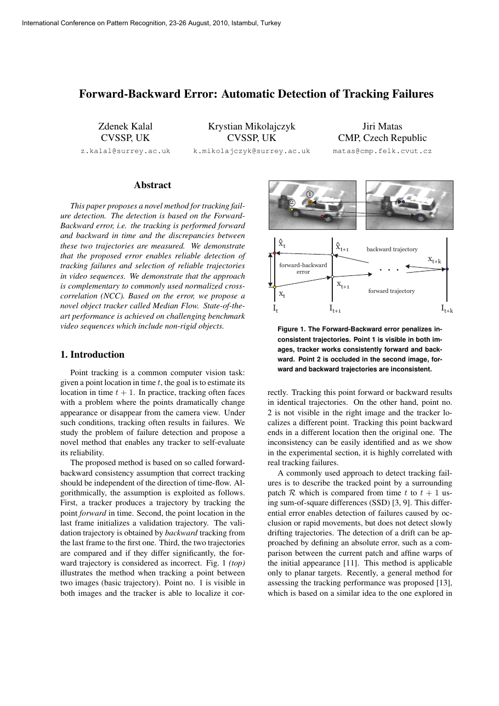
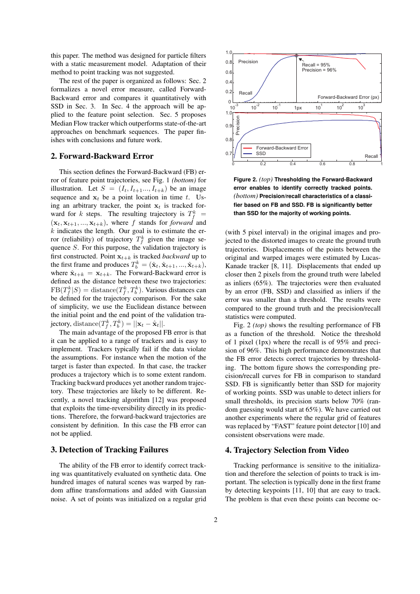
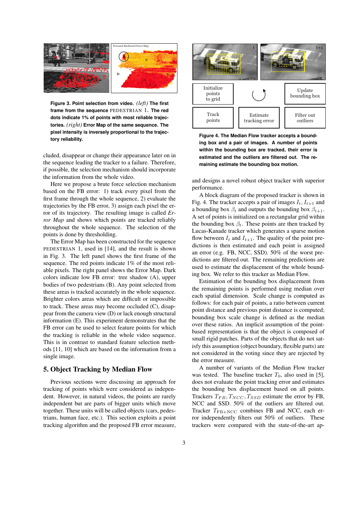

# 정방향 역방향 오차: 추적 실패의 자동 검출 (번역)

번역 범위: 전문 (초록, 본문, 그림 캡션, 표 캡션, 결론, 감사의 글). 참고문헌은 원문 그대로 둔다.

- 원제: Forward-Backward Error: Automatic Detection of Tracking Failures
- 저자: Zdenek Kalal (CVSSP, 영국), Krystian Mikolajczyk (CVSSP, 영국), Jiri Matas (CMP, 체코)
- 서지: International Conference on Pattern Recognition (ICPR) 2010, 2010년 8월 23~26일, 이스탄불, 터키. pp. 2756-2759. doi:10.1109/ICPR.2010.675
- 원문 파일: [Kalal2010_ICPR_forward_backward_error.pdf](Kalal2010_ICPR_forward_backward_error.pdf) (저자 공개본, 4쪽. 2026-11-04 http://kahlan.eps.surrey.ac.uk/featurespace/tld/Publications/2010_icpr.pdf 에서 받음. PDF 정보에 "Certified by IEEE PDFeXpress at 05/14/2010"이 찍혀 있다)
- 본문 추출: `pdftotext -layout`. 표 1은 추출이 깨져서 4쪽 그림을 눈으로 보고 옮겼다.
- 그림: 원문 쪽 전체를 `pdftoppm -r 110`으로 그렸다. 그림 5(4쪽)는 넣지 않고 수치를 표 1로 옮겼다.

---

## 초록

이 논문은 추적 실패를 검출하는 새 방법을 제안한다.

검출은 정방향 역방향(Forward-Backward, FB) 오차에 바탕을 둔다.
즉 시간 순서대로 한 번(정방향), 거꾸로 한 번(역방향) 추적하고, 두 궤적이 얼마나 어긋나는지 잰다.

우리는 다음을 보인다.

- 제안한 오차로 추적 실패를 믿을 만하게 검출하고, 영상 열에서 믿을 만한 궤적을 고를 수 있다.
- 이 방법은 흔히 쓰는 정규화 상호상관(NCC)과 서로 보완된다.

이 오차를 바탕으로 Median Flow라는 새 물체 추적기를 제안한다.
이 추적기는 모양이 변하는(강체가 아닌) 물체가 들어 있는 어려운 기준 영상에서 최고 수준의 성능을 낸다.

> 그림 1. 정방향 역방향 오차는 일관되지 않은 궤적에 벌점을 준다.
> 점 1은 두 영상에서 모두 보인다. 추적기가 정방향과 역방향에서 일관되게 동작한다.
> 점 2는 두 번째 영상에서 가려진다. 정방향 궤적과 역방향 궤적이 일치하지 않는다.
> (그림 아래쪽: 영상 I_t, I_t+1, ..., I_t+k 에서 정방향 궤적 x_t, x_t+1, ..., x_t+k 와 역방향 궤적 x̂_t, x̂_t+1, ... 을 그리고, 처음 점 x_t 와 x̂_t 사이의 거리를 정방향 역방향 오차로 표시한다.)

## 1. 서론

점 추적은 흔한 컴퓨터 비전 과제다.
시각 t에서 점의 위치가 주어지면, 시각 t+1에서의 위치를 추정하는 것이 목표다.

실제로는 점의 겉모습이 크게 바뀌거나 점이 카메라 시야에서 사라지는 일이 자주 생긴다.
이런 조건에서는 추적이 실패하기 쉽다.

우리는 실패 검출 문제를 다룬다.
그리고 어떤 추적기든 스스로 자기 신뢰도를 평가할 수 있게 하는 새 방법을 제안한다.

제안 방법은 이른바 정방향 역방향 일관성 가정에 바탕을 둔다.
올바른 추적이라면 시간이 흐르는 방향과 상관없이 같은 결과가 나와야 한다는 가정이다.

알고리즘으로는 다음처럼 쓴다.

1. 추적기가 점을 시간 순서대로 추적해 궤적을 만든다.
2. 마지막 영상의 점 위치로 검증 궤적을 시작한다. 검증 궤적은 마지막 영상에서 첫 영상까지 거꾸로 추적해 얻는다.
3. 두 궤적을 비교한다. 크게 다르면 정방향 궤적을 틀린 것으로 본다.

그림 1(위)은 두 영상 사이에서 점을 추적할 때(기본 궤적) 이 방법을 보여 준다.

- 점 1은 두 영상에서 모두 보이고, 추적기가 정확히 위치를 찾는다. 정방향으로 추적하든 역방향으로 추적하든 같은 궤적이 나온다.
- 반면 점 2는 오른쪽 영상에서 보이지 않는다. 추적기는 다른 점을 찾는다. 이 점을 거꾸로 추적하면 원래 위치와 다른 곳에서 끝난다.

이 불일치는 쉽게 알아낼 수 있다.
실험 절에서 보이듯이, 이 불일치는 실제 추적 실패와 매우 강하게 관련된다.

추적 실패를 검출하는 흔한 방법은 추적한 점을 주변 조각 R로 나타내고, 시각 t와 t+1의 조각을 제곱차 합(SSD)으로 비교하는 것이다 [3, 9].

- 이 "차분" 오차는 가림이나 빠른 움직임 때문에 생긴 실패는 잡는다.
- 그러나 천천히 흘러가는(드리프트하는) 궤적은 잡지 못한다.

드리프트 검출에는 절대 오차를 정의하는 방법을 쓸 수 있다.
예를 들어 현재 조각을 처음 겉모습을 아핀 변형한 것과 비교한다 [11].
이 방법은 평면 대상에만 쓸 수 있다.

최근 추적 성능을 평가하는 일반적인 방법이 제안됐다 [13].
이 논문과 비슷한 생각에 바탕을 둔다.
그 방법은 정적 측정 모델을 쓰는 입자 필터용으로 설계됐다.
점 추적에 맞게 바꾸는 방법은 제안되지 않았다.

이 논문의 구성은 다음과 같다.

- 2절은 정방향 역방향 오차라는 새 오차 척도를 정식화한다.
- 3절은 이를 SSD와 정량 비교한다.
- 4절은 이 방법을 특징점 선택에 적용한다.
- 5절은 최신 방법보다 기준 영상에서 나은 Median Flow 추적기를 제안한다.
- 마지막에 결론과 앞으로의 일을 적는다.

## 2. 정방향 역방향 오차

이 절은 특징점 궤적의 정방향 역방향(FB) 오차를 정의한다. 그림 1(아래)을 보라.

S = (I_t, I_t+1, ..., I_t+k)를 영상 열이라 하고, x_t를 시각 t의 점 위치라 하자.

- 임의의 추적기로 점 x_t를 k단계 정방향으로 추적한다.
- 그 결과 궤적은 T_f^k = (x_t, x_t+1, ..., x_t+k)다. f는 정방향(forward), k는 길이를 뜻한다.

우리의 목표는 영상 열 S가 주어졌을 때 궤적 T_f^k의 오차(신뢰도)를 추정하는 것이다.

이를 위해 먼저 검증 궤적을 만든다.

- 점 x_t+k를 첫 영상까지 역방향으로 추적한다.
- 그러면 T_b^k = (x̂_t, x̂_t+1, ..., x̂_t+k)가 나온다. 여기서 x̂_t+k = x_t+k다.

정방향 역방향 오차는 두 궤적 사이의 거리로 정의한다.

FB(T_f^k | S) = distance(T_f^k, T_b^k)

궤적 비교에는 여러 거리를 정의할 수 있다.
간단하게 하려고, 처음 점과 검증 궤적 끝점 사이의 유클리드 거리를 쓴다.

distance(T_f^k, T_b^k) = ||x_t − x̂_t||

제안한 FB 오차의 주된 장점은 다음과 같다.

- 여러 추적기에 쓸 수 있다.
- 구현이 쉽다.

추적기는 보통 자료가 추적기의 가정을 어길 때 실패한다.
예를 들어 대상의 움직임이 예상보다 빠를 때다.
그러면 추적기는 어느 정도 무작위인 궤적을 만든다.
역방향으로 추적하면 또 다른 무작위 궤적이 나온다.
두 궤적은 다를 가능성이 크다.

최근 시간 가역성을 예측에 직접 쓰는 새 추적 알고리즘이 제안됐다 [12].
그 추적기에서는 정방향 궤적과 역방향 궤적이 정의상 일치한다.
그래서 그 경우에는 FB 오차를 쓸 수 없다.

## 3. 추적 실패의 검출

FB 오차가 올바른 추적을 얼마나 잘 가려내는지 합성 자료에서 정량 평가했다.

실험 방법은 다음과 같다.

1. 자연 장면 영상 100장을 무작위 아핀 변환으로 변형하고 가우스 잡음을 더했다.
2. 원본 영상에 규칙 격자(5화소 간격)로 점을 놓고, 변형 영상에 투영해 정답 궤적을 만들었다.
3. 원본과 변형 영상 사이의 점 변위를 Lucas-Kanade 추적기로 추정했다 [8, 11].
4. 정답에서 2화소보다 가깝게 끝난 변위를 정상점(inlier)으로 표시했다(65%).
5. 궤적을 오차(FB, SSD)로 평가해, 오차가 임계값보다 작으면 정상점으로 분류했다.
6. 결과를 정답과 비교해 정밀도와 재현율을 계산했다.

> 그림 2. (위) 정방향 역방향 오차에 임계값을 두면 올바르게 추적된 점을 가려낼 수 있다.
> (아래) FB와 SSD에 바탕을 둔 분류기의 정밀도/재현율 특성. 대부분의 동작점에서 FB가 SSD보다 훨씬 낫다.
> (위 그림의 가로축은 정방향 역방향 오차(px), 로그 눈금 10^-3 ~ 10^3. 1px 임계값에 "재현율 = 95%, 정밀도 = 96%"가 표시돼 있다.)

그림 2(위)는 FB의 성능을 임계값의 함수로 보여 준다.

- 1화소(1px) 임계값에서 재현율 95%, 정밀도 96%다.
- 이 높은 성능은 FB 오차에 임계값을 두는 것만으로 올바른 궤적을 가려낼 수 있음을 보여 준다.

아래 그림은 FB와 표준 SSD의 정밀도/재현율 곡선을 비교한다.

- 대부분의 동작점에서 FB가 SSD보다 훨씬 낫다.
- SSD는 작은 임계값에서 정상점을 가려내지 못했다. SSD의 정밀도는 70% 아래에서 시작한다(무작위로 찍어도 65%에서 시작한다).

규칙 격자 대신 "FAST" 특징점 검출기 [10]로 점을 뽑아 다른 실험도 했다. 같은 결과를 관찰했다.

## 4. 영상에서 궤적 고르기

추적 성능은 초기화에 민감하다. 그래서 어떤 점을 추적할지 고르는 일이 중요하다.

보통은 첫 영상에서 추적하기 쉬운 특징점을 검출해 고른다 [11, 10].
문제는 이런 점도 나중에 가려지거나, 사라지거나, 겉모습이 바뀌어 추적 실패로 이어질 수 있다는 점이다.
그래서 가능하다면 선택 방법이 영상 전체의 정보를 써야 한다.

여기서 FB 오차에 바탕을 둔 전수 선택 방법을 제안한다.

1. 첫 영상의 모든 화소를 영상 끝까지 추적한다.
2. 궤적을 FB 오차로 평가한다.
3. 각 화소에 그 궤적의 오차를 붙인다.

그 결과 영상을 오차 지도(Error Map)라 부른다.
오차 지도는 어떤 점이 영상 전체에서 믿을 만하게 추적되는지 보여 준다.
점은 임계값으로 고른다.

> 그림 3. 영상에서 점 고르기. (왼쪽) PEDESTRIAN 1 열의 첫 영상. 빨간 점은 가장 믿을 만한 궤적을 가진 1%의 점이다. (오른쪽) 같은 열의 오차 지도. 화소 밝기는 궤적 신뢰도에 반비례한다.

오차 지도는 [14]에서 쓴 PEDESTRIAN 1 열에 대해 만들었다. 결과는 그림 3이다.

- 왼쪽은 열의 첫 영상이다. 빨간 점은 가장 믿을 만한 1%의 화소다.
- 오른쪽은 오차 지도다. 어두운 색은 FB 오차가 낮다는 뜻이다. 나무 그림자(A), 두 보행자의 상반신(B)이 그렇다. 이 영역에서 고른 점은 영상 전체에서 정확히 추적된다.
- 밝은 색 영역은 추적이 어렵거나 불가능하다. 이런 영역은 가려지거나(C), 시야에서 사라지거나(D), 구조 정보가 부족하다(E).

이 실험은 FB 오차로 영상 전체에서 추적이 믿을 만한 특징점을 고를 수 있음을 보여 준다.
한 장의 영상 정보에만 바탕을 둔 표준 특징 선택 방법 [11, 10]과 대비된다.

## 5. Median Flow로 물체 추적

앞 절들은 점을 서로 독립인 것으로 보고 점 추적 방법을 다뤘다.

그러나 자연 영상에서 점은 독립인 경우가 드물다. 함께 움직이는 더 큰 단위의 일부다.
이 단위를 물체라 부른다(자동차, 보행자, 사람 얼굴 등).

이 절은 점 추적 알고리즘과 제안한 FB 오차 척도를 이용해, 성능이 뛰어난 새 강건 물체 추적기를 설계한다.

> 그림 4. Median Flow 추적기는 경계 상자 하나와 영상 한 쌍을 받는다. 경계 상자 안의 여러 점을 추적하고, 그 오차를 추정하고, 이상점을 걸러 낸다. 남은 점으로 경계 상자의 움직임을 추정한다.
> (블록도: 점을 격자로 초기화 → 점 추적 → 추적 오차 추정 → 이상점 걸러 내기 → 경계 상자 갱신. 그림은 위의 3쪽 그림 오른쪽 위에 있다.)

제안한 추적기의 블록도는 그림 4다.

- 추적기는 영상 한 쌍 I_t, I_t+1과 경계 상자 β_t를 받아 경계 상자 β_t+1을 내보낸다.
- 경계 상자 β_t 안의 직사각형 격자에 점을 놓는다.
- 이 점들을 Lucas-Kanade 추적기로 추적해, I_t와 I_t+1 사이의 희소한 운동 흐름을 만든다.
- 점 예측의 품질을 추정해 각 점에 오차를 붙인다(예: FB, NCC, SSD).
- 가장 나쁜 예측 50%를 걸러 낸다.
- 남은 예측으로 경계 상자 전체의 변위를 추정한다.

이 추적기를 Median Flow라 부른다.

남은 점으로 경계 상자 변위를 추정할 때는 공간 방향마다 중앙값을 쓴다.
척도 변화는 다음처럼 계산한다.

- 점 쌍마다 현재 점 사이 거리와 이전 점 사이 거리의 비를 구한다.
- 경계 상자의 척도 변화는 이 비들의 중앙값으로 정한다.

점 기반 표현에는 물체가 작은 강체 조각들로 이루어져 있다는 가정이 숨어 있다.
이 가정을 만족하지 않는 물체 부분(물체 경계, 유연한 부분)은 오차 척도로 걸러지므로 투표에 들어가지 않는다.

Median Flow 추적기의 여러 변형을 시험했다.

- 기준 추적기 T_0([5]에서도 썼다)은 점 추적 오차를 평가하지 않고 모든 점으로 경계 상자 변위를 추정한다.
- 추적기 T_FB, T_NCC, T_SSD는 각각 FB, NCC, SSD로 오차를 추정한다. 이상점 50%를 걸러 낸다.
- 추적기 T_FB+NCC는 FB와 NCC를 합친다. 각 오차가 따로 이상점 50%를 걸러 낸다.

이 추적기들을 [14]의 영상 6개에서 최신 방법 [7, 4, 1, 2]와 비교했다.

- 물체는 첫 영상에서 손으로 초기화하고, 열 끝까지 추적했다.
- 경계 상자가 정답과 50%보다 많이 겹치면 궤적을 맞은 것으로 봤다.
- 성능은 추적기가 맞은 상태를 유지한 마지막 영상 번호로 평가했다.

> 그림 5. PEDESTRIAN 1 열: 여러 오차 척도의 성능 비교.
> (그래프: 가로축은 영상 번호(길이 140), 세로축은 추적기와 정답의 겹침. 선은 all, FB, NCC, SSD, FB+NCC.)

그림 5는 오차 척도가 Median Flow 추적기 성능에 주는 영향을 보여 준다.

- 기준 T_0 방법과 T_SSD가 가장 나쁘다. 앞에서 SSD가 올바른 점 궤적을 가려내는 데 덜 믿을 만하다고 한 주장을 뒷받침한다.
- T_FB와 T_NCC는 비슷하다. 기준 방법보다 두 배 오래 대상을 따라간다.
- T_FB+NCC가 확실히 가장 좋다. 열 전체에서 대상을 추적한다.

이는 FB가 NCC와 독립이고, 둘을 합치면 추적이 크게 나아진다는 것을 보여 준다.

표 1은 모든 영상의 정량 결과다. 마지막 줄은 각 알고리즘이 가장 좋았던 횟수다.
가장 좋은 결과는 FB와 NCC 오차를 합친 Median Flow가 얻었다.
이 추적기는 세 번 가장 좋았고, 이 영상들에서 새로운 최고 성능을 세웠다.

> 표 1. 올바르게 추적한 영상 수로 본 최신 방법과의 비교.

| 영상 열 | 영상 수 | [7] | [4] | [1] | [2] | T_0 | T_FB | T_NCC | T_SSD | T_FB+NCC |
|---|---:|---:|---:|---:|---:|---:|---:|---:|---:|---:|
| David | 761 | 17 | n/a | 94 | 135 | 93 | 761 | 144 | 28 | **761** |
| Jumping | 313 | 75 | 313 | 44 | 313 | 36 | 76 | 87 | 79 | 170 |
| Pedestrian 1 | 140 | 11 | 6 | 22 | 101 | 15 | 37 | 40 | 12 | **140** |
| Pedestrian 2 | 338 | 33 | 8 | 118 | 37 | 97 | 97 | 97 | 97 | 97 |
| Pedestrian 3 | 184 | 50 | 5 | 53 | 49 | 52 | 52 | 52 | 52 | 52 |
| Car | 945 | 163 | n/a | 10 | 45 | 248 | 510 | 394 | 353 | **510** |
| Best | n/a | 0 | 1 | 2 | 1 | 0 | 2 | 0 | 0 | 3 |

(굵은 글씨는 원문 표의 굵은 글씨를 그대로 옮겼다.)

## 6. 결론

이 논문은 궤적의 신뢰도를 추정하는 새 척도인 정방향 역방향 오차를 제안했다.

- 역방향 추적으로 검증 궤적을 만들고, 문제의 궤적과 비교한다.
- 구현은 같은 추적 알고리즘을 거꾸로 된 영상 열에 적용하기만 하면 된다.
- 이 척도를 Lucas-Kanade 추적기에 적용했고, SSD와 NCC 대비 이점과 서로 보완됨을 보였다.

제안한 정방향 역방향 오차를 바탕으로 Median Flow라는 새 추적기를 설계했다.
이 추적기는 여러 기준 영상에서 최고 수준의 성능을 냈다.

FB 오차는 제약 조건으로 구현해 [6]에서 소개한 새 추적 틀에도 쓸 수 있다.

**감사의 글.** 이 연구는 UK EPSRC EP/F0034 20/1과 BBC R&D 연구비(ZK, KM), EC 과제 ICT-215078 DIPLECS(JM)의 지원을 받았다.

## 참고문헌 (원문 그대로)

[1] S. Avidan. Ensemble tracking. PAMI, 29(2):261–271, 2007.
[2] B. Babenko, M.-H. Yang, and S. Belongie. Visual tracking with online multiple instance learning. CVPR, 2009.
[3] J. Bouguet. Pyramidal Implementation of the Lucas Kanade Feature Tracker Description of the algorithm. Technical report, OpenCV Document, Intel Microprocessor Research Labs, 1999.
[4] R. Collins, Y. Liu, and M. Leordeanu. Online selection of discriminative tracking features. PAMI, 27(10):1631–1643, 2005.
[5] Z. Kalal, J. Matas, and K. Mikolajczyk. Online learning of robust object detectors during unstable tracking. OLCV, 2009.
[6] Z. Kalal, J. Matas, and K. Mikolajczyk. P-N Learning: Bootstrapping Binary Classifiers by Structural Constraints. CVPR, 2010.
[7] J. Lim, D. Ross, R. Lin, and M. Yang. Incremental learning for visual tracking. NIPS, 2005.
[8] B. Lucas and T. Kanade. An iterative image registration technique with an application to stereo vision. IJCAI, 81:674–679, 1981.
[9] K. Nickels and S. Hutchinson. Estimating uncertainty in SSD-based feature tracking. IVC, 20(1):47–58, 2002.
[10] E. Rosten and T. Drummond. Machine learning for high-speed corner detection. ECCV, May 2006.
[11] J. Shi and C. Tomasi. Good features to track. CVPR, 1994.
[12] H. Wu, R. Chellappa, A. Sankaranarayanan, and S. Zhou. Robust visual tracking using the time-reversibility constraint. ICCV, 2007.
[13] H. Wu, A. C. Sankaranarayanan, and R. Chellappa. In situ evaluation of tracking algorithms using time reversed chains. CVPR, 2007.
[14] Q. Yu, T. Dinh, and G. Medioni. Online tracking and reacquisition using co-trained generative and discriminative trackers. ECCV, 2008.
