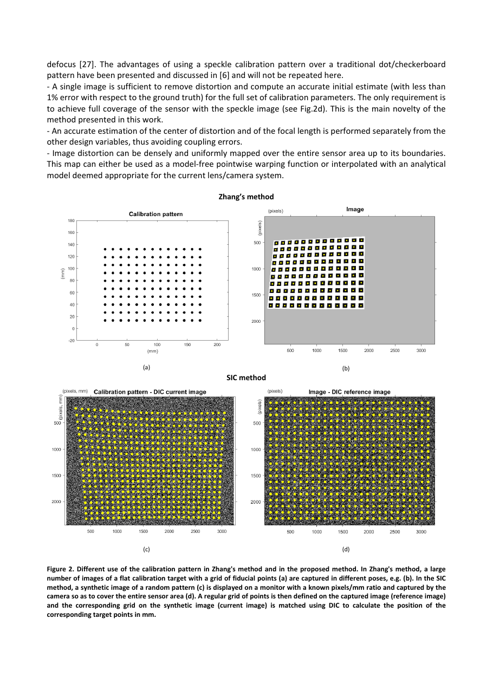
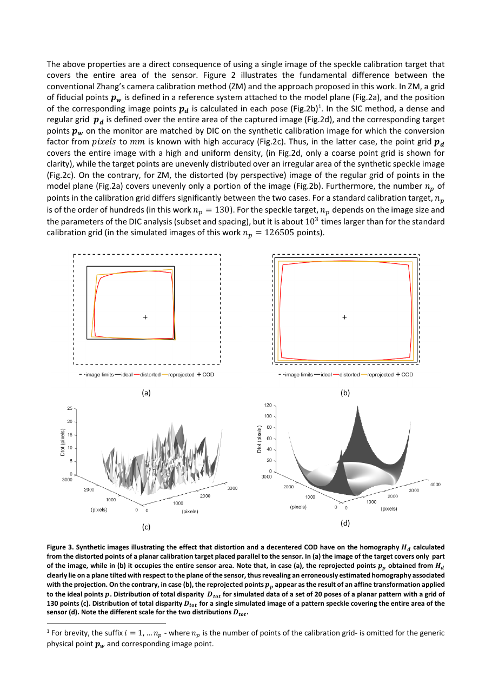
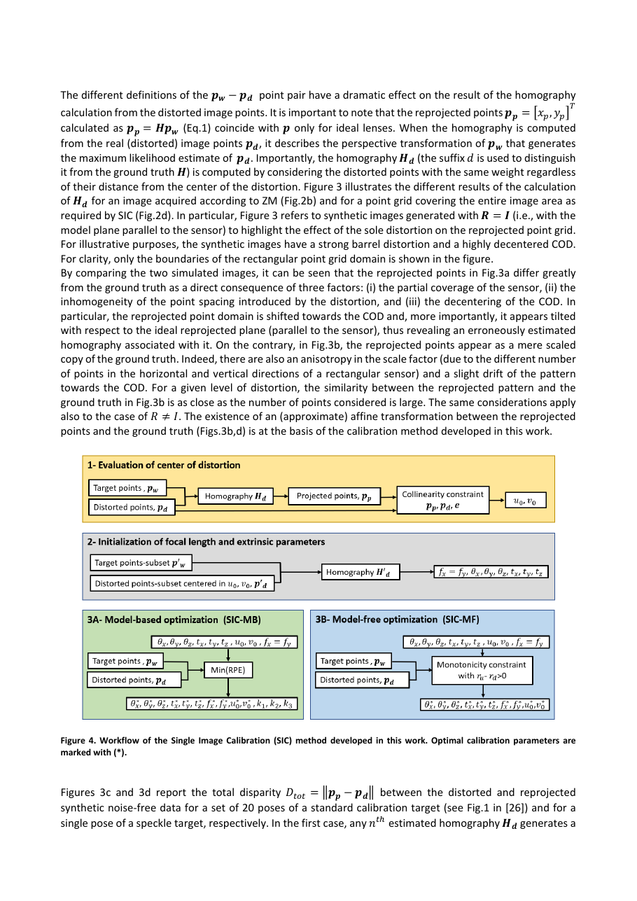
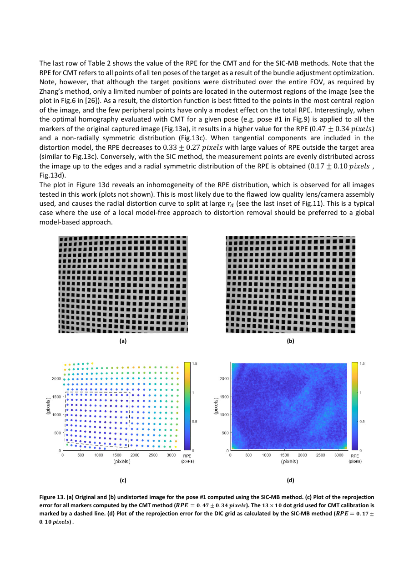

# 모델 없는 왜곡 보정을 갖춘 단일 영상 카메라 보정 (번역)

번역 범위: 전문 (초록, 본문 1~4절, 그림 1~13 캡션, 표 1~2, 각주). 참고문헌은 원문 그대로 둔다.

- 원제: Single-image camera calibration with model-free distortion correction
- 저자: Katia Genovese (School of Engineering, University of Basilicata, Potenza, 이탈리아)
- 서지: Optics and Lasers in Engineering 181:108348, 2024년 10월. doi:10.1016/j.optlaseng.2024.108348. 학술지판 라이선스 CC BY 4.0 (Crossref 확인)
- 원문 파일: [Genovese2024_arXiv2403.01263_single_image_calibration.pdf](Genovese2024_arXiv2403.01263_single_image_calibration.pdf) (arXiv 2403.01263, 22쪽. 2026-11-04 https://arxiv.org/pdf/2403.01263 에서 받음. PDF 정보의 원본 이름은 "revised_manuscript_SIC_method", 2024-06-24 생성. 학술지 심사 후 수정 원고다)
- 본문 추출: `pdftotext -layout`. 수식은 추출이 깨져서 4, 5, 10, 12, 13, 14쪽을 그림으로 열어 눈으로 옮겼다.
- 그림: 원문 쪽 전체를 `pdftoppm -r 110`으로 그렸다. 그림 2, 3, 4, 13이 있는 쪽을 넣었다. 나머지 그림은 캡션만 옮긴다.
- 번역 메모: "speckle"은 "무작위 얼룩 무늬"(줄여서 얼룩 무늬), "distortion"은 "왜곡", "center of distortion(COD)"은 "왜곡 중심", "reprojection error(RPE)"는 "재투영 오차", "principal point"는 "주점", "homography"는 "호모그래피"로 옮겼다.

---

## 초록

카메라 보정은 정확한 정량 측정이 필요한 컴퓨터 비전 응용에서 매우 중요한 과정이다.

Zhang이 개발한 널리 쓰이는 방법은 기준점이 격자로 놓인 평면판을 여러 자세에서 찍은 많은 영상을 쓴다.
이 방법은 유연하고 구현이 쉽지만 몇 가지 한계가 있다.

- 미리 정한 왜곡 모델의 계수를 포함해 전체 매개변수를 한꺼번에 최적화한다. 그래서 재투영 오차가 꽤 작아도 영상 가장자리에서 왜곡 보정이 나쁘거나, 내부 매개변수를 잘못 계산할 수 있다.
- 영상 이어 붙이기가 필요한 응용(예: 여러 카메라 계통)은 영상 맨 바깥 영역까지 왜곡을 정확히 알아야 한다.
- 내부 매개변수는 카메라 자세 추정의 정확도에 영향을 준다. 카메라 자세 추정은 로봇 주행의 시각 서보, 자동 조립 같은 응용에 기본이다.

이 논문은 센서 전체를 덮는 평면 얼룩 무늬 영상 **한 장**으로 보정 매개변수 전체를 구하는 방법을 제안한다.

- 영상 점과 보정판 위 물리 점의 대응은 디지털 영상 상관(DIC)으로 얻는다.
- 먼저 주점을 구한다. 그 다음 유효 초점거리와 외부 매개변수를 따로 계산한다.
- 과정 끝에 영상 전체에 걸쳐 조밀하고 고른, 모델 없는 왜곡 지도를 얻는다.

잡음 수준이 다른 합성 자료로 제안 방법이 실현 가능한지 시험하고, 계측 성능을 Zhang 방법과 비교했다.
실제 영상 시험은 여러 영상을 평균하면 가려지는 영상 형성의 특성을 이 방법이 드러낼 수 있음을 보여 준다.

핵심어: 단일 영상 카메라 보정, 모델 없는 왜곡 제거, 디지털 영상 상관, 얼룩 무늬 보정판.

---

## 1. 서론

카메라 보정은 영상에서 정확한 계측 정보를 얻기 위한 필수 전제다.
영상 형성은 핀홀 모델(그림 1)로 나타낸다.
카메라 보정은 3차원 물리 점을 2차원 영상 점으로 옮기는 사영 변환을 나타내는 외부 매개변수와 내부 매개변수를 구하는 일이다.

- 외부 매개변수: 세계 좌표계 Σ_W 안에서 카메라 좌표계 Σ_C의 자세를 정한다.
- 내부 매개변수: 카메라 좌표계의 영상 점(mm 단위)을 센서 좌표계 Σ_S의 영상 점(화소 단위)으로 옮기는 아핀 변환을 나타낸다.

카메라 보정 문헌은 많고 넓다. 개관은 [1][2]를 보라.
이하에서는 위치를 매우 정확히 아는 기준점이 있는 평판을 쓰는 사진측량 방법만 다룬다.
이런 방법은 대부분 Zhang의 기념비적 논문 [3]의 기법을 바탕으로 한다.

가장 흔한 보정판은 표식(원형 또는 사각형)의 규칙 격자 [3][4]나 체커보드 [5]다.
점의 무게중심이나 체커보드의 모서리가 세계 좌표계 Σ_W의 기준점이 된다.
최근에는 얼룩 무늬 보정판이 제안됐다 [6].
기준점을 아주 많이 정할 수 있고, 디지털 영상 상관(DIC) [7][8]으로 찍힌 영상의 짝과 부화소 정확도로 맞출 수 있기 때문이다.
DIC의 고유한 능력 덕분에, 점 격자에서는 원근 변형 [4]이, 체커보드에서는 초점 흐림 [5]이 주는 나쁜 영향을 넘을 수 있다.
얼룩 무늬 보정판의 자세한 설명과 논의는 [6]에 있다.

> **그림 1.** 핀홀 카메라 모델의 개략도. 카메라 내부 변환은 주점 **e**를 기준으로 한 균일한 크기 변경(척도 S)에 대해 변하지 않는다는 점에 주목하라.

실용 면에서 또 하나의 개선은 평면 디지털 화면에 합성 보정 무늬를 띄우는 것이다.

- 디지털 화면은 이제 어디에나 있고, 크기와 공간 해상도도 다양하다.
- 화면의 평탄도는 매우 정확하다. 화소 크기는 제조사 사양으로 바로 알 수 있고, 정밀도가 O(10⁻³ mm)까지 내려간다.
- 그래서 여러 방법(예: [9])의 맞춤 기능으로 최적의 디지털 얼룩 무늬를 만들면, 영상 영역 어느 점이든 mm 단위 위치를 자동으로 매우 정확히 안다.
- Zhang 방법 안에서 디지털 얼룩 보정판을 쓴 연구는, DIC 최신 기법을 적용하면 기존 무늬보다 성능이 낫다는 것을 보였다 [6].

카메라 보정의 중요한 문제는 영상 왜곡이다.
제대로 보정하지 않으면 영상 기반 측정에서 계통 오차의 원인이 된다.

- 시판 카메라와 렌즈 조합은 대부분 어느 정도 왜곡이 있고, 주로 방사 방향 성질을 띤다 [10][3].
- 가장 널리 쓰는 방사 왜곡 모델은 매개변수 2~3개의 짝수 차수 다항식 [3][11]과, 매개변수 하나로도 만족스러운 결과를 내는 나눗셈 모델 [12]이다.
- 왜곡 함수 추정은 보정 과정 안에 넣을 수도 있고 [13][3], 왜곡 없는 영상을 얻기 위한 별도 과정으로 할 수도 있다 [14][15]. 별도 과정은 내부 매개변수를 함께 얻기도 한다 [16][17].

Zhang 방법 [3]은 첫째 부류에 속한다.

- 서로 다른 자세의 보정판 영상을 최소 3장 써서, 이상적인 핀홀 모델에 바탕을 둔 닫힌 해로 카메라 매개변수의 근삿값을 구한다.
- 이 값을 초기값으로, 짝수 차수 다항식 방사 왜곡 함수의 계수까지 설계 변수로 넣은 비선형 최적화를 돌린다.
- 최적화는 재투영 오차(RPE)를 가장 작게 하는 매개변수를 찾는다. RPE는 실제(검출한) 영상 점과, 추정한 원근 기하로 계산한 짝 점 사이 유클리드 거리의 합이다.

Zhang 방법은 유연하고 구현이 쉽지만 몇 가지 한계가 있다.

- 보정판 자세의 수, 방향, 시야 안 분포가 보정 결과에 영향을 준다.
- 왜곡 함수를 주로 영상 안쪽(왜곡이 작은 곳)의 점으로 추정하면, 낮은 차수 왜곡 함수로도 재투영 잔차가 작게 나온다. 하지만 이 경우 영상 바깥 영역의 왜곡은 제대로 보정되지 않을 수 있다. 일부가 겹치는 이웃 영상을 이어 붙여야 하는 응용(예: 현미경 영상 이어 붙이기, 여러 카메라 DIC 계통 [18][19])에서 나쁜 결과를 낸다.
- 반대로 맞지 않는(예: 매개변수가 너무 많은) 왜곡 함수를 영상 자료에 억지로 맞추면, RPE는 낮지만 내부 매개변수 값이 틀린(흔히 물리적으로 불가능한) 값이 나올 수 있다. 그 결과 외부 매개변수의 정확도도 직접 나빠진다.
- 이 경우 형상 복원(예: 스테레오 DIC 측정)에는 영향이 작다. 하지만 카메라 자세 추정(예: 로봇의 시각 서보)에는 영향이 더 크다.
- 위 한계는 주로 내부 매개변수와 외부 매개변수의 상호작용, 그리고 명시적 왜곡 모델을 쓰는 데서 온다는 것이 널리 인정된다 [20][21].

미리 정한 함수를 쓰는 한계를 넘기 위해, 매개변수 없는 영상 왜곡 지도를 구하는 방법이 몇 가지 개발됐다.

- Hartley와 Kang [22]은 기념비적 논문에서 체커보드 평면 무늬와 모델 없는 접근으로 왜곡 중심(COD)과 방사 왜곡 곡선을 반복 없이 계산하는 방법을 제안했다. 영상 한 장이면 되지만 잡음에 매우 민감하고, 가장 좋은 결과는 여러 영상으로 얻는다 [22].
- [15]는 또 다른 모델 없는 접근이다. LCD 화면에 띄운 위상 이동 줄무늬를 카메라 센서 평면과 엄격히 평행한 두 위치에 놓고 왜곡 지도, COD, 유효 초점거리를 계산한다. 그러나 고정밀 이송대가 필요하고, 카메라에 대한 화면 방향의 정확도가 결과에 영향을 준다.
- [17]은 위상 표적을 바탕으로 한 모델 없는 반복 왜곡 보상 알고리즘이다. LCD 화면에 띄운 두 무리의 위상 무늬 여러 장이 주는 전체 영역 정보로 센서 전체의 왜곡 지도를 낸다. 하지만 결과를 RPE로만 보이고, 추정한 카메라 매개변수의 정확도 정보는 없다.
- [23]은 한 자세에서 구조광 무늬 여러 장으로 조밀한 모델 없는 왜곡 지도를 계산한다. 센서 중심에서 왜곡이 0이라는 강한 가정에 기대고, 카메라 매개변수는 추정하지 않는다.
- 마지막으로 얼룩 무늬 표적 여러 장을 써서 모델 기반 [6]과 모델 없는 [16] 접근으로 정확한 카메라 보정을 했다. 그러나 두 접근 모두 센서의 일부만 덮는 얼룩 표적을 여러 자세로 찍어야 한다.

이 연구는 센서 전체를 덮도록 화면에 띄운 얼룩 무늬 영상 한 장으로 영상 왜곡 지도와 보정 매개변수 전체를 정확히 구한다.
이 방법의 힘은 바로 다음 두 가지에서 나온다.

- (i) 영상 경계까지 영상 전체를 덮는 고르고 조밀한 점 격자를 쓴다.
- (ii) DIC의 부화소 정합 능력을 쓴다.

보정 매개변수 사이의 결합에서 오는 한계는 다음 순서로 넘는다.
먼저 주점을 추정한다. 다음에 유효 초점거리를 따로 계산하고, 마지막으로 외부 매개변수를 계산한다.
마지막 묶음 최적화에서는 얻은 전체 영역 왜곡 지도를 모델 기반 또는 모델 없는 방식으로 처리해 보정 결과를 다듬는다.

제안한 단일 영상 보정(SIC) 방법을 잡음 수준이 다른 합성 영상과 실제 영상으로 시험했다.
성능은 J.Y. Bouguet가 오픈 소스 Calibration Matlab Toolbox(CMT, [11])에 구현한 Zhang 방법과 비교했다.
SIC는 CMT보다 유연하고 잡음에 강했다. 또한 깊이에 따른 왜곡 변화를 잡아냈는데, 이는 근거리 사진측량에서 특히 중요한 성질이다 [24][25].

논문의 구성은 다음과 같다.

- 2절: 핀홀 카메라 모델의 원리를 다시 보고, 여러 자세의 일반 보정 격자 영상 여러 장과 비교해 센서 전체를 덮는 얼룩 무늬 한 장을 쓰는 이점을 보인다. 그리고 합성 영상 한 장을 예로 SIC 방법을 단계별로 설명한다.
- 3절: 합성 영상과 실제 영상 실험 결과를 보이고, 제안 방법을 Zhang 보정 기법과 비교한다. 생성 자료가 많아 가장 중요한 결과만 본문에 싣는다. 추가 결과와 실험 영상 원본 크기는 재현을 위해 온라인 보충 자료 [26]에 둔다.
- 4절: SIC의 장점과 한계, 앞으로의 발전과 응용을 논의한다.

---

## 2. 방법

영상 기반 계측에서 영상 형성은 이상적인 핀홀 모델로 나타낸다.
즉 점의 영상과 실제 점은 원근 변환으로 이어진다(그림 1의 영상 형성 개략도).
카메라 보정은 세계 좌표계 Σ_W의 3차원 점 좌표를 센서 좌표계 Σ_S의 2차원 영상 점 좌표로 옮기는 변환의 매개변수를 구하는 과정이다.

Zhang 방법 [3]은 위치를 정밀하게 아는 특징(표식 무게중심이나 체커보드 모서리)의 평면 격자를 최소 3장 찍어 카메라를 보정한다.
평면 보정판을 작업 공간 안에 방향을 바꿔 가며 차례로 놓고, 자세마다 영상을 한 장씩 찍는다.
평면 보정판이 세계 좌표계의 Z = 0 위에 있다고 두면, 보정판 점의 세계 좌표 **p_w** = [X, Y]ᵀ와 그 이상적인(왜곡 없는) 영상 투영 **p** = [x, y]ᵀ의 관계는 다음과 같다.

$$
S\begin{bmatrix}x\\y\\1\end{bmatrix}=
\begin{bmatrix}f_x&\gamma&u_0\\0&f_y&v_0\\0&0&1\end{bmatrix}
\begin{bmatrix}r_{11}&r_{12}&t_x\\r_{21}&r_{22}&t_y\\r_{31}&r_{32}&t_z\end{bmatrix}
\begin{bmatrix}X\\Y\\1\end{bmatrix}
=\boldsymbol{AE}\begin{bmatrix}X\\Y\\1\end{bmatrix}
\tag{1}
$$

여기서 S는 임의의 척도다(원근 투영 모델에서 척도의 기하 의미는 그림 1 참조).

- 내부 행렬 **A**는 카메라 좌표계 Σ_C(mm 단위)의 영상 점 좌표를 센서 영상 좌표계 Σ_S(화소 단위)로 옮기는 아핀 변환을 정한다 [3].
  - f_x, f_y: 센서의 가로, 세로 방향 영상 척도(초점거리라고도 부른다)
  - γ: 두 영상 축의 비틀림(이 연구에서는 0으로 둔다)
  - u_0, v_0: 주점 **e**의 좌표. 투영 중심에서 센서 평면에 내린 수선의 발이다 [3].
  - 내부 매개변수는 카메라와 렌즈 조합의 특성이고 자세와 무관하다.
- 외부 행렬 **E**는 세계 좌표계 Σ_W에서 카메라 좌표계 Σ_C로 가는 강체 변환을 나타낸다. 회전 행렬 **R**의 첫 두 열 **r₁**, **r₂**와 평행이동 벡터 **t** = [t_x, t_y, t_z]ᵀ의 성분을 담는다.
- [3]과 같은 표기로, 보정 평면의 방향은 3차원 벡터 **r**로 나타낸다. 회전축과 평행하고 크기가 회전각이다.
- 간단히 쓰려고 **t**를 **r** 뒤에 붙여 외부 매개변수 벡터 **V_E** = [θ_x, θ_y, θ_z, t_x, t_y, t_z]ᵀ로 둔다. 내부 매개변수는 벡터 **V_I** = [f_x, f_y, u_0, v_0]ᵀ에 담는다.

호모그래피 **H** = **AE**는 모델 평면 위 물리 점 **p_w**와 센서 평면 위 영상 **p** 사이 원근 변환을 나타낸다.
모델 평면 영상 한 장에서 척도를 빼고 추정할 수 있다. 추정 절차는 기준점이 최소 4개 필요하며 [3]의 부록 A에 자세히 있다.
그러나 **H**의 성분 9개에서 내부 매개변수와 외부 매개변수를 따로 뽑으려면, 서로 다른 자세의 보정 평면 영상이 최소 n = 3장(γ = 0이면 n = 2장), 즉 서로 다른 호모그래피 n개가 필요하다.
보정 무늬 자세 수를 늘리면(보통 n ≥ 10) 방법의 정확도와 정밀도가 모두 좋아진다고 알려져 있다 [3].

실제 영상의 왜곡은, 검출한 영상 점 좌표 **p_d** = [x_d, y_d]ᵀ와 식 (1)로 계산한 이상적인 점 좌표 **p**를 잇는 알맞은 함수를 정해서 다룬다.

- 문헌에는 여러 정교한 왜곡 모델이 있지만 [24], 왜곡의 방사 성분이 다른 성분보다 지배적이라고 일반적으로 받아들여진다.
- 왜곡 함수에 성분을 더 넣는 것은 RPE 면에서는 흔히 의미가 없고, 결과의 물리적 타당성은 오히려 해칠 수 있다.
- 이 연구에서는 방사 성분만 다룬다. CMT처럼 6차 짝수 다항식으로 나타낸다고 둔다.

$$
\begin{aligned}
x_d &= f_x\left(x_n + x_n\left[k_1 r_n^2 + k_2 r_n^4 + k_3 r_n^6\right]\right) + u_0\\
y_d &= f_y\left(y_n + y_n\left[k_1 r_n^2 + k_2 r_n^4 + k_3 r_n^6\right]\right) + v_0
\end{aligned}
\tag{2}
$$

여기서

$$
r_n^2 = x_n^2 + y_n^2 \tag{3}
$$

이고, 정규화한 이상 좌표는 다음과 같이 계산한다.

$$
x_n = (x - u_0)/f_x,\qquad y_n = (y - v_0)/f_y \tag{4}
$$

계수 k₁, k₂, k₃가 방사 왜곡 함수의 매개변수다.

- [3]과 마찬가지로 왜곡 중심은 주점 **e**와 같다고 둔다.
- 왜곡된 점 **p_d**가 이상적인 투영 점 **p**에서 벗어난 정도를 미리 정한 해석 모델로 나타내면, 왜곡 매개변수가 내부 매개변수 묶음에 미지수로 추가된다.
- 왜곡을 잘 제거하면 왜곡 없는 점 **p**를 되찾는다. **p**는 보정판 점 **p_w**와 이상적인 호모그래피 **H**(식 1)로 이어진다.
- 중요한 점: 왜곡의 양과 척도(초점거리 매개변수) 사이에는 모호성이 있다 [22]. 보통은 왜곡 중심에서 왜곡이 0, 즉 그곳에서 왜곡된 점과 왜곡 없는 점이 같다고 가정해 이 모호성을 푼다.

Zhang 방법은 왜곡을 두 단계로 다룬다.

1. 영상에 잡음과 왜곡이 없다고 보고, 해석해로 내부, 외부 매개변수의 근삿값을 계산한다.
2. 그 값을 초기값으로, 왜곡 함수 계수까지 포함한 매개변수 전체를 비선형 최적화로 다듬는다. 목적 함수는 재투영 오차 RPE, 즉 (식 1~4로 계산한) 왜곡된 영상 점과 검출한 짝 점 사이 유클리드 거리다.

왜곡이 심한 영상에서는 주점과 초점거리의 해석적 계산 [3]이 실패할 수 있다.
그래서 근사 초기값을 구하는 다른 방법을 흔히 쓴다.
예를 들어 이 논문에서 비교 대상으로 쓰는 CMT [11]는 주점이 센서 중심에 있다고 두고, 초점거리는 소실점으로 추정한다.

Zhang 방법은 강력하고 구현이 쉽지만 다음 한계가 있다.

- 결과의 불확도를 줄이려면 영상이 충분히 많아야 한다(보통 n ≥ 10).
- 작업 공간 안에서 보정판의 위치와 방향이 보정 결과에 영향을 준다.
- 점 보정 무늬를 쓰면 원근 변형이 (원형 또는 사각형) 표식의 무게중심 위치 정확도에 영향을 준다. 체커보드를 쓰면 초점 흐림이 모서리 위치 정확도에 영향을 준다.
- 미리 정한 왜곡 함수를 실제 렌즈, 카메라 조합의 왜곡에 억지로 맞춘다. 그래서 특히 왜곡 매개변수를 많이 쓸 때, 최종 최적화 결과가 RPE가 낮아도 참값을 정확히 반영하지 않을 수 있다.
- 설계 매개변수 사이의 결합과 최적화 문제의 비선형성 때문에, 부정확한 초기값과 부적절한 경계는 국소 최솟값으로의 수렴을 부를 수 있다. 내부 매개변수가 특히 추정 오차에 약하다.

이 연구는 위 한계를 다음과 같이 넘으려 한다.

- 얼룩 분포를 보정 무늬로 쓴다. 그래서 점 쌍 **p_d**와 **p_w**를 DIC로 부화소 정확도까지 맞출 수 있다. 또 얼룩 무늬는 원근 왜곡과 초점 흐림에 모두 강하다 [27]. 기존 점, 체커보드 무늬보다 얼룩 보정 무늬가 좋은 점은 [6]에서 보였으므로 여기서 되풀이하지 않는다.
- 영상 한 장으로 왜곡을 제거하고, 보정 매개변수 전체에 대해 정확한 초기 추정(참값 대비 오차 1% 미만)을 계산할 수 있다. 유일한 요구는 얼룩 영상이 센서를 완전히 덮는 것이다(그림 2d 참조). 이것이 이 논문 방법의 주된 새로움이다.
- 왜곡 중심과 초점거리를 다른 설계 변수와 따로 정확히 추정한다. 그래서 결합 오차를 피한다.
- 영상 왜곡을 센서 영역 전체에서 경계까지 조밀하고 고르게 지도로 그릴 수 있다. 이 지도는 모델 없는 점별 변형 함수로 그대로 쓰거나, 해당 렌즈, 카메라 계통에 알맞다고 보는 해석 모델로 보간해 쓸 수 있다.

> **그림 2.** Zhang 방법과 제안 방법에서 보정 무늬를 쓰는 방식의 차이. Zhang 방법에서는 기준점 격자가 있는 평면 보정판(a)을 여러 자세에서 많이 찍는다(예: b). SIC 방법에서는 무작위 무늬의 합성 영상(c)을 화소당 mm 비를 아는 화면에 띄우고, 센서 영역 전체를 덮도록 카메라로 찍는다(d). 그 다음 찍은 영상(기준 영상) 위에 규칙 격자 점을 정하고, 합성 영상(현재 영상) 위의 대응 격자를 DIC로 맞춰 대응하는 보정판 점의 mm 위치를 계산한다.

위 성질은 센서 영역 전체를 덮는 얼룩 보정판 영상 한 장을 쓴 직접 결과다.
그림 2는 기존 Zhang 카메라 보정 방법(ZM)과 이 연구의 접근 사이 근본 차이를 보인다.

- ZM에서는 기준점 격자 **p_w**를 모델 평면에 붙은 좌표계에서 정하고(그림 2a), 자세마다 대응 영상 점 **p_d**의 위치를 계산한다(그림 2b).¹
- SIC 방법에서는 찍은 영상의 영역 전체에 조밀한 규칙 격자 **p_d**를 정한다(그림 2d). 그리고 화소에서 mm로의 변환 계수를 매우 정확히 아는 합성 보정 영상 위에서, 화면 위 대응 보정판 점 **p_w**를 DIC로 맞춘다(그림 2c).
- 그래서 SIC에서는 점 격자 **p_d**가 영상 전체를 높고 고른 밀도로 덮는다(그림 2d에는 보기 쉽게 성긴 격자만 그렸다). 대신 보정판 점은 합성 얼룩 영상의 불규칙한 영역에 고르지 않게 퍼진다(그림 2c).
- 반대로 ZM에서는 모델 평면의 규칙 격자가 원근으로 왜곡된 영상(그림 2a)이 영상의 일부만 고르지 않게 덮는다(그림 2b).
- 또한 보정 격자의 점 수 n_p가 두 경우에 크게 다르다. 일반 보정판의 n_p는 수백 개 수준이다(이 연구에서 n_p = 130). 얼룩 보정판의 n_p는 영상 크기와 DIC 분석 매개변수(부분 영역 크기, 간격)에 따라 다르지만, 일반 보정 격자보다 약 10³배 많다(이 연구의 합성 영상에서 n_p = 126505점).

> ¹ 간단히 쓰기 위해 일반 물리 점 **p_w**와 대응 영상 점의 첨자 i = 1, …, n_p(n_p는 보정 격자의 점 수)를 생략한다.

> **그림 3.** 센서와 평행하게 놓은 평면 보정판의 왜곡된 점으로 계산한 호모그래피 **H_d**에 왜곡과 중심에서 벗어난 COD가 주는 영향을 보이는 합성 영상. (a)는 보정판 영상이 영상의 일부만 덮고, (b)는 센서 영역 전체를 차지한다. (a)에서는 **H_d**로 얻은 재투영 점 **p_p**가 센서 평면에 대해 기울어진 평면 위에 놓인 것이 뚜렷하다. 즉 투영에 대응하는 호모그래피가 잘못 추정됐다. 반대로 (b)에서는 재투영 점 **p_p**가 이상적인 점 **p**에 아핀 변환을 한 결과처럼 보인다. 점 130개 격자 평면 무늬 20자세 합성 자료의 전체 어긋남 D_tot 분포(c). 센서 영역 전체를 덮는 얼룩 무늬 합성 영상 한 장의 전체 어긋남 D_tot 분포(d). 두 D_tot 분포의 눈금이 다름에 주의하라.

**p_w**-**p_d** 점 쌍을 어떻게 정하느냐가 왜곡된 영상 점으로 호모그래피를 계산한 결과에 극적인 영향을 준다.

- 재투영 점 **p_p** = [x_p, y_p]ᵀ = **H p_w**(식 1)는 이상적인 렌즈에서만 **p**와 같다는 점이 중요하다.
- 호모그래피를 실제(왜곡된) 영상 점 **p_d**로 계산하면, 그것은 **p_d**의 최대 가능도 추정을 만드는 **p_w**의 원근 변환을 나타낸다.
- 중요한 점: 호모그래피 **H_d**(참값 **H**와 구별하려고 첨자 d를 붙인다)는 왜곡 중심에서의 거리와 상관없이 왜곡된 점에 같은 무게를 주고 계산한다.
- 그림 3은 ZM 방식으로 얻은 영상(그림 2b)과, SIC가 요구하는 대로 영상 전체를 덮는 점 격자(그림 2d)에서 **H_d**를 계산한 결과가 어떻게 다른지 보인다.
- 특히 그림 3은 왜곡만의 영향을 보이려고 **R** = **I**(모델 평면이 센서와 평행)로 만든 합성 영상이다.
- 보이기 위해 합성 영상에는 강한 통 모양 왜곡과 많이 벗어난 COD를 넣었다. 보기 쉽게 사각 점 격자 영역의 경계만 그렸다.

두 합성 영상을 비교하면 다음을 알 수 있다.

- 그림 3a의 재투영 점은 참값과 크게 다르다. 이는 세 요인의 직접 결과다. (i) 센서를 일부만 덮음, (ii) 왜곡이 만든 점 간격의 불균일, (iii) COD가 중심에서 벗어남.
- 특히 재투영 점 영역이 COD 쪽으로 밀렸고, 더 중요하게는 이상적인 재투영 평면(센서와 평행)에 대해 기울어져 보인다. 그에 연관된 호모그래피가 잘못 추정됐다는 뜻이다.
- 반대로 그림 3b의 재투영 점은 참값의 단순한 축소 사본처럼 보인다.
- 실제로는 척도에 비등방성(직사각형 센서의 가로, 세로 점 수가 달라서)이 있고, 무늬가 COD 쪽으로 약간 밀려 있다.
- 주어진 왜곡 수준에서, 그림 3b의 재투영 무늬와 참값의 닮음은 고려하는 점 수가 많을수록 더 가깝다.
- **R** ≠ **I**인 경우에도 같은 생각이 그대로 적용된다.
- 재투영 점과 참값 사이에 (근사적인) 아핀 변환이 있다는 사실(그림 3b, 3d)이 이 연구에서 개발한 보정 방법의 바탕이다.

> **그림 4.** 이 연구에서 개발한 단일 영상 보정(SIC) 방법의 작업 흐름. 최적 보정 매개변수는 (*)로 표시했다.

그림 3c와 3d는 왜곡된 점과 재투영 점 사이 전체 어긋남 D_tot = ‖**p_p** − **p_d**‖를, 잡음 없는 합성 자료에 대해 보인다. 3c는 일반 보정판 20자세([26]의 그림 1 참조), 3d는 얼룩 보정판 한 자세다.

- 첫째 경우, n번째 자세에서 추정한 호모그래피 **H_d**는 그 자세의 영상 격자 점 **p_d**를 가장 잘 근사하는 *국소* 재투영 점 **p_p**를 만든다(즉 **p_p** ≈ **p_d**, 그래서 D_tot가 낮다). 하지만 *전역* 수준에서는 부정확한 기여를 한다(**p_p** ≠ **p**).
- 반대로 그림 3d는, 센서 전체를 덮는 얼룩 영상 한 장에서 추정한 **H_d**로부터 이미 *전역* 왜곡 분포의 가까운 (축척된) 첫 근사를 얻을 수 있음을 뚜렷이 보인다(즉 **p_p** ≈ S**p**, 그래서 영상 가장자리에서 D_tot가 크다).

그림 4는 단일 영상 보정(SIC) 방법의 작업 흐름이다.

- 처음 두 단계는 왜곡 없는 영상 점의 축척된 가까운 근사를 얻는 것이 목적이다. 여기서 내부, 외부 매개변수 전체에 대한 매우 정확한 초기값(오차 < 1%)을 계산한다.
- 그 다음 보정을 두 길 중 하나로 다듬는다.
  - 해석적 왜곡 함수를 정한다(3A 단계, SIC *모델 기반* 접근, SIC-MB).
  - 또는 계산한 조밀하고 고른 방사 왜곡 자료로 영상을 점별로 되펴기 한다(3B 단계, SIC *모델 없는* 접근, SIC-MF).

> **그림 5.** 센서 영역 전체를 덮는 얼룩 무늬 영상 위에 정한 DIC 점 격자를 흉내 낸 합성 자료((c)에서 빨간 실선으로 경계 표시). 보정 격자 **p_w**(a), 이상적인 영상 점 **p**(b), 왜곡된(검출한) 점 **p_d**(c), 재투영 점 **p_p**(d). 비교하기 쉽게 이상 점 영역의 경계와 COD도 (c)와 (d)에 그렸다. 보기 쉽게 합성 영상 점 126505개 중 4755개만 그렸다.

제안 절차를 단계별로 설명하기 위해, 3절에서 보일 합성 자료의 1번 자세를 예로 든다.

- 이 자세는 외부 매개변수가 모두 0이 아니다(**V_E** = [8°, 16°, −26°, 5, 8, 300]ᵀ). 그래서 일반적인 경우를 대표한다([26]의 그림 2와 그림 5a, 5b의 예시 성긴 격자 참조).
- 내부 매개변수와 통 모양 왜곡 함수의 계수는 각각 **V_I** = [9285.7, 9278.6, 1609, 1353]ᵀ, **K** = [−1.3, 8.8, −163]ᵀ로 두었다.
- 왜곡 중심(주점 **e**와 같음)은 일부러 센서 중심 **e_s** = [u_s, v_s]ᵀ = [1632, 1224]ᵀ에서 크게 떨어뜨렸다.
- 영상 자료는 보정판 점 n_p = 126505개의 조밀한 규칙 격자 **p_w**를 영상 전체에 투영해 만들었다. SIC 방법에 필요한 얼룩 영상의 점 자료 **p_d**를 흉내 낸 것이다(그림 2d).
- 그림 5d에는 이상 점 영역의 경계(검은 실선)와, 왜곡된 점 **p_d**(그림 5c)로 계산한 호모그래피 **H_d**로 얻은 재투영 점 **p_p**를 그렸다.

영상 한 장(그림 5c)으로 카메라를 보정하는 단계는 다음과 같다.

### 1단계: 왜곡 중심 구하기

그림 5d를 보면, 영상 전체를 덮는 아주 조밀한 점 격자 **p_d**로 호모그래피 **H_d**를 구하면 재투영 점 **p_p**가 참값 **p**와 척도 S만 다른 것처럼 보인다.

- 실제로는 재투영 점 **p_p**가 어떤 왜곡 없는 점 묶음 **p_u** = [x_u, y_u]ᵀ = S**p**와도 정확히 같지 않다.
- **H_d** 계산은 (가장 흔한 직사각형 센서에서) 가로, 세로 방향의 **p_d** 점 수가 다르다는 것과, 같은 방향 안에서도 COD가 치우쳐 무늬의 왜곡 정도가 다르다는 것의 영향을 받기 때문이다.
- 그래서 왜곡 없는 점 **p_u**에 비해 **p_p** 분포는 가로세로비 AR = S_y/S_x ≠ 1을 가진다(S_x, S_y는 가로, 세로 척도). 또 통 모양(바늘겨레 모양) 왜곡이면 COD 쪽으로(COD에서 멀어지는 쪽으로) 밀린다.
- 따라서 충분한 근사로, 재투영 점 **p_p**와 왜곡 없는 점 **p_u** 사이에 아핀 변환이 있다고 둘 수 있다.

이 변환을 구하기 위해, 먼저 두 점 묶음 **p_d**와 **p_p**를 각각 (u_0, v_0)(COD 좌표)와 (u_c, v_c)(재투영 점 무늬의 중심 좌표)만큼 옮겨 센서 좌표계 원점에 맞춘다.

$$
\boldsymbol{p_{d0}}=\begin{bmatrix}x_{d0}\\y_{d0}\end{bmatrix}=\begin{bmatrix}x_d-u_0\\y_d-v_0\end{bmatrix},\qquad
\boldsymbol{p_{p0}}=\begin{bmatrix}x_{p0}\\y_{p0}\end{bmatrix}=\begin{bmatrix}x_p-u_c\\y_p-v_c\end{bmatrix}
\tag{5}
$$

그 다음 원점에 맞춘 재투영 점 **p_p0**에 비등방 척도를 곱해, 원점에 맞춘 왜곡 없는 점 **p_u0**를 얻는다.

$$
\boldsymbol{p_{u0}}=\begin{bmatrix}x_{u0}\\y_{u0}\end{bmatrix}
=\begin{bmatrix}S_x&0\\0&S_y\end{bmatrix}\begin{bmatrix}x_p-u_c\\y_p-v_c\end{bmatrix}
=\begin{bmatrix}x_u-u_0\\y_u-v_0\end{bmatrix}
\tag{6}
$$

방사 왜곡만 다루므로, 각 점 쌍 **p_d0**-**p_u0**는 센서 좌표계 원점을 지나는 직선 ℓ 위에 있어야 한다.
그래서 식 (6)의 미지수는 공선 조건을 걸어 구할 수 있다. 즉 n_p개 직선 ℓ이 (0,0)에서 떨어진 거리의 합 CC를 가장 작게 한다.

$$
CC(S_x,S_y,u_0,v_0,u_c,v_c)=\frac{1}{n_p}\sum_{i=1}^{n_p}
\frac{\left|x_{u0}(i)\,y_{d0}(i)-y_{u0}(i)\,x_{d0}(i)\right|}
{\sqrt{\left(y_{d0}(i)-y_{u0}(i)\right)^2+\left(x_{d0}(i)-x_{u0}(i)\right)^2}}
\tag{7}
$$

- 아핀 변환 매개변수의 강건한 초기값은 S_x = S_y = 1, u_0 = u_c = x_min, v_0 = v_c = y_min이다. (x_min, y_min)은 전체 어긋남 지도 D_tot(x_d, y_d)의 가운데 영역에서의 최솟값 위치다(그림 3d 참조).
- 이 첫 단계에서는 척도 S_x, S_y의 경계를 넓게 두는 것이 중요하다.
- 이 연구에서 시험한 모든 합성, 실제 자료에서, (x_min, y_min) = (u_s, v_s)로 두어도 비선형 최적화는 잘 수렴했다.
- 반대로 변수 u_0, v_0를 u_c, v_c와 따로 두는 것은 중요하다.

계산한 COD = [u_0, v_0]ᵀ의 최적 위치는 참값과 1화소 미만으로 다르다(표 1, 잡음 없는 자료). 잡음이 상당히 있어도 그렇다([26]의 표 1 참조).

- 추정한 설계 변수의 나머지는 이후 절차에 필요 없다.
- 흥미롭게도, 계산한 가로세로비는 1에 매우 가깝지만(AR = 1.0048), 두 전체 어긋남 지도 D_tot_p = ‖**p_p** − **p_d**‖(그림 6a)와 D_tot_u = ‖**p_u** − **p_d**‖(그림 6b)는 크게 다르다.
- 그림 6d와 6e를 비교하면, **p_d**, **p_u**, COD 사이의 공선 조건이 이제 만족된다는 것을 알 수 있다(곡선 r_u − r_d가 (0,0)을 지난다. r_u, r_d는 왜곡 없는 점과 왜곡된 점의 COD에서의 거리다).
- 그러나 방사 왜곡 함수 r_u − r_d는 아직 원형 대칭이 아니다(그림 6b). 다시 말해 이 단계가 끝나도 여전히 **p_u** ≠ S**p**다.

**표 1.** 잡음 없는 합성 영상 한 장에 대해 SIC 방법의 단계별로 계산한 내부, 외부 매개변수.

| 방법 | u_0 (화소) | v_0 (화소) | f_x (화소) | f_y (화소) | θ_x (°) | θ_y (°) | θ_z (°) | t_x (mm) | t_y (mm) | t_z (mm) |
|---|---:|---:|---:|---:|---:|---:|---:|---:|---:|---:|
| 참값 | 1609 | 1353 | 9285.7 | 9278.6 | 8 | 16 | −26 | 5 | 8 | 300 |
| SIC 1단계 | 1609.08 | 1352.7 | 8186.91 | 8186.91 | 7.99 | 15.25 | −27.12 | 5.01 | 8.03 | 272.90 |
| SIC 2단계 | 1609.08 | 1352.7 | 9093.62 | 9093.62 | 7.99 | 16.01 | −26.03 | 4.99 | 7.99 | 296.95 |
| SIC 3A단계 | 1608.93 | 1352.94 | 9285.28 | 9278.04 | 7.99 | 16.00 | −25.99 | 5.00 | 8.00 | 299.98 |
| SIC 3B단계 | 1609.07 | 1352.73 | 9284.34 | 9277.50 | 7.99 | 15.99 | −26.00 | 4.99 | 8.00 | 299.98 |

위에서 설명한 COD 구하기 최적화는 영상 전체에 퍼진 아주 조밀한 점 격자가 엄격히 필요하다(그림 2, [26]).
ZM에 쓴 영상 20장의 재투영 점과 왜곡된 점 전체(그림 3c)에 적용하면, 참값을 초기값으로 넣어도 실패한다.

> **그림 6.** 잡음 없는 합성 자료 1번 자세의 전체 어긋남 지도 D_tot_p(a), D_tot_u(b), D_tot_u′(c)를 위에서 본 그림(z축은 그림 3d와 같다). 대응하는 방사 왜곡 곡선: 1단계 시작(d), 1단계 끝(e), 2단계 끝(f). 1단계 끝에서는 **p_u**와 **p_d**를 잇는 모든 직선이 COD(그림의 (0,0) 점)를 지나지만 왜곡 함수는 원형 대칭이 아니다(e). 2단계 끝에서는 원형 대칭인 방사 왜곡 함수를 얻는다. 이 함수는 이상적인 곡선과 척도만 다르다(f).

### 2단계: 초점거리와 외부 매개변수의 초기화

왜곡 중심 좌표의 정확한 초기 추정을 계산하고 나면, 호모그래피 계산을 다듬을 수 있다.

- (u_0, v_0)를 중심으로 영상 안에 완전히 들어가는 가장 큰 원을 잡는다. 그 안에 있는 왜곡된 점의 부분 묶음 **p′_d**(와 대응 보정판 점 부분 묶음 **p′_w**)만 쓴다.
- 이렇게 하면 왜곡 정도가 같은 점의 수가 모든 방향에서 거의 같아진다.
- 실제로 이 점 부분 묶음으로 식 (7)의 최적화 문제를 풀면, 가로세로비 AR이 1과 10⁻⁵만큼만 다르고 u_c = u_0, v_c = v_0가 된다.

h_jk(j = 1,2,3, k = 1,2,3)를 점 **p′_d**와 **p′_w**를 잇는 호모그래피 **H′_d**의 성분이라 하면, 초점거리 f_x와 f_y의 첫 추정은 다음과 같이 계산할 수 있다.

$$
f_x=f_y=\sqrt{\left|\frac{(h_{11}-u_0h_{31})(h_{12}-u_0h_{32})+(h_{21}-v_0h_{31})(h_{22}-v_0h_{32})}{h_{31}\cdot h_{32}}\right|}
\tag{8}
$$

- 이 식은 h_31 × h_32 ≠ 0일 때만 성립한다.
- h_31과 h_32는 r_31, r_32에 비례하므로, 잘못 놓인 배치는 쉽게 계산해서 버릴 수 있다.
- 예를 들어 보정판을 센서와 평행하게 놓는 것은 피해야 한다. 그런데 흥미롭게도 "평면 물체를 수직으로 보는 것이 최종 응용에서나 카메라 보정에서나 가장 흔하다는 것은 놀라운 소식이다"라는 지적이 있다 [28].

> **그림 7.** 2단계 끝에서 점 **p′_u**에 서로 다른 척도 S를 곱해 얻은 방사 왜곡 곡선 r_u′ − r_d를, 잡음 없는 이상 좌표 **p**로 얻은 이상적인 방사 왜곡 곡선과 비교(a). 시험한 가장 높은 잡음 수준(σ = 1 화소)의 합성 자료에 대해 두 SIC 접근으로 얻은 방사 왜곡 곡선(b). (b) 곡선의 여러 영역을 확대한 그림은 (c)의 작은 그림들에 있다.

이 단계가 끝나면 내부 행렬 **A**의 첫 정확한 추정을 계산하고, 그로부터 외부 매개변수를 얻을 수 있다 [3].

- 그림 6c는 갱신한 왜곡 없는 점 **p′_u** = **H′_d p_w**로 얻은 전체 어긋남 지도 D_tot_u′ = ‖**p′_u** − **p_d**‖이다.
- 원형 대칭인 왜곡 곡선 r_u′ − r_d를 계산한다(r_u′는 **p′_u**의 COD에서의 거리, 그림 6f). 이것은 이상 점 **p**의 꽤 정확한 *축척된* 추정이다. 즉 **p′_u** ≈ S**p**다(**p_w**의 서로 다르게 축척된 두 투영의 모습은 그림 1 참조).
- 이는 표 1에서도 알 수 있다. 2단계 끝에서 추정한 매개변수와 참값 사이 오차가 매우 작다.
- 추정한 초점거리만 참값보다 작다. 재투영 점이 통 모양 왜곡이 있는 점 묶음에 가장 잘 맞기 때문이다.
- 그러나 호모그래피 **H′_d**를 영상의 가장 바깥 점을 빼고 계산했으므로, **p′_u**와 **p** 사이 척도는 1에 아주 가깝다.
- 이는 까다롭지 않은 응용이라면, 얼룩 무늬 영상 한 장으로 카메라를 보정해서 꽤 정확한 보정 매개변수와 왜곡 없는 영상을, 왜곡 모델을 정하지 않고도 얻을 수 있다는 뜻이다.

그림 7a는 **p′_u**에 서로 다른 척도 S를 곱해 얻은 방사 왜곡 곡선을 이상적인 방사 왜곡 곡선과 비교한다.

- 척도는 초점거리 값과 관련되며 왜곡 함수의 매개변수에 영향을 준다 [22](그림 1).
- 이상적인 왜곡 곡선은 단조이고, 왜곡 중심에서 값이 0이고 기울기도 0이다 [22].
- 얻은 방사 왜곡 곡선에서 출발해, 이상적인 방사 왜곡 곡선(그림 7의 빨간 곡선)으로 이끄는 호모그래피를 찾는 다듬기 단계를 두 가지 최적화 접근 중 하나로 한다.

### 3A단계: 모델 기반 최적화 (SIC-MB)

이 단계는 대부분의 보정 방법에 공통이다.
앞 단계에서 얻은 매개변수를, 미리 정한 왜곡 함수(식 2)의 매개변수와 함께 재투영 오차를 최소화해 다듬는다.

- 비선형 최적화 문제는 Matlab에 구현된 순차 2차 계획법(SQP)으로 푼다.
- 왜곡 매개변수 k₁, k₂, k₃의 초기값은 0으로 둔다.
- 앞 단계에서 얻은 매우 정확한 초기값과 엄격한 경계 덕분에, 최적화 계산 효율이 높아지고 물리적으로 불가능한 국소 최솟값으로 흘러가는 것을 막는다.
- 특히 주점이 그렇다. 주점은 잡음과, 실제 자료가 미리 정한 함수에 맞지 않는 것에 특히 민감하다. COD 근처에서 왜곡 함수 분포가 꽤 평평하기 때문이다(그림 7a 참조).
- 이 절에서 시험한 잡음 없는 합성 영상의 계산된 RPE는 1.2 × 10⁻³ ± 1.6 × 10⁻³ 화소다.
- 최적화한 보정 매개변수 값은 표 1에 있다. 구한 왜곡 매개변수는 k₁ = −1.3, k₂ = 8.81, k₃ = −163.18이다. (원문에는 세 계수가 모두 "k₁"로 적혀 있다. 순서상 k₁, k₂, k₃로 옮겼다.)
- 결과로 얻은 최종 방사 왜곡 곡선(그림 없음)은 그림 7a의 이상 곡선과 눈에 띄는 차이 없이 겹친다.

### 3B단계: 모델 없는 최적화 (SIC-MF)

SIC 절차에서 쓰는 매우 조밀하고 고른 영상 점 격자는 영상 전체에 걸친 전체 영역 왜곡 지도가 된다. 그래서 왜곡 제거에 모델 없는 접근을 쓸 수 있다.

- 2단계 끝에서 얻은 방사 왜곡 곡선(그림 6f)은, 미리 정한 해석 함수에 억지로 맞추지 않고, Hartley와 Kang [22]이 설명한 것과 비슷한 접근으로 더 다듬을 수 있다.
- 구체적으로, 2단계 끝의 초기 추정에서 출발해 곡선 r_u′(r_d)의 단조성을 걸어 보정 매개변수를 최적화한다. 즉 왜곡 없는 점 **p′_u**의 COD에서의 방사 거리 r_u′가, 왜곡된 짝 **p_d**의 방사 거리 r_d의 단조 함수이도록 한다(점의 순서가 바뀌지 않는다).
- 방법은 이렇다. 먼저 왜곡된 반경 r_d를 오름차순으로 정렬한다. 그 순서대로 왜곡 없는 반경 r_u′를 다시 늘어놓는다. 마지막으로 다음 함수를 최소화하는 비선형 탐색을 한다.

$$
M(u_0,v_0,FR,\theta_x,\theta_y,\theta_z,t_x,t_y,t_z)=\sum_{i=1}^{n_p-1}\left(r_{u'}(i+1)-r_{u'}(i)\right)^2
\tag{9}
$$

- 왜곡의 척도와 호모그래피의 척도 사이 모호성 때문에, 초점거리 f_x는 2단계에서 계산한 값으로 고정한다. 대신 비 FR = f_y/f_x를 최적화의 설계 변수로 넣는다.
- 이 단계의 결과로, 그림 7a에서 S = 1인 방사 왜곡 곡선의 흩어짐이 원래 척도를 유지한 채 크게 줄어든다.

마지막으로, 다음 함수를 최소화해 최적 척도 S*를 찾는다(S* × **p′_u** = **p**이고, S* × f_x가 참값에 해당하는 초점거리).

$$
O(S)=\sum_{i=1}^{n_p}\left(S\,r_{u'}(i)-r_d(i)\right)^2
\tag{10}
$$

제약은 S r_u′(i) − r_d(i) > −ε (ε ≥ 0)이다. 다시 말해 그림 7a의 가능한 모든 단조 곡선 가운데 가로축에 접하는 곡선을 찾는다.

- 이론상 ε = 0이다. 실제로는 ε을 (알 수 없는) 잡음 수준에 맞춰 골라야 한다.
- 합성 자료에서는 잡음 표준편차 σ를 알므로 ε = 3.5σ로 골랐다.
- 실험 영상 자료에서는 ε을 임의로 고르면 초점거리 평가의 정확도에 영향을 준다. 그래서 잡음에 강한 다른 접근을 구현했다. COD에 가장 가까운 첫 n′_p개 점에 대해 median(S r_u′(i) − r_d(i)) = 0이라는 제약 아래 함수 O(S)(식 10)를 최소화한다.
- n′_p의 최적값은 DIC 점 격자의 간격과 영상 크기에 따라 사용자가 정한다. 이 논문의 자료에서는 n′_p = 200으로 두었다.
- 잡음 없는 자료에 모델 없는 접근을 적용한 경우에도, 최종 방사 왜곡 곡선은 그림 7a의 이상 곡선과 눈에 띄는 차이 없이 겹친다(그림 없음).

모델 기반 방법이나 모델 없는 방법으로 얻은 왜곡 곡선은 같은 카메라로 찍은 다른 어떤 영상의 보정에도 쓸 수 있다.
다만 3.2절에서 보이듯이, 실제 영상에서는 작업 공간 안에서 왜곡 함수가 일정하다는 가정이 안전하지 않을 수 있다.

---

## 3. 실험

### 3.1 합성 영상 자료

제안 보정 방법을 더 검증하고 성능을 Zhang 방법과 비교하기 위해, 일반 보정판의 서로 다른 자세 20개에 해당하는 합성 영상 자료를 만들었다.

- 간격 5.28 mm의 13 × 10 점 격자를 3264 × 2448 화소 센서에 투영했다.
- 시험한 영상 자료 전체와 해당 **V_E**, **V_I**, **K** 값은 보충 자료 [26]의 그림 1에 있다.
- 합성 영상 자료를, 표준편차 σ가 [0, 1] 화소 범위인 가우스 잡음 10단계에 대해 CMT [11]로 처리했다.

세 접근 CMT, SIC-MB, SIC-MF로 얻은 내부 매개변수를 잡음 수준에 따라 그림 8a~d에서 비교한다.

- 잡음 없는 영상 자료에서는 CMT가 식 (2)의 정확한 왜곡 함수를 구현하고 있으므로 CMT 결과가 참값과 같다.
- 잡음이 0이 아닌 모든 수준에서 SIC-MB 방법이 다른 두 접근보다 낫다.
- 특히 SIC-MB 방법은 잡음에 비교적 둔감하다. 왜곡 계수 추정에서 특히 그렇다(그림 8e).
- σ > 0에서 SIC-MB 방법은 참값과 왜곡 없는 점 사이 전체 어긋남에서도 CMT 방법보다 낫다(그림 8f).
- SIC-MF에 뚜렷한 경향이 없는 것은 ε 선택 때문이다. ε 선택이 보정 결과를 이상치에 매우 민감하게 만든다.
- SIC 방법의 방사 왜곡 곡선 추정에 잡음이 주는 영향은, 시험한 가장 높은 잡음(σ = 1 화소)의 합성 자료에 대해 그림 7b에 있다.
  - 이상 곡선이 SIC-MB 곡선의 가장 잘 맞는 곡선처럼 보인다.
  - SIC-MF로 추정한 곡선은 똑같이 흩어져 있지만 SIC-MB 곡선보다 위로 밀려 있다(그림 7c의 확대 그림 셋 참조).
  - 첫째 작은 그림에서, ε 값을 늘리기만 해도 SIC-MF 곡선을 아래로 내릴 수 있음이 뚜렷하다(원문은 "식 8"이라 적었으나 ε은 식 10의 제약에 있다).

> **그림 8.** CMT와 SIC 보정 결과 비교: 주점 좌표 (a), (b), 초점거리 (c), (d), 왜곡 매개변수 (e). 참값과 추정한 왜곡 없는 점 사이 거리로 계산한 오차를 CMT와 SIC-MB 접근에 대해 그린 그림 (f).

### 3.2 실제 영상 자료

앞 절에서 말했듯이, 보정판 한 자세로 카메라를 보정하려면 센서 영역 전체를 덮는 무작위 회색 값 분포 영상을 찍는 것이 필수다.

- 이를 위해 큰 영상의 각 화소에 [0, 255] 범위의 무작위 값을 넣어 합성 얼룩 영상을 만들었다.
- 이 영상을 Samsung SyncMaster 172B 화면(1280 × 1024 화소 해상도, 0.264 mm 정사각 화소)에 1:1로 띄웠다. 화면은 카메라 작업 거리(약 500 mm)에 두었다(실험 장치 사진은 보충 자료 [26]의 그림 3).
- 이 논문의 실험에는 Sony IMX179 3264 × 2448 화소 센서와 5~50 mm 가변 초점 렌즈를 단 일반 소비자용 카메라를 썼다.
- 먼저 화면에 띄운 얼룩 영상이 카메라 시야 전체를 채우도록 렌즈 배율을 맞췄다.
- 그 다음 찍힌 영상에서 평균 얼룩 크기가 3 × 3 화소가 되도록 얼룩 무늬의 크기를 바꿨다.
- 마지막으로 원래 합성 영상을 화면 크기에 맞게 잘라 내고 가우스 평활 필터를 걸었다.
- 1:1로 띄운 얼룩 표적에서 어떤 점의 위치든, 합성 영상의 화소 위치에 화면 화소 크기를 곱해 매우 정확히 안다. 화면 화소 크기는 제조사가 10⁻³ mm 해상도까지 준다.
- 기존 평면 보정판 역할을 하도록, 30 × 30 화소 정사각 표식을 50 화소 간격으로 놓은 합성 영상을 하나 더 만들었다([26]의 그림 4).
- 카메라를 광학 테이블에 고정하고, 화면을 작업 공간 안의 서로 다른 자세 10개에 놓았다. 자세마다 얼룩 영상과 점 무늬 영상을 차례로 띄우고 카메라로 찍었다.
- 점 격자 전체 영상에서 13 × 10 사각 표식 부분 묶음을 나중에 골라, Zhang 방법이 요구하는 대로 작은 평면 보정판을 손으로 여러 자세에 놓은 것을 흉내 냈다(그림 9).
- 전형적인 얼룩 영상은 그림 2d에 있다. 이 연구에 쓴 영상 20장(얼룩과 점 무늬) 전체를 재현을 위해 온라인 보충 자료로 제공한다.

> **그림 9.** Zhang 방법의 카메라 보정에 쓴 영상. 같은 자세에서 얼룩 무늬를 띄우고, 찍은 영상 하나하나를 SIC 방법으로 따로 처리한다(전형적인 얼룩 영상은 그림 2d 참조).

얼룩 영상 하나하나를 SIC 방법으로 처리했다.

- 찍은 영상(그림 2d)을 합성 영상(그림 2c)과의 DIC 정합에서 기준 영상으로 썼다.
- 영상 위에 규칙 사각 점 격자(n_p = 117115점)를 정했다. 바깥 경계에는 DIC 부분 영역 크기만큼 여백을 두었다.
- [29]에 설명한 자체 개발 DIC Matlab 코드로 DIC 상관을 했다. 부분 영역 21 화소, 간격 8 화소, 쌍삼차 회색 값 보간을 썼다.
- DIC 코드는 SIFT [30] 초기화와 큰 변형 처리 능력 [29]을 갖췄다. 둘 다 척도가 다르고 상대 왜곡이 큰 영상을 정확히 상관시키는 데 필요하다(그림 2c와 2d의 상관 격자 비교).
- 결과로 나온 기준, 현재 점 격자 좌표가 SIC 절차를 시작하는 데 필요한 **p_d**와 **p_w** 점이다(1단계, 그림 4).
- 점 **p_d**는 찍은 영상 모두에 공통이고, 보정판 점 **p_w**는 자세마다 다른 묶음이 나온다.
- 그림 10은 연속 영상의 첫 영상에 대해 보정 과정의 시작(a)과 끝(b)에서 얻은 전체 어긋남의 원 분포다.

> **그림 10.** 1번 자세 실제 영상에 대해 1단계 끝에서 얻은 왜곡된 점과 재투영 점 사이 전체 어긋남 지도(원 자료)(a). 3단계 끝에서 왜곡된 점과 왜곡 없는 점 사이 전체 어긋남 지도(b). z 좌표의 눈금이 다름에 주의하라.

SIC-MB와 SIC-MF 방법으로 얻은 방사 왜곡 곡선 원 자료는 그림 11에 있다(r_u는 최종 왜곡 없는 점의 COD에서의 방사 거리).

- 보기 쉽게 CMT로 얻은 곡선은 그리지 않았다. SIC-MB 곡선과 좋은 근사로 겹치기 때문이다.
- 시험한 영상 10장 모두의 방사 왜곡 곡선을 CMT 곡선과 비교한 그림은 두 SIC 접근에 대해 보충 자료 [26]의 그림 5에 있다.
- 실험 자료는 잡음 수준이 낮은 것으로 보인다(그림 11의 곡선과 합성 자료 그림 7b의 곡선을 비교하라).
- 합성 자료와 마찬가지로, 두 SIC 접근의 곡선 사이에 어긋남이 보인다. 척도 S 계산 방법이 잡음에 민감하기 때문이다(그림 11의 확대 그림 참조).

> **그림 11.** SIC-MF와 SIC-MB 접근으로 얻은 방사 왜곡 곡선 비교. CMT로 얻은 곡선은 SIC-MB 곡선과 차이를 알아볼 수 없을 만큼 겹치므로 그리지 않았다.

**표 2.** 점 격자 무늬 영상 10장으로 CMT를 써서 얻은 내부 매개변수 실험 결과와, 같은 자세의 얼룩 무늬 영상 하나하나를 제안 SIC 방법으로 따로 처리해 얻은 결과의 비교.

| | CMT | 영상 #1 | #2 | #3 | #4 | #5 | #6 | #7 | #8 | #9 | #10 |
|---|---:|---:|---:|---:|---:|---:|---:|---:|---:|---:|---:|
| u_0 (화소) | 1707.37 | 1701.72 | 1713.80 | 1703.75 | 1712.15 | 1695.92 | 1704.58 | 1707.40 | 1704.19 | 1699.43 | 1716.99 |
| v_0 (화소) | 1485.61 | 1496.64 | 1496.69 | 1492.44 | 1491.40 | 1485.95 | 1497.60 | 1497.61 | 1490.01 | 1487.03 | 1493.18 |
| f_x (화소) | 6618.29 | 6402.12 | 6928.39 | 6724.55 | 6632.96 | 6627.87 | 6513.80 | 6314.58 | 6648.16 | 6618.56 | 6628.84 |
| f_y (화소) | 6617.43 | 6410.37 | 6924.74 | 6718.45 | 6632.16 | 6620.14 | 6514.44 | 6314.24 | 6645.09 | 6611.16 | 6628.54 |
| k₁ | −0.623 | −0.576 | −0.672 | −0.632 | −0.609 | −0.612 | −0.596 | −0.560 | −0.613 | −0.607 | −0.609 |
| k₂ | 1.531 | 1.120 | 1.570 | 1.360 | 1.217 | 1.221 | 1.201 | 1.088 | 1.226 | 1.189 | 1.220 |
| k₃ | −5.475 | −3.011 | −5.394 | −4.194 | −3.674 | −3.454 | −3.375 | −2.998 | −3.549 | −3.338 | −3.695 |
| RPE (화소) | 0.15 ± 0.08 | 0.17 ± 0.10 | 0.17 ± 0.12 | 0.17 ± 0.11 | 0.21 ± 0.17 | 0.21 ± 0.13 | 0.18 ± 0.11 | 0.16 ± 0.10 | 0.19 ± 0.13 | 0.21 ± 0.13 | 0.21 ± 0.17 |

표 2는 그림 9의 영상 10장으로 CMT를 써서 얻은 내부 보정 결과와, 같은 자세의 얼룩 영상 하나하나를 SIC-MB 방법으로 얻은 결과를 비교한다.

- 세 접근의 결과를, 렌즈 광축을 따라 잰 Σ_W에서 Σ_C까지의 거리 t_z(간단히 깊이)에 따라 그림 12에 그렸다.
- 그림에 뚜렷한 경향이 보인다. 깊이에 따른 왜곡은 문헌에서 오래 연구되고 모델링됐다 [24][31][25][32].
- 그러나 그림 12만으로는 왜곡(과 연관된 초점거리)과 깊이의 관계에 대해 결론을 내기에 충분하지 않다. 이 연구에서는 일반 방향 자세의 측정점들이 카메라 좌표계에서 같은 t_z에 있지 않기 때문이다(이것이 자료 흩어짐의 원인일 수도 있다).
- 주점 좌표에는 깊이와의 뚜렷한 관계가 보이지 않았다(그림 없음).

> **그림 12.** 이 논문에서 비교한 세 방법으로 계산한 초점거리를 깊이에 따라 그린 그림(a). SIC 모델 기반 접근과 CMT로 계산한 왜곡 계수를 깊이에 따라 그린 그림 (b)~(d).

표 2의 마지막 줄은 CMT와 SIC-MB 방법의 RPE 값이다.

- CMT의 RPE는 묶음 조정 최적화의 결과로, 열 자세 모두의 모든 점에 대한 값이다.
- 그러나 Zhang 방법의 요구대로 보정판 위치를 시야 전체에 퍼뜨렸지만, 영상 맨 바깥 영역에 있는 점은 적다([26]의 그림 6 참조).
- 그 결과 왜곡 함수는 영상 가운데 영역의 점에 가장 잘 맞춰지고, 몇 안 되는 바깥 점은 전체 RPE에 작은 영향만 준다.
- 흥미롭게도, 주어진 자세(예: 그림 9의 1번 자세)에 대해 CMT로 구한 최적 호모그래피를 원래 찍은 영상의 표식 전체(그림 13a)에 적용하면, RPE가 더 커지고(0.47 ± 0.34 화소) 방사 대칭이 아닌 분포가 나온다(그림 13c).
- 왜곡 모델에 접선 성분을 넣으면 RPE가 0.33 ± 0.27 화소로 줄지만, 보정판 영역 밖에서 RPE가 큰 값으로 남는다(그림 13c와 비슷하다).
- 반대로 SIC 방법에서는 측정점이 영상 가장자리까지 고르게 퍼져 있고, 방사 대칭인 RPE 분포를 얻는다(0.17 ± 0.10 화소, 그림 13d).

그림 13d는 RPE 분포의 불균일을 드러낸다. 이 연구에서 시험한 모든 영상에서 보였다(그림 없음).

- 이는 쓴 렌즈, 카메라 조합의 품질이 낮고 결함이 있기 때문일 가능성이 크다.
- 그 결과 큰 r에서 방사 왜곡 곡선이 갈라진다(그림 11의 마지막 확대 그림 참조).
- 이런 경우가 바로, 전역 모델 기반 접근보다 국소 모델 없는 왜곡 제거 접근을 써야 하는 전형적인 경우다.

> **그림 13.** (a) 1번 자세의 원래 영상, (b) SIC-MB 방법으로 계산한 왜곡 없는 영상. (c) CMT 방법으로 계산한 표식 전체의 재투영 오차 그림(RPE = 0.47 ± 0.34 화소). CMT 보정에 쓴 13 × 10 점 격자는 점선으로 표시했다. (d) SIC-MB 방법으로 계산한 DIC 격자의 재투영 오차 그림(RPE = 0.17 ± 0.10 화소).

---

## 4. 맺음말

이 논문은 DIC로 처리한 얼룩 무늬 영상 한 장으로 카메라 매개변수 전체를 정확히 계산하는 방법을 제시한다.

- 이 방법의 능력은 센서 영역 전체를 덮는 조밀하고 고른 보정 점 격자를 쓰는 데 엄격히 달려 있다.
- 방법은 왜곡 중심을 구하는 것으로 시작한다. COD가 센서 중심과 같다고 가정하는 것이 여전히 꽤 흔하지만, 정확한 COD 위치를 정하는 것이 다른 보정 매개변수에 주는 영향 때문에 중요하다는 것은 사진측량 분야에서 오래 인정돼 왔다 [33][28].
- 저자가 아는 한, 영상 한 장으로 COD와 방사 왜곡 곡선을 구하는 유일한 계측 보정 방법은 Hartley와 Kang [22]이 제안했다. 그러나 그 저자들도 조밀하고 강건한 결과를 얻으려면 서로 다른 자세의 보정판 영상을 최소 열 장 쓰라고 권한다.
- 다른 COD 추정 방법은 특수 장비와 여러 영상이 필요하다(예: [34][15]).
- 이 논문의 COD 계산은 반복 계산이지만, 최적화 문제가 잡음에 강하고 초기값과 무관하게 오차 < 1 화소로 전역 최적에 수렴한다.

제안 접근은 계산한 COD를 중심으로 한 왜곡된 점의 부분 묶음을 따로 떼어, 직사각형 센서와 중심에서 벗어난 COD가 호모그래피 **H_d**에 주는 영향을 없앤다. 그래서 왜곡 없는 점의 정확한(약간 축척된) 첫 추정을 얻는다.

- 실제로 호모그래피 **H_d**로 계산한 재투영 점은 참값이 아니라, 이상적인 재투영 무늬를 비등방으로 축척하고 옮긴 사본이다.
- 절차의 2단계 끝에서 보정 매개변수 전체에 대해 매우 정확한 추정(오차 < 1%)을 얻는다.
- 특히 내부 매개변수를 외부 매개변수와 따로 구하므로 결합 오차를 피한다.
- 보정은 모델 기반 또는 모델 없는 왜곡 평가를 쓰는 최적화로 더 다듬을 수 있다.
- 최적화가 최적에 매우 가까운 배치에서 엄격한 경계로 시작하므로, 국소 최솟값으로 수렴할 가능성은 매우 작다.

합성 자료와 실제 자료 모두 제안 방법의 정확도와 강건성을 보여 준다.
얻은 결과는 다음의 한계를 드러낸다.

- (i) RPE를 보정 정확도의 유일한 지표로 쓰는 것
- (ii) 작업 공간 전체에서 보정 매개변수가 같다고 가정하는 것

보정 무늬 영상을 한 장만 쓰는 것은 다음 경우에 특히 쓸모 있을 수 있다.

- 작업 공간이 작거나 물리적으로 제약된 응용(예: 만능 시험기, 검사 창을 통해 보기, 현미경)
- 보정 단계가 길고 지루할 수 있는 여러 카메라 계통

제안 접근의 한계는 다음과 같다.

- 계산 부담이 크다.
- DIC 알고리즘이 큰 변형 분석 능력을 갖춰야 한다.
- 카메라 시야 전체를 화면이 채워야 하므로 근거리 측정에만 쓸 수 있다. 위상 얼룩 무늬를 쓰면 이 마지막 한계를 넘어 SIC를 넓은 시야 측정으로 넓힐 수 있을 것이다 [35].

---

## 참고문헌 (원문 그대로)

[1] J. Salvi, X. Armangué, and J. Batlle, "A comparative review of camera calibrating methods with accuracy evaluation," Pattern Recognit., 2002, doi: 10.1016/S0031-3203(01)00126-1.
[2] F. Remondino and C. Fraser, "Digital camera calibration methods: considerations and comparisons," Int. Arch. Photogramm. Remote Sens. Spat. Inf. Sci., 2006.
[3] Z. Zhang, "A flexible new technique for camera calibration," IEEE Trans. Pattern Anal. Mach. Intell., vol. 22, no. 11, pp. 1330–1334, 2000, doi: 10.1109/34.888718.
[4] J. Heikkila and O. Silven, "A four-step camera calibration procedure with implicit image correction," 2002, pp. 1106–1112. doi: 10.1109/cvpr.1997.609468.
[5] L. Krüger and C. Wöhler, "Accurate chequerboard corner localisation for camera calibration," Pattern Recognit. Lett., 2011, doi: 10.1016/j.patrec.2011.04.002.
[6] B. Chen and B. Pan, "Camera calibration using synthetic random speckle pattern and digital image correlation," Opt. Lasers Eng., vol. 126, 2020, doi: 10.1016/j.optlaseng.2019.105919.
[7] M. A. Sutton, "Digital Image Correlation for Shape and Deformation Measurements," Springer Handb. Exp. Solid Mech., pp. 565–600, 2008, doi: 10.1007/SpringerReference_61945.
[8] B. Pan, "Digital image correlation for surface deformation measurement: Historical developments, recent advances and future goals," Meas. Sci. Technol., vol. 29, no. 8, 2018, doi: 10.1088/1361-6501/aac55b.
[9] F. Sur, B. Blaysat, and M. Grédiac, "Rendering Deformed Speckle Images with a Boolean Model," Journal of Mathematical Imaging and Vision, pp. 1–17, 2017. doi: 10.1007/s10851-017-0779-4.
[10] J. G. Fryer and D. C. Brown, "Lens distortion for close-range photogrammetry.," Photogrammetric Engineering & Remote Sensing. 1986.
[11] J. Y. Bouguet, "Camera Calibration Toolbox for Matlab," 2003.
[12] A. W. Fitzgibbon, "Simultaneous linear estimation of multiple view geometry and lens distortion," in Proceedings of the IEEE Computer Society Conference on Computer Vision and Pattern Recognition, 2001. doi: 10.1109/cvpr.2001.990465.
[13] J. Wang, F. Shi, J. Zhang, and Y. Liu, "A new calibration model of camera lens distortion," Pattern Recognit., 2008, doi: 10.1016/j.patcog.2007.06.012.
[14] C. Ricolfe-Viala and A. J. Sánchez-Salmerón, "Robust metric calibration of non-linear camera lens distortion," Pattern Recognit., 2010, doi: 10.1016/j.patcog.2009.10.003.
[15] C. Chen, F. Yang, and B. Pan, "Model-free method for intrinsic camera parameters calibration and lens distortion correction," Opt. Eng., vol. 60, no. 10, 2021, doi: 10.1117/1.oe.60.10.104102.
[16] Z. Jin et al., "A Novel Central Camera Calibration Method Recording Point-to-Point Distortion for Vision-Based Human Activity Recognition," Sensors, 2022, doi: 10.3390/s22093524.
[17] Y. Xu, F. Gao, H. Ren, Z. Zhang, and X. Jiang, "An iterative distortion compensation algorithm for camera calibration based on phase target," Sensors (Switzerland), 2017, doi: 10.3390/s17061188.
[18] X. Shao, X. Dai, Z. Chen, Y. Dai, S. Dong, and X. He, "Calibration of stereo-digital image correlation for deformation measurement of large engineering components," Meas. Sci. Technol., vol. 27, no. 12, 2016, doi: 10.1088/0957-0233/27/12/125010.
[19] K. Genovese, L. Cortese, M. Rossi, and D. Amodio, "A 360-deg Digital Image Correlation system for materials testing," Opt. Lasers Eng., vol. 82, 2016, doi: 10.1016/j.optlaseng.2016.02.015.
[20] C. Ricolfe-Viala and A. Esparza, "The Influence of Autofocus Lenses in the Camera Calibration Process," IEEE Trans. Instrum. Meas., 2021, doi: 10.1109/TIM.2021.3055793.
[21] C. Chen, F. Yang, and B. Pan, "Model-free method for intrinsic camera parameters calibration and lens distortion correction," Opt. Eng., 2021, doi: 10.1117/1.oe.60.10.104102.
[22] R. Hartley and S. B. Kang, "Parameter-free radial distortion correction with center of distortion estimation," IEEE Trans. Pattern Anal. Mach. Intell., 2007, doi: 10.1109/TPAMI.2007.1147.
[23] R. Sagawa, M. Takatsuji, T. Echigo, and Y. Yagi, "Calibration of lens distortion by structured-light scanning," in 2005 IEEE/RSJ International Conference on Intelligent Robots and Systems, IROS, 2005. doi: 10.1109/IROS.2005.1545167.
[24] BROWN DC, "Close- range camera calibration," Photogramm Eng, 1971.
[25] C. S. Fraser and M. R. Shortis, "Variation of distortion within the photographic field," Photogramm. Eng. Remote Sens., 1992.
[26] "Online supplemental material."
[27] H. Schreier, J. J. Orteu, and M. A. Sutton, Image correlation for shape, motion and deformation measurements: Basic concepts, theory and applications. 2009. doi: 10.1007/978-0-387-78747-3.
[28] K. H. Strobl, W. Sepp, and G. Hirzinger, "On the issue of camera calibration with narrow angular field of view," in 2009 IEEE/RSJ International Conference on Intelligent Robots and Systems, IROS 2009, 2009. doi: 10.1109/IROS.2009.5354776.
[29] K. Genovese, "An omnidirectional DIC system for dynamic strain measurements on soft biological parts to An omnidirectional DIC system for dynamic strain measurement on soft biological tissues and organs," Opt. Lasers Eng., vol. 116, pp. 6–18, 2019, doi: 10.1016/j.optlaseng.2018.12.006.
[30] D. G. Lowe, "Distinctive image features from scale-invariant keypoints," Int. J. Comput. Vis., vol. 60, no. 2, pp. 91–110, 2004, doi: 10.1023/B:VISI.0000029664.99615.94.
[31] L. Alvarez, L. Gómez, and J. R. Sendra, "Accurate depth dependent lens distortion models: An application to planar view scenarios," J. Math. Imaging Vis., 2011, doi: 10.1007/s10851-010-0226-2.
[32] C. Ricolfe-Viala and A. Esparza, "Depth-dependent high distortion lens calibration," Sensors (Switzerland). 2020. doi: 10.3390/s20133695.
[33] R. I. Hartley and R. Kaucic, "Sensitivity of calibration to principal point position," in Lecture Notes in Computer Science (including subseries Lecture Notes in Artificial Intelligence and Lecture Notes in Bioinformatics), 2002. doi: 10.1007/3-540-47967-8_29.
[34] P. Vera, O. Icasio-Hernández, and J. Salas, "Determination of the Center of Radial Distortion for a Camera Lens," IEEE Trans. Instrum. Meas., 2020, doi: 10.1109/TIM.2020.2974088.
[35] K. Genovese, Y. Chi, and B. Pan, "Stereo-camera calibration for large-scale DIC measurements with active phase targets and planar mirrors," Opt. Express, vol. 27, no. 6, 2019, doi: 10.1364/OE.27.009040.
