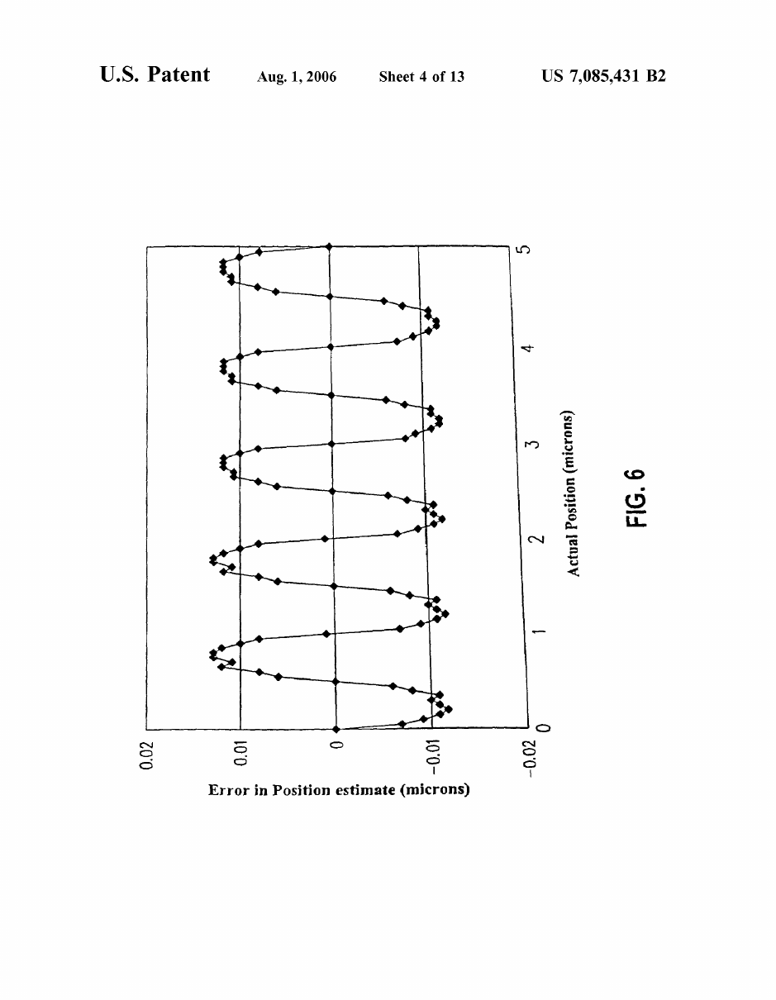
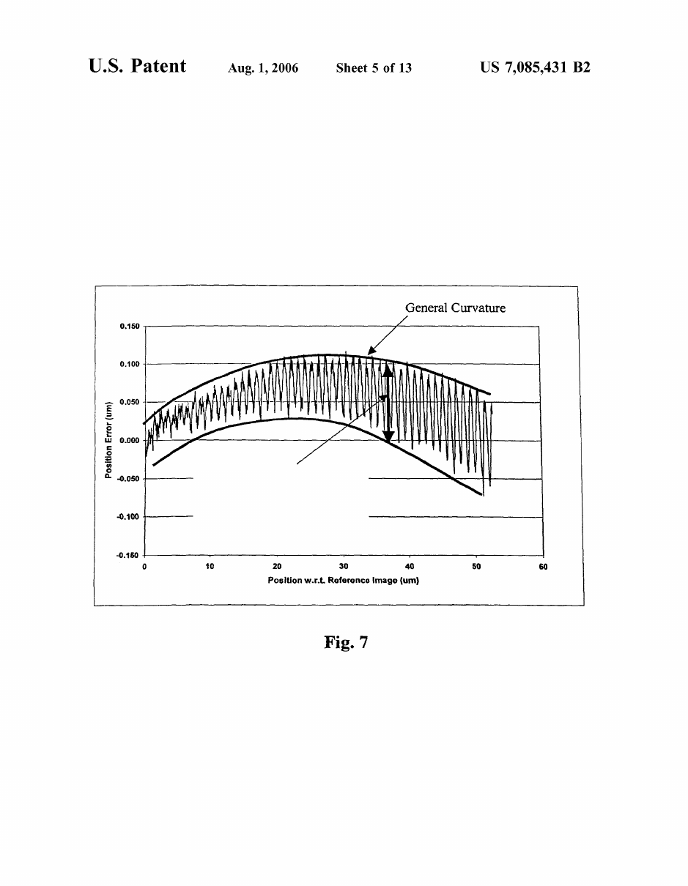
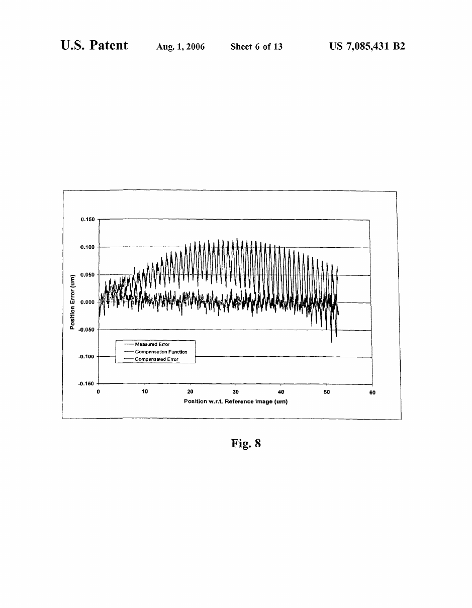

# US 7,085,431 B2 번역

번역 범위: 전문. 서지 사항, 초록, 발명의 상세한 설명 전부, 도면 설명, 청구항 30개. 인용 문헌 목록은 원문 그대로 둔다.

원문: [US7085431B2.pdf](US7085431B2.pdf) (Google Patents 공보 PDF, 30쪽, 도면 13장). 번역 원본 텍스트는 Google Patents 본문 텍스트(https://patents.google.com/patent/US7085431B2/en)를 쓰고, PDF 1쪽의 서지 사항과 대조했다. 2026-11-04 받음.

용어

- intra-reference-image position error: 기준 영상 내 위치 오차. 기준 영상 하나를 바꾸지 않고 쓰는 동안, 현재 영상이 기준에서 멀어질수록 생기는 위치 오차.
- reference image update: 기준 영상 갱신. 현재 영상이 기준과 충분히 겹치지 않게 되기 전에 기준 영상을 새것으로 바꾸는 것.
- displaced image: 이동 영상. 기준 영상을 찍은 뒤 표면이 움직인 상태에서 찍은 영상.
- uncompensated displacement value: 보상 전 변위 값.
- systematic displacement error: 계통 변위 오차.
- pixel pitch: 화소 간격.
- scale factor error: 척도 오차. 변위에 비례하는 오차.

---

## 서지 사항 (PDF 1쪽)

| 항목 | 내용 |
|---|---|
| (12) | 미국 특허 |
| (10) 특허 번호 | US 7,085,431 B2 |
| (45) 등록일 | 2006-08-01 |
| (54) 명칭 | Systems and methods for reducing position errors in image correlation systems during intra-reference-image displacements (기준 영상 내 변위 동안 영상 상관 시스템의 위치 오차를 줄이는 시스템과 방법) |
| (75) 발명자 | Benjamin K. Jones, Seattle, WA (US); Michael Nahum, Kirkland, WA (US) |
| (73) 권리자 | Mitutoyo Corporation, Kawasaki (JP) |
| (*) 고지 | 35 U.S.C. 154(b)에 따라 존속 기간이 602일 연장 또는 조정됨 |
| (21) 출원 번호 | 09/987,162 |
| (22) 출원일 | 2001-11-13 |
| (65) 공개 | US 2003/0090681 A1, 2003-05-15 |
| (51) Int. Cl. | G06K 9/64 (2006.01) |
| (52) U.S. Cl. | 382/278; 382/293 |
| 심사관 | Primary Examiner Daniel Mariam |
| 대리인 | Oliff & Berridge, PLC |
| 청구항, 도면 | 청구항 30개, 도면 13장 |
| 패밀리 (Google Patents) | GB2384050B, DE10252321A1, JP2003178297A, CN1326090C |
| 상태 (Google Patents) | Expired, Fee Related (만료 예정일 2023-07-08로 표시) |

인용 문헌 (원문 그대로)

```
U.S. PATENT DOCUMENTS
5,608,453 A * 3/1997 Gerber et al.
5,610,823 A * 3/1997 Gregory
5,754,226 A * 5/1998 Yamada et al.
5,793,430 A * 8/1998 Hackett et al.
6,134,271 A * 10/2000 Nakaya et al.
6,385,245 B1 * 5/2002 De Haan et al.
6,483,538 B1 * 11/2002 Hu
6,517,486 B1 * 2/2003 Li
6,687,013 B1 * 2/2004 Isshiki et al.
FOREIGN PATENT DOCUMENTS
EP 0 347 912 12/1989
JP A 05-018714 1/1993
WO WO 92/01923 3/1991
* cited by examiner
```

## (57) 초록

영상 상관 시스템에서 쓰는 위치 오차 보정(또는 저감) 방법과 시스템이다. 이 방법은 오차 함수를 얻는다. 이 오차 함수는 대체로 두 가지를 반영한다. 하나는 정해진 기준 영상 갱신 길이에 걸쳐 생기는 오차이고, 다른 하나는 제1 주파수로 생기는 오차다. 그 밖의 여러 시스템 오차도 반영한다. 이 오차를 제1 기준과 비교해 위치 오차를 맞출 수 있다. 여러 실시예에서, 오차 함수를 제1 기준에 맞출 때 오차 함수의 매개변수를 바꿀 수 있다. 이렇게 얻은 오차 함수로 위치 오차를 정하고, 영상 상관 시스템을 더 정확하게 만든다. 한 구현 예에서 제1 주파수는 화소 간격과 관련된다. 기준 영상 갱신 길이는 기준 영상을 바꾸는 거리와 관련되며, 쓸 수 있는 최대 기준 영상 갱신 길이다.

---

## 발명의 배경

### 1. 발명의 분야

이 발명은 영상 상관 시스템에 관한 것이다.

### 2. 관련 기술

여러 알려진 장치가 센서 배열로 얻은 영상과, 그 영상들 사이의 상관을 써서 변형이나 변위를 정한다. 예를 들어 그런 장치의 한 부류는, 광학적으로 거친 표면에 광원을 비추어 생기는 스페클 영상을 얻는 방식에 바탕을 둔다. 광원은 대개 결맞음 광원이다. 레이저를 내는 광원 같은 것이다. 그런 광원에는 레이저, 레이저 다이오드 따위가 있다. 광원이 거친 표면을 비추면, 표면에서 흩어진 빛이 광 센서에 맺힌다. 광 센서는 CCD일 수도 있고, CMOS 영상 센서 배열 같은 반도체 영상 센서 배열일 수도 있다.

거친 표면을 옮기거나 변형하기 전에, 첫 번째 스페클 영상, 곧 기준 스페클 영상을 찍어 저장한다. 그다음 표면을 옮기거나 변형한 뒤 두 번째 스페클 영상, 곧 이후 스페클 영상을 찍어 저장한다. 그리고 기준 영상과 두 번째 영상을 화소 단위로 비교한다. 대개 여러 번 비교한다. 비교할 때마다 기준 영상과 두 번째 영상을 서로 어긋나게, 곧 공간적으로 평행 이동시킨다. 비교와 비교 사이에 어긋남 양을 알려진 양만큼 늘린다. 예를 들어 영상 요소 하나, 화소 하나, 또는 정수 개의 영상 요소나 화소만큼 늘린다.

각 비교에서, 기준 영상의 한 화소 값에 두 번째 영상의 대응 화소 값을 곱하거나, 그 값을 뺀다. 대응 화소는 어긋남 양으로 정한다. 화소별 연산 결과를 모두 더해, 그 비교의 상관 값을 정한다. 이 상관 값을 그 비교의 어긋남 양, 곧 공간 이동 위치에 대해 그리면 상관 함수 값 점 하나가 된다. 기준 영상과 첫 영상 사이의 상관이 가장 큰 어긋남에서, 상관 함수 값 점 그림에 봉우리나 골이 생긴다. 봉우리인지 골인지는 화소 비교를 어떻게 하느냐에 달렸다. 봉우리나 골에 해당하는 어긋남 양이, 기준 스페클 영상과 두 번째 스페클 영상 사이의 변위나 변형 양이다.

부화소 분해능과 정확도가 필요한 영상 상관 시스템에서는 부화소 보간으로 부화소 분해능을 얻는다. 알려진 실험실용 시스템에서는 대개 다음과 같이 부화소 보간을 한다. 보통의 상호 상관 함수의 화소 단위 이산 점들에 연속 함수를 맞춘다. 맞춘 함수의 극값, 곧 봉우리를 부화소 분해능으로 찾는다. 그 극값 위치를 기준 영상과 두 번째 영상 사이의 참 어긋남, 따라서 변위의 가장 좋은 추정이라고 본다. 비슷한 절차를 합성 영상에 쓰는 방법도 알려져 있다. 이웃한 원래 화소 값 사이를 보간해 부화소 간격의 합성 화소 값을 만들고, 마치 화소가 원하는 부화소 위치에 놓인 채로 영상을 찍은 것처럼 다룬다.

부화소 분해능이 필요한 보통의 영상 상관 시스템과 고정밀 실험실 시스템에서는, 기준 영상과 두 번째 영상 사이의 변위를 부화소 분해능으로 정할 때 한 부화소 안에서 계통 변위 오차가 생긴다. 예를 들어 상호 상관 알고리즘이 쓰는 보간 방법 때문에 생기는 계통 변위 오차가 부화소 영상 상관에 들어갈 수 있다. 변위를 정하는 계통 오차는 여러 요인에 영향을 받는다. 스페클 무늬의 주파수 성분, 상관에 쓰는 보간기의 진폭 감쇠와 위상 오차 같은 것이다. 상관 함수를 모델링하는 보간 함수의 종류(선형, 2차, 가우스 등)에도 영향을 받는다.

미국 특허 출원 09/731,671(이하 '671 출원', 전체를 참조로 포함한다)은 상관 기반 위치 변환기에서 변위를 높은 정확도로 정하는 시스템과 방법을 밝힌다. 671 출원은 상관 기반 위치 변환기 따위에서 영상의 부화소 변위를 추정하는 시스템과 방법을 밝힌다. 그 시스템과 방법은, 보통의 부화소 추정 방법을 여러 상관 함수 값 점에 쓸 때 생기는 계통 변위 추정 오차를 없앤다. 특히 상관 함수 값 점이 비대칭으로 놓일 때 생기는 오차를 없앤다.

미국 특허 출원 09/860,636(이하 '636 출원', 전체를 참조로 포함한다)은 영상 상관 시스템에서 누적되는 계통 오차를 줄이는 시스템과 방법을 밝힌다. 636 출원은 영상 상관 기반 위치 변환기 따위에서 영상의 부화소 변위에 누적되는 계통 오차를 줄인다. 그러나 636 출원의 시스템과 방법은, 평행하지 않은 광원이나 광학 왜곡, 또는 둘 다로 생기는 영상 상관 시스템의 위치 오차를 보상하지 않는다.

## 발명의 요약

발명자들은 다음을 알아냈다. 부화소 분해능이 필요한 영상 상관 시스템과 고정밀 실험실 시스템은 계통 변위 오차 외에도, 평행하지 않은 광원이나 광학 왜곡, 또는 둘 다로 생기는 위치 오차를 겪는다. 예를 들어 671 출원의 시스템과 방법은, 평행하지 않은 광원이나 광학 왜곡으로 생기는 위치 오차를 보상하지 않는다. 636 출원의 시스템과 방법도 마찬가지다.

발명자들은 보통의 영상 상관 시스템에서 변위 위치를 정할 때 기준 영상 내 위치 오차가 들어간다는 것을 발견했다. 이 변위 오차는 기준 영상과 두 번째 영상 사이의 변위에 따라 달라진다. 곧 기준 영상 내 위치 오차는, 기준 영상을 바꿀 필요가 없는 변위 범위 안에서 생기는 오차다.

발명자들은 또한 여러 예시 영상 상관 시스템에서, 평행하지 않은 광원이나 광학 왜곡 때문에 기준 영상 내 변위 오차가 생길 수 있음을 알아냈다. 두 번째 영상의 위치가 기준 영상 위치에서 몇 화소 넘게 벗어나면, 이 오차가 영상 상관 시스템의 정확도를 해친다. 따라서 몇 화소마다 기준 영상 위치를 바꾸지 않으면, 이 위치 오차 때문에 정확도가 떨어진다. 반대로 이 오차를 피하려고 기준 영상을 자주 바꾸면, 시스템 메모리 요구와 측정 속도가 나빠질 수 있다. 636 출원에서 다룬 것처럼, 기준 영상을 바꿀 때 누적되는 오차도 늘어날 수 있다.

보통의 영상 상관 장치와, 영상 상관을 고정밀 위치 결정 등에 쓰는 실험실 시스템 모두에서, 평행하지 않은 광원과 광학 왜곡으로 생기는 위치 오차의 실제 문제는 충분히 다뤄지지 않았다.

특히 이런 장치와 시스템은, 평행하지 않은 광원이나 광학 왜곡으로 생기는 위치 오차를 줄이거나 보정하는 일을 충분히 고려하지 않았다. 곧 변위가 화소 간격 몇 개를 넘을 때 생길 수 있는 위치 오차를 충분히 고려하지 않았다. 이 위치 오차와 그 밖의 기준 영상 내 위치 오차는 특정 시스템 설계나 구성에 고유하다. 따라서 특정 설계나 구성에 대해, 이 오차를 정해지지 않은(임의의) 기준 영상 위치에 대한 변위의 함수로 특성화할 수 있다. 그 뒤로는 어떤 기준 영상 위치에 대한 변위든 그 특성화를 바탕으로 보상하거나 보정할 수 있다.

이 발명은 따로, 기준 영상과 두 번째 영상 사이의 변위와 관련된 기준 영상 내 오차를 줄이는 시스템과 방법을 제공한다.

이 발명은 따로, 영상 상관 시스템에서 평행하지 않은 광원이나 광학 왜곡 때문일 수 있는 위치 오차를 줄이는 시스템과 방법을 제공한다.

이 발명은 따로, 위치 오차를 줄이는 시스템과 방법을 제공한다.

이 발명은 따로, 상관 기반 위치 변환기 같은 영상 상관 변위 감지 시스템에서 위치 오차를 줄이는 시스템과 방법을 제공한다.

이 발명은 따로, 계산을 실시간으로 해서 정확한 변위 결정 속도를 높이는 시스템과 방법을 제공한다.

이 발명은 따로, 기준 영상과 두 번째 영상 사이의 변위로 생기는 기준 영상 내 위치 오차를 줄이거나 보정해, 기준 영상을 덜 자주 바꿔도 되는 시스템과 방법을 제공한다.

이 발명은 따로, 평행하지 않은 광원이나 광학 왜곡 등에서 생기는, 기준 영상과 두 번째 영상 사이의 변위로 인한 기준 영상 내 위치 오차를 줄이거나 보정해, 기준 영상을 덜 자주 바꿔도 되는 시스템과 방법을 제공한다.

이 발명은 따로, 평행하지 않은 광원이나 광학 왜곡으로 생기는 위치 오차를 보정하거나 줄여, 기준 영상을 덜 자주 바꿔도 되는 시스템과 방법을 제공한다.

이 발명은 따로, 스페클 영상으로 표면의 변위를 재는 데 특히 알맞은 시스템과 방법을 제공한다.

이 발명의 시스템과 방법은 센서 "영상"을 두고 설명한다. 여기서 "영상"은 광학 영상에 한정되지 않고, 더 넓게 1차원, 2차원 또는 그 이상 차원으로 배열된 센서 값들의 집합을 뜻한다. 마찬가지로 "화소"는 광학 영상 요소에 한정되지 않고, 그런 센서 값 배열의 낱알 크기를 뜻한다. "영상"은 영상 전체에 한정되지 않고, 센서 값 배열을 포함하는 영상의 어떤 부분이든 뜻한다.

이 발명의 시스템과 방법은, 화소 간격과 관련된 제1 공간 주파수와 기준 영상 변경과 관련된 제2 공간 주파수를 바탕으로, 기준 영상 내 변위의 위치 오차를 추정한다.

이 발명의 상관 시스템과 방법의 여러 예시 실시예에서는, 알려진 또는 앞으로 나올 어떤 영상 상관 방법으로 기준 영상과 이동 영상 사이(또는 현재 기준 영상과 새 기준 영상 사이)의 변위를 정할 때 생기는 여러 계통 변위 오차를 정하는 접근의 이점을 그대로 유지한다. 그러면서 평행하지 않은 광원이나 광학 왜곡 등으로 기준 영상과 두 번째 영상 사이의 변위에 따라 생기는 기준 영상 내 위치 오차를 줄이거나 보정한다.

다른 여러 예시 실시예에서, 이 시스템과 방법은 스페클 영상에 쓰기에 특히 알맞다.

다른 여러 예시 실시예에서, 이 시스템과 방법은 스페클 영상형 판독 헤드로 영상 상관을 빠르고 정확하게 할 때 누적 오차를 줄이는 데 특히 알맞다.

이 발명의 이런 특징과 장점, 그리고 다른 특징과 장점은 아래 여러 예시 실시예의 상세한 설명에 적혀 있거나, 그 설명에서 드러난다.

## 도면의 간단한 설명

다른 측면과 장점은 아래 상세한 설명과 첨부 도면을 읽으면 드러난다. 도면은 설명을 위한 것일 뿐 발명을 한정하지 않는다.

- 도 1은 스페클 영상 상관 광학식 위치 변환기의 블록도다.
- 도 2는 첫 번째 기법에 따라, 현재 기준 영상과 이동 영상의 관계, 그리고 상관 값을 만드는 데 쓰는 두 영상의 부분을 보여 준다.
- 도 3은 두 번째 기법에 따른 같은 관계를 보여 준다.
- 도 4는 세 번째 기법에 따른 같은 관계를 보여 준다.
- 도 5는 첫 영상과 두 번째 영상을 연속된 화소 변위로 어긋나게 하면서 보통의 곱셈형 상관 함수로 비교해 얻은 상관 함수의 한 예시 실시예를 보여 주는 그래프다.
- 도 6은 기준 영상과 현재 이동 영상 사이의 일련의 변위 위치에 걸친 계통 변위 오차를 보여 주는 그래프다.
- 도 7은 영상 상관 측정 시스템에서, 기준 영상과 현재 이동 영상 위치 사이의 변위 위치에 따른 전형적인 기준 영상 내 위치 오차의 한 예시 실시예를 보여 주는 그래프다.
- 도 8은 기준 영상을 약 52.7 μm 변위마다 갱신하는 영상 상관 측정 시스템에서, 이 발명의 한 예시 실시예에 따라 얻은 측정된 기준 영상 내 위치 오차와, 제1 보상 함수로 보상한 기준 영상 내 위치 오차를 보여 주는 그래프다.
- 도 9는 기준 영상을 약 94.6 μm 변위마다 갱신하는 시스템에서, 제2 보상 함수를 쓴 같은 그래프다.
- 도 10은 기준 영상을 약 95 μm 변위마다 갱신하는 시스템에서, 제3 보상 함수를 쓴 같은 그래프다.
- 도 11은 이 발명에 따라 기준 영상 내 위치 오차를 기술하는 함수의 매개변수를 얻는 방법의 한 예시 실시예를 보여 주는 순서도다.
- 도 12는 기준 영상 내 위치 오차를 기술하는 미리 정한 함수를 바탕으로, 측정한 변위 위치의 기준 영상 내 위치 오차를 줄이도록 변위 위치 측정을 보상하는 한 예시 방법을 보여 주는 순서도다.
- 도 13은 이 발명에 따른 도 1의 스페클 영상 상관 광학식 위치 변환기의 신호 생성 및 처리 회로의 한 예시 실시예를 더 자세히 보여 주는 블록도다.
- 도 14는 도 13의 신호 생성 및 처리 회로에 쓸 수 있는 기준 영상 내 오차 보상 결정 회로 또는 루틴의 한 예시 실시예를 더 자세히 보여 주는 블록도다.
- 도 15는 이 발명에 따라 쓸 수 있는 기준 영상 내 오차 보상 회로 또는 루틴의 한 예시 실시예를 더 자세히 보여 주는 블록도다.

---

## 예시 실시예의 상세한 설명

### 장치 구성 (도 1)

도 1은 스페클 영상 기반 광학식 위치 변환기 100의 블록도다. 이 변환기와 여러 알맞은 기계, 광학 구성, 영상 상관 방법, 관련 신호 처리 회로는 미국 출원 09/584,264(이하 '264 출원', 전체를 참조로 포함한다)에 더 자세히 적혀 있다.

도 1의 변환기 100은 판독 헤드 126, 신호 생성 및 처리 회로 200, 광학적으로 거친 표면 104를 포함한다. 도 1에서 판독 헤드 126의 부품과 거친 표면 104의 관계는, 대략 실제 물리 배치에 맞춰 개략적으로 그렸다.

특히 광학적으로 확산하는(거친) 표면 104는 판독 헤드 126의 조명 및 수광 끝 가까이에 놓인다. 광원 130이 그 끝에서 낸 빛이 표면 104를 비추면, 빛은 표면에서 그 끝의 수광 광학 요소 쪽으로 되흩어진다. 표면 104는 따로 마련한 요소의 일부일 수도 있고, 이미 있는 기구의 한 면일 수도 있다.

어느 경우든 표면 104는 광원과 판독 헤드 126 안의 광학계로부터 대체로 일정한 거리에 놓이고, 도 1의 측정 축 110 같은 적어도 하나의 정해진 상대 운동 축을 따라 판독 헤드 126에 대해 움직인다. 상대 운동은 대개 보통의 안내면이나 베어링(도시하지 않음)으로 제한되며, 이것들은 판독 헤드 126과 표면 104의 올바른 상대 위치를 유지하는 틀에 붙는다. 판독 헤드 126에는 장착을 돕고, 내부 부품을 장착 틀이나 표면 104의 예상 운동 축에 맞추는 정렬 구조(도시하지 않음)가 있을 수 있다.

도 1처럼 판독 헤드 126의 수광 광학 요소에는 렌즈 140이 있다. 렌즈 140은 판독 헤드 조립체의 조명 및 수광 끝에 놓이며, 그 광축이 표면 104의 조명된 점과 대체로 맞춰진다. 판독 헤드 126에는 또한 광축을 따라 렌즈 140에서 떨어진 핀홀 조리개판 150과, 조리개판 150에서 광축을 따라 떨어진 광 검출기 160이 있다. 광 검출기 160은 서로 독립된 개별 감광 요소 배열로 구성할 수 있는, 알려진 또는 앞으로 나올 어떤 감광 재료나 장치여도 된다. 카메라, 전자 또는 디지털 카메라, CCD 배열, CMOS 감광 요소 배열 따위다.

표면 104와 판독 헤드 126(렌즈 140, 조리개판 150, 광 검출기 160 포함)의 예시 간격과 배치는 아래와 264 출원에 더 적혀 있다. 광원 130, 렌즈 140, 조리개판 150, 광 검출기 160을 판독 헤드 126의 하우징에 장착하는 일은, 부품을 정밀하고 안정하게 장착한다면 소형 광학계나 산업용 카메라를 만드는 보통 방법으로 하면 된다.

판독 헤드 126을 표면 104 가까이 알맞게 두면, 광 검출기 160이 찍은 각 영상에는 비교적 밝은 점, 곧 스페클이 무작위로 나타난다. 표면 104에서 회절된 빛의 파동이 보강 간섭해 밝기 봉우리를 이루는 곳이다. 상쇄 간섭해 밝기 골을 이루는 곳은 비교적 어두운 점이 된다. 표면 104의 조명된 어느 부분에 해당하는 무작위 무늬는 고유하다. 그래서 표면 104는 특별한 표시 없이도 변위 기준 역할을 할 수 있다.

광 검출기 160은 적어도 한 축을 따라 알려진 간격으로 놓인 영상 요소 162의 배열 166을 가진다. 알려진 간격은 광 검출기 160에 맺힌 두 영상 사이의 변위나 어긋남을 재는 바탕이 되며, 따라서 영상을 만드는 표면, 곧 거친 표면 104의 변위를 재는 바탕도 된다.

판독 헤드 126에는 또한 신호 생성 및 처리 회로 200의 적어도 일부가 들어 있다. 도 1처럼 회로 200의 신호선 132는 광원 130에 이어져 광원을 제어하거나 구동한다. 신호선 164는 광 검출기 160과 회로 200을 잇는다. 특히 배열 166의 각 영상 요소 162는 하나씩 주소를 지정해, 그 요소의 빛 세기를 나타내는 값을 신호선 164로 회로 200에 내보낼 수 있다. 회로 200의 다른 부분은 판독 헤드 126에서 떨어진 곳에 둘 수 있고, 판독 헤드 126의 기능을 멀리서 조작하고 표시할 수 있다. 회로 200은 아래 도 12~14에서 더 자세히 설명한다.

도 1처럼 광원 130이 낸 광선 134는 확산하는(거친) 표면 104로 향해 그 일부를 비춘다. 그 결과 표면 104의 조명된 부분은 광축 144 둘레로 빛을 흩뜨리고 회절시킨다. 이 실시예와 다른 실시예의 구조와 동작은 아래와 264 출원에 더 적혀 있다.

광원 130이 백색광 광원이면, 그 빛은 조명된 부분의 영상을 만들어 영상 요소 162의 배열 166에 맺을 수 있다. 이 영상도 스페클 영상과 같은 방식으로 상관할 수 있지만, 거친 표면 104에서 흩어져 생기는 스페클은 들어 있지 않다.

광원 130이 결맞음 광원이고 신호선 132의 구동 신호로 광선 134를 결맞음 광선으로 내보내면, 결맞음 광선 134가 표면 104의 일부를 비춘다. 조명된 부분은 판독 헤드 126 광학계의 광축 144 위에 놓인다. 특히 조명된 부분에서 흩어진 빛 136은 렌즈 140이 모은다.

렌즈 140은 모은 빛 142를 핀홀 152가 있는 조리개판 150에 투사한다. 렌즈 140과 판 150 사이 거리는 렌즈 140의 초점 거리 f와 같다. 판 150과 표면 104의 조명된 부분 사이 거리는 h다.

판 150을 렌즈 140의 초점 거리 f에 두면, 스페클 영상 기반 광학식 위치 변환기의 광학계는 텔레센트릭이 된다. 또한 핀홀판 150의 핀홀 152를 쓰면, 스페클 크기와 스페클 무늬의 팽창은 핀홀 152의 치수에만 달려 있고, 특히 렌즈 140의 렌즈 매개변수와 무관해진다.

렌즈 140에서 모은 빛 142는 핀홀 152를 지난다. 특히 핀홀 152를 지난 빛 154는 광축 144를 따라 광 검출기 160의 영상 요소 162 배열 166에 투사된다. 감광 요소 162 배열 166의 면은 판 150에서 거리 d만큼 떨어져 있다. 스페클 크기는 핀홀 152의 치수가 이루는 각 α와, 핀홀판 150과 배열 166 면 사이 거리 d에만 달려 있다.

조명된 표면 104에서 배열 166으로 받은 빛의 검출 부분 안에서 스페클의 대략 크기 D는 다음과 같다.

$$D \approx \lambda/\tan(\alpha) = (\lambda \cdot d)/w \qquad (1)$$

여기서

- λ는 광선 134의 파장이다.
- d는 핀홀판 150과 배열 166 면 사이 거리다.
- w는 둥근 핀홀 152의 지름이다.
- α는 거리 d와 같은 반지름에서 치수 w가 이루는 각이다.

여러 예시 실시예에서 광학식 위치 변환기 100의 이 매개변수들의 대표 값은 λ=0.6 μm, d=10 cm(10⁵ μm), w=1 mm(10³ μm)다. 그 결과 대략의 스페클 크기 D는 약 60 μm다.

높은 분해능을 얻으려면 평균 스페클 크기가 광 검출기 160의 영상 요소 162 화소 크기와 대략 같거나 더 큰 것이 가장 쓸모 있다. 또한 판독 헤드 126의 여러 실시예에서 평균 스페클 크기는 영상 요소 162 화소 간격의 약 2배에서 10배다.

### 영상 취득과 기준 영상 운용

영상을 얻으려면 회로 200이 신호선 132로 구동 신호를 내보내 결맞음 광원 130이 결맞음 광선 134를 내게 한다. 광선 134는 거친 표면 104의 일부를 비추고, 그 부분이 광 검출기 160의 영상 요소 162 배열 166에 맺힌다. 그러면 회로 200은 신호선 164로 여러 신호 부분을 받는다. 각 신호 부분은 하나 이상의 영상 요소 162가 검출한 영상 값에 해당한다.

두 영상 사이의 표면 104 변위를 정하려면, 회로 200이 광 검출기 160에서 받은 첫 영상의 신호 부분들을 메모리에 저장한다. 잠시 뒤 회로 200은 다시 광원 130을 구동하고 신호선 164로 두 번째 영상 신호를 받는다. 대개 두 번째 영상은, 표면 104의 변위 속도에 따라, 첫 영상을 얻은 뒤 짧은 시간 안에 만들어 얻어야 한다. 이 시간은 첫 영상과 두 번째 영상이 충분히 "겹치도록" 짧아야 한다. 곧 첫 영상에 있는 영상 값 무늬가 두 번째 영상에도 있어, 두 영상 사이에 의미 있는 상관을 정할 수 있을 만큼 짧아야 한다.

그러나 어떤 예시 실시예에서는, 특정 위치에 해당하는 하나 이상의 기준 영상을 다음 이동 영상을 얻는 시간보다 오래 저장하는 것이 바람직할 수 있다. 곧 현재의 두 번째 영상을 다음 표본 영상의 첫 영상으로 쓰는 대신, 현재 기준 영상을 잇따른 이동 영상들에 거듭 쓴다. 대개 현재 기준 영상은, 현재 기준 영상과 현재 이동 영상이 더는 충분히 겹치지 않아 강한 상관 봉우리나 골을 만들지 못할 때까지 쓸 수 있다. 이렇게 하면 종래 기법처럼 잇따른 영상 사이에서 위치 오차가 누적되지 않는다.

곧 어느 시점에 현재 이동 영상은, 앞으로의 이동 영상이 현재 기준 영상과 충분히 겹치지 않을 수 있음을 알리는 상대 변위에 이른다. 그때 새 기준 영상을 정하고, 현재 기준 영상을 그것으로 바꾸거나 갱신해야 한다. 636 출원에 적힌 것처럼, 새 기준 영상은 현재 기준 영상을 처음 쓴 뒤 얻은 일련의 이동 영상 중 적어도 일부에서 고른다. 그렇게 해서 잇따른 기준 영상을 바꿀 때 생기는 계통 변위 오차로 누적된 위치 오차를 알거나, 줄이거나, 이상적으로는 없앤다.

현재 기준 영상과 현재 이동 영상을 처리해 상관 함수를 만든다. 실제로는 현재 이동 영상을 현재 기준 영상에 대해 어긋남 범위에 걸쳐 디지털로 옮긴다. 이 범위에는 두 영상의 무늬가 가장 잘 맞는 어긋남이 들어 있다. 상관 함수는 무늬가 맞는 정도를 나타내며, 따라서 영상을 디지털로 옮길 때 두 영상을 맞추는 데 필요한 어긋남 양을 나타낸다.

### 비교 기법 세 가지 (도 2~4)

현재 기준 영상과 현재 이동 영상을 비교하는 기법은 여럿이다. 예를 들어 도 2의 첫 번째 예시 기법에서는, 현재 이동 영상의 프레임 전체를 현재 기준 영상의 프레임 전체와 화소 단위로 비교해 상관 값 하나를 만든다. 이때 기준 영상과 이동 영상 가운데 상대 영상과 겹치지 않는 영역의 화소는 기본값을 가진 화소와 비교하거나, 기본 비교 값을 주는 따위로 처리한다. 도 5에 보인 것 같은 일련의 상관 값은, 비교할 때마다 현재 이동 영상을 현재 기준 영상에 대해 한 화소씩 옮겨 만든다.

도 3의 두 번째 예시 기법에서는 비교를 두 단계로 한다. 첫 단계에서 현재 이동 영상의 한 줄 이상을 현재 기준 영상의 대응 줄과 통째로 비교해 대략의 상관 값을 만든다. 도 5에 해당하는 일련의 대략 상관 값은, 비교할 때마다 이동 영상을 한 화소씩 옮겨 만든다. 비교하는 줄이 적어서 각 비교를 빨리 만들 수 있다. 그러나 영상 전체가 아니라 적은 줄만 쓰므로, 얻은 상관 값은 모든 줄을 비교했을 때의 값을 대략 나타낼 뿐이다. 그래도 대략 상관 값은 대개 현재 기준 영상과 이동 영상의 대략적인 겹침 양을 알려 준다.

두 번째 단계에서는, 정해진 겹침 정도로 현재 이동 영상과 현재 기준 영상 가운데 상관 값을 만들 때 비교할 부분을 정한다. 곧 보간한 부화소 변위를 정하는 데에는 상관 봉우리나 골 주변의 상관 값만 쓴다. 그래서 봉우리나 골 주변의 상관 값만 한 줄이나 몇 줄보다 많은 줄을 비교해 정하면 된다.

이 두 번째 단계에서는, 대략의 상관 봉우리나 골 주변의 각 화소 어긋남 양에 대해, 현재 이동 영상과 기준 영상의 겹친 영역만 화소 단위로 비교해 그 어긋남의 상관 값을 만든다. 따라서 어긋남 양마다 비교하는 부분의 크기가 다르다. 이 기법은 더 고쳐서, 드문드문 놓인 어긋남 위치에서만 상관 함수 값 점을 정하도록 할 수 있다. 이는 미국 특허 출원 09/921,889(이하 '889 출원', 전체를 참조로 포함한다)에 밝혀져 있다.

도 4의 세 번째 예시 기법에서는, 각 운동 방향으로 정해진 범위를 가진 창으로 현재 이동 영상의 일부를 골라 현재 기준 영상과 비교한다. 이때 창을 현재 기준 영상 위로 훑어, 이동 영상에서 고른 부분과 비교할 기준 영상의 부분을 골라 각 상관 값을 만든다. 곧 어긋남이 0일 때 창은 현재 기준 영상의 한쪽 가장자리에 맞춰진다. 어긋남이 화소 단위로 늘면 창은 반대쪽 가장자리로 한 화소씩 움직인다. 창이 반대쪽 가장자리에 닿을 때가 상관 값을 얻는 마지막 어긋남이다.

예를 들어 세 번째 기법의 여러 예시 실시예에서, 현재 이동 영상의 일부는 진행 방향으로 현재 이동 영상의 프레임 길이 L의 약 ⅓에서 ¼이다. 이 부분은 현재 이동 영상의 기하 중심에 둘 수 있다. 창은 범위가 고정될 수도 있고, 앞서 정한 기준 영상과 이동 영상 사이 변위 양에 따라 범위가 바뀔 수도 있다. 여러 예시 실시예에서 창 크기는, 비교할 화소 수를 줄이면서 동시에 강한 상관 봉우리나 골을 꼭 얻도록 적어도 일부는 고를 수 있다.

세 번째 기법의 다른 여러 예시 실시예에서는, 부분의 위치를 현재 기준 영상에 대한 현재 이동 영상의 변위 방향에 적어도 일부 따라 정할 수 있다. 이 경우 현재 이동 영상이 현재 기준 영상의 오른쪽으로 옮겨졌다면, 현재 기준 영상 부분의 위치를 가운데에서 왼쪽으로 옮긴다. 또 다른 여러 예시 실시예에서는, 부분을 옮기는 정도를 앞선 이동 영상의 현재 기준 영상에 대한 변위 양에 적어도 일부 따라 정할 수 있다. 이렇게 하면 현재 이동 영상의 부분 전체를 현재 기준 영상 프레임 안에 두면서, 새 기준 영상을 써야 하기 전까지 허용하는 상대 변위 양을 늘릴 수 있다.

두 번째와 세 번째 예시 기법처럼 현재 이동 영상의 일부만 현재 기준 영상의 같은 크기 부분과 비교하면, 배경 상관 값에 비해 더 강한 상관 봉우리나 골을 얻을 수 있다. 이 경우 현재 이동 영상의 부분이 현재 기준 영상의 가장자리에 다가가면 현재 기준 영상을 갱신해야 한다.

### 상관 함수와 부화소 보간 (도 5)

1차원 변위에서, 현재 기준 영상과 현재 이동 영상의 비교 부분이 각각 M행 N열의 2차원 배열로 놓인 M×N 화소일 때, 흔한 상관 알고리즘 하나는 다음과 같다.

$$R(p) = \sum_{n=1}^{N}\left(\sum_{m=1}^{M} I_1(m,n)\, I_2(p+m,\, n)\right) \qquad (2)$$

여기서

- R(p)는 현재 어긋남 값에 대한 상관 함수 값이다.
- p는 현재 어긋남 값(화소)이다.
- m은 현재 열이다.
- n은 현재 행이다.
- I1은 첫 영상에서 현재 화소의 영상 값이다.
- I2는 현재 어긋남 값에서 두 번째 영상의 대응 화소 영상 값이다.

2차원 변위에서는 당업자가 식 (2)를 두 번째 차원에 맞게 고칠 수 있다. 그런 고침 하나가 889 출원에 밝혀져 있다.

여러 예시 실시예에서 현재 기준 영상의 프레임 전체를 현재 이동 영상의 프레임 전체와 비교할 때는 순환 경계 조건을 쓴다. 식 (2)처럼 각 행의 상관 값을 얻어 행 상관 값을 더한다. 그 합을 M행에 걸쳐 평균해, 잡음이 줄어든 평균 상관 함수 값 점을 얻는다. 이 평균은, 상관 함수 극값을 보간으로 정할 때 얻으려는 분해능 정도까지 상관 함수 값 점이 안정하도록 하기 위해 바람직하다. 따라서 각 상관 함수 값 점이 이웃 점과 약 1 μm씩 떨어져 있을 때, 보간으로 극값을 정해 대략 나노미터 분해능을 얻으려면, 상관 함수 값 점이 대략 원하는 나노미터 분해능까지 안정해야 한다고 본다.

도 5는 앞서 말한 보통의 곱셈형 상관 함수 방법으로 첫 영상과 두 번째 영상을 비교해 얻은 예시 상관 함수를 보여 주는 그래프다. 특히 도 5의 상관 함수는 여러 이산 상관 함수 값 점 201을 포함한다. 이 점들은 x축을 따라 거리 208로 표시한 화소 간격 P에 해당하는 정해진 어긋남 증분만큼 떨어져 있다. 이 어긋남 증분은 도 1의 거친 표면 104의 변위 증분과 바로 관련될 수 있다. 이 변위 증분은 측정 축 110 방향의 배열 166 영상 요소 162 사이 실효 중심 간격(아래 설명에서 화소 간격 P라고도 부른다)과, 판독 헤드 126 광학계가 표면 104의 변위를 확대하는 배율에 달려 있다.

예를 들어 측정 축 110 방향의 영상 요소 162 실효 중심 간격이 10 μm이고 판독 헤드 126 광학계가 표면 변위를 10배 확대하면, 표면 104의 조명된 부분이 1 μm 움직일 때 영상 요소 162 위의 스페클 무늬는 10 μm 움직인다.

각 상관 함수 값 점 201은 두 번째 영상을 첫 영상에 대해, 측정 축 110 방향의 영상 요소 162 실효 중심 간격만큼 디지털로 옮겨 만든다. 이 경우 영상 요소 162의 실효 중심 간격이 표면 104의 약 1 μm 변위에 해당하므로, 이산 상관 함수 값 점 201은 약 1 μm 변위 거리만큼 떨어진다. 특히 상관 함수 값을 임의 단위로 그린 도 5의 상관 함수는, 첫 영상과 두 번째 영상의 영상(밝기) 무늬가 가장 잘 맞는 어긋남 값, 곧 공간 이동 위치에서 참 연속 상관 함수 205의 극값을 보인다.

여기서는 참 연속 상관 함수의 극값에 해당하는 화소 단위 어긋남 값을, 바탕 상관 함수가 봉우리를 만들든 골을 만들든 봉우리 어긋남이라 부른다. 봉우리 어긋남에 해당하는 표면 변위도, 봉우리든 골이든 봉우리 변위 또는 그냥 변위라고 부른다.

도 5의 예에서 참 연속 상관 함수 205의 극값은 선 203이 가리키듯 약 20화소(영상 요소 162)의 어긋남, 곧 20 μm 변위에서 생긴다. 도 5에서 참 연속 상관 함수 205의 극값은 극단 상관 함수 값 점 204와 구별되지 않는다. 그러나 대개 극값은 화소 간격의 정수배인 어긋남(공간 이동 위치)에서 생기지 않으므로, 극단 상관 함수 값 점과 정확히 겹치지 않는다.

보통은 부화소 분해능과 정확도가 필요하면, 상관 봉우리 202를 이루는 상관 함수 값 점들에 함수 f(x)를 수치적으로 맞춘다. 그다음 맞춘 함수 f(x)의 극값을 찾고, 그 어긋남 값(공간 이동 위치)을 첫 영상과 두 번째 영상의 봉우리 어긋남의 가장 좋은 추정으로 본다. 예를 들어 맞춘 함수 f(x)의 극값에 해당하는 어긋남 값을 찾으려면, f(x)를 미분해 기울기가 0인 x를 정한다.

식 (2) 같은 곱셈형 상관 함수를 쓰면, 상관 함수는 봉우리나 골 주변에서 비교적 휘어 있다. 그래서 수치 맞춤 함수 f(x)는 보통 2차 이상 함수로 고른다. 그러나 발명자들은, 상관 함수 극값을 부화소 수준에서 추정하는 이런 보통 방법이 도 6에 보인 것 같은 무시할 수 없는 계통 변위 오차를 들인다는 것을 알아냈다.

### 화소 주기 계통 오차 (도 6)

도 6은 앞서 말한 보통의 곱셈형 상관 함수 방법으로 첫 영상과 두 번째 영상을 부화소 수준에서 비교한 결과를 보여 주는 그래프다. 도 6에서 위치 추정 오차는 주기적이다. 추정 오차의 주기는 영상을 얻는 데 쓴 화소 간격과 같다. 발명자들은 이런 주기 오차 곡선이 부화소 영상 상관 시스템의 전형적인 계통 오차임을 알아냈다. 발명자들은 또한 이 주기성이 미리 정해진 오차 특성이 되며, 이 발명의 시스템과 방법의 여러 예시 실시예에서 이것을 바탕으로 계통 변위 오차를 줄이거나 피할 수 있음을 알아냈다. 주기 오차 곡선의 진폭이나 자세한 모양을 따로 정하지 않아도 그렇다.



*도 6. 가로축은 실제 위치(μm, 0~5), 세로축은 위치 추정 오차(μm, −0.02~0.02). 오차가 화소 간격과 같은 주기로 되풀이된다.*

발명자들은 나아가, 이런 계통 변위 오차가 특정 영상 상관 기반 변위 측정 시스템에서 비교적 안정하고, 비슷한 여러 시스템 사이에서도 비교적 비슷하다는 것을 알아냈다. 따라서 특정 시스템에서 이 계통 변위 오차를 한 번 구체적으로 정하면, 그 오차는 적어도 하나의 미리 정해진 오차 특성을 드러낸다. 이 특성은 그 시스템을 이후 운용할 때 이 오차를 구체적으로 보상하거나 피하는 바탕이 된다. 또한 특정 시스템이 비슷한 시스템 부류를 대표하는 정도만큼, 그 부류의 어떤 기계의 계통 변위 오차도 대표 시스템의 미리 정해진 오차 특성으로 어느 정도 비슷하게 보상하거나 피할 수 있다.

판독 헤드 126이 거친 표면 104를 따라 움직이면서 현재 기준 영상을 새 기준 영상으로 바꾸면, 도 6 같은 계통 변위 오차가 관련 측정에 들어간다. 따라서 한 기준 영상에서 다음 기준 영상으로 바꿀 때, 636 출원의 시스템과 방법으로 오차를 줄이거나 예측 가능한 방식으로 누적되게 하지 않으면, 이 계통 변위 오차는 관측할 수 없는 방식으로 누적될 수 있다.

### 기준 영상 내 위치 오차 (도 7)

발명자들은 또한 부화소 영상 상관 시스템이 여기서 기준 영상 내 위치(또는 변위) 오차라고 부르는 추가 위치 오차를 겪는다는 것을 알아냈다. 이 오차는 도 7~10에 보이며, 대개 현재 기준 영상과 현재 이동 영상 사이 변위의 복잡한 함수로 바뀐다. 기준 영상 내 위치 오차의 원인을 다 알지는 못하지만, 발명자들은 판독 헤드 126의 광학 요소와 광원 요소에 있는 평행하지 않은 광원이나 광학 왜곡 때문일 가능성이 높다고 본다. 발명자들은 현재 이동 영상이 현재 기준 영상에서 몇 화소 넘게 벗어나면 이 오차가 영상 상관 시스템의 정확도를 해친다는 것을 알아냈다. 따라서 몇 화소마다 현재 기준 영상을 새것으로 바꾸지 않으면, 두 영상 사이 변위가 커질수록 이 오차 때문에 정확도가 떨어진다. 반대로 이 오차를 피하려고 기준 영상을 자주 바꾸면 메모리 요구와 측정 속도가 나빠진다. 이 발명은 기준 영상 내 위치 오차를 줄이거나 이상적으로는 보정해, 영상 상관 시스템의 정확도를 높이는 시스템과 방법을 내놓는다.

도 7은 도 1 같은 영상 상관 측정 시스템에서 현재 기준 영상에 대한 변위 양에 따른 전형적인 기준 영상 내 위치 오차를 보여 주는 그래프다. 도 7의 그래프에는 척도 오차가 없다. 곧 변위에 선형으로 관련된 오차가 들어 있지 않다. 앞서 말했듯 기준 영상 내 위치 오차는 기준 영상 하나를, 그 기준에서 점점 더 멀어지는 이동 영상들과 함께 쓰는 동안 생기는 위치 오차다. 특히 도 7은 레이저 스페클 무늬를 쓰는 영상 상관 측정 시스템에서, 현재 기준 영상에 대한 변위 양에 따른 기준 영상 내 위치 오차를 보여 준다. 도 7의 오차에는 주기 성분이 있다. 이 성분의 봉우리에서 봉우리까지 크기는, 현재 이동 영상이 현재 기준 영상에서 몇 μm만 벗어났을 때 약 30 nm다. 이동이 약 50 μm일 때는 약 100 nm로 커진다. 이 주기 오차 성분은 변위 위치를 부화소 분해능으로 보간하기 때문에 생긴다. 발명자들은 기준 영상 내 위치 오차의 봉우리-봉우리 크기가 커지는 것이 렌즈 왜곡이나 영상 역상관(decorrelation) 때문일 수 있다고 본다. 기준 영상 내 위치 오차는 또한 전반적인 휨을 보인다. 발명자들은 이것이 광원의 불완전한 평행화, 렌즈 왜곡, 영상 역상관 때문일 수 있다고 본다. 그러나 원인과 상관없이 기준 영상 내 위치 오차의 모양은 재고 특성화할 수 있다.



*도 7. 가로축은 기준 영상에 대한 위치(μm, 0~60), 세로축은 위치 오차(μm). 빠른 화소 주기 진동의 폭이 변위에 따라 커지고, 전체가 위로 볼록하게 휜다(General Curvature 표시).*

다만 발명자들은 기준 영상 내 위치 오차를 잴 수는 있었지만, 이 오차의 정확한 원인은 확정하지 못했다. 따라서 발명자들은 지금 이 오차가 렌즈 왜곡, 거친 표면을 비추는 광선의 불완전한 평행화나 결맞음, 그 밖의 광학 수차의 결과일 수 있다고 보지만, 아래와 청구항에서 명시한 경우를 빼고는 이 원인들을 여기 밝힌 내용이나 청구항의 범위를 한정하는 것으로 해석해서는 안 된다.

### 보상 함수 (식 3~6, 도 8~10)

도 7의 기준 영상 내 위치 오차 곡선은 다음 일반 보상 함수로 기술할 수 있다.

$$e(x) = f_1(x)\,f_2(x) + f_3(x) + f_4(x) \qquad (3)$$

여기서

- x는 영상 상관 시스템이 처음 잰, 현재 기준 영상에서 현재 이동 영상까지의 변위 위치다.
- e(x)는 위치 오차다.
- f1(x)는 변위 위치에 따른 주기 보간 오차의 봉우리-봉우리 크기를 기술하는 함수다.
- f2(x)는 주기 보간 오차의 주파수나 모양에 해당하는 주파수나 모양을 가진 주기 함수다.
- f3(x)는 기준 영상 내 위치 오차 곡선의 전반적 휨을 기술하는 함수다.
- f4(x)는 척도 오차를 맞추는 선형 함수다. 척도 오차는 변위에 비례하는 오차 성분이다.

식 (3)의 일반 함수를 구현하는 첫 번째 예시 실시예는 다음과 같다.

$$e(x) = (c_1 + c_2 x)\sin(\omega_1 x + \varphi_1) + \mathrm{ABS}\big(c_3 \sin(\omega_2 x/2)\big) \qquad (4)$$

여기서

- c1, c2, c3은 경험적으로 얻은 매개변수다.
- ω1은 주기 보간 오차의 공간 주파수다.
- φ1은 주기 보간 오차의 공간 위상각이며, 주기 오차와 보상 함수를 맞추는 데 쓴다.
- ω2는 기준 영상 갱신의 공간 주파수다.

식 (3)의 f4(x) 항은 식 (4)의 예시 실시예에 짝이 없다. 곧 식 (4)의 실시예는 선형 척도 오차가 다른 수단으로 이미 없어졌다고 가정한다. 대개 경험 매개변수 c1, c2, c3은 특정 영상 상관 기반 위치 변환기의 도 7~10 같은 기준 영상 내 위치 오차 곡선의 모양을 관찰하거나 분석해 정할 수 있다. 대개 주기 보간 오차의 주파수 ω1은 2π/화소 간격과 관련된다. 마찬가지로 기준 영상 갱신 주파수 ω2는 2π/(기준 영상 갱신 사이 전체 변위)와 관련된다.

도 8은 측정한 기준 영상 내 위치 오차, 해당 오차 보상 함수의 보상 값(측정 오차와 거의 구별되지 않는다), 그 결과 보상된 기준 영상 내 위치 오차를 그린 것이다. 도 8의 그림에는 척도 오차가 없다. 곧 변위에 선형으로 관련된 오차가 들어 있지 않다. 보상된 오차는 주어진 변위에서 측정 오차에서 보상 함수 값을 빼서 얻는다. 특히 화소 간격이 약 1.05 μm이고, 현재 기준 영상을 새 기준 영상으로 바꿀 때 현재 기준 영상과 현재 이동 영상 사이 변위가 약 52.7 μm인 영상 상관 시스템에서, 식 (4)에 쓸 수 있는 값은 다음과 같다.

- c1=0.005
- c2=0.055
- c3=0.075
- ω1=5.977
- φ1=0.897
- ω2=0.119



*도 8. 가로축은 기준 영상에 대한 위치(μm, 0~60), 세로축은 위치 오차(μm). 범례는 Measured Error(측정 오차), Compensation Function(보상 함수), Compensated Error(보상 후 오차). 보상 후 오차에는 전반적 휨이 사라지고 화소 주기 진동이 남는다.*

도 8처럼 식 (4)로 기준 영상 내 위치 오차를 보상하면, 기준 영상을 바꾸지 않고도 평행하지 않은 광원이나 광학 왜곡 등으로 생길 수 있는 기준 영상 내 위치 오차를 보정하거나 그냥 줄일 수 있다. 도 8의 예시 실시예에서는 현재 기준 영상과 현재 이동 영상 사이의 큰 변위, 곧 50 μm가 넘는 변위에서 그렇다. 이로써 영상 상관 시스템의 정확도가 높아진다.

식 (3)의 일반 보상 함수를 구현하는 두 번째 예시 실시예는 다음과 같다.

$$e(x) = (c_1 + c_2 x)\sin(\omega_1 x + \varphi_1) + \mathrm{ABS}\big(c_3 \sin(\omega_2 x/2)\big) + c_4 \sin(\omega_2 x/4) \qquad (5)$$

여기서

- c1, c2, c3, c4는 경험적으로 얻은 매개변수다.
- ω1은 주기 보간 오차의 공간 주파수다.
- φ1은 주기 보간 오차의 공간 위상각이며, 주기 오차와 보상 함수를 맞추는 데 쓴다.
- ω2는 기준 영상 갱신의 공간 주파수다.

식 (4)의 실시예와 비교해, 식 (5)의 실시예는 식 3의 f3(x) 항에 해당하는 항을 하나 더 넣어 기준 영상 내 위치 오차 곡선의 전반적 휨을 더 정밀하게 보상할 수 있다. 대개 경험 매개변수 c1, c2, c3, c4는 특정 위치 변환기의 도 7~10 같은 오차 곡선 모양을 관찰해 정할 수 있다. 대개 주기 보간 오차의 주파수 ω1은 2π/화소 간격과 관련된다. 마찬가지로 기준 영상 갱신 주파수 ω2는 2π/(기준 영상 갱신 사이 전체 변위)와 관련된다.

도 9는 측정한 기준 영상 내 위치 오차, 해당 오차 보상 함수의 보상 값(이번에도 측정 오차와 거의 구별되지 않는다), 그 결과 보상된 오차를 그린 것이다. 도 9의 그림에는 척도 오차가 없다. 보상된 오차는 주어진 변위에서 측정 오차에서 보상 함수 값을 빼서 얻는다. 특히 화소 간격이 약 1.05 μm이고, 기준 영상을 바꿀 때 변위가 약 94.6 μm인 영상 상관 시스템에서, 식 (5)의 보상 함수에 쓸 수 있는 값은 다음과 같다.

- c1=0.005
- c2=0.350
- c3=0.070
- ω1=5.935
- φ1=0.655
- ω2=0.0664

도 9처럼 식 (5)로 보상하면, 기준 영상을 바꾸지 않고도 평행하지 않은 광원이나 광학 왜곡 등으로 생길 수 있는 기준 영상 내 위치 오차를 보정하거나 그냥 줄일 수 있다. 도 9의 예시 실시예에서는 90 μm가 넘는 큰 변위에서 그렇다.

식 (3)의 일반 보상 함수를 구현하는 세 번째 예시 실시예는 다음과 같다.

$$e(x) = (c_1 + c_2 x)\sin(\omega_1 x + \varphi_1) + c_3 \sin\!\big((\pi/D)\,x\big) + c_4 \sin\!\big((\pi/2D)\,x\big) + c_5 x \qquad (6)$$

여기서

- c1, c2, c3, c4, c5는 경험적으로 얻은 매개변수다.
- ω1은 주기 보간 오차의 공간 주파수다.
- φ1은 주기 보간 오차의 공간 위상각이며, 주기 오차와 보상 함수를 맞추는 데 쓴다.
- D는 기준 변위이며, 대개 경험 상수 c1~c5를 정하는 데 쓴 자료의 전체 변위 범위에 해당한다.

대개 경험 매개변수 c1~c5는 특정 위치 변환기의 도 7~10 같은 오차 곡선 모양을 관찰하거나 분석해 정할 수 있다. 대개 주기 보간 오차의 주파수 ω1은 2π/화소 간격과 관련된다. 식 (5)의 실시예와 달리, 식 (3)의 f4(x) 항은 식 (6)의 실시예에 짝이 있다. 곧 식 (6)에는 다른 수단으로 아직 없애지 못한 선형 척도 오차를 보상하는 항이 들어 있다. 또한 식 (5)의 실시예와 달리, 식 (3)의 f3(x) 항은 식 (6)에서 기준 영상 갱신의 고정 공간 주파수 ω2가 아니라 기준 변위 D에 달린 짝 항들을 가진다. 대개 식 (6)은 D보다 약간 큰 변위까지 맞다. 그러나 여러 예시 구현에서 D는 기준 영상을 갱신하기 전에 허용하는 최대 변위를 나타낸다. 그런 구현에서 기준 영상 갱신 전 최대 변위는 대개 영상 프레임의 약 4분의 3까지다.

더 넓게 보면, 식 3의 f3(x) 항에 대응하는 항으로 삼각 함수를 편의상 썼지만, 기준 영상 내 위치 오차 곡선의 전반적 휨을 기술하는 함수라면 어떤 것이든 알맞다.

도 10은 측정한 기준 영상 내 위치 오차, 해당 오차 보상 함수의 보상 값(이번에도 측정 오차와 거의 구별되지 않는다), 그 결과 보상된 오차를 그린 것이다. 도 10의 그림에는 척도 오차가 들어 있다. 곧 변위에 선형으로 관련된 오차가 있다. 이런 오차는 예를 들어 가정한 화소 간격이 참 화소 간격이 아닐 때 생길 수 있다. 보상된 오차는 주어진 변위에서 측정 오차에서 보상 함수 값을 빼서 얻는다. 특히 화소 간격이 약 1.05 μm이고, 기준 영상을 바꿀 때 변위가 약 95 μm인 영상 상관 시스템에서, 식 (6)의 보상 함수에 쓸 수 있는 값은 다음과 같다.

- c1=0.005
- c2=0.00084
- c3=0.35
- c4=0.050
- c5=−0.00835
- ω1=5.984
- φ1=−0.658
- D=95

도 10처럼 식 (6)으로 보상하면, 기준 영상을 바꾸지 않고도 기준 영상 내 위치 오차를 줄이거나 이상적으로는 보정해 영상 상관 시스템의 정확도를 높인다. 이런 오차에는 평행하지 않은 광원이나 광학 왜곡 등으로 생길 수 있는 것이 들어간다. 도 10의 예시 실시예에서는 90 μm가 넘는 큰 변위에서 그렇다.

도 8~10의 결과와 관련해, 식 (4)~(6)의 실시예에서 c1과 c2에 관련된 항은 다른 여러 예시 실시예의 오차 보상 함수에서 뺄 수 있다. 그래도 기준 영상 내 위치 오차 곡선의 전반적 휨으로 생기는 오차는 식의 나머지 항으로 보상된다. 예를 들어 전반적 휨이 주된 시스템 오차라면 이런 실시예가 알맞을 수 있다. 따라서 더 넓게, 여러 예시 실시예에서 식 (3)의 f1(x)f2(x), f3(x), f4(x)에 각각 해당하는 항들을 따로 또는 함께 써서 이 발명에 따라 변위 결정 오차를 줄일 수 있다.

### 매개변수를 얻는 방법 (도 11)

도 11은 이 발명에 따라, 기준 영상 내 변위의 위치 오차를 어느 정도 정확하게 나타내는 함수(또는 식)의 매개변수를 얻는 방법의 한 예시 실시예를 보여 주는 순서도다. 단계 S1000에서 시작해 S1010으로 간다. 여기서 변위의 "실제" 위치 오차를 얻는다. 한 변위의 "실제" 위치 오차는 기준 영상 내 변위의 "실제" 위치 값과, 보상하지 않은 기준 영상 내 변위 위치 값 사이의 차다.

여러 예시 구현에서 현재 변위의 "실제" 위치 값은, 간섭계 등을 포함하되 그에 한정되지 않는, 알려진 또는 앞으로 나올 어떤 변위 측정 방법이나 기기로 바로 얻는다. 다른 여러 예시 구현에서는, 위치 오차와 여러 물리 매개변수 및 시스템 특성(렌즈 수차, 부품 정렬 매개변수, 일반적인 역상관 거동 따위)의 관계를 해석, 상관 연구, 모의 실험으로 이미 알고 있다.

여러 예시 구현에서 현재 변위의 보상 전 기준 영상 내 위치 값은, 알려진 또는 앞으로 나올 어떤 영상 상관 방법을 쓰는 영상 상관 시스템으로 얻는다. "실제" 위치 오차를 얻는 것에는, 이 발명을 실시하는 예시 방법의 일부가 아닌 방법으로 만든 "실제" 위치 오차 값(또는 그 구성 요소)을 받는 것이 들어간다. 다른 여러 예시 구현에서는, 이 발명을 실시하는 예시 방법의 일부로 "실제" 위치 오차 값(또는 그 구성 요소)을 만드는 것이 들어간다.

여러 예시 실시예에서 현재 변위의 "실제" 위치 값은 간접으로 얻는다. 여러 물리 매개변수와 시스템 특성을 재거나 정하고, 알려진 또는 앞으로 나올 해석, 상관, 모의 실험 방법으로 관련 위치 오차를 정하고, 정한 위치 오차를 현재 변위의 보상 전 기준 영상 내 위치 값과 합쳐 "실제" 위치 값을 정한다.

다음으로 단계 S1020에서, 기준 영상 내 위치 오차를 나타내는 함수의 초기 매개변수를 얻거나 현재 매개변수로 정한다. 한 예시 구현에서는 초기 매개변수 c1, c2, c3, c4(식 (5)를 쓸 때), c5(식 (6)을 쓸 때), φ1을 예를 들어 0으로 두고, ω1과 ω2(또는 D)는 각각 화소 간격과 기준 영상 갱신 사이 거리로 둔다. 다른 예시 구현에서는 설계 매개변수가 특성화하려는 상관 시스템과 가깝지만 꼭 같지는 않은 상관 시스템의 매개변수로 초기 매개변수를 둔다.

그다음 단계 S1030에서, 단계 S1010에서 얻은 "실제" 위치 오차와, 현재 매개변수로 추정한 기준 영상 내 변위의 위치 오차 사이의 차를 얻는다. 곧 위치 오차 추정 식으로 현재 매개변수에서 기준 영상 내 변위의 위치 오차 추정을 얻는다. 단계 S1030의 변형으로, 여러 예시 실시예에서는 정한 위치 오차를 바로 추정 위치 오차로 쓴다.

다음 단계 S1040에서, "실제" 위치 오차와 추정 위치 오차 사이의 차가 받아들일 만한지 정한다. 받아들일 만하면 단계 S1060으로 가서 방법을 멈춘다.

반대로 받아들일 수 없으면 단계 S1050으로 가서 새 매개변수를 현재 매개변수로 얻는다. 한 예시 구현에서는 c1, c2, c3, c4(식 (5)를 쓸 때), c5(식 (6)을 쓸 때), φ1을 바꾸고, ω1과 ω2(또는 D)는 고정한다.

다른 예시 구현에서는 c1, c2, c3, c4(식 (5)), c5(식 (6)), φ1, ω1, ω2(또는 D)를 모두 바꾸되, ω1과 ω2(또는 D)의 변화는 c1~c5와 φ1의 변화에 비해 작게 한다. 또 다른 예시 구현에서는 이 매개변수들의 조합을 서로 다른 상대 크기로 바꾼다. 또 다른 예시 구현에서는 하나 이상의 매개변수를 기준 영상에서의 변위에 따라 다르게 바꾼다. 그다음 단계 S1030으로 돌아가, 새 현재 매개변수에서 "실제" 위치 오차와 위치 오차 추정의 차를 얻는다. 단계 S1030~S1050의 고리는 "실제" 위치 오차와 추정 위치 오차의 차가 받아들일 만하다고 판단될 때까지 이어진다.

받아들일 만한 추정 위치 오차를 얻도록 매개변수를 바꾸는 일은, 알려진 또는 앞으로 나올 어떤 절차로든 한다. 사용자가 준 기준에 따른 맞춤, 또는 추정 식이 준 추정 위치 오차와, 기준 영상 내 변위의 "실제" 위치 값과 보상 전 위치의 차 사이의 차를 최소화하는 맞춤 따위가 있으며, 이에 한정되지 않는다.

여러 예시 구현에서 많은 변위에 대한 "실제" 변위 값과 보상 전 위치 값을 미리 얻어, 단계 S1010의 실제 변위 위치 오차를 얻기 전에 준다. 다른 여러 예시 구현에서는 현재 변위의 "실제" 변위 값과 보상 전 위치 값을 단계 S1010의 일부로 실시간에 얻고, 이를 써서 "실제" 위치 오차를 얻는다. 또 다른 여러 예시 구현에서는 "실제" 위치 값과 기준 영상 내 변위의 보상 전 위치 값의 차(곧 "실제" 위치 오차)를 미리 정해 저장해 두고, 단계 S1010에서 그냥 준다.

도 11의 방법에서, 여러 예시 구현에서는 "실제" 위치 오차와 추정 위치 오차의 차가 받아들일 만한지를 사용자 선택으로 정할 수 있다. 예를 들어 변위의 정한 위치를 기준 위치에 맞추는 것 따위다. 다른 여러 예시 구현에서는 전체 누적 오차, 전체 평균 오차, 전체 봉우리-봉우리 오차 따위를 최소로 하는 것으로 받아들일지 정할 수 있다. 또 다른 여러 예시 구현에서는, 기준 영상을 바꾸지 않는 더 넓은 변위 범위의 부분 구간인 특정 변위 범위에서 누적 오차를 최소로 하는 것으로 정할 수 있다.

도 11의 방법에서, 여러 예시 구현에서는 기준 영상을 바꾸지 않는 변위 범위 전체에 걸쳐 하나의 매개변수 집합을 얻는 것으로 받아들일지 정할 수 있다. 다른 여러 예시 구현에서는, 기준 영상을 바꾸지 않는 변위 범위를 여러 부분 구간으로 나누고, 적어도 하나의 매개변수가 적어도 일부 부분 구간에서 다른 값을 갖도록 하는 것으로 정할 수 있다.

특정 영상 상관 기반 변위 측정 시스템의 기준 영상 내 위치 오차 특성을 한 번 구체적으로 정하면, 그 특성은 그 시스템을 이후 운용할 때 이 오차를 구체적으로 보상하거나 줄이는 바탕이 된다. 또한 기준 영상 내 위치 오차 특성은 비슷한 여러 시스템 사이에서 비교적 비슷할 수 있다. 따라서 특정 시스템이 비슷한 시스템 부류를 대표하는 정도만큼, 그 부류의 어떤 기계의 기준 영상 내 위치 오차도 대표 시스템의 미리 정한 특성으로 어느 정도 비슷하게 보상하거나 줄일 수 있다.

### 측정을 보상하는 방법 (도 12)

도 12는 위치 오차를 기술하는 미리 정한 함수를 바탕으로, 변위 위치 측정의 기준 영상 내 위치 오차를 줄이도록 측정을 보상하는 방법의 한 예시 실시예를 보여 주는 순서도다. 단계 S1100에서 시작해 단계 S1110으로 가서 현재 이동 영상을 넣는다. 그다음 단계 S1120에서 현재 기준 영상에 대한 현재 이동 영상의 보상 전 변위 위치 값을 정한다. 이 초기 변위 값은 671, 636, 889 출원에 밝힌 기법 같은, 알려진 또는 앞으로 나올 어떤 기법으로든 정할 수 있다. 다음 단계 S1130에서, 식 3~6 같은 미리 정한 기준 영상 내 오차 함수와 그 함수의 미리 정한 매개변수 값으로, 얻은 초기 변위 값에 대한 기준 영상 내 위치 오차를 정한다. 그다음 단계 S1140으로 간다.

단계 S1140에서, 단계 S1130에서 정한 기준 영상 내 위치 오차를 보상 전 변위 값과 합쳐 기준 영상 내 변위의 보상된 위치 값을 만든다. 그다음 단계 S1150에서 보상된 위치 값을 표시 장치로 내보내거나, 현재 기준 영상과 현재 이동 영상 사이 기준 영상 내 변위의 보상된 추정 위치로 뒤 공정에 넘긴다. 단계 S1160에서 다른 이동 영상을 얻을지 정한다. 그렇다면 단계 S1110으로 돌아간다. 아니면 단계 S1170으로 가서 방법을 멈춘다.

앞서 말한 도 11과 12의 예시 실시예는 기준 영상 내 위치 오차를 보상하는 데 필요한 정보를 기준 영상 위치에 대한 변위의 수학 함수 꼴로 담고, 그 함수를 써서 오차를 보상했다. 그러나 다른 여러 예시 실시예에서는 그 정보를 참조표 같은, 알려진 또는 앞으로 나올 다른 어떤 꼴로도 담고 쓸 수 있다.

참조표를 쓰는 여러 예시 실시예에서는, 도 11의 단계 S1010에 따라 실제 변위 위치 오차를 얻는다. 실제 변위 오차를 기준 영상 내 오차 참조표에 저장하고, 각각 알맞은 변위 위치와 짝짓는다. 그다음 도 12의 단계 S1100~S1170을 하되, 단계 S1130을 이 예시 구현에 맞게 고친다. 도 12의 단계 S1130은 얻은 초기 변위 값에 대한 기준 영상 내 위치 오차를 얻는다. 앞서의 도 12 구현에서는 이 오차를 미리 정한 오차 함수로 정했다. 이와 달리 이 예시 실시예에서는 미리 정한 기준 영상 내 오차 참조표로 정한다.

여러 예시 구현에서 기준 영상 내 오차 참조표는, 앞서 말한 주기 보간 오차의 공간 주파수의 1/20 간격의 변위에 해당하는 자료를 담는다. 얻은 초기 변위 값에 가장 가까운 참조표 변위 값에 해당하는 참조표 오차 값을 현재 기준 영상 내 위치 오차로 쓴다. 다른 여러 예시 구현에서는, 얻은 초기 변위 값을 감싸는 두 참조표 변위 값에 해당하는 두 오차 값 사이를 보간해 현재 기준 영상 내 위치 오차를 정한다. 보간 값은 감싸는 두 참조표 변위 값과 얻은 초기 변위 값의 관계에 따라 알려진 방법으로 정한다. 참조표의 다른 변위 간격을 쓰거나, 여러 구간에 걸친 기준 영상 내 위치 오차의 수학 함수를 여러 보간 방법과 섞는 다른 구현들도 당업자에게 분명할 것이다.

### 신호 생성 및 처리 회로 (도 13)

도 13은 이 발명의 시스템과 방법의 한 예시 실시예를 구현하는 신호 생성 및 처리 회로 200의 한 예시 실시예를 보여 주는 블록도다. 도 13처럼 회로 200은 제어기 210, 광원 구동기 220, 광 검출기 인터페이스 230, 메모리 240, 비교 회로 250, 비교 결과 누산기 260, 보간 회로 270, 기준 영상 내 위치 오차 보상 회로 300, 위치 누산기 280, 표시 구동기 290, 선택적 입력 인터페이스 295를 포함한다.

제어기 210은 제어선 211로 광원 구동기 220에, 신호선 212로 영상 검출기 인터페이스 230에, 신호선 213으로 메모리 240에 이어진다. 마찬가지로 제어기 210은 신호선 214~219 중 하나 이상으로 비교 회로 250, 비교 결과 누산기 260, 보간 회로 270, 기준 영상 내 보상 회로 300, 위치 누산기 280에 이어진다. 끝으로 제어기 210은 제어선 220으로 표시 구동기 290에, 입력 인터페이스 295가 있으면 입력 신호선 221로 그것에 이어진다. 메모리 240은 첫(기준) 영상 부분 242, 두 번째(이후) 영상 부분 244, 상관 부분 246을 포함한다.

동작할 때 제어기 210은 신호선 211로 광원 구동기 220에 제어 신호를 내보낸다. 이에 따라 광원 구동기 220은 신호선 132로 광원 130에 구동 신호를 내보낸다. 이어서 제어기 210은 신호선 212와 212로 영상 검출기 인터페이스 230과 메모리 240에 제어 신호를 내보내, 광 검출기 160에서 신호선 164로 받은, 각 영상 요소 162에 해당하는 신호 부분을 첫(기준) 영상 부분 242나 두 번째(이후) 영상 부분 244에 저장한다. 특히 개별 영상 요소 162의 영상 값은 배열 166에서 영상 요소 162의 위치에 맞춰 첫 영상 부분 242와 두 번째 영상 부분 244에 2차원 배열로 저장된다.

첫 영상 부분 242에 첫 영상이 저장되면, 제어기 210은 정해진 짧은 시간을 기다렸다가 다시 신호선 211로 광원 구동기 220에 제어 신호를 내보내 광원 130을 다시 구동한다. 그다음 신호선 212와 212의 신호로 영상 검출기 인터페이스 230과 메모리 240을 제어해, 얻은 영상을 두 번째 영상 부분 244에 저장한다.

그다음 제어기 210은 신호선 215로 비교 회로 250에 신호를 내보낸다. 이에 따라 비교 회로 250은 첫 영상 부분 242에서 특정 화소의 영상 값을 신호선 252로 받고, 현재 어긋남에 따른 대응 화소의 영상 값을 두 번째 영상 부분 244에서 신호선 252로 받는다. 그다음 비교 회로 250은 상관 알고리즘을 적용해 비교 결과를 정한다. 비교 회로 250은 현재 어긋남에서 첫 영상 부분 242의 첫 영상과 두 번째 영상 부분 244의 두 번째 영상을 화소 단위로 비교하는 데, 알려진 또는 앞으로 나올 어떤 알맞은 상관 기법이든 쓸 수 있다. 비교 회로 250은 현재 상관 어긋남의 비교 결과를 신호선 254로 비교 결과 누산기 260에 내보낸다.

비교 회로 250이 각 영상 요소 162의 영상 값을 첫 영상 부분 242에서 꺼내 두 번째 영상 부분 244의 대응 값과 비교하고, 상관 기법을 적용해 비교 결과를 비교 결과 누산기 260에 내보내고 나면, 누산기 260에 저장된 값이 도 7에 예시한 것처럼 정해진 단위로 현재 어긋남의 상관 값이 된다. 그러면 제어기 210은 신호선 214로 비교 결과 누산기 260에, 신호선 213으로 메모리 240에 신호를 내보낸다. 그 결과 누산기 260에 저장된 상관 알고리즘 결과가 출력되어 메모리 240의 상관 부분 246에서 현재 어긋남에 해당하는 자리에 저장된다.

그다음 제어기 210은 신호선 214로 신호를 내보내 결과 누산기 260을 비운다. 첫 영상 부분 242의 첫 영상과 두 번째 영상 부분 244의 두 번째 영상 사이의 원하는 모든 어긋남에 대해 비교 회로 250이 비교를 마치고, 결과가 비교 결과 누산기 260에 누적되어 제어기 210의 제어로 상관 부분 246에 저장되면, 제어기 210은 신호선 216으로 보간 회로 270에 제어 신호를 내보낸다.

이에 따라 보간 회로 270은 상관 부분 246에 저장된 상관 결과를 신호선 252로 받는다. 그리고 상관 함수의 봉우리나 골과 겹치는 상관 값을 찾고, 상관 함수의 봉우리나 골 근처에서 고른 상관 함수 값 점들로 보간해 봉우리 어긋남 값, 곧 영상 변위 값을 부화소 분해능으로 정한다. 그다음 보간 회로 270은 제어기 210의 신호선 216 신호에 따라, 정한 부화소 변위 추정 값을 신호선 279로 기준 영상 내 위치 오차 보상 회로 300에 내보낸다.

기준 영상 내 위치 오차 보상 회로 300은 제어기 210의 신호선 218 신호에 따라, 신호선 279로 받은 부화소 변위 추정 값에 미리 정한 기준 영상 내 오차 보상 함수를 적용해 보상된 부화소 변위 추정 값을 만든다. 이 값은 신호선 302로 위치 누산기 280에 나간다. 위치 누산기 280은 제어기 210의 신호선 217 신호에 따라, 보상된 변위 추정 값을 누산기 280에 저장된 누적 변위에 더한다. 그다음 위치 누산기 280은 갱신된 위치 변위를 신호선 282로 제어기 210에 내보낸다.

이에 따라 제어기 210은 표시 구동기 290이 있으면 갱신된 변위 값을 신호선 220으로 내보낼 수 있다. 그러면 표시 구동기 290은 신호선 292로 표시 장치(도시하지 않음)에 구동 신호를 내보내 현재 변위 값을 보여 준다.

신호선 296이 있으면 조작자나 협력 시스템과 제어기 210 사이를 잇는다. 입력 인터페이스 295가 있으면 입력 신호나 명령을 버퍼에 담거나 바꾸어 알맞은 신호를 제어기 210에 보낼 수 있다. 입력 인터페이스 295는 또한 링크 412로 아래에서 더 설명할 기준 영상 내 위치 오차 보상 함수 결정 시스템 400에 떼었다 붙였다 할 수 있게 이어질 수 있다.

### 보상 회로 (도 14)

도 14는 기준 영상 내 현재 변위의 위치 오차를 추정하는 기준 영상 내 위치 오차 보상 회로 300의 한 예시 구현을 더 자세히 보여 주는 블록도다. 도 13처럼 보상 회로 300은 기준 영상 내 위치 오차 획득 회로(또는 모듈) 310, 보상된 변위 값 결정 회로(또는 모듈) 330, 그리고 둘을 동작상 잇는 신호선 320을 포함한다.

동작할 때 획득 회로 310은 보간 회로 270에서 신호선 279로 현재의 보상 전 변위 추정 값을 받고, 이미 매개변수를 얻어 둔 상태에서 그 값에 대한 기준 영상 내 위치 오차를 얻는다. 다른 여러 예시 구현에서는, 식 (4), (5)와 다르지만 기준 영상 내 위치 오차에 맞는 다른 식으로 현재의 보상 전 부화소 변위 추정 값에 대한 오차를 얻는다. 획득 회로 310은 미리 정한 오차 함수와 받은 보상 전 부화소 변위 추정 값으로 현재 변위의 기준 영상 내 위치 오차를 얻고, 그 값을 신호선 320으로 결정 회로 330에 내보낸다.

결정 회로 330은 보간 회로 270에서 신호선 279로 보상 전 부화소 변위 추정 값을, 신호선 320으로 그 값에 대한 기준 영상 내 위치 오차를 받는다. 결정 회로(또는 모듈) 330은 두 값을 합쳐 보상된 부화소 변위 추정 값을 만든다. 그리고 그 값을 신호선 302로 위치 누산기 280에 내보낸다.

### 보상 함수 결정 시스템 (도 15)

도 15는 기준 영상 내 위치 오차 보상 함수 결정 시스템 400의 한 예시 실시예를 더 자세히 보여 주는 블록도다. 도 15처럼 시스템 400은 링크 412로 입력 인터페이스 295에 떼었다 붙였다 할 수 있게 이어질 수 있다. 시스템 400이 입력 인터페이스 295에 붙어 있는 설정 작업 동안, 제어기 210은 보간 회로 270의 원래 보상 전 부화소 변위 값을 링크 412로 시스템 400에 줄 수 있다. 시스템 400은 보상 전 부화소 변위 추정 값과, 그에 해당하는 실제 부화소 변위 값의 측정을 써서 도 7~10 같은 기준 영상 내 위치 오차 곡선을 만든다. 그다음 시스템 400은 기준 영상 내 오차 보상 함수를 정해 입력 인터페이스 295와 링크 412를 거쳐 제어기 210에 내보낸다. 제어기 210은 이 보상 함수를 보상 회로 300에 주어, 운용 모드에서 보상 전 변위 추정 값을 보상된 변위 추정 값으로 바꾸는 데 쓸 수 있도록 설정한다.

도 15처럼 시스템 400은 입출력 인터페이스 410, 메모리 420, 제어기 430, 매개변수 획득 회로(또는 모듈) 440, 오차 획득 회로(또는 모듈) 450, 오차 수용 판정 회로(또는 모듈) 460을 포함하며, 각각 제어/자료 버스 470에 이어진다. 제어기 430은 시스템 400을 이루는 여러 부품의 동작을 제어하고 자료를 처리한다. 메모리 420은 여러 부품의 처리에 필요한 매개변수와 중간, 최종 결과를 저장할 공간을 준다. 입출력 인터페이스는 적어도 신호 생성 및 처리 회로 200으로 가는 링크 412에 이어질 수 있고, 이어진 사용자 입력 장치의 입력과 사용자 출력 장치로의 출력도 허용한다.

동작할 때 매개변수 획득 회로(또는 모듈) 440은 현재 변위의 기준 영상 내 위치 오차를 추정하는 함수의 초기 매개변수를 얻는다(만들거나 받는다). 그리고 정한다. 예를 들어 초기 매개변수를 0으로 둘 수 있다. 또는 부품 치수가 다른 시스템의 매개변수 값으로 둘 수 있다. 얻은 초기 매개변수는 오차 획득 회로(또는 모듈) 450에 준다.

오차 획득 회로(또는 모듈) 450은 얻은 초기 매개변수로, 위치 오차를 추정하는 식을 써서 현재 변위의 기준 영상 내 위치 오차 추정을 얻는다. 얻은 추정은 오차 수용 판정 회로(또는 모듈) 460에 준다.

오차 수용 판정 회로(또는 모듈) 460은 주어진 또는 정한 기준 영상 내 변위의 위치 오차를 바탕으로, 남은 위치 오차가 받아들일 만한지 정한다. 이를 정할 때, 여러 예시 실시예에서 판정 회로 460은 현재 변위의 "실제" 위치 값과 현재 변위의 보상 전 기준 영상 내 위치 사이의 차에 접근할 수 있다. 여러 예시 구현에서 현재 변위의 "실제" 위치 값은, 간섭계 등을 포함하되 그에 한정되지 않는, 영상 상관 시스템의 분해능 이상의 분해능으로 변위를 재는 알려진 또는 앞으로 나올 어떤 변위 결정 시스템이나 기기로 얻는다. 여러 예시 구현에서 현재 변위의 보상 전 기준 영상 내 위치 값은 알려진 또는 앞으로 나올 어떤 영상 상관 시스템으로 얻는다.

여러 예시 구현에서 판정 회로 460은 현재 기준 영상 내 변위의 위치 오차를 추정하는 식의 값을, "실제" 위치 값과 보상 전 위치 값의 차와 비교해 추정 위치 오차가 받아들일 만한지 정한다. 예를 들어 사용자가 준 하나 이상의 기준에 따라 추정 위치 오차가 받아들여지면, 판정 회로 460은 기준 영상 내 변위의 위치 오차를 추정하는 식의 매개변수가 받아들일 만하다는 신호를 내보낸다. 받아들여지지 않으면, 그 식의 매개변수를 고쳐야 한다는 신호를 내보낸다.

여러 구현에서 제어기 430은 추정 위치 오차가 받아들여지도록 위치 오차 추정 식의 매개변수를 고친다. 다른 예시 구현에서는 매개변수 획득 회로(또는 모듈) 440이 그렇게 고친다. 추정 위치 오차가 받아들여지도록 매개변수를 바꾸거나 고치는 일은, 알려진 또는 앞으로 나올 어떤 절차로든 한다. 사용자가 준 기준에 따른 맞춤, 또는 추정 식이 준 추정 위치 오차와, 기준 영상 내 변위의 "실제" 위치 값과 보상 전 위치의 차 사이의 차를 최소화하는 맞춤 따위가 있으며, 이에 한정되지 않는다.

한 예시 구현에서는 c1, c2, c3, c4(식 (5)를 쓸 때), c5(식 (6)을 쓸 때), φ1을 바꾸고 ω1과 ω2(또는 D)는 고정한다. 또 다른 예시 구현에서는 c1~c5와 φ1, ω1, ω2(또는 D)를 모두 바꾸되 ω1과 ω2(또는 D)의 변화를 다른 매개변수의 변화보다 작게 한다. 또 다른 예시 구현에서는 이 매개변수들의 조합을 서로 다른 상대 크기로 바꾼다. 또 다른 예시 구현에서는 하나 이상의 매개변수를 기준 영상에서의 변위에 따라 다르게 바꾼다.

여러 예시 구현에서 많은 변위에 대한 "실제" 변위 값과 보상 전 위치 값을 미리 얻어 입출력 410을 거쳐 시스템 400에 준다. 다른 여러 예시 구현에서는 현재 변위의 "실제" 변위 값과 보상 전 위치 값을 실시간으로 얻는다. 또 다른 여러 예시 구현에서는 "실제" 위치 값과 기준 영상 내 변위의 보상 전 위치 값을 오차 획득 회로(또는 모듈) 450에 주고, 450이 그 차를 얻는다.

여러 예시 구현에서는 적어도 시스템 400과 회로 200의 여러 부품을 포함하는 조합으로, 특정 광학 설계 매개변수를 가진 상관 영상 시스템을 특성화할 수 있다. 그러면 특성화한 광학 설계 매개변수를 가진 상관 영상 시스템을 많이 양산할 수 있다.

### 구현 형태와 맺음말

신호 생성 및 처리 시스템 200과 기준 영상 내 위치 오차 보상 함수 결정 시스템 400은, 여러 예시 실시예에서 각각 프로그램된 범용 컴퓨터로 구현한다. 그러나 각각 전용 컴퓨터, 프로그램된 마이크로프로세서나 마이크로컨트롤러와 주변 집적 회로 요소, ASIC이나 다른 집적 회로, 디지털 신호 처리기, 개별 소자 회로 같은 배선 전자 또는 논리 회로, PLD, PLA, FPGA, PAL 같은 프로그램 가능 논리 장치 따위로도 구현할 수 있다. 대개 도 11과 12의 순서도를 구현할 수 있는 유한 상태 기계를 구현할 수 있는 장치라면 어떤 것이든 각각 시스템 200과 시스템 400을 구현하는 데 쓸 수 있다.

도 11~15의 각 회로, 모듈, 루틴은 알맞게 프로그램된 범용 컴퓨터의 일부로 구현할 수 있다. 또는 ASIC 안의 물리적으로 구별된 하드웨어 회로로 구현하거나, FPGA, PDL, PLA, PAL, 디지털 신호 처리기, 개별 논리 요소나 개별 회로 요소를 써서 구현할 수 있다. 도 11~15의 각 회로, 모듈, 루틴이 어떤 꼴을 띨지는 설계 선택이며 당업자에게 분명하고 예측 가능하다.

예를 들어 모듈은 도 11과 12의 단계와, 여러 예시 구현을 더 자세히 적은 이 개시의 부분들을 수행하는 제어 명령을 실은 반송파로 구현할 수 있다. 또한 시스템 200과 시스템 400은 위치 오차를 기술하는 오차 척도(곧 함수)를 얻고 그것을 적용해 오차가 줄어든 변위 위치를 얻는 단일 영상 상관 시스템으로 통합할 수 있다. 구성 회로의 중복을 피해 여러 예시 구현을 더 작게 만들 수 있다. 예를 들어 메모리 회로(또는 모듈) 하나, 제어기 회로(또는 모듈) 하나를 둔다. 다른 여러 예시 구현에서는 예를 들어 병렬 처리를 위해 중복을 둘 수 있다.

이 발명은 스페클 영상 처리를 포함한 여러 예시 실시예로 설명했으며, 스페클 영상에 바탕을 둔 변위 결정이 나아진다. 그러나 보통 방식으로 얻은 영상에 바탕을 둔 변위 결정도 이 발명의 시스템과 방법으로 나아질 수 있다. 특히 보통 방식으로 얻은 영상이 어느 정도 예측 가능하거나 통제되고, 높은 공간 주파수의 정보를 많이 담고 있으면, 이 발명에 따른 변위 결정은 종래 방식에 비해 크게 나아진다.

이 발명을 위의 예시 실시예와 함께 설명했지만, 많은 대안, 수정, 변형이 당업자에게 분명할 것이다. 따라서 위에 적은 발명의 예시 실시예는 설명을 위한 것이며 한정하려는 것이 아니다. 발명의 정신과 범위를 벗어나지 않고 여러 변경을 할 수 있다.

---

## 청구항 (30개)

1. 영상 상관 기반 변위 측정 시스템에서 변위 오차를 줄이는 데 쓸 수 있는 방법으로서,
   보상 전 변위 값에 해당하는 오차량의 추정을 정하는 단계를 포함하고, 보상 전 변위 값은 기준 영상과 이동 영상 사이의 변위를 나타내며,
   오차량의 추정은 기준 영상 내 오차를 포함하고, 영상 상관 기반 변위 측정 시스템 안에서 임의의 기준 영상 위치에 대한 변위와 관련지어 표현되며, 임의의 기준 영상 위치에 대한 변위는 그 시스템에서 단일 기준 영상으로 쓸 수 있는 최대 변위 범위의 상당 부분을 덮는 범위인, 방법.
2. 청구항 1에 있어서, 기준 영상과 이동 영상을 바탕으로 보상 전 변위 값을 만드는 단계를 더 포함하는 방법.
3. 청구항 1에 있어서, 추정한 오차량과 보상 전 변위 값을 합쳐 기준 영상과 이동 영상 사이의 보상된 변위를 정하는 단계를 더 포함하는 방법.
4. 청구항 1에 있어서, 오차량의 추정은 영상 상관 기반 변위 측정 시스템 안에서 임의의 기준 영상 위치에 대한 변위들과 관련지어 표현된 여러 오차 추정 가운데 하나인 방법.
5. 청구항 1에 있어서, 오차량의 추정은 참조표를 포함하는 꼴로 표현되는 방법.
6. 청구항 5에 있어서, 오차량의 추정은 참조표에 표현된 값들 사이의 보간에 바탕을 둔 값을 포함하는 꼴로 표현되는 방법.
7. 청구항 1에 있어서,
   오차량의 추정은, 영상 상관 기반 변위 측정 시스템이 단일 기준 영상으로 쓸 수 있는 최대 변위 범위의 상당 부분에 걸쳐 그 시스템이 정한 보상 전 변위 값에서 관찰된 오차를 나타내는 오차 함수를 포함하는 꼴로 표현되고,
   오차 함수는 관찰된 오차의 전반적 휨과 관련된 성분을 적어도 포함하며, 그 전반적 휨은 단일 기준 영상으로 쓸 수 있는 최대 변위 범위의 상당 부분에 걸쳐 있는 방법.
8. 청구항 7에 있어서, 기준 값과 보상 전 변위 값의 차에 오차 함수를 맞추는 단계를 더 포함하고, 기준 값은 기준 영상과 이동 영상들 사이의 변위를 나타내며, 보상 전 변위 값은 기준 영상과 이동 영상들 사이의 변위를 나타내는 방법.
9. 청구항 8에 있어서, 오차 함수와 기준 값의 차를 최소화하는 단계를 더 포함하는 방법.
10. 청구항 7에 있어서, 오차 함수는 주기적인 영상 상관 보간 오차와 관련된 제1 주기 성분을 포함하는 방법.
11. 청구항 10에 있어서, 오차 함수는 단일 기준 영상으로 쓸 수 있는 최대 변위 범위의 상당 부분인 범위에 걸쳐 제1 주기 성분의 진폭을 바꾸는 제2 성분을 포함하는 방법.
12. 영상 상관 기반 변위 측정 시스템에서 변위 오차를 줄이는 데 쓸 수 있는 장치로서,
   보상 전 변위 값에 해당하는 오차량의 추정을 정하는 모듈을 포함하고, 보상 전 변위 값은 기준 영상과 이동 영상 사이의 변위를 나타내며,
   오차량의 추정은 기준 영상 내 오차를 포함하고, 모듈 안에서 임의의 기준 영상 위치에 대한 변위와 관련지어 표현되며, 임의의 기준 영상 위치에 대한 변위는 그 시스템에서 단일 기준 영상으로 쓸 수 있는 최대 변위 범위의 상당 부분을 덮는 범위인, 장치.
13. 청구항 12에 있어서, 기준 영상과 이동 영상을 바탕으로 보상 전 변위 값을 만드는 모듈을 더 포함하는 장치.
14. 청구항 12에 있어서, 추정한 오차량과 보상 전 변위 값을 합쳐 기준 영상과 이동 영상 사이의 보상된 변위를 정하는 모듈을 더 포함하는 장치.
15. 청구항 12에 있어서, 오차량의 추정은 모듈 안에서 임의의 기준 영상 위치에 대한 변위들과 관련지어 표현된 여러 오차 추정 가운데 하나인 장치.
16. 청구항 12에 있어서, 오차량의 추정은 참조표를 포함하는 꼴로 표현되는 장치.
17. 청구항 16에 있어서, 오차량의 추정은 참조표에 표현된 값들 사이의 보간에 바탕을 둔 값을 포함하는 꼴로 표현되는 장치.
18. 청구항 12에 있어서,
   오차량의 추정은, 시스템이 단일 기준 영상으로 쓸 수 있는 최대 변위 범위의 상당 부분에 걸쳐 시스템이 정한 보상 전 변위 값에서 관찰된 오차를 나타내는 오차 함수를 포함하는 꼴로 표현되고,
   오차 함수는 관찰된 오차의 전반적 휨과 관련된 성분을 적어도 포함하며, 그 전반적 휨은 단일 기준 영상으로 쓸 수 있는 최대 변위 범위의 상당 부분에 걸쳐 있는 장치.
19. 청구항 18에 있어서, 기준 값과 보상 전 변위 값의 차에 오차 함수를 맞추는 모듈을 더 포함하고, 기준 값은 기준 영상과 이동 영상들 사이의 변위를 나타내며, 보상 전 변위 값은 기준 영상과 이동 영상들 사이의 변위를 나타내는 장치.
20. 청구항 19에 있어서, 오차 함수와 기준 값의 차를 최소화하는 모듈을 더 포함하는 장치.
21. 청구항 18에 있어서, 오차 함수는 주기적인 영상 상관 보간 오차와 관련된 제1 주기 성분을 포함하는 장치.
22. 청구항 21에 있어서, 오차 함수는 단일 기준 영상으로 쓸 수 있는 최대 변위 범위의 상당 부분인 범위에 걸쳐 제1 주기 성분의 진폭을 바꾸는 제2 성분을 포함하는 장치.
23. 청구항 12에 있어서, 장치는 컴퓨터로 읽을 수 있는 매체이고, 모듈은 그 매체에 저장된 제어 프로그램인 장치.
24. 제어 프로그램을 실행할 수 있는 장치로 제어 프로그램을 보내도록 부호화된 반송파로서, 제어 프로그램은 영상 상관 기반 변위 측정 시스템에서 변위 오차를 줄이는 데 쓸 수 있고,
   보상 전 변위 값에 해당하는 오차량의 추정을 정하는 명령을 포함하며, 보상 전 변위 값은 기준 영상과 이동 영상 사이의 변위를 나타내고,
   오차량의 추정은 기준 영상 내 오차를 포함하고, 제어 프로그램과 영상 상관 기반 변위 측정 시스템 가운데 하나 안에서 임의의 기준 영상 위치에 대한 변위와 관련지어 표현되며, 임의의 기준 영상 위치에 대한 변위는 그 시스템에서 단일 기준 영상으로 쓸 수 있는 최대 변위 범위의 상당 부분을 덮는 범위인, 반송파.
25. 청구항 1에 있어서, 기준 영상 내 오차는 평행하지 않은 광원이나 광학 왜곡으로 생기는 위치 오차를 포함하는 방법.
26. 청구항 1에 있어서, 기준 영상 내 오차는 영상 상관 기반 변위 측정 시스템에 고유한 오차를 포함하는 방법.
27. 청구항 12에 있어서, 기준 영상 내 오차는 평행하지 않은 광원이나 광학 왜곡으로 생기는 위치 오차를 포함하는 장치.
28. 청구항 12에 있어서, 기준 영상 내 오차는 영상 상관 기반 변위 측정 시스템에 고유한 오차를 포함하는 장치.
29. 청구항 24에 있어서, 기준 영상 내 오차는 평행하지 않은 광원이나 광학 왜곡으로 생기는 위치 오차를 포함하는 반송파.
30. 청구항 24에 있어서, 기준 영상 내 오차는 영상 상관 기반 변위 측정 시스템에 고유한 오차를 포함하는 반송파.

---

번역 메모

- 원문 "(c 1 +c 2 x)" 같은 표기는 Google Patents 본문의 아래첨자가 풀린 것이다. PDF 원문과 같은 뜻으로 c₁ + c₂x로 옮겼다.
- 원문은 도 13 설명에서 "signal lines 212 and 212"처럼 같은 번호를 두 번 적었다. 오기로 보이지만 고치지 않고 그대로 옮겼다.
- 원문은 회로 200을 "도 12~14에서 더 자세히 설명한다"고 적었지만 실제 블록도는 도 13~15다. 원문대로 옮겼다.
- 원문 "as exemplified in FIG. 7"(상관 값 예시)도 문맥상 도 5가 맞아 보이나 원문대로 옮겼다.
