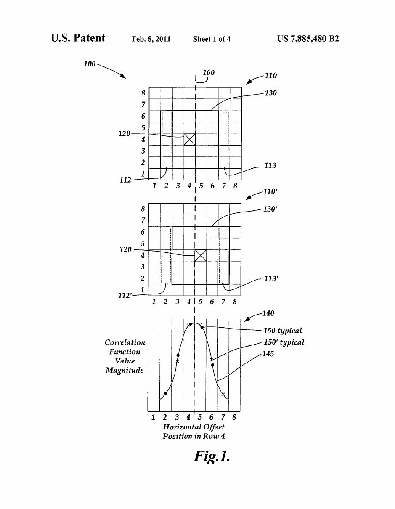
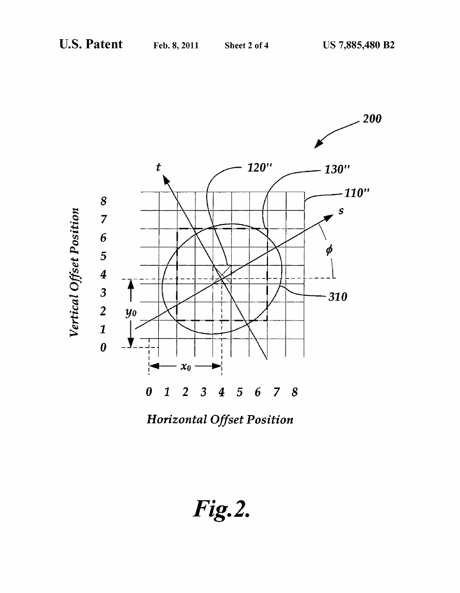
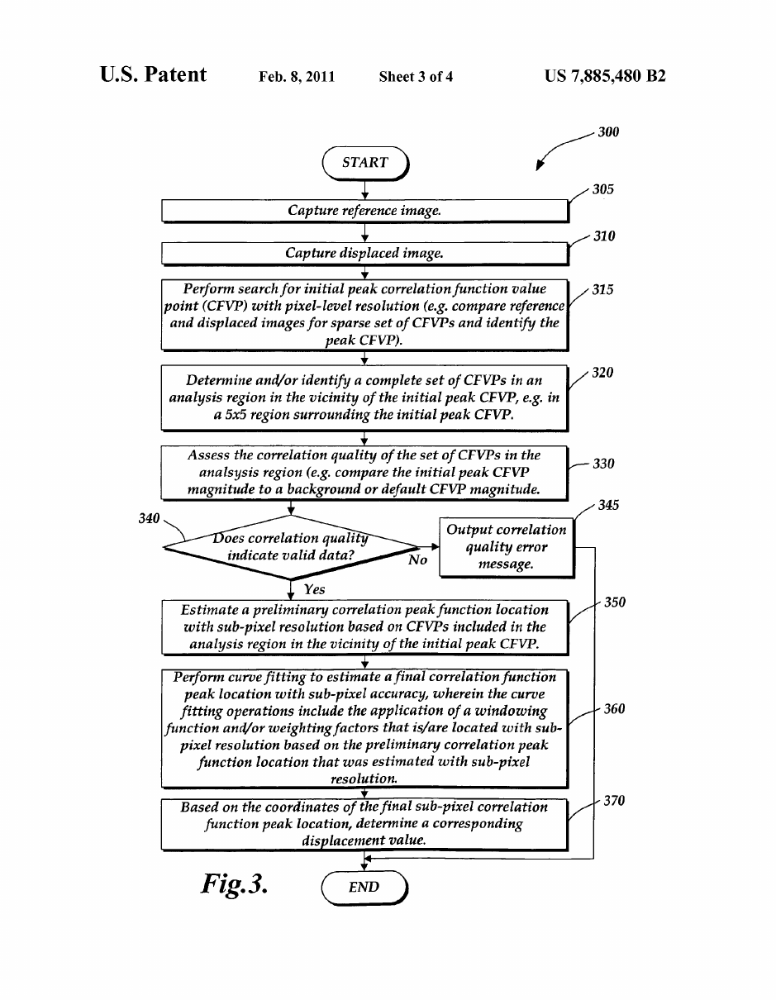

# US 7,885,480 B2 번역: 영상 상관 변위 측정을 위한 상관 피크 찾기 방법

- 원제: Correlation peak finding method for image correlation displacement sensing
- 원문: 같은 폴더의 `US7885480B2.pdf` (등록 공보, 14쪽, 도면 4장, 청구항 11)
- 번역 범위: 전문. 서지, 초록, 상세한 설명 전체, 도면 설명, 청구항 1~11. 인용 문헌 목록은 원문 그대로 둔다.
- 번역 원본 텍스트: 공보 PDF를 `pdftotext -layout`으로 뽑으면 두 단이 섞이고 수식이 깨진다. 그래서 같은 내용인 Google Patents 공개 본문(https://patents.google.com/patent/US7885480B2/en, 2026-11-04 확인)과 대조해 번역했다. 식 1과 식 7은 공보 그림(9쪽, 10쪽)을 눈으로 보고 옮겼다.
- 도면 부호(110, 120, 130 등)는 원문 그대로 둔다.
- 용어: correlation function value point(CFVP)는 "상관 함수 값 점(CFVP)"으로, pseudo-image는 "의사 영상", offset position은 "오프셋 위치", windowing function은 "창 함수", weighting factor는 "가중치"로 옮긴다.
- 번역 2026-11-04.

## 서지

| 항목 | 내용 |
|---|---|
| 공보 | US 7,885,480 B2 (등록 2011-02-08) |
| 출원 | US 11/591,179, 2006-10-31 출원 |
| 공개 | US 2008/0101722 A1 (2008-05-01) |
| 권리자 | Mitutoyo Corporation, Kawasaki-shi (JP). 공보 텍스트 층에는 "Mutos"로 깨져 있으나 1쪽 그림에서 Mitutoyo로 확인 |
| 발명자 | Robert Kamil Bryll (Bothell, WA), Benjamin Keith Jones (Seattle, WA), Karl Gustav Masreliez (Banyuls-sur-mer, FR) |
| 존속 기간 | 35 U.S.C. 154(b)에 따라 1078일 연장 |
| 국제 분류 | G06K 9/64 (2006.01) |
| 미국 분류 | 382/278, 382/141, 382/148, 382/151, 382/294 |
| 심사관 | Samir A. Ahmed (주심), Jayesh Patel (보조) |
| 대리인 | Christensen O'Connor Johnson Kindness PLLC |
| 청구항, 도면 | 청구항 11, 도면 4장 |

### 인용 문헌 (원문 그대로)

```
U.S. PATENT DOCUMENTS
4,805,123 A *  2/1989  Specht et al. ......... 382/144
5,359,513 A * 10/1994  Kano et al. ........... 382/128
5,485,224 A *  1/1996  Burns et al. .......... 348/699
5,495,535 A *  2/1996  Smilansky et al. ...... 382/145
6,016,116 A    1/2000  Henderson et al. ...... 342/64
6,100,925 A    8/2000  Rosser
6,307,959 B1 * 10/2001 Mandelbaum et al. ..... 382/154
6,483,538 B2 * 11/2002 Hu .................... 348/180
6,873,422 B2   3/2005  Nahum
6,937,349 B2   8/2005  Jones
6,990,254 B2 * 1/2006  Nahum ................. 382/278
6,996,291 B2   2/2006  Nahum
7,065,258 B2   6/2006  Nahum
7,085,431 B2 * 8/2006  Jones et al. .......... 382/278
2001/0033702 A1* 10/2001 Kawabata ............ 382/294
2006/0045314 A1  3/2006  Gao et al. .......... 382/106

FOREIGN PATENT DOCUMENTS
WO 94/01830 A1   1/1994
WO 97/00494 A1   1/1997

OTHER PUBLICATIONS
Boltryk, P.J., et al., "Surface Fitting for Improving the Resolution of Peak Estimation on a
Sparsely Sampled Two-Dimensional Surface With High Levels of Variance, for an Acoustic Velocity
Log," Measurement Science and Technology 15(3):581-591, Feb. 2004.
Papadimitriou, D.V., and T.J. Dennis, "A Stereo Disparity Algorithm for 3D Model Construction,"
Proceedings of Fifth International Conference on Image Processing and Its Applications,
Conference Publication No. 410, Edinburgh, Jul. 4-6, 1995, pp. 178-182.
Stewart, C.V., "Robust Parameter Estimation in Computer Vision," SIAM Review 41(3):513-537,
Sep. 1999.
* cited by examiner
```

(공보 OCR이 깨진 글자는 공보 그림으로 확인해 바로잡았다. 1쪽의 "(Continued)" 아래 항목은 2쪽에 이어진다.)

## 초록

영상 상관 변위 측정 시스템을 위한 상관 함수 피크 찾기 방법을 제공한다.
이 방법은 기준 영상과 변위 영상을 찍는 단계를 포함할 수 있다.
여러 오프셋 위치에서 기준 영상과 변위 영상의 상관을 구하고, 이를 바탕으로 화소 수준 해상도의 처음 피크 상관 함수 값 점(CFVP)을 찾는다.
그다음 처음 피크 CFVP를 둘러싼 분석 영역의 모든 오프셋 위치에서 CFVP 전체 묶음을 구할 수 있다.
그다음 분석 영역 안의 CFVP로 예비 상관 함수 피크 위치를 부화소 해상도로 추정한다.
끝으로 곡선 맞춤으로 최종 상관 함수 피크 위치를 부화소 정확도로 추정한다.
이때 곡선 맞춤에는 창 함수나 가중치 묶음, 또는 둘 다를 쓴다.
창 함수와 가중치는 예비 부화소 상관 함수 피크 위치를 바탕으로 부화소 해상도로 놓는다.

## 발명의 분야

이 발명은 영상 상관으로 물체의 변위를 구하는 일에 관한 것이다.

## 발명의 배경

센서 배열로 얻은 영상과, 그 영상 사이의 상관으로 물체의 변형이나 변위를 구하는 장치가 여럿 알려져 있다.
예를 들어 이런 장치의 한 갈래가 Nahum의 미국 특허 6,873,422('422 특허), 6,990,254('254 특허), 6,996,291('291 특허), 7,065,258('258 특허)에 적혀 있다. 이 특허들은 모두 전문이 참고로 이 명세서에 포함된다.

이런 장치에서는 대개 다음과 같이 한다.

- 물체를 옮기거나 변형하기 전에, 물체에서 나온 첫째 영상(기준 영상)을 찍어 저장한다.
- 물체를 옮기거나 변형한 뒤, 물체에서 나온 둘째 영상(이후 영상)을 찍어 저장한다.
- 그다음 첫째와 둘째 영상을 화소 단위로 정량 비교한다. 예를 들어 상관 연산을 쓴다.

대개 두 영상을 서로 다른 양만큼 어긋나게(공간적으로 평행 이동해) 놓고 여러 번 비교한다. 예를 들어 비교마다 오프셋을 1화소씩 바꾼다.
그다음 정량 비교 결과(예: 상관 함수 값)를 대응하는 오프셋 양, 곧 공간 평행 이동 위치에 대해 그려 상관 함수 값 점을 정한다.
둘째 영상과 첫째 영상의 상관이 가장 강한 오프셋에서, 상관 함수 값 점 그래프에 피크나 골이 생긴다. 피크인지 골인지는 화소 단위 비교를 어떻게 했는지에 따라 다르다.
피크나 골에 대응하는 오프셋 양이 첫째와 둘째 영상 사이의 변위나 변형의 양이다.

상관 함수 값 점 그래프에서 피크나 골을 부화소 해상도로 추정하는 방법은 여러 가지가 알려져 있다.
그 가운데 더 정확한 방법 하나가 '422 특허에 나온다.
'422 특허는 곡선 맞춤을 쓰는 여러 방법이 내는 상관 피크 위치 추정값에, 센서 배열의 화소 간격을 주기로 하는 공간 주기적 부화소 오차가 생길 수 있음을 설명한다.
'422 특허는 상관 피크 위치를 추정할 때 이 오차를 줄이는 여러 방법을 가르친다.
그러나 '422 특허의 방법을 쓴 뒤에도 주기적 부화소 오차가 어느 정도 남을 수 있다.
Jones의 미국 특허 7,085,431('431 특허, 전문이 참고로 포함됨)은 앞에서 말한 주기적 부화소 오차와 다른 오차를 특성화하고 보상하는 방법을 가르친다.
그러나 '431 특허의 방법에는 교정 비용과 신호 처리의 복잡함이 따른다.

이 발명은 영상 상관 변위 측정을 위한 상관 피크 찾기 방법으로, 공간 주기적 부화소 오차를 줄이면서 앞에서 말한 단점과 다른 단점을 극복한다.

## 발명의 요약

이 요약은 아래 상세한 설명에서 더 풀어 쓸 개념 몇 가지를 간단히 소개한다. 청구한 대상의 핵심 특징을 가리키거나, 청구 범위를 정하는 데 도움을 주려는 것이 아니다.

기준 영상과 변위 영상 사이의 가장 좋은 상관 위치(오프셋)를 추정할 때 어떤 계통적 주기 부화소 오차가 생긴다.
이 계통 오차는 이산 표본화 과정 때문에 생긴다. 구체적으로는 다음과 같은 이유다.

- 기준 영상과 변위 상관 영상의 해상도가 제한되어 있다.
- 보통의 영상 상관 기법에서 상관 함수 값 점(CFVP)을 계산할 때 쓰는 오프셋 위치 사이의 간격 해상도가 제한되어 있다.
- 그 밖의 비슷한 이유.

상관 함수 피크 위치를 추정할 때 CFVP를 비교적 적게 쓰면 이 부정확함이 더 커질 수 있다.

영상 상관 변위 측정 시스템에서 쓰는 상관 함수 피크 찾기 방법을 제공한다. 이 방법은 위에서 말한 종류의 계통적 부화소 오차를 줄인다.

이 발명의 한 측면에 따르면, 여러 CFVP에 상관 함수 곡선을 맞추기 전에, 또는 맞추는 과정의 일부로, 창 함수나 가중치를 적용한다.
창 함수나 가중치는 상관 함수 피크 위치의 예비 추정값의 위치를 기준으로 정한다. 이 예비 추정은 부화소 해상도로 한다.

이 발명의 다른 측면에 따르면, 부화소 해상도로 하는 예비 추정은 비교적 적은 수의 CFVP, 예를 들어 CFVP 4개로 할 수 있다.

이 발명의 다른 측면에 따르면, 상관 함수 곡선은 비교적 적은 수의 CFVP에 맞출 수 있다. 예를 들어 2차원 상관 함수 곡선이라면 CFVP 25개 미만, 여러 실시예에서는 9개만으로도 맞출 수 있다.

이 발명의 다른 측면에 따르면, 창 함수나 가중치는 분석 영역의 가장자리 근처 CFVP가 곡선 맞춤에 미치는 영향을 크게 줄이도록 고른다. 분석 영역은 대개 여러 변위 측정 각각의 곡선 맞춤에 쓰는 영역이다.

- 여러 실시예에서 가중치는 원뿔 창 함수, 가우스 창 함수, 시그모이드 창 함수 같은 것에 대응할 수 있다.
- 분석 영역 크기가 M=N=5인 한 실시예에서는 원뿔 창 함수로 가중치를 정할 수 있다. 부화소 예비 추정 위치 (xp, yp)에서 가중치 1.0, (xp, yp)에서 반지름 M/2 오프셋 간격 이상 떨어진 곳에서 가중치 0이다.
- 한 실시예에서는 창 함수나 가중치를 최소제곱 곡선 맞춤 함수 안의 두 항의 차이에 적용한다.

그러나 이 실시예들은 모두 예시일 뿐이며 한정하지 않는다.

## 도면의 간단한 설명

이 발명의 앞에서 말한 측면과 따르는 여러 장점은, 아래 상세한 설명을 첨부 도면과 함께 보면 더 쉽게 이해된다.

- 도 1은 비교적 적은 상관 함수 값 점으로 상관 함수 피크 위치를 추정해 변위를 구할 때, 주기적 부화소 오차가 생기는 한 예를 보여 주는 그림이다.
- 도 2는 도 3의 루틴에서 쓸 수 있는 곡선 맞춤의 한 실시예에서 쓰는 변수 변환을 보여 주는 그래프다.
- 도 3은 이 발명에 따른 루틴의 한 실시예를 보여 준다. 비교적 적은 상관 함수 값 점으로, 주기적 부화소 오차를 줄여 상관 함수 피크 위치를 추정한다.
- 도 4는 이 발명의 상관 함수 피크 찾기 방법을 쓸 수 있는 영상 상관 변위 측정 시스템 한 종류의 한 실시예를 보여 주는 블록도다.

## 바람직한 실시예의 상세한 설명

### 도 1: 주기적 부화소 오차가 생기는 이유



도 1의 그림 100은, 비교적 적은 상관 함수 값 점으로 상관 함수 피크 위치를 추정해 변위를 구할 때 주기적 부화소 오차가 생기는 과정을 설명하는 한 방법을 보여 준다.

- 그림 100에는 첫째 2차원 상관 함수 값 점 의사 영상 110이 있다. 물체의 기준 영상과 물체의 첫째 이후 영상 사이 첫째 변위에 대응한다.
- 둘째 2차원 상관 함수 값 점 의사 영상 110′도 있다. 같은 기준 영상과 물체의 둘째 이후 영상 사이 둘째 변위에 대응한다.
- 1차원 상관 함수 값 크기 그래프 140도 있다.
- 의사 영상 110과 110′, 그래프 140은 모두 도 1의 가로 방향으로 같은 기준 틀에 맞춰 놓았다. 아래에서 더 자세히 설명한다.

의사 영상 110은 8×8 의사 화소 격자로 그렸다.
각 의사 화소 자리는 기준 영상과, 변위 센서가 준 첫째 변위 영상 사이의 특정 (X,Y) 또는 (행, 열) 화소 오프셋에 대응한다. 그 오프셋의 상관 함수 값을 구할 때의 오프셋이다.
그 의사 화소에 매긴 값은 영상 밝기 값이 아니라 대응하는 상관 함수 값이다.

도 1에서 피크 상관 함수 값 점 120에 대응하는 의사 화소 하나를 "X"로 채웠다.
그 의사 화소는 의사 영상 110 안에서 가장 극단적인 상관 함수 값, 곧 상관 함수 피크에 가장 가까운 값에 대응한다.
알려진 여러 영상 상관 과정은 피크 상관 함수 값 점 120을 찾는 데서 시작한다.
여러 실시예에서 피크 상관 함수 값 점 120의 위치를 정하는 연산은 빠른 탐색이나 거친 탐색 기법을 쓸 수 있다. 예를 들어 참고로 포함한 '291 특허나 '254 특허에 나온 기법 하나를 쓴다.

여기서 다루는 범용 영상 상관 변위 측정 시스템에서는, 실용적으로 가능한 가장 빠른 속도로 물체의 움직임을 따라가는 능력이 바람직한 특징이다.
이 능력은 변위 측정 시스템의 측정 주기 속도, 곧 표본화 속도에 달려 있다.
표본화 속도는 다시 영상 처리, 상관, 최종 부화소 상관 피크 찾기 연산을 얼마나 빨리 할 수 있는지에 달려 있을 수 있다.
따라서 여러 실시예에서 상관 연산의 수를 실용적인 최소로 줄이고, 최종 부화소 상관 피크 위치를 특히 효율적으로 찾는 일이 중요할 수 있다.
그래서 여러 실시예에서는 먼저 피크 상관 함수 값 점 120을 정하고, 그 근처의 제한된 수의 상관 함수 값 점(CFVP)만 분석해 상관 피크 위치를 부화소 해상도로 정한다.
이 예에서 의사 영상 110에 대해서는 5×5 분석 영역 130 안의 제한된 수의 CFVP를 분석한다.
분석 영역 130은 피크 상관 함수 값 점 120을 가운데에 두도록 고른다.

분석 영역 130에는 대응하는 상관 함수의 피크를 2차원으로 찾기에 충분한 자료가 있다. 그러나 이 설명에서는 간단하고 분명하게 하려고 피크 위치를 한 방향으로만 본다.
특히 1차원 상관 함수 값 크기 그래프 140은 CFVP 150(각각 "점" 기호로 표시)을 보여 준다. 이 점들은 분석 영역 130에서 피크 상관 함수 값 점 120과 같은 행(넷째 행)에 있는 의사 화소들의 값이다.
그래프 140은 바탕에 있는 "참" 상관 함수 145도 보여 준다. 기준 영상과 변위 영상의 해상도가 "무한"하고 오프셋을 연속으로 바꿔 비교할 수 있다면 얻을 함수다.
참 상관 함수 145의 참 피크 위치 160은 점선으로 표시했으며 아래에서 더 설명한다.
설명을 위해, CFVP 150은 바탕의 참 상관 함수 145를 이산 점에서 "표본화"한 것으로 생각할 수 있다. 바탕 곡선이나 참 피크 위치 160을 추정하려는 표본이다.

의사 영상 110′의 그림은 의사 영상 110과 같은 방식이다. 프라임(′)이 붙은 번호의 요소는 프라임이 없는 대응 요소의 설명으로 이해할 수 있다.
의사 영상 110′에 대응해, 1차원 상관 함수 값 크기 그래프 140은 CFVP 150′(각각 "x" 기호로 표시)도 보여 준다. 이 점들은 분석 영역 130′에서 피크 상관 함수 값 점 120′과 같은 행(넷째 행)에 있는 의사 화소들의 값이다.

이 설명에서는, 의사 영상 110′을 구하려고 기준 영상과 상관한 둘째 변위 영상이, 의사 영상 110을 구하려고 기준 영상과 상관한 첫째 변위 영상에 비해 아주 조금(무한소만큼) 옮겨졌다고 가정한다.
첫째와 둘째 변위 영상이 무한소만큼만 다르므로, 그래프 140의 바탕 참 상관 함수 145는 의사 영상 110뿐 아니라 의사 영상 110′에도 대응한다고 볼 수 있다.
그러나 참 피크 위치 160이 CFVP를 구할 때 쓰는 넷째와 다섯째 가로 오프셋 위치의 대략 한가운데에 있다.
그래서 그 무한소 차이만으로도 피크 상관 함수 값 점 120′이 피크 상관 함수 값 점 120에 비해 가로 오프셋 위치 하나만큼 옮겨진다.
그 결과 분석 영역 130′도 가로 오프셋 위치 하나만큼 옮겨진다. 분석 영역 130′은 의사 영상 110에서와 같은 절차로 피크 상관 함수 값 점 120′을 가운데에 두도록 정하기 때문이다.
분석 영역 130′은 분석 영역 130의 의사 화소 묶음 112를 빼고, "새" 의사 화소 묶음 113을 넣는다.
이런 이유로, 바탕 영상 변위의 차이가 무한소일지라도, CFVP 150′이 바탕 참 상관 함수 145를 표본화한 모양은 CFVP 150의 표본화와 크게 다를 수 있다.
그 결과 CFVP 150′에 바탕을 둔 참 피크 위치 160의 추정값은 CFVP 150에 바탕을 둔 추정값과 다를 수 있다.
두 추정값의 차이는 화소 간격에 비하면 작을 수 있다.
그러나 참 피크 위치 160의 이런 추정의 정확도나 강건함이 조금만 좋아져도, 영상 상관 변위 측정 시스템의 수많은 응용에서 중요하다는 점을 알아야 한다.

정리하면, 위에서 말한 이산 표본화는 추정된 상관 함수 피크 위치에 부정확함을 들여올 수 있다. 원인은 다음과 같다.

- 기준 영상과 변위 상관 영상의 해상도가 제한되어 있다.
- CFVP에 대응하는 가로 오프셋 위치 사이의 간격 해상도가 제한되어 있다.
- 피크 상관 값 점(120, 120′) 선택이 이산적이다.
- 그 밖의 비슷한 이유.

상관 함수 피크 위치를 추정할 때 CFVP를 비교적 적게 쓰면 이 부정확함이 더 커질 수 있다.
또 참 피크 위치 160이 CFVP를 구할 때 쓰는 가로 오프셋 위치들의 대략 한가운데에 올 때마다 이 부정확함이 더 커질 수 있다.
그 결과 주기적 부화소 오차가 생길 수 있고, 이 오차는 영상 상관 변위 측정 시스템이 내는 변위 측정값에 관련 오차를 만든다.

도 1의 그래프 140은 기준 영상과 변위 영상 사이 가장 좋은 상관에 대응하는 위치가 최대 CFVP 옆에 있는 예를 보여 준다(예를 들어 곱셈형 상관 함수의 가장 좋은 상관 위치에 해당할 수 있다). 그러나 이 발명은 그렇게 한정되지 않는다.
여러 실시예에서 "절대 차이의 합"(SAD)형 상관 함수를 유리하게 쓸 수 있다.
알려진 대로 SAD형 상관 함수는 피크 대신 골을 만든다. 이때 기준 영상과 변위 영상 사이 가장 좋은 상관에 대응하는 위치는 최소 CFVP 옆에 있다.
따라서 이 명세서에서는 참 연속 상관 함수의 "가장 좋은 상관" 극값과 연관된 위치를, 바탕 상관 함수가 실제로 피크를 만들든 골을 만들든 상관 함수 피크 위치라고 부를 수 있다.
마찬가지로 가장 극단적인 CFVP를 피크 CFVP라고 부를 수 있다. SAD형 상관 함수가 만드는 것처럼 상관 골과 연관된 최솟값 CFVP일 때도 그렇다.

발명자들은, 제한된 수의 CFVP를 맞출 때, 특히 "절대 차이의 합"(SAD) 상관 방법에 바탕을 둔 CFVP를 맞출 때, 가우스 곡선 맞춤이 상관 함수 피크 추정의 오차를 줄이는 데 유리할 수 있음을 알아냈다.
예를 들어 점의 수가 제한되어 있을 때, 여러 조건에서 가우스 곡선 맞춤은 '422 특허에서 가르친 방법보다 오차를 조금 더 낮출 수 있다.
그러나 CFVP에 가우스 함수를 맞추는 것만으로는, 도 1에서 설명한 종류의 계통적 주기 오차를 없애기에 충분하지 않다.

### 창 함수를 쓴 가우스 곡선 맞춤 (식 1~7)

위에서 말한 계통 오차를 줄이는 한 방법은, 곡선 맞춤 연산 전에, 또는 그 일부로, CFVP에 창 함수를 적용하는 것이다.
그러나 창 함수에 관한 여러 연구와 응용은 더 많은 표본 점을 쓰거나, "참" 바탕 곡선의 모양을 더 잘 알거나 하는 경우가 많다. 이와 달리 실제 상관 변위 측정 시스템에는 여러 실용적 고려와 제약이 있을 수 있다.
그래서 연산들의 독특한 조합이, 오차를 줄여 "참" 상관 함수 피크 위치를 가장 정확하게 추정하면서도, 비교적 높은 변위 측정 속도를 허용하는 방법이 될 수 있다.
이 발명에 따라, 위에서 말한 종류의 계통적 주기 오차를 줄이면서 비교적 적은 CFVP와 비교적 높은 변위 측정 속도를 허용하는 연산 조합의 한 예를 아래 식 1~7로 설명한다.
특히 2차원 CFVP 묶음에 대해 참 2차원 상관 함수 피크 위치를 추정하는 한 실시예를 아래에 적는다.
아래 연산들은 이 발명에 따른 영상 상관 변위 측정 시스템과 연관된 신호 처리 및 제어 시스템 안의 여러 회로나 루틴으로 구현할 수 있다.
이 발명과 함께 쓸 수 있는 여러 신호 처리 및 제어 시스템의 예는 참고로 포함한 문헌들에 나온다.

앞에서 말했듯이, CFVP 수가 제한되어 있으면 가우스 곡선 맞춤이 유리할 수 있다.
한 실시예에서, 바탕의 참 상관 함수를 근사하는 데 쓰는 가우스 함수 GF의 꼴은 다음과 같이 쓸 수 있다.

$$
GF=\sqrt{A-B\,e^{-\frac{s^{2}}{2\sigma_s^{2}}}\,e^{-\frac{t^{2}}{2\sigma_t^{2}}}}\qquad(\text{식 }1)
$$

여기서 σs와 σt는 가우스 함수 GF의 표준편차이고, s와 t는 도 2에 보이고 아래에서 설명하는 변환된 CFVP 좌표다.



도 2의 그림 200은 변환된 (s,t) CFVP 좌표계를 보여 준다.
도 2에는 위에서 설명한 의사 영상 110과 같은 방식의 의사 영상 110″이 있다. 이중 프라임(″)이 붙은 번호의 요소는 의사 영상 110의 프라임 없는 대응 요소의 설명으로 이해할 수 있다.
설명을 위해, CFVP 의사 화소의 가로, 세로 오프셋 위치로 (x,y) 좌표계를 그림처럼 정의할 수 있다.
타원 310(길쭉함을 과장해 그렸다)은 분석 영역 130″의 CFVP에 대해 "가장 잘 맞는" 자리에 놓인 2차원 가우스 함수 GF의 밑면을 개략적으로 나타낸다.
CFVP (x,y) 좌표계와 변환된 CFVP (s,t) 좌표계 사이 변환식은 다음과 같다.

$$
s=(x-x_0)\cos\varphi+(y-y_0)\sin\varphi
$$

$$
t=-(x-x_0)\sin\varphi+(y-y_0)\cos\varphi\qquad(\text{식 }2,3)
$$

도 2처럼, 위치 (x0,y0)는 가장 잘 맞는 2차원 가우스 함수 GF의 밑면인 타원 310의 기하 중심이다. 각 φ는 x축에 대한 타원 310의 장축 회전각이다.
위치 (x0,y0)는 대개 이산 오프셋 위치들 사이에 부화소 해상도로 놓인다. 이상적으로는 분석 영역 130″의 CFVP가 표본화한 참 2차원 상관 함수의 피크와 가능한 한 가깝게 일치한다.

실제 영상 상관 변위 측정 시스템의 신호 처리는, 식 1의 제곱근에 따르는 번거로움을 피하면 더 빠르고 간단하게 할 수 있다.
그래서 한 실시예에서는 함수 GF의 제곱을 CFVP의 제곱에 맞출 수 있다.
다음 함수 GF²를 CFVP의 제곱(이하 CFVP²)에 맞출 수 있다.

$$
GF^{2}=A-B\,e^{-\frac{s^{2}}{2\sigma_s^{2}}}\,e^{-\frac{t^{2}}{2\sigma_t^{2}}}\qquad(\text{식 }4)
$$

함수 GF²는 CFVP² 값에 맞출 때 함수 GF와 같은 피크 위치를 가진다.

분석 영역 130″은 일반적으로 M×N 영역으로 나타낼 수 있다. 왼쪽 아래 의사 화소 (xmin, ymin)에서 오른쪽 위 (xmin+M, ymin+N)까지다.
앞의 분석 영역 130~130″ 설명에서는 M=N=5다.
최소제곱법으로 가장 잘 맞는 매개변수 x0, y0와 다른 매개변수 A, B, σs, σt, φ를 찾을 수 있다.
창 함수를 적용하지 않고 함수 GF²를 분석 영역 130″의 CFVP²에 맞추려면, 다음 최소제곱 함수 F를 정의하고 최소화할 수 있다.

$$
F(x_0,y_0,A,B,\sigma_s,\sigma_t,\varphi)=\sum_{x=x_{min}}^{x_{min}+m}\ \sum_{y=y_{min}}^{y_{min}+n}\left[GF^{2}(x,y)-CFVP^{2}(x,y)\right]^{2}\qquad(\text{식 }5)
$$

앞의 함수 F를 고쳐 창 함수를 넣으면, 도 1에서 설명한 계통적 부화소 오차를 2차원 상관 함수 피크 추정 결과에서 줄일 수 있다.
한 실시예에서 창 함수는 이산 가중치 W(x,y)를 다음 함수 FW에 적용해 구현할 수 있다.

$$
FW(x_0,y_0,A,B,\sigma_s,\sigma_t,\varphi)=\sum_{x=x_{min}}^{x_{min}+m}\ \sum_{y=y_{min}}^{y_{min}+n}W(x,y)\left[GF^{2}(x,y)-CFVP^{2}(x,y)\right]^{2}\qquad(\text{식 }6)
$$

함수 FW를 최소화하는 가장 잘 맞는 매개변수 (x0, y0, A, B, σs, σt, φ)는 알려진 최적화 기법이나, 시판 소프트웨어 라이브러리의 최적화 루틴으로 구할 수 있다.

이 발명에 따른 여러 실시예에서, 분석 영역 130″에 대응하는 가중치 W(x,y)는 2차원 상관 함수 피크 위치의 예비 추정값의 위치를 기준으로 정한다. 이 예비 추정은 부화소 해상도로 한다.
여러 실시예에서 예비 추정은 피크 상관 함수 값 점 120″ 가까이의 비교적 적은 CFVP로 한다. 예를 들어 '422 특허에 나온, 부화소 해상도로 상관 함수 피크를 추정하는 방법 하나를 쓴다.
창 함수나 연관된 가중치 W(x,y)의 위치를, 상관 함수 피크 위치의 예비 부화소 해상도 추정을 바탕으로 정하는 일의 중요성은 이전에는 인식되지 않았다.
이하 상관 함수 피크의 예비 부화소 해상도 추정 위치를 (xp, yp)라고 부른다.

여러 실시예에서 창 함수나 가중치는, 분석 영역 130″의 가장자리 근처 의사 화소가 곡선 맞춤에 미치는 영향을 크게 줄이도록 고른다는 점을 알아야 한다.
여러 실시예에서 가중치 W(x,y)는 원뿔 창 함수, 가우스 창 함수, 시그모이드 함수 같은 것에 대응할 수 있다.
원뿔 가중 함수를 예로 들면, 분석 영역 크기가 M=N=5인 한 실시예에서 가중치는 (xp, yp)에서 가중치 1.0, (xp, yp)에서 반지름 2.5 오프셋 간격 이상 떨어진 곳에서 가중치 0인 창 함수로 정할 수 있다. 예를 들어 다음과 같다.

$$
W(x,y)=\frac{(M/2)-\sqrt{(x-x_p)^{2}+(y-y_p)^{2}}}{(M/2)},\quad \sqrt{(x-x_p)^{2}+(y-y_p)^{2}}\le (M/2)\text{ 일 때}
$$

$$
W(x,y)=0,\quad \sqrt{(x-x_p)^{2}+(y-y_p)^{2}}>(M/2)\text{ 일 때}\qquad(\text{식 }7)
$$

위에서 말한 특정 가중치는 예시일 뿐이며 한정하지 않는다.
더 일반적으로는, 창 함수나 가중치가 분석 영역 130″의 가장자리에 붙은 의사 화소가 곡선 맞춤에 미치는 영향을 크게 줄이도록 고르기만 하면, 여러 종류의 창 함수를 쓸 수 있다.
여러 실시예에서 가장자리에 붙은 의사 화소에 대응하는 곡선 맞춤 항의 감쇠가 위 예만큼 0에 가까울 필요는 없다.
예를 들어 어떤 실시예에서는 가장자리에 붙은 의사 화소에 대응하는 항 일부가, 가능한 최대 가중치 크기의 1/2 정도나 그 이상인 가중치를 가져도 여전히 유리한 결과를 얻을 수 있다.

또 식 6의 예에서는 가중치를 최소제곱 최소화 함수 FW 안의 차이에 적용한다.
이 방식은 구현이 쉽다는 장점이 있지만 예시일 뿐이며 한정하지 않는다.
예를 들어 구현이 조금 더 복잡하거나 결과가 조금 덜 바람직할 수 있지만, 여러 실시예에서 GF²(x,y)와 CFVP²(x,y) 항을 따로, 또는 GF(x,y)와 CFVP(x,y) 항을 따로, 알맞은 개별 가중치로 가중해도 비슷한 부화소 오차 감소 효과를 얻을 수 있다.
계통적 부화소 오차 감소에서 비슷한 이점을 주는 이런 수학적 대안과 다른 대안은 이 분야의 통상의 기술자에게 분명할 것이다.
그러나 어느 경우든 이 발명의 한 원리에 따라, 연관된 창 함수나 가중치는 2차원 상관 함수 피크 위치의 예비 추정값의 위치를 기준으로 정해야 한다. 이 예비 추정은 부화소 해상도로 한다.

### 도 3: 처리 순서 (루틴 300)



도 3은 이 발명에 따른 루틴 300의 한 실시예를 보여 준다. 영상 상관 변위 측정 시스템에서, 비교적 적은 상관 함수 값 점으로 주기적 부화소 오차를 줄여 상관 함수 피크 위치를 추정한다.
루틴 300은 블록 305에서 시작해 기준 영상을 찍는다. 블록 310에서 변위 영상을 찍는다.

다음 블록 315에서, 기준 영상과 변위 영상의 비교를 바탕으로 화소 수준 해상도로 처음 피크 상관 함수 값 점(CFVP)을 찾는다.
한 실시예에서 기준 영상과 변위 영상은 "절대 차이의 합"(SAD) 상관 기법("차이의 절댓값" 또는 "AVD" 기법이라고도 함)으로 비교할 수 있다.
2차원 SAD CFVP는 알려진 기법으로 구할 수 있다. 예를 들어 미국 특허 6,937,349에 있는 식 2의 설명에서 유추해 구한다.
여러 실시예에서 화소 수준 해상도로 처음 피크 상관 함수 값 점의 위치를 정하는 연산은, 참고로 포함한 '291 특허나 '254 특허에 나온 기법 같은 빠른 탐색, 거친 탐색, 성긴 탐색 기법을 쓸 수 있다.

다음 블록 320에서, 처음 피크 CFVP 근처의 분석 영역, 예를 들어 처음 피크 CFVP를 가운데에 둔 분석 영역에서 CFVP 전체 묶음을 구하거나 찾는다.
예를 들어 여러 실시예에서 블록 315 연산으로 찾은 처음 피크 CFVP는 도 2에서 설명한 피크 상관 함수 값 점 120″에 대응할 수 있다.
그다음 여러 실시예에서 분석 영역 130″에 대응하는 분석 영역을, 처음 피크 CFVP를 가운데에 두도록 고른다.
분석 영역은 앞에서 말했듯 M×N 의사 화소로 이루어질 수 있다.
한 실시예에서는 M=N=5, 다른 실시예에서는 M=N=3이다. 다만 이 M, N 값은 예시일 뿐이며 한정하지 않는다.
분석 영역 크기와 상관없이, 여러 실시예에서 블록 320의 연산은 분석 영역 전체의 CFVP 전체 묶음을 구한다.
어떤 실시예에서는 블록 315에서 처음 피크 CFVP를 찾는 탐색 연산이, 결국 처음 피크 CFVP로 정해질 점을 찾으려고 탐색한 영역 전체의 CFVP를 구하는 일을 포함할 수 있다.
이런 경우 블록 320의 연산은 처음 피크 CFVP를 가운데에 둔 분석 영역을 정하는 일로 그칠 수 있고, 그 안의 CFVP는 이미 구해져 있다.

다음 블록 330에서, 분석 영역에 포함된 하나 이상의 CFVP의 "상관 품질"을 평가한다.
예를 들어 한 실시예에서는 처음 피크 CFVP의 크기와 배경 또는 기본 CFVP의 크기의 비를 구한다.
배경 또는 기본 CFVP 크기는 "잡음" 값, 곧 의미 있는 상관이 없음을 나타내는 값에 대응한다.
이 값은 설계로 알 수 있다(기본값). 또는 처음 피크 CFVP에서 정해진 거리만큼 떨어진 곳, 곧 상관 피크 밖에 확실히 놓이는 곳에서 배경 CFVP(또는 CFVP 평균)를 구해 알 수 있다.

다음 판단 블록 340에서, 상관 품질이 유효한 상관 함수 피크를 가리키는지 판단한다.
예를 들어 앞에서 말한 "상관 품질" 비가 10이면 분석 영역에는 확실히 상관 함수 피크가 있다.
반면 그 비가 1에 가까우면 분석 영역에 참 상관 함수 피크가 있을 가능성이 낮다.
실제로 블록 340에서 적용할 상관 품질 기준은 경험이나 분석으로 정할 수 있다.
판단 블록 340에서 상관 품질이 분석 영역에 유효한 상관 함수 피크가 있음을 가리킨다고 판단하면 루틴은 블록 350으로 간다.
그렇지 않고 상관 품질이 유효한 상관 피크를 가리키지 않는다고 판단하면 블록 345로 가서 상관 품질 오류 메시지를 내고 루틴을 끝낸다.
블록 330, 340, 345는 루틴 300의 여러 실시예에서 선택 사항이거나 빠질 수 있다.
블록 330, 340, 345의 연산은 이 발명에 따른 영상 상관 변위 측정 시스템의 신뢰성을 높이거나 오류 위험을 줄이는 기능을 준다. 그러나 참 상관 함수 피크와 연관된 CFVP로 추정한 상관 함수 피크 위치의 최종 해상도나 정확도에는 영향이 없다.

블록 350에서, 처음 피크 CFVP 근처 분석 영역에 포함된 CFVP를 바탕으로 예비 상관 함수 피크 위치를 부화소 해상도로 추정한다.
여러 실시예에서 예비 상관 함수 피크 위치는 처음 피크 CFVP(예: 피크 CFVP 120″) 가까이의 비교적 적은 CFVP로 부화소 해상도로 추정한다. 예를 들어 '422 특허에 나온 방법 하나를 쓴다.
그러나 다른 여러 실시예에서는, 분석 영역에 포함된 CFVP를 바탕으로 예비 상관 함수 피크 위치를 부화소 해상도로 추정할 수 있는 다른 방법이라면, 지금 알려진 것이든 앞으로 개발될 것이든 쓸 수 있다.

다음 블록 360에서, 곡선 맞춤으로 최종 상관 함수 피크 위치를 부화소 정확도로 추정한다.
이 곡선 맞춤 연산에는 창 함수나 가중치의 적용이 들어간다. 창 함수나 가중치는 블록 350 연산으로 정한 예비 부화소 상관 함수 피크 위치를 바탕으로 부화소 해상도로 놓는다.
예를 들어 여러 실시예에서 블록 360의 연산은 식 1~7에서 설명한 가르침에 따른 방법을 구현할 수 있다.
그다음 블록 370에서, 최종 추정 부화소 상관 함수 피크 위치의 좌표를 바탕으로 대응하는 변위 값을 정하고 루틴을 끝낸다.

도 3 블록 문구 (원문 그림의 상자 안 글)

- 305: 기준 영상을 찍는다.
- 310: 변위 영상을 찍는다.
- 315: 화소 수준 해상도로 처음 피크 상관 함수 값 점(CFVP)을 찾는다 (예: CFVP의 성긴 묶음에 대해 기준 영상과 변위 영상을 비교하고 피크 CFVP를 찾는다).
- 320: 처음 피크 CFVP 근처 분석 영역(예: 처음 피크 CFVP를 둘러싼 5×5 영역)의 CFVP 전체 묶음을 구하거나 찾는다.
- 330: 분석 영역의 CFVP 묶음의 상관 품질을 평가한다 (예: 처음 피크 CFVP 크기를 배경 또는 기본 CFVP 크기와 비교).
- 340: 상관 품질이 유효한 자료를 가리키는가? 아니오면 345, 예면 350.
- 345: 상관 품질 오류 메시지를 낸다.
- 350: 분석 영역에 포함된 CFVP로 예비 상관 피크 함수 위치를 부화소 해상도로 추정한다.
- 360: 곡선 맞춤으로 최종 상관 함수 피크 위치를 부화소 정확도로 추정한다. 곡선 맞춤 연산에는 창 함수나 가중치의 적용이 들어가며, 이것들은 부화소 해상도로 추정한 예비 상관 피크 함수 위치를 바탕으로 부화소 해상도로 놓는다.
- 370: 최종 부화소 상관 함수 피크 위치의 좌표를 바탕으로 대응하는 변위 값을 정한다.

### 무게중심 추정에도 같은 원리

앞의 실시예들은 기준 영상과 변위 영상의 가장 좋은 상관 위치를 추정하려고 상관 함수의 피크를 구하는 것으로 설명했다.
그러나 상관 함수의 무게중심을 추정해 가장 좋은 상관 위치를 추정하는 방법도 알려져 있다.
이런 방법을 쓸 때도 비슷한 이유로 도 1에서 설명한 것과 비슷한 계통적 부화소 오차가 생길 수 있다.
위에서 설명한 것과 비슷하게, 무게중심 추정에 쓰는 CFVP에 창 함수나 가중치 묶음을 적용해 이런 계통적 부화소 오차를 줄일 수 있다.
따라서 CFVP를 비교적 적게 쓸 때 무게중심 추정 방법에는 단점이 있을 수 있지만, 여러 실시예에서 이 발명의 다른 측면과 함께 쓸 수 있고 여전히 만족스러운 결과를 얻을 수 있다.
특히 무게중심 추정에 바탕을 둔 부화소 정확도의 가장 좋은 상관 위치 추정에는, 예비 부화소 상관 함수 피크 위치를 바탕으로 부화소 해상도로 놓은 창 함수나 가중치 묶음(예: CFVP 묶음을 가중하는 것)의 적용이 들어갈 수 있다.

이 발명의 바람직한 실시예를 보여 주고 설명했지만, 이 명세서를 바탕으로 이 분야의 기술자에게는 보인 특징 배치와 연산 순서의 많은 변형이 분명할 것이다.
따라서 이 발명의 정신과 범위를 벗어나지 않고 여러 변경을 할 수 있음을 알 것이다.

### 도 4: 이 방법을 쓸 수 있는 장치의 예 (스페클 영상 위치 변환기)

도 4는 이 발명의 상관 함수 피크 찾기 방법을 쓸 수 있는 영상 상관 변위 측정 시스템 한 종류의 한 실시예를 보여 주는 블록도다.
도 4처럼 영상 상관 변위 시스템은 상관 영상 기반 광학 위치 변환기 400을 포함한다. 변환기 400은 판독 헤드 426, 신호 생성 및 처리 회로 500, 광학적으로 거친 표면 404를 포함한다.
도 4에서 판독 헤드 426의 부품과, 그 부품과 광학적으로 거친 표면 404의 관계는, 대체로 한 예시 물리 구성에 대응하는 배치로 개략 표시했다. 아래에서 더 설명한다.
스페클 영상을 쓰는 상관 영상 기반 광학 위치 변환기 400, 그리고 알맞은 여러 기계 및 광학 구성, 영상 상관 방법, 연관 신호 처리 회로는 참고로 포함한 '254 특허에 더 자세히 나온다.

특히 광학적으로 산란하는, 곧 광학적으로 거친 표면 404는 판독 헤드 426의 조명 및 수광 끝에 붙어 놓인다.
그래서 광학적으로 거친 표면 404가 판독 헤드 426의 그 끝에서 광원 430이 내보낸 빛으로 비춰지면, 내보낸 빛은 광학적으로 거친 표면 404에서 그 끝에 놓인 영상 수광 광학 요소 쪽으로 산란되어 돌아온다.
광학적으로 거친 표면 404는 특별히 마련한 요소의 일부일 수도, 따로 있는 기구의 일체 표면일 수도 있다.

어느 경우든 광학적으로 거친 표면 404는 광원과, 판독 헤드 426에 든 광학계에서 대체로 안정된 거리에 놓인다. 그리고 도 4의 측정 축 410, 412 같은 한 축이나 두 축의 상대 운동을 따라 판독 헤드 426에 대해 움직인다.
2차원 운동을 허용할 때는 대개 광학적으로 거친 표면 404의 2차원 영역의 가로 경계 안에서 허용 운동에 제약이 없다.
1차원 상대 운동만 허용할 때는 대개 판독 헤드 426과 광학적으로 거친 표면 404 사이의 알맞은 상대 위치를 유지하는 틀에 붙인 보통의 안내면이나 베어링(그림에 없음)으로, 상대 운동을 측정 축 410이나 412 중 하나를 따라 제한한다.
판독 헤드 426은 정렬 요소(그림에 없음)를 포함할 수 있다. 이 요소는 판독 헤드 426의 설치를 돕고, 판독 헤드 426의 내부 부품을 설치 틀이나, 광학적으로 거친 표면 404의 예상 상대 운동 축에 맞춘다.

도 4처럼 판독 헤드 426의 영상 수광 광학 요소에는 렌즈 440이 있다. 렌즈 440은 판독 헤드 조립체 406의 조명 및 수광 끝에 놓이며, 렌즈 440의 광축이 광학적으로 거친 표면 404의 조명된 점과 대체로 맞도록 놓인다.
판독 헤드 426에는 또 핀홀 조리개판 450이 있다. 조리개판 450은 렌즈 440에서 광축을 따라 떨어져 있다. 광 검출기 460은 조리개판 450에서 광축을 따라 떨어져 있다. 도 4와 같다.
광 검출기 460은 독립적인 개별 광 감지 요소의 배열로 구성할 수 있는, 알려졌거나 앞으로 개발될 어떤 종류의 광 감지 재료나 장치라도 된다. 예: 카메라, 전자 또는 디지털 카메라, CCD 배열, CMOS 광 감지 요소 배열.

렌즈 440, 조리개판 450, 광 검출기 460을 포함해 광학적으로 거친 표면 404와 판독 헤드 426의 예시 간격과 배치는 아래에서 더 설명한다.
광원 430, 렌즈 440, 조리개판 450, 광 검출기 460을 판독 헤드 426의 하우징에 설치하는 일은, 부품을 정밀하고 안정되게 설치하기만 하면, 소형 광학계 제작이나 산업용 카메라 제작의 보통 방법으로 할 수 있다.

판독 헤드 426이 광학적으로 거친 표면 404 옆에 알맞게 놓이면, 광 검출기 460이 찍는 각 영상에는 비교적 밝은 점, 곧 스페클과 비교적 어두운 점의 무작위 무늬가 담긴다.
밝은 점은 광학적으로 거친 표면 404에서 회절된 광파가 보강 간섭해 피크를 만든 곳이고, 어두운 점은 상쇄 간섭해 지워진 곳이다.
광학적으로 산란하는, 곧 광학적으로 거친 표면 404의 조명된 부분마다 대응하는 무작위 무늬는 고유하다.
그래서 광학적으로 거친 표면 404는 특별한 표식 없이도 변위 기준으로 쓸 수 있다.

광 검출기 460은 적어도 한 축을 따라 알려진 간격으로 떨어진 영상 요소 462의 배열 466을 가진다.
알려진 간격은 광 검출기 460에 투영된 두 영상 사이의 변위나 오프셋을 재는 바탕이 된다. 따라서 영상을 만드는 표면, 곧 광학적으로 거친 표면 404의 변위를 재는 바탕도 된다.

그러나 일반적으로 배열 466은 서로 직교하는 두 축을 따라 각 축의 알려진 간격으로 2차원으로 뻗는다.
이 알려진 간격은 두 축에서 같을 필요가 없다.
한 축만 움직임을 허용하는 시스템에서는 배열 466이 그 방향으로 가로 방향보다 훨씬 길게 뻗는 경우가 많다.
2차원 움직임을 허용하는 시스템에서는 두 직교 방향 각각의 배열 466 길이가 대략 같은 크기 정도지만, 정확히 같을 필요는 없다.

또 판독 헤드 426에는 신호 생성 및 처리 회로 500의 적어도 일부가 들어 있다.
도 4처럼 신호 생성 및 처리 회로 500에서 나온 신호선 432는 광원 430에 이어져 광원 430을 제어하거나 구동한다.
신호선 464는 광 검출기 460과 신호 생성 및 처리 회로 500을 잇는다.
특히 배열 466의 영상 요소 462는 각각 따로 주소를 지정할 수 있어, 그 영상 요소 462에 닿은 빛의 세기를 나타내는 값을 신호선 464로 신호 생성 및 처리 회로 500에 낸다.
신호 생성 및 처리 회로 500의 다른 부분은 판독 헤드 426에서 떨어진 곳에 둘 수 있고, 판독 헤드 426의 기능은 원격으로 운용하고 표시할 수 있다.

도 4처럼 광원 430은 광선 434를 내보낸다. 광선 434는 광학적으로 산란하는, 곧 광학적으로 거친 표면 404로 향해 그 일부를 비춘다.
그 결과 광학적으로 거친 표면 404의 조명된 부분은 광축 444 둘레로 빛을 산란하고 회절한다.

광원 430이 백색광원이면, 그 빛은 조명된 부분의 영상을 만들고 이 영상은 영상 요소 462의 배열 466에 투영될 수 있다.
이 영상은 스페클 영상과 같은 방식으로 상관을 구할 수 있지만, 광학적으로 거친 표면 404의 산란으로 생기는 스페클은 담기지 않는다.

광원 430이 결맞음 광원이고 신호선 432의 구동 신호로 구동되어 결맞음 광선 434를 낼 때, 결맞음 광선 434는 광학적으로 산란하는, 곧 광학적으로 거친 표면 404의 일부를 비춘다.
조명된 부분은 판독 헤드 426 광학계의 광축 444 위에 놓인다.
특히 광학적으로 거친 표면 404의 조명된 부분에서 산란된 빛 436은 렌즈 440이 모은다.

렌즈 440은 모은 빛 442를, 핀홀 조리개 452가 있는 핀홀 조리개판 450으로 투영한다.
렌즈 440은 판 450에서 렌즈 440의 초점거리와 같은 거리 f만큼 떨어져 있다.
핀홀 조리개판 450은 광학적으로 거친 표면 404의 조명된 부분에서 거리 h만큼 떨어져 있다.

판 450을 렌즈 440의 초점거리 f에 놓으면 스페클 영상 기반 광학 위치 변환기의 광학계는 텔레센트릭이 된다.
또 핀홀 판 450의 핀홀 452를 쓰면 스페클 크기와 스페클 무늬의 팽창은 핀홀 452의 치수에만 달려 있게 된다. 특히 렌즈 440의 렌즈 매개변수와 무관해진다.

렌즈 440에서 모인 빛 442는 핀홀 452를 지난다.
특히 핀홀 452를 지난 빛 454는 광축 444를 따라 광 검출기 460의 영상 요소 462 배열 466 위로 투영된다.
광 감지 요소 462 배열 466의 표면은 판 450에서 거리 d만큼 떨어져 있다.
스페클 크기는 핀홀 452의 치수가 이루는 각 α와, 핀홀 판 450과 광 검출기 460의 영상 요소 462 배열 466이 이루는 표면 사이 거리 d에만 달려 있다.

광학적으로 산란하는, 곧 광학적으로 거친 표면 404의 조명된 부분에서 영상 요소 462 배열 466으로 받은 빛의 검출 부분 안의 스페클 대략 크기 D는 다음과 같다.

$$
D\approx\lambda/\tan(\alpha)=(\lambda\cdot d)/w\qquad(\text{식 }8)
$$

여기서

- λ는 광선 434의 파장이다.
- d는 핀홀 판 450과 배열 466 표면 사이 거리다.
- w는 둥근 핀홀 452의 지름이다.
- α는 거리 d와 같은 반지름에서 치수 w가 이루는 각이다.

여러 예시 실시예에서 광학 위치 변환기 400의 이 매개변수들의 보통 값은 λ=0.6 μm, d=10 cm(10⁵ μm), w=1 mm(10³ μm)다. 그 결과 스페클 대략 크기 D는 60 μm다.

높은 해상도를 얻으려면 평균 스페클 크기를 광 검출기 460의 영상 요소 462 화소 크기와 대략 같거나 조금 크게 하는 것이 가장 쓸모 있다.
또 판독 헤드 426의 여러 실시예에서 평균 스페클 크기는 영상 요소 462 화소 간격의 대략 2배에서 10배다.

영상을 얻으려고, 신호 생성 및 처리 회로 500은 신호선 432로 구동 신호를 내 결맞음 광원 430이 결맞음 광선 434를 내게 한다.
광선 434는 광학적으로 거친 표면 404의 일부를 비추고, 그 부분이 광 검출기 460의 영상 요소 462 배열 466에 맺힌다.
그다음 신호 생성 및 처리 회로 500은 신호선 464로 여러 신호 부분을 받는다. 각 신호 부분은 하나 이상의 개별 영상 요소 462가 검출한 영상 값에 대응한다.

광학적으로 거친 표면 404의 두 영상 사이 변위를 구하려고, 신호 생성 및 처리 회로 500은 광 검출기 460에서 받은 첫째 영상의 신호 부분을 메모리에 저장한다.
잠시 뒤 신호 생성 및 처리 회로 500은 다시 결맞음 광원 430을 구동하고, 신호선 464로 광 검출기 460에서 둘째 영상 신호를 받는다.
일반적으로 둘째 영상은, 광학적으로 거친 표면 404가 광 검출기 460에 대해 움직이는 속도에 따라, 첫째 영상을 얻은 뒤 짧은 시간 안에 만들고 얻어야 한다.
이 시간은 첫째와 둘째 영상이 충분히 "겹치도록" 보장할 만큼 짧아야 한다.
곧 첫째 영상에 있는 영상 값 무늬가 둘째 영상에도 있어서, 두 영상 사이에 의미 있는 상관을 구할 수 있도록 보장할 만큼 짧아야 한다.

첫째 영상과 둘째(변위) 영상을 처리해 상관 함수를 만든다.
실제로는 둘째 영상을 첫째 영상에 대해 여러 오프셋, 곧 공간 평행 이동 위치에 걸쳐 디지털로 옮긴다. 그 범위에는 두 영상의 무늬가 거의 맞는 오프셋이 들어 있다.
상관 함수는 무늬가 맞는 정도를 나타낸다. 따라서 영상을 디지털로 옮길 때 두 영상을 맞추는 데 필요한 오프셋 양을 나타낸다.

## 청구항

1. 물체 변위를 구하는 영상 상관 변위 측정 시스템에서 쓰는 상관 함수 피크 찾기 방법으로, 다음을 포함한다.
   - 기준 영상을 찍는다.
   - 변위 영상을 찍는다.
   - 화소 수준 해상도로 처음 피크 상관 함수 값 점(CFVP)을 찾아 정한다. 이는 기준 영상과 변위 영상의 적어도 일부를 바탕으로 여러 오프셋 위치에서 각각의 CFVP를 여럿 구하고, 그 여러 CFVP 가운데 피크 CFVP를 정하는 것에 바탕을 둔다.
   - CFVP 전체 묶음을 구한다. 전체 묶음은 처음 피크 CFVP 근처 분석 영역에 포함된 M×N 오프셋 위치 각각에서 구한 CFVP를 포함하며, M과 N은 정수다.
   - 처음 피크 CFVP 근처 분석 영역에 포함된 CFVP를 바탕으로, 예비 상관 함수 피크 위치를 부화소 해상도 (xp,yp)로 추정한다.
   - 곡선 맞춤 연산으로 최종 상관 함수 피크 위치를 부화소 정확도로 추정한다. 이 곡선 맞춤 연산에는 창 함수와 가중치 묶음(W(x,y)) 가운데 적어도 하나의 적용이 들어간다. 그것은 부화소 해상도로 추정한 예비 부화소 상관 함수 피크 위치를 기준으로 정한다.
2. 청구항 1의 방법에서, 여러 CFVP에 상관 함수 곡선(GF, GF²)을 맞추기 전에, 또는 맞추는 과정의 일부로, 창 함수나 가중치를 적용하는 것을 더 포함한다.
3. 청구항 2의 방법에서, 창 함수나 가중치는 상관 함수 피크 위치의 예비 추정값의 위치를 기준으로 정하며, 이 예비 추정은 부화소 해상도로 한다.
4. 청구항 1의 방법에서, 부화소 해상도로 하는 상관 함수 피크 위치의 예비 추정은 CFVP 4개를 바탕으로 한다.
5. 청구항 1의 방법에서, 창 함수나 가중치는 분석 영역의 가장자리 근처 CFVP가 곡선 맞춤 연산에 미치는 영향을 크게 줄이도록 고른다. 분석 영역은 대개 여러 변위 측정 각각에 연관된 곡선 맞춤 연산에 쓰는 영역이다.
6. 청구항 1의 방법에서, 가중치는 원뿔 창 함수, 가우스 창 함수, 시그모이드 창 함수에 대응할 수 있다.
7. 청구항 1의 방법에서, 2차원 상관 함수 곡선의 경우 상관 함수 곡선을 CFVP 25개 이하에 맞춘다.
8. 청구항 1의 방법에서, 2차원 상관 함수 곡선의 경우 상관 함수 곡선을 CFVP 9개 이하에 맞춘다.
9. 청구항 1의 방법에서, 가중치는 원뿔 창 함수로 정한다. 이 함수는 부화소 해상도로 한 상관 함수 피크 위치 예비 추정의 위치에 대응하는 위치 (xp, yp)에서 가중치 1.0, 위치 (xp, yp)에서 반지름 M/2 오프셋 간격 이상 떨어진 곳에서 가중치 0이다.
10. 청구항 1의 방법에서, M=N이고 N은 3 이상 5 이하다.
11. 청구항 1의 방법에서, 창 함수나 가중치는 최소제곱 곡선 맞춤 함수 안의 두 항의 차이에 적용한다.
