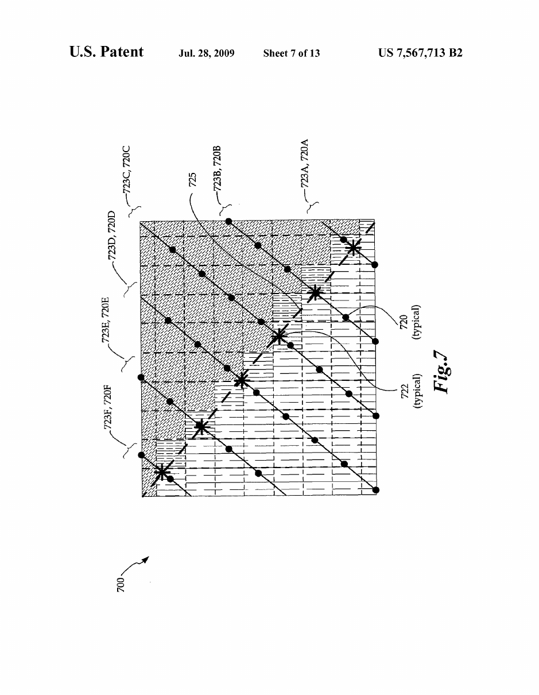
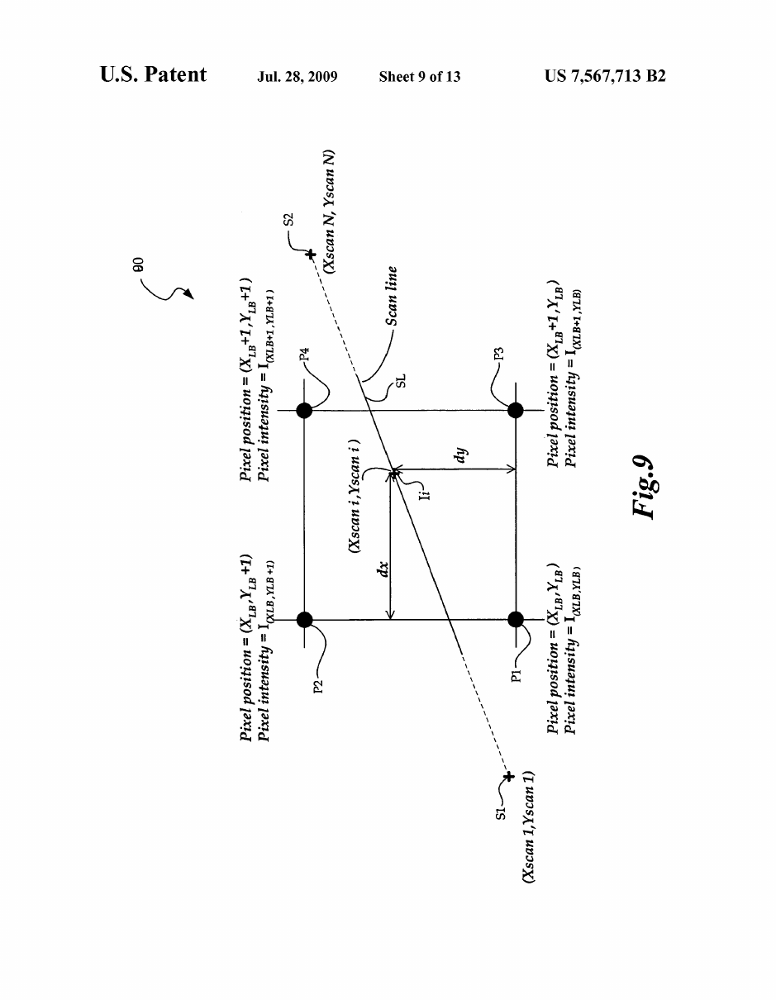
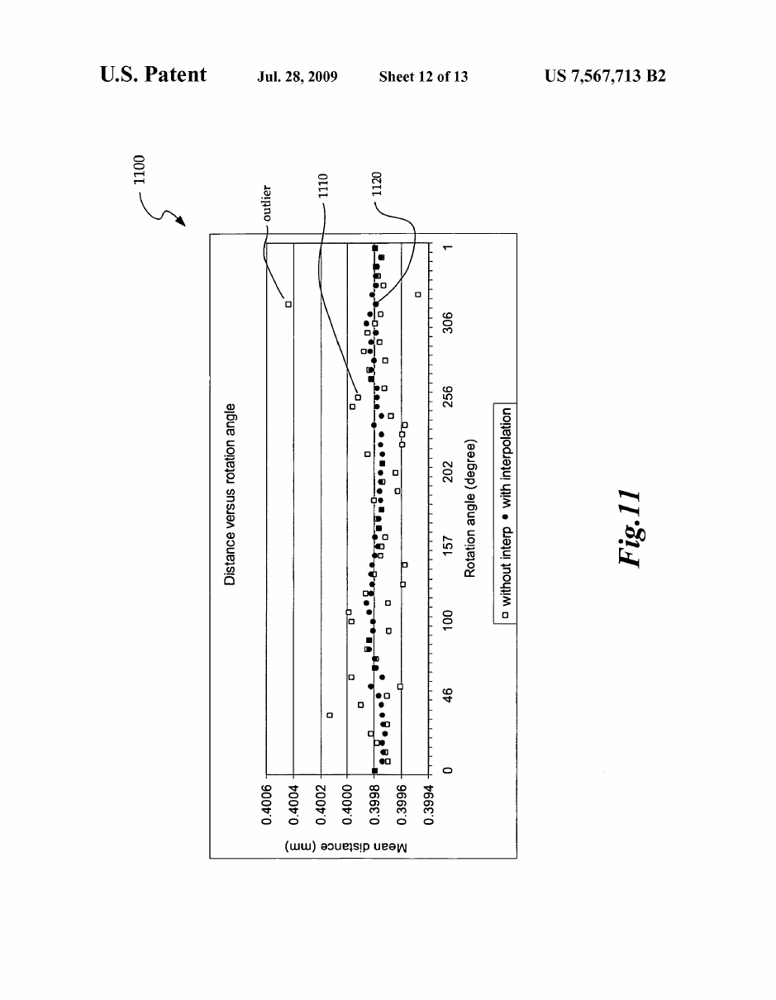

# US 7,567,713 B2 번역: 고정밀 머신 비전 검사 장비에서 밝기 보간으로 에지 위치를 재는 방법

번역 범위: 전문(서지면, 초록, 명세서 본문, 도면 설명, 청구항 1~17). 인용 문헌은 원문 그대로 둔다.
원문: [US7567713B2.pdf](US7567713B2.pdf) (Google Patents 공보 이미지, patentimages.storage.googleapis.com, 21쪽)
본문 추출: `pdftotext`로 쪽마다 왼쪽, 오른쪽 단을 나눠 뽑았다. 마지막 쪽(청구항 9 끝~17)은 글자층이 없어 쪽 그림을 보고 옮겼다.
번역 원칙: 뜻을 살린 직역. 원문 기호(XLB, Yscan i 등)와 도면 번호는 그대로 둔다. 번역자 메모는 `[역주]`로 따로 표시한다.

---

## 서지 사항 (공보 1쪽)

- (12) 미국 특허, Ding
- (10) 특허 번호: US 7,567,713 B2
- (45) 등록일: 2009년 7월 28일
- (54) 발명의 명칭: METHOD UTILIZING INTENSITY INTERPOLATION FOR MEASURING EDGE LOCATIONS IN A HIGH PRECISION MACHINE VISION INSPECTION SYSTEM (고정밀 머신 비전 검사 장비에서 밝기 보간으로 에지 위치를 재는 방법)
- (75) 발명자: Yuhua Ding, Kirkland, WA (US)
- (73) 권리자: Mitutoyo Corporation, Kawasaki-shi (JP)
- (*) 공지: 35 U.S.C. 154(b)에 따라 존속 기간이 730일 연장 또는 조정됨
- (21) 출원 번호: 11/350,590
- (22) 출원일: 2006년 2월 8일
- (65) 공개 자료: US 2007/0183666 A1, 2007년 8월 9일
- (51) Int. Cl.: G06K 9/48 (2006.01), G06K 9/00 (2006.01)
- (52) US Cl.: 382/199; 382/141
- (58) 검색 분야: 382/199, 382/195, 201, 203, 298, 141-152; 348/86-95, 348/125-134
- 청구항 17개, 도면 13장
- 심사관: Sherali Ishrat. 대리인: Christensen O'Connor Johnson Kindness PLLC

(56) 인용 문헌 (원문 그대로)

```
U.S. PATENT DOCUMENTS
6,002,793 A *   12/1999  Silver et al. ........ 382/152
6,061,467 A      5/2000  Michael
6,175,644 B1 *   1/2001  Scola et al. ......... 382/141
7,003,161 B2     2/2006  Tessadro
7,030,351 B2     4/2006  Wasserman et al.
2003/0095700 A1  5/2003  Yu et al.
2003/0206667 A1 11/2003  Wang et al.
2005/0031191 A1  2/2005  Venkatachalam
2005/0213807 A1  9/2005  Wasserman et al.
2006/0023937 A1  2/2006  Tessadro
2006/0093205 A1  5/2006  Bryll et al.

OTHER PUBLICATIONS
U.S. Appl. No. 11/185,561, filed Jul. 20, 2005, Blanford et al. [not yet published].
QVPAK 3D CNC Vision Measuring Machine Operation Guide, Version 2.0, Manual No. 4911GB,
  Series No. 359, Mitutoyo Corporation & Micro Encoder Inc., Kanagawa, Japan, Sep. 1996.
QVPAK 3D CNC Vision Measuring Machine User's Guide, Version 7.0, 1st ed., Manual No. 99MCB225A,
  Series No. 359, Mitutoyo Corporation & Micro Encoder Inc., Kanagawa, Japan, Jan. 2003.
Rockett, P., "The Accuracy of Sub-Pixel Localisation in the Canny Edge Detector,"
  Proceedings of the British Machine Vision Conference 1999, Nottingham, United Kingdom,
  Sep. 13-16, 1999, pp. 392-400.
* cited by examiner
```

## (57) 초록

영상에서 정밀하게 에지를 찾도록 비디오 도구를 운용하는 방법이다. 이 방법은 정해 둔 주사선 방향에 맞춘 직선 위의 위치들에 대해 영상 밝기 추정값을 구한다. 그리고 이 추정 밝기값과 직선 위 위치를 바탕으로, 그 직선 위의 에지 점 위치를 정한다. 이 방법은 에지 측정에 생길 수 있는, 부화소 수준의 방향 의존 편차를 줄인다. 밝기값은 가장 가까운 이웃 화소들의 밝기 사이를 보간해 추정할 수 있다. 직선 위의 위치를 화소 행이나 열과 일치하도록 고르면, 보간은 인접한 두 화소 밝기 사이의 선형 보간으로 충분하다.

(대표 도면: 도 8의 흐름도. 810 검사 영상 제공, 830 에지 위치를 정할 주사선 방향 정의, 840 그 방향에 맞춘 직선 주사선 위 위치에서 보간 밝기값 여러 개 결정, 850 보간 밝기값과 직선 위 위치로 에지 위치 결정)

---

## 명세서

### 발명의 분야

이 발명은 머신 비전 검사 장비에 관한 것이다. 더 구체적으로는, 고정밀 머신 비전 검사 장비에서 밝기 보간을 이용해 에지 위치를 재는 방법에 관한 것이다.

### 발명의 배경

정밀 머신 비전 검사 장비는 검사 대상의 치수를 정밀하게 재고, 그 밖의 여러 특성을 검사하는 데 쓴다. 이런 장비의 사용자 화면에는 보통 여러 비디오 도구가 있다. 사용자는 에지 검출에 필요한 영상 처리를 거의 몰라도, 이 도구를 공작물 영상 위에 놓아 에지 위치를 찾을 수 있다. 이런 기능을 갖춘 종래 장비의 한 예는 범용 "오프라인" 정밀 비전 검사 장비로 분류할 수 있는 것으로, 일리노이주 오로라의 Mitutoyo America Corporation(MAC)이 판매하는 QUICK VISION 시리즈 비전 검사기와 QVPAK 소프트웨어다. QUICK VISION 시리즈와 QVPAK 소프트웨어의 기능과 작동(사용자 화면과 여러 비디오 도구 포함)은, 예를 들어 2003년 1월 발행 QVPAK 3D CNC Vision Measuring Machine Users Guide와 1996년 9월 발행 QVPAK 3D CNC Vision Measuring Machine Operation Guide에 대체로 설명되어 있다. 두 문서는 전체가 이 명세서에 참조로 포함된다. 예를 들어 QV-302 Pro 모델로 대표되는 이 제품은 정밀 위치 결정 장치, 조절 가능한 조명, CCD 배열 등, 현미경형 광학계를 써서 공작물의 검사 영상을 여러 배율로 얻는다.

이런 범용 "오프라인" 정밀 비전 검사 장비는 쓰임새가 넓다는 특징이 있다. 사용자나 자동 프로그램이 구성과 촬영 조건을 빠르게 바꿔, 여러 종류의 대상이나 공작물, 또는 한 공작물의 여러 부분에 대해 다양한 검사를 할 수 있다. 이런 장비에는 조작을 단순하고 강건하게 만드는 기능과 비디오 도구가 있는 것이 좋다. 그래야 "비전문가" 작업자도 정밀 검사를 믿을 만하게 할 수 있다.

그런데 사용자는 정밀 비전 검사 장비에 점점 더 높은 측정 정확도를 기대한다. 전에는 알려지지 않았거나 무시할 만했던 오차 원인이 이제 중요해지고 있다. 그러면서도 정확도를 높인 장비와 비디오 도구는 여전히 경제적이어야 하고, 처리량이 높아야 하며, 단순하고 강건하게 작동해 "비전문가" 작업자도 정밀 검사를 믿을 만하게 할 수 있어야 한다. 이런 요구를 채우는 장비와 비디오 도구가 필요하다.

### 발명의 요약

기존의 어떤 장비는 같은 특징이라도 시야 안에서 그 특징이 놓인 방향에 따라 측정 결과나 위치 결과가 달라진다는 것이 밝혀졌다. 따라서 이런 측정 편차와 그에 따른 오차를 없애는 개선된 장비가 필요하다. 이 발명은 고정밀 머신 비전 검사 장비에서 에지 위치를 재도록 비디오 도구를 운용하는 개선된 방법에 관한 것이다. 더 구체적으로는, 검사 영상에서 에지가 특정 방향일 때 생기는 부화소 에지 위치 오차를 줄이거나 없애는 방법이다. 이 방법은 다음처럼 구현할 수 있다.

- 교정이나 조회 표(look-up table)가 필요 없다.
- 처리량이 높다.
- 이미 쓰던 에지 검출 알고리즘을 그대로 쓸 수 있다.
- 사용자가 오차를 일으키는 조건을 알아채거나, 그것을 피하려고 특별한 조작을 할 필요가 없다.

또한 기존의 어떤 머신 비전 검사 장비는 그 장비의 소프트웨어를 조금만 "개조"해서 이 발명의 여러 실시 형태를 쓸 수 있다.

이 발명의 다른 측면에 따르면, 에지 위치를 정하는 데 쓰는 공칭 "주사선"에 대응하는 밝기 프로파일을 만들 때 보간을 쓴다. 각 공칭 주사선의 방향과 위치는 비디오 도구의 방향이나 설정값으로 정할 수 있다. 각 주사선의 밝기 프로파일은 지정된 보간 방법으로 만든다. 이 보간 덕분에 밝기 프로파일의 자료점이 공칭 주사선과 매우 높은 정도로 일치하거나, 공칭 주사선에 적어도 거의 평행하고 가까운 직선과 일치한다. 그 다음 에지 검출 알고리즘으로 밝기 프로파일을 분석해, 대상 특징의 에지 위치를 높은 정밀도로 정한다. 중요한 점은, 이 방법을 기존 머신 비전 검사 소프트웨어에 넣을 때 공칭 주사선 위치를 만드는 알고리즘도, 에지 위치를 찾는 알고리즘도 고칠 필요가 없다는 것이다.

이 발명의 다른 측면에 따르면, 한 실시 형태에서 주사선의 밝기 프로파일 자료점을 만드는 보간은 쌍선형 보간이다. 밝기 프로파일의 각 자료점 밝기는 가장 가까운 이웃 화소 네 개의 밝기로 쌍선형 보간 계산을 해서 구한다.

이 발명의 다른 측면에 따르면, 한 실시 형태에서 밝기 프로파일 자료점(위치)은 밝기 프로파일을 만들 때 적어도 한 좌표 방향으로는 선형 보간만 쓰면 되도록 고른다. 예를 들어 각 점의 두 좌표 중 적어도 하나가 정수(즉 화소 행이나 열과 맞음)가 되게 자료점을 고른다. 그러면 한 좌표축을 따라 화소 밝기의 선형 보간을 높은 정확도로 쓸 수 있다. 이 구현에서는 밝기 프로파일 자료점 사이의 간격이 주사선 방향에 따라 달라질 수 있다. 이런 구현은 에지 검출 정확도를 해치지 않으면서 계산 효율을 높인다.

### 도면의 간단한 설명

이 발명의 앞의 측면들과 여러 장점은 다음 상세한 설명을 첨부 도면과 함께 보면 더 쉽게 이해된다.

- 도 1은 범용 머신 비전 검사 장비의 한 예를 보인 그림이다.
- 도 2는 영상의 에지 위에 놓인 점 도구(point tool)의 한 예를 보인 그림이다.
- 도 3은 영상의 에지 위에 놓인 상자 도구(box tool)의 한 예를 보인 그림이다.
- 도 4는 영상의 원형 에지 위에 놓인 원 도구(circle tool)의 한 예를 보인 그림이다.
- 도 5는 화소 밝기값 집합으로 에지 위치를 정하는 방법의 한 예를 보인 그림이다.
- 도 6은 에지 위치를 정하기 위해 공칭 주사선 집합에 대응하는 밝기 프로파일 자료점 값을 정하는 종래 방법의 하나를 보인 그림이다.
- 도 7은 에지 위치를 정하기 위해 공칭 주사선 집합에 대응하는 밝기 프로파일 자료점 값을 정하는, 이 발명에 따른 개선 방법의 한 예를 보인 그림이다.
- 도 8은 도 7의 개선 방법을 구현하는 루틴의 한 실시 형태를 보인 흐름도다.
- 도 9는 도 7과 8의 방법에서 밝기값을 정하는 데 쓸 수 있는 보간 방법의 한 실시 형태를 보인 그림이다.
- 도 10A는 도 7과 8의 방법에서, 쌍선형 보간으로 직선 주사선 위 밝기 프로파일 자료점 값을 정하고 그 결과로 에지 점을 정하는 루틴의 첫 번째 실시 형태를 보인 흐름도다.
- 도 10B는 도 7과 8의 방법에서, 자료점 위치를 제약하고 적어도 한 좌표 방향으로 선형 보간을 써서 직선 주사선 위 밝기 프로파일 자료점 값을 정하고 그 결과로 에지 점을 정하는 루틴의 한 실시 형태를 보인 흐름도다.
- 도 11은 도 6의 종래 방법과 도 7, 8, 9의 방법으로 얻은 점과 직선 사이 거리 측정 결과를 비교한 그림이다.
- 도 12는 도 6의 종래 방법과 도 7, 8, 9의 방법으로 얻은 원 측정 결과를 비교한 그림이다.

### 바람직한 실시 형태의 상세한 설명

도 1은 이 발명에 따라 쓸 수 있는 머신 비전 검사 장비 10의 한 예를 보인 블록도다. 머신 비전 검사 장비 10은 비전 측정기 12를 포함한다. 비전 측정기 12는 제어용 컴퓨터 14와 자료와 제어 신호를 주고받도록 연결된다. 제어용 컴퓨터 14는 다시 모니터 또는 표시 장치 16, 프린터 18, 조이스틱 22, 키보드 24, 마우스 26과 자료와 제어 신호를 주고받도록 연결된다. 모니터 또는 표시 장치 16에는 머신 비전 검사 장비 10의 작동을 제어하거나 프로그래밍하는 사용자 화면을 띄울 수 있다.

비전 측정기 12는 움직이는 공작물 스테이지 32와, 줌 렌즈나 교환 렌즈를 포함할 수 있는 광학 촬영계 34를 포함한다. 줌 렌즈나 교환 렌즈는 보통 광학 촬영계 34가 만드는 영상에 여러 배율을 준다. 머신 비전 검사 장비 10은 앞서 말한 QUICK VISION 시리즈 비전 장비와 QVPAK 소프트웨어, 그리고 비슷한 최신 상용 정밀 머신 비전 검사 장비와 대체로 견줄 만하다. 머신 비전 검사 장비 10은 함께 계류 중이고 같은 권리자에게 양도된 미국 특허 출원 10/978,227에도 설명되어 있으며, 이 출원은 전체가 참조로 포함된다. 비전 측정기와 제어 장치의 여러 측면은 함께 계류 중이고 같은 권리자에게 양도된 미국 특허 출원 10/808,948(2004년 3월 25일 출원)과 10/632,823(2003년 8월 4일 출원)에도 더 자세히 설명되어 있으며, 이들도 전체가 참조로 포함된다.

'948과 '823 출원에 더 자세히 설명된 대로, 머신 비전 검사 장비 10은 제어부를 포함할 수 있다. 제어부는 촬영해 저장한 공작물 검사 영상을 불러오고, 그 영상의 공작물 특징을 검사, 분석하며, 검사 결과를 저장하거나 내보낸다. 이런 분석, 검사 방법은 보통 메모리의 비디오 도구부에 들어 있는 여러 비디오 도구로 구현된다. 에지 검출 도구, 치수 측정 도구, 자동 초점 도구 같은 도구들은 앞서 말한 QUICKVISION 시리즈 비전 장비와 QVPAK 소프트웨어처럼 여러 상용 머신 비전 검사 장비에서 흔히 쓸 수 있다. 여러 비디오 도구는 함께 계류 중이고 같은 권리자에게 양도된 미국 특허 출원 09/987,986(2001년 11월 16일 출원), 10/719,210(2003년 11월 24일 출원), 10/903,714(2004년 7월 30일 출원), 11/185,561(2005년 7월 20일 출원)에도 설명되어 있으며, 각각 전체가 참조로 포함된다. 아래에서 더 자세히 설명하듯이, 이 발명은 여러 비디오 도구(예: 점, 상자, 원 도구 등)와 함께 쓰여 그 측정의 정확도와 일관성을 높인다.

도 2는 영상 200(예: 영상 표시 장치 위)에서 더 어둡거나 그늘진 영역 208의 경계에 있는 에지 205 위에 놓인 점 도구 210의 한 예를 보인 그림이다. 도 2와 아래 도면들에서 그늘진 영역 208 같은 음영 영역은 설명을 위해, 영상에서 밝기가 상대적으로 낮은 화소를 나타낸다. 아래에서 더 자세히 설명하듯이, 점 도구 210은 영상에서 에지 점 하나의 위치를 정하도록 설정할 수 있다. 여러 에지 점을 찾는 다른 종류의 도구(예: 상자형 에지 도구)도 비슷한 동작을 바탕으로 한다. 점 도구 210의 그래픽 사용자 화면은 몸체 211, 에지 선택기 212, 극성 표시 화살촉 214를 포함할 수 있다. 화살촉 214는 보통 에지를 가로질러 밝은 곳에서 어두운 곳으로, 또는 어두운 곳에서 밝은 곳으로 향한다. 참조로 포함된 문헌에 설명된 대로, 이것은 어떤 상황에서 에지 찾기의 신뢰도를 높인다. 도 2에서 몸체 211은, 몸체 211로 정의되고 공칭상 몸체 211과 겹치는 공칭 주사선 220을 가린다. 주사선은 아래 도 3과 4를 참조해 더 자세히 그리고 설명한다.

작동할 때 사용자는 점 도구 210을 고르고(예: 화면 가장자리의 비디오 도구 막대에서), 찾을 에지 특징을 지정한다. 지정은 몸체 211을 에지 특징 위에 놓고, 에지 선택기 212를 에지를 따라 원하는 자리에서 에지에 최대한 가깝게 놓아서 한다. 점 도구 몸체 211의 방향으로, 에지를 가로지르는 원하는 주사선 방향을 정하고 표시할 수 있다. 이것은 도 2 오른쪽 위의 x-y 좌표계에 보인 각 A로 나타낸다. 도 2와 이 명세서의 다른 도면에서 영상 화소는 x 좌표 방향을 따라 행으로, y 좌표 방향을 따라 열로 놓인다. 따라서 각 A는 영상의 화소 행에 대한 공칭 주사선 방향 각을 나타낸다. 화살표 214는 에지 검출에 쓸 기준 방향, 곧 극성을 가리킨다. 작동 중 점 도구 210의 설정이 끝나면, 그 밑에 있는 에지 점 찾기 루틴의 명령이 실행된다. 이 루틴은 점 도구 210의 몸체 211과 공칭상 겹치는 주사선에 대응하는 밝기 프로파일 자료점(예: 화소 밝기 자료)을 분석하고, 대상 특징의 에지 위치를 찾는 여러 동작을 한다. 아래 도 5에서 더 자세히 설명하듯이, 여러 실시 형태에서 점 도구 210의 에지 점 찾기 루틴은 주사선에 대응하는 밝기 프로파일을 따른 기울기 크기를 바탕으로 에지 위치를 정할 수 있다.

도 3은 영상 300(예: 영상 표시 장치 위)에서 그늘진 영역 308의 경계에 있는 에지 305 위에 놓인 상자 도구 310의 한 예를 보인 그림이다. 상자 도구 310의 그래픽 사용자 화면은 관심 영역(ROI) 표시기 311, 옆면을 따라 놓인 극성 표시 화살표 314, 찾을 에지 위에 놓이는 에지 선택기 312를 포함할 수 있다. 상자 도구 310 안에는 공칭 주사선 320이 표시될 수 있다. 상자 도구 310은 이 주사선을 만들어 에지 점을 정하는 데 쓴다. 상자 도구는 각 공칭 주사선 320을 따라, 앞서 도 2의 점 도구 210의 주사선 220에서 설명한 것처럼 대상 특징의 에지 점을 정한다. 도 3에 보인 대로, 그리고 아래에서 더 자세히 설명하듯이, 정한 에지 점들에 직선 325를 맞춰 에지 305의 측정 위치와 방향을 정할 수 있다.

작동할 때 상자 도구 310을 고르고, 찾을 에지 특징을 지정하도록 설정한다. 작업자는 ROI 표시기 311을 옮기고, 크기를 바꾸고, 돌려서, 측정 ROI가 찾을 에지 특징 부분을 포함하게 할 수 있다. 에지 선택기 312는 에지를 따라 원하는 자리에서 찾을 에지를 더 정확히 지정하도록 놓을 수 있다. 표시된 영상 위에서 ROI 표시기 311의 방향으로, 에지를 가로지르는 원하는 주사선 방향을 정하고 표시할 수 있다. 이것은 도 3 오른쪽 위의 x-y 좌표계에 보인 각 A로 나타낸다. 더 일반적으로, ROI 표시기 311 전체의 방향, 화살표 314를 포함하는 ROI 표시기 부분의 방향, 또는 공칭 주사선 320의 방향 중 어느 것으로든 주사선 방향을 정하거나 표시할 수 있다. 화살표 314는 에지 검출에 쓸 극성을 정한다. 상자 도구 310의 설정이 끝나면, 그 밑의 에지 점 찾기 루틴 명령이 실행된다. 이 루틴은 아래에서 더 자세히 설명하듯이, 밝기 프로파일 자료를 분석해 각 주사선을 따라 에지 점을 찾고, 찾은 에지 점들에 직선을 맞춘다.

도 4는 영상 400(예: 영상 표시 장치 위)에서 더 어둡거나 그늘진 영역 408의 경계에 있는 원형 에지 405 위에 놓인 원 도구 410의 한 예를 보인 그림이다. 원 도구 410의 그래픽 사용자 화면은 ROI 바깥 원 411A와 ROI 안쪽 원 411B로 된 ROI 표시기, 에지 선택기 412, 원 도구 410의 에지 검출에 쓸 극성을 나타내는 화살표 414를 포함할 수 있다. 원 도구 410이 만들어 에지 점을 정하는 데 쓰는 공칭 주사선 420은 ROI 안쪽 원 411B와 바깥 원 411A 사이에 표시될 수 있다. 원 도구는 각 공칭 주사선 420에 대해, 앞서 도 2의 점 도구 210의 주사선 220에서 설명한 것처럼 대상 특징의 에지 점을 찾는다. 정한 에지 점들에 원 425를 맞추면, 원형 에지 405의 측정 위치와 반지름이 정해진다.

원 도구 410의 여러 기능의 작동은, 설명이나 문맥상 달리 나타내지 않는 한, 앞서 도 3에서 설명한 상자 도구 310의 비슷한 기능과 같다. 작동할 때 원 도구 410을 고르고, 찾을 에지 특징을 지정하도록 설정한다. 작업자는 ROI 표시기를 옮기고 크기를 바꿔, ROI 안쪽 원 411B와 바깥 원 411A 사이에 찾을 에지 특징이 들어가게 할 수 있다. 에지 선택기 412는 에지를 따라 원하는 자리에서 찾을 에지를 더 정확히 지정하도록 놓을 수 있다. 화살표 414는 에지 검출에 쓸 극성을 정한다. 원 도구 410의 설정이 끝나면, 그 밑의 에지 점 찾기 루틴 명령이 실행된다. 이 루틴은 ROI 둘레에 여러 각도로 퍼진, 반지름 방향의 직선 주사선 여러 개 각각의 방향을 정한다. 그 다음 루틴은 밝기 프로파일 자료값을 분석해 각 주사선을 따라 에지 점을 찾고, 찾은 에지 점들에 원을 맞춘다. 방식은 아래에서 설명하는 직선 에지 결정 동작과 비슷하다. 앞의 도구들과 달리, 원 도구 410이 정해 쓰는 반지름 방향 공칭 주사선의 방향은 주사선마다 다르다.

정리하면, 일반적으로 에지 점은 여러 비디오 도구로 정하며, 도구는 에지 점에 기하 형태를 맞춰 대상 영상 특징을 잰다. 비디오 도구를 운용하는 한 종래 방법에서는 도구 종류(예: 점, 상자, 원 등)에 따라 정해진 도구 매개변수로 ROI 안에 공칭 주사선을 하나 이상 정하거나 만든다. 도구는 각 공칭 주사선에 대해, 공칭 주사선을 근사하는 밝기 프로파일 자료점 위치 집합을 정하거나 고른다. 그 자료점 위치에 대응하는 밝기값을 정해, 공칭 주사선에 대응하는 밝기 프로파일을 정의한다. 그 다음 한 실시 형태에서는, 예를 들어 아래 도 5에서 더 자세히 설명하듯이, 에지 검출 알고리즘이 밝기 프로파일을 따라 기울기를 분석해 기울기 크기가 가장 큰 위치를 찾는다. 밝기 프로파일에서 기울기가 가장 큰 위치로, 그 공칭 주사선에 대응하는 영상 속 에지 점 위치를 정한다. 이 종래 방법의 한 구현 예는 아래 도 6에서 더 자세히 설명한다.

도 5는 밝기 프로파일로 에지 위치를 정하는 방법의 한 예를 보인 그래프 500이다. 도 5에 보인 대로, 밝기 프로파일 510은 주사선(예: 도 2, 3, 4의 주사선 220, 320, 420 중 하나)을 나타내는 위치들에 대응하는 영상 화소 밝기(회색조)값 525의 집합이다. 주사선을 나타내는 자료점, 곧 위치는 가로축을 따라 0~50의 "화소 번호"로 표시된다. 자료점 0에서 시작하면, 영상 밝기값은 처음에 대략 자료점 23까지 비교적 어두운 영역을 보이고, 그 뒤 자료점 50까지 비교적 밝은 영역이 이어진다.

기울기 크기값 526은 밝기값 525로부터 구하며, 역시 도 5에 보인다. 여러 종래 알고리즘은 가로축에서 기울기 크기의 최대에 해당하는 위치를 찾아 그 위치를 에지 위치로 정한다. 기울기 크기 최대가 여러 개면, 비디오 도구의 에지 선택기나 방향 표시기(예: 점 도구 210의 에지 선택기 212나 극성 표시기 214)가 알고리즘이 원하는 최대를 고르도록 돕는다. 도 5에서 최대 기울기 기준(곧 기울기 최대)은 에지가 대략 자료점 23에 있음을 가리킨다. 곡선 맞춤, 무게중심 계산 같은 방법을 쓰면 밝기 프로파일 자료점 사이에서 기울기 크기 최대를 비교적 정밀하게 찾을 수 있다. 이것은 보통 영상 속 해당 에지 위치를 정할 때 부화소 수준의 측정 분해능과 반복성을 뒷받침한다.

도 6은 공칭 주사선을 나타내는 밝기 프로파일(예: 도 5의 밝기 프로파일 510)을 정하고, 그 결과로 에지 위치를 정하는 종래 방법의 하나를 보인 그림 600이다. 도 6에는 에지의 작은 부분과 그 둘레 영상 화소가 매우 크게 확대되어 있다. 도 6은 더 큰 ROI(그림에 없음)의 작은 일부다. 영상 화소는 점선으로 둘러싼 상자로 모식적으로 나타낸다. 화소의 공칭 위치는 화소 중심이다. 각 화소의 밝기는 상자 안 음영 정도로 대략 나타내며, 음영이 짙을수록 밝기가 낮다. 도 6에는 각각의 주사선 영상 화소 집합 620A~620F가 있다. 각 집합은 화소 중심 점들을 하나 이상의 실선 선분으로 이은 것으로 나타내며, 주사선 영상 화소 집합 620B가 그 전형이다. 도 6의 실시 형태에서 집합 620A~620F의 주사선 영상 화소는 각 공칭 주사선을 나타내도록 고른 것이다. 공칭 주사선에 가장 가까운 화소이기 때문이다. 공칭 주사선은 도 6에 그리지 않았지만, 같은 영상을 보인 도 7에서 아래 설명하는 공칭 주사선 723A~723F와 같을 수 있다. 도 6은 ROI의 일부만 보이므로, 그림의 주사선 영상 화소 집합 620A~620F는 "불완전한" 집합이라는 점을 알아야 한다. 곧 ROI 안 전형적인 주사선을 따라 들어가는 화소를 모두 보이지 않으며, 정확한 에지 검출에 충분한 수의 화소를 보이지 않는다. 그러나 그 일반 구조는 종래 방법을 대표하며, 이 설명에는 충분하다.

주사선 영상 화소 집합은 도 5에서 설명한 밝기 프로파일 510과 비슷한 밝기 프로파일을 준다. 이것을 비슷하게 분석해 밝기 프로파일을 따른 에지 위치를 정할 수 있다. 도 6에는 각각의 최적 맞춤 직선 621A~621F도 있다. 이 경우 이 직선들은 원래 공칭 주사선과 평행하며, 각 주사선 영상 화소 집합에 가장 잘 맞도록 놓인 직선이다. 이 예에서는 밝기 프로파일의 인접 화소 번호 사이에서 부화소 분해능으로 에지 위치를 정하면, 대응하는 주사선 영상 화소 사이의 대응 위치(예: 비례 위치)를 해당 최적 맞춤 직선(621A~621F 중 하나)에 투영해 검출 에지 점 622 하나를 정한다. 검출 에지 점 622는 꺾인 실선 624로 이은 십자로 나타낸다. 도 6에는 검출 에지 점 622에 맞춘 점선의 최적 맞춤 직선 625도 있다. 최적 맞춤 직선 625의 위치가 영상 속 대상 직선 에지 특징의 측정 위치를 정한다. 다른 실시 형태에서는, 밝기 프로파일의 인접 화소 번호 사이에서 에지 위치를 정하면, 대응하는 주사선 영상 화소를 잇는 선 위의 대응 위치를 그대로 검출 에지 점 622 하나로 쓴다.

설명을 위해 도 6은 에지 검출에 쓰는 일반적인 ROI보다 화소 수를 크게 줄이고 크게 확대해 보였다는 점을 알아야 한다. 그래서 도 6은 주사선 영상 화소 집합 620A~620F가 각자의 직선에서 벗어난 정도를 크게 과장한다. 도 6에 보인 화소를 일반 표시 장치에 띄우면 해당 표시 영역의 폭은 대략 2 mm(0.1인치)보다 작다. 따라서 실제로는 ROI가 도 6의 화소 묶음보다 훨씬 크고, 실제 주사선 영상 화소 집합은 훨씬 많은 화소를 포함하며, 각 집합의 화소는 표시 장치에서 매우 곧은 직선처럼 보인다. 화소 영상에서 직선을 나타낼 때는, 예를 들어 주사선 영상 화소 집합 620A~620F처럼 직선을 가장 잘 근사하는 영상 화소를 고르거나, 잘 알려진 Bresenham 알고리즘 같은 방법을 쓰는 것이 관례였다. 앞서 설명한 종래 방법은 좋은 측정 분해능과 반복성, 예를 들어 영상 화소 간격의 1/10~1/50 정도를 주었으므로 만족스러웠다.

그러나 전에는 알려지지 않았거나 무시할 만했던 오차 원인이 최근 장비와 응용에서 중요해지고 있다. 종래 에지 검출 방법은 같은 특징이라도 시야 안에서 그 특징의 방향에 따라 다른 측정 결과를 낼 수 있다는 것이 알려졌다. 예를 들어 이런 방향 의존 측정 결과는, Peter Rocket의 *The Accuracy of Sub-Pixel Localisation in the Canny Edge Detector*(BMVC99, pp. 392-401)에 설명된 대로, 잘 알려진 Canny 에지 검출기에서 발견되었다. Rocket은 Canny 에지 검출기의 이런 오차를 조회 표로 보정할 수 있다고 제안한다. 그러나 Canny 에지 검출기와 제안된 보정 방법은 범용 정밀 머신 비전 검사 장비의 비디오 도구라는 맥락에서는 쉽게 적용할 수 없거나 바람직하지 않다.

[역주] 본문은 쪽수를 pp. 392-401로, 서지면 인용 문헌은 pp. 392-400으로 적었다. 원문 그대로 옮겼다.

부화소 수준의 방향 의존 측정 편차는 이제 앞서 도 5에서 설명한 종래 방법에서도 확인되었다. 이런 측정 편차는 도 11과 12에 보인다. 이제 이런 측정 편차를 만드는 오차를 줄이거나 없애는 방법을 설명한다.

도 7은 공칭 주사선을 나타내는 밝기 프로파일을 정하고 그 결과로 에지 위치를 정하는, 이 발명에 따른 개선 방법의 한 예를 보인 그림 700이다. 도 7의 개선 방법은 범용 정밀 머신 비전 검사 장비의 비디오 도구라는 맥락에서 효율적이고 강건하다. 도 7에는 각각의 공칭 주사선 723A~723F가 있다. 여러 실시 형태에서 공칭 주사선은 도 2의 점 도구 210의 몸체 211과 평행하게, 또는 도 3의 상자 도구 310의 공칭 중심선에 수직으로, 또는 도 4의 원 도구 410에서처럼 반지름 방향으로 정할 수 있다. 여러 실시 형태에서 공칭 주사선은 비디오 도구 ROI 전체에 걸쳐 지정한 개수의 위치에 같은 간격으로 놓거나, 화소 간격 단위나 밀리미터, 도 같은 절대 측정 단위로 정한 거리만큼 띄워 놓을 수 있다. 더 일반적으로, 공칭 주사선은 쓸 만한 개수의 주사선을 주고, 찾을 에지를 가로질러 쓸 만하거나 바람직한 방향(예: 에지에 거의 수직)으로 주사선을 놓을 수 있는, 지금 알려졌거나 나중에 개발될 어떤 방법으로든 정할 수 있다. 각 주사선 자료점 집합 720A~720F는 공칭 주사선 723A~723F를 따라 놓인 점들의 집합으로 나타낸다. 도 7에 보인 대로, 각 주사선 자료점 집합 720A~720F 안에서 자료점은 공칭 주사선과 겹치고 서로 한 직선 위에 있도록 고른다. 주사선 자료점 집합 720A~720F는 "불완전한" 집합이다. 곧 정확한 에지 검출에 충분한 화소를 보통 포함하지 않는다. 그러나 설명에는 충분하다.



주사선 자료점은 영상 화소 위치와 겹치는 대신 한 직선 위에 있도록 제약되므로, 각 자료점의 밝기는 아래에서 더 자세히 설명하듯이 인접 화소 밝기로 추정(예: 보간)해야 한다. 이렇게 얻은 주사선 자료점 집합은 도 5에서 설명한 밝기 프로파일 510과 비슷한 밝기 프로파일을 준다. 이 밝기 프로파일도 비슷하게 분석해 밝기 프로파일을 따른 에지 위치(예: 기울기 크기 최대 위치)를 정할 수 있다.

앞에서 설명한 방법은 2차원(2D) 영상을 지나는 한 직선(이 경우 공칭 주사선)을 따른 밝기 프로파일에 해당하는 1차원(1D) 밝기 프로파일을 만들 수 있게 한다는 점을 알아야 한다. 따라서 1D 밝기 프로파일에서 찾은 에지 위치를, 큰 근사나 오차 없이 2D 영상을 지나는 그 직선 위로 바로 되돌려 대응시킬 수 있다. 검출 에지 점 722가 최적 맞춤 직선 725에 매우 잘 맞는 것을 볼 수 있다.

이와 달리 도 6에서 설명한 종래 방법은 2D 영상을 지나는 곧은(1D) 직선을 따른 밝기 프로파일과 꼭 맞지는 않는 밝기 자료로 1D 밝기 프로파일을 만든다. 따라서 1D 밝기 프로파일에서 찾은 에지 위치를 어느 정도의 근사나 오차 없이 2D 영상으로 바로 되돌려 대응시킬 수 없다. 이 근사나 오차는 주사선 영상 화소 집합이 찾을 에지 근처에서 "2D 꺾임"을 포함할 때 더 나빠진다. 도 6에서 주사선 영상 화소 집합 620A~620C에 대응하는 에지 점 622가 직선에 잘 맞지 않는 것이 그 예다.

도 8은 도 7의 개선 방법을 구현하는 루틴 800의 한 실시 형태를 보인 흐름도다. 도 8에 보인 대로, 블록 810에서 검사 영상을 준비한다. 블록 820에서 영상에 들어 있는 에지 특징을 지정한다. 블록 830에서 에지 특징 위치를 정하는 데 쓸 주사선 방향을 정한다. 블록 840에서, 정한 주사선 방향에 맞춘 직선 주사선 위의 위치들에 대응하는 보간 영상 밝기값 여러 개를 추정한다. 블록 850에서, 이 보간 영상 밝기값들과 직선 주사선 위 대응 위치를 바탕으로 직선 주사선을 따른 에지 특징 위치를 정한다. 루틴 800은 여기서 설명한 비디오 도구 밑에 있는(그 안에 포함된) 하나 이상의 에지 찾기 루틴에 들어가는 명령으로 구현할 수 있다. 이 명령은 비디오 도구 동작 중에 실행되어, 머신 비전 검사 장비가 해당 동작을 하도록 제어한다.

도 9는 도 7과 8의 방법에서 직선 위 위치의 밝기값을 추정하는 데 쓸 수 있는 보간 방법의 한 실시 형태를 보인 그림 900이다. 도 9에 보인 대로, 가장 가까운 이웃 화소 중심 네 개 P1, P2, P3, P4가 밝기를 추정할 자료점 Ii 둘레에 정사각형을 이룬다. 주사선 끝점 S1과 S2가 직선 SL을 정한다. 밝기 자료점 Ii는 주사선 SL 위에서 화소 P1로부터 가로 거리 dx, 세로 거리 dy만큼 떨어져 있다.



여러 점의 위치와 화소 밝기는 다음처럼 정의한다.

- 화소 P1: 위치 (XLB, YLB), 밝기 I(XLB, YLB)
- 화소 P2: 위치 (XLB, YLB+1), 밝기 I(XLB, YLB+1)
- 화소 P3: 위치 (XLB+1, YLB), 밝기 I(XLB+1, YLB)
- 화소 P4: 위치 (XLB+1, YLB+1), 밝기 I(XLB+1, YLB+1)
- 주사선 끝점 S1: 위치 (Xscan 1, Yscan 1)
- 주사선 끝점 S2: 위치 (Xscan N, Yscan N)
- 밝기 자료점 Ii: 위치 (Xscan i, Yscan i)

도 9에 보인 대로, 그리고 아래 도 10A와 10B에서 더 자세히 설명하듯이, 밝기 자료점 Ii에 줄 밝기값은 보간으로 추정할 수 있다. 보간 방법의 한 실시 형태에서, 주사선 SL 위 각 자료점 Ii(i = 1, 2, 3, ...)의 추정 밝기는 다음 식처럼 가장 가까운 이웃 네 개의 밝기로 계산한다.

```
I(Xscan i, Yscan i) = dx [ dy I(XLB+1, YLB+1) + (1 - dy) I(XLB+1, YLB) ]
                    + (1 - dx) [ dy I(XLB, YLB+1) + (1 - dy) I(XLB, YLB) ]      (식 1)
```

여기서 dx와 dy는 밝기값을 추정하는 해당 자료점에 대응하는 값이다. 식 1 대신 쓸 수 있는 같은 뜻의 식이 도 10A의 단계 1025에 있다.

[역주] 공보 인쇄본에서 식 1 둘째 괄호의 첫 항 첨자가 흐리게 인쇄되어 있다. 위 식은 도 9의 화소 정의(P2 = (XLB, YLB+1))와 쌍선형 보간 정의에 맞춰 적었다.

도 10A는 도 7과 8의 방법에서, 쌍선형 보간으로 직선 주사선 위 밝기 프로파일 자료점 값을 추정하고 그 결과로 에지 점을 정하는 루틴 1000의 한 실시 형태를 보인 흐름도다. 도 10A에 보인 대로, 블록 1010에서 비디오 도구의 공칭 주사선을 정하고, 주사선을 따라 밝기 프로파일 자료점 위치 집합 (Xscan 1, Yscan 1)~(Xscan N, Yscan N)을 정하며, i = 1로 초기화한다. 블록 1015에서 XLB = Xscan i의 정수 부분, YLB = Yscan i의 정수 부분으로 변수를 정한다. 블록 1020에서 dy = Yscan i - YLB, dx = Xscan i - XLB를 구한다. 블록 1025에서 다음을 구한다.

```
I(Xscan i, Yscan i) = I(XLB, Yscan i) + dx * [ I(XLB+1, Yscan i) - I(XLB, Yscan i) ]
  여기서
I(XLB,   Yscan i) = I(XLB, YLB)   + dy * [ I(XLB, YLB+1)   - I(XLB, YLB) ]
I(XLB+1, Yscan i) = I(XLB+1, YLB) + dy * [ I(XLB+1, YLB+1) - I(XLB+1, YLB) ]
```

블록 1030에서 i를 i = i+1로 늘린다. 판단 블록 1035에서 i = N인지 판단한다. i가 N이 아니면 루틴은 블록 1015로 돌아간다. i가 N이면 블록 1040으로 간다. 블록 1040에서는 주사선을 따른 자료 집합 (I(Xscan 1, Yscan 1), ..., I(Xscan N, Yscan N)) 중 적어도 일부를 바탕으로, 예를 들어 앞서 설명한 밝기 프로파일에서 에지 위치를 찾는 방법으로 주사선 위 에지 위치를 정한다.

도 10B는 도 7과 8의 방법에서, 자료점 위치를 제약하고 적어도 한 좌표 방향으로 선형 보간을 써서 직선 주사선 위 밝기 프로파일 자료점 값을 추정하고 그 결과로 에지 점을 정하는 루틴 1050의 한 실시 형태를 보인 흐름도다. 도 10B에 보인 대로, 블록 1055에서 비디오 도구의 공칭 주사선을 정하고, 주사선을 따라 밝기 프로파일 자료점 위치 집합 (Xscan 1, Yscan 1)~(Xscan N, Yscan N)을 정한다. 이때 모든 Xscan i가 화소 열 위치에 대응하게(곧 dx = 0) 정하고, i = 1로 초기화한다. 블록 1060에서 XLB = Xscan i, YLB = Yscan i의 정수 부분으로 변수를 정한다. 블록 1065에서 dy = Yscan i - YLB를 구한다. 블록 1070에서 다음을 구한다.

```
I(Xscan i, Yscan i) = I(XLB, YLB) + dy * [ I(XLB, YLB+1) - I(XLB, YLB) ]
```

블록 1075에서 i를 i = i+1로 늘린다. 판단 블록 1080에서 i = N인지 판단한다. i가 N이 아니면 루틴은 블록 1060으로 돌아간다. i가 N이면 블록 1085로 간다. 블록 1085에서는 주사선을 따른 자료 집합 (I(Xscan 1, Yscan 1), ..., I(Xscan N, Yscan N)) 중 적어도 일부를 바탕으로 주사선 위 에지 위치를 정한다.

루틴 1050은 루틴 1000과 비슷한 대안이지만, 직선 위에 놓인 자료점의 밝기를 추정하는 보간 계산의 효율을 높인다는 점을 알 수 있다. 비슷한 이점을 주는 다른 실시 형태로, 루틴 1050에서 x와 y 좌표의 역할을 바꿔 모든 Yscan i가 화소 행 위치에 대응하게(곧 dy = 0) 할 수도 있다. 또 다른 실시 형태로, 주사선을 따라 자료점 위치를 번갈아 골라, 어떤 자료점은 dx = 0, 다음 자료점은 dy = 0, 이런 식으로 할 수도 있다. 위에서 설명한 루틴이나 동작은 모두 여기서 설명한 비디오 도구 밑에 있는(그 안에 포함된) 하나 이상의 에지 찾기 루틴에 들어가는 명령으로 구현할 수 있다. 이 명령은 비디오 도구 동작 중에 실행되어, 머신 비전 검사 장비가 해당 동작을 하도록 제어한다.

도 11은 에지 점과 직선 에지 사이 거리의 치수 측정을, 도 6의 종래 에지 검출 방법을 구현한 경우와, 도 7, 8, 9에서 설명한 대로 직선 위 위치의 밝기 프로파일을 추정하는 개선 방법으로 잰 경우로 비교한 그림 1100이다. 종래 방법("보간 없음")의 결과는 네모 자료점 1110으로, 개선 방법("보간 있음")의 결과는 동그라미 자료점 1120으로 나타낸다. 도 11에 보인 대로, 360도 범위의 여러 방향에서 이 치수 측정의 최대-최소 폭(peak-to-peak) 편차는 종래 방법에서 약 0.6 µm(이상치 1개 제외)였던 것이 이 발명에 따른 개선 방법에서 약 0.15 µm로 줄었다. 큰 개선이다.



도 12는 도 6의 종래 에지 검출 방법을 구현해 얻은 치수 측정 결과와, 도 7, 8, 9에서 설명한 대로 직선 위 위치의 밝기 프로파일을 추정하는 개선 방법으로 얻은 결과를 비교한 그림 1200이다. 측정 결과는 원 비디오 도구로 지름 500 µm인 원 16개를 재서 얻었다. 각 원마다 에지 점 360개를 검출한 뒤 원을 맞췄다. 각 에지 점에서 맞춘 원 중심까지의 거리를 보였으며, 종래 방법("보간 없음")의 결과는 십자 자료점 1210으로, 개선 방법("보간 있음")의 결과는 동그라미 자료점 1220으로 나타낸다. 에지 점 360개는 각각 다른 반지름 방향 주사선 방향으로 검출한 것이라는 점을 알 수 있다. 보는 바와 같이, 이 발명의 개선 방법으로 얻은 거리 측정의 편차, 곧 오차는 종래 방법으로 얻은 결과에 비해 크게 줄었다.

[역주] 본문은 도 12의 결과를 수치 없이 "크게 줄었다"고만 적는다. 도 12(13번째 도면, 공보 14쪽)의 축은 세로 "원 중심까지 거리(mm)" 0.246~0.254, 가로 "에지 점 번호(360도에 고르게 분포)" 1~360이다. 그림을 눈으로 읽으면, 보간 없는 십자점은 약 0.2465~0.2535 mm까지 흩어지고, 보간 있는 점은 약 0.2485~0.2515 mm 안에 모인다. 두 경우 모두 에지 점 번호를 따라 대략 90도 주기로 오르내리는 물결이 남아 있다. 이 값들은 그림 눈대중이며 공보 본문의 수치가 아니다.

또한 앞의 설명은 설명을 분명히 하려고 단색 영상을 다뤘지만, 색 화소가 섞인 영상(예: 빨강, 초록, 파랑 색 채널 화소로 된 영상)의 에지 검출도 비슷한 방식으로 할 수 있다는 점을 알아야 한다. 한 예로, 각 색 채널 영상을 공통의 전체 좌표계에 놓인 단색 영상으로 다룰 수 있다. 각 색 채널 영상을 앞서 설명한 대로 분석하고, 각 채널에서 나온 측정 결과를 전체 좌표계에서 평균이나 다른 적절한 방법으로 합칠 수 있다. 다른 예로, 알려진 방법으로 색 채널을 합쳐 알맞은 "단색" 의사 영상을 만들고, 이를 앞의 방법으로 분석할 수 있다.

이 발명의 바람직한 실시 형태를 보이고 설명했지만, 이 개시를 바탕으로 이 분야 기술자에게는 보이고 설명한 특징 배치와 동작 순서의 여러 변형이 분명할 것이다. 따라서 이 발명의 정신과 범위를 벗어나지 않고 여러 변경을 할 수 있음을 알 수 있다.

---

## 청구항

배타적 권리나 특권을 청구하는 이 발명의 실시 형태는 다음과 같이 정의된다.

1. 머신 비전 검사 장비로 얻은 공작물 검사 영상에서 에지 특징의 위치를 정하는 방법으로서, 컴퓨터를 써서 다음 단계를 수행하는 것을 포함하는 방법:
   a) 영상에 들어 있는 에지 특징을 지정하는 단계;
   b) 에지 특징의 적어도 한 에지 점의 위치를 정하는 데 쓸 주사선 방향을 정하는 단계;
   c) 정한 주사선 방향에 맞춘 직선 위의 위치들에 대응하는 추정 영상 밝기값 여러 개를 정하는 단계; 그리고
   d) 추정 영상 밝기값 여러 개와 그 직선 위 대응 위치를 바탕으로, 그 직선 위 에지 점의 위치를 정하는 단계.

2. 청구항 1에 있어서, 추정 영상 밝기값 여러 개를 정하는 것은 쌍선형 보간으로 영상 밝기값을 추정하는 것을 포함하는 방법.

3. 청구항 2에 있어서, 직선 위 각 위치에 대해, 그 위치에 가장 가까운 이웃 화소 네 개의 영상 밝기값을 써서 쌍선형 보간을 하는 방법.

4. 청구항 1에 있어서, 직선 위 위치 중 적어도 하나를 화소 행이나 화소 열과 공칭상 겹치도록 정하는 방법.

5. 청구항 4에 있어서, 직선 위 위치 하나를 화소 행과 공칭상 겹치도록 정하면, 그 위치에 대응하는 영상 밝기값의 추정은 같은 화소 행에 있는 가장 가까운 이웃 화소 두 개의 영상 밝기값 사이의 선형 보간을 포함하는 방법.

6. 청구항 4에 있어서, 직선 위 위치 하나를 화소 열과 공칭상 겹치도록 정하면, 그 위치에 대응하는 영상 밝기값의 추정은 같은 화소 열에 있는 가장 가까운 이웃 화소 두 개의 영상 밝기값 사이의 선형 보간을 포함하는 방법.

7. 청구항 1에 있어서, 단계 a)와 b)는 영상 표시 화면에 띄운 비디오 도구를 설정해서 수행하고, 단계 c)와 d)는 비디오 도구의 에지 점 찾기 루틴이 수행하며, 그 루틴은 다음을 포함하는 방법:
   머신 비전 검사 장비가, 정한 주사선 방향에 맞춘 직선 위의 위치들에 대응하는 추정 영상 밝기값 여러 개를 정하는 동작을 하도록 제어하는 명령으로서, 직선 주사선 위 각 위치에 대해 가장 가까운 이웃인 영상 화소들의 영상 밝기값 사이를 보간해 영상 밝기값을 추정하는 명령; 그리고
   머신 비전 검사 장비가, 추정 영상 밝기값 여러 개와 그 직선 위 대응 위치를 바탕으로 그 직선 위 에지 점의 위치를 정하는 동작을 하도록 제어하는 명령.

8. 청구항 7에 있어서, 영상에 들어 있는 에지 특징을 지정하는 것은 비디오 도구의 그래픽 사용자 화면의 에지 지정 요소를 영상 표시 화면 위에 놓는 것을 포함하는 방법.

9. 청구항 8에 있어서, 비디오 도구는 점 도구와 상자 도구 중 하나이고, 에지 특징의 적어도 한 에지 점의 위치를 정하는 데 쓸 주사선 방향을 정하는 것은 영상 표시 화면 위에서 비디오 도구의 그래픽 사용자 화면의 주사선 방향 표시 요소의 방향을 정하는 것을 포함하는 방법.

10. 청구항 8에 있어서,
    비디오 도구는 원 도구이고;
    에지 점 찾기 루틴은, 머신 비전 검사 장비가 관심 영역 둘레에 여러 각도로 퍼진 반지름 방향 직선 주사선 여러 개 각각의 방향을 정하는 동작을 하도록 제어하는 주사선 결정 명령을 포함하며;
    에지 특징의 적어도 한 에지 점의 위치를 정하는 데 쓸 주사선 방향을 정하는 것은 주사선 결정 명령을 실행하는 것을 포함하고; 그리고
    정한 주사선 방향에 맞춘 직선 위의 위치들에 대응하는 추정 영상 밝기값 여러 개를 정하는 동작은, 반지름 방향 직선 주사선 여러 개 각각의 위치들에 대응하는 추정 영상 밝기값 여러 개를 정하는 동작을 포함하는 방법.

11. 머신 비전 검사 장비로 얻은 공작물 검사 영상에서 에지 특징의 위치를 정하는 비디오 도구로서, 다음을 포함하는 비디오 도구:
    영상에 들어 있는 에지 특징을 지정하도록 영상 표시 화면 위에 놓을 수 있는 그래픽 사용자 화면 수단;
    에지 특징의 적어도 한 에지 점의 위치를 정하는 데 쓸 주사선 방향을 정하는 수단; 그리고
    에지 점을 찾는 수단으로서, 다음을 포함하는 수단:
    머신 비전 검사 장비가, 정한 주사선 방향에 맞춘 직선 위의 위치들에 대응하는 추정 영상 밝기값 여러 개를 정하는 동작을 하도록 제어하는 수단; 그리고
    머신 비전 검사 장비가, 추정 영상 밝기값 여러 개와 그 직선 위 대응 위치를 바탕으로 그 직선 위 에지 점의 위치를 정하는 동작을 하도록 제어하는 수단.

12. 청구항 11에 있어서, 직선 위의 위치들에 대응하는 추정 영상 밝기값 여러 개를 정하는 동작은 쌍선형 보간으로 영상 밝기값을 추정하는 동작을 포함하는 비디오 도구.

13. 청구항 11에 있어서, 직선 위의 위치들에 대응하는 추정 영상 밝기값 여러 개를 정하는 동작은 다음을 포함하는 비디오 도구:
    직선 위 위치 중 적어도 하나를 화소 행과 공칭상 겹치도록 정하는 동작; 그리고
    직선 위 위치 하나가 화소 행과 겹치면, 그 위치에 대응하는 영상 밝기값을 같은 화소 행에 있는 가장 가까운 이웃 화소 두 개의 영상 밝기값 사이의 선형 보간으로 추정하는 값 추정 동작.

14. 청구항 11에 있어서, 직선 위의 위치들에 대응하는 추정 영상 밝기값 여러 개를 정하는 동작은 다음을 포함하는 비디오 도구:
    직선 위 위치 중 적어도 하나를 화소 열과 공칭상 겹치도록 정하는 동작; 그리고
    직선 위 위치 하나가 화소 열과 겹치면, 그 위치에 대응하는 영상 밝기값을 같은 화소 열에 있는 가장 가까운 이웃 화소 두 개의 영상 밝기값 사이의 선형 보간으로 추정하는 값 추정 동작.

15. 청구항 11에 있어서,
    비디오 도구는 점 도구이고;
    그래픽 사용자 화면 수단은 점 도구 몸체와 에지 선택기 중 적어도 하나를 포함하며;
    주사선 방향을 정하는 수단은 영상 표시 화면 위에 놓인 방향의 점 도구 몸체를 포함하고; 그리고
    정한 주사선 방향에 맞춘 직선 위의 위치들에 대응하는 추정 영상 밝기값 여러 개를 정하는 동작은, 직선을 점 도구 몸체와 한 직선 위에 있도록 정하고, 직선 위 각 위치에 대해 가장 가까운 이웃인 영상 화소들의 영상 밝기값 사이를 보간해 영상 밝기값을 추정하는 동작을 포함하는 비디오 도구.

16. 청구항 11에 있어서,
    비디오 도구는 상자 도구이고;
    그래픽 사용자 화면 수단은 관심 영역 표시기와 에지 선택기 중 적어도 하나를 포함하며;
    주사선 방향을 정하는 수단은 영상 표시 화면 위에 놓인 방향의 관심 영역 표시기, 영상 표시 화면 위에 놓인 방향의 상자 도구 방향 표시기, 영상 표시 화면 위의 주사선 표시기 중 적어도 하나를 포함하고; 그리고
    정한 주사선 방향에 맞춘 직선 위의 위치들에 대응하는 추정 영상 밝기값 여러 개를 정하는 동작은 다음을 포함하는 비디오 도구:
    정한 주사선 방향과 평행하게 맞추고 관심 영역 안에 퍼뜨린 직선 주사선 여러 개를 정하는 동작; 그리고
    직선 주사선 여러 개 각각의 위치들에 대응하는 추정 영상 밝기값 여러 개를 정하되, 각 직선 주사선 위 각 위치에 대해 가장 가까운 이웃인 영상 화소들의 영상 밝기값 사이를 보간해 영상 밝기값을 추정하는 동작.

17. 청구항 11에 있어서,
    비디오 도구는 원 도구이고;
    그래픽 사용자 화면 수단은 관심 영역 표시기와 에지 선택기 중 적어도 하나를 포함하며;
    주사선 방향을 정하는 수단은 에지 점을 찾는 수단에 포함된 수단으로서, 머신 비전 검사 장비가 관심 영역 둘레에 여러 각도로 퍼진 반지름 방향 직선 주사선 여러 개 각각의 방향을 정하는 동작을 하도록 제어하는 수단을 포함하고; 그리고
    정한 주사선 방향에 맞춘 직선 위의 위치들에 대응하는 추정 영상 밝기값 여러 개를 정하는 동작은, 반지름 방향 직선 주사선 여러 개 각각의 위치들에 대응하는 추정 영상 밝기값 여러 개를 정하되, 각 직선 주사선 위 각 위치에 대해 가장 가까운 이웃인 영상 화소들의 영상 밝기값 사이를 보간해 영상 밝기값을 추정하는 동작을 포함하는 비디오 도구.

\* \* \* \* \*
