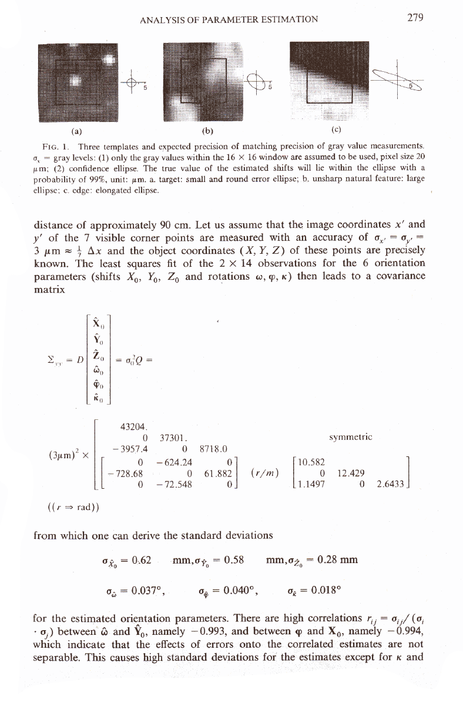
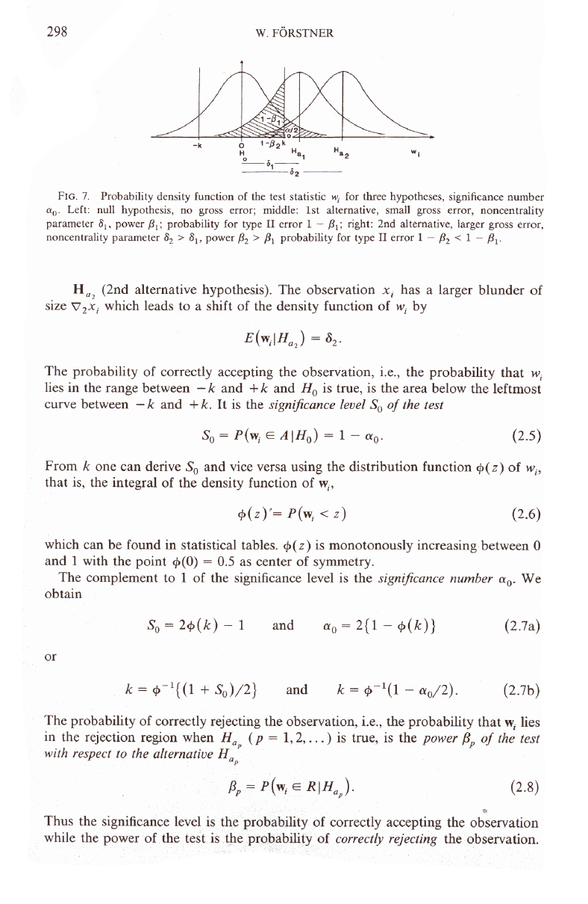
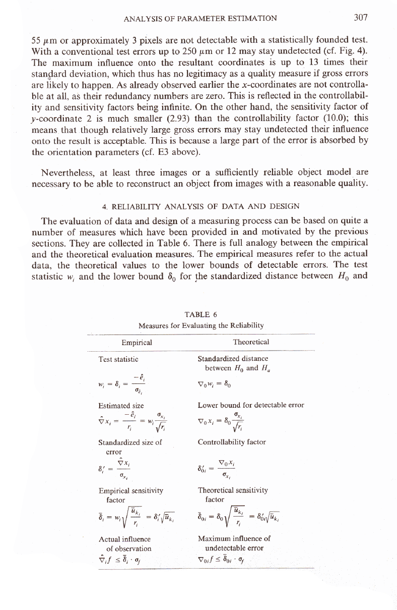

# 번역: 선형 모형의 모수 추정에 대한 신뢰성 분석과 컴퓨터 비전 측정 문제에의 응용

- 원제: Reliability Analysis of Parameter Estimation in Linear Models with Applications to Mensuration Problems in Computer Vision
- 저자: W. Förstner (서독 슈투트가르트 대학 사진측량연구소)
- 서지: Computer Vision, Graphics, and Image Processing 40, 273-310 (1987). 1986-09-15 접수. doi:10.1016/S0734-189X(87)80144-5
- 원문 파일: `Forstner1987_CVGIP_reliability.pdf` (본 대학 IPB 공개 스캔본, 38쪽)
- 번역 범위: 전문(초록, 본문 0~5절, 그림과 표 캡션). 참고문헌은 원문 그대로.
- 번역 방법: 스캔 이미지 PDF라서 `pdftotext -layout`으로 글자가 나오지 않았다(38바이트). 300 dpi로 이미지화한 뒤 tesseract OCR로 글을 뽑고, 수식과 표는 쪽 이미지를 보고 확인했다. OCR이 깨진 수식은 앞뒤 정의로 복원했고, 복원한 곳은 [역주]로 표시했다.
- 표기: 원문의 기호 $\nabla$는 "모형 안의 오차"를 뜻한다(차이 $\Delta$와 구별). 모자 기호(^)는 추정값이다. 곱셈은 $\cdot$로 쓴다.

---

## 초록

측정 문제를 분석하는 목적은 두 가지다. 하나는 측정 과정의 설계가 특정 작업에 알맞은지 평가하는 것이다. 다른 하나는 실제로 얻은 측정값과 그 측정값이 결과에 주는 영향을 판정하는 것이다.

이 논문은 네덜란드 측지학자 W. Baarda가 발전시킨 품질 관리 개념을 소개한다. 이 이론은 객관적인 품질 척도를 준다. 이 척도는 설계의 기하와, 사용한 추정 방법과 검정 방법을 함께 고려한다.

- 설계의 평가는 정밀도, 통제 가능성(controllability), 강건성(robustness) 척도에 기초한다. 이 척도는 계획 단계에서도 쓸 수 있다.
- 자료의 평가는 통계 검정, 가능한 과대오차(blunder)의 추정 크기, 관측값이 결과에 주는 영향에 기초한다.

세 가지 예, 곧 템플릿 정합, 카메라의 절대 표정, 상대 표정을 통해 이 척도가 직관적인 평가를 정밀하게 만든다는 것을 보인다. 이 척도는 컴퓨터 비전의 측정 문제에서 자동 품질 관리에 알맞아 보인다.

---

## 0. 서론

### 0.1 일반

컴퓨터 비전의 많은 측정 문제는 선형 회귀로 이어지거나 선형 회귀로 줄일 수 있다. 예는 다음과 같다.

- 템플릿 정합
- 물체 공간의 여러 점이 영상에서 식별되었을 때 카메라 표정 모수를 정하는 일
- 영상 열에서 관측한 강체의 운동 모수 추정
- 불규칙하게 퍼진 점들로 곡면을 다항식이나 유한요소로 근사하는 일
- 주어진 점들에 가장 잘 맞는 직선을 정하는 일

이런 작업에는 최소제곱법이 표준이다. 최소제곱법은 선형 연립방정식으로 이어지므로 쓰기 쉽고, 자료의 모든 정보를 한꺼번에 쓰며, 꽤 일반적인 가정 아래 최적 추정값을 준다. 더욱이 최소제곱법을 통계 검정 이론과 함께 쓰면 자료와 설계를 철저히 평가할 수 있다.

그러나 지난 20년 동안 이 방법은 끊임없이 공격받았다. 이유는 모두 한 가지로 모인다. 최소제곱 추정은 실무에 쓰기에 충분히 강건하지 않다는 것이다. 곧 최소제곱의 기본 가정이 현실적이지 않아 받아들일 만한 결과를 내지 못한다는 주장이다. 여기서 벗어나는 길은 원칙적으로 두 가지다. 강건 추정을 쓰거나, 자료와 설계를 기하적, 통계적으로 분석하는 진단 방법을 쓰는 것이다.

강건 추정기([14], [17] 참조)는 다음 영향을 없애려고 개발되었다: 과대오차, 계통오차, 무시한 상관, 단순화한 모형, 약하고 불확실한 가정 등. 이런 영향은 실제로 최소제곱 추정을 받아들일 수 없게 만들 수 있다. 더 중요한 것은, 이런 영향이 **작은 잔차나 자료와 모형의 훌륭한 맞춤 뒤에 숨을 수 있다**는 점이다. 이런 결함이 반드시 추정값의 분산을 크게 만들지도 않는다. 그래서 분석가는 안심하게 된다.

강건 추정기는 실제로 도움이 되고 효율적일 수 있다. 다만 두 조건이 필요하다. 미지 모수의 수가 관측값의 수보다 작아야 한다. 그리고 증명하기 쉽지 않은 둘째 조건으로, 어떤 관측도 한 모수를 혼자 결정해서는 안 된다. 그런 관측은 시스템 안에서 통제할 수 없기 때문이다. 이런 상황은 쉽게 생길 수 있고, 큰 시스템에서는 더 잘 숨는다.

자료 분석가들은 일찍이 이 상황을 알아채고 설계의 강건성을 요구했다([1-5, 7]). 설계의 강건성은 문제를 정확히 짚는 말이며 "지렛점(leverage point)", "가짜 관측", "검출할 수 없는 과대오차", "분리할 수 없는 효과" 같은 개념과 관련된다. 이 학파의 메시지는 이렇다. 최소제곱법이 주는 모든 정보를 통계 분석과 함께 활용하고, 강건하지 않은 설계를 피하도록 실험을 잘 계획하라. 목표는 다음을 보여 최소제곱 추정의 품질을 문서로 남기는 것이다.

- 통계 검정이 과대오차, 모형 오차 등을 골라냈다.
- 검출할 수 없는 과대오차나 계통오차는 결과에 제한된 영향만 준다.

강건 추정 접근은 추정 과정의 가정을 점검하려면 이런 실험 설계 분석의 뒷받침을 받아야 한다. 강건 추정기는 자료 정리에는 효과적이지만 결과를 제대로 분석하는 것을 막는다. 예상 오차, 특히 이상치의 모형이 기본 가정 안에 섞여 들어가기 때문이다. 반면 통계 검정 이론의 접근은 실험의 설계, 추정, 평가, 개선에서 품질 관리를 위한 분명한 틀을 준다.

품질 관리는 측정에 쓰는 컴퓨터 비전 응용 모두에 본래 있는 문제다. 영상과 물체 사이의 기하 관계는 특히 스테레오와 영상 열 분석에서 너무 다양해서 단순화한 분석을 허용하지 않는다. 기하 구속이나 동역학 구속 같은 추가 정보를 고려해야 할 때는 더 그렇다. 자동화에는 자기 진단이 필요하다([12, 19] 참조). 이 맥락에서 자기 진단은 측정의 불확실성, 그 불확실성이 결과에 주는 영향, 설계가 지정된 작업에 알맞은지를 기술하는 잘 확립된 기법에 기초할 수 있다.

### 0.2 측정을 위한 통계 모형의 개념

측정의 목적은 현실에 대한 정보를 얻는 것이다. 수학 모형에 기초해 측정 절차를 만든다. 여기에는 기기의 사양, 측정망의 설계 등이 들어간다. 이 측정 과정은 현실에게 질문을 던지는 일로 볼 수 있다. 현실의 대답은 관측값, 예를 들어 $x$다. 관측값은 가정한 모형의 맥락에서 던진 질문에 대해서만 의미가 있다.

수학 모형에는 보통 여러 미지 모수가 있다. 이를 벡터 $y$로 쓴다. 이 모수는 대개 직접 관측할 수 없다. 설계의 과제는 관측량으로부터 이 미지 모수를 요구하는 품질로 끌어낼 수 있는 측정 과정을 만드는 것이다.

실제 측정 과정은 너무 복잡해서 자세히 기술할 수 없다. 기기 교정은 관측값이 모형 안의 값과 어느 정밀도까지 맞도록 보장하려 한다. 측정 중의 조건을 나타내는 다른 값(예: 온도)도 흔히 기록한다. 이 값이 기본 수학 모형에 직접 들어가지 않더라도 평가 단계에서 쓰일 것으로 기대한다.

수학 모형은 관측과 미지 모수 사이에 가정한 기하 관계와 물리 관계를 담는다. 따라서 모형에 나오는 관측은 관측값을 추상화한 것이다. 관측값 $x$를 모형에 나오는 확률변수 $\mathbf{x}$의 실현값으로 보는 것이 보통이다. 모형은 관측값 자체가 아니라 관측의 함수, 예를 들어 기댓값 $E(\mathbf{x})$나 분산 $V(\mathbf{x})=\Sigma_{xx}$에 대해 세운다. 실용상의 이유로 미지 모수 $y$와 관측 $\mathbf{x}$ 사이의 관계는 가능한 한 단순하게, 그러나 작업에 필요한 만큼은 복잡하게 둔다.

모형을 점검하려면 대립 모형을 기술해서 모형 안의 예상 오차를 드러내야 한다. 이 대립 모형에 기초한 점검과 검정도 현실에 던지는 질문으로 해석할 수 있다. 현실의 대답(예: 검정 통계량)은 다시 모형과 그 대립 모형의 맥락 안에서만 의미가 있다.

결국 관측값과 그 판정에서 얻는 정보의 양은 설계자의 경험과 창의성, 그리고 측정 과정과 평가 과정에 대한 생각을 수학 모형으로 옮기는 능력에 크게 달려 있다.

### 0.3 논문의 개요

다음 절들에서 실제 관측값에 대한 질문과, 이 질문에 대한 측정 과정 설계의 품질에 대한 질문에 어떻게 답할 수 있는지 보인다. 여기 소개하는 품질 관리 개념은 네덜란드 측지학자 W. Baarda가 1960년대와 1970년대 초에 발전시켰다([1, 2, 4]). 이 논문은 오차 검출 문제에 집중한다. 그러나 이 개념은 계통오차, 곧 수학 모형의 더 일반적인 결함에도 쓸 수 있다.

자세히는 다음 질문을 다룬다.

1. (a) 수학 모형을 대립 모형에 비해 기각해야 하는지 어떻게 결정하는가? 이는 통계 검정(검정 통계량 $w_i$)으로 이어지며, 예를 들어 과대오차 검출에 쓸 수 있다.
   (b) 수학 모형을 기각하려면 수학 모형과 대립 모형의 차이가 얼마나 커야 하는가? 결정이 높은 확률로 옳아야 한다면, 이 최소 차이(대립 가설 아래 $w_i$ 분포의 비중심 모수 $\delta_0$)는 일반적으로 검정 통계량의 임계값보다 훨씬 크다는 것을 보인다.
2. (a) 의심되는 모형 오차는 얼마나 큰가? 의심 관측의 과대오차는 얼마나 큰가? 일반적으로 과대오차의 일부만 최소제곱 맞춤의 잔차에 나타난다. 이 비율, 곧 측정 과정의 설계에서 끌어낼 수 있는 잉여수(redundancy number) $r_i$로 잔차에서 과대오차의 크기를 추정할 수 있다.
   (b) 검출할 수 있는 과대오차의 최소 크기는 얼마인가? 일정한 최소 확률로 검출할 수 있는 과대오차의 하한($\nabla_0 x_i$)은 일반적으로 관측 표준편차의 3배보다 훨씬 크다. 이 하한은 측정 설계의 통제 가능성, 곧 Baarda가 말한 **내부 신뢰성**을 나타낸다.
3. (a) 관측값 하나가 결과에 주는 영향은 얼마인가? 관측 $x_i$가 결과 $f$에 주는 효과($\hat\nabla_i f$)는 그 관측을 버릴지, 결과를 받아들일지 결정하는 데 결정적일 수 있다.
   (b) 검출할 수 없는 과대오차나 계통오차가 결과에 줄 수 있는 최대 영향은 얼마인가? 검출할 수 없는 오차가 결과 $f$에 주는 이 최대 영향($\nabla_{0i} f$)은 과대오차에 대한 측정 과정 설계의 민감도 또는 강건성, 곧 Baarda가 말한 **외부 신뢰성**을 나타낸다. 이는 설계의 최적화나 승인에 결정적일 수 있다.

1절은 설계의 기하를 다룬다. 질문 2(a)와 3(a)(오차의 추정 크기, 관측의 효과)는 통계 검정 없이 답할 수 있기 때문이다. 2절은 통계 검정과 그 검정력을 다루며 질문 1(a, b)(검정과 비중심 모수)에 답한다. 3절은 기하 개념과 통계 개념을 이어 설계의 신뢰성을 평가하는 바탕을 만들고, 질문 2(b)와 3(b)(통제 가능성과 민감도)에 답한다. 컴퓨터 비전의 세 예, 곧 템플릿 정합, 카메라의 절대 표정과 상대 표정이 이 개념이 쓸모 있음을 보여 준다.

---

## 1. 설계의 기하

### 1.1 모수 추정의 정밀도

다음 선형 모형이 주어졌다고 하자.

$$E(\mathbf{x}) = A y,\qquad V(\mathbf{x}) = \Sigma = \sigma_0^2 Q \tag{1.1}$$

이 식은 관측 $\mathbf{x}$의 기댓값 $n$개와 미지 모수 $y$ $u$개를 선형으로 잇는다. 설계 행렬 $A$의 계수 $a_{ij}$는 알려져 있다고 가정한다. 비선형 모형 $E(\mathbf{x})=f(y)$를 선형화해서 얻을 수도 있으며, 그때 $A$는 편미분 $\partial f_i/\partial y_j$의 행렬이다. $A$는 완전 계수이고 $n>u$, 곧 $\mathrm{rk}(A)=u$라고 가정한다. 관측의 분산공분산 행렬 $\Sigma$는 미지의 분산 인자 $\sigma_0^2$를 빼고는 알려져 있다고 가정한다. 가중계수 행렬 $Q$는 정칙이라고 가정한다. 자세한 내용은 [23, 24]를 보라.

관측값 $x'=(x_1,x_2,\dots,x_n)$에서 출발해 과잉 결정된 연립방정식 (1.1)을 풀면 미지 모수의 추정값 $\hat y$를 얻는다(모자는 추정값을 뜻한다).

$$\hat y = (A'\Sigma^{-1}A)^{-1}A'\Sigma^{-1}x \tag{1.2a}$$
$$\hat y = (A'Q^{-1}A)^{-1}A'Q^{-1}x \tag{1.2b}$$

$x$가 정규분포 확률변수 $\mathbf{x}$의 실현값이라고 가정하면 식 (1.2a), (1.2b)는 $y$의 최대우도 추정이다. 이 추정은 분산 인자 $\sigma_0^2$와 무관하다. $\hat y$는 또한 $y$의 최량 선형 불편 추정(BLUE)이며, 이때는 기댓값과 분산 말고는 $\mathbf{x}$의 분포에 대한 가정이 필요 없다. 식 (1.1)은 관측의 가중 행렬 $W$를 쓰는 최소제곱법으로도 풀 수 있다.

$$\hat y = (A'WA)^{-1}A'Wx \tag{1.2c}$$

$W=Q^{-1}$로 고르면 분명히 두 추정이 같다.

$\hat y$로 맞춤값을 얻는다.

$$\hat x = A\hat y \tag{1.3}$$

이 값은 모형에 "맞고" 기댓값 $E(\mathbf{x})$의 추정값이다. 차이

$$\hat e = A\hat y - x = \hat x - x \tag{1.4}$$

는 관측값에 대한 보정값, 곧 잔차다. 잔차로 분산 인자의 추정값을 얻는다.

$$\hat\sigma_0^2 = \frac{\hat e' Q^{-1}\hat e}{r} \tag{1.5}$$

여기서

$$r = n - u \tag{1.6}$$

는 시스템의 잉여도(redundancy)다. $r=0$이면 관측값이 가정한 확률 성질과 상관없이 모수 $y$를 유일하게 정하고, 잔차는 0이다.

이제 오차 전파로 추정값 $\hat y$, $\hat x$, $\hat e$의 정밀도를 얻는다.

$$V(\hat{\mathbf{y}}) = \Sigma_{\hat y\hat y} = (A'\Sigma^{-1}A)^{-1} = \sigma_0^2 Q_{\hat y\hat y}$$
$$V(\hat{\mathbf{x}}) = \Sigma_{\hat x\hat x} = A\Sigma_{\hat y\hat y}A' = \sigma_0^2 Q_{\hat x\hat x} \tag{1.7a}$$
$$V(\hat{\mathbf{e}}) = \Sigma_{\hat e\hat e} = \Sigma - \Sigma_{\hat x\hat x} = \sigma_0^2 Q_{\hat e\hat e}$$

추정값의 표준편차는 다음과 같다.

$$\sigma_{\hat y_j} = \sigma_0\sqrt{q_{\hat y_j\hat y_j}} = \sqrt{V(\hat y_j)},\quad \sigma_{\hat x_i} = \sigma_0\sqrt{q_{\hat x_i\hat x_i}},\quad \sigma_{\hat e_i} = \sigma_0\sqrt{q_{\hat e_i\hat e_i}} \tag{1.7b}$$

이 척도로 관측의 피할 수 없는 우연오차가 결과에 주는 영향을 평가할 수 있다. 공분산 행렬과 표준편차는 수학 모형 안의 확률변수 $\hat{\mathbf y}$, $\hat{\mathbf x}$, $\hat{\mathbf e}$의 성질이지, 실제 추정값 $\hat y$, $\hat x$, $\hat e$의 성질이 아니라는 점을 기억해야 한다. 이 구별은 수식에서는 분명하지만 본문에서는 늘 그렇지는 않다.

**참고.** 비선형 모형을 선형화하면 추정값에 작은 오차가 생기지만, 특히 상대 정확도가 10%보다 좋으면 대체로 무시할 수 있다([25] 참조).

**예.**

**E1. 템플릿 정합.** 템플릿 정합은 최소제곱 추정 문제로 쓸 수 있으며, 미분 접근이라고도 한다([15] 참조). 1차원 연속 템플릿 $g(t)$와 관측한 화소 밝기 $n$개 $g_1(t_i)$, $i=1,\dots,n$이 주어지면 비선형 모형은 $E(g_1(t_i)) = g(t_i - t)$이고, 미지 모수는 이동량 $y=t$ 하나다. $t_0=0$에서 1차 도함수 $\dot g(t)=dg/dt$로 선형화하면 선형 모형 $E(g_1(t_i)) = g(t_i) - \dot g(t_i)\,t$, 또는 $g_1(t_i)+\hat e(t_i) = g(t_i) - \dot g(t_i)\,\hat t$를 얻는다. 설계 행렬 $A$는 여기서 벡터이며 1차 도함수를 담는다: $A'=(\dot g(t_1),\dots,\dot g(t_n))$. 백색 잡음, 곧 측정 밝기 $g_1$의 오차가 서로 상관없고 같은 분포라고 가정하면($\Sigma=\sigma_0^2 I$) 잘 알려진 추정값 $\hat t = [\sum \dot g^2(t_i)]^{-1}\cdot[\sum (g_1(t_i)-g(t_i))\,\dot g(t_i)]$를 얻는다. 실제로는 이를 비선형 문제의 반복 해법에서 근사값 갱신으로 쓸 수 있다.

식 (1.7b)와 분산 $\sigma_{\dot g}^2=\sum\dot g^2(t_i)/n$, 신호 대 잡음비 $\mathrm{SNR}=\sigma_g/\sigma_0$로 추정 이동량 $\hat t$의 이론 정밀도를 구할 수 있다.

$$\sigma_{\hat t}^2 = \frac{\sigma_0^2}{\sum_{i=1}^n \dot g^2(t_i)} = \frac{\sigma_0^2}{n}\cdot\frac{1}{\sigma_{\dot g}^2} = \frac{1}{n}\cdot\frac{1}{\mathrm{SNR}^2}\cdot\frac{\sigma_g^2}{\sigma_{\dot g}^2}$$

정합의 정밀도는 다음에 달려 있다.

- 밝기의 잡음 수준 $\sigma_0$
- 화소 수 $n$, 곧 창 크기
- 템플릿 무늬의 거칠기

이로써 즉석 평가가 객관적이 된다. 2차원 템플릿 정합에서는 두 미지 이동량(또는 시차)에 대해 $2\times2$ 공분산 행렬을 얻고, 이를 신뢰 타원으로 그릴 수 있다(그림 1 참조).

> **그림 1.** 세 템플릿과 예상 정합 정밀도. 밝기 측정의 정밀도 $\sigma_0$ = 1 밝기 단계. (1) 16×16 창 안의 밝기만 쓴다고 가정, 화소 크기 20 μm. (2) 신뢰 타원: 추정 이동량의 참값은 99% 확률로 타원 안에 있다. 단위 μm. a. 표적: 작고 둥근 오차 타원. b. 흐릿한 자연 특징: 큰 타원. c. 에지: 길쭉한 타원.
> [역주] 그림 1이 실린 279쪽 전체를 넣었다. 위쪽이 그림 1이고 아래쪽은 예 E2의 공분산 행렬이다.

무늬 모수 $\sigma_{\dot g}^2/\sigma_g^2$는 신호의 유효 대역폭과 자기상관 함수의 곡률에 모두 비례함을 보일 수 있다([20, 11] 참조). 이론 연구(예: [13, 9]), 컴퓨터 모의실험([16, 21] 참조), 실험 결과(예: [6, 22])는 물체 위치와 시차 결정에서 부화소 정확도에 도달할 수 있음을 한결같이 보여 준다.

**E2. 단일 카메라의 절대 표정.** 적어도 3개 물체점의 공간 좌표와 카메라 교정값(초점거리 등)이 주어지면 물체를 찍은 영상 하나로 카메라 표정을 정할 수 있다. 그림 2는 한 변 30 cm, 두께 18 cm인 정사각 블록이 좌표계에 대해 30° 기울어진 모습을 보인다. 초점거리 15 mm, 화소 크기 $\Delta x$ = 20 μm인 디지털 카메라로 약 90 cm 거리에서 영상을 찍었다고 하자. 보이는 모서리점 7개의 영상 좌표 $x'$, $y'$를 정확도 $\sigma_{x'}=\sigma_{y'}$ = 3 μm = $\tfrac{1}{7}\Delta x$로 측정하고, 이 점들의 물체 좌표 $(X,Y,Z)$는 정확히 안다고 하자. 6개 표정 모수(이동 $X_0, Y_0, Z_0$와 회전 $\omega, \varphi, \kappa$)에 대해 관측 2×7 = 14개를 최소제곱 맞춤하면 다음 공분산 행렬을 얻는다.

$$\Sigma_{\hat y\hat y} = \sigma_0^2 Q_{\hat y\hat y} = (3\,\mu\mathrm{m})^2\times
\begin{pmatrix}
43204. & & & & & \\
0 & 37301. & & & \text{대칭} & \\
-3957.4 & 0 & 8718.0 & & & \\
0 & -624.24 & 0 & 10.582 & & \\
-728.68 & 0 & 61.882 & 0 & 12.429 & \\
0 & -72.548 & 0 & 1.1497 & 0 & 2.6433
\end{pmatrix}$$

(행과 열 순서 $X_0, Y_0, Z_0, \omega, \varphi, \kappa$. 단위는 위치에 대해 m, 각에 대해 rad 기준. [역주] 행렬의 0 칸과 단위 표기는 스캔이 흐려 일부 추정했다.)

여기서 추정 표정 모수의 표준편차를 얻는다.

- $\sigma_{X_0}$ = 0.62 mm, $\sigma_{Y_0}$ = 0.58 mm, $\sigma_{Z_0}$ = 0.28 mm
- $\sigma_\omega$ = 0.037°, $\sigma_\varphi$ = 0.040°, $\sigma_\kappa$ = 0.018°

상관계수 $r_{ij}=\sigma_{ij}/(\sigma_i\sigma_j)$가 높은 쌍이 있다. $\omega$와 $Y_0$ 사이는 −0.993, $\varphi$와 $X_0$ 사이는 −0.994다. 이는 상관된 추정값에 대한 오차의 효과를 분리할 수 없음을 뜻한다. 그래서 $\kappa$와 $Z_0$를 빼고는 추정값의 표준편차가 크다. 높은 상관은 또한 충분한 자릿수로 계산하지 않으면 수치 해가 불안정할 수 있음을 뜻한다. 그러나 구한 표준편차가 지정된 작업에 충분하고 계산이 거슬리는 반올림 오차를 들여오지 않는다면, 높은 상관이 결과를 오염시키지는 않는다.

> **그림 2.** 공간에서 카메라의 절대 표정. 주어진 것: 점 7개의 물체 좌표 $(X,Y,Z)$. 측정한 것: 영상 좌표 $(x',y')$. 미지: 표정 모수, (1) 이동 $X_0, Y_0, Z_0$, (2) 회전각 $\omega', \varphi', \kappa'$. (PC = 투영 중심)

**E3. 두 카메라의 상대 표정.** 물체를 모르면, 미지의 축척을 빼고 물체의 모양을 복원하려면 서로 다른 두 위치에서 찍은 영상이 적어도 두 장 필요하다. 동시에 두 카메라의 공간 상대 표정도, 역시 미지의 축척을 빼고, 정할 수 있다. 왼쪽 카메라의 위치와 자세는 알려져 있고 원점에서 왼쪽으로 30 cm 떨어져 있다고 하자(그림 3 참조). 오른쪽 카메라는 원점에서 오른쪽으로 30 cm, 대략 x축 위에 있고 자세는 조금 바뀔 수 있다. 두 카메라 위치 사이 거리는 축척을 고정하려고 알려져 있다고 가정한다. 그러면 적어도 5개 점의 영상 좌표 $(x',y')$와 $(x'',y'')$를 정합 절차로 측정할 때 둘째 카메라의 위치 $Y_0''$, $Z_0''$와 자세각 $\omega''$, $\varphi''$, $\kappa''$, 그리고 물체 모양을 동시에 정할 수 있다. 앞면 점 7개의 영상 좌표를 다시 표준편차 3 μm로 잴 수 있다고 하면, 영상 좌표 2×2×7 = 28개를 미지 표정 모수와 물체 좌표 5 + 7×3 = 26개에 대해 최소제곱 맞춤해서 다음 표정 정밀도를 얻는다. ([역주] OCR에 "36"으로 읽혔으나 5 + 21 = 26이며, 뒤 문장도 26개 미지수라고 쓴다.)

- $\sigma_{\omega''}$ = 0.058°, $\sigma_{\varphi''}$ = 0.68°, $\sigma_{\kappa''}$ = 0.042°

위치 $Y_0''$, $Z_0''$와 y축 둘레 회전각 $\varphi''$의 정밀도는 물체 정보가 없어서 앞 예보다 훨씬 나쁘다. 이 설계의 약점은 미지수 26개에 대한 잉여도 2 = 28 − 26이 앞 예의 8 = 14 − 6에 비해 낮다는 데서 이미 드러난다. 반면 각 $\omega''$와 $\kappa''$는 아주 잘 정해진다. 이유는 세로 시차, 곧 y 시차만 표정 모수를 정하고, x 좌표는 물체 좌표, 특히 깊이를 직접 정하기 때문이다. 이 말은 뒤에서 정확히 하겠다. 여기서도 표정 모수 $\omega''$와 $Y_0''$ 사이, $\varphi''$와 $Z_0''$ 사이에 같은 높은 상관이 보인다.

> **그림 3.** 두 카메라의 상대 표정과 물체 복원. 주어진 것: (1) 왼쪽 카메라의 위치와 자세, (2) 카메라 사이 거리. 측정한 것: 대응점 7개의 영상 좌표 $(x',y')$와 $(x'',y'')$. 미지: (1) 오른쪽 카메라의 표정(이동 $Y_0''$, $Z_0''$, 회전각 $\omega''$, $\varphi''$, $\kappa''$), (2) 물체 좌표 $(X,Y,Z)$.

정밀도 분석은 모형 오차, 특히 과대오차가 없을 때만 현실적인 진술을 준다. 그래서 과대오차가 추정과 평가 절차에 주는 영향을 살핀다.

### 1.2 과대오차와 그 효과

관측값 $x_i$에 오차 $\nabla x_i$가 있다고 하자. (기호 $\nabla$는 수학 모형 안의 모든 오차를 가리키며 차이 $\Delta$와 구별한다. 이 표기는 Baarda에서 왔으며 물리학의 연산자와 혼동하지 말아야 한다.) 행렬 식을 쓰려고 벡터 $\nabla_i x' = (0,0,\dots,\nabla x_i,0,\dots,0)$를 도입한다. $i$번째 자리에만 $\nabla x_i$가 있고 나머지는 0이다. 관측 벡터 $\mathbf x$는 $\nabla_i x$만큼 바뀐다.

이제 기본 모형과 가정한 대립 모형을 정확히 쓸 수 있다. 통계 용어에 따라 식 (1.1)을 귀무가설 $H_0$라 한다.

$$H_0:\ E(\mathbf x\mid H_0) = Ay \tag{1.1b}$$

일반적으로 여러 대립가설 $H_{ai}$가 있다.

$$H_{ai}:\ E(\mathbf x\mid H_{ai}) = E(\mathbf x\mid H_0) + \nabla_i x,\quad \nabla_i x\ne 0 \tag{1.8a}$$

또는

$$H_{ai}:\ E(\mathbf x\mid H_{ai}) = Ay + h_i\nabla x_i,\quad \nabla x_i\ne0 \tag{1.8b}$$

벡터 $h_i$는 오차 원인이 관측에 주는 효과를 기술한다. 여기서 $h_i$는 단위 벡터 $h_i'=(\dots,0,1,0,\dots)$다.

과대오차를 기술하는 이 모형은 가장 단순한 경우다. 오차가 관측의 기댓값, 곧 평균에만 영향을 준다고 가정하기 때문이다. 그러나 이 유형의 대립 모형으로 중요한 실제 상황을 기술할 수 있다. 예:

- 자동 스테레오에서 정합 알고리즘의 잘못된 대응
- 두 점 사이 거리를 잘못 잰 경우
- 단일 계통 효과(이 경우 $h_i$는 꽉 찬 벡터다)

이 모든 경우에 오차가 측정 정확도에는 영향을 주지 않고, 오차 원인이 관측에 주는 효과를 모수 하나로 기술할 수 있다고 가정한다.

그러나 이 유형의 대립에 맞지 않는 중요한 반례가 있다.

- 표적이나 기준점을 식별할 때의 오차는 관측값 2개나 3개, 곧 영상이나 물체 공간의 좌표에 영향을 준다.
- 노출 중 카메라가 움직이면 계통오차가 생길 수 있다. 이때 점의 위치와, 영상 흐림 때문에 점 측정의 정밀도가 함께 바뀐다.
- 마지막으로, 오차가 평균은 그대로 두고 관측의 분산에만 영향을 줄 수 있다. 예를 들어 정밀도 차이를 모르는 두 측정 또는 정합 절차를 쓰면서 두 절차의 표준편차가 같다고 가정해야 할 때다.

여기서는 유도를 단순하게 하려고 식 (1.8) 유형의 대립에 집중한다(일반화는 5절 참조).

이제 대립가설이 기술하는 관측 오차가 절차 안의 여러 추정값에 주는 효과를 살펴보자. 오차 $\nabla_i x$가 추정값에 주는 영향은 다음과 같다.

$$\nabla_i\hat y = Q_{\hat y\hat y}A'Q^{-1}\nabla_i x \tag{1.9a}$$
$$\nabla_i\hat x = Q_{\hat x\hat x}Q^{-1}\nabla_i x \tag{1.9b}$$
$$\nabla_i\hat e = -Q_{\hat e\hat e}Q^{-1}\nabla_i x \tag{1.9c}$$

그림 4는 그림 3 예에서 점 5의 y 좌표에 2½ 화소, 곧 50 μm 오차가 있을 때 복원한 물체 모양에 주는 효과를 보인다. 모든 점이 영향을 받는다. 실제로는 $\nabla x_i$를 모르므로, 새 점의 참 좌표를 알 때만 그 영향을 알아챌 수 있다. 맞춤값에 대한 과대오차의 영향도 마찬가지다. 맞춤값은 미지 모수의 선형 함수일 뿐이기 때문이다.

> **그림 4.** 점 5의 y 좌표에 있는 2½ 화소(50 μm) 오차가 복원 물체 모양에 주는 효과. 실선: 과대오차가 없을 때 물체 모양. 점선: 과대오차가 있을 때 물체 모양. 측정 정밀도를 3 μm, 곧 ⅐ 화소로 가정하면 50 μm 오차는 검출할 수 없다.

그러나 적어도 오차 $\nabla x_i$가 잔차 $\hat e$에 주는 효과 $\nabla_i\hat e$는 보인다. 수학 모형이 맞다는 전제 아래 $\hat{\mathbf e}$의 기댓값

$$E(\hat{\mathbf e}) = 0 \tag{1.10}$$

은 $E(\hat{\mathbf y})$나 $E(\hat{\mathbf x})$와 달리 알려져 있기 때문이다. 그래서 오차가 잔차에 주는 효과를 공부한다. 과대오차의 크기를 추정할 수 있고, 이를 써서 그 오차가 맞춤값과 미지 모수에 주는 영향을 추정할 수 있음을 보이겠다.

### 1.3 관측 오차가 잔차에 주는 효과

표기를 단순하게 하려고 행렬을 도입한다.

$$R = \Sigma_{\hat e\hat e}\Sigma^{-1} = Q_{\hat e\hat e}Q^{-1} = I - A(A'\Sigma^{-1}A)^{-1}A'\Sigma^{-1} \tag{1.11}$$

그러면 식 (1.9c)는 다음과 같이 쓴다.

$$\nabla\hat e = -R\nabla x,\quad\text{또는}\quad \nabla_i\hat e_i = -r_{ii}\nabla x_i \tag{1.12}$$

식 (1.12)는 우연오차를 포함해 일반적인 $\nabla x$에도 성립하므로 첨자 $i$는 생략할 수 있다. $R$은 일반적으로 꽉 찬 행렬이다. 따라서 일반적으로

- (a) 관측 하나의 오차는 모든 잔차에 영향을 준다(열).
- (b) 잔차 하나는 모든 관측 오차의 영향을 받는다(행).
- (c) 관측 $x_i$의 오차 $\nabla x_i$가 대응 잔차 $\hat e_i$에 주는 효과 $\nabla_i\hat e_i$는 $R$의 $i$번째 대각 원소로 정해진다.

따라서 행렬 $R$은 관측 오차가 잔차에 주는 영향에 관한 설계 기하의 모든 정보를 담는다. $R$은 설계 행렬 $A$와 관측의 공분산 행렬 $\Sigma$에만 달려 있고, 개별 관측값에는 달려 있지 않다. 따라서 $R$은 측정 과정의 설계를 계획하는 데 쓸 수 있다.

$R$에는 여기서 해석에 유리하게 쓸 수 있는 여러 성질이 있다. 모두 $R$이 멱등, 곧 $R^2=R$이라는 데서 나온다.

- (a) 행렬

$$U = I - R = Q_{\hat x\hat x}Q^{-1} = \Sigma_{\hat x\hat x}\Sigma^{-1} = A(A'\Sigma^{-1}A)^{-1}A'\Sigma^{-1} \tag{1.13}$$

  은 오차 $\nabla x$가 맞춤값 $\hat x$에 주는 영향에 쓰이며 역시 멱등이다. $\hat x = Ux$이므로 통계 문헌에서는 $U$를 흔히 햇 행렬(hat matrix)이라 한다.
- (b) $R$과 $U$의 고윳값은 0 또는 1이다. 고윳값 분해로 보일 수 있다.
- (c) 따라서 $R$과 $U$의 대각합과 계수가 같다: $\mathrm{tr}\,R = \mathrm{rk}\,R$, $\mathrm{tr}\,U = \mathrm{rk}\,U$.
- (d)

$$\mathrm{tr}\,U = \mathrm{rk}\,U = \mathrm{rk}\big(A(A'\Sigma^{-1}A)^{-1}A'\Sigma^{-1}\big) = \mathrm{rk}\,A = u \tag{1.14}$$

  로부터

$$\mathrm{tr}\,R = \sum r_{ii} = \mathrm{tr}(I - U) = \mathrm{tr}\,I - \mathrm{tr}\,U = n - u = r \tag{1.15}$$

  가 나온다. 따라서 $R$의 대각 원소 $r_{ii}$를 모두 더하면 시스템의 잉여도 $r$이 되며, 이는 $r$이 관측 $n$개에 어떻게 나뉘는지 보여 준다. 마찬가지로 $U$의 대각 원소 $u_{ii}$를 모두 더하면 미지 모수의 총수 $u$가 되며, 각 관측이 미지 모수 결정에 얼마나 기여하는지 보여 준다. 1.5절에서 $y$의 부분 벡터에 대한 효과를 살핀다.
- (e) 대각 원소 $r_{ii}$와 $u_{ii}$는 0과 1 사이에 있다.

$$0\le r_{ii}\le 1,\qquad 0\le u_{ii}\le 1 \tag{1.16}$$

  대각 원소가 0이나 1이면 $R$과 $U$의 그 행과 열의 비대각 원소는 모두 0이다. $R$과 $U$는 $Q=I$일 때만 대칭이다.

$R$의 대각 원소가 분석에 결정적이라는 것은 분명하다. 이들을 더하면 잉여도가 되므로 "잉여수(redundancy number)"라 부르고 다음과 같이 정의한다.

> **정의($r_i$).** 관측 $x_i$의 잉여수 $r_i$는
> $$r_i = \big(I - A(A'\Sigma^{-1}A)^{-1}A'\Sigma^{-1}\big)_{ii} = (\Sigma_{\hat e\hat e}\Sigma^{-1})_{ii} = (Q_{\hat e\hat e}Q^{-1})_{ii} \tag{1.17}$$
> 로 정의하며, 시스템의 잉여도 $r$에 대한 그 관측의 기여분이다. $\sum r_i = r$.

마찬가지로 다음을 정의한다.

> **정의($u_i$).** 관측 $x_i$가 시스템의 미지 모수 수 $u$에 기여하는 몫 $u_i$는
> $$u_i = \big(A(A'\Sigma^{-1}A)^{-1}A'\Sigma^{-1}\big)_{ii} = (\Sigma_{\hat x\hat x}\Sigma^{-1})_{ii} = (Q_{\hat x\hat x}Q^{-1})_{ii} \tag{1.18}$$
> 로 정의한다. $\sum u_i = u$.

따라서 다음 대칭 관계를 얻는다.

- 전체 관측 수, 미지수 수, 잉여 관측 수에 대해: $n = u + r$ (1.6b)
- 개별 기여분에 대해: $1 = u_i + r_i$ (1.19)
- 멱등 행렬에 대해: $I = U + R$ (1.20)

따라서 잉여수 $r_i$의 평균 $\bar r$은 상대 잉여도 $r/n$과 같다. ([역주] OCR에는 $r/u$로 읽혔으나 정의상 $r/n$이다.)

관측 오차와 잔차의 관계로 돌아가면, $x_i$의 오차 $\nabla x_i$가 대응 잔차 $\hat e_i$에 주는 영향 $\nabla_i\hat e_i$는

$$\nabla_i\hat e_i = -r_i\nabla x_i \tag{1.21a}$$

다. $r_i$는 늘 0과 1 사이이므로 오차의 일부, 어쩌면 작은 일부만 잔차에 나타난다.

**예.**

**E1. 템플릿 정합(계속).** 특성을 아는 1차원 에지의 위치를 찾는다고 하자. 1차 도함수 $n$ = 13개가 $A'=(0,0,0,0,10,30,60,30,10,0,0,0,0)$이라 하자. 잉여수는 $r_i = 1 - \dot g^2(t_i)/[\sum\dot g^2(t_i)]$로 구하며, 이 경우 $\{r_i\}$ = {1, 1, 1, 1, 0.98, 0.84, 0.36, 0.84, 0.98, 1, 1, 1, 1}이다. 평균 잉여도 $r/n$ = 12/13 = 0.92는 높은 통제 가능성을 가장하므로 오해를 부른다. 에지의 가장 가파른 점에서의 가장 작은 잉여수가 이 설계의 약점을 드러낸다. 이 화소의 밝기 오차 가운데 3분의 1만 잔차에 드러나고, 나머지 약 66%는 이동 모수의 결정에 직접 영향을 준다. 이 예는 또한 1차 도함수가 0보다 큰 화소만 이동 결정에 기여함을 보이는데, 이는 당연히 예상되는 일이다.

**E2. 단일 카메라의 절대 표정(계속).** 단일 카메라 절대 표정(그림 2 참조)에서 영상 좌표 14개의 잉여수는 다음 표와 같다.

| 점 $i$ | 1 | 2 | 3 | 4 | 5 | 6 | 7 |
|---|---|---|---|---|---|---|---|
| $r_{x_i}$ | 0.569 | 0.345 | 0.569 | 0.590 | 0.628 | 0.652 | 0.628 |
| $r_{y_i}$ | 0.617 | 0.246 | 0.617 | 0.680 | 0.566 | 0.726 | 0.566 |

$\sum r_i$ = 8.000.

평균 잉여도 $r/n$ = 8/14 = 0.57은 높고, 점 2의 y 좌표의 가장 작은 잉여수가 약 ¼인 것도 받아들일 만하다. 이 좌표의 오차 가운데 4분의 1이 대응 잔차에 나타난다.

**E3. 두 카메라의 상대 표정(계속).** 상대 표정에서 두 영상 가운데 왼쪽 영상의 점 좌표 14개의 잉여수는 다음 표와 같다(오른쪽 영상 좌표의 값도 같다).

| 점 $i$ | 1 | 2 | 3 | 4 | 5 | 6 | 7 |
|---|---|---|---|---|---|---|---|
| $r_{x_i}$ | 0 | 0 | 0 | 0 | 0 | 0 | 0 |
| $r_{y_i}$ | 0.150 | 0.160 | 0.150 | 0.185 | 0.048 | 0.259 | 0.048 |

이미 지적했듯 상대 잉여도 $r/n$ = 2/28 = 0.07은 받아들일 수 없으며, 개별 잉여수가 이를 확인해 준다. $x_5$의 50 μm 오차가 만드는 잔차 $\hat e_5$는 약 3 μm다. ([역주] 원문은 $x_5$라고 쓴다. 그림 4의 예는 점 5의 y 좌표 오차이고 y 잉여수 0.048 × 50 μm ≈ 2.4 μm이므로 y 좌표를 가리키는 것으로 보인다.) 기하를 모르면 오차를 의심하지 않을 것이다. 상황은 더 나쁘다. 기선 방향(x축)의 오차는 크기와 상관없이 잔차에 전혀 나타나지 않는다. 이 오차는 물체 좌표, 곧 깊이(z 좌표)를 전적으로 결정한다. y축 방향 오차, 곧 세로 시차의 오차도 잔차에 거의 나타나지 않는다. 사용하는 검정이나 탐색 전략과 상관없이, 영상 좌표의 과대오차는 꽤 커야 검출될 것으로 예상할 수 있다.

이제 위에서 세운 기하 관계의 응용 몇 가지를 보자.

관측 $x_i$에 오차가 있다는 단서가 있으면, 잔차 $\hat e_i$로부터 오차 크기의 추정값 $\hat\nabla x_i$를 얻는다.

$$\hat\nabla x_i = -\hat e_i/r_i \tag{1.22}$$

대립가설의 확장 모형 식 (1.8b), 곧 오차 원인의 크기(과대오차) $\nabla x_i$를 미지 모수 하나로 추가한 모형에서도 같은 추정값을 얻는다. 더욱이 이 추정값은 관측값 $x_i$와, $x_i$를 빼고 추정하거나 $x_i$의 가중을 0으로 두고 추정해서 얻은 예측값 $\hat x_i^{(i)}$의 차이와 같다. 이는 실무에서 매우 중요하다. 식 (1.22)는 한 번의 해만으로 모든 관측에 동시에 쓸 수 있지만 다른 방법은 그렇지 않기 때문이다. 따라서 관측을 하나씩 빼고 다시 추정해서 오차 크기를 구할 필요가 더는 없다.

잔차 $\hat e_i$와, 필요하면 추정 오차 크기 $\hat\nabla x_i$를 평가하려고 표준편차를 구한다.

$$\sigma_{\hat e_i} = \sigma_{x_i}\sqrt{r_i} \tag{1.23}$$
$$\sigma_{\hat\nabla x_i} = \frac{\sigma_{x_i}}{\sqrt{r_i}} \tag{1.24}$$

따라서 잔차의 표준편차는 늘, 어쩌면 훨씬, 관측의 표준편차보다 작다. 반면 추정 오차 크기의 정밀도는 늘, 어쩌면 훨씬, 관측의 정밀도보다 낮다.

추정 오차 크기 $\hat\nabla x_i$를 관측 정밀도에 대해 표준화할 수도 있다. 비

$$\delta_i' = \hat\nabla x_i/\sigma_{x_i} \tag{1.25a}$$

는 무차원 양이며, $x_i$ 오차의 추정 크기를 관측 표준편차 단위로 잰다. 그 정밀도는

$$\sigma_{\delta_i'} = 1/\sqrt{r_i} \tag{1.26}$$

이다. 따라서 과대오차를 합리적 정밀도, 예를 들어 상대오차 25%에서 10% 미만으로 추정하려면 과대오차가 관측 표준편차보다 적어도 25배에서 100배($\delta_i'$ > 25 또는 100) 커야 한다.

추정 오차 크기는 다음 꼴로도 쓸 수 있다.

$$\hat\nabla x_i = \delta_i'\cdot\sigma_{x_i} \tag{1.25b}$$

식 (1.21a)는 표준 소프트웨어 패키지로 컴퓨터 모의실험을 해서 잉여수 $r_i$를 정하는 데도 쓸 수 있다. 관측 $x_i$만 $\nabla x_i$만큼 바꾸면, 대응 잔차의 변화 $\nabla e_i$로부터 잉여수 $r_i$를 계산할 수 있다.

$$r_i = -\nabla e_i/\nabla x_i \tag{1.21b}$$

**예.**

**E4.** $\hat e_i$ = −1.5 cm, $r_i$ = 0.25, $\sigma_{x_i}$ = 0.8 cm
→ $\sigma_{\hat e_i}$ = 0.8 cm × √0.25 = 0.4 cm
→ $\hat\nabla x_i$ = −1.5 cm/0.25 = −6 cm, $\sigma_{\hat\nabla x_i}$ = 1.6 cm, $\delta_i'$ = −7.5, $\sigma_{\delta_i'}$ = 2. 또는 $\hat\nabla x_i$ = −6 ± 1.6 cm, $\delta_i'$ = −7.5 ± 2.

([역주] 식 (1.22)를 따르면 부호가 +6 cm여야 하지만 원문 표기를 그대로 옮겼다. 뒤의 E4(계속)에서는 $\hat e_i$ = 1.5 cm, $\hat\nabla x_i$ = −6 cm로 적혀 있어 앞쪽 잔차의 부호가 오식으로 보인다.)

관측 정밀도에 비해 작은 이 잔차는 표준편차가 $\sigma_{x_i}$의 50%에 불과하며, 6 cm 오차에서 왔을 수 있다. 그러나 이 추정의 정밀도는 그리 높지 않다. 상대 정밀도는 1.6/6 = 2/7.5 = 27%다.

> **그림 5.** 세 광선의 교차. 주어진 것: 세 카메라의 위치와 자세, 투영 중심이 일직선. 측정한 것: 영상점 $P_1, P_2, P_3$의 좌표(여기서는 x 좌표만 다룬다). 미지: 물체점 $P$의 좌표. x 좌표의 오차는 위치를 특정할 수 없다.

**E5.** $\hat e_i$ = −16.3 cm, $r_i$ = 1/6, $\sigma_{x_i}$ = 0.8 cm
→ $\sigma_{\hat e_i}$ = 0.33 cm
→ $\hat\nabla x_i$ = 97.8 cm, $\sigma_{\hat\nabla x_i}$ = 0.8 cm × √6 ≈ 2 cm, 따라서 $\hat\nabla x_i$ = 97.8 ± 2 cm
→ $\delta_i'$ = 97.8 cm/0.8 cm ≈ 122, $\sigma_{\delta_i'}$ ≈ 2.4, 따라서 $\delta_i'$ = 122 ± 2.4.

이 큰 잔차는 약 1 m의 오차에서 왔을 수 있다. 오차가 꽤 커서, 곧 $\delta_i'$ ≈ 122배로 $\sigma_{x_i}$보다 크므로 이 추정은 비교적 정밀하며, 옮겨 적기 오류를 의심할 이유가 될 수 있다.

**E6.** 그림 5는 평면 위의 세 점에서 공간의 한 점을 관측할 때처럼, $P_1$, $P_2$, $P_3$에서 나온 세 광선의 교점 $P$를 보인다. 이 경우 $R$ 행렬은

$$R = \begin{pmatrix} \tfrac16 & -\tfrac13 & \tfrac16\\ -\tfrac13 & \tfrac23 & -\tfrac13\\ \tfrac16 & -\tfrac13 & \tfrac16\end{pmatrix}$$

이다. 잉여수는 1/6, 2/3, 1/6이다. 이를 더하면 관측 $n$ = 3개, 미지 좌표 $u$ = 2개인 이 시스템의 총잉여도 $r$ = 3 − 2 = 1이 된다. $R$은 특이 행렬이며 $\mathrm{rk}\,R = r = 1$이다. 모든 행과 열이 서로 비례한다. 따라서 **어떤** 크기의 **어떤** 오차 조합이든 잔차 벡터 $\nabla\hat e = R\nabla x$는 잔차 사이에 같은 비 1 : −2 : 1을 갖는다. 오차의 위치를 특정할 수 없다. 가장 큰 잔차는 늘 가운데 광선에 속한다. 가장 큰 잔차를 오차 위치 특정에 쓸 수 **없다**.

잔차 벡터가 $\hat e'$ = (−12 μm, 24 μm, −12 μm)이고 영상 좌표의 정밀도가 10 μm라 하자. 원인 오차와 그 정밀도의 개별 추정값은 다음과 같다.

- $\hat\nabla x_1$ = −12 μm/(1/6) = 72 μm ± 24 μm
- 또는 $\hat\nabla x_2$ = 24 μm/(2/3) = −36 μm ± 12 μm
- 또는 $\hat\nabla x_3$ = −12 μm/(1/6) = 72 μm ± 24 μm

따라서 이 잔차 무늬는 바깥 광선의 72 μm 단일 오차, 가운데 광선의 36 μm 오차, 또는 더 복잡한 다른 오차 원인에서 왔을 수 있다. 추정값 $\hat\nabla x_i$는 우연오차가 서로 상쇄된다고 가정한다. 잉여수가 작은 추정값의 정확도는 잉여수가 큰 추정값보다 낮다.

이 예는 2절에서 다시 다룬다.

### 1.4 관측 오차가 미지 모수에 주는 효과

벡터 $\nabla_i x$에 담긴 관측 오차의 효과는 식 (1.9a)로 계산할 수 있다. 앞에서는 관측 오차의 실제 크기에 대한 정보가 없어서 이 식을 쓸 수 없었다. 앞 절에서 바로 그 크기의 추정값을 만들었으므로, 이제 이를 써서 관측이 미지 모수 추정값 $\hat y$에 주는 영향을 끌어낼 수 있다.

$$\hat\nabla_i\hat y = Q_{\hat y\hat y}A'Q^{-1}\hat\nabla_i x \tag{1.27}$$

좌표의 50 μm 오차를 잔차에서 식 (1.22)로 추정했다면 그림 4가 바로 이런 영향을 보여 줄 것이다. 따라서 관측을 추정 과정에서 빼거나 가중을 0으로 두면 $\hat y$는 $\hat\nabla_i\hat y$만큼 바뀐다. 그래서 식 (1.27)은 $x_i$ 오차의 추정 크기가 $\hat y$에 주는 영향일 뿐 아니라, **관측이 $\hat y$에 주는 영향**이라고도 부를 수 있다.

큰 시스템에서는 영향 수 $(Q_{\hat y\hat y}A'Q^{-1})_{ji}$ $n\times u$개를 계산하는 것이 감당하기 어렵다. 그래서 이 영향을 세 가지 면에서 살핀다.

- 맞춤값 $\hat x$
- 모든 미지 모수 $\hat y$
- 미지 모수의 임의 함수 $f(\hat y)$

**(a)** 먼저 관측 $x_i$가 자기 맞춤값 $\hat x_i$에 주는 영향을 묻는다. 식 (1.11a)에서

$$\hat\nabla_i\hat x_i = u_i\hat\nabla x_i = \hat\nabla x_i + \hat e_i \tag{1.28a}$$

를 얻으며, 이는 식 (1.21)과 완전히 대응한다. 식 (1.28)은 추정 오차 가운데 한 부분($\hat e_i$)은 잔차에 나타나고 다른 부분($\hat\nabla_i\hat x_i$)은 맞춤값으로 들어간다는 것을 분명히 보인다. 맞춤값 $\hat x_i$와 영향 $\hat\nabla_i\hat x_i$의 표준편차는 각각

$$\sigma_{\hat x_i} = \sigma_{x_i}\sqrt{u_i} \tag{1.29}$$
$$\sigma_{\hat\nabla_i\hat x_i} = \sigma_{x_i}\frac{u_i}{\sqrt{r_i}} \tag{1.30}$$

이며, 역시 식 (1.24)와 대응한다. ([역주] (1.30)의 분자는 스캔에서 $u_i$로 읽힌다. $\hat\nabla_i\hat x_i = u_i\hat\nabla x_i$와 (1.24)에서 나오는 값이다.) 영향 $\hat\nabla_i\hat x_i$도 맞춤값의 정밀도에 대해 표준화한다. 맞춤값에 대한 표준화 영향은

$$\bar\delta_i = \frac{\hat\nabla_i\hat x_i}{\sigma_{\hat x_i}} = \frac{u_i\hat\nabla x_i}{\sigma_{x_i}\sqrt{u_i}} \tag{1.31a}$$
$$\bar\delta_i = \delta_i'\cdot\sqrt{u_i} \tag{1.31b}$$

이다. 따라서 관측 $x_i$가 자기 맞춤값에 주는 영향은 맞춤값 표준편차의 $\bar\delta_i$배다. $u_i\le1$이므로 영향 인자 $\bar\delta_i$는 늘 추정 오차의 표준화 크기 $\delta_i'$보다 작다.

**(b)** 이제 오차 $\hat\nabla x_i$가 추정 모수 $\hat y$에 주는 전체 영향을 살핀다. 스칼라 척도를 얻으려고 벡터 $\hat\nabla_i\hat y$의 길이를 정규방정식 행렬 $(\Sigma_{\hat y\hat y})^{-1}$로 가중해서 구한다.

$$\|\hat\nabla_i\hat y\| = \sqrt{\hat\nabla_i\hat y'(\Sigma_{\hat y\hat y})^{-1}\hat\nabla_i\hat y} \tag{1.32}$$

이제

$$\Sigma = \mathrm{Diag}(\sigma_{x_i}^2) \tag{1.33}$$

곧 관측이 서로 상관없다고 가정하면(흔한 관행이다) 다음을 보일 수 있다.

$$\bar\delta_i = \|\hat\nabla_i\hat y\| \tag{1.31c}$$

따라서 관측이 상관없으면 영향 벡터 $\hat\nabla_i\hat y$의 정규화 길이는 식 (1.25)와 (1.22)를 써서 식 (1.31b)로 얻을 수 있다. 잔차 $\hat e_i$, 잉여수 $r_i$, 표준편차 $\sigma_{x_i}$만 있으면 되므로 수치적으로 유리하다.

$$\bar\delta_i = \frac{-\hat e_i}{\sigma_{x_i}r_i}\sqrt{1-r_i} \tag{1.31d}$$

**(c)** $\bar\delta_i$는 여전히 추상적인 척도로 보이므로, 이제 관측 $x_i$가 미지 모수의 임의 함수 $f = g'\hat y$, 예를 들어 추정 좌표에서 끌어낸 거리, 방향, 넓이에 주는 영향을 분석한다. 곧 다음을 구하려 한다.

$$\hat\nabla_i f = g'\hat\nabla_i\hat y = g'\Sigma_{\hat y\hat y}A'\Sigma^{-1}\hat\nabla_i x \tag{1.34}$$

관측이 상관없고 $x_i$에만 오차 $\hat\nabla x_i$가 있다고 가정하므로 식 (1.34)는 다음으로 단순해진다.

$$\hat\nabla_i f = g'\Sigma_{\hat y\hat y}a_i\cdot\hat\nabla x_i/\sigma_{x_i}^2 \tag{1.35}$$

여기서 $a_i'$는 설계 행렬 $A$의 $i$번째 행이다. ([역주] 분모의 제곱은 스캔이 흐려 정의로 복원했다.)

슈바르츠 부등식 $u'Vw \le \sqrt{u'Vu}\sqrt{w'Vw}$를 쓰면

$$\hat\nabla_i f \le \sqrt{g'\Sigma_{\hat y\hat y}g}\,\sqrt{a_i'\Sigma_{\hat y\hat y}a_i}\,\hat\nabla x_i/\sigma_{x_i}^2$$

를 얻는다. $\hat\nabla x_i/\sigma_{x_i} = \delta_i'$, $\sqrt{a_i'\Sigma_{\hat y\hat y}a_i} = \sigma_{\hat x_i} = \sigma_{x_i}\sqrt{u_i}$, $\sqrt{g'\Sigma_{\hat y\hat y}g} = \sigma_f$를 쓰면 다음으로 줄어든다.

$$\hat\nabla_i f \le \bar\delta_i\cdot\sigma_f \tag{1.36}$$

이것이 오차가 추정 결과에 주는 효과를 평가하는 핵심 공식이다. 결과의 **경험적 민감도(empirical sensitivity)**라고 부를 수 있다. 식 (1.36)은 관측 오차 $\hat\nabla_i x$가 임의 함수 $f$에 주는 효과가 그 함수 표준편차의 $\bar\delta_i$배보다 작다고 말한다. 따라서 모든 관측에서 $\bar\delta_i$가 작으면 관측 오차 때문에 결과가 크게 나빠질 것을 걱정할 필요가 없다. 관측 $x_i$를 자료에서 빼면, 추정값에서 끌어낸 값 $f(\hat y)$는 $\bar\delta_i\cdot\sigma_f$보다 많이 바뀌지 않는다. 이 진술은 $f$의 표준편차를 기준으로 하므로, 측정 과정의 설계는 관심 있는 추정값의 모든 함수에 대해 받아들일 만한 정밀도를 보장해야 한다.

식 (1.36)의 부등호는 어떤 함수는 그 관측의 영향을 전혀 받지 않을 수도 있다는 사실을 반영한다. 위에서 보였듯(식 (1.31) 참조) 맞춤값 $\hat x_i = a_i'\hat y$에서는 등호가 성립하며, $\hat\nabla_i\hat x_i = \bar\delta_i\sigma_{\hat x_i}$다.

다음 절은 미지 모수의 부분집합 $k = y_2$, 예를 들어 좌표에 대한 영향에만 관심이 있는 경우를 다룬다. 식은 본질적으로 같고 영향 값 $u_i$만 $\bar u_{k_i}$로 바꾸면 된다. 처음 읽을 때는 이 소절을 건너뛰고 1.6절 앞의 예로 바로 가도 된다.

### 1.5 관측 오차가 모수 부분집합에 주는 효과

때로는 관측이 미지 모수의 부분집합, 예를 들어 좌표에만 주는 영향을 알고 싶다. 이 영향은 일반적으로 더 작아야 한다. 오차의 일부가 다른 성가신 모수(nuisance parameter), 예를 들어 표정 모수나 계통오차 보정 모수에 흡수되기 때문이다. 이 영향에 대한 단순한 관계를 얻으려고, 모든 모수를 담은 원래 모형을 관심 있는 부분집합만 담은 모형으로 줄인다.

미지 모수가 두 부분 $y' = (t', k')$로 이루어져 있다고 하자. $t$는 변환 모수 $u_t$개, $k$는 좌표 $u_k$개이고 $u = u_t + u_k$다. 예를 들어 영상 열에서 카메라 위치의 표정 모수와 공통점의 물체 좌표를 동시에 추정하려는 경우다. 좌표 결정에만 관심이 있다고 하자. 그러면 표정 모수를 성가신 모수로 다룬다(물론 항법 문제처럼 반대일 수도 있다. 그때는 $t$와 $k$의 역할을 바꾼다). 설계 행렬 $A$도 이에 맞춰 $A = (B\ C)$로 나눈다. 그러면 모형 식 (1.1)은

$$E(\mathbf x) = Ay = Bt + Ck,\qquad V(\mathbf x) = \Sigma = \sigma_0^2 Q \tag{1.37}$$

가 된다. 정규방정식은

$$N\hat y - h = \begin{pmatrix}N_{tt} & N_{tk}\\ N_{kt} & N_{kk}\end{pmatrix}\begin{pmatrix}\hat t\\ \hat k\end{pmatrix} - \begin{pmatrix}h_t\\ h_k\end{pmatrix} = \begin{pmatrix}B'\Sigma^{-1}B & B'\Sigma^{-1}C\\ C'\Sigma^{-1}B & C'\Sigma^{-1}C\end{pmatrix}\begin{pmatrix}\hat t\\ \hat k\end{pmatrix} - \begin{pmatrix}B'\Sigma^{-1}x\\ C'\Sigma^{-1}x\end{pmatrix} = (A'\Sigma^{-1}A)\hat y - A'\Sigma^{-1}x = 0 \tag{1.38}$$

이다. $\hat t$를 소거해서 이 시스템을 모수 $k$로 줄이면 축소 시스템을 얻는다.

$$\bar N\hat k - \bar h = \big(N_{kk} - N_{kt}(N_{tt})^{-1}N_{tk}\big)\hat k - \big(h_k - N_{kt}(N_{tt})^{-1}h_t\big) = 0 \tag{1.39}$$

행렬 곱셈으로, 축소 설계 행렬

$$\bar C = C - B(N_{tt})^{-1}N_{tk} = \big(I - B(B'\Sigma^{-1}B)^{-1}B'\Sigma^{-1}\big)C \tag{1.40}$$

를 쓰면 이 축소 시스템이

$$(\bar C'\Sigma^{-1}\bar C)\hat k - \bar C'\Sigma^{-1}x = 0 \tag{1.41}$$

과 같음을 보일 수 있다. 이 시스템은 행렬 $A$를 $\bar C$로, 차원 $u$를 $u_k$로 바꾸면 원래 시스템 식 (1.38)과 완전히 대응한다.

따라서 관측이 모든 미지 모수에 주는 영향을 끌어낸 생각의 흐름을 축소 시스템에 바로 적용할 수 있다. 그러면 식 (1.18)의 $u_i$ 대신 $\bar u_{k_i}$를 써야 한다.

> **정의($\bar u_{k_i}$).** 모수 부분집합 $k$의 결정에 대한 $x_i$의 기여분 $\bar u_{k_i}$는
> $$\bar u_{k_i} = (\bar U_k)_{ii} = \big(\bar C(\bar C'\Sigma^{-1}\bar C)^{-1}\bar C'\Sigma^{-1}\big)_{ii} \tag{1.42}$$
> 로 정의한다. $\sum\bar u_{k_i} = u_k$.

마지막으로 관측 $x_i$가 모수 $\hat y$의 부분집합 $k$에 주는 영향에 대해 관계 $\bar\delta_i = \delta_i'\sqrt{\bar u_{k_i}}$를 얻으며, 이것이 식 (1.31b)를 대신한다.

$\bar u_{k_i}\le u_i$, 곧 미지 모수 부분집합에 대한 영향이 모든 모수에 대한 영향보다 작다는 것을 보이려고 차 $u_i - \bar u_{k_i}$를 구한다. 식 (1.40)을 쓰면 나머지 모수 $t$의 결정에 대한 관측의 남은 기여분 $u_{t_i}$를 얻는다.

> **정의($u_{t_i}$).** 모수 부분 벡터 $t$의 결정에 대한 $x_i$의 남은 기여분 $u_{t_i}$는
> $$u_{t_i} = (U_t)_{ii} = \big(B(B'\Sigma^{-1}B)^{-1}B'\Sigma^{-1}\big)_{ii} \tag{1.43}$$
> 로 정의한다. $\sum u_{t_i} = u_t$.

변환 모수 $t$를 정하지 않으면 $u_{t_i}$ = 0이다. 좌표 $k$를 정하지 않으면 $u_{t_i} = u_i$다. 모두 합하면 다음 대응 식을 얻는다.

- 관측 수, 변환 모수 수, 좌표 수, 잉여 관측 수에 대해: $n = u_t + u_k + r$ (1.44)
- 관측 $n$개의 개별 기여분에 대해: $1 = u_{t_i} + \bar u_{k_i} + r_i$ (1.45a)
- 멱등 행렬에 대해: $I = U_t + \bar U_k + R$ (1.46)

(1.3절의 논의 참조.)

성분 $u_{t_i}$, $\bar u_{k_i}$, $r_i$는 각 관측의 정보가 두 미지 모수 무리와 잔차에 어떻게 나뉘는지 완전히 보여 준다.

식 (1.45)를 다시 정리하면 기여수 $\bar u_{k_i}$를 다르게 해석할 수 있다. 좌표 $k$가 고정, 곧 알려져 있다고 가정하면 다른 잉여수 $r_i' = 1 - u_{t_i}$를 얻으며, 이는 늘 잉여수 $r_i$보다 크다. 좌표를 고정하면 관측의 통제 가능성이 커지기 때문이다. 전체 모형 식 (1.37)에서 국소 잉여도의 손실

$$r_i' - r_i = \bar u_{k_i} \tag{1.45b}$$

은 바로 좌표 결정에 필요한 관측의 기여분이다.

이제 경험적 민감도 인자의 최종 공식을 줄 수 있다.

$$\bar\delta_i = \frac{-\hat e_i}{\sigma_{x_i}r_i}\sqrt{1 - r_i - u_{t_i}} = \delta_i'\sqrt{1 - r_i - u_{t_i}} = \delta_i'\sqrt{\bar u_{k_i}} = \delta_i'\sqrt{r_i' - r_i} \tag{1.47}$$

식 (1.37)과 함께 이것으로 각 관측이 결과에 주는 효과를 계산할 수 있고, 관측 오차에 대해 결과를 평가하는 데 쓸 수 있다. ([역주] 원문은 "식 (1.37)"이라 썼으나 문맥상 식 (1.36)을 가리키는 것으로 보인다.)

**예.**

**E4(계속).** $\hat e_i$ = 1.5 cm, $r_i$ = 0.25, $\sigma_{x_i}$ = 0.8 cm ($\hat\nabla x_i$ = −6 cm, $\delta_i'$ = 7.5). $u_{t_i}$ = 0으로 가정하면

- → $\bar u_{k_i}$ = 0.75, $\hat\nabla_i\hat x_i$ = −6 cm × 0.75 = −4.5 cm
- $\sigma_{\hat x_i}$ = 0.8 × √0.75 = 0.7 cm
- $\bar\delta_i = \delta_i'\sqrt{\bar u_{k_i}} = \hat\nabla_i\hat x_i/\sigma_{\hat x_i}$ = 6.5

미지 모수 결정에 대한 $x_i$의 기여분 $\bar u_{k_i}$는 0.75다. 곧 $x_i$의 오차(6 cm) 가운데 ¾(4.5 cm)이 맞춤값으로 들어간다. 이는 맞춤값 표준편차의 $\bar\delta_i$ = 6.5배로, 우연오차만으로 생길 영향보다 꽤 크며, 1.5 cm라는 작은 잔차로는 예상하지 못했을 값이다.

**E5(계속).** $\hat e_i$ = −16.3 cm, $r_i$ = 1/6, $\sigma_{x_i}$ = 0.8 cm ($\hat\nabla x_i$ = 97.8 cm, $\delta_i'$ = 122)

- → $\bar u_{k_i}$ = 5/6, $\hat\nabla_i\hat x_i$ = 97.8 cm − 16.3 cm = 81.5 cm
- $\sigma_{\hat x_i}$ = 0.8 cm × √(5/6) = 0.73 cm
- $\bar\delta_i$ = 81.5 cm/0.73 cm = 112

여기서는 과대오차의 5/6이 맞춤값으로 들어간다. $x_i$가 1 m 오차가 있는 거리라면, 대응 점들은 추정 좌표로 계산한 거리가 약 83 cm 틀리도록 움직인다. 이는 이 거리 표준편차의 112배가 넘는다. 물론 이 오차를 찾아 없애거나, 더 좋게는 관측을 다시 재는 데 어려움은 없다.

### 1.6 1절 요약

이 절의 결과는 두 가지다.

(1) 최소제곱 추정에 기초한 측정 절차의 설계를 평가하는 객관적 척도를 만들었다. 잉여수 $r_i$(식 (1.17))와 기여수 $\bar u_{k_i}$(식 (1.42))는 관측의 오차가 대응 잔차에 얼마나 나타나는지, 결과를 얼마나 나쁘게 만들 수 있는지에 대한 뚜렷한 통찰을 준다. 이 값은 설계 행렬 $A$와 공분산 행렬 $\Sigma$, 또는 가중계수 행렬 $Q$에만 달려 있고 실제 관측에는 달려 있지 않다. 따라서 오차가 보이는 부분을 최대로, 그 효과를 최소로 하도록 설계를 계획할 수 있다. 또는 두 기준을 묶어

$$\frac{\bar u_{k_i}}{r_i}\to\min$$

을 최적화할 수 있다. 이 비는 3절에서 다시 다룬다. 이 비는 Baarda의 외부 신뢰성에 결정적이며, 설계의 민감도 또는 강건성을 잰다.

(2) 실제 관측값의 평가는 이 관측에 있을 수 있는 과대오차의 추정 크기와 그 결과에 대한 효과에 기초할 수 있다. 과대오차의 추정 크기 $\hat\nabla x_i$(식 (1.22))는 오차 원인을 진단하는 데 귀중한 도움이 된다. 이 추정의 정밀도는 너무 작지 않은 과대오차(측정 정밀도의 20배 초과)에 대해 합리적인 상대 정확도를 낼 만큼 높다. $x_i$가 틀렸는지 확실하지 않을 때는 그 관측이 결과에 주는 효과가 결정적일 수 있다. 결과의 경험적 민감도는 값 $\bar\delta_i$(식 (1.47))에 담겨 있다. 이 값은 미지 모수 $\hat y$의 미리 정한 부분집합 $k$의 임의 함수가 받는 최대 왜곡을 그 함수의 표준편차 단위로 준다(식 (1.36)). $\bar\delta_i$ < 1 또는 2이면 추정 좌표가 표준편차의 1배나 2배보다 더 왜곡되지 않음을 보장한다.

이 척도는 관측을 판정하는 데 쓸모 있지만, 지금까지는 과대오차의 위치를 찾는 절차도, 관측값이 틀렸는지 아닌지 결정하는 수단도 없다. 이는 다음 절의 통계 검정으로 할 수 있다.

---

## 2. 과대오차 검출을 위한 가설 검정

이 절은 관측을 틀렸다고 볼 수 있는지 결정하는 수단을 준다. 통계 검정은 국소 기하를 고려하며 최적이다. 검정력, 곧 귀무가설과 대립가설을 구별하는 능력은 통계 검정에 기초한 결정을 평가하는 데 쓸 수 있다. 또한 잘못된 결정이 작은 확률로만 일어나려면 두 가설의 차이가 적어도 얼마나 커야 하는지 말해 준다. 3절에서 이 척도를 관측의 통제 가능성과, 검출할 수 없는 오차에 대한 결과의 민감도를 평가하는 데 적용한다.

### 2.1 통계 검정

통계 검정은 주어진 귀무가설을 주어진 대립가설에 비해 기각해야 하는지에 답하려 한다. 여기 맥락에서 통계 검정은 잔차가 미리 지정한 어떤 관측이 틀렸다는 단서를 주는지 아닌지 말해 주어야 한다.

따라서 통계 검정은 과대오차의 **위치 특정**을 위해 만든 것이 아니다. 그러나 여러 대립 가운데 가장 큰 검정 통계량을 틀린 관측, 곧 가장 그럴듯한 대립의 지표로 삼아 그 목적으로 쓰기는 한다. 이는 이론적으로 정당화할 수 있다. 여기서는 관측 하나를 통계 검정으로 판정하는 더 단순한 문제에 집중한다.

검정은 관측값 $x$의 함수인 검정 통계량 $w_i$에 기초한다. 귀무가설 $H_0$가 참일 때 검정 통계량의 확률밀도 함수, 특히 기댓값과 분산을 알아야 한다. 좋은 검정 통계량은 모든 정보를 쓰고(충분성), 귀무가설과 대립가설을 가장 잘 구별한다(효율성). 과대오차 검출의 최선 검정 통계량은

$$w_i = \frac{-h_i'\Sigma^{-1}\hat e}{\sqrt{h_i'\Sigma^{-1}\Sigma_{\hat e\hat e}\Sigma^{-1}h_i}} \tag{2.1}$$

이며, 상관없는 관측에서는 표준화 잔차로 줄어든다.

$$w_i = \frac{-\hat e_i}{\sigma_{\hat e_i}} = \frac{-\hat e_i}{\sigma_{x_i}\sqrt{r_i}} \sim N(0,1) \tag{2.2}$$

$w_i$로 관측의 추정 크기 $\hat\nabla x_i$도 함께 검정하고, $r_i$를 통해 기하를 고려한다. 관측이 정규분포를 따르면 $H_0$가 성립할 때 $w_i$는 표준정규분포 $N(0,1)$을 따른다. 관측이 정확히 정규분포가 아니더라도 잔차는 중심극한정리 때문에 거의 정규분포다.

검정은 검정 통계량(의 절댓값)을 임계값 $k$와 비교하는 것이다. $k$는 원칙적으로 자유롭게 고를 수 있다. 예: $k$ = 3. 오차가 없는 경우의 상황이 그림 6에 있다. 구간 $(-k, +k)$는 채택역 $A$다. 양과 음의 과대오차가 같은 정도로 일어난다고 가정하므로 0에 대해 대칭이다. $w_i\in A$이면 $H_0$를 기각할 이유가 없으므로 $H_0$를 채택한다. 곧 관측에 오차가 없다고 본다. $A$ 바깥 영역은 기각역 $R$이다. $w_i\in R$이면 $H_0$를 기각하고 대립가설 $H_{ai}$를 택한다. 곧 관측 $x_i$가 틀렸다고 본다.

**예.**

**E7.** $\hat e_i$ = 1 cm, $r_i$ = 0.3, $\sigma_{x_i}$ = 1 cm → $|w_i|$ = 1.83 < 3 = $k$, 또는 $\hat e_i$ < $3\sigma_{\hat e_i} = 3\sigma_{x_i}\sqrt{r_i}$ = 1.64 cm. 관측을 채택한다.

**E8.** $\hat e_i$ = 5 μm, $r_i$ = 0.09, $\sigma_{x_i}$ = 5 μm → $|w_i|$ = 3.33 > 3 = $k$, 또는 $\hat e_i$ > $3\sigma_{x_i}\sqrt{r_i}$ = 4.5 μm. 관측을 기각한다. 잔차 $\hat e_i$의 임계값 4.5 μm는 관측의 표준편차 $\sigma_{x_i}$보다 작다!

> **그림 6.** 과대오차 검출을 위한, 정규분포 검정 통계량 $w_i$의 통계 검정에서 채택역과 기각역. 양과 음의 과대오차가 같은 정도로 일어난다고 가정한다. (가운데 $A$, 양쪽 $R$, 경계 $-k$, $+k$, 중심 $E(w_i\mid H_0)$ = 0)

**E6(계속).** $\hat e_1 = \hat e_3$ = −12 μm, $\hat e_2$ = 24 μm, $\sigma_{x_i}$ = 10 μm → $w_1 = w_2 = w_3$ = 2.93 < 3 = $k$.
통계 검정은 관측을 채택하라고 한다. 그러나 이 결정은 의심스럽다. 표준화 잔차가 임계값보다 아주 조금 작을 뿐이다. $k$ = 2.5를 고르면 세 관측 모두 틀렸다고 나온다. 그러나 검정 통계량이 같으므로 위치 특정은 불가능하며, 이는 현실을 그대로 반영한다. 관측을 채택할지 기각할지 확신이 없으면 영향 인자 $\bar\delta_i$를 볼 수 있다. 이 값은 6.6, 2.1, 6.6이다. 관측 $x_1$이나 $x_3$이 틀렸다면 좌표가 표준편차의 6.6배까지 왜곡될 수 있으며, 이는 너무 커 보인다. 따라서 이 점은 기각해야 한다!

### 2.2 검정의 평가

통계 검정에 기초한 결정의 평가는 다음에 달려 있다.

1. 검정 통계량이 채택역에 속하는지 기각역에 속하는지
2. 관측이 틀렸는지 아닌지

결정을 살피려고 $x_i$의 오차 $\nabla x_i$가 검정 통계량 $w_i$에 주는 영향을 구한다. 이 영향은

$$\delta_i = \nabla w_i = \frac{-\nabla\hat e_i}{\sigma_{\hat e_i}} = \frac{-\nabla\hat e_i}{\sigma_{x_i}\sqrt{r_i}} = \frac{\nabla x_i}{\sigma_{x_i}}\sqrt{r_i} \tag{2.3}$$

이며, $w_i$의 확률밀도 함수를 $\delta_i$만큼 옮긴다. 따라서

$$w_i\mid H_{ai}\sim N(\delta_i, 1) \tag{2.4}$$

이다. 식 (2.3)에서, 기하가 약하거나 정확도가 낮을수록 과대오차가 검정 통계량 $w_i$에 주는 영향이 작고, 따라서 $H_0$와 $H_a$를 구별하기 더 어렵다는 결론을 얻는다. $N(\delta_i, 1)$은 비중심 모수 $\delta_i$를 갖는 비중심 정규분포다.

그림 7은 세 가설에 대한 검정 통계량 $w_i$의 밀도 함수를 보인다.

> **그림 7.** 세 가설에 대한 검정 통계량 $w_i$의 확률밀도 함수, 유의수 $\alpha$. 왼쪽: 귀무가설, 과대오차 없음. 가운데: 첫째 대립, 작은 과대오차, 비중심 모수 $\delta_1$, 검정력 $\beta_1$, 제2종 오류 확률 $1-\beta_1$. 오른쪽: 둘째 대립, 더 큰 과대오차, 비중심 모수 $\delta_2>\delta_1$, 검정력 $\beta_2>\beta_1$, 제2종 오류 확률 $1-\beta_2<1-\beta_1$.
> [역주] 그림 7이 실린 298쪽 전체를 넣었다.

- $H_0$(귀무가설). 관측 $x_i$에 오차가 없다. 검정 통계량의 기댓값은 $E(w_i\mid H_0) = 0$이다.
- $H_{a1}$(첫째 대립가설). 관측 $x_i$에 오차 $\nabla x_i$가 있어 $w_i$의 밀도 함수가 $E(w_i\mid H_{a1}) = \delta_1$만큼 옮겨진다.
- $H_{a2}$(둘째 대립가설). 관측 $x_i$에 더 큰 과대오차 $\nabla x_i$가 있어 $w_i$의 밀도 함수가 $E(w_i\mid H_{a2}) = \delta_2$만큼 옮겨진다.

관측을 옳게 채택할 확률, 곧 $H_0$가 참일 때 $w_i$가 $-k$와 $+k$ 사이에 있을 확률은 가장 왼쪽 곡선 아래 $-k$와 $+k$ 사이 넓이다. 이것이 검정의 유의 수준 $S_0$다.

$$S_0 = P(|w_i| < k\mid H_0) \tag{2.5}$$

([역주] 식 (2.5)는 OCR에서 빠졌다. 본문 정의로 복원했다.)

$k$에서 $S_0$를, 또 그 반대를, $w_i$의 분포 함수 $\Phi(z)$, 곧 $w_i$ 밀도 함수의 적분

$$\Phi(z) = P(w_i < z) \tag{2.6}$$

으로 얻을 수 있다. 이 값은 통계표에서 찾을 수 있다. $\Phi(z)$는 0과 1 사이에서 단조 증가하며 $\Phi(0)$ = 0.5를 대칭 중심으로 한다.

유의 수준을 1에서 뺀 값이 유의수 $\alpha_0$다. 다음을 얻는다.

$$S_0 = 2\Phi(k) - 1,\qquad \alpha_0 = 2\{1 - \Phi(k)\} \tag{2.7a}$$

또는

$$k = \Phi^{-1}\{(1+S_0)/2\},\qquad k = \Phi^{-1}(1 - \alpha_0/2) \tag{2.7b}$$

관측을 옳게 기각할 확률, 곧 $H_{ap}$ ($p$ = 1, 2, ...)가 참일 때 $w_i$가 기각역에 있을 확률은 대립 $H_{ap}$에 대한 검정의 검정력 $\beta_p$다.

$$\beta_p = P(w_i\in R\mid H_{ap}) \tag{2.8}$$

따라서 유의 수준은 관측을 옳게 채택할 확률이고, 검정력은 관측을 옳게 기각할 확률이다.

**표 1. 검정 중의 결정**

| | $\lvert w_i\rvert \le k$ | $\lvert w_i\rvert > k$ |
|---|---|---|
| $H_0$ 참 | $H_0$ 채택. 유의 수준 $S_0$. 옳은 결정 | $H_0$ 기각. 유의수 $\alpha_0$. 제1종 오류 |
| $H_{ap}$ 참 | $H_0$ 채택. $1-\beta_p$. 제2종 오류 | $H_0$ 기각. 검정력 $\beta_p$. 옳은 결정 |

잔차의 크기와 그에 따른 검정 통계량은 가정한 과대오차뿐 아니라 우연오차의 영향도 받으므로 가능한 결정은 네 가지다. 표 1에 그 확률과 함께 정리했다.

위에서 말한 두 옳은 결정 말고 두 종류의 잘못된 결정이 있다.

**제1종 오류.** $H_0$가 참, 곧 관측에 오차가 없는데도 $|w_i| > k$에서 관측에 오차가 있다고 결론 낼 수 있다. 이 제1종 오류의 확률이 유의수 $\alpha_0$다. $H_0$를 기각하면 쓸데없는 오차 원인 찾기가 시작되므로 $\alpha_0$를 생산자 위험이라고도 하며, 보통 작게, 예를 들어 0.01이나 0.001로 고른다. 이는 임계값 $k$ = 2.58 또는 3.29에 해당한다.

**제2종 오류.** $H_a$가 참, 곧 관측에 오차가 있는데도 $|w_i| < k$에서 관측이 옳다고 결론 낼 수 있다. 이 제2종 오류의 확률 $1-\beta_p$는 임계값 $k$뿐 아니라 과대오차의 크기, 일반적으로 말하면 대립가설이 귀무가설에서 떨어진 거리에도 달려 있다. 그림 7의 오른쪽 두 곡선에서 이를 분명히 볼 수 있다. 검정력 $\beta_p$의 보수 $1-\beta_p$를 소비자 위험이라고도 한다. $\alpha_0$처럼 작아야 한다.

$\delta_p$로 이어지는 오차를 검출할 확률 $\beta_p$는 다음으로 계산할 수 있다.

$$\beta_p = P(w_i > k\mid H_{ap}) + P(w_i < -k\mid H_{ap}) = \Phi(\delta_p - k) + [1 - \Phi(\delta_p + k)] \tag{2.9a}$$

첫째 항은 그림 7의 둘째나 셋째 곡선 아래 $w_i > k$인 넓이에 해당한다. 둘째 항은 $\delta_p > 0$이면 보통 아주 작으며, 둘째나 셋째 곡선 아래 $w_i < -k$인 넓이에 해당한다.

$\delta_p$가 $k$보다 크면 대괄호 안의 항을 무시할 수 있고 다음을 얻는다.

$$\beta_p = \Phi(\delta_p - k) \tag{2.9b}$$

이 식에서 $\delta_p$를 $|w_i|$로 바꾸면, 실제로 검정한 관측에서 추정 크기의 오차를 검출할 수 있는 확률을 얻는다.

**표 2. 유의수 $\alpha$와 임계값 $k$**

| $k$ | $\alpha$ (%) |
|---|---|
| 1.96 | 5 |
| 2.58 | 1 |
| 3.0 | 0.27 |
| 3.29 | 0.1 |

**표 3. $\delta$ = 4일 때 유의 수준 $1-\alpha$와 검정력 $\beta$**

| $1-\alpha$ (%) | $k$ | $\beta$ (%) |
|---|---|---|
| 99.9 | 3.29 | 76 |
| 99.7 | 3.0 | 84 |
| 99.0 | 2.58 | 93 |
| 95.0 | 1.96 | 98 |

다음 세 예는 $k$, $\alpha$, $\beta$, $\delta$의 상대적 의존 관계를 보이고, 이들이 상식을 반영함을 보인다.

- (a) 제1종 오류, 곧 좋은 관측을 잘못 기각할 확률 $\alpha$는 임계값 $k$가 커질수록 작아진다(표 2).
- (b) 임계값을 작게 고를수록 오차를 찾는 능력이 크다(표 3).
- (c) 검정력 $\beta_p$, 곧 과대오차를 찾을 확률은 $\delta_p$로 나타낸 오차 크기와 함께 커진다. 반대로 오차를 찾지 못할 확률 $1-\beta_p$는 오차가 클수록 작아진다. 검정력 함수 $\beta(\delta)$는 그림 8에 있다(표 4도 보라).

특히, 크기가 임계값 $k$인 오차는 50% 확률로만 검출할 수 있다.

> **그림 8.** 검정력 함수 $\beta(\delta)$. (1) 오차 크기, 곧 귀무가설과 대립가설 사이 거리 $\delta$(비중심 모수)에 따른 검정력 $\beta(\delta)$. (2) 가설 분리, 곧 과대오차 검출에 요구하는 최소 확률 $\beta_0$에서 끌어낸 비중심 모수의 하한 $\delta_0(\beta_0)$ (Baarda [1, 2]에 따름).

**표 4. $k$ = 3일 때 비중심 모수 $\delta_p$와 검정력 $\beta_p$**

| $\delta_p$ | $\beta_p$ (%) | $1-\beta_p$ (%) |
|---|---|---|
| 3 | 50 | 50 |
| 4 | 84 | 16 |
| 5 | 97.7 | 2.3 |
| 6 | 99.9 | 0.1 |

**예.**

**E7(계속).** 식 (2.9a)에서 $\delta_p$를 $|w_i|$로 바꾸면
$|w_i|$ = 1.83 → $\beta_p$ = Φ(1.83 − 3) + [1 − Φ(1.83 + 3)] = 0.121 + 1 − 0.99999 = 0.121.
이 작은 오차는 아주 낮은 확률로만 찾을 수 있다.

**E8(계속).** $|w_i|$ = 3.33 → $\beta_p$ = Φ(3.33 − 3) = 0.629. 이 오차는 그리 높지 않은 확률로 찾을 수 있다. 이 크기의 오차가 있는 경우가 100번이면, 그 가운데 63%에서만 과대오차를 찾을 것으로 기대할 수 있다.

### 2.3 $H_0$와 $H_a$ 사이 거리의 하한

검정, 유의 수준, 두 가설이 주어지면 식 (2.9a)로 검정력 $\beta = \beta(\delta, \alpha)$를 구할 수 있다. 값 $\delta$는 귀무가설과 대립가설 사이 거리라 부를 수 있다. 오차의 크기는 일반적으로 모르므로 이 모수 $\delta$를 정할 수 없고, 따라서 이 식을 쓸 수 없다.

W. Baarda의 기본 생각은 검정력과 비중심 모수 사이 관계를 뒤집어

$$\delta = \delta(\beta, \alpha) \tag{2.10}$$

를 쓰는 것이었다. 미리 정한 검정력에 대해 식 (2.10)은 $H_0$와 $H_a$ 사이 거리, 곧 그 검정력으로 검출할 수 있는 오차의 크기를 준다. 이제 대립, 곧 오차를 미리 정한 하한 $\beta_0$보다 큰 확률 $\beta$로 검출해야 한다고 요구하면, $H_0$와 $H_a$ 사이 거리 $\delta$는 하한 $\delta_0$보다 커야 한다. 비중심 모수 $\delta$의 이 **하한** $\delta_0$는 다음에서 끌어낼 수 있다(그림 8 참조).

$$\beta \ge \beta_0\ \to\ \delta\ge\delta_0,\qquad \delta_0 = \delta_0(\beta_0, \alpha_0) \tag{2.11}$$

이 하한은 다음에 달려 있다.

- 사용한 검정, 특히 검정 통계량의 분포
- 유의 수준 $S_0 = 1-\alpha_0$, 곧 미리 정한 제1종 오류 확률 $\alpha_0$
- 요구하는 최소 검정력, 곧 오차를 옳게 검출할 최소 확률

**표 5. 유의수 $\alpha_0$와 요구 최소 검정력 $\beta_0$에 따른 비중심 모수 $\delta$의 하한 $\delta_0$**

| $\beta_0$ (%) \ $\alpha_0$ | 0.01% | 0.1% | 1% | 5% |
|---|---|---|---|---|
| ($k$) | 3.72 | 3.29 | 2.58 | 1.96 |
| 50 | 3.72 | 3.29 | 2.58 | 1.96 |
| 70 | 4.41 | 3.82 | 3.10 | 2.48 |
| 80 | 4.73 | 4.13 | 3.42 | 2.80 |
| 90 | 5.17 | 4.57 | 3.86 | 3.24 |
| 95 | 5.54 | 4.94 | 4.22 | 3.61 |
| 99 | 6.22 | 5.62 | 4.90 | 4.29 |
| 99.9 | 6.98 | 6.38 | 5.67 | 5.05 |

검정력에 근사식 (2.9b)를 쓰면 이 하한 $\delta_0$는 다음으로 계산할 수 있다.

$$\delta_0(\beta_0, \alpha_0) = \Phi^{-1}(1-\alpha_0/2) + \Phi^{-1}(\beta_0) = k + \Phi^{-1}(\beta_0) \tag{2.12}$$

$\beta_0 > 0.5$이면 $\Phi^{-1}(\beta_0)$는 양수이므로, 적어도 50% 검정력을 요구하면 비중심 모수 $\delta$의 최소 하한 $\delta_0$는 늘 임계값 $k$보다 크다. 이는 또한, $H_a$가 실제로 참일 때 높은 확률로 $H_0$를 옳게 기각하려면 $H_0$와 $H_a$ 사이 거리 $\delta$가 임계값 $k$보다, 어쩌면 훨씬, 커야 한다는 뜻이다. $\delta_0$ 값 일부가 표 5에 있다.

검정 절차의 검정력을 실제로 쓸 수 있게 만든 것은 W. Baarda의 공로다. 그는 서로 다른 설계를 비교할 수 있도록

$$\delta_0 = \text{const.}\quad\text{(모든 측정 설계에 대해)}$$

로 둘 것을 제안했다. $\delta_0$를 일정하게 둔다는 것은, 모든 응용에 공통인 최소 거리의 가설들을 검정 절차가 분리할 수 있어야 한다는 뜻이다. 이렇게 하면 생산자 위험 $\alpha_0$와 소비자 위험 $1-\beta_0$를 각각 균형 잡을 자유가 남는다.

다음 절은 이 생각의 흐름을 오차 검출 문제에 적용한다.

---

## 3. 과대오차에 대한 신뢰성 분석

1절에서는 설계의 기하를 써서 관측값을 평가하는 것을 논했다. 2절은 오차 검출과 그 판정의 수단을 주었다. 이제 두 개념을 묶어 최종 목표, 곧 과대오차에 대한 설계의 신뢰성 분석을 이룬다. Baarda를 따라 내부 신뢰성과 외부 신뢰성을 구별한다. 내부 신뢰성의 정도를 재려고, 겨우 검출할 수 있는 오차의 하한을 끌어낸다. 이는 관측의 통제 가능성 척도로도 볼 수 있다. 검출 가능한 오차의 하한에서 결과의 민감도 또는 강건성에 바로 도달한다. 이것이 외부 신뢰성을 재며, 본질적으로 검출할 수 없는 과대오차가 추정 모수에 주는 영향이다.

### 3.1 Baarda의 내부 신뢰성

앞 절에서 두 가설의 요구 분리도를 보장하는 $H_0$와 $H_a$ 사이 거리의 하한 $\delta_0$를 끌어냈다. 거리 $\delta$는 관측의 과대오차 크기에 달려 있고 식 (2.3)으로 끌어낼 수 있다. 이제 겨우 검출할 수 있는 과대오차의 하한을 끌어내려 한다. 과대오차 $\nabla x_i$가 검정 통계량 $w_i$에 주는 실제 영향 $\delta_i = \nabla w_i$를 하한 $\delta_0$로 바꾸면, 관측 $x_i$의 과대오차 $\nabla x_i$의 하한 $\nabla_0 x_i$에 대해 풀 수 있고 **경계값(boundary value)**을 얻는다.

$$\nabla_0 x_i = \sigma_{x_i}\frac{\delta_0}{\sqrt{r_i}} \tag{3.1}$$

검정 통계량 $w_i$의 검정에 유의 수준 $1-\alpha_0$를 쓰면, 경계값 $\nabla_0 x_i$보다 큰 과대오차 $\nabla x_i$는 $\beta_0$보다 높은 확률로 검출할 수 있다. 짧게 말하면, 경계값보다 큰 과대오차는 검출할 수 있고, 경계값보다 작으면 검출할 수 없다.

경계값 $\nabla_0 x_i$는 다음을 고려한다.

- 표준편차 $\sigma_{x_i}$로 기술되는 관측의 정밀도
- 잉여수 $r_i$로 기술되는 측정 절차 설계의 기하
- 비중심 모수의 하한 $\delta_0$에 담긴 유의 수준과 요구 최소 검정력

관측의 잉여수 $r_i$가 작을수록 과대오차가 더 커야 검출할 수 있다. 이 경우 잔차가 더 작으므로 이치에 맞다. 경계값은 설계의 내부 신뢰성을 뚜렷이 그려 보인다.

$r_i$ = 1인 경우는 관측의 참값을 알 때만 생긴다. 예를 들어 미지 축척 모수를 함께 추정하지 않을 때 주어진(고정된) 두 점 사이 거리다. 이 최적의 경우 $\delta_0\cdot\sigma_{x_i}$보다 큰 과대오차 $\nabla x_i$는 이미 $\beta_0$보다 큰 확률로 찾을 수 있다. 유의 수준이 $S_0 = 1-\alpha_0$ = 99.9%이면(표 5 참조) $4.13\,\sigma_{x_i}$보다 작은 과대오차는 80%보다 큰 확률로는 검출할 수 없다. 잉여수는 보통 1보다 훨씬 작다. 따라서 과대오차는 관측 표준편차의 4배보다 훨씬 커야 검출할 수 있다. 반면 어떤 관측을 다른 관측으로 통제할 수 없으면 $r_i = \hat e_i$ = 0이고 그 관측은 검정할 수 없다. 경계값은 무한대다.

**예.** $\delta_0$ = 4로 가정하면 다음을 얻는다.

| 예 | 종류 | $\sigma_{x_i}$ | $r_i$ | $\nabla_0 x_i$ |
|---|---|---|---|---|
| E9 | 거리 | 1.0 cm | 0.25 | 8.0 cm |
| E10 | 거리 | 1.5 cm | 0.7 | 7.2 cm |
| E11 | 영상 좌표 | 5 μm | 1/6 | 49 μm |
| E12 | 영상 좌표 | 3 μm | 1/12 | 42 μm |

종류가 다른 관측의 경계값은 바로 비교할 수 없다. 예의 거리와 영상 좌표를 따로 평가하더라도, 예를 들어 42 μm 경계값이 49 μm 경계값보다 좋은지 의문이다. 경계값을 측정 정확도에 대해 보면, 둘째 영상 좌표가 잉여수가 더 작으므로 첫째 영상 좌표보다 덜 신뢰할 수 있다.

그래서 1절의 정규화처럼 경계값을 두 부분으로 나눈다. 하나는 정밀도에 관한 것이고 다른 하나는 신뢰성에 관한 것이다. 이렇게 관측의 **통제 가능성(controllability)** 척도에 도달한다(식 (1.25a) 참조).

$$\delta_{0i}' = \frac{\nabla_0 x_i}{\sigma_{x_i}} = \frac{\delta_0}{\sqrt{r_i}} \tag{3.2}$$

따라서 $\delta_{0i}'$는 관측 표준편차 $\sigma_{x_i}$에 곱해서 경계값 $\nabla_0 x_i$를 얻는 인자다. 통제 가능성 인자 $\delta_{0i}'$로 마침내 다음을 얻는다(식 (1.25b) 참조).

$$\nabla_0 x_i = \delta_{0i}'\cdot\sigma_{x_i},\qquad \delta_{0i}' = \delta_0/\sqrt{r_i} \tag{3.3}$$

따라서 통제 가능성 값 $\delta_{0i}'$는, 최소 확률 $\beta_0$로 검출되려면 과대오차가 관측 표준편차보다 적어도 몇 배 커야 하는지를 나타내는 인자다.

예 E9~E12의 통제 가능성 인자는 (a) 8.0, (b) 4.8, (c) 9.8, (d) 14.0이다. 거리 (b)가 $\nabla_0 x_i = 4.8\,\sigma_{x_i}$로 가장 잘 통제되고, 영상 좌표 (d)가 $\nabla_0 x_i = 14\,\sigma_{x_i}$로 가장 나쁘게 통제된다.

유의 수준 $S_0$와 최소 검정력을 정하고 나면 통제 가능성은 간단히 잉여수 $r_i$에만 달린다. 따라서 통제 가능성을 평가하는 것은 기하를 평가하는 것과 같다. 이것이 Baarda가 모든 측정 설계에서 $\delta_0$를 일정하게 고르라고 요구한 이유다.

경계값에는 사용한 검정에 관한 정보도 들어 있으므로 서로 다른 검정을 비교하는 데 쓸 수 있다. 예를 들어 최적이 아니고 기하를 고려하지 않는 흔한 검정 통계량

$$w_i^* = -\hat e_i/\sigma_{x_i} \tag{3.4}$$

를 쓰면 경계값은

$$\nabla_0^* x_i = \sigma_{x_i}\frac{\delta_0}{r_i} \tag{3.5}$$

가 된다. 이는 $\nabla_0 x_i$보다 $1/\sqrt{r_i}$배 크다. 특히 기하가 약하면($r_i\ll1$) 차이가 크다. $r_i$ = 1/9이면 $\nabla_0^* x_i = 3\nabla_0 x_i$다. 예 E12에서 흔한 검정 통계량 식 (3.4)를 쓰면 오차가 144 μm보다 커야 하고, 표준화 잔차를 쓰면 42 μm다. 이 값을 가정한 측정 정확도 3 μm와 비교해야 한다! ([역주] E12의 $r_i$ = 1/12이면 비는 $\sqrt{12}$ ≈ 3.46배이고 42 × 3.46 ≈ 145 μm로 원문 144 μm와 맞는다.)

### 3.2 Baarda의 외부 신뢰성

앞 절에서는 과대오차가 검출되려면 얼마나 커야 하는지 논했다. 경계값 $\nabla_0 x_i$보다 작은 과대오차는 검출되지 않은 채 남아 결과를 오염시킬 수 있다. 이제 검출할 수 없는 과대오차가 추정값에 주는 최대 영향을 구한다. 관측이 결과에 주는 효과를 분석한 1절의 관계를 쓸 수 있다.

식 (1.47)의 $\delta_i'$를 $\delta_{0i}'$로 바꾸면 **민감도 또는 강건성 인자** $\bar\delta_{0i}$를 얻는다.

$$\bar\delta_{0i} = \delta_{0i}'\sqrt{\bar u_{k_i}} = \delta_0\sqrt{\frac{\bar u_{k_i}}{r_i}} = \delta_0\sqrt{\frac{1 - r_i - u_{t_i}}{r_i}} \tag{3.6}$$

식 (1.37)로 이어진 같은 생각의 흐름을 따를 수 있다. 이번에는 관측 $x_i$의 검출할 수 없는 오차 $\nabla x_i < \nabla_0 x_i$가 추정 좌표 $\hat k$, 또는 $\hat k$에 담긴 미지수의 다른 부분집합의 임의 함수 $f$에 주는 최대 영향을 얻는다. $\hat\nabla_i f$를 $\nabla_{0i} f$로, $\bar\delta_i$를 $\bar\delta_{0i}$로 바꾸면 마침내 다음을 얻는다.

$$\nabla_{0i} f \le \bar\delta_{0i}\cdot\sigma_f = \sigma_f\cdot\delta_0\cdot\sqrt{\bar u_{k_i}/r_i} \tag{3.7}$$

식 (3.7)은 검출할 수 없는 과대오차에 대한 결과의 민감도 또는 강건성에서 비 $\bar u_{k_i}/r_i$의 결정적 역할을 보여 준다(1.6절 참조). 민감도 또는 강건성 인자 $\bar\delta_{0i}$는 Baarda의 외부 신뢰성을 잰다.

**예(계속).**

- E9: $\delta_{0i}'$ = 8.0, $\bar\delta_{0i}$ = 6.9
- E10: $\delta_{0i}'$ = 4.8, $\bar\delta_{0i}$ = 2.6
- E11: $\delta_{0i}'$ = 9.8, $\bar\delta_{0i}$ = 8.9
- E12: $\delta_{0i}'$ = 14.0, $\bar\delta_{0i}$ = 13.2

민감도 인자는 $u_{t_i}$ = 0, 곧 $\bar u_{k_i} = 1 - r_i$로 가정해 계산했다. 이 값들은 둘째 관측(E10)만 받아들일 수 있음을 보인다.

이제 처음 세 예에서 신뢰성, 곧 관측의 통제 가능성과 추정 모수의 강건성을 살펴보자. 모든 경우 $\delta_0$ = 4로 가정했다.

**E1. 템플릿 정합(계속).** 정합 예의 유일한 미지 모수는 이동량이다. 따라서 $\bar u_{k_i} = 1 - r_i$로 두고 식 (3.5)와 (3.7)로 통제 가능성 인자, 검출 가능한 과대오차의 경계값, 민감도 인자를 계산할 수 있다. 측정 밝기의 표준편차를 $\sigma_x$ = 5 밝기 단계로 가정하고, 에지 가운데 화소들에 대해 다음 표로 모았다.

| 기울기 | 0 | 10 | 30 | 60 | 30 | 10 | 0 |
|---|---|---|---|---|---|---|---|
| $\delta_{0i}'$ | 4.00 | 4.04 | 4.36 | 6.67 | 4.36 | 4.04 | 4.00 |
| $\nabla_0 x_i$ [밝기 단계] | 20 | 20 | 22 | **33** | 22 | 20 | 20 |
| $\bar\delta_{0i}$ | 0 | 0.57 | 1.75 | **5.33** | 1.75 | 0.57 | 0 |

가운데 화소 밝기의 통제 가능성은 겨우 받아들일 만하다. 이 가정 아래, 예를 들어 물체의 불규칙성 때문에 생길 수 있는 33 밝기 단계 미만의 밝기 오차는 검출할 수 없다. 추정 이동량에 대한 효과는 그 표준편차의 5배 미만이다. 기울기가 낮은 밝기값은 이동량에 무시할 만한 효과를 주므로 추정 절차에서 빼도 된다. 일반적으로 민감도 값 $\bar\delta_{0i}$가 아주 작으면 그 관측이 정말 필요한지, 불필요한지 점검해 보라는 뜻이다.

**E2. 단일 카메라의 절대 표정(계속).** 이 경우에도 미지 모수 무리는 하나, 곧 카메라의 표정 모수 6개뿐이다. 표준편차 $\sigma_x$ = 3 μm로 가정하면 다음 표의 값을 얻는다.

| | 점 $i$ | 1 | 2 | 3 | 4 | 5 | 6 | 7 |
|---|---|---|---|---|---|---|---|---|
| x | $\delta_{0i}'$ | 5.30 | 6.81 | 5.30 | 5.21 | 5.05 | 4.95 | 5.05 |
| x | $\nabla_0 x_i$ [μm] | 16 | 20 | 16 | 16 | 15 | 15 | 15 |
| x | $\bar\delta_{0i}$ | 3.48 | 5.51 | 3.48 | 3.65 | 3.08 | 2.92 | 3.08 |
| y | $\delta_{0i}'$ | 5.09 | 8.06 | 5.09 | 4.85 | 5.32 | 4.69 | 5.32 |
| y | $\nabla_0 x_i$ [μm] | 15 | 24 | 15 | 15 | 16 | 14 | 16 |
| y | $\bar\delta_{0i}$ | 3.15 | 7.00 | 3.15 | 2.74 | 3.50 | 2.46 | 3.50 |

이 설계는 예상대로 매우 균질하다. 점 2의 y 좌표가 가장 덜 통제된다. 측정 정밀도의 8배, 대략 1화소 미만의 과대오차는 검출할 수 없다. 이 관측의 검출할 수 없는 과대오차가 결과에 주는 최대 효과($\bar\delta_{0i}$ = 7)는 겨우 받아들일 만하다.

**E3. 두 카메라의 상대 표정(계속).** 지금까지는 늘 표정 모수의 품질을 분석했다. 이제 두 영상과, 추가 정보로는 축척 인자(예: 두 카메라 위치 사이 거리)만으로 미지 물체를 복원하는 일의 강건성을 살핀다. 관측의 오차는 표정 모수와 물체 좌표 모두에 영향을 준다. 물체 좌표를 고정한 경우의 잉여수는 앞 예 (b)에서 이미 안다. 각 영상 좌표의 국소 잉여도 손실이 기여수 $\bar u_{k_i}$를 준다(식 (1.45b) 참조). 예를 들어 점 5의 y 좌표의 잉여수는 0.566에서 0.048로 바뀌어(위 E3 참조) $\bar u_{k_i}$ = 0.518이 되고, 민감도 인자는 $\bar\delta_{0i}$ = 4 × √(0.518/0.048) = 13.1이 된다. 모두 합해 y 좌표의 신뢰성 값은 다음과 같다.

| 점 $i$ | 1 | 2 | 3 | 4 | 5 | 6 | 7 |
|---|---|---|---|---|---|---|---|
| $\delta_{0i}'$ | 10.3 | 10.0 | 10.3 | 9.30 | 18.3 | 7.86 | 18.3 |
| $\nabla_0 x_i$ [μm] | 31 | 30 | 31 | 28 | 55 | 24 | 55 |
| $\bar\delta_{0i}$ | 7.06 | 2.93 | 7.06 | 6.54 | 13.1 | 5.37 | 13.1 |

5번째 점의 통제 가능성이 낮아 이 설계는 매우 약하다. 55 μm, 곧 약 3화소까지의 과대오차는 통계적 근거가 있는 검정으로도 검출할 수 없다. 흔한 검정으로는 250 μm, 곧 12화소까지의 오차가 검출되지 않고 남을 수 있다(그림 4 참조). 결과 좌표에 대한 최대 영향은 그 표준편차의 13배까지이므로, 과대오차가 일어날 가능성이 있다면 표준편차는 품질 척도로서 정당성이 없다. 앞에서 보았듯 x 좌표는 잉여수가 0이므로 전혀 통제할 수 없다. 이는 통제 가능성 인자와 민감도 인자가 무한대라는 데 반영된다. 반면 y 좌표 2의 민감도 인자(2.93)는 통제 가능성 인자(10.0)보다 훨씬 작다. 이는 비교적 큰 과대오차가 검출되지 않고 남더라도 결과에 주는 영향은 받아들일 만하다는 뜻이다. 오차의 큰 부분이 표정 모수에 흡수되기 때문이다(위 E3 참조).

그럼에도, 영상에서 물체를 합리적 품질로 복원하려면 적어도 영상 세 장이나 충분히 신뢰할 수 있는 물체 모형이 필요하다.

---

## 4. 자료와 설계의 신뢰성 분석

측정 과정의 자료와 설계는 앞 절들에서 제시하고 동기를 준 꽤 많은 척도로 평가할 수 있다. 표 6에 모았다. 경험적 평가 척도와 이론적 평가 척도는 완전히 대응한다. 경험적 척도는 실제 자료를, 이론적 값은 검출 가능한 오차의 하한을 가리킨다. 대응하는 식에서 다른 점은 검정 통계량 $w_i$와, $H_0$와 $H_a$ 사이 표준화 거리의 하한 $\delta_0$뿐이다. 첨자 0은 이론값을 뜻한다.

> **표 6. 신뢰성 평가 척도**
>
> | 경험적 | 이론적 |
> |---|---|
> | 검정 통계량 $w_i = -\hat e_i/\sigma_{\hat e_i}$ | $H_0$와 $H_a$ 사이 표준화 거리 $\nabla_0 w_i = \delta_0$ |
> | 추정 크기 $\hat\nabla x_i = -\hat e_i/r_i = w_i\,\sigma_{x_i}/\sqrt{r_i}$ | 검출 가능 오차의 하한 $\nabla_0 x_i = \delta_0\,\sigma_{x_i}/\sqrt{r_i}$ |
> | 오차의 표준화 크기 $\delta_i' = \hat\nabla x_i/\sigma_{x_i}$ | 통제 가능성 인자 $\delta_{0i}' = \nabla_0 x_i/\sigma_{x_i}$ |
> | 경험적 민감도 인자 $\bar\delta_i = w_i\sqrt{\bar u_{k_i}/r_i} = \delta_i'\sqrt{\bar u_{k_i}}$ | 이론적 민감도 인자 $\bar\delta_{0i} = \delta_0\sqrt{\bar u_{k_i}/r_i} = \delta_{0i}'\sqrt{\bar u_{k_i}}$ |
> | 관측의 실제 영향 $\hat\nabla_i f\le\bar\delta_i\cdot\sigma_f$ | 검출 불가 오차의 최대 영향 $\nabla_{0i} f\le\bar\delta_{0i}\cdot\sigma_f$ |
>
> [역주] 307쪽 전체를 넣었다. 위쪽이 표 6이다.

이제 여러 상황에서 이 척도들의 의미를 논하겠다. 통계 검정과 유의하지 않은 오차의 효과 사이 상호작용, 그리고 관측을 버리는 올바른 기준을 고르는 문제는 이미 지적했다.

문제는 분명히 두 유형으로 나뉘는 것 같다.

- **A.** 평가 과정이 오차 원인의 설명이나 이해를 목표로 할 수 있다. 이 경우 대립은, 느슨하게 말하면, 의미가 있는 모형을 나타낸다. 예는 좌표의 1 m 오차 같은 잘 정의된 오차다.
- **B.** 평가 과정이 결과 좌표나 다른 기하량, 물리량의 품질 점검을 목표로 할 수 있다. 이 경우 대립은 과대오차를 검출하고 보정해 높은 신뢰성의 결과에 도달하려고 세운다. 오차의 성격은 부차적이다. 대립의 집합은 어떤 효과도 빠뜨리지 않을 만큼 크기만 하면 된다.

A와 B는 각각 자연과학과 공학의 문제에 해당한다.

표 7은 경험적 척도와 이론적 척도를 담고, 이 두 유형의 문제에서 어느 척도가 자료와 설계의 평가에 결정적인지 표시한다.

- **A.** 검정 통계량 $w_i$로 과대오차를 검출하고 위치를 특정하며, 필요하면 과대오차의 추정 크기 $\hat\nabla x_i$에 기초해 관측을 보정한다. (그러나 보정은 오차의 종류를 설명할 수 있을 때만 해야 하며, 그렇지 않으면 다시 재야 한다.) 신뢰할 만한 검출에는 작은 경계값 $\nabla_0 x_i$가 필요하다.
  과대오차의 안전한 위치 특정은 검정 통계량 $w_i$로만 가능하므로, 이런 자료 평가는 자료 편집 과정에서 늘 필요하다.
- **B.** 결과 좌표 $k$나 미지 모수 $y$의 다른 부분집합의 신뢰성은 경험적 민감도 인자와 이론적 민감도 인자로 완전히 기술할 수 있다. 경험적 값 $\bar\delta_i$가 작으면(예를 들어 < 2 또는 3) 실제 모형 오차가 크더라도 결과에 거의 효과가 없음을 뜻한다. 이론적 값 $\bar\delta_{0i}$가 작으면 설계가 검출할 수 없는 모형 오차에 대해 강건함을 뜻한다. 경험적 민감도 인자가 충분히 작다면 이 맥락에서 검정 통계량 $w_i$는 그리 쓸모 있어 보이지 않는다. 미지 모수의 정밀도가 그리 균질하지 않다면, 분석은 관측의 영향 $\hat\nabla_i f$ 그리고/또는 검출할 수 없는 오차의 영향 $\nabla_{0i} f$가 모수의 지정 함수에 주는 효과에 기초해야 한다.

**표 7. 두 유형의 평가 과정에 대한 경험적 척도와 이론적 척도**

| 척도 유형 | 평가 척도 이름 | 값 | 식 | A | B |
|---|---|---|---|---|---|
| 경험적 | 검정 통계량 | $w_i$ | (2.1)/(2.2) | x | |
| 경험적 | 추정 크기 | $\hat\nabla x_i$ | (1.22) | x | |
| 경험적 | 경험적 민감도 | $\bar\delta_i$, $\hat\nabla_i f$ | (1.47)/(1.37) | | x |
| 이론적 | 경계값(통제 가능성, 내부 신뢰성) | $\nabla_0 x_i$ | (3.3) | x | |
| 이론적 | 이론적 민감도(강건성, 외부 신뢰성) | $\bar\delta_{0i}$, $\nabla_{0i} f$ | (3.7) | | x |

주. 목표 A: 오차의 설명과 이해. 목표 B: 결과의 품질 관리.

---

## 5. 요약과 결론

결과 품질에 대한 측정 과정의 분석은, 설계의 기하와 사용한 추정 절차, 검정 절차를 고려하는 객관적 척도에 기초할 수 있다. 이것이 이 논문의 핵심 메시지다. 정밀도, 통제 가능성, 강건성 척도에 기초한 설계 평가는 계획에 쓸 수 있다. 자료 평가는 통계 검정, 가능한 과대오차의 크기 추정, 관측값이 결과에 주는 영향에 기초할 수 있으며, 자료 편집 단계를 단순하게 만든다. 예들은 이 품질 척도가 직관과 맞음을 보여 준다.

이 품질 척도는 다른 방법으로는 찾지 못했을 설계와 자료의 약점을 드러낼 수 있다. 따라서 컴퓨터 비전의 측정 문제에서 자동 품질 관리에, 적어도 추정 절차의 더 나은 자기 진단에 알맞아 보인다.

그러나 이 발표에서 한 단순화 가정을 염두에 두어야 한다.

- 분석은 오차가 하나만 있다고 가정했다. 오차가 둘 이상인 경우를 다루는 이론은 있으며, 서로 다른 오차의 분리 가능성이나 위치 특정 가능성을 평가하는 더 어려운 문제도 다룰 수 있다. 비슷한 생각의 흐름으로, 미리 정한 확률로 과대오차의 위치를 옳게 찾으려면 잔차 사이 상관에 대한 요구 조건에 이르게 된다[10]. 그러나 자료 정리의 실제 문제에서는 강건 추정 기법을 유리하게 쓸 수 있다. 강건 추정은 가설을 제안해 주므로 더 깊은 품질 분석의 출발점이 된다.
- 분석은 모형이 맞다는 데 기초한다. 그러나 이 개념은 계통오차 평가에도 알맞으며, 이미 그렇게 정식화되어 있다. 이 경우 식 (1.8b)의 $h$ 벡터는 꽉 찬 벡터이거나, 오차 원인이 관측에 주는 효과를 기술하는 행렬이다. 그러면 계통오차에 대한 결정 가능성과 민감도에 관한 진술에 도달한다[10].
- 분석은 관측값의 정밀도를 안다고 가정한다. 추정 분산 인자에 기초한 F 검정을 쓰는 경우에도 분석을 간단히 맞출 수 있으며, 기하 분석은 바뀌지 않는다. 어쨌든 표준편차의 개별 오차는 과대오차와 분리할 수 없다. 종류가 다른 관측 무리의 정밀도 추정은 가능하지만 아직 이 개념에 통합되지 않았다[8, 10].

1.1절에서 시사했듯 정밀도 분석은 고른 좌표계의 영향을 고려해야 한다. 이 문제는 여기서 다루지 않았지만, 이른바 S 체계 이론에 기댈 수 있다([3, 18] 참조).

이런 제약에도 불구하고 이 개념을 적용하면 실험 설계의 기하에 대한 뚜렷한 통찰을 얻을 것이다. 컴퓨터 비전의 측정 문제에서 매우 신뢰할 만한 결과로 이어지는 전략에 도달하려면 이론 연구와 실험 연구가 필요할 것이다.

---

## 참고문헌 (원문 그대로)

1. W. Baarda, Statistical Concepts in Geodesy, Netherlands Geod. Commission New Series, Vol. 2, No. 4, Delft, 1967.
2. W. Baarda, A Testing Procedure for Use in Geodetic Networks, Netherlands Geod. Commission New Series, Vol. 2, No. 5, Delft, 1968.
3. W. Baarda, S-Transformations and Criterion Matrices, Netherlands Geod. Commission New Series, Vol. 5, No. 1, Delft, 1973.
4. W. Baarda, Measures for accuracy of geodetic networks, in International Symposium on Optimization of Design and Computation of Control Networks, Sopron, Hungary, 1977.
5. D. A. Belsey, E. Kuh, and R. E. Welsch, Regression Diagnostics, Wiley, New York, 1980.
6. C. Cafforio and F. Rocca, Methods for measuring small displacements in television images, IEEE Inf. Theory IT-22, 1976, 573-579.
7. R. D. Cook and S. Weisberg, Residuals and Influence in Regression, Chapman & Hall, 1982.
8. W. Förstner, Evaluation of block adjustment results, Int. Arch. Photogrammetry 23-III, Hamburg, 1980.
9. W. Förstner, On the geometrical precision of digital correlation, Int. Arch. Photogrammetry 24-III, Helsinki, 1982.
10. W. Förstner, Reliability and Discernability of Extended Gauss-Markov Models, pp. 79-103, Deutsche Geod. Kommission A98, München, 1983.
11. W. Förstner, Quality assessment of object location and point transfer using digital image correlation techniques, Int. Arch. Photogrammetry 25-III, Rio de Janeiro, 1984.
12. W. A. Gale, (Ed.), Artificial Intelligence and Statistics, Addison-Wesley, Reading, MA, 1986.
13. C. D. McGillem and M. Svedlow, Image registration error variance as a measure of overlay quality, IEEE Geosci. Electron. GE-14, 1976, 44-49.
14. F. R. Hampel, Robust Estimation: A Condensed Partial Survey, Zur Wahrscheinlichkeitstheorie, 1973.
15. T. S. Huang, (Ed.), Image Sequence Analysis, Springer-Verlag, Berlin/New York, 1981.
16. T. S. Huang and P. Hsu, Image sequence enhancement, in Image Sequence Analysis, Springer-Verlag, Berlin/New York, 1981.
17. P. J. Huber, Robust Statistics, Wiley, New York, 1981.
18. M. Molenaar, A further inquiry into the theory of S-transformations and criterion matrices, Netherlands Geod. Commission New Series, Vol. 7, No. 1, Delft 1981.
19. D. Pregibon, A DIY guide to statistical strategy, in GALE 1981, pp. 389-400.
20. T. W. Ryan, R. T. Gray, and B. R. Hunt, Prediction of correlation errors in stereo pair images, Opt. Eng. 19, 1980.
21. J. D. Thurgood and E. M. Mikhail, Subpixel Mensuration of Photogrammetric Targets in Digital Images, Report CH-PH-82-2, School of Civil Engineering, Purdue, 1982.
22. A. Pertl, Digital image correlation with an analytical plotter, in Photogrammetria 40, Amsterdam, 1985, pp. 9-19.
23. C. R. Rao, Linear Statistical Inference and its Applications, Wiley, New York, 1973.
24. E. M. Mikhail and F. Ackermann, Observations and Least Squares, Dun Donnelley, New York, 1976.
25. A. Papoulis, Probability, Random Variables, and Stochastic Processes, McGraw-Hill, New York, 1965.

([역주] 참고문헌은 OCR 결과를 원문 쪽 이미지와 대조해 옮겼다. 5번의 저자 철자 Belsey는 원문 표기 그대로다.)
