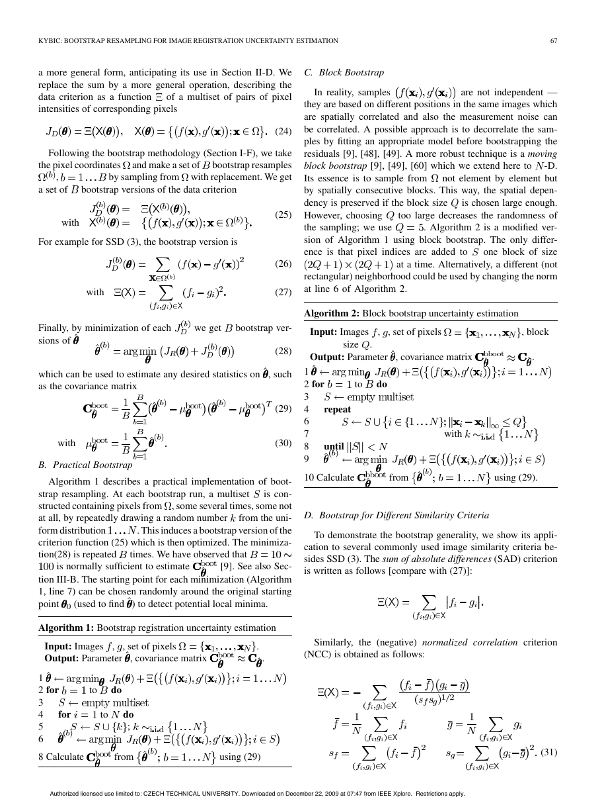
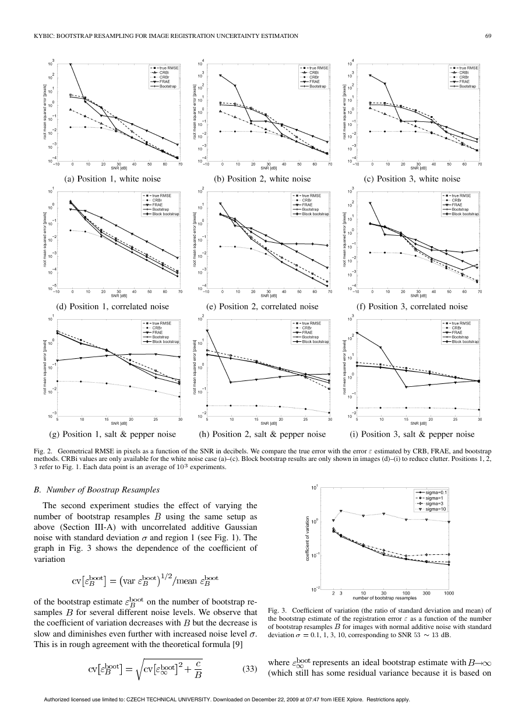
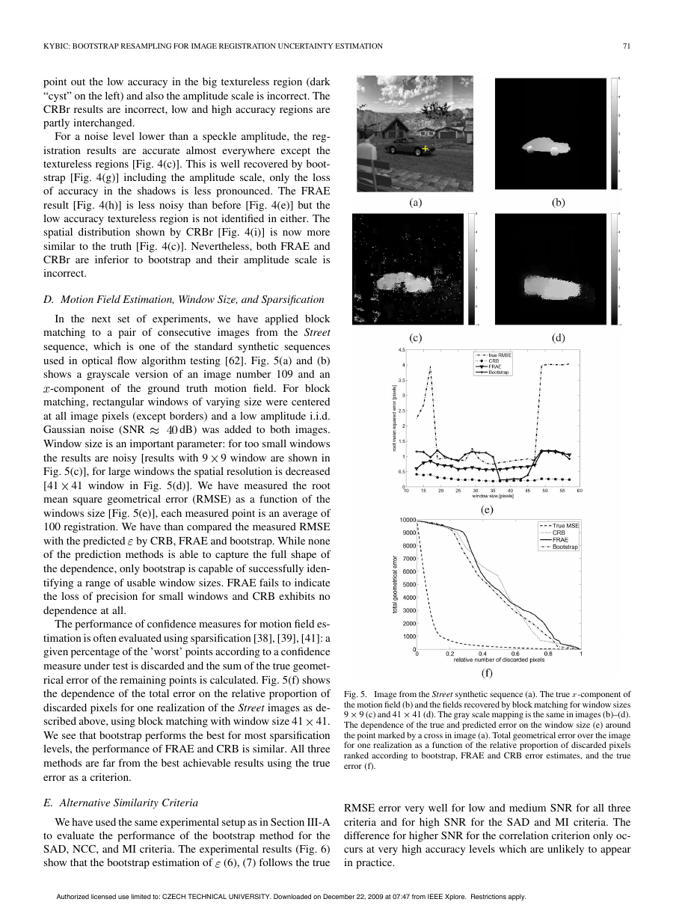

# 정답 없이 영상 정합의 불확도를 추정하는 부트스트랩 재표본 (번역)

번역 범위: 전문 (초록, 본문, 알고리즘, 그림 캡션, 결론, 저자 소개). 참고문헌은 원문 그대로 둔다.
원문: [Kybic2010_TIP_bootstrap_registration_uncertainty.pdf](Kybic2010_TIP_bootstrap_registration_uncertainty.pdf) (저자 소속 CMP 공개본, 10쪽, 64~73쪽)
원제: Bootstrap Resampling for Image Registration Uncertainty Estimation Without Ground Truth
저자: Jan Kybic (체코 공과대학 프라하, 응용사이버네틱스 센터)
서지: IEEE Transactions on Image Processing, 19(1), 64-73, 2010년 1월. DOI 10.1109/TIP.2009.2030955
원고 접수 2008-08-12, 수정 2009-07-27, 온라인 첫 게재 2009-08-25.

수식은 원문 쪽 이미지를 보고 옮겼다(pdftotext가 수식 기호를 잃었다). 그림은 해당 쪽 전체를 110 dpi로 옮긴 것이다.
번역 안의 [대괄호 설명]은 번역자가 덧붙인 말이다.

---

## 초록

화소 기반 영상 정합 알고리즘의 불확도를 추정하는 문제를 다룬다.
주어진 것은 정합할 두 영상뿐이고, 정답 자료는 없는 경우다.
새로 제안하는 방법은 부트스트랩 재표본(bootstrap resampling)을 쓴다.
이 방법은 매우 일반적이다. 화소 기반 유사도 기준을 최소화하는 정합 방법이라면 거의 다 쓸 수 있다.
SSD, SAD, 상관, 상호정보량 기준으로 시연한다.
실험으로, 부트스트랩 방법이 당시 최고 수준인 크라메르-라오 하한(Cramér-Rao bound) 방법보다 정합 정확도를 더 잘 추정함을 보인다.
추가로, 이차 민감도 분석에 바탕을 둔 빠른 정합 정확도 추정(FRAE) 방법도 평가한다. FRAE는 계산 부담이 거의 없다.
FRAE는 대부분 크라메르-라오 하한 방법보다 낫지만, 부트스트랩 방법보다는 못하다.

색인어: 정확도 추정, 부트스트랩, 크라메르-라오 하한, 영상 정합, 움직임 추정, 성능 한계, 불확도 추정.

## I. 서론

영상 정합[1], [2]은 주어진 두 영상에서 대응하는 점들의 좌표를 잇는 기하 변환을 찾는다.
영상 정합은 움직임 분석, 동영상 압축과 부호화, 물체 추적, 영상 안정화, 분할, 스테레오 복원, 초해상도에 쓰인다[3].
생의학 응용[4]-[8]에는 같은 대상 안, 대상 사이, 서로 다른 촬영 장비 사이의 분석, 아틀라스와의 정합, 특징의 모양과 크기 정량화, 탄성 영상, 왜곡 보정, 움직임 검출과 보정이 있다.

대부분의 영상 정합 알고리즘은 하나의 결정된 답, 즉 모르는 기하 변환의 점 추정값만 돌려준다.
그러나 실제로는 언제나 어느 정도 불확도가 있고, 정합 정확도에는 한계가 있다.
이 불확도를 알면 정합 결과를 믿어도 되는지, 얼마나 믿어도 되는지, 입력 자료가 알맞은지를 판단하는 데 쓸모가 있다.
더 믿을 만한 영상 쌍이나 공간 위치에 더 큰 가중치를 주는 데도 쓸 수 있다. 예를 들어 연속 영상 정합, 집단 정합, 흐름장 메우기, 변위에서 탄성 계수를 구하는 일에 쓸 수 있다.

이 논문은 특정한 한 쌍의 영상에 대해, 영역 기반(또는 화소 기반. 표식 기반, 특징 기반과 대비되는) 영상 정합 알고리즘의 불확도를 추정하는 일반 방법을 제시한다.
이 방법(II절)은 부트스트랩 재표본[9]-[11]을 쓰며, 원래 알고리즘보다 계산량이 10~100배 늘어나는 대가로 좋은 성능을 낸다.
이 방법의 핵심은 불확도를 입력 영상만으로, 정합 문제에 대한 아주 약한 가정 아래에서 추정한다는 점이다.
정답도, 변환과 잡음과 영상에 대한 명시적 모형도 필요 없다.
또한 상대적 해석만 가능한 무차원 신뢰도 척도가 아니라, 절대 불확도(화소 단위)를 추정하는 것을 목표로 한다.

주요 한계는 두 가지다.
(i) 돌려받은 변환의 흩어짐(변동성)만 추정할 수 있고, 편향은 추정할 수 없다. 다행히 영상 정합 알고리즘의 편향은 흔히 꽤 작다. 이는 실험(III-A절)에서 볼 수 있다.
(ii) 영상을 만드는 과정에 어떤 형태의 에르고드성을 가정해야 한다. 그래야 공간 안에서의 거동으로부터 여러 실현 사이의 거동을 추론할 수 있다.

부트스트랩 방법을 크라메르-라오 하한 방법[12], [13], 그리고 빠른 정합 정확도 추정(FRAE) 방법과 실험으로 비교한다. FRAE는 가우스 근사와 이차 민감도 분석 아이디어[14]에 바탕을 둔다(I-E절).

### A. 문제 정의 I, 영상 정합

대부분의 영역 기반 영상 정합 알고리즘은 다음 틀로 쓸 수 있다.
두 영상 $f, g: \mathbb{R}^m \to \mathbb{R}^n$이 주어진다. 회색조 영상이면 $n=1$이다.
두 영상은 영상 생성 과정(예: 센서 잡음)의 확률적 실현으로 보며, 모르는 기하 변환 $T_{\theta^*}: \mathbb{R}^m \to \mathbb{R}^m$로 이어져 있다.
따라서 화소 $f(\mathbf{x})$는 화소 $g'(\mathbf{x}) = g(T_{\theta^*}(\mathbf{x}))$에 대응하고, 둘의 값은 서로 의존한다.
설명을 쉽게 하려고, 여기서는 주로 2차원 평행이동($m=2$)을 다룬다.

$$T_{\theta^*}(\mathbf{x}) = \mathbf{x}' = \mathbf{x} + \theta^* \tag{1}$$

이 변환은 매개변수 벡터 $\theta^* \in \mathbb{R}^d$, $d=2$로 완전히 정해진다.
정합의 질은 다음 기준으로 잰다.

$$J(\theta) = J_R(\theta) + J_D(\theta) \tag{2}$$

여기서 $J_R$은 기준의 정칙화 부분으로, 흔히 매끄럽지 않은 변형에 벌점을 준다.
자료 부분 $J_D$는 영상 유사도 척도로 영상 $f$와 변형된 영상 $g'$의 닮음을 잰다.
다시 단순하게, 제곱차 합(SSD) 유사도 기준을 쓰고 정칙화는 쓰지 않는다.

$$J(\theta) = J_D(\theta) = \sum_{\mathbf{x}\in\Omega} \left(f(\mathbf{x}) - g'(\mathbf{x})\right)^2, \quad g'(\mathbf{x}) = g(T_\theta(\mathbf{x})) = g(\mathbf{x}+\theta^*) \tag{3}$$

여기서 $\Omega \subset \mathbb{Z}^m$은 알맞은 창(window)의 화소 집합이다.
변환 매개변수는 $J$를 최소로 하는 값으로 추정한다.

$$\hat\theta = \arg\min_\theta J(\theta) \tag{4}$$

기준이 타당하다면 추정한 변환 매개변수가 참값에 가깝다고 기대한다. $\hat\theta \approx \theta^*$.

이렇게 변환 $T$와 기준 $J$를 고르면, 정합 알고리즘은 잘 알려진 블록 정합 알고리즘[15]과 같아진다.
구현에서는 영상 $g$를 3차 B-스플라인[16], [17]으로 보간하고, 도함수는 해석적으로 계산한다.
최소화 (4)는 BFGS(Broyden-Fletcher-Goldfarb-Shanno) 준뉴턴 알고리즘[18]으로 한다. 이 알고리즘은 기울기로부터 헤세 행렬 추정값을 점점 갱신한다.

### B. 문제 정의 II, 불확도 추정

영상 생성 과정(측정 잡음)이 확률적이므로 영상 $f, g$는 (여러 실현에 걸쳐) 확률 변수다.
따라서 기준 $J(\theta)$도 확률적이고, (4)로 얻은 추정 $\hat\theta$도 확률적이다.
이 글에서 다루는 문제는 $\hat\theta$의 불확도를 나타내는 것이다.
특히 다음 공분산 행렬을 구한다.

$$\mathbf{C}_{\hat\theta} = \mathrm{E}\left[(\hat\theta - \bar\theta)(\hat\theta-\bar\theta)^T\right], \quad \bar\theta = \mathrm{E}[\hat\theta] \tag{5}$$

그리고 평균 변위 분산을 구한다.

$$\varepsilon^2 = \mathrm{E}\left[\operatorname*{mean}_{\mathbf{x}\in\Omega} \left\| T_{\hat\theta}(\mathbf{x}) - T_{\bar\theta}(\mathbf{x}) \right\|^2\right] \tag{6}$$

$T(\mathbf{x}) = \mathbf{x}+\theta$이면 식은 다음과 같이 간단해진다.

$$\varepsilon^2 = \operatorname{tr} \mathbf{C}_{\hat\theta} \tag{7}$$

추정기 (4)가 편향이 없으면($\bar\theta = \theta^*$), 평균 변위 분산 $\varepsilon^2$는 평균제곱 기하 오차(MSE)와 같다.
MSE는 뒤틀림 지수(warping index)[19]와 밀접하다.
평균제곱근 오차도 정의한다. $\mathrm{RMSE} = \mathrm{MSE}^{1/2}$.

### C. 영상 정합 정확도 평가에 관한 기존 연구

정합 방법의 평가는 대부분 모의실험으로 한다. 자료를 인공으로 만들고, 복원한 결과를 알려진 참 변환과 비교한다[20]-[22].
더 현실적이지만 쓸 수 있는 곳이 좁은 "금 표준(gold standard)" 방식은, 독립적이고 충분히 정확한 다른 방법으로 참 변형을 정하는 것이다. 예를 들어 정합에는 쓰지 않는 검증용 특수 표식을 쓴다[23]-[25].
"동 표준(bronze standard)"[26], [27]은 여러 정합 알고리즘의 강건한 평균을 기준으로 쓴다.
정합 정확도는 정답 분할[28], [29]에서 간접적으로 추정하거나, 좋은 생성 모형을 만드는 능력으로 추정할 수도 있다[30].
변환의 자유도가 낮고 대응 특징이 많으면 사후 추정이 가능하다[31], [32].
블록 정합[33], [34]과 광류 추정[35]-[38]의 신뢰도 척도는 기준의 자료 부분(높은 상관을 선호하는 식) 또는 정칙화 부분(있을 법하지 않은 변형에 벌점)에 바탕을 둔다.
이 척도들은 영상 도함수 공분산 행렬[39], [40]에서 얻거나, 특정 잡음 모형을 가정한 사후 확률[41]에서 얻을 수 있다.
그러나 신뢰도 척도는 보통 정합 오차의 절대값을 복원하려 하지 않는다는 점에 주의하라. 한 영상 안 서로 다른 공간 위치 사이의 오차 순서만 상대적으로 알려 준다.
일부 특수한 경우, 흔히 독립 동일 분포(i.i.d.) 가우스 잡음을 가정하면, 기대 정확도를 해석적으로 계산할 수 있다[42]-[46].

### D. 크라메르-라오 하한

가장 관련 있는 기존 방법은 $\theta^*$에 대한 크라메르-라오 하한[12], [13]을 추정하는 것이다. 일관성을 위해 이 글의 기호로 간단히 정리한다.
다루기 쉽도록 다음 관측 모형을 가정한다.

$$f(\mathbf{x}) = u'(\mathbf{x}) + w_f(\mathbf{x}), \quad g(\mathbf{x}) = u(\mathbf{x}) + w_g(\mathbf{x}), \quad u'(\mathbf{x}) = u(T_{\theta^*}(\mathbf{x})) = u(\mathbf{x}+\theta^*)$$

여기서 $w_f, w_g$는 분산 $\sigma^2$인 평균 0의 i.i.d. 가우스 덧셈 측정 잡음이다. $f, g$는 입력 영상이고, $u$는 고정되었지만 관측할 수 없는 "참" 영상이다.
대응하는 로그 가능도는 다음과 같다.

$$-\log p(f,g\mid\theta) = \text{const} + \frac{1}{2\sigma^2}\left(\sum_{\mathbf{x}\in\Omega}\left(f(\mathbf{x})-u'(\mathbf{x})\right)^2 + \left(g(\mathbf{x})-u(\mathbf{x})\right)^2\right) \tag{8}$$

피셔 정보 행렬(FIM) $\mathbf{F}$의 원소는 다음과 같다.

$$F_{ij}(\theta) = -\mathrm{E}\left[\frac{\partial^2 \log p(f,g\mid\theta)}{\partial\theta_i\,\partial\theta_j}\right] \tag{9}$$

(8)의 두 번째 이차항은 $\theta$에 대해 상수이고, $w_f = f(\mathbf{x}) - u'(\mathbf{x})$의 기댓값은 0이다. 따라서

$$F_{ij}(\theta) = \frac{1}{\sigma^2}\sum_{\mathbf{x}\in\Omega}\frac{\partial u'}{\partial\theta_i}\frac{\partial u'}{\partial\theta_j} \tag{10}$$

연쇄 법칙을 쓰면

$$\frac{\partial u'}{\partial\theta_i} = \sum_{k=1}^{m}\frac{\partial u'}{\partial x_k}\frac{\partial x_k}{\partial\theta_i} \tag{11}$$

[13]을 따라 편미분 $\partial u'/\partial x_k$는 1차 차분으로 추정한다.
크라메르-라오 하한은 (4)를 포함한 $\theta^*$의 모든 불편 추정기의 공분산에 대한 하한을 준다.

$$\mathbf{C}_{\hat\theta} \ge \mathbf{F}^{-1} \tag{12}$$

이 부등식은 양의 준정부호라는 뜻이다.

추정값 $\mathbf{C}^{\mathrm{CRBi}}_{\hat\theta} \approx \mathbf{F}^{-1}$은 [12], [13]에 설명되어 있다.
실제로는 $\sigma$도 $u'$도 알 수 없다. 그래서 먼저 (4)대로 정합을 해서 $\hat\theta$를 얻고, 다음 최대가능도 추정값을

$$u'(\mathbf{x}) \approx \frac12\left(f(\mathbf{x}) + g(\mathbf{x}+\hat\theta)\right) \tag{13}$$

$$\sigma^2 \approx \frac{1}{2N}\sum_{\mathbf{x}\in\Omega}\left(f(\mathbf{x}) - g(\mathbf{x}+\hat\theta)\right)^2 \tag{14}$$

(10)에 넣어 실제 계산 가능한 CRB 추정값 $\mathbf{C}^{\mathrm{CRBr}}_{\hat\theta} \approx \mathbf{F}^{-1}$을 얻는다.

[번역자 주: CRBi는 참 영상과 참 잡음을 아는 이상적 경우(i), CRBr은 관측 영상으로 대신한 실현 가능한 경우(r)다.]

### E. 빠른 정합 정확도 추정(FRAE)

나중에 비교에 쓸 두 번째 방법인 빠른 정합 정확도 추정(FRAE)[14]을 간단히 정리한다. FRAE는 이차 민감도 분석 아이디어에 바탕을 둔다.
빠른 방법이고, 계산 부담이 거의 없다.
유사도 기준을 화소별 기여의 합으로 쓸 수 있다고 하자.

$$J(\theta) = J_D(\theta) = \sum_{\mathbf{x}\in\Omega} e(\mathbf{x};\theta) \tag{15}$$

먼저 잡음 없는 값 $J^*(\theta)$ 둘레에서 $\hat\theta$에서의 기준값 $J(\theta)$의 신뢰구간을 정한다.

$$\mathrm{P}\left[J^*(\theta) - \gamma \le J(\theta) \le J^*(\theta) + \gamma\right] = 1-\alpha \tag{16}$$

$J(\theta)$가 표준편차 $\sigma_J$인 정규분포를 따른다고 가정하면, $\alpha=0.05$일 때

$$\gamma = \Phi^{-1}\left(1-\frac{\alpha}{2}\right)\sigma_J \approx 1.96\,\sigma_J \tag{17}$$

여기서 $\Phi^{-1}$은 표준정규 누적분포함수의 역함수다. 표준편차는 다음과 같이 추정할 수 있다.

$$\sigma_J^2 \approx \operatorname{Var}\left[\sum_{\mathbf{x}\in\Omega} e(\mathbf{x})\right] = \sum_{\mathbf{x}\in\Omega}\sum_{\mathbf{y}\in\Omega}\operatorname{Cov}\left[e(\mathbf{x}), e(\mathbf{y})\right] \tag{18}$$

$e(\mathbf{x})$가 서로 상관이 없으면 실용적인 추정식은

$$\sigma_J^2 \approx \sum_{\mathbf{x}\in\Omega}\left(e(\mathbf{x}) - \bar e\right)^2 \tag{19}$$

이고, 여기에 양자화 잡음의 영향을 더할 수도 있다[14].

참 기준 함수 $J^*(\theta)$를 제한된 정확도로만 알기 때문에, 그 최솟점 $\theta^*$의 위치도 제한된 정확도로만 안다.
신뢰구간 (16)과 최솟점의 성질에서, 관측 가능한 양으로 참값 $\theta^*$에 대한 부등식을 얻는다.

$$\mathrm{P}\left[J(\theta^*) \le J(\hat\theta) + 2\gamma\right] \ge (1-\alpha)^2 \tag{20}$$

$J(\theta)$를 $\hat\theta$ 둘레에서 이차식으로 근사한다.

$$J(\theta) = J(\hat\theta) + \frac12(\theta-\hat\theta)^T\mathbf{H}(\theta-\hat\theta) \tag{21}$$

헤세 행렬 $\mathbf{H}$의 추정값은 BFGS 최적화 과정의 부산물로 공짜로 얻는다. 그러면

$$\mathrm{P}\left[(\theta^*-\hat\theta)^T\mathbf{H}(\theta^*-\hat\theta) \le 4\gamma\right] \ge (1-\alpha)^2 \tag{22}$$

이를 등호로 만족시키려면 정규분포를 따르는 $\hat\theta$가 가져야 할 등가 공분산 행렬을 얻을 수 있다.

$$\mathbf{C}^{\mathrm{FRAE}}_{\hat\theta} = \frac{4\gamma}{F^{-1}\left((1-\alpha)^2, d\right)}\mathbf{H}^{-1} = \lambda\,\sigma_J\,\mathbf{H}^{-1} \tag{23}$$

여기서 $F^{-1}$은 $\chi^2_d$ 누적분포함수의 역함수다.
$\lambda$는 미리 계산할 수 있다. 예를 들어 $\alpha = 0.05$, $d = 2$이면 $\lambda \approx 1.6839$다.

### F. 부트스트랩, 소개와 기존 연구

부트스트랩 재표본[9]-[11], [47]-[50]은 표본이 적은 상황에서 모수 추정기의 정확도를 평가하는 강력하고 쓰임이 넓은 계산 기법이다.
확률분포 $p_X$를 따르는 확률 변수 $X$의 i.i.d. 표본 $\mathsf{X} = \{x_1, \ldots, x_N\}$이 있다고 하자.
부트스트랩 재표본은 $\mathsf{X}$에서 복원 추출로 $N$개 점을 무작위로 골라 만든다.
이를 $B$번 되풀이해 $B$개의 다중집합 $\mathsf{X}^{(b)}$, $b = 1\ldots B$를 만든다.[각주 1]
부트스트랩 재표본 $\mathsf{X}^{(b)}$는 $\mathsf{X}$가 주어졌을 때 조건부 독립이고, $X$와 같은 분포를 따른다.

[각주 1] 다중집합은 집합을 일반화한 것으로, 같은 원소를 여러 번 담을 수 있다.

또 연속 통계량 $\vartheta(X)$(예: 평균)와 그 추정기 $\varphi(\mathsf{X}) \approx \vartheta$가 있다고 하자.
우리는 $\hat\vartheta = \varphi(\mathsf{X})$의 믿음성을, 예를 들어 분산이나 신뢰구간으로 평가하고 싶다.
추정기 $\varphi$를 부트스트랩 재표본 $\mathsf{X}^{(b)}$에 적용해 $B$개 값 $\hat\vartheta^{(b)} = \varphi(\mathsf{X}^{(b)})$를 얻는다.
그 다음 원하는 믿음성 척도를 $B$개 부트스트랩 값 $\hat\vartheta^{(b)}$의 경험 분포로 계산한다.

영상 처리에서 부트스트랩 재표본은 검출과 분류 알고리즘[51], [52], 에지 검출기[53]의 성능 평가, 타원 매개변수 추정의 편향 보정[54], 영상 분할 개선[55], [56]에 쓰였다.
3차원 키포인트에 바탕을 둔 강체 운동 추정 알고리즘의 정확도 평가에도 쓰였다[57], [58].

## II. 부트스트랩 정확도 추정

부트스트랩 재표본 정확도 추정[59]은 일반적이지만 계산이 많이 드는 방법이다.
입력은 정합 알고리즘과 두 입력 영상 $f$, $g$다.
FRAE, CRB(I-D절, I-E절)와 달리 부트스트랩 방법은 확률 밀도 $p(\hat\theta)$의 비모수 추정과, 신뢰구간 같은 $\hat\theta$에 대한 어떤 통계량도 줄 수 있다.
다만 CRB, FRAE와 쉽게 비교하려고, 여기서는 부트스트랩으로 공분산 행렬 추정값 $\mathbf{C}^{\mathrm{boot}}_{\hat\theta}$를 얻고, 이어서 (7)로 $\varepsilon^2$를 구하는 데 집중한다.
이렇게 하면 부트스트랩 재표본 수 $B$가 조금만 있어도 되어 계산이 감당할 만하다는 이점도 있다(III-B절 참고).

### A. 부트스트랩 공분산 추정

(4)에서 얻은 $\hat\theta$의 흩어짐을 정하려고, 부트스트랩으로 여러 실현에 걸친 기준 함수 $J(\theta)$의 거동을 "흉내" 낸다.
부트스트랩은 화소 기여의 합 (15)로 쓴 기준에 적용할 수 있다.
그러나 II-D절에서 쓸 것을 내다보고 더 일반적인 형태를 쓴다.
합을 더 일반적인 연산으로 바꾸어, 자료 기준을 대응 화소 밝기 쌍의 다중집합의 함수 $\Xi$로 나타낸다.

$$J_D(\theta) = \Xi\left(\mathsf{X}(\theta)\right), \quad \mathsf{X}(\theta) = \left\{\left(f(\mathbf{x}), g'(\mathbf{x})\right); \mathbf{x}\in\Omega\right\} \tag{24}$$

부트스트랩 방법론(I-F절)을 따라 화소 좌표 $\Omega$를 취하고, $\Omega$에서 복원 추출로 $B$개의 부트스트랩 재표본 $\Omega^{(b)}$, $b=1\ldots B$를 만든다.
그러면 자료 기준의 부트스트랩 판 $B$개를 얻는다.

$$J_D^{(b)}(\theta) = \Xi\left(\mathsf{X}^{(b)}(\theta)\right), \quad \mathsf{X}^{(b)}(\theta) = \left\{\left(f(\mathbf{x}), g'(\mathbf{x})\right); \mathbf{x}\in\Omega^{(b)}\right\} \tag{25}$$

예를 들어 SSD (3)의 부트스트랩 판은 다음과 같다.

$$J_D^{(b)}(\theta) = \sum_{\mathbf{x}\in\Omega^{(b)}}\left(f(\mathbf{x}) - g'(\mathbf{x})\right)^2 \tag{26}$$

$$\Xi(\mathsf{X}) = \sum_{(f_i, g_i)\in\mathsf{X}}(f_i - g_i)^2 \tag{27}$$

마지막으로 각 $J_D^{(b)}$를 최소화해 $\hat\theta$의 부트스트랩 판 $B$개를 얻는다.

$$\hat\theta^{(b)} = \arg\min_\theta\left(J_R(\theta) + J_D^{(b)}(\theta)\right) \tag{28}$$

이 값들로 $\hat\theta$에 대한 원하는 어떤 통계량이든 추정할 수 있다. 예를 들어 공분산 행렬은

$$\mathbf{C}^{\mathrm{boot}}_{\hat\theta} = \frac1B\sum_{b=1}^{B}\left(\hat\theta^{(b)} - \mu^{\mathrm{boot}}_{\hat\theta}\right)\left(\hat\theta^{(b)} - \mu^{\mathrm{boot}}_{\hat\theta}\right)^T \tag{29}$$

$$\mu^{\mathrm{boot}}_{\hat\theta} = \frac1B\sum_{b=1}^{B}\hat\theta^{(b)} \tag{30}$$

### B. 실용 부트스트랩

알고리즘 1은 부트스트랩 재표본의 실용 구현을 보여 준다.
각 부트스트랩 회차마다 $\Omega$의 화소를 담은 다중집합 $S$를 만든다. 어떤 화소는 여러 번 들어가고 어떤 화소는 하나도 들어가지 않는다.
이는 균등분포 $1\ldots N$에서 난수 $k$를 되풀이해 뽑아서 한다.
이렇게 기준 함수의 부트스트랩 판 (25)가 생기고, 이를 최적화한다.
최소화 (28)을 $B$번 되풀이한다.
$\mathbf{C}^{\mathrm{boot}}_{\hat\theta}$를 추정하는 데 보통 $B = 10\sim100$이면 충분했다[9]. III-B절도 참고하라.
각 최소화의 출발점(알고리즘 1의 7행)은 원래 출발점 $\theta_0$($\hat\theta$를 찾을 때 쓴) 둘레에서 무작위로 골라, 국소 최솟값이 있으면 드러나게 할 수 있다.



**알고리즘 1: 부트스트랩 정합 불확도 추정**

- 입력: 영상 $f, g$, 화소 집합 $\Omega = \{\mathbf{x}_1, \ldots, \mathbf{x}_N\}$
- 출력: 매개변수 $\hat\theta$, 공분산 행렬 $\mathbf{C}^{\mathrm{boot}}_{\hat\theta} \approx \mathbf{C}_{\hat\theta}$

```
1 θ̂ ← argmin_θ J_R(θ) + Ξ({(f(x_i), g'(x_i)); i = 1..N})
2 for b = 1 to B do
3     S ← 빈 다중집합
4     for i = 1 to N do
5         S ← S ∪ {k};  k ~ i.i.d. 균등 {1..N}
6     θ̂(b) ← argmin_θ J_R(θ) + Ξ({(f(x_i), g'(x_i)); i ∈ S})
8 (29)로 {θ̂(b); b = 1..N}에서 C_boot 계산
```

[번역자 주: 원문의 행 번호는 6 다음이 8이고, 마지막 행의 첨자는 원문대로 $b=1\ldots N$이다. 문맥상 $b=1\ldots B$로 읽는다.]

### C. 블록 부트스트랩

실제로는 표본 $(f(\mathbf{x}_i), g'(\mathbf{x}_i))$가 서로 독립이 아니다.
같은 영상 안의 서로 다른 위치에서 왔으므로 공간 상관이 있고, 측정 잡음도 상관될 수 있다.
한 가지 방법은 알맞은 모형을 맞춰 표본의 상관을 없앤 뒤, 잔차를 부트스트랩하는 것이다[9], [48], [49].
더 강건한 기법은 이동 블록 부트스트랩(moving block bootstrap)[9], [49], [60]이며, 여기서 이를 N차원으로 넓힌다.
핵심은 $\Omega$에서 원소를 하나씩이 아니라 공간적으로 붙어 있는 블록 단위로 뽑는 것이다.
블록 크기 $Q$를 충분히 크게 고르면 이렇게 해서 공간 의존성이 보존된다.
그러나 $Q$를 너무 크게 고르면 표집의 무작위성이 줄어든다. 우리는 $Q=5$를 쓴다.
알고리즘 2는 블록 부트스트랩을 쓰도록 알고리즘 1을 고친 것이다.
유일한 차이는 화소 번호를 한 번에 크기 $(2Q+1)\times(2Q+1)$인 블록 하나씩 $S$에 더한다는 점이다.
또는 알고리즘 2의 6행에서 노름을 바꾸어 사각형이 아닌 다른 이웃을 쓸 수도 있다.

**알고리즘 2: 블록 부트스트랩 불확도 추정**

- 입력: 영상 $f, g$, 화소 집합 $\Omega = \{\mathbf{x}_1,\ldots,\mathbf{x}_N\}$, 블록 크기 $Q$
- 출력: 매개변수 $\hat\theta$, 공분산 행렬 $\mathbf{C}^{\mathrm{bboot}}_{\hat\theta} \approx \mathbf{C}_{\hat\theta}$

```
1  θ̂ ← argmin_θ J_R(θ) + Ξ({(f(x_i), g'(x_i)); i = 1..N})
2  for b = 1 to B do
3      S ← 빈 다중집합
4      repeat
6          S ← S ∪ {i ∈ {1..N}; ||x_i − x_k||_∞ ≤ Q}
7              단, k ~ i.i.d. {1..N}
8      until ||S|| < N
9      θ̂(b) ← argmin_θ J_R(θ) + Ξ({(f(x_i), g'(x_i)); i ∈ S})
10 (29)로 {θ̂(b); b = 1..N}에서 C_bboot 계산
```

[번역자 주: 원문 8행은 "until ||S|| < N"으로 인쇄되어 있다. 뜻으로는 $S$의 크기가 $N$에 이를 때까지 되풀이하는 것으로 읽힌다. 원문 표기를 그대로 옮겼다.]

### D. 여러 유사도 기준에 대한 부트스트랩

부트스트랩의 일반성을 보이려고, SSD (3) 말고도 흔히 쓰는 몇 가지 영상 유사도 기준에 적용하는 방법을 보인다.
절대차 합(SAD) 기준은 다음과 같다[(27)과 비교].

$$\Xi(\mathsf{X}) = \sum_{(f_i, g_i)\in\mathsf{X}}\left|f_i - g_i\right|$$

비슷하게, (음의) 정규화 상관(NCC) 기준은 다음과 같다.

$$\Xi(\mathsf{X}) = -\sum_{(f_i,g_i)\in\mathsf{X}}\frac{(f_i-\bar f)(g_i-\bar g)}{(s_f s_g)^{1/2}}$$

$$\bar f = \frac1N\sum_{(f_i,g_i)\in\mathsf{X}} f_i, \quad \bar g = \frac1N\sum_{(f_i,g_i)\in\mathsf{X}} g_i, \quad s_f = \sum_{(f_i,g_i)\in\mathsf{X}}(f_i-\bar f)^2, \quad s_g = \sum_{(f_i,g_i)\in\mathsf{X}}(g_i-\bar g)^2 \tag{31}$$

상호정보량(MI)은 화소별 기여를 바로 찾을 수 없지만, 그래도 형태 (24)에 잘 들어맞는다.

$$J(\theta) = J_D(\theta) = \Xi(\mathsf{X}) = -\sum_{k=1}^{L_F}p_k\log p_k - \sum_{l=1}^{L_G}q_l\log q_l + \sum_{k=1}^{L_F}\sum_{l=1}^{L_G}r_{kl}\log r_{kl} \tag{32}$$

여기서 $r_{kl}$은 $L_F\times L_G$개 칸과 매개변수 $f_{\min}, g_{\min}, h_f, h_g$를 가진 매끄러운 결합 히스토그램[61]이고, $p_k, q_l$은 대응하는 주변 히스토그램이다.

$$r_{kl} = \sum_{(f_i,g_i)\in\mathsf{X}}\underbrace{\phi\left(\frac{f_i-f_{\min}}{h_f}-k\right)}_{\phi^F_k(f_i)}\underbrace{\phi\left(\frac{g_i-g_{\min}}{h_g}-l\right)}_{\phi^G_l(g_i)}$$

$$p_k = \sum_{(f_i,g_i)\in\mathsf{X}}\phi^F_k(f_i), \quad q_l = \sum_{(f_i,g_i)\in\mathsf{X}}\phi^G_l(g_i)$$

여기서 $\phi$는 고른 창 함수다. 우리는 1차 B-스플라인, 즉 P1 또는 선형 보간을 쓴다.

부트스트랩 알고리즘(알고리즘 1)은 위 네 유사도 기준 모두에서 바꾸지 않고 그대로 동작한다.
7행[번역자 주: 알고리즘 1의 최소화 행]에서 최소화할 기준을 계산할 때, 원래 화소 집합이 아니라 부트스트랩 다중집합 $S$ 위에서 계산하도록 주의해야 한다.
부트스트랩 표본은 공간적으로 독립이 아니다. 특히 NCC와 MI 기준에서 그렇다.
그런데도 부트스트랩은 잘 동작하고, 블록 부트스트랩을 쓸 필요조차 없다(III-A절의 실험 결과 참고).

## III. 실험

### A. 블록 정합 정확도 예측

첫 실험의 목적은 블록 정합 알고리즘(I-A절)의 참 평균제곱근 기하 오차(RMSE)를 재고, 이를 크라메르-라오 하한 방법 CRB(I-D절), FRAE 방법[14](I-E절), 부트스트랩 방법(II절)이 예측한 $\varepsilon$ (6), (7)과 비교하는 것이다.

512×512 화소의 8비트 회색조 Lena 영상을 쓰고, 61×61 크기의 직사각형 관심 영역(ROI) 세 개를 골랐다. 세 영역은 각각 질감과 세부가 많고, 중간이고, 적다(그림 1).

**그림 1.** 세 직사각형 시험 영역 1, 2, 3(ROI)을 표시한 Lena 시험 영상. 번호가 커질수록 세부가 줄어든다.

매 회차마다 ROI를 $[-2, 2]^2$ 화소 범위에서 균등하게 무작위로 고른 변위 $\mathbf{t}$만큼 옮겼다.
원래 ROI와 옮긴 ROI 둘 다에 세 종류 잡음 가운데 하나를 더했다.
(i) 표준편차 $\sigma$를 바꿔 가며 넣은, 상관 없는 평균 0의 i.i.d. 가우스(백색) 잡음.
(ii) i.i.d. 잡음을 표준편차 0.8 화소인 가우스 커널로 합성곱해 만든 상관 가우스 잡음.
(iii) 각 화소 값을 확률 $p$로 0 또는 255(무작위 선택)로 바꾸는 소금-후추 잡음. $p$는 $10^{-3}$에서 0.3 사이였다.
블록 정합 정합은 작은(최대 ±0.05 화소) 무작위 초기 변위 $\theta_0$에서 출발했다.
발산을 잡으려고 최대 변위를 ±10 화소로 제한한 제약 BFGS 최적화를 썼다.
방법, 잡음 종류, 잡음 크기마다 실험을 $10^3$번 했다.
화소 단위 평균제곱근 기하 오차(RMSE) $\left(\operatorname{mean}\|\mathbf{t}-\hat\theta\|^2\right)^{1/2}$를 보고하고, 평가한 방법들이 추정한 평균 변위 $\varepsilon$ (6), (7)과 비교한다.
모든 경우에 편향은 무시할 만큼 작았다.
이상값(최적화 프로그램이 수렴하지 못한 경우)이 통계를 왜곡하지 않도록, 가장 높은 값과 가장 낮은 값을 5%씩 버리는 절사 평균을 썼다.
이는 보고 결과에 작게만 영향을 주며, 그것도 가장 높은 잡음 수준에서만 그렇다.
ROI 크기 61×61의 결과만 보고한다. 다른 ROI 크기의 결과도 비슷했다. 모든 방법에서 ROI가 커지면 오차가 천천히 줄었다. 이는 평행이동만 고려했기 때문이다.

그림 2에 일부 결과를 보인다.
크라메르-라오 하한(CRBi)은 정확도를 잘 추정한다. 특히 SNR이 높을 때 그렇다[그림 2(a)-(c)].
그래도 늘 부트스트랩보다 못하고, 흔히 FRAE 방법보다도 못하다.
다만 실제 조건에서는 CRBi를 계산할 수 없다는 점을 명심하라. 모르는 양에 달려 있기 때문이다.
계산할 수 있는 것은 CRBr(I-D절)뿐인데, 이는 지나치게 낙관적인 추정을 준다. 특히 SNR이 낮을 때 그렇고, 시험한 방법 가운데 가장 나쁘다.
CRBr의 장점은 계산 비용이 가장 작다는 것이다. 그러나 결과는 가우스 잡음과 높은 SNR에서만 쓸 수 있음을 보여 준다.

SNR이 중간에서 높고 잡음이 가우스이면, FRAE 방법(I-E절)은 쓸 만한 추정을 준다. 오차를 흔히 크게 잡기는 하지만 참 오차의 추세를 올바르게 따른다[그림 2(a)-(f)].
FRAE 방법은 SNR이 낮을 때(10~20 dB보다 나쁠 때) 실패한다. 이때는 헤세 행렬 추정을 믿을 수 없기 때문이다.
FRAE 방법은 시험한 SNR 범위의 소금-후추 잡음에서도 실패한다[그림 2(g)-(i)].

분명한 승자는 부트스트랩 방법(II-A절)이다.
추정한 오차가 상관 없는 잡음, 상관 잡음, 소금-후추 잡음 모두에서 참 오차를 따라간다[그림 2(a)-(i)].
대부분의 경우 두 값의 비는 2보다 작다.

한편 블록 부트스트랩 방법(II-C절)의 이점은 입증되지 않았다.
위치 1과 상관 잡음[그림 2(d)]처럼 블록 부트스트랩이 일반 부트스트랩보다 나은 경우도 있다.
그러나 대부분은 뚜렷한 개선이 없다. 소금-후추 잡음[그림 2(g)-(i)]이나 상관 없는 잡음(그림 없음)이 그렇다.
블록 부트스트랩이 일반 부트스트랩보다 못한 경우도 있다[그림 2(e)-(f)].



**그림 2.** SNR(데시벨)에 따른 화소 단위 기하 RMSE. 참 오차와, CRB, FRAE, 부트스트랩 방법이 추정한 오차 $\varepsilon$를 비교한다.
CRBi 값은 백색 잡음의 경우 (a)-(c)에서만 있다. 그림이 복잡하지 않도록 블록 부트스트랩 결과는 (d)-(i)에만 보인다.
위치 1, 2, 3은 그림 1을 가리킨다. 각 자료점은 $10^3$번 실험의 평균이다.
(a) 위치 1, 백색 잡음 (b) 위치 2, 백색 잡음 (c) 위치 3, 백색 잡음 (d) 위치 1, 상관 잡음 (e) 위치 2, 상관 잡음 (f) 위치 3, 상관 잡음 (g) 위치 1, 소금-후추 잡음 (h) 위치 2, 소금-후추 잡음 (i) 위치 3, 소금-후추 잡음.

### B. 부트스트랩 재표본 수

두 번째 실험은 부트스트랩 재표본 수 $B$를 바꾸었을 때의 영향을 본다.
설정은 위(III-A절)와 같고, 표준편차 $\sigma$인 상관 없는 덧셈 가우스 잡음과 영역 1(그림 1 참고)을 썼다.
그림 3의 그래프는 여러 잡음 수준에서, 부트스트랩 추정값 $\varepsilon_B^{\mathrm{boot}}$의 변동계수

$$\operatorname{cv}\left[\varepsilon^{\mathrm{boot}}_B\right] = \left(\operatorname{var}\varepsilon^{\mathrm{boot}}_B\right)^{1/2} / \operatorname{mean}\varepsilon^{\mathrm{boot}}_B$$

가 부트스트랩 재표본 수 $B$에 따라 어떻게 달라지는지 보여 준다.
변동계수는 $B$가 커지면 줄지만, 줄어드는 속도가 느리고, 잡음 수준 $\sigma$가 커질수록 더 둔해진다.
이는 이론식[9]과 대략 맞는다.

$$\operatorname{cv}\left[\varepsilon^{\mathrm{boot}}_B\right] = \sqrt{\operatorname{cv}\left[\varepsilon^{\mathrm{boot}}_\infty\right]^2 + \frac{c}{B}} \tag{33}$$

여기서 $\varepsilon^{\mathrm{boot}}_\infty$는 $B\to\infty$인 이상적 부트스트랩 추정값이다(유한 개의 잡음 섞인 화소 값에 바탕을 두므로 여전히 약간의 분산이 남는다). $c$는 $\varepsilon$의 첨도에 따른 상수다.
실험 결과와 문헌[9] 모두, $B$가 10만큼 작아도 흔히 충분하고 $B$를 100 넘게 늘리는 일은 드물게만 쓸모 있다는 우리 경험 관찰을 뒷받침한다.

**그림 3.** 부트스트랩 재표본 수 $B$에 따른, 정합 오차 $\varepsilon$의 부트스트랩 추정값의 변동계수(표준편차와 평균의 비). 표준편차 $\sigma$ = 0.1, 1, 3, 10인 정규 덧셈 잡음 영상이며, SNR 53~13 dB에 해당한다.
(그림 3은 그림 2와 같은 쪽 이미지의 오른쪽 아래에 있다.)

### C. 공간 의존성

세 번째 실험은 시험한 방법들이 정합 오차의 공간 의존성을 얼마나 잘 정하는지 평가한다.
초음파 영상[그림 4(a)]을 III-A절처럼 무작위로 평행이동했다.
i.i.d. 가우스 잡음을 더한 뒤, 블록 정합 알고리즘으로 원래 영상과 옮긴 영상 사이의 변위를 구했다.
29×29 크기의 창을 쓰고, 창 중심을 영상 전체에 5화소 간격으로 옮겼다.
기하 RMSE를 100번 실험 평균으로 보인다. 단, 부트스트랩 방법은 10번 실험과 $B=10$ 부트스트랩 반복을 썼다.
변형장은 원래 해상도로 다시 보간했고, 가장자리 영역은 무시했다(영상에서 검게 표시).

잡음 수준이 스페클 진폭보다 크면, 변형은 영상 에지를 따라서만 정확히 정해진다[그림 4(b)].
부트스트랩 결과[그림 4(d)]는 이를 아주 잘 잡아내며, RMSE의 크기도 꽤 잘 추정한다.
FRAE[그림 4(e)]는 몇몇 강한 에지를 따라 정합 정확도가 높음을 올바르게 보이지만, 큰 무늬 없는 영역(왼쪽의 어두운 "낭종")의 낮은 정확도를 짚어내지 못하고, 크기 눈금도 틀린다.
CRBr 결과는 틀렸다. 정확도가 낮은 영역과 높은 영역이 일부 뒤바뀌었다.

잡음 수준이 스페클 진폭보다 작으면, 무늬 없는 영역을 빼고 거의 모든 곳에서 정합 결과가 정확하다[그림 4(c)].
부트스트랩은 크기 눈금까지 포함해 이를 잘 복원한다[그림 4(g)]. 다만 그림자 영역의 정확도 손실은 덜 두드러진다.
FRAE 결과[그림 4(h)]는 앞[그림 4(e)]보다 덜 시끄럽지만, 두 경우 모두 정확도 낮은 무늬 없는 영역을 찾지 못한다.
CRBr이 보이는 공간 분포[그림 4(i)]는 이번에는 참값[그림 4(c)]에 더 가깝다.
그래도 FRAE와 CRBr 모두 부트스트랩보다 못하고, 크기 눈금이 틀린다.

**그림 4.** 무작위 평행이동을 준 초음파 영상 (a)에 대한 블록 정합 정합 오차의 공간 의존성 예측.
화소 단위 기하 RMSE를 회색조로 보이며, 어두운 색이 높은 정확도, 밝은 색이 낮은 정확도다.
낮은 SNR 결과 (d)-(f)는 참 오차 (b)와, 높은 SNR 결과 (g)-(i)는 참 오차 (c)와 비교하라. 영상마다 회색조 눈금이 다르다.
부트스트랩 (d), (g)는 10번 반복 평균, 나머지 (b), (c), (e), (f), (h), (i)는 100번 반복 평균이다.
(a) 입력 영상 (b) 참 오차, SNR = 18 dB (c) 참 오차, SNR = 38 dB (d) 부트스트랩, 18 dB (e) FRAE, 18 dB (f) CRBr, 18 dB (g) 부트스트랩, 38 dB (h) FRAE, 38 dB (i) CRBr, 38 dB.
[번역자 주: 캡션 원문은 "(d)-(g)"로 적었으나 그림 배치로 보아 부트스트랩 패널은 (d)와 (g)다. 이 그림은 넣지 않았다. 원문 70쪽을 본다.]

### D. 움직임장 추정, 창 크기, 희소화

다음 실험들에서는 Street 연속 영상의 연속된 두 영상에 블록 정합을 적용했다.
Street는 광류 알고리즘 시험에 쓰는 표준 합성 연속 영상 가운데 하나다[62].
그림 5(a), (b)는 109번 영상의 회색조 판과, 움직임장 정답의 $x$ 성분을 보인다.
블록 정합에서는 여러 크기의 직사각형 창을 (가장자리를 뺀) 모든 영상 화소에 중심을 두고 놓았고, 두 영상 모두에 진폭이 작은 i.i.d. 가우스 잡음(SNR ≈ 40 dB)을 더했다.
창 크기는 중요한 매개변수다. 창이 너무 작으면 결과가 시끄럽고[9×9 창의 결과를 그림 5(c)에 보임], 창이 크면 공간 해상도가 떨어진다[41×41 창, 그림 5(d)].
창 크기에 따른 평균제곱근 기하 오차(RMSE)를 쟀다[그림 5(e)]. 각 측정점은 100번 정합의 평균이다.
이어서 잰 RMSE를 CRB, FRAE, 부트스트랩이 예측한 $\varepsilon$과 비교했다.
어느 예측 방법도 의존성의 전체 모양을 잡아내지는 못하지만, 쓸 만한 창 크기 범위를 성공적으로 찾아내는 것은 부트스트랩뿐이다.
FRAE는 작은 창에서의 정밀도 손실을 나타내지 못하고, CRB는 의존성을 전혀 보이지 않는다.

움직임장 추정용 신뢰도 척도의 성능은 흔히 희소화(sparsification)[38], [39], [41]로 평가한다.
시험하는 신뢰도 척도로 보아 "가장 나쁜" 점들을 주어진 비율만큼 버리고, 남은 점들의 참 기하 오차 합을 계산한다.
그림 5(f)는 위에서 설명한 Street 영상의 한 실현에 대해, 41×41 창 블록 정합을 쓸 때, 버린 화소의 상대 비율에 따른 전체 오차를 보인다.
부트스트랩이 대부분의 희소화 수준에서 가장 좋고, FRAE와 CRB의 성능은 비슷하다.
세 방법 모두, 참 오차를 기준으로 썼을 때 얻을 수 있는 최선의 결과와는 거리가 멀다.



**그림 5.** Street 합성 연속 영상의 영상 (a). 움직임장의 참 $x$ 성분 (b)와, 창 크기 9×9 (c), 41×41 (d)의 블록 정합으로 복원한 장. (b)-(d)의 회색조 대응은 같다.
영상 (a)에 십자로 표시한 점 둘레에서, 창 크기에 따른 참 오차와 예측 오차 (e).
부트스트랩, FRAE, CRB 오차 추정값과 참 오차로 순위를 매겨 버린 화소의 상대 비율에 따른, 한 실현의 영상 전체 기하 오차 합 (f).

### E. 다른 유사도 기준

III-A절과 같은 실험 설정으로 SAD, NCC, MI 기준에서 부트스트랩 방법의 성능을 평가했다.
실험 결과(그림 6)는 부트스트랩이 추정한 $\varepsilon$ (6), (7)이, 세 기준 모두에서 낮은 SNR과 중간 SNR일 때, 그리고 SAD와 MI 기준에서는 높은 SNR일 때도 참 RMSE를 아주 잘 따라감을 보인다.
상관 기준에서 높은 SNR일 때 생기는 차이는 실제로는 나타나기 어려운 아주 높은 정확도 수준에서만 생긴다.

**그림 6.** 그림 2처럼, 그림 1의 위치 1에서 SNR(dB)에 따른 화소 단위 기하 RMSE. 참 오차와 부트스트랩 방법이 추정한 오차 $\varepsilon$를 (a) SAD, (b) 정규화 상관, (c) 상호정보량 영상 유사도 기준에서 비교한다. 각 자료점은 100번 실험의 평균이다.
(이 그림은 넣지 않았다. 원문 72쪽을 본다.)

## IV. 결론

최소화 기반 화소 정합 알고리즘의 넓은 부류에 쓸 수 있는, 부트스트랩에 바탕을 둔 일반적인 영상 정합 불확도 추정 기법을 보였다.
정합할 두 영상 말고는 아무것도 없어도 정합 오차를 정량적으로 예측할 수 있다.
아주 약한 가정만 하면 된다.
단순하게 하려고 2차원 평행이동만 다루었지만, 제시한 정확도 추정 기법은 자유도가 더 많은 변환을 찾는 다른 정합 방법에도 바로 쓸 수 있다.
살펴본 방법 가운데 부트스트랩이 FRAE와 CRB보다 좋았으며, 계산 비용을 감당할 수 있으면 부트스트랩을 써야 한다.
설명한 방법론이, 정합 불확도 추정이 필요한 모든 실제 상황에서 널리 쓰이리라 기대한다.

## 각주와 사사

이 연구는 체코 교육부 과제 1M0567의 지원을 받았다.
이 원고의 심사를 맡고 게재를 승인한 부편집장은 Pier Luigi Dragotti 박사다.
저자는 체코 공과대학 프라하 전기공학부 응용사이버네틱스 센터 소속이다(e-mail: kybic@fel.cvut.cz).
일부 그림의 컬러판은 http://ieeexplore.ieee.org 에서 볼 수 있다.

## 저자 소개

Jan Kybic(M'99, SM'08)는 1974년 체코 프라하에서 태어났다.
체코 공과대학 프라하에서 1996년 학사(Bc.), 1998년 석사(Ing.)를 우등으로 받았다.
2001년 스위스 로잔 연방공과대학(EPFL)에서 생의학 영상 처리로 박사 학위를 받았다. 학위 논문 주제는 매개변수 변형 모형을 쓰는 탄성 영상 정합이다.
2002~2003년 프랑스 INRIA 소피아앙티폴리스에서 박사후 연구원으로 있었다.
2003년부터 체코 공과대학 프라하 기계지각 센터(CMP)의 연구원이다.
Kybic 박사는 IEEE Transactions on Medical Imaging의 부편집장이다.
관심 분야는 신호와 영상 처리, 의료 영상, 영상 정합, 스플라인과 웨이블릿, 역문제, 탄성 영상, 컴퓨터 비전, 수치 방법, 알고리즘 이론, 제어 이론이다.
권위 있는 동료 심사 학술지 논문 14편, 책 1권, 책의 장 2편, 학회 논문 50편 이상을 쓰거나 함께 썼다.

---

## 참고문헌 (원문 그대로)

[1] L. Brown, "A survey of image registration techniques," ACM Comput. Surv., vol. 24, no. 4, pp. 326–376, Dec. 1992.
[2] B. Zitová and J. Flusser, "Image registration methods: A survey," Image Vis. Comput., no. 21, pp. 977–1000, 2003.
[3] D. Robinson, S. Farsiu, and P. Milanfar, "Optimal registration of aliased images using variable projection with applications to super-resolution," The Comput. J., Apr. 2007.
[4] H. Lester and S. R. Arridge, "A survey of hierarchical non-linear medical image registration," Pattern Recognit., vol. 32, no. 1, pp. 129–149, Jan. 1999.
[5] J. Maintz and M. A. Viergever, "A survey of medical image registration," Med. Image Anal., vol. 2, no. 1, pp. 1–36, 1998.
[6] J. Pluim, J. B. A. Maintz, and M. A. Viergever, "Mutual-information-based registration of medical images: A survey," IEEE Trans. Med. Imag., vol. 22, no. 8, pp. 986–1004, Aug. 2003.
[7] P. A. van den Elsen, E.-J. D. Pol, and M. A. Viergever, "Medical image matching—A review with classification," IEEE Eng. Med. Biol., pp. 26–39, Mar. 1993.
[8] D. L. G. Hill, P. G. Batchelor, M. Holden, and D. J. Hawkes, "Medical image registration," Phys. Med. Biol., no. 46, pp. R1–R45, 2001.
[9] B. Efron and R. Tibshirani, An Introduction to the Bootstrap. New York: Chapman & Hall, 1993, vol. 57, Monographs on Statistics and Applied Probability.
[10] B. Efron, "Bootstrap methods: Another look at the jackknife," Ann. Statist., no. 7, pp. 1–26, Jul. 1979.
[11] A. M. Zoubir and B. Boashash, "The bootstrap and its applications in signal processing," IEEE Signal Process. Mag., no. 1, pp. 56–76, Jan. 1998.
[12] D. Robinson and P. Milanfar, "Fundamental performance limits in image registration," IEEE Trans. Image Process., vol. 13, pp. 1185–1199, 2004.
[13] I. S. Yetik and A. Nehorai, "Performance bounds on image registration," IEEE Trans. Signal Process., vol. 54, no. 5, pp. 1737–1748, May 2006.
[14] J. Kybic, "Fast no ground truth image registration accuracy evaluation: Comparison of bootstrap and Hessian approaches," in Proc. IEEE Int. Symp. Biomedical Imaging: From Nano to Macro, New York, May 2008, pp. 792–795.
[15] J. Jain and A. Jain, "Displacement measurement and its application in interframe image coding," IEEE Trans. Commun., pp. 1799–1808, Dec. 1981.
[16] M. Unser, "Splines: A perfect fit for signal and image processing," IEEE Signal Process. Mag., vol. 16, no. 6, pp. 22–38, Nov. 1999.
[17] I. J. Schoenberg, "Contributions to the problem of approximation of equidistant data by analytic functions," Quart. Appl. Math., vol. 4, pp. 45–99, 1946.
[18] W. H. Press, S. A. Teukolsky, W. T. Vetterling, and B. P. Flannery, Numerical Recipes in C, 2nd ed. Cambridge, U.K.: Cambridge Univ. Press, 1992.
[19] P. Thévenaz, U. E. Ruttimann, and M. Unser, "A pyramid approach to subpixel registration based on intensity," IEEE Trans. Image Process., vol. 7, pp. 1–15, Jan. 1998.
[20] R. M. Haralick, H. Joo, C. N. Lee, X. Zhuang, V. G. Vaidya, and M. B. Kim, "Pose estimation from corresponding point data," IEEE Trans. Syst., Man, Cybern., vol. 6, no. 19, pp. 1426–1446, 1989.
[21] J. L. Barron, S. S. Fleet, and D. J. nad Beauchemin, "Performance of optical flow techniques," Int. J. Comput. Vis., no. 12, pp. 43–77, 1994.
[22] S. Kiebel, J. Ashburner, J. Poline, and K. Friston, "MRI and PET coregistration—A cross validation of statistical parametric mapping and automated image registration," Neuroimage, no. 5, 1997.
[23] C. J. Maurer, J. Fitzpatrick, M. Wang, R. J. Galloway, R. Maciunas, and G. Allen, "Registration of head volume images using implantable fiducial markers," IEEE Trans. Med. Imag., vol. 16, 8, Aug. 1997.
[24] J. West, J. M. Fitzpatrick, M. Y. Wang, B. M. Dawant, C. R. J. Maurer, R. M. Kessler, R. J. Maciunas, C. Barillot, D. Lemoine, A. Collignon, F. Maes, P. Suetens, D. Vandermeulen, P. A. van den Elsen, S. Napel, T. S. Sumanaweera, B. Harkness, P. F. Hemler, D. L. G. Hill, D. J. Hawkes, C. Studholme, J. B. A. Maintz, M. A. Viergever, G. Malandain, X. Pennec, M. E. Noz, G. Q. J. Maguire, M. Pollack, C. A. Pelizzari, R. A. Robb, D. Hanson, and R. P. Woods, "Comparison and evaluation of retrospective intermodality brain image registration techniques," J. Comput. Assist. Tomogr., vol. 21, no. 4, pp. 554–568, 1997.
[25] P. Jannin, J. Fitzpatrick, D. Hawkes, X. Pennec, R. Shahidi, and M. Vannier, "Validation of medical image processing in image-guided therapy," IEEE Trans. Med. Imag., vol. 21, no. 12, pp. 1445–1449, Dec. 2002.
[26] T. Glatard, X. Pennec, and J. Montagnat, "Performance evaluation of grid-enabled registration algorithms using bronze-standards," in Proc. MICCAI—Medical Image Computing and Computer-Assisted Intervention, 2006, vol. 4191, pp. 152–160.
[27] S. Nicolau, X. Pennec, L. Soler, and N. Ayache, "Evaluation of a new 3D/2D registration criterion for liver radio-frequencies guided by augmented reality," in Proc. Int. Symp. Surgery Sim. Soft Tissue Model, 2003, pp. 270–283.
[28] W. R. Crum, O. Camara, and D. L. G. Hill, "Generalized overlap measures for evaluation and validation in medical image analysis," IEEE Trans. Med. Imag., vol. 25, no. 11, pp. 1451–1461, Nov. 2006.
[29] P. Hellier, C. Barillot, I. Corouge, B. Gibaud, G. Le Goualher, D. Collins, A. Evans, G. Malandain, N. Ayache, G. Christensen, and H. Johnson, "Retrospective evaluation of intersubject brain registration," IEEE Trans. Med. Imag., vol. 22, no. 9, pp. 1120–1130, Sep. 2003.
[30] R. Schestowitz, C. J. Twining, T. F. Cootes, V. S. Petrovic, C. J. Taylor, and W. R. Crum, "Assessing the accuracy of non-rigid registration with and without ground truth," in Proc. IEEE Int. Symp. Biomedical Imaging: From Nano to Macro, Apr. 2006, pp. 836–839.
[31] X. Pennec and J.-P. Thirion, "A framework for uncertainty and validation of 3d registration methods based on points and frames," Int. J. Comput. Vis., vol. 25, no. 3, pp. 203–229, 1997.
[32] M. H. Moghari and P. Abolmaesumi, M. I. Miga and K. R. Cleary, Eds., "Maximum likelihood estimation of the distribution of target registration error," in Proc. Medical Imaging: Visualization, Image-Guided Procedures, and Modeling, Apr. 2008, vol. 6918, pp. 69180I–69180I-12.
[33] M. Chan, Y. Yu, and A. Constantinides, "Variable size block matching motion compensation with applications to video coding," IEE Proc., no. 4, Aug. 1990.
[34] P. Anandan, "A computational framework and an algorithm for the measurement of visual motion," Int. J. Comput. Vis., vol. 2, no. 3, pp. 283–310, Jan. 1989.
[35] D. J. Heeger, "Optical flow using spatiotemporal filters," Int. J. Comput. Vis., vol. 1, no. 4, pp. 279–302, 1988.
[36] E. P. Simoncelli, E. H. Adelson, and D. J. Heeger, "Probability distributions of optical flow," in Proc. Conf Computer Vision and Pattern Recognition, Mauii, HI, 1991, pp. 310–315.
[37] A. Bruhn, J. Weickert, and C. Schnörr, "Lucas/Kanade meets Horn/Schunck: Combining local and global optic flow methods," Int. J. Comput. Vis., vol. 61, no. 3, pp. 211–231, 2005.
[38] A. Bruhn and J. Weickert, "A confidence measure for variational optic flow methods," in Geometric Properties for Incomplete Data, R. Klette, R. Kozera, L. Noakes, and J. Weickert, Eds. New York: Springer, 2006, pp. 283–298.
[39] A. Dev, B. J. A. Kröse, and F. C. A. Groen, "Confidence measures for image motion estimation," in Proc. Real World Computing Symp., 1997, pp. 199–206.
[40] U. Neumann and S. You, "Adaptive multi-stage 2D image motion field estimation," in Proc. SPIE Conf. Applications of Digital Image Processing, 1998, vol. 3460, pp. 116–123.
[41] I. Patras, I. A. Hendriks, and R. L. Lagendijk, "Confidence measures for block matching motion estimation," in Proc. Int. Conf. Image Processing, 2002, pp. 277–280.
[42] C. Q. Davis and D. M. Freeman, "Statistics of subpixel registration algorithms based on spatiotemporal gradients or block matching," Opt. Eng., vol. 4, no. 37, pp. 1290–1298, Apr. 1998.
[43] K. Kanatani, Geometric Computation for Machine Vision. New York: Oxford Univ. Press, 1993.
[44] K. Kanatani, "Analysis of 3-D rotation fitting," IEEE Trans. Pattern Anal. Mach. Intell., vol. 16, no. 5, pp. 543–549, May 1994.
[45] M. A. Snyder, "The precision of 3-D parameters in correspondence based techniques: The case of uniform translational motion in rigid environment," IEEE Trans. Pattern Anal. Mach. Intell., vol. 5, no. 11, pp. 523–528, Nov. 1998.
[46] M. Steele and C. Jaynes, "Parametric subpixel matchpoint recovery with uncertainty estimation: A statistical approach," in Proc. Computer Vision and Pattern Recognition—Workshop on Statistical Analysis in Computer Vision, Los Alamitos, CA, 2003, vol. 8, p. 90.
[47] A. M. Zoubir and D. R. Iskander, Bootstrap Techniques for Signal Processing. Cambridge, U.K.: Cambridge Univ. Press, 2004.
[48] A. M. Zoubir and R. Iskander, "Bootstrap methods and applications," IEEE Signal Process. Mag., vol. 24, no. 4, pp. 10–19, 2007.
[49] D. N. Politis, "Computer-intensive methods in statistical analysis," IEEE Signal Process. Mag., vol. 15, no. 1, pp. 39–55, Jan. 1998.
[50] R. O. Duda, P. E. Hart, and D. G. Stork, Pattern Classification, 2nd ed. New York: Wiley, 2001.
[51] A. K. Jain, R. C. Dubes, and C. C. Chen, "Bootstrap techniques for error estimation," IEEE Trans. Pattern Anal. Mach. Intell., vol. 9, no. 5, pp. 628–633, May 1987.
[52] B. C. Jiang, Y. M. Wang, and C. C. Wang, "Bootstrap sampling technique applied to the PCB golden fingers defect classification study," Int. J. Production Res., vol. 39, no. 10, pp. 2215–2230, Jul. 2001.
[53] K. Cho, P. Meer, and C. Javier, "Performance assessment through bootstrap," IEEE Trans. Pattern Anal. Mach. Intell., no. 11, pp. 1185–1198, Nov. 1997.
[54] J. Cabrera and P. Meer, "Unbiased estimation of ellipses by bootstrapping," IEEE Trans. Pattern Anal. Mach. Intell., vol. 18, no. 7, pp. 752–756, Jul. 1996.
[55] F. Ghorbel and C. Banga, "Bootstrap sampling applied to image analysis," in Proc. IEEE Int. Conf. Acoustics, Speech, and Signal Processing, Apr. 1994, vol. 6, pp. 81–84.
[56] C. Banga and F. Ghorbel, "Optimal bootstrap sampling for fast image segmentation: Application to retina image," in Proc. IEEE Int. Conf. Acoustics, Speech, and Signal Processing, Apr. 1993, vol. 5, pp. 638–641.
[57] B. Matei, P. Meer, and D. Tyler, "Performance assessment by resampling: Rigid motion estimators," in Proc. IEEE Conf. Empirical Evaluation Techniques in Computer Vision, K. Bowyer and P. Phillips, Eds., 1998, pp. 72–95.
[58] B. Matei and P. Meer, "Optimal rigid motion estimation and performance evaluation with bootstrap," in Proc. Computer Vision and Pattern Recognition Conf., 1999, vol. 1, pp. 339–345.
[59] J. Kybic and D. Smutek, "Image registration accuracy estimation without ground truth using bootstrap," in CVAMIA: Computer Vision Approaches to Medical Image Analysis, R. Beichel and M. Sonka, Eds. New York: Springer, 2006, vol. 3117, Lecture Notes in Computer Science, pp. 61–72.
[60] H. R. Künsch, "The jackknife and the bootstrap for general stationary observations," Ann. Statist., no. 17, pp. 1217–1241, 1989.
[61] P. Thévenaz and M. Unser, "Optimization of mutual information for multiresolution image registration," IEEE Trans. Image Process., vol. 9, no. 12, pp. 2083–2099, Dec. 2000.
[62] B. McCane, K. Novins, D. Crannitch, and B. Galvin, "On benchmarking optical flow," Comput. Vis. Image Understand., vol. 84, no. 1, pp. 126–143, 2001.
