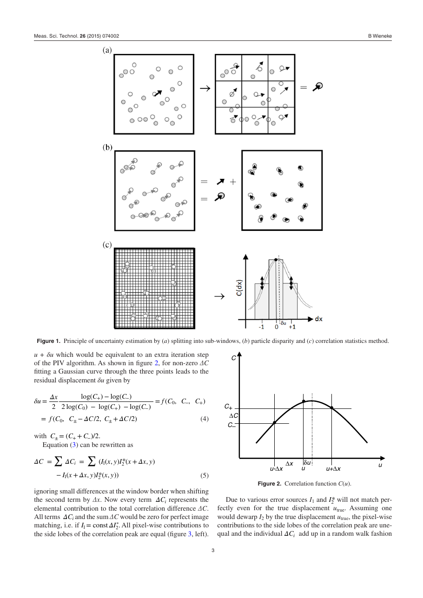
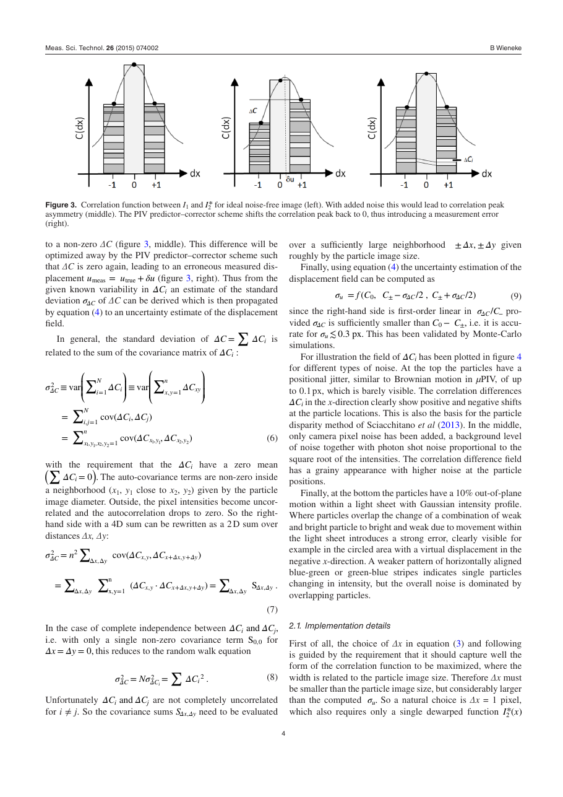
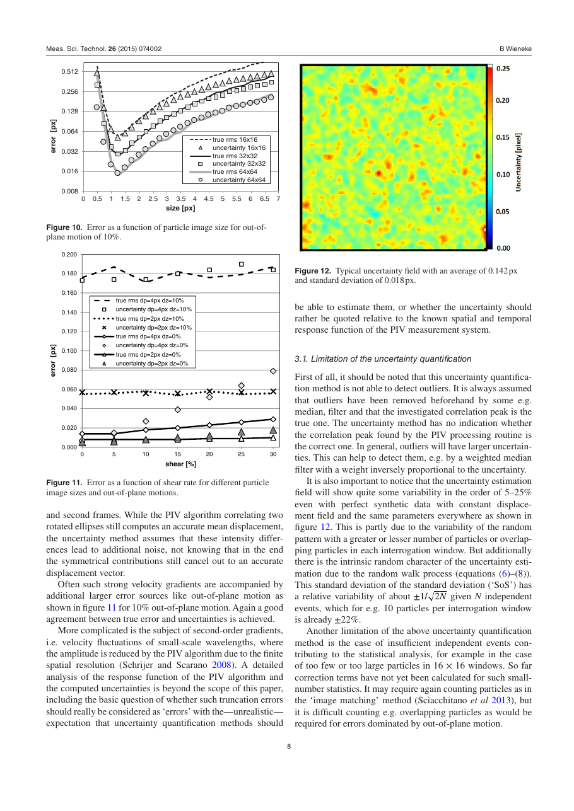

# 상관 통계로 구하는 PIV 불확도 정량화 (번역)

번역 범위: 전문 (초록, 본문, 그림 캡션, 결론). 참고문헌은 원문 그대로 둔다. 부록은 원문에 없다.
원문: [Wieneke2015_MST_PIV_uncertainty_correlation_statistics.pdf](Wieneke2015_MST_PIV_uncertainty_correlation_statistics.pdf) (출판사 공개본, CC BY 3.0, 표지 1쪽 + 본문 10쪽)
원제: PIV uncertainty quantification from correlation statistics
저자: Bernhard Wieneke (LaVision GmbH, 독일 괴팅겐)
서지: Measurement Science and Technology 26 (2015) 074002 (10pp), doi:10.1088/0957-0233/26/7/074002
접수 2014-12-23, 수정 2015-02-26, 게재 승인 2015-03-09, 출판 2015-06-05

그림은 해당 쪽 전체를 110 dpi로 옮긴 것이다. 쪽 번호는 논문 본문 쪽(1~10)이다.
수식은 pdftotext 결과와 PDF 그림을 대조해 다시 적었다.

용어
- PIV: 입자 영상 유속계(particle image velocimetry). 입자를 뿌린 유동을 두 번 찍고, 두 영상을 맞춰 변위장을 구한다.
- 질의 창(interrogation window): 변위 벡터 하나를 구하는 작은 영상 영역.
- 되돌려 펴기(dewarp): 계산한 변위장으로 두 번째 영상을 첫 영상 자리로 옮기는 것.
- 불확도(uncertainty): 참값을 모를 때 측정 오차의 표준편차 추정값.

---

## 초록

PIV 변위장의 불확도를 범용 후처리 방법으로 추정한다.
이 방법은 두 영상의 밝기 패턴 차이를 써서, 상관 과정을 통계적으로 분석한다.
먼저 계산한 변위장으로 두 번째 영상을 첫 영상 위로 되돌려 편다.
그러면 거의 완벽하게 맞는 두 영상을 얻는다.
남은 차이가 상관 함수의 봉우리를 얼마나 옮기는지 분석한다.
각 질의 창 안의 밝기 차이 표준편차와, 상관 봉우리의 기대 비대칭 사이의 관계를 유도한다.
이 비대칭을 변위 벡터의 불확도로 바꾼다.
여러 잡음과 실험 조건(화소 잡음, 면 밖 운동, 입자 밀도, 입자 영상 크기 등)에서 합성 자료로 시험했다.
이 방법이 실제 오차를 정확히 추정함을 보인다.

핵심어: PIV, 불확도, 상관

## 1. 서론

PIV는 30년 넘게 쓰였지만, 실제 실험 자료에서 측정 불확도를 강건하고 정확하게 정량화하는 방법은 아직 부족하다.
흔히 0.05~0.1 화소라는 대략의 값을 인용한다.
또는 유동장이 매끄러울 것으로 기대되는 공간이나 시간 이웃에서 변위장이 얼마나 흔들리는지를 보고 판단한다.
대부분의 연구는 여러 오차원을 흉내 낸 합성 자료로 이루어졌다.
그러나 이런 방법은 보통 실제 실험의 오차를 과소평가한다.
특정 실험 장치에 대해, 측정한 속도장의 벡터 하나하나에 측정 불확도를 구하려는 노력은 최근 몇 년에야 시작되었다.

Timmins 등(2012)이 만든 '불확도 곡면(uncertainty surface)' 방법은 기록 영상에서 오차에 영향을 주는 변수를 분석한다.
지금은 네 변수를 본다.
입자 영상 크기, 입자 밀도, 변위, 전단이다.
먼저 이 변수들을 바꾼 합성 영상으로 PIV 알고리즘을 시험한다.
즉 특정 알고리즘과 선택한 처리 설정에 대한 불확도 곡면을 만든다.
그다음 각 질의 창 안에서 잰 변수(입자 크기 등)와 비교해, 벡터마다 불확도를 붙인다.

'봉우리 비(peak ratio)' 방법(Charonko와 Vlachos 2013)은 가장 높은 상관 봉우리와 두 번째로 높은 봉우리의 비가 불확도의 좋은 척도라고 가정한다.
이 비와 변위의 가장 그럴듯한 불확도 사이에 경험식을 유도했다.
Persoons(2014)는 시간 분해 PIV에서 봉우리 비를 공간 5 × 5, 시간 9점 커널의 국소 변위 흔들림과 함께 썼다.
이 흔들림은 물리적인 난류 흔들림과 측정 불확도가 섞인 것이다.
이 방법은 펄스 간격을 바꾸는 방식의 설정과 처리를 이끌어, PIV 측정의 동적 범위를 넓히는 데 성공했다.
비슷한 고급 다중 펄스, 다중 프레임 기법(예: Westerweel 등 2013의 개관)도 정확한 불확도 추정에서 같은 이득을 얻을 것이다.

'영상 맞춤(image matching)' 또는 '입자 불일치(particle disparity)' 방법(Sciacchitano 등 2013)은 측정한 변위장으로 두 번째 영상을 (또는 두 영상을 반씩) 되돌려 펴서 첫 영상과 겹친다.
각 질의 창에서 두 프레임의 입자 위치를 계산한다.
짝지은 입자의 위치에 남은 불일치로 변위 벡터의 불확도를 추정한다.

모든 불확도 정량화 방법에는 각자의 장점과 약점이 있고, 어떤 오차원을 반영할 수 있는지도 다르다.

일반적으로 평면 PIV는 두 영상을 맞춘다.
변위장 dx(x, y)를 영상 I1(x, y)와 I2(x + dx(x, y), y + dy(x, y)) = I2*(x, y)의 밝기가 가장 잘 맞도록 구한다.
보통 (I1 I2*)의 합으로 주는 상관을 최대화한다.
또는 L2 노름, 곧 평균제곱오차 (I1 − I2*)²의 합을 최소화한다.
이를 최소 제곱 차(MQD), 최소제곱 맞춤(LSM), 제곱차 합(SSD)이라고도 한다.
밝기 I를 (I − Iavg)/(Σ(I − Iavg)²)^(1/2)로 정규화하면 두 방법이 수학적으로 같음을 보일 수 있다(Medan 등 1991).

이런 영상 맞춤 알고리즘은 다시 국소 정규화 방식과 전역 정규화 방식으로 나뉜다.
여러 광류(Horn과 Schunck 1981, Lucas와 Kanade 1981) 같은 전역 방법은 변위장 전체를 한꺼번에 반복 최적화한다.
PIV에서 더 흔한 국소 방법은 작은 질의 창을 골라 두 번째 영상의 대응 창과 맞추고, 이를 영상의 모든 창에 되풀이한다.
보통 반복 다중 패스 예측자-수정자 방식을 쓴다(예: Schrijer와 Scarano 2008).
중간 단계에서 이상치 제거를 포함한 벡터장 정규화를 하므로, 이는 국소와 전역의 중간 방식으로 볼 수 있다.

여기서는 특정 PIV 알고리즘이 아니라, 변위장을 계산한 뒤 후처리 단계로 어떤 알고리즘에도 쓸 수 있는 범용 불확도 추정 방법에 초점을 둔다.
이 방법은 입자 불일치 방법(Sciacchitano 등 2013)을 확장한 것이다.
다만 입자 하나하나의 변위 대신, 상관 봉우리에 대한 화소 하나하나의 기여를 분석한다.

## 2. 상관 통계로 구하는 불확도 추정

일반 개념을 그림 1에 보였다.
질의 창 하나의 벡터 불확도를 구하려면, 원칙적으로 질의 창을 더 작은 부분으로 나눌 수 있다(그림 1(a)).
각 부분 창은 화소와 입자가 적어서 잡음이 더 큰 변위 벡터를 준다.
그러면 n × n개 벡터의 표준편차를 √(n × n)으로 나눈 값이, 창 전체로 구한 벡터 불확도의 대략적인 추정이 된다.
이는 이상치가 없고, 작은 규모의 유동 기울기가 없는 등 이상적인 조건에서만 그렇다.

입자 불일치 방법은 더 작은 규모로 내려가 입자 하나하나와 그 변위의 퍼짐을 분석한다(그림 1(b)).
이 방법은 불확도 추정에 더 좋은 통계를 준다.
여기서 제안하는 상관 통계 방법은 더 깊이 들어가 화소 하나하나를 본다.
각 화소가 상관 봉우리 모양에 주는 흔들리는 기여에서 불확도 추정을 이끌어 낸다(그림 1(c)).
뒤에서 보이듯, 화소 하나와 그 이웃을 분석하지만 실제 국소 공간 규모는 공간 공분산 행렬의 폭으로 정해진다.
이 폭은 다시 평균 입자 영상 크기와 관련된다.

상관 통계 방법의 입력은 맞출 두 영상과 PIV가 계산한 변위장이다.
먼저 변위장 u(x)로 영상 2를 영상 1 위로 되돌려 편다.

$$I_2^*(\mathbf{x}) = I_2(\mathbf{x} + \mathbf{u}) \tag{1}$$

이를 위해 충분히 정확한 고차 부화소 보간 방식이 필요하다(Astarita와 Cardone 2005).
식을 간단히 하려고 여기서는 I1을 고정한 비대칭 되돌려 펴기를 쓴다.
이 방식은 시간 분해 PIV 처리 뒤 유체 요소 궤적을 라그랑주 방식으로 분석할 때 가끔 쓴다.
일반적인 2프레임 PIV에서는 두 프레임을 ±u/2로 대칭으로 되돌려 펴는 쪽이 낫다.
3절의 자료 처리에는 대칭 방식을 썼다.
두 방식 모두 DaVis 소프트웨어에 구현했고, 성능 차이는 보지 못했다.

아래 식은 x 방향 u 성분에 대해서만 적지만, v 성분에도 똑같이 쓸 수 있다.
합은 한 변 길이 n인 질의 창의 N = n²개 화소 전체에 대해 계산한다.
일반적으로는 유효 공간 분해능 Lsr에 해당하는 영역에서 계산한다.
Lsr은 PIV 알고리즘과 설정마다 정해야 하며, 3.2절에서 다시 다룬다.
창 겹침 비율과, 중간 벡터 회귀 필터를 쓰는 다중 패스 방식의 세부에 따라, 유효 공간 분해능은 아래에서 설명하듯 n과 꽤 다를 수 있다.

정사각 창 대신, 조금 더 큰 가우스 가중 질의 창에서 합을 계산할 수도 있다.
이때 2차원 가우스 가중 곡선의 지름은 Lsr에 가깝게 둔다.
일반적으로 불확도를 계산할 때는 원래 PIV 알고리즘과 같은 정사각, 원형, 타원형 창과 같은 가중 함수, 같은 부화소 보간 함수를 써야 한다.

PIV 알고리즘이 충분히 수렴해서, 계산한 변위 u에서 상관 함수

$$C(u) = \sum \big(I_1(x, y)\, I_2(x+u, y)\big) = \sum \big(I_1(x, y)\, I_2^*(x, y)\big) \tag{2}$$

가 기울기 dC/du = 0인 최댓값에 있다고 가정한다.
그러면 u에서 작은 거리 ±Δx만큼 떨어진 상관값 C+ = C(u + Δx)와 C− = C(u − Δx)는 같아야 한다.

$$\Delta C = C_+ - C_- = \sum \big(I_1(x, y)\, I_2^*(x+\Delta x, y) - I_1(x, y)\, I_2^*(x-\Delta x, y)\big) \cong 0 \tag{3}$$

보통 Δx는 뒤에서 설명하듯 1화소다.
ΔC가 0이 아니면 알고리즘이 어떤 이유로 수렴하지 못했다는 뜻이다.
이때 세 점 C0 = C(u), C−, C+로 개선된 최적 변위 u + δu를 계산할 수 있다.
이는 PIV 알고리즘의 반복을 한 번 더 하는 것과 같다.
그림 2처럼 ΔC가 0이 아니면, 세 점을 지나는 가우스 곡선을 맞춰 남은 변위 δu를 얻는다.

$$\delta u = \frac{\Delta x}{2}\,\frac{\log C_+ - \log C_-}{2\log C_0 - \log C_+ - \log C_-} = f(C_0, C_-, C_+) = f\!\left(C_0,\; C_\pm - \frac{\Delta C}{2},\; C_\pm + \frac{\Delta C}{2}\right) \tag{4}$$

여기서 C± = (C+ + C−)/2이다.

**그림 1.** 불확도 추정의 원리. (a) 부분 창으로 나누기, (b) 입자 불일치, (c) 상관 통계 방법.

**그림 2.** 상관 함수 C(u). (u − Δx, u, u + Δx의 세 점 C−, C0, C+와, 두 옆값의 차 ΔC, 남은 변위 δu를 보인다.)

식 (3)은 다음처럼 다시 쓸 수 있다.

$$\Delta C = \sum \Delta C_i = \sum \big(I_1(x, y)\, I_2^*(x+\Delta x, y) - I_1(x+\Delta x, y)\, I_2^*(x, y)\big) \tag{5}$$

둘째 항을 Δx만큼 옮길 때 창 경계에서 생기는 작은 차이는 무시했다.
이제 각 항 ΔCi는 전체 상관 차이 ΔC에 대한 기본 기여를 나타낸다.
영상이 완벽하게 맞으면, 곧 I1 = 상수 × I2*이면, 모든 ΔCi와 그 합 ΔC가 0이다.
상관 봉우리의 옆 날개에 대한 화소별 기여가 모두 같다(그림 3 왼쪽).

여러 오차원 때문에, 참 변위 utrue에서도 I1과 I2*는 완벽하게 맞지 않는다.
I2를 참 변위로 되돌려 편다고 하자.
그러면 상관 봉우리 옆 날개에 대한 화소별 기여가 같지 않다.
각 ΔCi는 마구 걷기(random walk) 방식으로 더해져 0이 아닌 ΔC가 된다(그림 3 가운데).
PIV 예측자-수정자 방식은 이 차이를 최적화로 없애 ΔC를 다시 0으로 만든다.
그 결과 측정 변위는 umeas = utrue + δu로 틀리게 된다(그림 3 오른쪽).
따라서 ΔCi의 알려진 흩어짐에서 ΔC의 표준편차 σΔC를 추정할 수 있다.
이를 식 (4)로 전파하면 변위장의 불확도 추정을 얻는다.

**그림 3.** 잡음 없는 이상적 영상에서 I1과 I2* 사이의 상관 함수(왼쪽). 잡음을 더하면 상관 봉우리가 비대칭이 된다(가운데). PIV 예측자-수정자 방식은 상관 봉우리를 0으로 되돌리며, 이때 측정 오차가 생긴다(오른쪽).

일반적으로 ΔC = ΣΔCi의 표준편차는 ΔCi의 공분산 행렬의 합과 관련된다.

$$\sigma_{\Delta C}^2 \equiv \operatorname{var}\Big(\sum_{i=1}^{N} \Delta C_i\Big) \equiv \operatorname{var}\Big(\sum_{x,y=1}^{n} \Delta C_{xy}\Big) = \sum_{i,j=1}^{N} \operatorname{cov}(\Delta C_i, \Delta C_j) = \sum_{x_1,y_1,x_2,y_2=1}^{n} \operatorname{cov}(\Delta C_{x_1,y_1}, \Delta C_{x_2,y_2}) \tag{6}$$

여기서 ΔCi의 평균은 0이어야 한다(ΣΔCi = 0).
자기 공분산 항은 입자 영상 지름으로 정해지는 이웃 안(x1, y1이 x2, y2에 가까울 때)에서만 0이 아니다.
그 밖에서는 화소 밝기가 서로 상관이 없어지고 자기상관이 0으로 떨어진다.
그래서 오른쪽의 4차원 합을 거리 Δx, Δy에 대한 2차원 합으로 다시 쓸 수 있다.

$$\sigma_{\Delta C}^2 = n^2 \sum_{\Delta x, \Delta y} \operatorname{cov}(\Delta C_{x,y}, \Delta C_{x+\Delta x, y+\Delta y}) = \sum_{\Delta x, \Delta y} \sum_{x,y=1}^{n} (\Delta C_{x,y} \cdot \Delta C_{x+\Delta x, y+\Delta y}) = \sum_{\Delta x, \Delta y} S_{\Delta x, \Delta y} \tag{7}$$

ΔCi와 ΔCj가 완전히 독립이면, 곧 Δx = Δy = 0인 공분산 항 S0,0 하나만 0이 아니면, 이 식은 마구 걷기 식이 된다.

$$\sigma_{\Delta C}^2 = N \sigma_{\Delta C_i}^2 = \sum \Delta C_i^2 \tag{8}$$

불행히도 i ≠ j일 때 ΔCi와 ΔCj는 완전히 상관이 없지는 않다.
그래서 공분산 합 SΔx,Δy를 충분히 넓은 이웃 ±Δx, ±Δy에서 계산해야 한다.
이 이웃의 크기는 대략 입자 영상 크기로 정해진다.

마지막으로 식 (4)를 써서 변위장의 불확도 추정을 다음처럼 계산한다.

$$\sigma_u = f\!\left(C_0,\; C_\pm - \frac{\sigma_{\Delta C}}{2},\; C_\pm + \frac{\sigma_{\Delta C}}{2}\right) \tag{9}$$

σΔC가 C0 − C±보다 충분히 작으면, 오른쪽은 σΔC/C−에 대해 1차 선형이기 때문이다.
곧 σu ≲ 0.3 px에서 정확하다.
이는 몬테카를로 모의실험으로 확인했다.

설명을 위해 여러 잡음에 대한 ΔCi 장을 그림 4에 그렸다.
위쪽은 입자에 최대 0.1 px의 위치 흔들림을 준 경우다.
µPIV의 브라운 운동과 비슷하며, 눈으로는 거의 보이지 않는다.
x 방향 상관 차이 ΔCi는 입자 위치에서 양과 음의 이동을 뚜렷이 보인다.
이것이 Sciacchitano 등(2013)의 입자 불일치 방법의 바탕이기도 하다.
가운데는 카메라 화소 잡음만 더한 경우다.
배경 잡음 수준과, 밝기의 제곱근에 비례하는 광자 산탄 잡음을 더했다.
상관 차이 장은 거친 알갱이 모양이고, 입자 위치에서 잡음이 더 크다.

끝으로 아래쪽은 가우스 밝기 분포를 가진 광면 안에서 입자가 10%의 면 밖 운동을 한 경우다.
입자가 겹친 곳에서, 어두운 입자와 밝은 입자의 조합이 광면 안 움직임 때문에 밝은 입자와 어두운 입자로 바뀐다.
이것이 큰 오차를 만든다.
예를 들어 동그라미 친 영역에서 음의 x 방향으로 가짜 변위가 뚜렷이 보인다.
가로로 늘어선 파랑-초록, 초록-파랑 줄무늬의 약한 패턴은 입자 하나의 밝기가 바뀌는 경우를 나타낸다.
그러나 전체 잡음은 겹친 입자가 지배한다.

**그림 4.** 첫째, 둘째 영상 프레임(왼쪽, 가운데)과 상관 차이 ΔCi(오른쪽). 브라운 운동형 입자 흔들림(위), 카메라 화소 잡음(가운데), 면 밖 운동(아래). 푸른색은 ΔCi의 음수 값, 초록에서 빨강은 양수 값이다.

### 2.1. 구현 세부

먼저 식 (3) 이하의 Δx는 최대화할 상관 함수의 모양을 잘 잡아야 한다는 요구로 정한다.
상관 함수의 폭은 입자 영상 크기와 관련된다.
그래서 Δx는 입자 영상 크기보다 작아야 하지만, 계산되는 σu보다는 훨씬 커야 한다.
따라서 Δx = 1화소가 자연스러운 선택이다.
이렇게 하면 식 (3) 이하에서 되돌려 편 함수 I2*(x)가 세 개가 아니라 하나만 필요하다.
입자 영상이 아주 크면 더 큰 Δx(예: 2)가 나을 수 있다.
덧붙이면 PIV 알고리즘 자체에도 그렇다.
그러나 이는 조사하지 않았다.

입자와 관련된 오차원, 특히 면 밖 운동이나 µPIV의 브라운 운동 같은 입자의 무작위 운동에서는 자기 공분산 행렬 SΔx,Δy가 대략 양의 2차원 가우스 곡선이다.
그 지름은 대략 평균 입자 영상 크기다(그림 5(c)~(e)).
여기서는 먼저 모든 Δx, Δy < 5 px에 대해 SΔx,Δy를 계산한다.
그러나 바깥쪽의 무작위하고 음수일 수도 있는 공분산 항을 더하지 않도록, S/S0,0이 0.05 아래로 떨어질 때까지 안쪽 값만 더한다.

화소마다 독립인 순수 카메라 잡음의 경우, 식 (5)에서 I(x)와 I(x + 1)이 거꾸로 엮여 있다.
그래서 Δx = ±1, Δy = 0의 공분산이 음수이지만 무시할 수 없다(y 성분에서는 y 방향으로 마찬가지다).
그림 5(a)에 이를 보였다.
이 때문에 S를 어디까지 더할지 기준을 정하기 어렵다.
처리를 간단히 하려고, 먼저 모든 ΔCi를 x 방향으로 간단한 필터 ΔCi′(x) = (ΔCi(x − 1) + 2ΔCi(x) + ΔCi(x + 1))/4로 매끄럽게 한다(y 성분은 y 방향으로 같게 한다).
이 필터는 음의 공분산 항을 없앤다(그림 5(b)).
통계 분석의 다른 성질은 바꾸지 않는다.
입자 관련 잡음에서는 S 행렬이 한 방향으로 조금 넓어질 뿐이다.

**그림 5.** 대표적인 자기상관 행렬 SΔx,Δy/S0,0. 순수 화소 잡음과 입자 영상 크기 2.5 px에서 ΔCi를 매끄럽게 하지 않은 경우(a)와 매끄럽게 한 경우(b). 면 밖 운동 5%에서 ΔCi를 매끄럽게 하고 입자 크기 1.0 px(c), 2.5 px(d), 4.0 px(e)인 경우.

필요한 값 C0, C+, C−, SΔx,Δy(Δx, Δy = 0~4)는 질의 창 전체의 합으로 계산해야 한다.
가우스 가중 창이면, 공칭 질의 창 크기의 두 배 이상 넓이에서 가중합으로 계산해야 한다.
특히 75% 겹침이면 처리 시간이 PIV 반복 2~3번에 해당할 수 있다.
더 빠른 구현은 C들과 SΔx,Δy를 먼저 영상 전체의 화소별 장으로 계산하는 것이다.
이 장들을 빠른 재귀 2차원 가우스 필터(Lukin 2007)로 공간적으로 매끄럽게 한다.
이는 가중합 과정과 같다.
필터 길이는 유효 질의 창 크기와 같게 하고, 그 뒤 필터 길이의 제곱을 곱한다(매끄럽게 하기와 더하기의 차이).
그다음 각 벡터 위치에서 C0, C+, C−, SΔx,Δy의 국소값을 꺼내 σu를 계산한다.
이렇게 하면 처리 시간이 PIV 반복 한 번보다 짧아진다.
GPU 구현은 처리 시간을 다시 한 자릿수 줄였다.
이 방식은 가중하지 않은 정사각 창을 쓴 PIV 처리에서도 성공적으로 시험했다.
다중 패스 PIV 예측자-수정자 방식 때문에, 이때도 유효 필터 모양은 사각(top-hat) 함수보다 가우스 곡선에 더 가깝다.

위의 1차원 유도는 변위장의 x 성분과 y 성분에 대해 따로 한다.
실제 PIV 자료에서 x와 y 방향 사이의 의존은 아직 보지 못했다.
다만 예를 들어 비스듬한 방향으로 강한 비점수차가 있으면 교차 항이 있을 것으로 예상할 수 있다.
여기서는 여러 오차원 아래의 2차원 변위로 논의를 한정한다.

## 3. 합성 자료

입자 영상 크기, 입자 밀도, 면 밖 운동, 잡음 수준 같은 변수를 바꾼 합성 영상으로 이 절차를 시험했다.
영상 크기는 1000 × 1000화소다.
기본 설정은 다음과 같다.
- 입자 영상 크기 2.5 px
- 입자 밀도 0.1 ppp(화소당 입자 수)
- 입자 최고 밝기 1000 카운트
- 입자는 가우스 레이저 밝기 분포 안에 놓임
- 일정 변위: x 방향 0.6화소, y 방향 0.3화소, 면 밖 운동 없음

입자 영상 크기는 2σ로 정의하며, 밝기 분포는 exp(−(x² + y²)/2σ²)에 비례한다.

처리는 LaVision DaVis 8.2로 했다.
4패스, 75% 겹침, 가우스 가중 함수를 쓰는 질의 창, 공칭 창 크기 16 × 16 ~ 64 × 64화소다.
중간 벡터 정규화가 더 짧은 변위 파장에 맞춰지므로, 32 × 32 창의 유효 창 크기는 예를 들어 겹침 0%/50%/75%에서 32/28/22화소다.
여기서 유효 공간 분해능을 재는 방법은 Elsinga와 Westerweel(2011)과 비슷하다.

전형적인 카메라의 변환율을 4 e−/카운트로 가정하고, 16 e−(4 카운트)의 가우스 배경 화소 잡음을 영상에 더했다.
여기에 광전자 수의 제곱근에 비례하는 광자 산탄 잡음을 더했다.
그래서 밝기 1000 카운트 화소에서는 잡음이 최대 16 카운트가 된다.

아래 그림들에서 전체 불확도 σ = √(σu² + σv²)는 모든 벡터 불확도의 제곱평균제곱근(rms)으로 하나의 평균값으로 합쳤다(Sciacchitano 등 2015의 부록 참조).
전체 참 오차는 알려진 변위에 대한 모든 벡터 차이의 rms로 계산했다.
참 오차는 보통 무작위 부분이 지배한다.
큰 편향은 입자 영상 크기 ≤ 1 px('봉우리 고정, peak locking')에서만 나타난다.
시험한 변수 범위에서 이상치는 보지 못했고, 후처리는 하지 않았다.

먼저 배경 화소 잡음만 바꾸었다.
창 크기 16 × 16 ~ 64 × 64에서, 넓은 잡음 범위에 걸쳐 불확도를 정확히 추정함을 보인다(그림 6).
잡음은 입자 최고 밝기 1000 카운트에 대한 백분율로 적었다.
잡음 진폭이 아주 클 때만 불확도가 약 0.3~0.4 px에서 더 오르지 않는다.
이는 식 (9)의 한계에서 예상한 대로다.
PIV에서 고려할 오차 수준은 보통 0.02 px에서 0.2~0.3 px이다.
모든 오차원을 합치면 이보다 작은 경우는 드물다.
이보다 크면 상관 봉우리가 덜 뚜렷하고 이상치가 많을 수 있다.
그때는 실험 장치를 개선하거나 더 큰 질의 창을 쓰는 것을 고려해야 한다.

**그림 6.** 가우스 화소 잡음에 따른 오차. (가로축 잡음 수준 2~256%, 세로축 오차 0.002~0.512 px, 로그 눈금. 16 × 16, 32 × 32, 64 × 64 창의 참 rms와 불확도.)

면 밖 운동을 광면 두께의 0~30%로 바꾼 결과를 그림 7에 보였다.
입자 영상 크기는 1.5 px(왼쪽)와 2.5 px(오른쪽)이다.
불확도는 32 × 32와 64 × 64 창에서 올바르게 계산된다.
그러나 입자 크기 2.5 px에서 24 × 24 창은 조금, 16 × 16 창은 20% 과소평가한다.
면 밖 운동이 있을 때 오차는 (아마 아주 적은 수의) 겹친 입자가 지배한다.
앞에서 말했듯, 이 입자들은 광면을 함께 지나며 밝기가 예를 들어 밝음-어두움에서 어두움-밝음으로 바뀐다.
그래서 큰 가짜 면 안 변위가 생긴다.
입자 크기 1.5 px에서는 입자가 겹칠 확률이 훨씬 작아서 오차가 더 작다.

**그림 7.** 면 밖 운동에 따른 오차. 입자 영상 크기 1.5 px(왼쪽), 2.5 px(오른쪽).

Nobach와 Bodenschatz(2009)가 지적했듯, 이 오차 수준은 입자 밀도와 거의 무관하다.
입자 밀도가 낮으면 겹치는 입자가 적다.
그러나 전체 입자가 적어서 이들이 오차에 크게 기여한다.
반대로 입자 밀도가 높으면 거의 모든 입자가 겹쳐 오차를 만든다.
그러나 정보량이 훨씬 많아서 그만큼 오차가 줄어든다.

이는 면 밖 운동 10%에서 입자 밀도를 아주 낮은 값부터 아주 높은 값까지 바꾼 그림 8에서 확인된다.
오차 수준은 거의 일정하다.
불확도 정량화는 꽤 잘 맞는다.
64 × 64 창에서는 조금 과대평가하고, 16 × 16에서는 과소평가한다.

**그림 8.** 면 밖 운동 10%에서 입자 밀도에 따른 오차.

일반적으로 면 밖 운동은 PIV 처리에서 흔히 지배적인 오차원이다(Nobach와 Bodenschatz 2009).
첫째와 둘째 레이저 펄스의 분포가 어긋나거나, 촬영마다 레이저 밝기 분포가 불안정해도 같은 효과가 생긴다.

입자 크기와 관련된 또 다른 오차원은 µPIV에서 각 입자의 무작위 브라운 운동이다.
여기서는 더 많은 입자의 평균 효과 때문에, 입자 밀도가 높을수록 오차와 추정 불확도가 낮아진다(그림 9).
16 × 16 창을 빼면 참 오차와 불확도가 잘 맞는다.
16 × 16 창에서는 불확도가 약 20~30% 너무 낮다.

**그림 9.** ±0.1 px 무작위 브라운 입자 운동에서 입자 밀도에 따른 오차.

면 밖 운동 10%로 고정하고 입자 영상 크기를 바꾸어도, 평균 참 오차와 불확도가 꽤 잘 맞는다(그림 10).
크기가 1화소보다 작으면 되돌릴 수 없는 정보 손실 때문에 무작위 오차와 편향 오차가 크게 늘어난다('화소 고정, pixel locking').
자세히 보면 불확도 정량화로는 오차의 무작위 부분만 추정할 수 있다.
계통 편향은 잡히지 않는다.
더 큰 입자에서는 오차를 조금 과소평가한다.
특히 16 × 16 창에서 그렇다.

**그림 10.** 면 밖 운동 10%에서 입자 영상 크기에 따른 오차.

끝으로 면 안 기울기의 영향을 조사했다.
폭 400, 높이 1000화소의 합성 영상을 만들고, 면 안 전단을 0~30%로 바꾸었다.
곧 영상 왼쪽과 오른쪽에서 y 방향 변위가 최대 −60/+60 px이다.
이는 32 × 32 질의 창 안에서 최대 10 px의 변화이며, 영상 변형 기법을 쓰는 PIV 알고리즘만 다룰 수 있다.
그림 11에서 보이듯, 입자 영상 크기 2 px에 면 밖 운동이 없으면 참 오차는 0.01 px 아래에 머문다.
이는 이렇게 극단적인 조건에서도 합성 영상 생성기, PIV 알고리즘, 되돌려 펴기 함수가 정확함을 확인해 준다.
벡터 위치가 단 0.1 px만 부정확해도 이미 0.03 px의 편향 오차가 생겼을 것이다.

전단 30%에서는 계산된 불확도가 0.03 px로 과대평가된다.
입자 영상 크기 4 px에서는 더 크다.
이는 아마 영상 되돌려 펴기가 둥근 입자를 첫째와 둘째 프레임에서 서로 다른 방향으로 돌아간 타원으로 찌그러뜨리기 때문일 것이다.
돌아간 두 타원을 상관하는 PIV 알고리즘은 여전히 정확한 평균 변위를 계산한다.
그러나 불확도 방법은 이 밝기 차이가 추가 잡음을 만든다고 가정한다.
결국 대칭인 기여가 상쇄되어 정확한 변위 벡터가 나온다는 것을 모르기 때문이다.

이런 강한 속도 기울기에는 흔히 면 밖 운동 같은 더 큰 오차원이 함께 있다.
그림 11의 면 밖 운동 10% 경우가 그렇다.
여기서도 참 오차와 불확도가 잘 맞는다.

**그림 11.** 입자 영상 크기와 면 밖 운동을 달리했을 때 전단율에 따른 오차.

더 복잡한 것은 2차 기울기, 곧 짧은 파장의 속도 흔들림이다.
유한한 공간 분해능 때문에 PIV 알고리즘이 그 진폭을 줄인다(Schrijer와 Scarano 2008).
PIV 알고리즘의 응답 함수와 계산된 불확도의 자세한 분석은 이 논문의 범위를 넘는다.
이런 절단 오차를 정말 '오차'로 보아야 하는지라는 기본 질문도 포함된다.
곧 불확도 정량화 방법이 이를 추정할 수 있어야 한다는 (비현실적인) 기대를 할지, 아니면 PIV 측정 장치의 알려진 공간, 시간 응답 함수에 상대적으로 불확도를 적어야 할지의 문제다.

**그림 12.** 대표적인 불확도 장. 평균 0.142 px, 표준편차 0.018 px.

### 3.1. 불확도 정량화의 한계

먼저, 이 불확도 정량화 방법은 이상치를 검출하지 못한다는 점을 밝혀 둔다.
이상치는 미리, 예를 들어 중앙값 필터로 제거했고, 조사하는 상관 봉우리가 참 봉우리라고 늘 가정한다.
이 불확도 방법은 PIV 처리 루틴이 찾은 상관 봉우리가 올바른지에 대한 정보를 갖고 있지 않다.
일반적으로 이상치는 불확도가 더 크다.
이 점은 이상치 검출에 도움이 될 수 있다.
예를 들어 불확도에 반비례하는 가중을 쓴 가중 중앙값 필터로 검출할 수 있다.

또 하나 중요한 점이 있다.
변위장이 일정하고 모든 곳의 변수가 같은 완벽한 합성 자료에서도, 불확도 추정 장은 5~25% 정도 꽤 흩어진다(그림 12).
일부는 각 질의 창마다 입자나 겹친 입자의 수가 많거나 적은 무작위 패턴의 흩어짐 때문이다.
그 밖에 마구 걷기 과정(식 (6)~(8)) 때문에 불확도 추정 자체가 본래 무작위성을 띤다.
이 '표준편차의 표준편차(SoS)'는 독립 사건이 N개일 때 상대 흩어짐이 약 ±1/√(2N)이다.
예를 들어 질의 창당 입자가 10개이면 이미 ±22%다.

이 불확도 정량화 방법의 또 다른 한계는, 통계 분석에 기여하는 독립 사건이 모자라는 경우다.
예를 들어 16 × 16 창에 입자가 너무 적거나 너무 큰 경우다.
이런 작은 표본 통계에 대한 보정 항은 아직 계산하지 않았다.
'영상 맞춤' 방법(Sciacchitano 등 2013)처럼 다시 입자를 세야 할 수도 있다.
그러나 면 밖 운동이 오차를 지배할 때 필요한 것처럼 겹친 입자를 세기는 어렵다.

끝으로 이 방법은 주로 불확도의 무작위 부분을 추정한다.
편향 오차는 원리상 식 (4)로 정량화할 수 있다.
그러나 PIV 알고리즘이 충분히 수렴해 상관 봉우리가 대칭이고, 그 자체로 편향이 없어야 한다고 가정한다.
강한 봉우리 고정 같은 미지의 편향은 잡히지 않는다.
이런 편향은 불확도 곡면 방법(Timmins 등 2012)으로 더 잘 정량화할 수 있을 것이다.
강한 봉우리 고정에서도 편향 오차의 크기는 보통 무작위 오차, 곧 불확도보다 작다.
그러나 파생 통계량에서는 지배적이 될 수 있다.

실제로는 입자 영상 크기가 큰 경우에도 식 (4)에서 작은 편향 항이 관찰되었다.
예를 들어 PIV 알고리즘이 한 값으로 수렴하지 않고 반복마다 조금씩 오락가락하기 때문이다.
이런 작은 편향 항은 참 편향 오차원과 관련이 없으므로, 어느 정도 무작위한 성질로 본다.
그래서 최신 구현(DaVis 8.2.2)에서는 이를 무작위 불확도에 σtotal² = σbias² + σrandom²로 더한다.

### 3.2. 불확도 전파를 위한 준비

와도, 발산, 난류 운동 에너지, 레이놀즈 응력 같은 파생량으로 불확도를 전파하려면, 참 오차의 공간, 시간 자기상관 계수를 알아야 한다.
u와 v 오차 항 사이의 상관도 알아야 하고, 스테레오 PIV에서는 w와의 상관도 알아야 한다.
불확도 전파의 세부는 앞으로의 연구 주제다(Wilson과 Smith 2013a, 2013b도 참조).
여기서는 공간 자기, 교차 상관 계수만 간단히 조사한다.
이는 불확도 방법의 종류와 무관하다.
영상 자료와 PIV 처리 방식에만 달려 있다.

그림 6~11에 쓴 합성 자료에서는 참 오차 δu와 δv 사이에 큰 결합이 없었다.
C(δu, δv) ≤ 0.05였다.
예외는 영상 품질이 거의 이상적이고 오차가 0.01 px 아래인 자료점(예: 그림 6의 낮은 잡음)이다.
여기서는 −0.1 ~ −0.3 정도의 상관값을 쟀다.
이렇게 낮은 오차는 실제 실험에서 보통 만나지 않으므로 더 조사하지 않았다.
PIV 알고리즘의 바닥 잡음 수준과 처리 방식의 세부가 관련될 수 있다.

반면 스테레오 PIV에서는 (u1, v1, u2, v2)로 3성분 (u, v, w)를 재구성하므로 늘 결합이 있다.
예를 들어 카메라가 x축을 따라 놓이면 특히 u와 w 사이에 결합이 있다.
u와 w가 모두 u1과 u2에 달려 있기 때문이다.
이런 결합 항은 보정 함수에서 직접 계산하거나 합성 자료로 잴 수 있다.
특히 레이놀즈 응력 Ruw 같은 양에서는 이를 반영해야 한다.

그림 6~10 자료에 대해 참 오차의 평균 공간 자기상관 함수를 계산했다.
그림 13은 x 방향 δu 성분의 자기상관(AF(참 오차))이다.
32 × 32 질의 창, 75% 겹침, 벡터 간격 8화소로 처리했다.
dx = 32 px를 넘으면 값이 0 가까이에 머문다.
δu의 y 방향 상관, δv의 x와 y 방향 상관에서도 같은 감소를 쟀다.
이는 PIV 알고리즘의 유효 공간 분해능과 직접 관련된다.
그림의 실선은 PIV 알고리즘이 공간 분해능 Lsr = 2σ = 18 px인 가우스 모양 선형 필터와 같다면 기대되는 자기상관 함수다.
이는 불확도 계산에 쓴 Lsr = 22 px와 조금 다르다.
흥미롭게도 불확도 값 흔들림의 측정 자기상관은 Lsr = 22 px에 가깝게 맞는다.
이 관계를 이해하려면 더 조사해야 한다.

**그림 13.** x 방향 참 오차 δu의 공간 자기상관.

유효 공간 분해능은 변위장에 계단 함수를 넣은 합성 영상으로 Elsinga와 Westerweel(2011)과 비슷한 방법으로 정했다.
여러 파장의 사인파 변위장에 대한 PIV 알고리즘 응답을, 단순 사각 필터의 sinc 응답과 비교해서 구할 수도 있다(예: Schrijer와 Scarano 2008).
어느 경우든 불확도 전파에 필요한 자기상관 값은 평균 측정값에서 가져올 수 있다.
여기서 쓴 모든 합성 자료에서 이 값은 표준편차 0.02~0.03 미만으로 매우 일정하다.

## 4. 결론

PIV 변위장의 국소 측정 불확도를, 맞출 두 영상의 차이를 후처리해 추정한다.
밝기 차이가 상관 함수 모양에 주는 화소별 기여의 표준편차를 통계적으로 계산한다.
이를 변위 벡터의 무작위 불확도와 연결한다.

이 불확도 정량화 방법을 무작위 가우스 잡음, 입자 영상 크기와 밀도, 면 안과 면 밖 운동 등을 바꾼 합성 자료로 시험했다.
대부분의 경우 참 무작위 오차와 잘 맞았다.
16 × 16 창에서는 참 오차를 조금 과소평가했다.
이 방법은 봉우리 고정이나 다른 계통 오차원에서 오는 편향 오차를 추정하지 못한다.

이 방법의 정확도는 다른 PIV 불확도 정량화 방법과의 비교를 포함한 국제 공동 연구의 일부로, 별도로 설계한 실험에서 더 조사했다(Neal 등 2015, Sciacchitano 등 2015).
그 결과는 여기서 제시한 불확도 방법이 타당함을 확인해 준다.

## References (원문 그대로)

Astarita T and Cardone G 2005 Analysis of interpolation schemes for image deformation methods in PIV Exp. Fluids 38 233–43
Charonko J J and Vlachos P P 2013 Estimation of uncertainty bounds for individual particle image velocimetry measurements from cross-correlation peak ratio Meas. Sci. Technol. 24 065301
Elsinga G E and Westerweel J 2011 The point spread function and the spatial resolution of PIV cross-correlation methods PIV'11 (Kobe, Japan)
Horn B K and Schunck B G 1981 Determining optical flow Artif. Intell. 17 185–203
Lucas B D and Kanade T 1981 An iterative image registration technique with an application to stereo vision Image Understanding Workshop (DARPA) pp 121–30
Lukin A 2007 Tips and tricks: fast image filtering algorithms Proc. of GraphiCon'2007 (Moscow, Russia) pp 186–9
Medan Y, Yair E and Chazan D 1991 Super resolution pitch determination of speech signals IEEE Trans. Signal Process. 39 40–8
Neal D R, Sciacchitano A, Smith B L and Scarano F 2015 Collaborative framework for PIV uncertainty quantification: the experimental database Meas. Sci. Technol. 26 074003
Nobach H and Bodenschatz E 2009 Limitations of accuracy in PIV due to individual variations of particle image intensities Exp. Fluids 47 27–38
Persoons T 2014 Time-resolved high-dynamic-range particle image velocimetry using local uncertainty estimation 30th AIAA Aerodynamic Measurement Technology and Ground Testing Conference doi: 10.2514/1.J053651
Schrijer F and Scarano F 2008 Effect of predictor–corrector filtering on the stability and spatial resolution of iterative PIV interrogation Exp. Fluids 45 927–41
Sciacchitano A, Neal D R, Smith B L, Warner S O, Vlachos P P, Wieneke B and Scarano F 2015 Collaborative framework for PIV uncertainty quantification: comparative assessment of methods Meas. Sci. Technol. submitted
Sciacchitano A, Wieneke B and Scarano F 2013 PIV uncertainty quantification by image matching Meas. Sci. Technol. 24 045302
Timmins B H, Wilson B W, Smith B L and Vlachos P P 2012 A method for automatic estimation of instantaneous local uncertainty in particle image velocimetry measurements Exp. Fluids 53 1133–47
Westerweel J, Elsinga G E and Adrian R J 2013 Particle image velocimetry for complex and turbulent flows Annu. Rev. Fluid Mech. 45 409–36
Wilson B M and Smith B L 2013a Taylor-series and Monte-Carlo-method uncertainty estimation of the width of a probability distribution based on varying bias and random error Meas. Sci. Technol. 24 035301
Wilson B M and Smith B L 2013b Uncertainty on PIV mean and fluctuating velocity due to bias and random errors Meas. Sci. Technol. 24 035302
