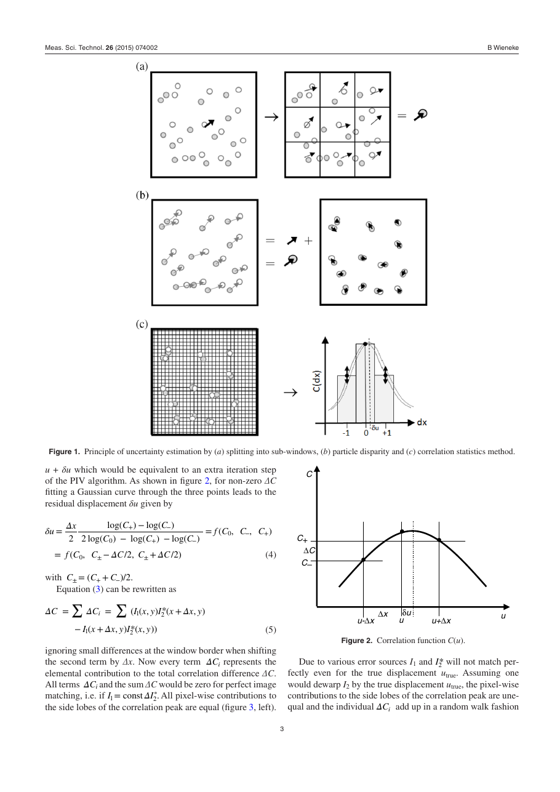

# Wieneke 2015, 상관 통계로 구하는 PIV 불확도 정량화 (MST)

- 원제: PIV uncertainty quantification from correlation statistics
- 원문: 같은 폴더의 `Wieneke2015_MST_PIV_uncertainty_correlation_statistics.pdf` (출판사 공개본, CC BY 3.0). 번역: [번역.md](번역.md)
- 저자: Bernhard Wieneke (LaVision GmbH, 독일 괴팅겐)
- 서지: Measurement Science and Technology, 26(7), 074002 (10pp), 2015. 출판 2015-06-05. doi:10.1088/0957-0233/26/7/074002 (OpenAlex W2205734188, Crossref로 서지 확인)
- 핵심 (원문 확인)
  - 정답 없이, 맞춘 두 영상의 남은 밝기 차이만으로 벡터 하나하나의 불확도(표준편차)를 구하는 범용 후처리 방법이다. 어떤 정합 알고리즘 뒤에도 붙일 수 있다.
  - 순서
    - 구한 변위로 둘째 영상을 첫 영상 자리로 되돌려 편다.
    - 화소마다 상관 봉우리의 좌우 날개 차이에 주는 기여 ΔCi를 구한다(식 5).
    - ΔCi를 그냥 독립으로 더하지 않는다. 이웃 화소끼리의 공분산 합 S(Δx, Δy)를 S/S0,0 < 0.05가 될 때까지 더해 σΔC를 구한다(식 6, 7). 독립 가정(식 8)은 틀린다고 명시한다.
    - σΔC를 3점 가우스 봉우리 식(식 4, 9)에 넣어 변위 불확도 σu로 바꾼다.
  - 순수 화소 잡음에서는 이웃 공분산이 음수가 되어 합이 불안정하다. (1, 2, 1)/4 필터로 ΔCi를 먼저 매끄럽게 해 해결한다.
  - 한계를 스스로 밝힌다.
    - 이상치(틀린 봉우리)는 검출하지 못한다. 이상치는 미리 제거했다고 가정한다. 다만 이상치는 불확도가 커서, 불확도 반비례 가중 중앙값 필터에 쓸 수 있다고 제안한다.
    - 무작위 부분만 추정한다. 봉우리 고정 같은 계통 편향은 잡지 못한다.
    - 독립 사건 수가 적으면 과소평가한다. 불확도 추정 자체도 ±1/√(2N)만큼 흔들린다.
    - 되돌려 펴기가 입자 모양을 바꾸는 강한 전단에서는 과대평가한다.
- 정량 수치 (모두 합성 영상, 원문 확인)
  - 시험 조건: 1000 × 1000 영상, 입자 2.5 px, 0.1 ppp, 최고 밝기 1000 카운트, 배경 잡음 4 카운트와 산탄 잡음(최대 16 카운트), 변위 (0.6, 0.3) px, DaVis 8.2, 4패스, 75% 겹침.
  - 식 (9)는 σu ≲ 0.3 px에서 정확하다. 잡음이 아주 크면 0.3~0.4 px에서 포화한다.
  - 16 × 16 창은 과소평가: 면 밖 운동에서 20%, 브라운 운동에서 20~30%. 32 × 32, 64 × 64 창은 잘 맞는다.
  - 완벽한 합성 자료에서도 불확도 장이 5~25% 흩어진다. 그림 12 예: 평균 0.142 px, 표준편차 0.018 px.
  - 불확도의 상대 흩어짐 ±1/√(2N). 독립 입자 10개면 ±22%.
  - 전단 30%에서 참 오차는 0.01 px 미만인데 불확도는 0.03 px로 과대평가.
  - u, v 오차 상관 C(δu, δv) ≤ 0.05. 단, 오차가 0.01 px 미만인 거의 이상적인 영상에서는 −0.1 ~ −0.3.
  - 참 오차 공간 자기상관: 32 × 32 창, 8 px 간격에서 32 px 넘으면 거의 0. 가우스 필터 Lsr 18 px에 맞고, 불확도 흔들림은 Lsr 22 px에 맞는다.
  - 처리 시간: 영상 전체 장을 재귀 가우스 필터로 매끄럽게 하는 구현에서 PIV 반복 1번 미만. GPU에서 다시 10배 줄었다. 직접 합산하면 PIV 반복 2~3번.
- 우리와의 관계: ○ 질문 4(주), 8(주), 1(보조)
  - 질문 4 (정답 없는 한 장 불확도, 얽힌 오차 반영): 이 논문의 핵심이 바로 "점별 기여가 서로 얽혀 있으니 독립 합 대신 이웃 공분산 합을 쓰라"는 것이다. 우리 536점의 유효 독립 정보 약 19와 같은 문제다. 헤세 행렬만 쓰는 공분산(독립 가정)은 우리 경우 과소평가할 것이라는 근거가 된다(우리 과제로의 추론).
  - 질문 8 (지표가 못 잡는 실패): 저자가 직접 "편향은 못 잡는다"고 밝힌다. 우리 영점 이동(하루 안 가로 ≤0.84 px, 날짜 간 세로 +0.44 px)은 잔차에 드러나지 않는 편향이라 이 방식으로 잡히지 않는다(우리 과제로의 추론).
  - 질문 1 (실패 검출 지표): 불확도는 실패 검출기가 아니라고 명시한다. 다만 큰 불확도가 실패의 보조 신호가 된다고 제안한다. 실패 검출은 다른 지표(정역방향 오차, NCC 등)와 묶어야 한다.
- 링크
  - DOI: https://doi.org/10.1088/0957-0233/26/7/074002
  - PDF: https://iopscience.iop.org/article/10.1088/0957-0233/26/7/074002/pdf
  - OpenAlex: https://openalex.org/W2205734188

---

## 상세 요약 (번역본 기반)

### 1. 문제
- PIV 실험에서 벡터마다 오차를 알고 싶다. 정답은 없다.
- 기존 방법
  - 불확도 곡면(Timmins 2012): 영상 변수로 합성 실험표를 찾는다.
  - 봉우리 비(Charonko, Vlachos 2013): 1등과 2등 봉우리 비로 경험식.
  - 입자 불일치(Sciacchitano 2013): 되돌려 편 두 영상의 입자 위치 차이.
- 이 논문은 입자보다 더 작은 화소 단위로 내려간다.

### 2. 방법
- 수렴했다면 상관 함수 C(u)는 꼭대기에서 기울기 0이다. 그래서 C(u + 1) = C(u − 1)이어야 한다.
- 잡음이 있으면 화소별 기여 ΔCi가 마구 걷기로 더해져 좌우가 어긋난다. 알고리즘은 이 어긋남을 없애려고 변위를 옮긴다. 그 옮김이 바로 오차 δu다.
- 그러니 ΔCi의 흩어짐 σΔC를 알면 δu의 표준편차를 안다.
- σΔC² = Σ S(Δx, Δy). 이웃끼리 공분산을 더한다. 독립이면 S(0,0)만 남는다.
- 마지막으로 3점 가우스 봉우리 식에 C± ± σΔC/2를 넣어 σu를 얻는다.

### 3. 결과
- 화소 잡음, 면 밖 운동, 입자 밀도, 입자 크기, 전단을 바꾼 합성 영상에서 참 rms 오차와 불확도 rms가 대체로 맞는다.
- 독립 사건이 적은 16 × 16 창에서는 20~30% 낮게 나온다.

### 4. 우리에게 주는 시사점 (우리 과제로의 추론, 검증 전)
- control의 GN과 joint의 ECC는 모두 최소제곱 정합이라, ΔCi에 해당하는 값이 "잔차 × 영상 기울기 × 자코비안"이다. Wieneke의 S 합은 최소제곱의 샌드위치 공분산 H⁻¹ (Jᵀ Σ J) H⁻¹에서 Σ를 이웃 잔차 곱으로 추정하는 것과 같은 구조다.
- 우리 정밀도 영역(점 잡음 0.009~0.015 px)은 이 논문이 "실제로 드물다"며 더 조사하지 않은 0.01 px 근처다. 이 영역에서 성분끼리 오차 상관 −0.1 ~ −0.3이 보고되었다. Y, T처럼 반응이 거의 평행(cos 0.99999)한 우리 두 성분은 성분별 1차원 처리가 아니라 2 × 2 공분산으로 다뤄야 한다.

---

## 리뷰 카드

- **어떻게 해결했나:** 정합 뒤 남은 잔차 영상에서 화소별 기여를 만들고, 이웃 공분산 합으로 "얽힌 잡음"을 반영한 뒤, 봉우리 모양 식으로 변위 불확도로 바꿨다. 정답도, 반복 촬영도 필요 없다.
- **같은 점:** 우리도 템플릿을 센터 사진에 맞춘 뒤 잔차가 남는다. 점(또는 화소)끼리 오차가 얽혀 있다(536점, 유효 약 19). 정답 없이 사진 한 장의 불확도가 필요하다. 처리 시간 제약이 있다.
- **다른 점:** PIV는 입자 2.5 px 무늬, 오차 0.02~0.3 px, 창마다 다른 변위다. 우리는 QR과 가로선 고정 표식, 점 잡음 0.01 px대, 사진 전체가 Y, T 두 값으로 묶인다. 우리 Y, T는 반응이 거의 평행해서 성분 간 결합이 핵심인데, 논문은 x, y를 따로 처리했다. 우리 주 오차는 무작위보다 영점 편향(0.84 px, 0.44 px)이 크다. 논문은 합성 영상만 시험했다.
- **가져올 해결책:** control은 GN 수렴 뒤 536점의 잔차 rᵢ와 자코비안 Jᵢ로 샌드위치 공분산을 만든다. 이웃 점 쌍의 잔차 곱을 더하되, 상관이 0.05 아래로 떨어지는 거리에서 자른다(Wieneke 규칙). 이 공분산을 P12와 6절편 역산으로 전파해 σY, σT와 둘의 상관을 낸다. 허용 Y 0.65 px(±0.045), T 0.80 px(±0.01)와 비교해, 예를 들어 3σY가 0.65 px를 넘으면 재촬영으로 보낸다. 독립 정보가 약 19라서 σ 추정 자체가 ±1/√38 ≈ ±16% 흔들림을 감안한다. 영점 편향은 이 값에 안 잡히므로 별도 항(QR 대 가로선 차이, 백래시 예산)으로 더한다.

## 이 단계 후보 방법으로서

- **방법 이름:** 상관 통계 점별 불확도 (잔차 기반 샌드위치 공분산, 이웃 공분산 합)
- **전제 조건**
  - 정합이 수렴했다(잔차 기울기 0).
  - 찾은 봉우리, 곧 대응이 맞다(이상치 없음).
  - 오차가 무작위 위주다. 편향은 작다.
  - 공분산을 더할 이웃 범위를 정할 수 있다.
  - 독립 사건이 충분하다.
- **장점**
  - 정답과 반복 촬영 없이 사진 한 장으로 구한다.
  - 정합 알고리즘과 무관한 후처리다. control, joint 둘 다 붙일 수 있다.
  - 얽힌 잡음을 명시적으로 반영한다. 독립 가정 헤세 공분산의 과소평가를 고친다.
  - 계산이 가볍다(정합 반복 1번 미만, 원문 기준).
- **단점**
  - 이상치, 곧 틀린 대응을 잡지 못한다.
  - 편향(영점 이동, 백래시, 카메라 이동)을 잡지 못한다.
  - 독립 사건이 적으면 과소평가한다(16 × 16에서 20~30%).
  - 되돌려 펴기가 모양을 바꾸면 과대평가한다.
  - 0.01 px 영역, 성분 결합이 강한 경우는 원문에서 시험하지 않았다.
- **우리 적용 조건**
  - 실패 검출 지표(정역방향 오차, NCC 최솟값, 유효점 수)로 이상치를 먼저 거른 뒤에만 쓴다.
  - Y, T를 2 × 2로 함께 전파한다. 성분별 1차원 처리는 쓰지 않는다.
  - 판정 기준은 σ만이 아니라 σ에 영점 편향 예산을 더한 값으로 잡는다.
  - 검증: 같은 자세 반복 묶음(1020, 1029의 3장 묶음)의 실제 흩어짐과 예측 σ를 비교한다. 날짜를 나눈 평가에서 희소화 곡선으로 순위 성능도 본다.
  - 실패 사진이 거의 없으므로 가림, 흔들림, 반사를 합성해 과소평가 여부를 시험한다.
