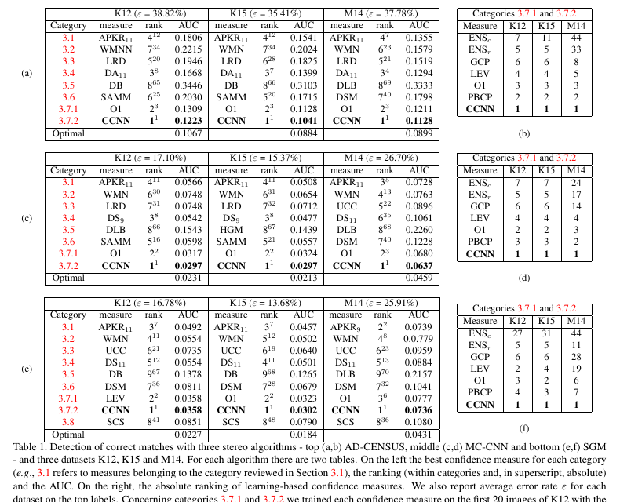
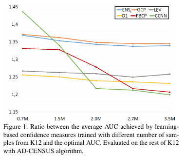
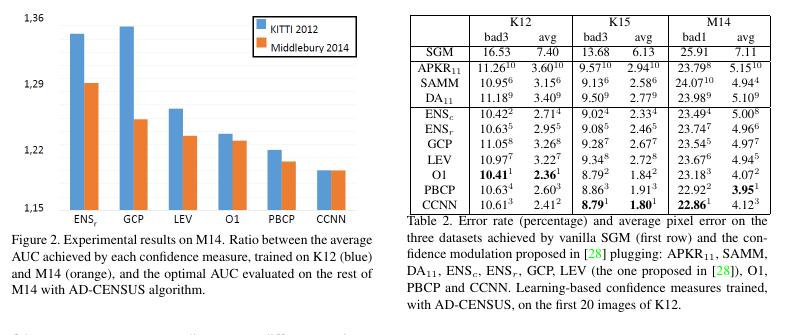

# 기계학습 시대의 신뢰도 지표 정량 평가

- 원제: Quantitative evaluation of confidence measures in a machine learning world
- 저자: Matteo Poggi, Fabio Tosi, Stefano Mattoccia (University of Bologna, DISI)
- 원문: 같은 폴더의 `Poggi2017_ICCV_confidence_measures.pdf` (CVF 오픈액세스판, 10쪽)
- 번역 범위: 전문 (초록, 본문, 표와 그림 캡션, 감사의 글). 참고문헌은 원문 그대로 둔다.
- 쪽 번호 메모: CVF판 아래쪽 번호는 5228~5237이다. IEEE Xplore(Crossref) 서지는 5238-5247이다.

---

## 초록

신뢰도 지표는 믿을 수 없는 깊이 측정값을 찾아내는 것이 목적이다.
여러 용도에 중요하고, 최근에는 스테레오 정확도를 높이는 데에도 쓰인다.
이 주제는 Hu와 Mordohai가 2010년(과 2012년)에 깊이 연구했다.
그들은 신뢰도 지표 17개와 국소 알고리즘 2개를, 당시 있던 자료 두 개에서 다뤘다.
그 뒤 이 분야에는 큰 변화가 있었다.

- 훨씬 크고 어려운 자료가 나왔다.
- 딥러닝을 쓰는 것을 포함해 더 효과적인 새 스테레오 알고리즘이 나왔다.
- 기계학습을 쓰는 신뢰도 지표가 나왔다.

그래서 이 논문은 최신 신뢰도 지표 52개(변형까지 세면 76개)를 빠짐없이 다시 정리하고 정량 평가한다.
특히 랜덤 포레스트와 딥러닝에 바탕을 둔 최근 지표에 초점을 둔다.
평가에는 알고리즘 3개와 지금 쓸 수 있는 어려운 자료들을 쓴다.
또 학습 기반 신뢰도 지표가 본래 가지는 문제도 다룬다.
이 방법들은 새 자료에 얼마나 일반화되는가?
특정한 학습이 효과를 얼마나 높이는가?
더 좋은 신뢰도 지표가 실제로 스테레오 전체 정확도를 얼마나 높이는가?

## 1. 서론

스테레오로 깊이를 구하는 일은 아직 풀리지 않은 문제다 [5, 23, 37].
그래도 최근 몇 년 사이 알고리즘의 효과는 눈에 띄게 좋아졌다(예: [47, 40]).
신뢰도 지표도 마찬가지다.
신뢰도 지표는 믿을 수 없는 시차(disparity) 할당을 찾아내는 것이 목적이다.
[41, 28, 31, 40]에서 보였듯이 스테레오 처리 흐름에 끼워 넣으면 매우 효과적인 단서가 된다.
한편 정답이 있는 매우 어려운 자료들이 나오면서 스테레오 알고리즘의 약점이 드러났다.
KITTI 2012(K12) [5], KITTI 2015(K15) [23], Middlebury 2014(M14) [37]가 그 예다.
따라서 신뢰도 지표로 스테레오 알고리즘의 실패를 믿을 만하게 예측하는 능력은 매우 중요하다.
이 목적의 방법도 많이 나왔다.

Hu와 Mordohai [13]는 당시 있던 신뢰도 지표를 빠짐없이 정리했다.
표준 국소 알고리즘의 두 변형을 썼다.
그리고 지표의 효과를 재는 매우 효과적인 척도를 정의했다.
다만 평가 자료 [39]는 작고 대부분 현실적이지 않았다.
그 뒤 이 분야에는 큰 변화가 있었다.

- 새롭고 더 믿을 만한 신뢰도 예측 방법이 나왔다. 특히 랜덤 포레스트 [8, 41, 28, 31]와 딥러닝 [32, 40]에 바탕을 둔 방법이다.
- 정답이 있는 훨씬 큰 자료가 나왔다. 실내 [37]와 실외 [5, 23]에서 찍은, 매우 어렵고 현실적인 장면이다.
- 더 효과적인 새 스테레오 알고리즘이 나왔다. 일부는 딥러닝을 쓰고 [47, 22], 점점 더 자주 신뢰도 지표와 함께 쓰인다 [40, 31, 28]. 또 최근에는 SGM [9]이 대부분 최고 수준 알고리즘의 시차 최적화 방법이 되었다(예: [47, 40]).

이런 사실을 볼 때 이 분야는 더 깊은 분석이 필요하다고 본다.
그래서 이 논문의 목표는 다음과 같다.

1. [13]의 분류를 넓히고 갱신한다. 새 신뢰도 지표, 특히 기계학습 기반 지표를 넣는다.
2. 지금 쓸 수 있는 더 크고 훨씬 어려운 자료 [23, 37]에서 성능을 빠짐없이 평가한다.
3. 학습 자료가 기계학습 기반 신뢰도 지표의 효과에 주는 영향을 이해한다.
4. 새 자료와 최신 스테레오 알고리즘을 다룰 때의 성능을 평가한다.
5. 최신 스테레오 처리 흐름에 넣었을 때의 동작을 평가한다.

초점은 주로 기계학습 기반 방법이지만, 빠짐없이 하기 위해 쓸 수 있는 신뢰도 지표는 모두 분류와 평가에 넣었다.
전체로 52개 지표, 변형까지 세면 76개를 평가한다.
스테레오 알고리즘 3개와, 정답이 있는 어려운 자료 3개(K12, K15, M14)를 쓴다.

## 2. 관련 연구

스테레오 신뢰도 지표의 가장 최근 분류와 평가는 Hu와 Mordohai [13]가 내놓았다.
그들은 당시 있던 신뢰도 지표 17개를, 깊이 신뢰도를 추론할 때 쓰는 단서에 따라 6개 범주로 나눴다.
또 신뢰도 예측의 효과를 분명하게 재는 척도를 제안했다.
이 척도는 곡선 아래 넓이(AUC) 분석에 바탕을 둔다.
그리고 예전 실내 Middlebury [39, 12]와 실외 Fountain P11 [42] 자료에서 정량 평가했다.
정합 비용으로 절대차 합(SAD)과 정규화 상호상관(NCC)을 쓰는 표준 국소 알고리즘을 썼다.

그 뒤 새 신뢰도 지표가 나왔다 [14, 15, 25, 2, 7, 8, 41, 28, 31].
더 중요한 것은 이 분야가 기계학습에서 영감을 받은 방법론의 영향을 받았다는 점이다.
선구적인 연구에서 Hausler 등 [8]은 여러 신뢰도 지표를 분류용으로 학습한 랜덤 포레스트에 넣어 정합 신뢰도를 추론했다.
이 융합 전략이 다른 어떤 신뢰도 지표보다 훨씬 좋은 성능을 낸다는 것을 보였다.
이 전략을 따라 [41]과 [28]은 더 효과적인 특징을 써서 신뢰도를 더 높였다.
이 흐름에서 [31]은 왼쪽 시차 지도에서 상수 시간에 뽑은 특징만으로 신뢰도 지표를 추론한다.
[8]과 달리 [41, 28, 31]의 랜덤 포레스트는 회귀 방식으로 학습한다.
합성곱 신경망(CNN) 기반 방법으로는 Seki와 Pollefeys [40]가 왼쪽과 오른쪽 시차 지도에서 뽑은 특징을 처리해 신뢰도 지표를 추론했다.
Poggi와 Mattoccia [32]는 왼쪽 시차 지도를 CNN에 넣어 신뢰도 지표를 처음부터 학습했다.
또 [35]는 손으로 설계한 여러 단서를 묶는 방법을 제안했다.
[33]은 국소 일관성을 이용해 신뢰도 정확도를 높이는 전략을 제안했다.
신뢰도 지표의 비지도 학습으로는 Mostegel 등 [27]이 다른 시점에서 계산한 여러 깊이 지도 사이의 모순으로 학습 정답을 정하는 방법을 제안했다.
Tosi 등 [43]은 신뢰도 지표 여러 개의 묶음을 이용했다.

이 분야에서는 신뢰도 지표를 스테레오 처리 흐름에 넣는 방법도 나왔다.
전체 정확도를 높이거나 [41, 28, 31, 40, 29, 36, 16, 26, 6], 가림(occlusion)을 다루거나 [9, 25], 깊이 불연속 근처 정확도를 높이기 위해서다 [4].
이 방법들 대부분은 Semi Global Matching(SGM) [9] 알고리즘의 정확도를 높이는 것이 목적이다.
추정한 정합 신뢰도를 단서로 쓴다.
신뢰도 지표는 여러 센서의 깊이 지도를 합치는 센서 융합에도 효과적으로 쓰였다 [20, 24].
끝으로 임베디드 스테레오 시스템에 맞는 신뢰도 지표가 [34]에서 분석되었다.

최근 몇 년 사이 매우 어려운 자료도 나왔다.
실내로는 M14 [37], 실외로는 K12 [5]와 K15 [23]가 있다.
예전 표준 자료 [39]와 달리, 새 자료들은 스테레오가 아직 열린 연구 문제임을 분명히 보여 준다.
이 사실은 CNN으로 스테레오를 푸는 최근 흐름의 길도 열었다.
이 흐름에서 Zbontar와 Le Cun [47]은 CNN으로 스테레오 쌍에서 효과적인 정합 비용을 추론하는 첫 성공 사례를 내놓았다.
지금은 K12, K15, M14에서 상위인 거의 모든 스테레오 방법이 이를 쓴다.
이 전략을 따라 Chen 등 [1]과 Luo 등 [18]은 실시간 스테레오 정합이 가능한 매우 효율적인 구조를 제안했다.
[30]은 CNN으로 여러 시차 지도를 묶을 수 있게 했다.
기존 스테레오 처리 흐름에서 벗어나는 한 걸음 더 나간 시도는 Mayer 등 [22]이다.
이 경우 스테레오 쌍이 주어지면, 끝에서 끝까지 학습한 CNN이 좌우 대응을 처음부터 회귀로 구한다.

## 3. 신뢰도 지표의 분류

제안된 신뢰도 지표는 많지만, 모두 다음 정보의 (일부를) 처리한다.

- 비용 곡선
- 왼쪽과 오른쪽 영상의 관계
- 시차 지도

[13]을 따라, 신뢰도 지표를 입력 단서에 따라 범주로 묶을 수 있다.
각 지표가 어떤 단서를 처리하는지 분명히 하려고 다음 표기를 쓴다.
왼쪽(L)과 오른쪽(R) 영상으로 된 스테레오 쌍이 있다.
일반적인 스테레오 알고리즘은 L의 각 화소에 비용 곡선 c를 붙인다.
이 곡선의 최솟값을 c1, 그에 해당하는 시차 가설을 d1이라 한다.
곡선의 두 번째 최솟값을 c2(시차 가설은 d2)라 한다.
c2m은 두 번째 국소 최솟값이다(c2와 같을 수도 있다).
이 분류에서 52개 신뢰도 지표(와 변형)를 다음 8개 범주로 묶는다.

### 3.1 최소 비용과 비용 곡선의 국소 성질

이 방법들은 c1, c2, c2m으로 표현되는 비용 곡선의 국소 성질을 분석한다.

- 정합 점수 지표(MSM) [13]: 각 점의 신뢰도로 최소 비용 c1의 음수를 쓴다.
- 최대 여유(MM): c2m과 c1의 차이를 계산한다.
- 단순 최대 여유(MMN) [13]: c2m 대신 c2를 쓴다.
- 비선형 여유(NLM) [7]: c2m과 c1의 차이에 비선형 변환을 한다. 변형인 단순 비선형 여유(NLMN)는 c2m 대신 c2를 쓴다.
- 곡률(CUR) [13]과 국소 곡선(LC) [44]: 최솟값 c1과 두 이웃 (d1−1), (d1+1)에서 비용 곡선의 모양을 분석한다. 두 방법은 비슷하지만 전략이 다르다.
- 피크 비(PKR) [10, 13]: c2m과 c1의 비를 계산한다. 변형인 단순 피크 비(PKRN) [13]는 c2m 대신 두 번째 최솟값 c2를 쓴다.
- 평균 피크 비(APKR) [14]: 패치 안의 PKR 값을 평균해 신뢰도로 쓴다.
- 이 평가에는 APKR과 같은 패치 평균 전략을 쓰는 변형 하나를 더 넣었다. 평균 단순 피크 비(APKRN)라 부른다.
- 가중 피크 비(WPKR) [15]와 가중 단순 피크 비(WPKRN): 원래 지표 PKR과 PKRN을 패치 안에서 평균한다. 가중치는 기준 영상 내용에 따라 정한 0 또는 1이다.
- 끝으로 이 범주에 [8]이 제안한 특징 묶음에 속한 지표 두 개를 넣었다.
  - 시차 모호성 지표(DAM): d1과 d2 사이의 거리를 계산한다.
  - 반전역 에너지(SGE): SGM 알고리즘 [9]에서 영감을 받은 전략을 쓴다. 패치 안에서 여러 주사선 위에 있는 점들의 c1 비용을 더한다. 이때 시차가 검사하는 점과 다르면 벌점을 준다. 차이가 1이면 P1, 그보다 크면 P2(>P1)를 준다.

### 3.2 비용 곡선 전체의 분석

앞의 지표들과 달리, 이 범주의 지표는 각 점에서 정합 비용 전체의 분포를 분석한다.

- 섭동(PER) [8]: 비용 곡선이 이상적인 곡선에서 얼마나 벗어났는지 잰다.
- 최대 가능도 지표(MLM) [21, 13]와 도달 가능 가능도 지표(ALM) [24, 13]: 정합 비용에서 확률 밀도 함수(pdf)를 추론한다. 기준이 되는 이상적인 c1은 MLM에서는 0, ALM에서는 실제 c1이다.
- 변곡 수(NOI) [17]: 비용 곡선의 국소 최솟값 개수를 센다.
- 이웃 국소 최솟값(LMN) [14]: 패치 안에서 검사하는 점과 같은 시차 d1에 국소 최솟값을 가진 점의 수를 센다.
- 승자 여유 지표(WMN) [13]: 각 점에서 c2m과 c1의 차이를 모든 비용의 합으로 정규화한다. 변형인 단순 승자 여유 지표(WMNN) [13]는 c2m 대신 c2를 쓴다.
- 음 엔트로피 지표(NEM) [38, 13]: 각 점의 불확실성 정도를 정합 비용의 음 엔트로피와 연결한다.

### 3.3 좌우 일관성

이 범주는 대응하는 점 사이의 일관성을 두 가지 단서로 평가한다.
하나는 대칭 단서로, 왼쪽과 오른쪽 지도를 쓴다.
다른 하나는 비대칭 단서로, 왼쪽 지도만 쓴다.

첫 번째 전략을 쓰는 지표는 다음과 같다.

- 좌우 일관성(LRC) [3, 13]: L의 한 점의 시차와, R의 대응점의 시차 사이 절대 차이의 음수를 신뢰도로 쓴다.
- 좌우 차이(LRD) [13]: c2와 c1의 차이를, c1과 R의 대응점 최소 비용 사이 절대 차이로 나눈다.
- 이 범주에 영평균 절대차 합(ZSAD) [8]도 넣었다. 스테레오 쌍에서 대응점을 중심으로 한 패치끼리의 비유사도를 평가한다.

LRC와 ZSAD는 전체 비용 부피가 필요 없다는 점을 짚어 둔다.

한편 기준 시차 지도만 분석하는 지표는 유일성 제약을 쓴다.

- 비대칭 일관성 검사(ACC) [25]와 유일성 제약(UC) [2]: 오른쪽 영상의 같은 좌표에 겹쳐 떨어지는 여러 점의 묶음을 찾는다.
  - ACC는 묶음 안에서 시차가 가장 큰 후보가 다른 어떤 후보보다 비용이 가장 작은지를 이진으로 확인한다.
  - UC는 비용이 최소인 후보만 유효로 고른다.
- 이 후자 전략의 이진이 아닌 변형 두 개를 더 고려했다.
  - 유일성 제약 비용(UCC): c1의 음수를 신뢰도로 쓴다.
  - 유일성 제약 발생 수(UCO): 신뢰도가 겹침 수에 반비례한다고 본다.

위의 네 전략에서, 겹친 점 묶음의 나머지 후보는 항상 무효로 둔다.

### 3.4 시차 지도 특징

이 범주의 지표는 기준 시차 지도에서 특징을 뽑아 얻는다.
그래서 어떤 3차원 센서의 신뢰도 추론에도 쓸 수 있는 가능성이 있다.

- 불연속까지 거리(DTD) [41, 28]: 각 점에서 가장 가까운 것으로 추정되는 깊이 경계까지의 거리를 구한다.
- 시차 지도 분산(DMV) [8]: 같은 목적으로 시차 기울기의 크기를 계산한다.

나머지 지표는 검사하는 점을 중심으로 한 패치에서 특징을 뽑는다.

- 시차 분산(VAR) [28, 31]: 시차의 분산을 계산한다.
- 시차 일치(DA) [31]: 중심 점과 같은 시차를 가진 점의 수를 센다.
- 시차 중앙값 편차(MDD) [41, 28, 31]: 시차와 그 중앙값의 차이를 계산한다.
- 시차 흩어짐(DS) [31]: 패치 안의 서로 다른 시차 할당 개수를 나타낸다.

### 3.5 기준 영상 특징

이 범주의 지표는 기준 영상만을 정의역으로 쓴다.

- 경계까지 거리(DB) [41, 28]: 스테레오 배치 때문에 영상 경계에서 자주 생기는 잘못된 시차 할당을 찾으려 한다.
- 왼쪽 영상을 기준으로 할 때 더 의미 있는 DB의 변형을 왼쪽 경계까지 거리(DLB)라 부른다. 왼쪽 경계까지의 거리를 쓴다.

두 지표 모두 영상 내용이 아니라 사전 정보에 의존한다.
이 범주의 마지막 두 지표는 기준 영상에서 특징을 뽑는다.

- 가로 기울기 지표(HGM) [8, 28]: 영상 무늬를 찾으려고 가로 기울기 반응을 분석한다.
- 에지까지 거리(DTE): 가장 가까운 에지까지의 거리로 깊이 경계를 찾으려 한다. 깊이 경계는 스테레오 알고리즘에서 믿기 어려운 경우가 있다.

### 3.6 영상 고유성

이 지표들의 생각은, 검사하는 점이 같은 영상의 가로 주사선 위 이웃 안에서 얼마나 고유한지를 이용하는 것이다.

- 고유성(DTS) [19, 13]: 이 정의를 그대로 쓴다. 정해진 범위 안에서, 검사하는 점 자신을 빼고 계산한 자기 정합 비용의 최솟값을 그 점의 신뢰도로 둔다.
- 고유 유사도 지표(DSM) [45, 13]: 두 DTS의 곱을 c1의 제곱 [13] 또는 c1 [45]으로 나눈 값을 신뢰도로 준다. 하나는 기준 영상에서, 다른 하나는 오른쪽 영상의 대응점 위치에서 계산한다.
- 자기 인식 정합 지표(SAMM) [26, 13]: 한 점에서, 가정한 시차만큼 알맞게 옮긴 좌우 비용 곡선과 좌좌 비용 곡선 사이의 영평균 정규화 상관을 계산한다.

### 3.7 학습 기반 방법

최근 몇몇 저자는 기계학습 틀로 신뢰도 지표를 추론하자고 제안했다.
이런 방법의 공통 흐름은 여러 신뢰도 지표를 랜덤 포레스트 분류기에 넣는 것이다 [8, 41, 28, 31].
또는 같은 목적으로 딥러닝 구조를 쓴다 [40, 32].
지금까지 살펴본 기존 신뢰도 지표와 크게 다른 점이 있다.
학습 기반 방법은 시차 할당의 불확실성 정도를 추론하려면 학습 단계가 필요하다.
학습은 정답이 있는 자료로 하거나, 알맞은 방법론 [27, 43]으로 한다.

#### 3.7.1 랜덤 포레스트 방법

이 범주의 선구적 방법은 앙상블 학습(ENSc) [8]이다.
이 방법은 분류용으로 학습한 랜덤 포레스트에 신뢰도 지표 23개로 된 특징 벡터를 넣어 신뢰도를 추론한다.
특징은 원래 스테레오 쌍, 왼쪽과 오른쪽 시차 지도, 여러 축척에서 계산한 비용 부피에서 뽑는다.
그 다음 얻은 특징을 원래 해상도로 키운다.
특징 벡터는 PKR1,2,3, NEM1,2,3, PER1,2,3, LRC1, HGM1,2,3, DMV1,2,3, DAM1,2,3, ZSAD1,2,3, SGE1로 이루어진다.
위첨자는 축척이다. 1은 원래 해상도, 2는 절반 해상도, 3은 4분의 1 해상도다.
저자들은 "신뢰도 지표에는 정합 오차 크기 정보가 없다"는 이유로 이 특징 벡터로 랜덤 포레스트를 분류용으로 학습하자고 주장한다.
추론 때는 예측한 범주의 사후 확률을 뽑는다.
하지만 회귀로 학습하면 숲 안 모든 나무의 평균 반응을 쓸 수도 있다.
그래서 회귀 방식 앙상블 학습(ENSr)도 평가에 넣었다.
우리가 아는 한 이것은 전에 다뤄진 적이 없다.

지상 기준점(GCP) [41]에서는 회귀용으로 학습한 랜덤 포레스트에 원래 축척에서 계산한 지표 8개로 된 특징 벡터를 넣어 신뢰도를 추론한다.
왼쪽 영상, 왼쪽과 오른쪽 시차 지도, 비용 부피에서 뽑는 특징은 MSM, DB, MMN, AML, LRC, LRD, DTD, MDD다.

스테레오 활용(LEV) [28]에서는 왼쪽 영상, 왼쪽과 오른쪽 시차 지도, 비용 부피에서 뽑은 지표 22개로 된 특징 벡터를 회귀용 랜덤 포레스트에 넣는다.
특징 벡터는 다음과 같다(위첨자는 패치 크기).
PKR, PKRN, MSM, MM, WMN, MLM, PER, NEM, LRC, LRD, LC, DTD, VAR1,2,3,4, MDD1,2,3,4, HGM, DLB.

앞의 방법들과 달리, O(1) 시차 특징(O1) [31]은 왼쪽 시차 지도에서 상수 시간에 뽑은 특징만으로 된 방법을 제안한다.
특징 벡터는 DA1,2,3,4, DS1,2,3,4, MED1,2,3,4, MDD1,2,3,4, VAR1,2,3,4로 이루어진다(위첨자는 패치 크기). MED는 시차의 중앙값이다.
ENSr, GCP, LEV처럼 특징 벡터를 회귀 방식 랜덤 포레스트에 넣는다.

이 절을 마치며 짚어 둔다.
ENS [8]와 LEV [28]는 특징 수를 줄인 변형도 제안했다. 각각 7개와 8개다.
LEV는 22개 특징 전체로 랜덤 포레스트를 학습한 뒤 변수 중요도를 분석해 특징을 고르고, 다시 학습한다.
하지만 [8]과 [28]이 보고했듯이 특징 벡터 전체를 쓸 때 효과가 더 높다.
그래서 평가에는 ENS(분류와 회귀 방식)와 LEV의 전체 판을 썼다.

#### 3.7.2 CNN 방법

다른 많은 컴퓨터 비전 분야처럼, 합성곱 신경망은 최근 신뢰도 추정에서도 매우 효과적임이 드러났다.

패치 기반 신뢰도 예측(PBCP) [40]에서 CNN의 입력은 두 채널 p1, p2다.
이 채널은 왼쪽과 오른쪽 시차 지도에서 패치 단위로 계산한다.
패치 값이 중심 화소와 밀접하게 묶여 있어서, 신뢰도 지도 계산이 꽤 무겁다.
더 빠른 방법도 있다. 패치를 더 이상 중심 화소와 묶지 않으면, 딥러닝의 흔한 최적화 기법으로 신뢰도 지도를 매우 효율적으로 예측할 수 있다. 효과는 조금 줄어든다.
하지만 원래 판이 더 효과적이어서 실험에는 원래 판을 썼다.

더 추상화한 단계가 신뢰도 CNN(CCNN) [32]이다.
이 방법에서는 입력 자료에서 단서를 따로 뽑지 않고 CNN이 신뢰도를 회귀로 예측한다.
패치로 학습한 심층 신경망이 왼쪽 시차 지도만 처리해 신뢰도 지표를 처음부터 배운다.
이 성질은 O1과 같다. 그래서 두 방법은 어떤 3차원 센서에도 쓸 수 있는 가능성이 있다 [31, 32].

### 3.8 SGM 전용

이 범주는 SGM [9]과 본질적으로 연결된 방법 두 개를 묶는다.
이 방법들의 생각은, 이 스테레오 알고리즘에서 얻을 수 있는 중간 결과로 신뢰도 지도를 추론하는 것이다.

- 국소 전역 관계(PS) [20]: 반전역 최적화 전과 후의 비용 곡선에서 얻을 수 있는 단서를 묶는다.
- 일관된 주사선 합(SCS) [11]: 각 화소에서, 전체 SGM 처리가 정한 시차와 같은 시차에 투표한 주사선 수를 센다.

## 4. 평가 절차와 실험 결과

이 절에서는 검토한 신뢰도 지표의 여러 측면에 대한 실험 결과를 빠짐없이 보고한다.
자료는 K12(영상 194장), K15(200장), M14(15장)이다.
각 자료에서 정답이 있는 학습용 스테레오 쌍을 썼다.
앞에서 검토한 모든 지표를 변형까지 포함해 평가했다.
패치 기반 지표(APKR, APKRN, WPKR, WPKRN, DA, DS, MED, VAR)는 여러 크기의 패치를 썼다.
5×5, 7×7, 9×9, 11×11이며, LEV와 O1 특징의 위첨자 1, 2, 3, 4에 해당한다.
[28, 31]에 따르면 축척이 효과가 있기 때문이다.
물론 랜덤 포레스트 기반 최신 방법(변형 ENSr 포함)과 CNN 기반 방법 두 개도 넣었다.
전체로 신뢰도 지표 76개를 평가한다(각주 1).

- 4.1절에서는 스테레오 알고리즘 3개로, 이 지표들이 올바른 정합을 골라내는 성능을 평가한다. [13]이 제안하고 이 분야에서 널리 쓰이는 ROC 곡선 분석을 쓴다 [8, 41, 28, 31, 32, 40].
- 최근 방법 대부분의 핵심 기술이 기계학습이므로, 4.2절에서는 학습이 효과에 주는 영향을 보고한다. 특히 학습 표본의 양과, 다른 자료로 일반화하는 능력에 초점을 둔다.
- 끝으로 신뢰도 지표는 스테레오 정확도를 높이는 데 자주 쓰이므로 [41, 28, 31, 40], 4.3절에서는 가장 효과적인 신뢰도 지표를 그런 최신 방법 하나 [28]에 넣었을 때의 성능을 평가한다.

각주 1: 소스 코드는 vision.disi.unibo.it/~mpoggi/code.html 에 있다.

### 4.1 올바른 정합의 검출

올바른 시차 할당과 틀린 할당을 구별하는 능력이 신뢰도 지표에서 가장 바라는 성질이다.
이를 정량 평가하려고 [13]은 ROC 곡선 분석을 썼다.
신뢰도 값에 따라 시차 지도에서 오류를 걷어 내는 능력을 재는 방법이다.
절차는 다음과 같다.

1. 시차 지도가 주어지면, 신뢰도가 높은 순서로 화소의 부분집합 p를 뽑는다(예: 전체 화소의 5%).
2. 그 표본의 오류율을 계산한다. 오류율은 정답과의 절대 거리가 문턱 τ보다 큰 점의 비율이다. τ는 자료마다 다르다.
3. 화소를 더 뽑아 부분집합을 키우고(예: 5% 더) 오류율을 계산한다. 영상의 모든 화소를 넣을 때까지 반복한다.
4. 신뢰도가 같은 화소들이 있으면, 같은 값인 화소를 모두 부분 표본에 넣는다.

각 부분 표본 p와 그 오류율의 관계가 ROC 곡선을 그린다.
그 AUC는 신뢰도 지표가 좋은 정합과 틀린 정합을 효과적으로 구별하는 능력을 잰다.
틀린 화소의 비율이 ε ∈ [0, 1]인 시차 지도를 생각하자.
최적의 지표라면 처음 (1 − ε)개의 점을 뽑을 때까지 오류율 0을 얻는다.
따라서 최적 AUC 값 [13]은 다음과 같다.

$$AUC_{opt} = \int_{1-\varepsilon}^{1} \frac{p - (1-\varepsilon)}{p}\, dp = \varepsilon + (1-\varepsilon)\ln(1-\varepsilon) \tag{1}$$

이 절차를 따라 76개 신뢰도 지표를 K12, K15, M14에서 평가했다.
널리 쓰이는 스테레오 알고리즘 3개를 썼고, 시차 선택은 모두 승자 독식(winner takes all) 전략이다.

- AD-CENSUS: 5×5 패치의 센서스 변환 [46]으로 정합 비용을 계산하고, 5×5 상자 필터로 모은다.
- MC-CNN [47]: 영상 패치에서 CNN으로 비용을 추론하는 국소 방법이다. 저자들이 K12, K15, M14에서 학습한 신경망을 그대로 썼다.
- SGM [9]: 주사선 8개 구현이다. 데이터 항으로 AD-CENSUS로 모은 비용을 쓰고, P1과 P2는 각각 0.2와 0.5다(비용은 정규화했다).

표 1. 스테레오 알고리즘 3개(위 (a,b) AD-CENSUS, 가운데 (c,d) MC-CNN, 아래 (e,f) SGM)와 자료 3개(K12, K15, M14)에서 올바른 정합의 검출. 알고리즘마다 표가 두 개 있다. 왼쪽 표는 범주마다 가장 좋은 신뢰도 지표(예: 3.1은 3.1절에서 검토한 범주에 속하는 지표), 순위(범주 사이 순위와, 위첨자로 전체 순위), AUC를 보인다. 오른쪽 표는 학습 기반 신뢰도 지표의 전체 순위다. 각 자료의 평균 오류율 ε도 맨 위 이름 칸에 적었다. 범주 3.7.1과 3.7.2의 각 신뢰도 지표는, 해당 알고리즘으로 K12의 처음 20장에서 학습했다((a,b)는 AD-CENSUS, (c,d)는 MC-CNN, (e,f)는 SGM).

표 1의 왼쪽 표 내용을 옮긴다(순위는 "범주 사이 순위(전체 순위)"로 적는다).

(a) AD-CENSUS

| 범주 | K12 (ε = 38.82%) | K15 (ε = 35.41%) | M14 (ε = 37.78%) |
|---|---|---|---|
| 3.1 | APKR11, 4(12), 0.1806 | APKR11, 4(12), 0.1541 | APKR11, 4(7), 0.1355 |
| 3.2 | WMNN, 7(34), 0.2215 | WMN, 7(34), 0.2024 | WMN, 6(23), 0.1579 |
| 3.3 | LRD, 5(20), 0.1946 | LRD, 6(28), 0.1825 | LRD, 5(21), 0.1519 |
| 3.4 | DA11, 3(8), 0.1668 | DA11, 3(7), 0.1399 | DA11, 3(4), 0.1294 |
| 3.5 | DB, 8(65), 0.3446 | DB, 8(66), 0.3103 | DLB, 8(69), 0.3333 |
| 3.6 | SAMM, 6(25), 0.2030 | SAMM, 5(20), 0.1715 | DSM, 7(40), 0.1798 |
| 3.7.1 | O1, 2(3), 0.1309 | O1, 2(3), 0.1128 | O1, 2(3), 0.1211 |
| 3.7.2 | CCNN, 1(1), 0.1223 | CCNN, 1(1), 0.1041 | CCNN, 1(1), 0.1128 |
| 최적 | 0.1067 | 0.0884 | 0.0899 |

(c) MC-CNN

| 범주 | K12 (ε = 17.10%) | K15 (ε = 15.37%) | M14 (ε = 26.70%) |
|---|---|---|---|
| 3.1 | APKR11, 4(11), 0.0566 | APKR11, 4(11), 0.0508 | APKR11, 3(5), 0.0728 |
| 3.2 | WMN, 6(30), 0.0748 | WMN, 6(31), 0.0654 | WMN, 4(13), 0.0763 |
| 3.3 | LRD, 7(31), 0.0748 | LRD, 7(32), 0.0712 | UCC, 5(22), 0.0896 |
| 3.4 | DS9, 3(8), 0.0542 | DS9, 3(8), 0.0477 | DS11, 6(35), 0.1061 |
| 3.5 | DLB, 8(66), 0.1543 | HGM, 8(67), 0.1439 | DLB, 8(68), 0.2260 |
| 3.6 | SAMM, 5(16), 0.0598 | SAMM, 5(21), 0.0557 | DSM, 7(40), 0.1228 |
| 3.7.1 | O1, 2(2), 0.0317 | O1, 2(2), 0.0324 | O1, 2(3), 0.0680 |
| 3.7.2 | CCNN, 1(1), 0.0297 | CCNN, 1(1), 0.0297 | CCNN, 1(1), 0.0637 |
| 최적 | 0.0231 | 0.0213 | 0.0459 |

(e) SGM

| 범주 | K12 (ε = 16.78%) | K15 (ε = 13.68%) | M14 (ε = 25.91%) |
|---|---|---|---|
| 3.1 | APKR11, 3(7), 0.0492 | APKR11, 3(7), 0.0457 | APKR9, 2(2), 0.0739 |
| 3.2 | WMN, 4(11), 0.0554 | WMN, 5(12), 0.0502 | WMN, 4(8), 0.0.779 (원문 표기 그대로) |
| 3.3 | UCC, 6(21), 0.0735 | UCC, 6(19), 0.0640 | UCC, 6(23), 0.0959 |
| 3.4 | DS11, 5(12), 0.0554 | DS11, 4(11), 0.0501 | DS11, 5(13), 0.0884 |
| 3.5 | DB, 9(67), 0.1378 | DB, 9(68), 0.1265 | DLB, 9(70), 0.2157 |
| 3.6 | DSM, 7(36), 0.0811 | DSM, 7(28), 0.0679 | DSM, 7(32), 0.1041 |
| 3.7.1 | LEV, 2(2), 0.0358 | O1, 2(2), 0.0323 | O1, 3(6), 0.0777 |
| 3.7.2 | CCNN, 1(1), 0.0358 | CCNN, 1(1), 0.0302 | CCNN, 1(1), 0.0736 |
| 3.8 | SCS, 8(41), 0.0851 | SCS, 8(48), 0.0790 | SCS, 8(36), 0.1080 |
| 최적 | 0.0227 | 0.0184 | 0.0431 |

표 1의 오른쪽 표(학습 기반 지표의 전체 순위, K12 / K15 / M14)

| 지표 | (b) AD-CENSUS | (d) MC-CNN | (f) SGM |
|---|---|---|---|
| ENSc | 7 / 11 / 44 | 7 / 7 / 24 | 27 / 31 / 44 |
| ENSr | 5 / 5 / 33 | 5 / 5 / 17 | 5 / 5 / 11 |
| GCP | 6 / 6 / 8 | 6 / 6 / 14 | 6 / 6 / 28 |
| LEV | 4 / 4 / 5 | 4 / 4 / 4 | 2 / 4 / 19 |
| O1 | 3 / 3 / 3 | 2 / 2 / 3 | 3 / 2 / 6 |
| PBCP | 2 / 2 / 2 | 3 / 3 / 2 | 4 / 3 / 7 |
| CCNN | 1 / 1 / 1 | 1 / 1 / 1 | 1 / 1 / 1 |

기계학습 기반 신뢰도 지표는 각 스테레오 알고리즘마다 K12의 일부 영상으로 학습했다.
처음 20장이고, 정답이 있는 모든 화소에서 표본을 하나씩 뽑아 모두 270만 개다.
그리고 모든 자료에서 평가했다(K12는 학습 영상을 뺐다).
아주 다른 장면에서의 성능을 보기 위해서다.
랜덤 포레스트 방법은 [28]이 권한 대로 나무 10개로 학습했다.
종료 조건은 정해진 반복 횟수(예: 나무 수에 비례)다.
CNN 기반 지표는 25 에포크 동안 학습했다(약 100만 번 반복).
배치 크기 64, 학습률 0.001, 모멘텀 0.9이고, [32, 40]이 제시한 손실 함수를 최소화했다.
학습 자료가 다르면(예: 자료, 표본 수 등) 성능이 다를 수 있다.
이는 4.2절에서 자세히 평가한다.
이 절의 평가에서는 K12로만 학습했다.
신뢰도 지표가 다른 자료로 동작을 얼마나 일반화하는지 보기 위해서다.
이것은 대부분의 실제 응용에서 중요하고 바람직한 성질이다.
오류 문턱은 해당 논문들이 권한 대로 K12와 K15는 τ = 3, M14는 τ = 1을 썼다(각주 2).

각주 2: Middlebury 영상은 4분의 1 해상도로 처리했다. 원래 시차 범위를 다른 자료와 맞추기 위해서다(KITTI의 228에 비해 800).

표 1에는 AD-CENSUS (a,b), MC-CNN (c,d), SGM (e,f)에 대해 각 자료(K12, K15, M14)에서 평균한 AUC를 요약했다.
각 자료의 평균 오류율 ε도 함께 적었다.
각 알고리즘마다 왼쪽 표에는 3절의 범주마다 가장 좋은 지표와 그 전체 순위를 적었다.
오른쪽 표에는 기계학습 기반 신뢰도 지표의 전체 순위를 적었다.

표 1 (a,c,e)를 보면, 학습 기반 지표가 늘 가장 좋은 결과를 낸다.
AUC로는 CCNN이 체계적으로 1위다.
랜덤 포레스트 기반 지표가 아주 가깝게 뒤따른다(9개 실험 중 7개에서 O1이 그 범주 1위).
범주 3.7.1과 3.7.2를 보면, 대부분의 경우 PBCP, O1, LEV가 매우 좋다.
예외는 SGM 알고리즘과 M14다(표 1(f)).
이 특정 경우에는 CCNN을 빼면 APKR11이 기계학습 기반 방법보다 좋다.
그래도 이 경우에도 O1과 PBCP의 효과는 받아들일 만해 보인다.
이 사실은 일부 학습 기반 신뢰도 지표(특히 CCNN, 그리고 O1과 PBCP)가 다른 자료에서도 매우 좋은 성능을 낸다는 것을 보여 준다.
흥미롭게도 이 지표들은 입력 단서로 시차 지도만 쓴다.
표 1 (b,d,f)는 ENSc, ENSr, GCP, LEV 같은 다른 지표에서는 이 동작이 늘 성립하지는 않음을 보여 준다. 특히 M14에서 그렇다.
끝으로 ENSr가 늘(때로는 크게) ENSc보다 좋다.

다른 범주를 보면, APKR은 앞에서 말한 M14와 SGM만이 아니라 모든 실험에서 좋은 결과를 낸다.
다른 흥미로운 지표는 범주 3.4에 속한 것들이다.
특히 AD-CENSUS에서는 DA, MC-CNN과 SGM에서는 DS다.
이 결과는 가장 좋은 학습 기반 방법처럼 시차 지도의 단서만 처리해도 믿을 만한 신뢰도 추정을 할 수 있음을 확인해 준다.
다른 범주는 특별히 효과적이지 않아 보인다.
특히 왼쪽 영상 단서만 쓰는 지표는 늘 전체에서 가장 나쁜 성능을 냈다.
범주 3.2의 지표는 SGM 실험을 빼면 아주 효과적이지는 않지만, 그 안에서는 WMN이 늘 가장 좋은 결과를 낸다.
또 짚어 둘 점은, 기존 전략의 단순(naive) 판이 원래 판보다 AUC가 나쁘다는 것이다.
SGM 전용 방법에서는 SCS가 늘 PS보다 좋지만, AUC 값이 최상위 방법과는 꽤 멀다.
끝으로 범주 3.3과 3.6의 지표는 세 자료에서 믿을 만한 신뢰도 예측을 보장하지 못한다.

### 4.2 학습 자료의 영향

여러 알고리즘과 자료에서 신뢰도 지표의 성능을 평가했으니, 이 절에서는 학습 자료가 학습 기반 지표의 효과에 주는 영향을 분석한다.
서로 다른 학습 구성의 결과를 정량 비교하려고, 지표 k가 얻은 AUC와 AUCopt의 비 Δk를 다음처럼 정의한다.

$$\Delta_k = \frac{AUC_k}{AUC_{opt}} \tag{2}$$

Δk가 낮을수록 더 좋은 학습 구성이다.

처음 평가할 문제는 학습 표본이 얼마나 필요한지, 그리고 그것이 각 신뢰도 지표의 전체 효과에 어떤 영향을 주는지다.
K12 자료의 첫 영상부터 5, 10, 15, 20, 25쌍을 써서 표본 수를 달리한 학습을 여러 번 했다.
이 부분집합은 정답이 있는 학습 표본을 각각 약 70만, 150만, 200만, 270만, 350만 개 준다.
자료를 더 쓰면 더 복잡한 랜덤 포레스트도 쓸 수 있다.
그래도 표본이 더 많을 때 서로 다른 특징 벡터를 넣은 같은 숲의 동작을 비교하려고, 4.1절의 매개변수와 종료 조건을 그대로 두었다.

그림 1. 학습 기반 신뢰도 지표를 K12에서 뽑은 서로 다른 수의 표본으로 학습했을 때, 평균 AUC와 최적 AUC의 비. AD-CENSUS 알고리즘으로 K12의 나머지에서 평가했다.

그림 1은 AD-CENSUS 알고리즘으로 학습한, 기계학습 기반 상위 6개 지표(ENSr, GCP, LEV, O1, CCNN, PBCP)의 Δk를 학습 표본 수의 함수로 보인다.
학습 자료의 양은 랜덤 포레스트 기반 방법의 효과를 조금만 바꾼다(Δk 개선이 0.05보다 작다).
가장 좋은 AUC는 270만 표본부터 얻는다.
반대로 CNN 기반 지표는 충분히 많은 자료로 학습해야만 효과가 크게 좋아진다.
하지만 그 개선도 270만 표본에서 거의 포화한다.
특히 CCNN은 가장 작은 부분집합으로 학습하면 가장 나쁜 결과를 내지만, 더 큰 학습 자료에서는 가장 좋은 지표가 된다(Δk 차이 약 0.25).
350만에서의 LEV와 ENSr를 빼면, 모든 지표가 표본 수가 늘수록 AUC가 단조롭게 좋아진다.

두 번째로 평가한 문제는 신뢰도 지표가 다른 환경이나 장면(즉 다른 자료)으로 얼마나 일반화할 수 있는가다.
이 동작을 정량 평가하려고, AD-CENSUS로 M14의 일부에서 신뢰도 지표를 학습했다.
학습 표본 양은 4.1절의 학습 구성과 거의 같게 맞췄다.
그 다음 이 구성의 결과를, 4.1절에서 AD-CENSUS로 쓴 구성과 M14의 나머지 자료에서 비교했다.
식 (2)의 Δk를 계산했다.
두 구성에서 Δk가 비슷한 신뢰도 지표는 매우 다른 두 상황 사이에서 잘 일반화하는 것이다.

그림 2. M14에서의 실험 결과. 각 신뢰도 지표를 K12(파랑)와 M14(주황)에서 학습했을 때, 평균 AUC와 최적 AUC의 비. AD-CENSUS 알고리즘으로 M14의 나머지에서 평가했다. (오른쪽은 표 2. 아래 4.3절 참고)

그림 2는 지표 6개에 대한 두 값을 그린다.
CNN 기반 지표가 랜덤 포레스트 방법보다 더 잘 일반화함을 분명히 볼 수 있다.
CCNN이 이 점에서 PBCP보다 더 효과적이다.
또 O1은 다른 자료에 더 잘 적응하는 것으로 보인다.
두 Δk 사이 차이가 ENSr, GCP, LEV보다 작다.
이 실험은, 입력 단서로 시차 지도를 쓰는 신뢰도 지표(CCNN, PBCP, O1)가 과소적합에 덜 취약해 보인다는 점을 다시 한번 보여 준다.

### 4.3 스테레오 정확도 개선

마지막으로 조사한 문제는 신뢰도 지표가 스테레오 정확도에 주는 영향이다.
최근 크게 주목받는 주제다(예: [41, 28, 31, 40]).
이 평가에는 Park과 Yoon [28]이 제안한 비용 조절(cost modulation)을 골랐다.
이유는 다음과 같다.
[31]은 SGM 알고리즘 전용이고, [41, 40]은 지표마다 다를 수 있는 매개변수에 의존한다.
반면 [28]은 어떤 스테레오 알고리즘에도 맞고 매개변수가 없다.
SGM은 4.1절처럼 조정했다.
[28]에 기계학습 기반 지표와, 단독 지표 세 개(APKR, SAMM, DA11)를 넣었다.

표 2. 기본 SGM(첫 행)과 [28]이 제안한 신뢰도 조절에 APKR11, SAMM, DA11, ENSc, ENSr, GCP, LEV([28]이 제안한 것), O1, PBCP, CCNN을 넣었을 때, 세 자료에서 얻은 오류율(백분율)과 평균 화소 오차. 학습 기반 신뢰도 지표는 AD-CENSUS로 K12의 처음 20장에서 학습했다.

| 방법 | K12 bad3 | K12 avg | K15 bad3 | K15 avg | M14 bad1 | M14 avg |
|---|---|---|---|---|---|---|
| SGM | 16.53 | 7.40 | 13.68 | 6.13 | 25.91 | 7.11 |
| APKR11 | 11.26 (10) | 3.60 (10) | 9.57 (10) | 2.94 (10) | 23.79 (8) | 5.15 (10) |
| SAMM | 10.95 (6) | 3.15 (6) | 9.13 (6) | 2.58 (6) | 24.07 (10) | 4.94 (4) |
| DA11 | 11.18 (9) | 3.40 (9) | 9.50 (9) | 2.77 (9) | 23.98 (9) | 5.10 (9) |
| ENSc | 10.42 (2) | 2.71 (4) | 9.02 (4) | 2.33 (4) | 23.49 (4) | 5.00 (8) |
| ENSr | 10.63 (5) | 2.95 (5) | 9.08 (5) | 2.46 (5) | 23.74 (7) | 4.96 (6) |
| GCP | 11.05 (8) | 3.26 (8) | 9.28 (7) | 2.67 (7) | 23.54 (5) | 4.97 (7) |
| LEV | 10.97 (7) | 3.22 (7) | 9.34 (8) | 2.72 (8) | 23.67 (6) | 4.94 (5) |
| O1 | **10.41 (1)** | **2.36 (1)** | 8.79 (2) | 1.84 (2) | 23.18 (3) | 4.07 (2) |
| PBCP | 10.63 (4) | 2.60 (3) | 8.86 (3) | 1.91 (3) | 22.92 (2) | **3.95 (1)** |
| CCNN | 10.61 (3) | 2.41 (2) | **8.79 (1)** | **1.80 (1)** | **22.86 (1)** | 4.12 (3) |

괄호 안 숫자는 원문 위첨자 순위다.

세 자료 K12, K15, M14에서 표 2를 보면, 기계학습 기반 신뢰도 지표가 다른 지표보다 전체적으로 더 효과적이다.
특히 O1이 K12에서 가장 낮은 오류율을 얻고, CCNN과 PBCP가 K15와 M14에서 다른 지표보다 좋다.
이 실험은 AUC로 잰 신뢰도 지표의 효과와 정확도 개선 사이에 직접적인 관계가 없음을 보여 준다.
그래도 이 척도로 가장 효과적인 지표(CCNN, PBCP, O1)가 가장 좋은 결과를 얻는다.
끝으로 이 실험에서 ENSc와 ENSr가 기존 지표와 학습 기반 지표를 포함한 다른 지표보다 자주 더 좋다는 점을 짚어 둔다.
또 비용 조절에 쓸 때는 ENSc가 대부분 ENSr보다 좋다. AUC로 본 결과와 반대다.

## 5. 결론

이 논문에서는 최신 신뢰도 지표를 검토하고 평가했다.
기계학습 기법에 바탕을 둔 최근 지표에 주의를 기울였다.
스테레오 알고리즘 3개와 크고 어려운 자료 3개로 한 빠짐없는 평가는, 학습 기반 지표가 기존 방법보다 훨씬 효과적임을 분명히 보여 준다.
특히 입력 단서로 시차 지도를 쓰는 지표가 다음 세 가지에서 더 좋은 결과를 낸다.

- 올바른 정합의 검출
- 새 자료에 적응하는 능력
- 스테레오 정확도를 높이는 효과

이런 방법에서 학습은 분명히 추가로 다뤄야 할 문제다.
하지만 평가에서 보였듯이 필요한 학습 자료의 전체 양은 제한적이다.
그리고 가장 좋은 학습 기반 신뢰도 지표는 새 자료에 훨씬 더 잘 일반화한다.

## 감사의 글

이 연구에 쓴 Titan X Pascal GPU를 기증한 NVIDIA Corporation의 지원에 감사한다.

## 참고문헌 (원문 그대로)

[1] Z. Chen, X. Sun, L. Wang, Y. Yu, and C. Huang. A deep visual correspondence embedding model for stereo matching costs. In Proceedings of the IEEE International Conference on Computer Vision, pages 972–980, 2015. 2
[2] L. Di Stefano, M. Marchionni, and S. Mattoccia. A fast area-based stereo matching algorithm. Image and vision computing, 22(12):983–1005, 2004. 2, 3
[3] G. Egnal, M. Mintz, and R. P. Wildes. A stereo confidence metric using single view imagery. In PROC. VISION INTERFACE, pages 162–170, 2002. 3
[4] F. Garcia, B. Mirbach, B. E. Ottersten, F. Grandidier, and I. Cuesta-Contreras. Pixel weighted average strategy for depth sensor data fusion. In ICIP, pages 2805–2808. IEEE, 2010. 2
[5] A. Geiger, P. Lenz, C. Stiller, and R. Urtasun. Vision meets robotics: The kitti dataset. Int. J. Rob. Res., 32(11):1231–1237, sep 2013. 1, 2
[6] R. Gherardi. Confidence-based cost modulation for stereo matching. In Pattern Recognition, 2008. ICPR 2008. 19th International Conference on, pages 1–4, Dec 2008. 2
[7] R. Haeusler and R. Klette. Evaluation of stereo confidence measures on synthetic and recorded image data. In 2012 International Conference on Informatics, Electronics and Vision, ICIEV 2012, pages 963–968, 2012. 2, 3
[8] R. Haeusler, R. Nair, and D. Kondermann. Ensemble learning for confidence measures in stereo vision. In CVPR. Proceedings, pages 305–312, 2013. 1. 1, 2, 3, 4, 5
[9] H. Hirschmuller. Stereo processing by semiglobal matching and mutual information. IEEE Transactions on Pattern Analysis and Machine Intelligence (PAMI), 30(2):328–341, feb 2008. 1, 2, 3, 5, 6
[10] H. Hirschmüller, P. R. Innocent, and J. Garibaldi. Real-time correlation-based stereo vision with reduced border errors. Int. J. Comput. Vision, 47(1-3), apr 2002. 3
[11] H. Hirschmuller, M. Buder, and I. Ernst. Memory efficient semi-global matching. In ISPRS Annals of the Photogrammetry, Remote Sensing and Spatial Information Sciences, pages 371–376, 2012. 5
[12] H. Hirschmller. Evaluation of cost functions for stereo matching. In IEEE Computer Society Conference on Computer Vision and Pattern Recognition, 2007. 2
[13] X. Hu and P. Mordohai. A quantitative evaluation of confidence measures for stereo vision. IEEE Transactions on Pattern Analysis and Machine Intelligence (PAMI), pages 2121–2133, 2012. 1, 2, 3, 4, 5
[14] S. Kim, D. g. Yoo, and Y. H. Kim. Stereo confidence metrics using the costs of surrounding pixels. In 2014 19th International Conference on Digital Signal Processing, pages 98–103, Aug 2014. 2, 3
[15] S. Kim, C. Y. Jang, and Y. H. Kim. Weighted peak ratio for estimating stereo confidence level using color similarity. In 2016 IEEE Asia Pacific Conference on Circuits and Systems (APCCAS), pages 196–197, Oct 2016. 2, 3
[16] D. Kong and H. Tao. A method for learning matching errors in stereo computation. In British Machine Vision Conference (BMVC), 2004 2004. 2
[17] S. Lefebvre, S. Ambellouis, and F. Cabestaing. A colour correlation-based stereo matching using 1D windows. In IEEE, editor, Third International IEEE Conference on Signal-Image Technologies and Internet-Based System, SITIS'07, pages 702–710, Shanghai, China, Dec 2007. IEEE. 3
[18] W. Luo, A. G. Schwing, and R. Urtasun. Efficient Deep Learning for Stereo Matching. In Proc. CVPR, 2016. 2
[19] R. Manduchi and C. Tomasi. Distinctiveness maps for image matching. In Image Analysis and Processing, 1999. Proceedings. International Conference on, pages 26–31. IEEE, 1999. 4
[20] G. Marin, P. Zanuttigh, and S. Mattoccia. Reliable fusion of tof and stereo depth driven by confidence measures. In 14th European Conference on Computer Vision (ECCV 2016), pages 386–401, 2016. 2, 5
[21] L. Matthies. Stereo vision for planetary rovers: Stochastic modeling to near real-time implementation. Int. J. Comput. Vision, 8(1), jul 1992. 3
[22] N. Mayer, E. Ilg, P. Häusser, P. Fischer, D. Cremers, A. Dosovitskiy, and T. Brox. A large dataset to train convolutional networks for disparity, optical flow, and scene flow estimation. In The IEEE Conference on Computer Vision and Pattern Recognition (CVPR), 2016. 1, 2
[23] M. Menze and A. Geiger. Object scene flow for autonomous vehicles. In Conference on Computer Vision and Pattern Recognition (CVPR), 2015. 1, 2
[24] P. Merrell, A. Akbarzadeh, L. Wang, P. Mordohai, J. M. Frahm, R. Yang, D. Nister, and M. Pollefeys. Real-time visibility-based fusion of depth maps. In 2007 IEEE 11th International Conference on Computer Vision, pages 1–8, Oct 2007. 2, 3
[25] D. B. Min and K. Sohn. An asymmetric post-processing for correspondence problem. Sig. Proc.: Image Comm., 25(2):130–142, 2010. 2, 3
[26] P. Mordohai. The self-aware matching measure for stereo. In The International Conference on Computer Vision (ICCV), pages 1841–1848. IEEE, 2009. 2, 4
[27] C. Mostegel, M. Rumpler, F. Fraundorfer, and H. Bischof. Using self-contradiction to learn confidence measures in stereo vision. In The IEEE Conference on Computer Vision and Pattern Recognition (CVPR), 2016. 2, 4
[28] M. G. Park and K. J. Yoon. Leveraging stereo matching with learning-based confidence measures. In The IEEE Conference on Computer Vision and Pattern Recognition (CVPR), June 2015. 1, 2, 3, 4, 5, 6, 8
[29] D. Pfeiffer, S. Gehrig, and N. Schneider. Exploiting the power of stereo confidences. In IEEE Computer Vision and Pattern Recognition, pages 297–304, Portland, OR, USA, June 2013. 2
[30] M. Poggi and S. Mattoccia. Deep stereo fusion: combining multiple disparity hypotheses with deep-learning. In Proceedings of the 4th International Conference on 3D Vision, 3DV, 2016. 2
[31] M. Poggi and S. Mattoccia. Learning a general-purpose confidence measure based on o(1) features and a smarter aggregation strategy for semi global matching. In Proceedings of the 4th International Conference on 3D Vision, 3DV, 2016. 1, 2, 3, 4, 5, 8
[32] M. Poggi and S. Mattoccia. Learning from scratch a confidence measure. In Proceedings of the 27th British Conference on Machine Vision, BMVC, 2016. 1, 2, 4, 5, 6
[33] M. Poggi and S. Mattoccia. Learning to predict stereo reliability enforcing local consistency of confidence maps. In The IEEE Conference on Computer Vision and Pattern Recognition (CVPR), July 2017. 2
[34] M. Poggi, F. Tosi, and S. Mattoccia. Efficient confidence measures for embedded stereo. In 19th International Conference on Image Analysis and Processing (ICIAP 2017), September 2017. 2
[35] M. Poggi, F. Tosi, and S. Mattoccia. Even more confident predictions with deep machine-learning. In 12th IEEE Embedded Vision Workshop (EVW2017) held in conjunction with IEEE Conference on Computer Vision and Pattern Recognition (CVPR), July 2017. 2
[36] N. Sabater, A. Almansa, and J. M. Morel. Meaningful Matches in Stereovision. IEEE Transactions on Pattern Analysis and Machine Intelligence (PAMI), 34(5):930–42, dec 2011. 2
[37] D. Scharstein, H. Hirschmller, Y. Kitajima, G. Krathwohl, N. Nesic, X. Wang, and P. Westling. High-resolution stereo datasets with subpixel-accurate ground truth. In GCPR, pages 31–42. 1, 2
[38] D. Scharstein and R. Szeliski. Stereo matching with nonlinear diffusion. International Journal of Computer Vision, 28:155–174, 1998. 3
[39] D. Scharstein and R. Szeliski. A taxonomy and evaluation of dense two-frame stereo correspondence algorithms. Int. J. Comput. Vision, 47(1-3):7–42, apr 2002. 1, 2
[40] A. Seki and M. Pollefeys. Patch based confidence prediction for dense disparity map. In British Machine Vision Conference (BMVC), 2016. 1, 2, 4, 5, 6, 8
[41] A. Spyropoulos, N. Komodakis, and P. Mordohai. Learning to detect ground control points for improving the accuracy of stereo matching. In The IEEE Conference on Computer Vision and Pattern Recognition (CVPR), pages 1621–1628. IEEE, 2014. 1, 2, 3, 4, 5, 8
[42] C. Strecha, W. von Hansen, L. J. V. Gool, P. Fua, and U. Thoennessen. On benchmarking camera calibration and multi-view stereo for high resolution imagery. In 2008 IEEE Computer Society Conference on Computer Vision and Pattern Recognition (CVPR), 24-26 June 2008, Anchorage, Alaska, USA, 2008. 2
[43] F. Tosi, M. Poggi, A. Tonioni, L. Di Stefano, and S. Mattoccia. Learning confidence measures in the wild. In 28th British Machine Vision Conference (BMVC 2017), September 2017. 2, 4
[44] A. Wedel, A. Meiner, C. Rabe, U. Franke, and D. Cremers. Detection and Segmentation of Independently Moving Objects from Dense Scene Flow. In Proceedings of the 7th International Conference on Energy Minimization Methods in Computer Vision and Pattern Recognition, pages 14–27, Bonn, Germany, August 2009. Springer. 3
[45] K.-J. Yoon and I.-S. Kweon. Distinctive similarity measure for stereo matching under point ambiguity. Computer Vision and Image Understanding, 112(2):173–183, 2008. 4
[46] R. Zabih and J. Woodfill. Non-parametric local transforms for computing visual correspondence. In Proceedings of the Third European Conference on Computer Vision (Vol. II), ECCV '94, pages 151–158, Secaucus, NJ, USA, 1994. Springer-Verlag New York, Inc. 5
[47] J. Zbontar and Y. LeCun. Stereo matching by training a convolutional neural network to compare image patches. Journal of Machine Learning Research, 17:1–32, 2016. 1, 2, 5
