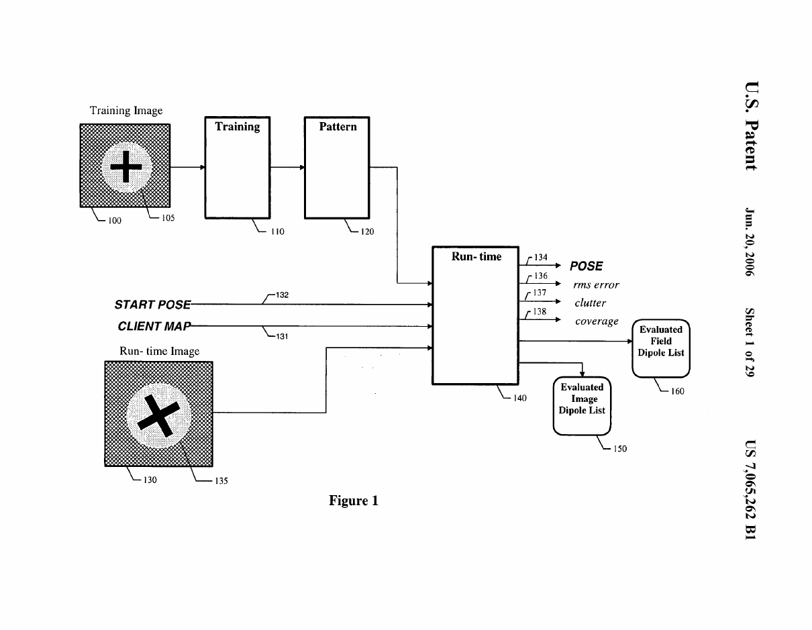
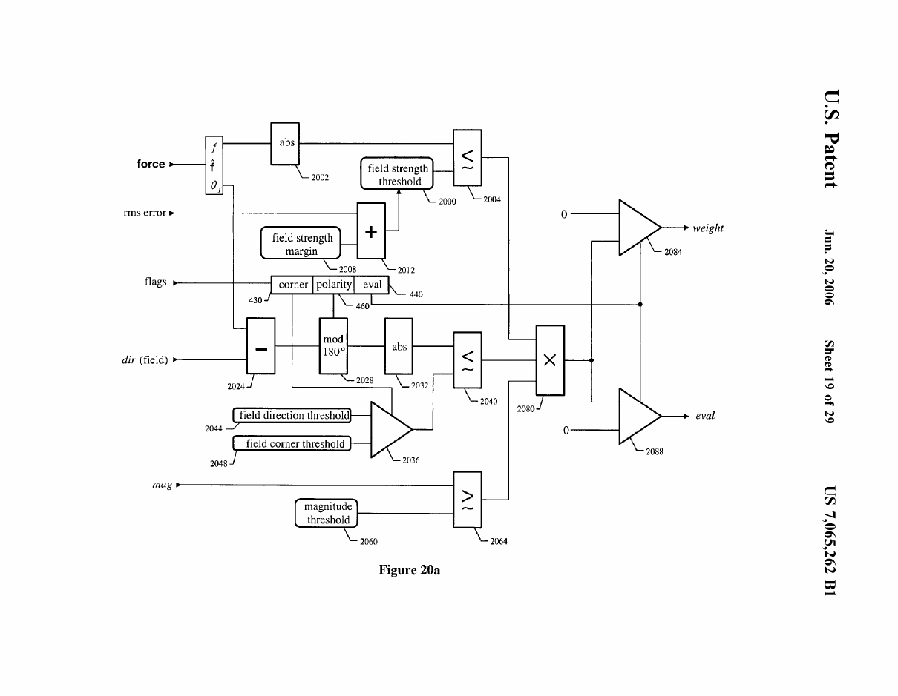
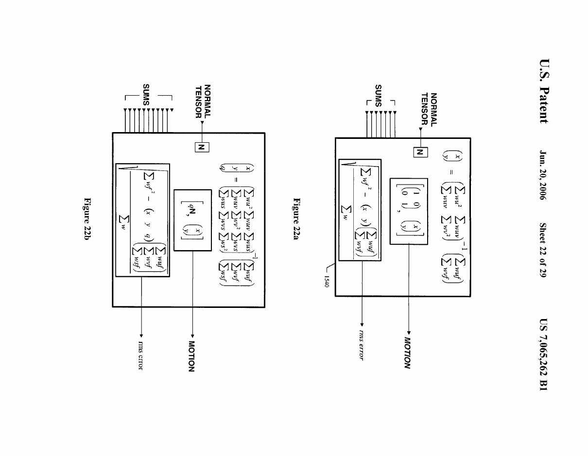
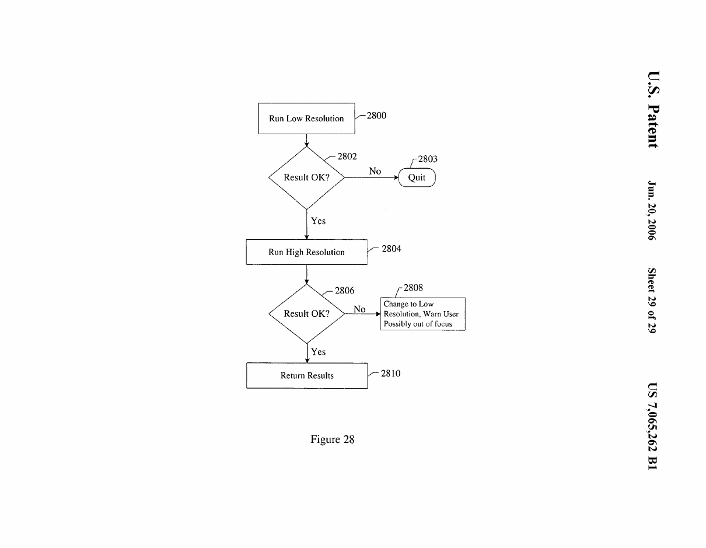

# US7065262B1 번역: 빠르고 정확한 다차원 패턴 검사

번역 범위: 전문(초록, 관련 출원, 기술 분야, 배경 기술, 발명의 요약, 도면 설명, 실시 형태 상세 설명, 청구항 55개, 2012년 재심사 증명서 요지). 인용 문헌은 원문 그대로 둔다.
원문: 같은 폴더의 `US7065262B1.pdf` (52쪽. 공보 첫 2쪽, 도면 29장, 본문과 청구항, 마지막 2쪽은 2012년 당사자계 재심사 증명서 US 7,065,262 C1). PDF는 스캔 이미지라 글자 추출이 첫 장만 된다.
번역 대본: Google Patents 본문 텍스트(2026-11-04 curl로 받음). 식, 서지, 재심사 결과는 PDF 쪽 이미지와 OCR로 대조했다.
번역일: 2026-11-04. 번역문 안의 [역주]는 번역자가 덧붙인 설명이다.

## 서지 (공보 첫 장)

- (10) 특허 번호: US 7,065,262 B1
- (45) 등록일: 2006-06-20
- (54) 발명의 명칭: FAST HIGH-ACCURACY MULTI-DIMENSIONAL PATTERN INSPECTION (빠르고 정확한 다차원 패턴 검사)
- (75) 발명자: William Silver (Weston, MA, US), Aaron Wallack (Natick, MA, US), Adam Wagman (Framingham, MA, US)
- (73) 권리자: Cognex Corporation, Natick, MA (US)
- (*) 존속기간 35 U.S.C. 154(b)에 따라 206일 연장
- (21) 출원 번호: 10/705,563
- (22) 출원일: 2003-11-10
- (63) 09/746,147 (2000-12-22 출원, 현 US 6,658,145)의 계속 출원. 09/746,147은 09/001,869 (1997-12-31 출원, 포기)의 계속 출원이고, 09/001,869는 08/979,588 (1997-11-26 출원, 포기)의 일부 계속 출원이다.
- (51) Int. Cl.: G06K 9/36 (2006.01)
- (52) U.S. Cl.: 382/291; 382/199; 382/203; 382/209
- 심사관: Daniel Mariam. 대리인: Russ Weinzimmer
- 청구항 55개, 도면 29장
- 재심사: 당사자계 재심사 증명서 US 7,065,262 C1 (발행 2012-08-14, 재심사 청구 95/001,181, 2009-06-10). 청구항 1, 11~13, 21, 28~30, 39, 47, 54, 55 취소. 나머지 청구항은 재심사 대상이 아니었다(이 문서 끝의 "재심사 증명서" 절 참조).

## 초록

저장한 패턴과 그에 맞는 영상 부분 사이의 차이를 찾는 방법과 장치를 제공한다. 패턴의 위치, 방향, 크기가 달라도 거짓 차이가 생기지 않는다. 본 발명은 또 모델 패턴에 대해 물체 영상을 분석하여 물체 영상의 결함을 찾는 시스템이다. 이 시스템은 다음을 포함한다.

- 모델 패턴에서 패턴 특징을 뽑는다.
- 패턴 특징으로 벡터 값 함수를 만들어 패턴 장(field)을 얻는다.
- 물체 영상에서 영상 특징을 뽑는다.
- 패턴 장과, 영상 특징을 패턴 특징에 대응시키는 n차원 변환을 써서 각 영상 특징을 평가하고, 적어도 하나의 연관된 특징 특성 값을 정한다.
- 적어도 하나의 특징 특성 값으로 물체 영상의 결함을 적어도 하나 찾는다.

본 발명은 서로 다른 두 종류의 결함을 찾을 수 있다. 빠진 특징과 여분의 특징이다. 본 발명은 찾고 검사할 물체의 이상적인 예를 나타내는 저장 패턴을 쓴다. 이 패턴은 디지털 영상 재표본화보다 훨씬 빠르게, 화소 격자 양자화 오차 없이, 임의의 정밀도로 이동, 회전, 크기 변경할 수 있다. 그래서 알려진 어떤 종래 방법보다 빠르고 정확한 패턴 검사를 제공한다. 또한 디지털 영상 재표본화를 쓰지 않으므로, 패턴과 영상 사이에 거짓 차이를 만들어 검사 성능을 제한하는 화소 양자화 오차가 없다.



도 1 (공보 첫 장 대표도, 도면 1/29). 학습 영상 100에서 학습 모듈 110이 저장 패턴 120을 만든다. 실행 시간 영상 130, 시작 자세 132, 클라이언트 맵 131을 받은 실행 모듈 140이 자세 134, RMS 오차 136, 잡음도(clutter) 137, 포괄률(coverage) 138, 평가된 영상 쌍극자 목록 150, 평가된 장 쌍극자 목록 160을 낸다.

## 관련 출원의 상호 참조

본 출원은 미국 특허 출원 09/746,147 (2000-12-22 출원, 현재 2003-12-02 등록된 US 6,658,145)의 계속 출원이다. 09/746,147은 미국 특허 출원 09/001,869 (1997-12-31 출원, 현재 포기)의 계속 출원이며, 09/001,869는 미국 특허 출원 08/979,588 (1997-11-26 출원, 현재 포기)의 일부 계속 출원이다.

## 발명의 분야

본 발명은 기계 시각에 관한 것이며, 특히 영상 안의 패턴을 검사하는 시스템에 관한 것이다.

## 발명의 배경

디지털 영상은 많은 장치로 만들어지고 많은 실용 목적에 쓰인다. 장치로는 가시광이나 적외선으로 동작하는 TV 카메라, 라인 스캔 센서, 비행점 스캐너, 전자 현미경, CT 스캐너를 포함한 X선 장치, 자기공명 영상기, 그 밖에 당업자에게 알려진 장치가 있다. 실용 분야로는 산업 자동화, 의료 진단, 군사, 민간, 과학 목적의 위성 영상, 사진 처리, 감시와 교통 관측, 문서 처리 등 많은 것이 있다.

이런 응용을 위해 여러 장치로 만든 영상을 디지털 장치로 분석하여 알맞은 정보를 뽑는다. 실용적으로 매우 중요한 분석의 하나는, 촬영 장치 시야 안의 물체에 해당하는 영상 속 패턴의 위치, 방향, 크기를 정하는 것이다. 패턴 위치 찾기 방법은 산업 자동화에서 특히 중요하다. 반도체 제조, 전자 조립, 제약, 식품 가공, 소비재 제조 등에서 로봇과 다른 자동화 장비를 안내하는 데 쓰인다.

실용적으로 중요한 또 다른 디지털 영상 분석은, 물체 영상과 물체의 "이상적인" 모습을 나타내는 저장 패턴 사이의 차이를 찾는 것이다. 이 차이를 찾는 방법을 일반적으로 패턴 검사 방법이라 부르며, 산업 자동화에서 조립, 포장, 품질 관리 등 많은 목적에 쓴다.

패턴 위치 찾기와 검사에 일찍부터 널리 쓰인 방법으로 블롭(blob) 분석이 있다. 이 방법은 어떤 수단으로, 보통은 화소 밝기를 문턱과 비교하여, 디지털 영상의 화소를 "물체"나 "배경"으로 나눈다. 물체로 분류한 화소는, 두 물체 화소가 이웃이면 같은 블롭에 속한다는 규칙으로 블롭으로 묶는다. 이것을 연결성 분석이라 한다. 각 블롭에 대해 넓이, 둘레, 질량 중심, 관성 주모멘트, 관성 주축 같은 성질을 정한다. 블롭의 위치, 방향, 크기는 각각 질량 중심, 제1 관성 주축의 각도, 넓이로 본다. 이 값들과 다른 블롭 성질을 알려진 이상값과 비교하여 검사에 쓸 수 있다.

블롭 분석은 계산이 비교적 싸서 값싼 하드웨어에서도 빨리 돈다. 이상적인 조건에서는 꽤 정확하고, 방향과 크기가 바뀌는 물체에 잘 맞는다. 한 가지 한계는 물체 일부가 빠지거나 가려지거나, 예상하지 않은 여분 특징이 있으면 정확도가 크게 떨어질 수 있다는 점이다. 또 다른 한계는 검사에 쓸 수 있는 값이 물체의 거친 특징이라 미세한 변화를 찾는 데 쓸 수 없다는 점이다. 그러나 가장 심각한 한계는, 제한되고 잘 통제된 조건이 아니면 화소를 물체와 배경으로 나누는 믿을 만한 방법이 일반적으로 없다는 점이다. 이런 한계 때문에 개발자들은 패턴 위치 찾기와 검사에 다른 방법을 찾아야 했다.

일찍 널리 쓰인 또 다른 방법은 이진 템플릿 정합이다. 이 방법은 찾을 패턴의 예가 담긴 학습 영상을 쓴다. 학습 영상에서 예가 담긴 부분을 문턱 처리하여 이진 패턴을 만들고 메모리에 저장한다. 실행 시간에는 찾을 물체가 담긴 영상이 들어온다. 저장 패턴을 실행 시간 영상의 같은 크기 부분과 모든 위치나 고른 위치에서 비교하고, 저장 패턴과 가장 잘 맞는 위치를 물체 위치로 본다. 패턴의 어떤 위치에서의 일치도는 대응 영상 화소와 일치하는 패턴 화소의 비율일 뿐이며, 이것이 패턴 검사 정보가 된다.

이진 템플릿 정합은 영상 화소를 물체나 배경으로 나누는 데 의존하지 않으므로 블롭 분석보다 훨씬 넓은 문제에 쓸 수 있다. 또 빠지거나 여분인 패턴 특징을 정확도를 크게 잃지 않고 훨씬 잘 견디며, 패턴과 물체 사이의 더 미세한 차이를 찾을 수 있다. 그러나 한 가지 한계는 이진화 문턱이 필요하다는 점이다. 이 문턱은 실제로, 특히 신호 대 잡음비가 나쁘거나 조명 세기나 물체 대비가 바뀌는 조건에서 믿을 만하게 고르기 어렵다. 문턱 처리로 정보를 많이 잃기 때문에 정확도는 보통 한 화소 정도로 제한된다. 더 심각한 것은 이진 템플릿 정합이 물체의 방향과 크기를 잴 수 없다는 점이다. 게다가 방향이나 크기가 조금만 바뀌어도 정확도가 빨리 떨어지고, 더 큰 변화가 예상되면 이 방법은 아예 쓸 수 없다.

비교적 값싼 회색조 정규화 상관 방법이 나오면서 이진 템플릿 정합보다 크게 나아졌다. 방법은 비슷하지만 문턱을 쓰지 않아 영상 밝기 전 범위를 고려하고, 일치도는 주어진 위치에서 저장 패턴과 영상 부분 사이의 상관계수가 된다.

이진화 문턱이 필요 없고 상관이 근본적으로 잡음에 강하므로, 신호 대 잡음비가 나쁘거나 조명 세기나 물체 대비가 바뀌는 조건에서도 성능이 크게 떨어지지 않는다. 또한 문턱 처리로 잃는 정보가 없으므로, 잘 알려진 보간 방법으로 약 1/4 화소까지의 위치 정확도가 실용적이다. 그러나 방향과 크기에 관한 상황은 이진 템플릿 정합보다 크게 나아지지 않았다. 또 다른 한계는, 어떤 응용에서는 물체 영상 안에서 대비가 국소적으로 달라져 저장 패턴과의 상관이 나빠지고, 결국 위치를 제대로 찾지 못한다는 점이다.

최근에는 방향이나 크기가 크게 바뀔 것으로 예상되는 응용에도 쓸 수 있도록 회색조 상관이 개선되었다. 이 방법들은 저장 패턴을 디지털 영상 재표본화로 회전하거나 크기를 바꾼 다음 영상과 맞춘다. 각도, 크기, x-y 위치 범위에 걸쳐 맞추면, 해당하는 다차원 공간에서 물체 위치를 찾을 수 있다. 이런 방법은 이진 영상의 화소 양자화 오차가 훨씬 심하기 때문에 이진 템플릿 정합에서는 잘 동작하지 않는다.

이 방법들의 한 가지 문제는 디지털 재표본화와 2차원보다 큰 공간 탐색 모두의 계산 비용이 매우 크다는 점이다. 이 비용을 다루기 위해 탐색 방법은 문제를 둘 이상의 단계로 나눈다. 첫 단계는 패턴을 거칠게 솎은 판으로 전체 탐색 공간을 빨리 훑어 n차원 공간에서 가능한 물체 위치를 찾는다. 다음 단계들은 더 고운 패턴으로 앞 단계 위치를 다듬고, 더 고운 해상도에서 패턴과 상관이 나쁘게 드러난 위치를 버린다. 이런 거친-고운 방법의 변형은 이진 템플릿 정합과 원래의 2차원 상관에도 쓰였지만, 차원이 높은 탐색 공간에서 더욱 중요하다.

이 방법들의 위치 정확도는 다차원 공간을 얼마나 촘촘히 탐색하는지와, 이산 화소 격자가 위치, 방향, 배율의 작은 변화를 얼마나 잘 나타내는지 둘 다에 제한된다. 탐색의 촘촘함은 응용에 맞게 고를 수 있지만, 계산 비용이 해상도와 차원 수에 따라 매우 빨리 늘어서, 실제 응용은 높은 정확도에 필요한 비용이나 시간을 감당하지 못하는 경우가 많다. 이산 화소 격자의 한계는 더 근본적이다. 공간을 아무리 촘촘히 탐색해도, 보통 패턴에서는 위치 정확도가 약 1/4 화소보다, 방향은 1도 정도보다, 배율은 1% 정도보다 훨씬 좋기를 기대할 수 없다.

회색조 화소 격자 방법을 패턴 검사에 쓸 때도 비슷하다. 다차원 공간에서 물체 위치를 찾은 뒤, 패턴의 화소를 영상의 대응 화소와 비교하여 차이를 찾을 수 있다. 그러나 일부 차이는 재표본화 과정 자체에서 생긴다. 역시 화소 격자가 방향과 배율의 작은 변화를 정확히 나타내지 못하기 때문이다. 이 차이는 물체 경계처럼 영상 밝기가 빨리 바뀌는 영역에서 특히 심하다. 흔히 이런 영역이 물체에서 가장 중요하게 검사할 곳이다. 일반적으로 재표본화로 생긴 차이와 물체 결함으로 생긴 차이를 구별할 수 없으므로 검사 성능이 떨어진다.

## 발명의 요약

일반적인 한 측면에서, 본 발명은 저장 패턴과 그에 맞는 영상 부분 사이의 차이를 찾는 방법과 장치이며, 패턴의 위치, 방향, 크기 변화가 거짓 차이를 만들지 않는다. 차이를 찾는 과정을 검사라 부른다. 일반적으로 검사 전에 물체 영상의 위치를 정밀하게 찾아야 한다. 다른 일반적 측면에서, 본 발명은 모델 패턴에 대해 물체 영상을 분석하는 시스템이며, 이 시스템은 모델 패턴에서 패턴 특징을 뽑고, 패턴 특징으로 벡터 값 함수를 만들어 패턴 장을 얻고, 물체 영상에서 영상 특징을 뽑고, 패턴 장과 영상 특징을 패턴 특징에 대응시키는 n차원 변환으로 각 영상 특징을 평가하여 적어도 하나의 연관 특징 특성 값을 정하고, 적어도 하나의 특징 특성 값으로 물체 영상의 결함을 적어도 하나 찾는다. 바람직한 실시 형태에서, 적어도 하나의 연관 특징 특성 값은 연관된 영상 특징이 모델 패턴의 특징에 대응하지 않을 가능성을 나타내는 확률값을 포함한다. 다른 바람직한 실시 형태에서는 연관된 영상 특징이 모델 패턴의 특징에 대응할 가능성을 나타내는 확률값을 포함한다.

다른 바람직한 실시 형태에서, 적어도 하나의 패턴 특징은 그 패턴 특징이 물체 영상의 어떤 특징에도 대응하지 않을 가능성을 나타내는 확률값을 포함한다.

특징 특성 값을 쓸 때는, 영상 특징의 특징 특성 값을 패턴 장의 한 요소로 옮기는 것이 바람직하다. 바람직한 실시 형태에서 그 요소는 패턴 장에서 가장 가까운 요소다.

특징 특성 값을 쓸 때는 여러 영상 특징을 쓰고, 여러 특징 특성 값을 여러 영상 특징에서 패턴 장의 여러 요소로 옮기는 것도 바람직하다. 이때 패턴 장의 일부 요소는 이웃 요소로의 연결을 적어도 하나 가질 수 있다. 또한 여러 특징 특성 값을 옮긴 뒤에는, 패턴 장의 각 요소가 자기 특징 특성 값과 이웃 요소들의 특징 특성 값 가운데 최댓값을 받는 것이 바람직하다.

다른 바람직한 실시 형태에서, 특징 특성 값을 쓰는 것은 패턴 장의 가장 가까운 요소를 찾고, 영상 특징의 특징 특성 값을 그 요소로 옮기고, 적어도 옮긴 특징 특성 값으로 포괄률(coverage) 값을 계산하는 것을 포함한다.

또 다른 바람직한 실시 형태에서, 각 영상 특징의 평가는 영상 특징의 방향을 패턴 장 요소의 방향과 비교하는 것을 포함한다. 두 방향의 차이가 지정된 방향 매개변수보다 작으면 그 영상 특징에 더 높은 가중치를 주는 것이 바람직하다. 지정된 방향 매개변수는 패턴 장 요소의 특성, 예를 들어 "모서리"나 "비모서리"를 나타내는 표시로 정할 수 있다.

영상 특징의 방향과 패턴 장 요소의 방향 차이가 지정된 방향 매개변수보다 크면 그 영상 특징에 더 낮은 가중치를 줄 수도 있다. 이 방향 매개변수도 "모서리"나 "비모서리" 표시 같은 패턴 장 요소의 특성으로 정할 수 있다.

또 다른 바람직한 실시 형태에서, 각 영상 특징의 평가는 영상 특징의 방향을 패턴 장 요소의 방향과 180도를 법으로(modulo 180°) 비교하는 것을 포함한다.

영상 특징이, 그 위치에 영상 특징이 없을 것으로 지정한 패턴 장 요소에 대응하는 위치에 있으면 가중치 0을 주는 것도 가능하다.

또한 각 영상 특징의 평가는 각 영상 특징의 거리를 지정된 거리 매개변수와 비교하는 것을 포함할 수 있다. 영상 특징의 거리가 지정된 거리 매개변수보다 크면 더 낮은 가중치를, 작으면 더 높은 가중치를 줄 수 있다.

다른 바람직한 실시 형태에서, 각 영상 특징의 평가는 영상 특징의 방향을 패턴 장 요소의 방향과 비교하는 것과, 영상 특징의 거리를 지정된 거리 매개변수와 비교하는 것을 함께 포함한다.

모호함을 피하기 위해, 다차원 공간에서 패턴의 위치를 자세(pose)라 부른다. 더 정확히, 자세는 영상의 점을 저장 패턴의 대응 점으로 보내는 좌표 변환이다. 바람직한 실시 형태에서 자세는 일반적인 6자유도 선형 좌표 변환이다. 6자유도는 2×2 행렬의 네 원소와, 두 병진 자유도에 해당하는 벡터의 두 원소로 나타낼 수 있다. 병진이 아닌 네 자유도는 다른 방식으로, 예를 들어 방향, 배율, 종횡비, 기울임(skew)으로, 또는 x 배율, y 배율, x축 각도, y축 각도로 똑같이 나타낼 수도 있다.

본 발명은 패턴 검사를 위한 어떤 거친-고운 방법에서든 고운 해상도 단계를 대신할 수 있다. 예를 들어 상관 탐색 후 골든 템플릿 분석(Golden Template Analysis)을 하는 종래 방법이 그렇다. 그런 방법의 거친 위치 찾기 단계와 함께 쓰면, 본 발명은 알려진 어떤 종래 방법보다 빠르고 정확한 전체 패턴 검사 방법이 된다.

바람직한 실시 형태에서는 Cognex Corporation(Natick, MA)이 판매하는 PatQuick™ 도구로 대략적인 물체 자세를 얻는다.

본 발명은 찾고 검사할 물체의 이상적인 예를 나타내는 저장 패턴을 쓴다. 패턴은 학습 영상에서 만들거나 기하 기술에서 합성할 수 있다. 본 발명에 따르면 패턴과 영상은 특징 기반 기술로 나타내며, 이 기술은 디지털 영상 재표본화보다 훨씬 빠르게, 화소 격자 양자화 오차 없이 임의의 정밀도로 이동, 회전, 크기 변경할 수 있다. 따라서 정확도가 격자가 위치, 방향, 크기(또는 다른 자유도)의 작은 변화를 나타내는 능력에 제한되지 않는다. 또 재표본화를 하지 않으므로, 디지털 재표본화로 인한 화소 양자화 오차가 패턴과 영상 사이에 거짓 차이를 만들어 검사 성능을 제한하지 않는다.

정확도는 공간을 탐색하는 촘촘함에도 제한되지 않는다. 본 발명은 일치도가 가장 높은 자세를 정하려고 공간 안의 이산 위치를 시험하지 않기 때문이다. 대신 본 발명은 대략적인 시작 자세에서, 공간의 차원 수(즉 자유도)와 시작 자세와 최종 자세 사이 거리에 상관없는, 작고 고정된 수의 증분으로 정확한 물체 자세를 정한다. 단 시작 자세가 참 자세의 "포착 범위(capture range)" 안에 있어야 한다. 따라서 실행 시간을 실제 응용이 허용하는 범위 안에 두려고 정확도를 희생할 필요가 없다.

자유도 수에 따라 실행 시간이 빨리 늘어나는 종래 방법과 달리, 본 발명의 방법은 실행 시간이 최악에도 아주 느리게 늘고, 어떤 실시 형태에서는 전혀 늘지 않는다. 따라서 실행 시간을 실용 범위에 두려고 자유도 측정을 희생할 필요가 없다. 게다가 넷 이상의 자유도를 다듬도록 허용하면 흔히 패턴과 영상이 더 잘 맞아 정확도가 좋아진다.

본 발명은 영상을 특징 검출기로 처리하여 화소 격자에 묶이지 않은 기술을 만든다. 이 기술은 물체 경계를 따라 있는 점(위치)을 나타내는 쌍극자(dipole, 특징이라고도 함)라는 요소의 목록이다. 쌍극자는 물체 경계 위 한 점의 위치 좌표와, 그 점에서 경계에 거의 수직인 방향을 포함한다. 물체 경계는 영상 기울기(영상의 각 점에서 밝기 변화의 빠르기와 방향을 나타내는 벡터)가 국소 최대가 되는 곳으로 정의한다. 바람직한 실시 형태에서 기울기는 조절 가능한 공간 해상도로 추정한다. 다른 바람직한 실시 형태에서 쌍극자 방향은 기울기 방향이다. 다른 바람직한 실시 형태에서 쌍극자, 즉 특징은 도면에서 더 설명하는 추가 정보를 담는다. 또 다른 바람직한 실시 형태에서 쌍극자는 영상이 아니라 CAD 시스템에 있을 법한 물체의 기하 기술에서 만든다.

본 발명이 위치 찾기와 이어지는 검사에 쓰는 저장 모델 패턴은, 물체 경계를 나타내어 찾을 물체를 기술하는 쌍극자 목록을 만드는 바탕이다. 모델 패턴에서 얻은 쌍극자 목록을 장 쌍극자 목록이라 부른다. 이것은 예시 물체가 담긴 모델 학습 영상에서 특징 검출기로 만들거나, 기하 기술에서 합성할 수 있다. 장 쌍극자 목록으로 장(field)이라 부르는 2차원 벡터 값 함수를 만든다. 저장 모델 패턴 영역 안의 각 점에 대해, 장은 모델 물체 경계 위 가장 가까운 점까지의 거리와 방향을 나타내는 벡터를 준다. 이 벡터를 저장 모델 패턴 안 지정 점에서의 힘(force)이라 부른다.

모델 물체 경계 위 가장 가까운 점이 반드시 장 쌍극자가 나타내는 경계점 가운데 하나는 아니며, 일반적으로 장 쌍극자 위치 사이에 있을 수 있다. 또 저장 모델 패턴 안의 점이 반드시 정수 격자 위치는 아니며, 일반적으로 계산 장치의 정밀도 한계 안에서 알려진 실수 위치다. 힘 벡터는 가장 가까운 경계점을 가리키므로 (불연속점을 빼면) 경계에 수직이어야 한다.

바람직한 실시 형태에서, 장 위치에서 일정 범위 안에 모델 물체 경계점이 없으면 힘 벡터 대신 특수 코드를 준다. 다른 바람직한 실시 형태에서는 힘에 더해 가장 가까운 장 쌍극자의 식별자를 준다. 다른 바람직한 실시 형태에서는, 힘이 가리키는 경계에서의 기울기 방향이 힘 방향과 같은지 180도 반대인지(둘 다 경계에 수직) 나타내는 정보 1비트를 더 준다. 다른 바람직한 실시 형태에서는 도면에서 더 설명하는 추가 정보를 준다. 다른 실시 형태에서는 장이 패턴 안 위치에 더해 방향도 받고, 대략 주어진 방향에 있는 가장 가까운 모델 물체 경계점까지의 거리와 방향을 힘으로 돌려준다.

본 발명이 쓰는 저장 모델 패턴은 장 쌍극자 목록, 장, 그리고 실시 형태에 맞는 동작 매개변수 묶음을 포함하며, 명세서 전체에서 더 설명한다.

물체 영상과 대략적인 시작 자세가 주어지면 패턴 위치 찾기는 다음처럼 진행한다. 물체 영상을 특징 검출기로 처리하여 영상 쌍극자 목록이라는 쌍극자 목록을 만든다. 시작 자세는 끌림 단계(attraction step)라 부르는 증분 개선을 차례로 거쳐 다듬어진다. 각 단계는 변할 수 있도록 허용한 모든 자유도에서 훨씬 정확한 자세를 낸다. 이 과정은 정해진 단계 수 뒤에, 마지막 단계에서 자세가 크게 바뀌지 않을 때, 또는 다른 합리적인 기준으로 끝낼 수 있다. 바람직한 실시 형태에서는 네 단계 뒤에 끝낸다.

각 끌림 단계에서 영상 쌍극자는 편한 순서로 처리한다. 각 영상 쌍극자의 위치와 방향을 현재 자세 변환으로 옮겨 영상 좌표를 모델 패턴(장) 좌표로 바꾼다. 장으로 영상 쌍극자가 옮겨진 점에서의 힘을 정한다. 각 영상 쌍극자는 물체 경계 위에 있다고 보고, 힘은 저장 모델 패턴의 가장 가까운 모델 물체 경계까지의 거리와 방향을 주므로, 옮긴 위치에 영상 쌍극자가 있다는 것은 영상 쌍극자가 힘 방향으로 힘 거리만큼 움직이도록 자세를 고쳐야 한다는 증거로 본다.

물체 경계는 일반적으로 경계에 수직인 방향, 즉 위에서 말한 힘 방향으로는 위치 정보를 주지만, 경계를 따르는 방향으로는 정보를 주지 않는다는 점이 중요하다. 따라서 영상 쌍극자가 주는 증거는 하나의 자유도, 즉 힘의 선을 따르는 위치만 구속하며, 힘에 수직인 방향으로는 증거를 주지 않는다.

현재 자세가 참 물체 위치에 꽤 가까우면, 많은 영상 쌍극자가 영상 경계를 저장 모델 패턴 경계와 최대한 맞추려면 자세를 어떻게 고쳐야 하는지 좋은 증거를 준다. 그러나 여러 이유로 다른 많은 영상 쌍극자가 거짓이거나 오도하는 증거를 줄 수 있다. 따라서 각 영상 쌍극자가 주는 증거를 평가하고, 증거의 상대적 신뢰도를 나타내는 가중치를 각 영상 쌍극자에 주는 것이 중요하다.

한 실시 형태에서는 영상 쌍극자의 (패턴 좌표계로 옮긴) 방향을 힘 방향과 비교하고, 그 결과를 180도를 법으로 하여 영상 쌍극자의 가중치를 정한다. 방향이 지정 매개변수 안에서 일치하면 높은 가중치를, 다른 지정 매개변수를 넘어 어긋나면 가중치 0을, 방향 차이가 두 매개변수 사이이면 중간 가중치를 준다.

다른 실시 형태에서는 영상 쌍극자 방향을 힘이 가리키는 모델 패턴 경계의 기울기 방향과 비교한다. 매개변수로 비교를 180도를 법으로 할지(기울기 극성을 사실상 무시), 360도를 법으로 할지(기울기 극성을 고려) 고른다. 바람직한 실시 형태에서는 장 자체가 저장 모델 패턴 안의 각 점에서 극성을 무시할지, 고려할지, 전역 매개변수에 맡길지를 나타낸다.

한 실시 형태에서는 힘 거리로 쌍극자 가중치를 정한다. 바람직한 실시 형태에서는 힘 거리가 어떤 지정 매개변수보다 크면, 쌍극자가 너무 멀어 유효한 증거가 아니라고 보고 가중치 0을 준다. 다른 지정 매개변수보다 작으면 높은 가중치를, 두 매개변수 사이이면 중간 가중치를 준다.

바람직한 실시 형태에서, 힘 거리에 따른 가중치를 정하는 매개변수는 끌림 단계마다 조정한다. 자세가 점점 정확해지므로 유효한 증거를 나타내는 영상 쌍극자는 패턴 경계에 더 가까울 것으로 기대해야 하기 때문이다.

한 실시 형태에서는 영상 쌍극자의 기울기 크기로 쌍극자 가중치를 정한다. 바람직한 실시 형태에서는 쌍극자 방향, 힘 거리, 기울기 크기를 함께 써서 가중치를 정한다.

각 끌림 단계에서 본 발명은 각 영상 쌍극자가 준 증거를 쌍극자 가중치를 고려하여 가장 잘 설명하는 새 자세를 정한다. 바람직한 실시 형태에서는 최소제곱법으로 새 자세를 정한다.

각 영상 쌍극자를 평가하여 가중치를 내는 과정은 검사용 정보도 준다. 서로 다른 두 종류의 오류를 찾는 것이 바람직하다. 빠진 특징은 대응하는 영상 특징을 찾을 수 없는 패턴 특징이고, 여분 특징("잡음", clutter라고도 함)은 어떤 패턴 특징에도 대응하지 않는 영상 특징이다. 한 실시 형태에서는 가중치가 낮은 영상 쌍극자를 잡음으로 본다. 바람직한 실시 형태에서는 아래 도면에서 더 설명하듯이 각 영상 쌍극자마다 고유한 잡음 값을 계산한다.

빠진 패턴 특징을 찾을 수 있는 실시 형태에서는, 장의 각 점이 힘 벡터에 더해 가장 가까운 장 쌍극자(있다면)의 식별자도 준다. 각 장 쌍극자는 평가값을 담으며 0으로 초기화한다. 각 영상 쌍극자는 자기 평가값("가중치" 또는 "특징 특성 값"이라고도 함)을, 장이 가리키는 가장 가까운 장 쌍극자의 평가값으로 옮긴다. 일반적으로 영상 쌍극자와 장 쌍극자의 대응이 일대일이 아니므로, 어떤 장 쌍극자는 둘 이상의 영상 쌍극자에서 평가값을 받고, 어떤 것은 하나도 받지 못한다. 평가값을 받지 못한 장 쌍극자는 정말로 빠진 특징일 수도 있고, 양자화 효과로 옮김에 생긴 틈일 수도 있다.

한 장 쌍극자에 둘 이상의 평가값이 옮겨지면 합리적인 어떤 방법으로든 합칠 수 있다. 바람직한 실시 형태에서는 가장 큰 평가값을 쓰고 나머지는 버린다. 옮김의 틈은 이웃 장 쌍극자를 고려하여 메울 수 있다. 한 실시 형태에서는 회색조 수리 형태학으로 알려진 방법으로 틈을 메운다. 본 발명에서는 장 쌍극자가 1차원 경계를 따라 놓이므로 형태학 연산의 1차원 판을 쓴다. 바람직한 실시 형태에서는 형태학적 팽창(dilation) 연산을 쓴다.

시작 자세가 참 자세에서 너무 멀면, 자세를 올바른 방향으로 움직일 좋은 증거가 영상 쌍극자에서 충분히 나오지 않을 수 있다. 참 자세로 끌려가는 시작 자세의 집합이 그 패턴의 포착 범위를 정의한다. 포착 범위는 쓰는 패턴에 따라 다르며, 시작 자세를 정하는 방법에 필요한 정확도를 결정한다.

바람직한 실시 형태에서, 쌍극자를 만드는 특징 검출기는 넓은 공간 주파수 범위에 걸쳐 조절할 수 있다. 특징 검출기를 비교적 높은 해상도에서 아주 미세한 특징을 찾도록 설정하면 정확도는 높지만 포착 범위는 비교적 작다. 반대로 비교적 낮은 해상도에서 거친 특징을 찾도록 설정하면 정확도는 낮지만 포착 범위는 비교적 크다. 이것은 거친 저해상도 단계 뒤에 고운 고해상도 단계를 두는 다해상도 방법을 시사한다. 이 방법에서는 포착 범위가 거친 단계로 정해져 비교적 크고, 정확도는 고운 단계로 정해져 높다.

## 도면의 간단한 설명

다음 상세 설명과 아래 도면을 함께 보면 본 발명을 더 잘 이해할 수 있다.

- 도 1은 본 발명의 한 실시 형태의 상위 블록도다.
- 도 1A는 종횡비 2:1의 화소 배열을 보인다.
- 도 2는 도 1의 학습 블록의 블록도다.
- 도 3은 도 2의 특징 검출 블록의 블록도다.
- 도 4는 32비트 워드의 비트 배정과 선택적인 "가장 가까운 쌍극자" 비트를 보인다.
- 도 5는 장 요소 배열과 그 테두리 장 요소를 보인다.
- 도 6은 장 심기(seeding)를 보인다. 도 5의 장 요소 일부, 패턴 경계의 여러 직선 조각, 연관된 장 쌍극자가 있다.
- 도 7A는 장 쌍극자 연결을 보인다. 도 6의 장 요소 일부, 패턴 경계의 여러 직선 조각, 연관된 여러 오른쪽, 왼쪽 연결이 있다.
- 도 7B와 7C는 이웃 장 요소를 살피는 순서를 보인다.
- 도 8은 도 2의 사슬 분할을 보인다. 도 5의 장 요소 일부, 여러 직선 조각, 여러 왼쪽, 오른쪽 연결이 있다.
- 도 9A, 9B, 9C는 도 2 장 생성 모듈의 전파 단계가 하는 분석의 일부를 보인다.
- 도 10은 도 2 장 생성 모듈의 전파 단계를 더 자세히 보인다.
- 도 11은 도 6에서 심기 후 보인 장 배열의 같은 부분을, 한 번 전파한 결과의 새 힘 벡터와 함께 보인다.
- 도 12는 도 11과 같은 부분을 두 번 전파한 뒤 보인다.
- 도 13은 도 1의 바람직한 실시 형태의 실행 모듈 블록도다.
- 도 14는 각 끌림 단계에서 영상 쌍극자의 증거를 가장 잘 설명하는 자세를 정하는 최소제곱법을 보인다.
- 도 15는 도 13의 끌림 모듈 블록도다.
- 도 16은 도 15의 사상(map) 모듈 블록도다.
- 도 17은 도 15의 장 모듈 블록도다.
- 도 18은 도 15의 회전 모듈 블록도다.
- 도 19A, 19B, 19C는 퍼지 논리 처리 요소 세 개의 입력에 따른 출력을 보인다.
- 도 20A는 도 15 평가 모듈의 일부로, "가중치(weight)"와 "평가값(eval)"을 계산하는 바람직한 시스템의 개략도다.
- 도 20B는 도 15 평가 모듈의 일부로, "잡음도(clutter)"를 계산하는 바람직한 시스템의 개략도다.
- 도 21은 도 15 합 모듈의 개략도다.
- 도 22A~D는 도 15 해법(solve) 모듈의 블록도로, 여러 자유도에 대해 "움직임"과 "RMS 오차"를 내는 식과 입력을 보인다.
- 도 23은 도 15 합성(compose) 모듈의 식 블록도다.
- 도 24는 도 15 법선 텐서 모듈의 식 블록도다.
- 도 25는 여러 영상 쌍극자와 연결된 여러 장 쌍극자를 보여 장 쌍극자 평가를 설명한다.
- 도 26은 본 발명의 다해상도 실시 형태의 상위 블록도다.
- 도 27A와 27B는 도 15 모듈들이 수행하는 동작 순서의 흐름도다.
- 도 28은 본 발명의 다해상도 동작 방식의 흐름도다.

## 바람직한 실시 형태의 상세한 설명

아래 도면에서 "모듈"은 소프트웨어, 펌웨어, 하드웨어로 구현할 수 있다. 또 각 모듈은 하위 모듈이나 "단계"를 포함할 수 있으며, 각각은 하드웨어, 소프트웨어, 또는 그 조합으로 구현할 수 있다. 도 1은 본 발명의 한 실시 형태의 상위 블록도다. 위치 찾기나 검사, 또는 둘 다에 쓸 패턴 105의 예가 담긴 학습(모델) 영상 100이 주어진다. 학습 모듈 110은 학습 영상을 분석하여 이후에 쓸 저장 모델 패턴 120을 만든다. 적어도 하나의 실행 시간 영상 130이 주어지며, 각 영상에는 학습(모델) 패턴 105와 모양이 비슷하지만 크기와 방향은 다를 수 있는 패턴 135의 사례가 0개 이상 담겨 있다.

각 실행 시간 영상 130에는 사용자가 응용에 맞게 고른 클라이언트 맵 131이 딸려 있다. 클라이언트 맵은 정규직교이지만 그 밖에는 임의인 좌표계의 점을 영상의 점으로 보내는(대응시키는) 좌표 변환이다. 정규직교 좌표계는 서로 수직이고 각 축의 눈금이 단위인 축을 가진다. 클라이언트 맵은 방향 자유도와 기울임, 배율, 종횡비 자유도를 제대로 다루는 데 필요한 정규직교 기준을 준다. 실제 응용에서 영상 자체는 거의 정규직교가 아니다. 실제 영상 센서의 화소가 완전한 정사각형인 경우가 거의 없기 때문이다. 예를 들어 도 1A처럼 종횡비 2:1인 화소도 있을 수 있다. 이 경우 클라이언트 맵은 다음 2×2 행렬이다.

```
| 0.5  0.0 |
| 0.0  1.0 |
```

화소가 정사각형이면 클라이언트 맵은 항등 변환이다. 즉 변환 행렬의 대각 원소는 모두 1.0, 비대각 원소는 모두 0.0이다.

또 상당히 비정규직교인 장이 쓸모 있을 때도 있다. 예를 들어 정사각형 패턴에서 만든 장으로, 알맞은 시작 자세를 써서 직사각형이나 평행사변형 꼴의 패턴 사례를 찾고 검사할 수 있다. 이런 경우는 정규직교 기준이 있어야만 다룰 수 있다.

각 실행 시간 영상마다 시작 자세 132를 알맞은 방법으로 정한다. 예를 들어 방향과 크기를 재표본화한 거친 회색조 상관, 거친 일반화 허프 변환, 또는 Cognex PatQuick™ 도구를 쓴다. 시작 자세 132는 패턴 105의 점을 실행 시간 영상 130의 대략 대응하는 점 135로 보내는 6자유도 좌표 변환이다. 실행 모듈 140은 저장 패턴 120, 시작 자세 132, 클라이언트 맵 131을 써서 영상 130을 분석한다. 분석 결과로 실행 모듈 140은 패턴 점 105를 정확히 대응하는 영상 점 135로 보내는 자세 134를 낸다.

실행 모듈 140은 패턴 105와 영상 130의 일치 정도를 재는 RMS 오차 값 136을 낸다. RMS 오차 값 136은 영상 쌍극자의 증거에 가장 잘 맞는 자세를 정하는 데 쓰는 최소제곱 해(또는 다른 오차 최소화 해)의 제곱평균제곱근 오차이며, 아래에서 더 자세히 설명한다. 값 0은 완전한 맞춤이고, 값이 클수록 맞춤이 나쁘다.

실행 모듈 140은 대응하는 영상 특징을 찾은 패턴 105의 비율을 재는 포괄률(coverage) 값 138을 낸다. 포괄률 값 138은 장 쌍극자 평가값을 모두 더해 장 쌍극자 수로 나누어 계산하며, 아래에서 더 자세히 설명한다.

실행 모듈 140은 패턴 특징에 대응하지 않는, 영상에서 찾은 여분 특징을 재는 잡음도(clutter) 값을 낸다. 바람직한 실시 형태에서 잡음도 값은 개별 영상 쌍극자의 잡음 값을 모두 더해 장 쌍극자 수로 나누어 계산한다.

실행 모듈 140은 평가된 영상 쌍극자 목록 150과 평가된 장 쌍극자 목록 160을 낸다. 평가된 영상 쌍극자 목록 150은 패턴 105에 없는 영상 130의 특징을 알려 주고, 평가된 장 쌍극자 목록 160은 영상 130에 없는 패턴 105의 특징을 알려 준다. 이렇게 찾은 영상과 패턴의 차이를 검사에 쓸 수 있다.

도 2는 학습 모듈 110과 패턴 관련 자료 120의 블록도다. 위치 찾기나 검사할 패턴 105의 예가 담긴 학습 영상 100이 학습 모듈 110에 주어지고, 학습 모듈 110은 학습 영상 100을 분석하여 이후에 쓸 저장 패턴 120을 만든다. 학습 모듈 110은 특징 검출 모듈 200과 장 생성 모듈 210, 두 모듈로 이루어진다. 두 모듈 모두 응용에 맞게 동작을 조절하는 여러 매개변수 220을 쓴다. 이 매개변수들과 이후 실행 모듈에 필요한 매개변수는 패턴에 따라 다르므로, 그림처럼 패턴 120 안에 모아 저장한다.

특징 검출 모듈 200은 매개변수 220을 써서 학습 영상 100을 처리하고 장 쌍극자 집합 230을 만들어 패턴 120에 저장한다. 장 생성 모듈 210은 장 쌍극자 집합 230과 매개변수 220으로 장 240을 만들어 패턴 120에 저장한다.

위 요약에서 말했듯이, 장 240은 이론상 패턴 105 영역 안의 실수 위치의 함수로 정보를 낸다. 실제로는 모든 장 값을 해석적으로 계산하여 저장할 수 없으므로, 격자의 이산 점에서 장 값을 저장하는 2차원 배열을 쓴다. 실수 위치(실시 형태의 세부에 따른 어떤 정밀도)가 주어지면, 도 17의 방법 같은 보간 방법으로 격자 요소 사이 중간 점의 장 값을 계산한다. 장 격자는 이동, 회전, 크기 변경을 하지 않으므로 재표본화가 필요 없고 격자 양자화 효과가 작다. 대신 격자에 묶이지 않은 영상 쌍극자를 도 16의 사상에 따라 고정된 장 좌표로 옮긴다.

따라서 장 생성 모듈 210의 목적은 장 240을 담는 2차원 배열의 요소를 계산하는 것이다. 장 생성 모듈 210 자체는 도 2처럼 여러 단계나 하위 모듈로 이루어진다. 각 단계는 대개 앞 단계 결과를 바탕으로 장을 어떤 방식으로 고친다. 일부 단계는 장 쌍극자 집합 230에 정보를 더하기도 한다. 도 2의 단계 순서는 바람직한 실시 형태에 해당하며, 발명의 취지 안에서 다른 변형이 많이 가능하다. 핵심 요건은 저장 패턴 120이 패턴 105 영역 안 위치의 함수로 일정한 정보를 줄 수 있어야 한다는 것이다.

도 2의 바람직한 실시 형태에서 장 생성 모듈 210은 다음 단계로 이루어진다. 초기화 단계 250은 도 5의 장 배열 요소 520, 540에 미리 정한 코드를 넣는다. 심기 단계 252는 장 쌍극자 집합 230의 쌍극자에 해당하는 위치의 장 배열 요소를 설정한다. 연결 단계 254는 심은 장 배열로 각 장 쌍극자의 이웃 쌍극자를 찾는다. 찾은 뒤에는 패턴 경계를 따라 왼쪽과 오른쪽 이웃(있다면)의 식별자를 저장하여 장 쌍극자를 이웃과 이어 사슬을 만든다. 사슬 단계 256은 연결된 장 쌍극자를 훑어 개별 사슬을 찾아 목록으로 만든다. 각 사슬에 대해 시작과 끝 쌍극자, 길이, 전체 기울기 크기, 열린 사슬인지 닫힌 사슬인지 정하여 저장한다.

거르기 단계 258은 약한 사슬이 담은 쌍극자를 장 배열에서 지워(즉 그 쌍극자에 대해 심기 단계 252를 되돌려) 약한 사슬을 패턴에서 없앤다. 약한 사슬을 찾는 기준은 여러 가지를 쓸 수 있다. 바람직한 실시 형태에서는 전체 기울기 크기나 평균 기울기 크기가 지정 매개변수보다 작은 사슬을 약하다고 본다.

분할 단계 260은 사슬을 곡률이 낮은 조각으로 나누고, 그 사이의 곡률이 높은 구역을 모서리라 부른다. 모서리 쌍극자는 이후 도면에서 설명하듯이 쓰도록 장 배열에 표시한다. 곡률은 여러 방법으로 정할 수 있다. 바람직한 실시 형태에서는, 예를 들어 도 8과 함께 더 설명하듯이, 쌍극자 방향이 어느 한 이웃과 지정 매개변수보다 더 다르면 모서리로 본다.

0번 이상의 전파 단계 262가 심은 위치에서 장을 바깥으로 넓힌다. 그 결과 패턴 경계를 가리키는 힘 벡터와 실행 단계에 필요한 다른 정보를 경계에서 어느 정도 떨어진 곳에서도 얻을 수 있다. 전파 단계 262의 횟수는 매개변수로 정하며, 장이 유효한 힘 벡터를 담는 경계로부터의 거리와 패턴 학습에 드는 계산 시간을 결정한다. 바람직한 실시 형태에서는 전파 단계를 네 번 쓴다. 전파 범위 밖의 장 요소는 초기화 단계 250에서 넣은 코드를 그대로 담는다.

도 3은 본 발명 실시에 쓸 특징 검출기의 바람직한 실시 형태를 보인다. 특징 검출기는 학습 영상이나 실행 시간 영상일 수 있는 원본 영상 300을 처리한다. 저역 통과 필터 310과 영상 솎기기 320은 여러 이유로 무시하고 싶은 원본 영상의 미세한 세부를 줄인다. 예를 들어 잡음이나 고운 질감을 줄이거나, 거친 패턴 특징에 집중하여 패턴의 포착 범위를 넓히고 싶을 수 있다. 또 영상 쌍극자 수를 줄여 처리 시간을 줄이고 싶을 수도 있다.

필터 310과 솎기기 320의 응답은 패턴에 저장된 매개변수 220(이 도면에는 없음)으로 조절한다. 매개변수의 한 설정은 필터와 솎기기를 사실상 끄며, 이때 원본 영상 300이 최대 해상도를 위해 그대로 통과한다.

디지털 영상의 저역 통과 필터링과 솎기 방법은 이 분야에 잘 알려져 있다. 바람직한 실시 형태에서는 [U.S. patent pending "Efficient, Flexible Digital Filtering"]에 기술된 상수 시간 2차 근사 가우스 필터를 쓴다.

필터를 거치고 솎은 영상은 기울기 추정 모듈 330이 처리하여 각 화소에서 영상 기울기의 x(가로)와 y(세로) 성분 추정값을 낸다. 직교-극좌표 변환 모듈 340은 기울기의 x, y 성분을 크기와 방향으로 바꾼다. 봉우리 검출 모듈 350은 기울기 크기가 잡음 문턱을 넘고, 대략 기울기 방향에 놓인 1차원 단면을 따라 국소 최대인 점을 찾아, 각 점의 격자 좌표(행과 열 번호), 기울기 크기, 기울기 방향 목록을 낸다.

부화소 보간 모듈 360은 그 1차원 단면을 따라 기울기 크기가 최대인 위치를 보간하여 점의 실수(어떤 정밀도까지) 좌표 (xi, yi)를 정한다. 결과는 영상의 경계를 따라 놓인 점 목록이며, 각 점의 좌표, 방향, 크기를 담는다. 이 목록은 장 쌍극자 목록이나 영상 쌍극자 목록의 바탕으로 쓸 수 있고, 필요에 따라 정보를 더할 수 있다.

영상 경계 위의 점을 찾는 방법은 이 분야에 잘 알려져 있다. 기울기 추정이든 다른 기법이든 그런 방법은 무엇이든 본 발명 실시에 쓸 수 있다. 기울기 추정, 직교-극좌표 변환, 봉우리 검출, 보간 방법도 잘 알려져 있다. 바람직한 실시 형태에서는 [U.S. patent pending "Method and Apparatus for Fast, Inexpensive, Subpixel Edge Detection"]에 기술된 방법을 쓴다.

바람직한 실시 형태에서 원본 영상은 화소당 8비트 회색조다. 저역 통과 필터는 저역 필터 고유의 잡음 감소 성질을 살려 16비트 영상을 낸다. 기울기 추정 모듈은 잘 알려진 Sobel 커널을 쓰며, 필터 310을 켜도록 매개변수를 설정했으면 16비트 필터 영상에, 끄도록 설정했으면 8비트 무필터 영상에 동작한다. 기울기의 x, y 성분은 정밀도 손실을 피하려고 항상 16비트로 계산하고, 기울기 크기와 방향은 잘 알려진 CORDIC 알고리즘으로 적어도 6비트까지 계산하는 것이 바람직하다.

학습 모듈 110과 실행 모듈 140 모두에서 특징 추출에 몇 가지 매개변수 값이 필요하다. 일반적으로 저역 통과 필터 310의 응답, 솎기기 320의 솎기 양, 봉우리 검출기 350의 잡음 문턱을 조절하는 매개변수가 들어간다. 본 발명 실시에 쓰는 특징 추출기의 세부에 따라 다른 값이 필요할 수도 있다.

매개변수의 알맞은 설정은 분석할 패턴과 영상의 성질에 따라 다르다. 바람직한 실시 형태에서는 많은 경우에 잘 맞는 기본값을 쓰지만, 모든 경우에 잘 맞는 규칙은 일반적으로 줄 수 없다. 이 바람직한 실시 형태는 아래 도 26과 함께 더 설명한다.

도 4는 본 발명의 바람직한 실시 형태에서 쓰는 장 배열의 한 요소를 보인다. 정보는 32비트 워드 400에 담는다. 메모리를 아끼고, 데이터 캐시에 들어가는 요소 수를 최대로 하고 모든 요소가 알맞은 주소 경계에 정렬되는 워드 크기를 써서 일반 컴퓨터에서 접근을 빠르게 하기 위해서다. 힘 벡터에는 고정 소수점 표현을 쓴다. 부동 소수점 표현보다 작고, Texas Instruments TMS320C80이나 Intel Pentium-MMX 같은 최신 프로세서의 신호 처리 능력을 가장 잘 쓰기 위해서다.

바람직한 실시 형태에서, 장 요소는 패턴 경계 위 가장 가까운 점까지의 거리와 방향을 주는 힘 벡터와, 그 경계점의 기울기 방향이 힘 벡터와 같은 방향인지 180도 반대인지 나타내는 비트 하나를 저장한다. 도 4처럼 부호 있는 힘 크기 410과 기울기 방향 420을 저장하여 이를 이룬다. 힘 방향이 기울기 방향과 같으면 힘 크기 410은 양수, 반대이면 음수다.

힘 벡터를 x-y 성분이 아니라 크기와 방향으로 나타내는 이유는 길이가 0이지만 방향이 잘 정의된 벡터를 나타낼 수 있어야 하기 때문이다. 이런 벡터를 유사 영벡터(pseudo-null vector)라 부른다. 해당 x-y 성분은 잘 알려진 다음 식으로 계산한다.

```
(force_x, force_y) = magnitude × (cos(direction), sin(direction))
```

저장된 크기는 힘 방향이 기울기 방향과 반대이면 음수이므로, 위 식에 기울기 방향을 써도 된다.

그림의 바람직한 실시 형태에서 힘 크기 410은 장 격자 간격 단위이며, 전체 16비트의 2의 보수 표현을 쓴다. 이 가운데 낮은 11비트가 이진 소수점 오른쪽에 있고 가장 높은 비트가 부호 비트다. 따라서 힘 벡터 최대 길이는 16 격자 단위 바로 아래이고, 해상도는 격자 단위의 1/2048이다.

기울기 방향 420은 0~360도 범위의 12비트 이진 각도로 나타내는 것이 바람직하며, 해상도는 360/4096 = 0.0880도다. 다른 실시 형태에서는 응용마다 필요에 따라 더 높거나 낮은 정밀도와 범위를 주도록 장 요소 400의 비트를 힘 410과 방향 420에 나눈다.

4비트 표시(flags) 요소 430도 장 요소 400에 저장한다. 2비트 평가 코드 440은, 현재 자세가 영상 쌍극자를 이 요소 400이 덮는 영역의 장 위치로 옮겼을 때 그 영상 쌍극자를 어떻게 평가할지 정한다.

- "상관없음(don't care)" 코드는 그 영상 쌍극자를 무시하라는 뜻이다.
- "빈칸 기대(expect blank)" 코드는 패턴의 이 영역에 특징이 없을 것으로 기대한다는 뜻이다. 따라서 여기로 옮겨진 영상 쌍극자는 검사용으로 낮은 평가값과 높은 잡음 등급을 받고, 위치 찾기 증거로는 쓰지 않는다.
- "평가만(evaluate only)" 코드는 그 영상 쌍극자를 검사용으로 보통 기준에 따라 평가하되, 위치 찾기 증거로는 쓰지 않는다는 뜻이다.
- "끌림(attract)" 코드는 그 영상 쌍극자를 평가하고, 위치 찾기와 검사 모두에 쓴다는 뜻이다.

평가 코드 440이 "상관없음"이나 "빈칸 기대"이면 힘 벡터는 정의되지 않으며 무효라 한다. 평가 코드가 "평가만"이나 "끌림"이면 힘 벡터는 유효하다고 한다.

1비트 모서리 코드 450은 힘 벡터가 가리키는 패턴 경계점이 곡률 높은 구역("모서리임")인지 곡률 낮은 조각("모서리 아님")인지 나타낸다. 힘 벡터가 무효이면 모서리 코드는 "모서리 아님"으로 둔다.

1비트 극성 코드 460은 위 요약과 아래 설명처럼 영상 쌍극자 평가에서 기울기 방향을 고려할지 무시할지 나타낸다. 매개변수로 장 요소 400에 저장된 극성 표시를 덮어쓸지, 덮어쓴다면 극성을 반드시 고려할지 무시할지 정한다.

바람직한 실시 형태에서 장 요소 400은 힘 벡터에 더해 가장 가까운 장 쌍극자의 식별자 401도 담는다. 식별자 401은 장 쌍극자 목록의 색인으로 나타낼 수 있다. 바람직한 실시 형태에서는 16비트 색인을 쓰며, 일반 컴퓨터의 데이터 정렬 지침을 지키려고 별도 배열에 저장한다.

도 5는 장 생성 단계 210의 초기화 단계 250을 자세히 보인다. 장 요소 400의 2차원 배열 500을 쓴다. 격자 간격은 합리적이면 무엇이든 쓸 수 있다. 바람직한 실시 형태에서 격자 간격은 특징 검출기 200의 기울기 추정 모듈 330에 들어가는 영상의 격자 간격과 같다.

장 요소 520(도 5에서 흰색, 구조는 장 요소 400과 같음)은 학습 패턴 105 영역을 덮어 함께 "학습 영역"을 이룬다. 장 요소 520은 평가 코드 440을 "빈칸 기대"로 초기화한다. 위에서 말했듯이 이 상태에서는 힘 벡터가 무효로 간주되므로 초기화할 필요가 없다. 그러나 아래 도 20b와 함께 설명하는 한 실시 형태에서는 이 장 요소 520의 기울기 방향 필드 420을 학습 영상의 대응 기울기 방향으로 둔다. 추가 장 요소 540의 테두리(도 5에서 회색, 구조는 장 요소 400과 같음)는 평가 코드 440을 "상관없음"으로 초기화한다. 일반적으로 학습 영역 경계 밖에 어떤 특징이 있을지 모른다는 사실을 반영한 것이다. 이 "상관없음" 값은 각 전파 단계 262에서 안쪽으로 복제되어, 학습 패턴 105 바로 바깥의 영상 특징이 바로 안쪽의 패턴 특징으로 끌리지 않게 한다.

흰색 장 요소 520과 같은 크기의 장 쌍극자 색인 401 배열도 따로 쓰지만 초기화할 필요는 없다. 이 배열의 값은 배열 500의 대응 장 요소의 힘 벡터가 유효할 때만 유효하다.

도 6은 장 생성 모듈 210의 심기 단계 252를 자세히 보인다. 장 배열 500의 장 요소 520 일부를 보인다. 각 장 쌍극자는 어떤 장 요소 안에 있다. 예를 들어 점 600의 장 쌍극자는 도 6에서 회색으로 표시한 장 요소 620 안에 있다. 예시 장 쌍극자 점 600에 해당하는 패턴 경계 660의 작은 직선 부분도 보인다. 이 경계 부분은 주로 그림 이해를 돕기 위한 것이다. 방향과, 방향에 수직인 선을 따른 위치는 의미가 있지만 길이는 사실상 임의다.

장 요소 620에는 힘 벡터 640을 넣는다. 힘 벡터는 요소 620의 중심에서 경계 부분 660 위의 점을 가리키며, 쌍극자 방향과 같거나 반대(즉 경계에 수직)인 방향 가운데 벡터 머리가 경계 660에 닿게 하는 쪽이다. 그림의 예에서는 벡터가 가리키는 경계 위의 점이 쌍극자 위치 600과 겹치지만, 일반적으로 그럴 필요는 없다. 도 6에는 심은 힘 벡터의 다른 예들도 있다.

장 쌍극자 위치가 정확히 장 요소 중심에 놓여 힘 벡터 길이가 0이 될 수도 있다. 이 경우 힘 벡터는 유사 영벡터다. 방향은 잘 정의되어 있으며 제대로 설정해야 한다.

바람직한 실시 형태에서, 심은 힘 벡터를 받는 각 장 요소의 평가 코드는 "끌림", 모서리 코드는 "모서리 아님", 극성 코드는 "극성 고려"로 둔다. 특정 응용에 맞게 발명의 취지 안에서 다른 방식도 만들 수 있다.

심은 힘 벡터를 받는 각 장 요소에 대해, 장 쌍극자 색인 배열의 대응 요소 401은 그 장 요소를 심는 데 쓴 장 쌍극자를 가리키도록 둔다.

[U.S. patent pending "Method and Apparatus for Fast, Inexpensive, Subpixel Edge Detection"]에 더 기술된 도 3의 특징 검출기를 쓰고 장 격자가 기울기 추정 모듈 330 입력 영상과 같은 기하를 가지는 바람직한 실시 형태에서는, 한 장 요소 안에 장 쌍극자가 둘 이상 들어가지 않고, 격자 양자화 효과로 인한 경계의 틈도 생기지 않는다. 다른 특징 검출 방법을 쓰는 덜 바람직한 실시 형태에서는, 한 장 요소에 들어간 여러 쌍극자나 양자화 효과로 인한 경계의 틈을 다루는 여러 방식을 쓸 수 있다. 한 장 요소 안의 여러 쌍극자에 대해서는 힘 벡터가 가장 짧은 것을 고르고 나머지를 버리는 방법이 바람직하다. 경계의 틈에 대해서는 아무것도 하지 않고 전파 단계가 틈을 메우게 하는 방법이 바람직하다.

도 7은 장 생성 모듈 210의 연결 단계 254를 자세히 보인다. 도 7a는 도 6과 같은 장 배열 500의 장 요소 520 일부를 보인다. 예시 장 요소 620도 연회색으로 보인다.

모든 장 쌍극자에 대해, 심은 장을 살펴 그 쌍극자와 이어야 할 쌍극자를 담은 이웃 위치를 찾는다. 예시 장 요소 620에 대해 이웃 위치 700을 중간 회색으로 보인다. 이웃 위치 700은 네 위치씩 두 단계로 살피며, 각 단계의 순서는 장 요소 620에 해당하는 장 쌍극자의 방향으로 정한다.

한 단계에서는 왼쪽 이웃 장 요소 710을 찾고, 장 요소 620에 해당하는 장 쌍극자에 왼쪽 연결 715를 저장하여 장 요소 710에 해당하는 장 쌍극자를 왼쪽 이웃으로 지정한다. 다른 단계에서는 오른쪽 이웃 장 요소 720을 찾고, 오른쪽 연결 725를 저장하여 장 쌍극자의 오른쪽 이웃을 지정한다. 이웃을 찾지 못하면 빈 연결을 저장한다. "왼쪽"과 "오른쪽"은 쌍극자 기울기 방향을 따라 보는 가상의 관찰자를 기준으로, 임의지만 일관되게 정의한다.

도 7b는 방향이 화살표 740과 742 사이에 있는 쌍극자, 즉 점선 744와 746 사이에 있는 패턴 경계에 대해 이웃 장 요소를 살피는 순서를 보인다. 왼쪽 이웃을 찾는 순서는 +1, +2, +3, +4다. 이 순서에서 쌍극자를 담은(심은) 첫 이웃이 있으면 그것이 왼쪽 이웃이다. 마찬가지로 오른쪽 이웃을 찾는 순서는 −1, −2, −3, −4다.

도 7c는 쌍극자 방향이 화살표 760과 762 사이, 즉 패턴 경계가 점선 764와 766 사이에 있는 다른 예를 보인다. 이웃 순서는 그림과 같다. 다른 모든 쌍극자 방향에 대한 순서는 도 7b와 7c 두 경우를 회전한 것일 뿐이다.

도 7b와 7c의 순서는, 대각 이웃이 패턴 경계 방향에 더 "가까워도" 직교 이웃을 대각 이웃보다 먼저 고른다. 이 선호 덕분에 격자 축과 나란하지 않은 경계에서 사슬이 계단 모양을 제대로 따라간다. 이 선호는 특징 검출기가 경계 위의 점을 고르는 세부 방식에 어느 정도 달려 있다.

모든 장 쌍극자의 연결을 만든 뒤 일관성 검사를 한다. 구체적으로, 어떤 쌍극자의 왼쪽 이웃의 오른쪽 이웃은 그 쌍극자 자신이어야 하고, 오른쪽 이웃의 왼쪽 이웃도 그 쌍극자 자신이어야 한다. 이 조건을 어기는 연결이 있으면 빈 연결로 바꾸어 끊는다. 연결 단계가 끝나면 일관된 사슬만 남는다.

발명의 취지와 범위 안에서 쌍극자를 잇는 다른 방법도 많이 쓸 수 있다. 어떤 실시 형태, 특히 검사를 하지 않는 경우에는 연결 254를 아예 뺀다.

도 8은 장 생성 단계 210의 분할 단계 260을 자세히 보인다. 중간 회색으로 칠한 장 요소 800은 쌍극자 방향이 왼쪽이나 오른쪽 이웃과 지정 매개변수보다 더 다르므로 "모서리"로 판정된다. 바람직한 실시 형태에서 이 매개변수는 16.875도다. 이 요소들의 모서리 코드 450은 "모서리임"으로 둔다. 연회색으로 칠한 다른 장 요소 820은 한 사슬 조각 위에, 역시 연회색인 장 요소 840은 다른 사슬 조각 위에 있다. 이 요소들은 장을 심을 때 이미 "모서리 아님"으로 두었으므로 모서리 코드를 다시 설정할 필요가 없다.

도 9는 장 생성 단계 210의 전파 단계 262가 하는 분석의 일부 예를 보인다. 도 9a의 예에서 장 요소 900은 처음에 유효한 힘 벡터가 없다. 평가 코드는 초기화 단계 250이 둔 "빈칸 기대"다. 이웃 요소 902는 대략 직선이라고 가정한 패턴 경계 906의 한 조각을 가리키는 유효한 힘 벡터 904를 가진다.

요소 900의 중심 916에서 이웃 902의 중심으로 벡터 908을 만든다. 벡터 908을 힘 벡터 904에 사영한 910을 만든다. 이웃의 힘 벡터 904에 사영 910을 더하여, 장 요소 900의 중심 916에서 경계 906으로 가는 새 힘 벡터 912를 만든다. 오프셋 값을 계산하는데, 그 크기는 벡터 908과 사영 910의 차의 길이 914이고, 부호는 벡터 908을 사영 910과 겹치게 하려면 돌려야 하는 방향 918로 정한다. 그림처럼 반시계 방향이 양, 시계 방향이 음이다. 이 분석의 결과는 새 힘 벡터 912와, 크기 914와 부호 918을 가진 오프셋 값이다.

도 9b는 요소 930의 대각 이웃 932에 대한 비슷한 예다. 벡터 938을 힘 벡터 934에 사영한 940을 만든다. 이웃의 힘 벡터 934에 사영 940을 더하여, 장 요소 930의 중심 946에서 경계 936으로 가는 새 힘 벡터 942를 만든다. 오프셋 값의 크기는 벡터 938과 사영 940의 차의 길이 944이고, 벡터 938을 사영 940과 겹치게 하려면 시계 방향 948로 돌려야 하므로 부호는 음이다.

도 9c는 또 다른 예로, 이 경우 경계 966이 장 요소 960과 이웃 962 사이를 지난다. 벡터 968을 힘 벡터 964에 사영한 970을 만든다. 이웃의 힘 벡터 964에 사영 970을 더하여, 장 요소 960의 중심 976에서 경계 966으로 가는 새 힘 벡터 972를 만든다. 오프셋 값의 크기는 벡터 968과 사영 970의 차의 길이 974이고, 벡터 968을 사영 970과 겹치게 하려면 시계 방향 978로 돌려야 하므로 부호는 음이다.

장 생성 단계 210의 전파 단계 262를 도 10에서 더 자세히 보인다. 장 배열의 각 요소를 살핀다. 평가 코드 440이 "빈칸 기대"인 요소는 그 요소로 장을 전파할 후보로 본다. 다른 모든 장 요소는 이미 최종 상태이므로 건너뛴다. 후보 장 요소마다 여덟 이웃을 살핀다. 서로 인접한 이웃 둘 이상이 유효한 힘 벡터를 가지거나 평가 코드가 "상관없음"이면 그 장 요소로 장을 전파한다. 그렇지 않으면 그 장 요소는 건너뛰고, 이후 전파 단계에서 다시 볼 수 있다.

인접한 이웃 둘 이상이라는 규칙은 이웃 사이에서 장을 보간할 정보가 충분하도록 하기 위한 것이다. "인접"은 도 10의 요소 1010과 1012처럼 변을 공유하거나, 요소 1010과 1014처럼 꼭짓점을 공유하는 것을 뜻한다.

도 10에서 연회색 요소 1000은 평가 코드가 "빈칸 기대"이고, 중간 회색 이웃 1010, 1012, 1014는 유효한 힘 벡터를 가진다(장이 이웃에 심어졌거나 이미 전파되었다). 이웃 요소 1010은 힘 벡터 1030을 가지며, 도 9의 방법으로 새 힘 벡터 1032와 양의 오프셋 1034를 계산한다. 이웃 요소 1012는 힘 벡터 1040을 가지며, 도 9의 방법으로 새 힘 벡터 1042와 음의 오프셋 1044를 계산한다. 이웃 요소 1014는 힘 벡터 1050을 가지며, 도 9의 방법으로 새 힘 벡터 1052와 음의 오프셋 1054를 계산한다.

장 요소 1000의 이웃을 순서 1070을 따라 반시계 방향으로 훑는다. 순서 1070의 시작과 끝은 임의다. 인접한 이웃 사이에 양에서 음으로 바뀌는 오프셋 전환이 정확히 하나 있으면, 새 힘 벡터 1032와 1042 사이를 보간하여 힘 벡터 1080을 만들어 요소 1000으로 장을 전파한다.

바람직한 실시 형태에서 보간은 벡터 1032와 1042의 가중 평균이다. 벡터 1032는 오프셋 1044의 크기로, 벡터 1042는 오프셋 1034의 크기로 가중한다. 그러면 한 벡터의 가중치는 다른 벡터의 오프셋에 비례하고 자기 오프셋에 반비례하므로, 대응하는 이웃의 힘 벡터에 더 가까이 지나는 벡터가 더 크게 가중된다. 도 10처럼 벡터 1032에 해당하는 오프셋이 더 작으므로 더 크게 가중되고, 따라서 힘 벡터 1080은 벡터 1042보다 벡터 1032에 더 가까이 지난다.

벡터의 가중 평균을 만드는 한 방법은 각 벡터에 해당 가중치를 곱해 더한 뒤 가중치 합의 역수를 곱하는 것이다. 이것은 x와 y 성분을 각각 가중 평균하는 것과 같다. 바람직한 실시 형태에서는 크기와 방향을 각각 가중 평균한다.

보간에 참여하는 벡터 1032와 1042가 패턴 경계 위의 먼 점들이나 서로 다른 경계를 가리키면, 요소 1000에서 장을 정할 수 없다고 보고 평가 코드를 "상관없음"으로 둔다. 바람직한 실시 형태에서는 두 벡터의 크기가 3 격자 단위보다 더 다르거나 방향이 135도보다 더 다르면 먼 점이나 다른 경계를 가리킨다고 본다.

바람직한 실시 형태에서는 열린 사슬의 끝에서 장을 전파하는 특수 규칙을 쓴다. 유효한 힘을 가진 이웃 요소가 작은 양의 오프셋을 내고, 반시계 방향으로 인접한 이웃 가운데 유효한 힘을 가진 것이 없으면, 보간 없이 도 9 방법으로 만든 새 힘 벡터를 그대로 써서 장을 전파한다. 마찬가지로 유효한 힘을 가진 이웃 요소가 작은 음의 오프셋을 내고, 시계 방향으로 인접한 이웃 가운데 유효한 힘을 가진 것이 없으면, 보간 없이 도 9 방법으로 만든 새 힘 벡터를 써서 장을 전파한다. 바람직한 실시 형태에서 작은 오프셋은 크기가 격자 단위의 1/10보다 작은 것이다.

인접한 이웃 사이의 양에서 음으로의 오프셋 전환이나 특수 규칙 적용이 둘 이상 있거나 하나도 없으면, 요소 1000에서 장을 정할 수 없다고 보고 평가 코드를 "상관없음"으로 둔다. 그런 전환이 하나도 없는 한 이유는, 이웃 장 요소 자체가 "상관없음"으로 설정된 경우다. 예를 들어 초기화 단계 250이 둔 테두리 요소 540이 그렇다.

요소 1000으로 유효한 힘이 전파되면, 모서리 코드 450, 극성 코드 460, 가장 가까운 장 쌍극자 색인도 보간에 참여한 이웃 요소 가운데 오프셋 크기가 가장 작은(가중치가 가장 큰) 요소에서 복사하여 전파한다. 도 10의 예에서는 요소 1010에서 값을 복사한다. 특수 규칙을 적용했으면 새 힘 벡터를 만드는 데 쓴 작은 오프셋의 이웃에서 값을 복사한다.

비슷한 결과를 얻도록 발명의 취지 안에서 위 규칙의 많은 변형을 쓸 수 있다. 실제로 패턴 경계 위 가장 가까운 점을 가리키는 힘 벡터를 만드는 방법이면 무엇이든 본 발명 실시에 쓸 수 있다.

도 11은 도 6에서 심기 후 보인 장 배열의 같은 부분을, 전파 단계 한 번의 결과인 새 힘 벡터와 함께 보인다. 도 12는 같은 부분을 전파 단계 두 번 뒤에 보인다. 도 12의 장 요소 1200은 인접한 이웃 사이의 양에서 음으로의 오프셋 전환이 둘 이상 있어서 평가 코드가 "상관없음"으로 설정되었다.

도 13은 바람직한 실시 형태의 실행 모듈 140 블록도다. 실행 모듈 140은 저장 패턴 120, 시작 자세 132, 클라이언트 맵 131을 써서 영상 130을 분석한다. 분석 결과로 실행 모듈은 패턴 점을 정확히 대응하는 영상 점으로 보내는 자세 134를 낸다.

실행 모듈 140은 패턴과 영상의 일치 정도를 재는 RMS 오차 값 136, 대응하는 영상 특징을 찾은 패턴의 비율을 재는 포괄률 값 138, 패턴 특징에 대응하지 않는 영상의 여분 특징을 재는 잡음도 값 137을 낸다.

실행 모듈 140은 예를 들어 도 25처럼 평가된 영상 쌍극자 목록 150과 평가된 장 쌍극자 목록 160을 낸다. 평가된 영상 쌍극자 목록 150의 잡음 값으로 패턴 105(도 1)에 없는 영상 130의 특징을 찾을 수 있다. 이 확률값은 0~1 범위이며 영상 특징이 패턴에 없을 가능성을 나타낸다. 평가된 장 쌍극자 목록 160의 "eval2" 값(도 25)으로 영상 130에 없는 패턴 105의 특징을 찾을 수 있다. 이 확률값은 0~1 범위이며 패턴 특징이 영상에서 발견되었을 가능성을 나타낸다.

실행 모듈 140은 특징 검출 모듈 200으로 영상 130을 처리하여 영상 쌍극자 목록 1300을 만든다. 바람직한 실시 형태에서 특징 검출 모듈 200은 학습 모듈 110이 쓰는 것과 같고, 패턴 매개변수 220에 저장된 같은 매개변수 설정으로 조절하며, 도 26과 함께 더 설명한다. 다른 실시 형태에서는 특정 응용에 맞게 다른 방법이나 다른 매개변수 설정을 쓴다.

적어도 하나의 끌림 모듈 1350이 패턴 매개변수 220, 장 쌍극자 집합 230, 장 240, 영상 쌍극자 목록 1300, 시작 자세 132, 클라이언트 맵 131을 써서 시작 자세 132를 다듬고, 다른 출력 136, 138, 160, 150을 낸다.

도 14는 각 끌림 단계에서 영상 쌍극자의 증거를 가장 잘 설명하는 자세를 최소제곱법으로 정하는 바람직한 실시 형태의 수학적 바탕을 이끌어 내는 데 쓰는 그림이다. 현재 자세로 장 점 1400으로 옮겨지고 방향이 1402인 영상 쌍극자 하나를 본다. 그림 이해를 돕기 위해 영상 경계 1404의 작은 부분도 보인다.

장은 옮겨진 영상 쌍극자 점 1400에서 힘 f 1430을 가지며, 이 힘은 패턴 경계 1410 위 가장 가까운 점 1435를 가리킨다. 힘 1430은 점 1435에서 패턴 경계 1410에 수직이고, 옮겨진 영상 쌍극자 방향 1402는 힘 방향과 (180도를 법으로) 비슷하지만 같지는 않다.

옮겨진 영상 쌍극자 점 1400은 장 원점 1420에 대한 위치 벡터 p 1450을 가진다. 장 점 1400에 영상 쌍극자가 있고, 힘 1430이 있으며, 옮겨진 쌍극자 방향이 힘 방향과 (바람직한 실시 형태에서 180도를 법으로) 비슷하다는 사실은, 영상 쌍극자가 점 1435에서 패턴 경계 1410에 접하는 선 1440 위 어딘가에 놓이도록 현재 자세를 고쳐야 한다는 증거로 본다. 쌍극자는 힘에 수직인 방향, 즉 접선 1440을 따르는 위치에 대해서는 증거를 주지 않는다. 위치 벡터 p′ 1470은 접선 1440 위의 한 점을 정의하고, 차 벡터 p−p′ 1460은 옮겨진 쌍극자 위치가 힘의 결과로 어떻게 움직일지 나타낸다.

[C, t]가 현재 자세를 새롭고, 바라건대 더 정확한 자세로 보내는 6자유도 좌표 변환이라 하자. 이 변환은 장의 힘 아래에서 영상 쌍극자가 장에 대해 어떻게 움직일지 알려 주므로 움직임 변환이라 부른다. 여기서 C는 2×2 행렬이고 t는 병진 벡터다. 검토 중인 증거는 이 변환이 p를 p′로 보내야 함을 시사한다.

```
p′ = C p + t                      (1)
```

I를 단위 행렬이라 하고 다음을 정의한다.

```
f  = |f|                          (2)
f̂  = f / f                        (3)
Ċ  = C − I                        (4)
```

도 14에서 다음을 알 수 있다.

```
f = (p′ − p) ⋅ f̂                  (5a)
  = (C p + t − p) ⋅ f̂             (5b)
  = [(C − I) p + t] ⋅ f̂           (5c)
  = (Ċ p + t) ⋅ f̂                 (5d)
```

따라서 힘 f = f f̂ 인 장 점 p로 옮겨지는 영상 쌍극자 하나가 주어지면, 현재 자세를 새 자세로 어떻게 보낼지 알려 주는, 미지수 여섯 개 [C, t]에 대한 식 하나를 얻는다. 쌍극자 여섯 개로 6자유도를 풀 수 있지만, 실제로는 쌍극자 여섯 개의 증거로는 정확한 해는커녕 의미 있는 해도 대개 얻지 못한다. 실제로는 보통 수십 개에서 수천 개의 많은 쌍극자와, 과결정 연립식을 푸는 방법을 쓴다.

바람직한 실시 형태에서는 최소제곱법을 쓴다. i번째 쌍극자의 오차 항을 다음처럼 정의할 수 있다.

```
e_i = (Ċ p_i + t) ⋅ f̂_i − f_i     (6)
```

이 정의로 이 분야에 잘 알려진 방법으로 최소제곱 문제를 세우고 풀 수 있다. 각 쌍극자의 가중치 w_i를 정하면 제곱 오차 합을 다음처럼 쓸 수 있다.

```
E = Σ_i w_i [ (Ċ p_i + t) ⋅ f̂_i − f_i ]²     (7)
```

실제로는 대개 여섯보다 적은 자유도를 푸는 것이 바람직하다. 어떤 패턴은 특정 자유도를 포함하면 특이하거나 불안정한 해가 나온다. 예를 들어 원은 방향을 풀 수 없고, 모서리는 크기를 풀 수 없다. 다른 경우에는 해가 가능하지만, 일부 자유도, 특히 종횡비와 기울임은 바뀌지 않는다고 알려져 있어서 포함하면 문제가 될 수 있다. 아마 가장 심각한 문제는, 모든 영상에 어느 정도 있는 믿을 수 없는 증거가 더 많은 자유도를 허용할수록 더 심각한 영향을 준다는 점일 것이다. 또 다른 문제는 추가 자유도를 풀려면 계산이 다소 더 필요하다는 점이다.

바람직한 실시 형태에서는 x 병진, y 병진, 방향, 크기에 해당하는 4자유도로 최소제곱 문제를 세운다. 4자유도 최소제곱 해에 필요한 합을 계산하고, 패턴 매개변수 220으로 어느 자유도를 풀지 지정한다.

정규직교 좌표계에서는 행렬 Ċ를 다음처럼 써서 방향과 크기 변화로 제한할 수 있다.

```
Ċ = |  p  q |                      (8a)
    | −q  p |
  = p I + q |  0  1 |              (8b)
            | −1  0 |
```

그러나 실제 응용에서 영상 자체는 거의 정규직교가 아니다. 예를 들어 CCD 카메라는 보통 화소가 1% 정도 정사각형이 아니다. 라인 스캔 카메라는 좌표축 사이 각도가 기계적 정렬에 달려 있어서 좌표축이 완전히 직교하지 않을 수 있다. 정사각형에서 벗어난 정도는 작지만, 본 발명으로 얻을 수 있는 정확도를 생각하면 쉽게 검출된다. 또 상당히 비정규직교인 장이 쓸모 있을 때도 있다. 예를 들어 정사각형 패턴에서 만든 장으로, 알맞은 시작 자세를 써서 직사각형이나 평행사변형 꼴의 패턴 사례를 찾고 검사할 수 있다.

이런 경우 일반적으로 방향 자유도는 영상이나 장 좌표가 아니라 정규직교인 실세계 좌표계로 정의하기를 원한다. 식 8을 다음처럼 다시 쓴다.

```
Ċ = p I + q N                      (9)
```

여기서 행렬 N의 원소는 장 좌표계에서의 법선 텐서 성분이다. 법선 텐서는 혼합 2계 텐서로, 벡터를 받아 벡터를 내는 함수이며, 쉽게 말해 벡터를 90도 돌리는 방법을 알려 준다. 물론 정규직교 좌표계에서 법선 텐서 성분은 다음과 같다.

```
|  0  1 |
| −1  0 |
```

법선 텐서 성분은 현재 자세와, 클라이언트 맵이라 부르는 좌표 변환으로 계산한다. 클라이언트 맵은 정규직교이지만 그 밖에는 임의인 기준 좌표계의 점을 실행 시간 영상의 점으로 보낸다.

이제 제곱 오차 합인 식 7을 다음처럼 다시 쓸 수 있다.

```
E = Σ_i w_i [ [ (p I + q N) p_i + t ] ⋅ f̂_i − f_i ]²                    (10a)
  = Σ_i w_i [ p p_i⋅f̂_i + q N p_i⋅f̂_i + t⋅f̂_i − f_i ]²                 (10b)
```

다음을 대입한다.

```
r_i = p_i ⋅ f̂_i                    (11)
s_i = N p_i ⋅ f̂_i                  (12)
t   = (x, y)                       (13)
f̂_i = (u_i, v_i)                   (14)
```

식 10b에 대입하면 마침내 다음을 얻는다.

```
E = Σ_i w_i [ x u_i + y v_i + p r_i + q s_i − f_i ]²     (15)
```

식 15에 바탕한 최소제곱 문제는 잘 알려진 방법으로 x, y, p, q에 대해 쉽게 세우고 풀 수 있다. 원하는 움직임 변환 [C, t]는 그 해에서 식 4, 9, 13으로 얻는다. 현재 자세를 움직임 변환과 합성하여 새 자세를 얻는다.

[역주] 식 8~15에서 스칼라 p(크기 변화)와 위치 벡터 p_i는 원문 표기를 그대로 따랐다. 서로 다른 양이다.

도 15는 영상 쌍극자의 증거를 가장 잘 설명하는 최소제곱법에 바탕한 바람직한 실시 형태의 끌림 모듈 1350 블록도다. 또 도 15 모듈의 바람직한 동작 순서를 더 분명히 하기 위해 도 27A와 27B에 흐름도를 둔다. 흐름도의 단계에는 그림끼리 대조하기 쉽도록 도 15의 참조 번호를 괄호 안에 적었다. 현재 자세 1500은 처음에 시작 자세로 두고(2702), 각 끌림 단계 끝에 갱신한다(2724). 합 모듈 1535를 0으로 초기화한 뒤(2704), 법선 텐서 계산 모듈 1510이 현재 자세와 클라이언트 맵으로 이번 끌림 단계의 법선 텐서 N을 계산한다(2706).

영상 쌍극자 목록 1300(도 13)의 각 영상 쌍극자 1515를 처리한다(2708). 사상 모듈 1520이 현재 자세 1500으로 쌍극자 1515의 위치와 방향을 영상 좌표에서 장 좌표로 옮긴다(2710). 장 모듈 1525가 옮긴 위치로 힘, 표시 430, 가장 가까운 장 쌍극자 색인을 정한다(2712). 힘, 표시, 색인은 나중에 쓰도록 영상 쌍극자 1515에 저장한다. 회전 모듈 1530은 법선 텐서, 힘, 장 좌표의 영상 쌍극자 위치로 식 11과 12에 따라 쌍극자의 힘 좌표 위치 (r, s)를 얻는다(2714).

평가 모듈 1545는 힘, 표시, 장 좌표의 영상 쌍극자 방향, 쌍극자 기울기 크기를 살펴, 끌림(위치 찾기)용 가중치와 검사용 평가값과 잡음 값을 계산한다(2714). 어떤 실시 형태에서는 평가 모듈 1545가 가중치와 평가값을 정할 때 앞 끌림 단계의 RMS 오차도 고려한다. 평가값과 잡음 값은 나중에 쓰도록 영상 쌍극자 1515에 저장한다.

합 모듈 1535는 힘, 힘 좌표의 쌍극자 위치, 가중치로 최소제곱 해에 필요한 합을 계산한다(2716). 쌍극자가 더 없으면(2718), 해법 모듈 1540이 합과 법선 텐서로 움직임 변환을 풀고 RMS 오차를 계산한다(2720). 합성 모듈 1505는 현재 자세와 움직임 변환을 합성하여 새 자세를 만든다(2722). 이것이 다음 끌림 단계의 현재 자세가 되고, 마지막 끌림 단계이면 최종 자세가 된다(2726).

검사를 하는 바람직한 실시 형태에서는, 마지막 끌림 단계 끝에 장 쌍극자 평가 모듈 1550이 평가 모듈 1545가 이미 평가한 영상 쌍극자 목록과(2728) 패턴 120에 저장된 장 쌍극자 집합 230을 평가하여, 평가된 장 쌍극자 목록, 포괄률 등급, 잡음도 등급을 낸다(2730).

도 16은 도 15 사상 모듈 1520의 세부를 보인다. 입력은 영상 좌표의 영상 쌍극자 위치 1600, 영상 좌표에 대한 영상 쌍극자 방향 1610, 현재 자세 1620이다. 한 출력은 그림처럼 계산한 장 좌표의 쌍극자 위치 1630이다.

다른 출력은 그림처럼 계산한 장 좌표에 대한 쌍극자 방향 1640이다. 출력 dir(field) 1640의 식은 벡터와 행렬 연산을 오른쪽에서 왼쪽으로 읽으면 사실상 다음을 한다.

- 각도 θd의 코사인과 사인을 계산하여 영상 좌표에 대한 쌍극자 방향의 단위 벡터를 만든다.
- 단위 벡터를 90도 돌려 쌍극자를 담은 경계를 따르는 방향을 얻는다.
- 돌린 단위 벡터를 Cp로 장 좌표에 옮겨 장 좌표의 경계 방향을 얻는다.
- 옮긴 벡터를 −90도 돌려 장 좌표에서 경계에 수직인 방향을 얻는다.
- 자세 행렬의 행렬식이 음수이면 변환이 좌표계의 왼손, 오른손 방향을 바꾼 것이다. 앞 단계의 −90도가 +90도였어야 하므로 벡터를 180도 돌린다.
- 결과 벡터의 각도를, 결과가 0~360도 범위인 잘 알려진 두 인수 아크탄젠트 함수로 계산한다.

출력 dir(field) 1640에 보이듯이 이 계산은 상당히 단순화할 수 있다. 바람직한 실시 형태에서는 단순화한 식을 각 끌림 단계 시작에 써서, 8비트 이진 각도로 색인하는 256개 요소 조회표를 계산해 사상 블록 1520에 쓴다. 이렇게 하면 방향 사상을 쌍극자마다 빠르게 할 수 있다.

조회표를 계산할 때 식의 대칭 덕분에 128개 요소만 계산하면 된다. 나머지는 계산한 값의 음수다. 계산 시간을 더 줄이려고 짝수 색인 요소 64개를 계산하고, 홀수 색인 요소는 짝수 색인 요소에서 보간한다. 따라서 식을 64번만 적용하면 된다. 아크탄젠트 함수는 잘 알려진 CORDIC 방법으로 계산한다.

출력 dir(field) 1640을 계산할 때 쌍극자 방향 대신 경계 방향을 옮긴다는 점에 주의한다. 여기서 설명하는 실시 형태에서 방향은 정사각형 화소를 가정하는 기울기 추정 방법 330과 직교-극좌표 변환 방법 340으로 정하기 때문이다. 이것은 비정규직교 좌표계 사이에서 방향을 옮길 때가 아니면 문제가 아니다. 그런 경우에는 경계 방향을 써야 한다.

도 17은 도 15 장 모듈 1525의 블록도와, 수행하는 계산을 보이는 기하 그림이다. 장 좌표의 영상 쌍극자 위치 1754가 장 블록 1525에 들어온다. 좌표 1754는 장 격자 칸 1750 안에 있다.

정수 반올림 모듈 1700이 좌표를 정수 장 격자 위치 1758로 반올림한다. 주소 생성 모듈 1704가 정수 장 격자 좌표 1758로 격자 칸 1750에 해당하는 장 요소 1708을 찾는 메모리 주소를 만든다. 그림의 실시 형태에서는 가장 가까운 장 쌍극자 색인을 다른 장 정보와 함께 저장하지만, 여기서 설명했듯이 어떤 실시 형태에서는 색인을 별도 배열에 둔다.

장 요소 1708에서 얻은 힘 방향, 표시, 색인은 장 모듈 1525의 직접 출력이다. 그러나 힘 크기 1774는, 힘 벡터가 장 안의 실수 위치에 대해 꽤 매끄러운 함수가 되도록 보간한다.

힘 보간은 정수 격자 위치 1758에 해당하는 장 요소 1708에 저장된 힘이 패턴 경계 1782의 대략 직선인 부분을 가리킨다는 가정에 바탕한다. 이것은 가진 정보로 쓸 수 있는 빠르고 정확한 보간이다. 계산을 더 들이는 보간은 이웃 장 요소도 쓸 수 있다.

힘 크기를 보간하려면, 모듈 1712가 실수 위치 1754에서 정수 위치 1758을 빼 부격자 위치 벡터 1762를 만든다. 코사인, 사인 모듈 1716(바람직한 실시 형태에서는 조회표로 구현)이 힘 방향의 단위 벡터 1766을 만든다. 내적 모듈 1720이 부격자 위치 벡터 1762와 단위 벡터 1766의 내적 1770을 계산한다. 뺄셈 모듈 1724가 힘 크기 1774에서 내적 1770을 빼서 보간된 힘 크기 1778을 만든다.

보간된 힘 크기 1778, 힘 방향 단위 벡터 1766, 장 요소 1708에 저장된 힘 방향 각도를 출력 모듈 1728이 모아, 장 모듈 1525가 내는 힘 벡터 1526의 일부가 된다.

그림에 없는 다른 실시 형태에서는 각 장 요소에 적어도 하나의 힘 벡터를 저장하여, 적어도 하나의 패턴 경계 위 가장 가까운 점들을 가리킨다. 장 모듈 1525는 위치에 더해 영상 쌍극자 방향도 살피고, 쌍극자 방향에 가장 가까운 저장 힘 벡터를 보간과 이후 단계 출력에 쓴다.

도 18은 도 15 회전 모듈 1530의 세부를 보인다. 입력은 법선 텐서 1800, 힘 1810, 장 좌표의 영상 쌍극자 위치 1820이다. 출력은 그림처럼, 그리고 위 식 11과 12로 설명했듯이 계산한 힘 좌표의 영상 쌍극자 위치 pos(force) 1830이다.

도 19는 도 20에 보인 바람직한 실시 형태의 평가 모듈 1545에서 쓰는 여러 바람직한 퍼지 논리 처리 모듈을 보인다.

도 19a는 퍼지 "보다 큼" 모듈이다. 실수 입력 1900과 퍼지 문턱 1904를 받아 퍼지 논리값 1912를 낸다. 퍼지 문턱 1904는 그래프 1908의 x축 위 점들을 지정하는 순서쌍이다. 그래프 1908은 입력 1900에 따른 퍼지 논리 출력 1912를 보인다. 퍼지 논리값은 0.0 이상 1.0 이하 범위에 있다.

도 19b는 퍼지 "보다 작음" 모듈이다. 실수 입력 1930과 퍼지 문턱 1934를 받아 퍼지 논리값 1942를 낸다. 퍼지 문턱 1934는 그래프 1938의 x축 위 점들을 지정하는 순서쌍이다. 그래프 1938은 입력 1930에 따른 퍼지 논리 출력 1942를 보인다. 퍼지 논리값은 0.0 이상 1.0 이하 범위에 있다.

도 19c는 퍼지 "부정" 모듈이다. 퍼지 논리값 입력 1960을 1에서 빼서 뒤집어 퍼지 논리값 출력 1964를 낸다.

[역주] 퍼지 문턱 (t_zero, t_one)은 출력이 0이 되는 점과 1이 되는 점이다. 둘 사이에서는 출력이 0과 1 사이로 바뀐다(그림 19의 그래프는 두 점 사이가 선형으로 보인다).

도 20은 도 15 평가 모듈 1545의 바람직한 실시 형태 블록도다. 도 20a는 가중치와 평가값을 계산하는 부분, 도 20b는 잡음 값을 계산하는 부분이다.



도 20a (도면 19/29). 힘 크기 f, 방향 차이, 기울기 크기 mag에서 퍼지 신뢰 인자 세 개를 만들고 곱하여(2080) 가중치(weight)와 평가값(eval)을 낸다. 앞 단계 RMS 오차를 장 세기 여유에 더해(2012) 장 세기 문턱(2000)을 바꾸는 경로가 보인다.

도 20a를 보면, 가중치와 평가값의 계산은 힘 크기 "f", 힘 방향 θf와 영상 쌍극자 방향 dir(field)의 비교, 영상 쌍극자의 기울기 크기 "mag"에 바탕한다. 이 세 평가 요인 각각에 대해 퍼지 논리 모듈 2004, 2040, 2064가, 평가 중인 영상 쌍극자가 준 증거의 신뢰도에 대한 확신을 나타내는 퍼지 논리값을 낸다. 이렇게 만든 퍼지 신뢰 인자 세 개를 결합 모듈 2080이 0.0~1.0 범위의 신뢰 점수 하나로 합친다. 가중치와 평가값 출력은 평가 코드 440(도 4)으로 신뢰 점수나 값 0.0 가운데 하나를 골라 얻는다.

절댓값 모듈 2002는 힘 크기 f에서 힘 벡터의 길이를 계산한다. 여기서 설명하는 바람직한 실시 형태에서 힘 크기는 힘과 기울기 방향이 다르면 음수일 수 있다. 퍼지 "보다 작음" 모듈 2004는 힘 길이를 장 세기 문턱 2000과 비교하여, 힘 길이가 장 세기 문턱 "아래"이면 높은 확신을 나타내는 세기 신뢰 인자를 낸다.

장 세기 문턱 2000은 첫 끌림 단계에서는 패턴 매개변수 220으로 정한다. 바람직한 실시 형태에서 첫 끌림 단계는 장 세기 문턱 값 t_zero = 2.0 장 격자 단위, t_one = 3.0 장 격자 단위를 쓴다.

도 20의 실시 형태에서 장 세기 문턱 2000은 각 끌림 단계 뒤에 앞 단계의 RMS 오차로 고친다. 덧셈 모듈 2012가 장 세기 여유 매개변수 2008의 t_zero와 t_one 성분 모두에 RMS 오차를 더해 새 장 세기 문턱 2000을 만든다. 그 결과 장 세기 문턱 2000은 각 끌림 단계에서 분석 중인 실행 시간 영상이 저장 패턴에 얼마나 잘 맞는지에 맞춰진다.

앞 단계 RMS 오차로 장 세기 문턱을 조정하는 방법은 어떤 응용에서는 효과적이지만, 다른 경우에는 한 해로 수렴하지 않고 끌림이 다소 진동하는 결과가 관찰되었다. 그림에 없는 바람직한 실시 형태에서는 각 끌림 단계 뒤에 장 세기 문턱을 같은 크기씩 줄인다. 따라서 끌림이 해로 수렴할수록, 영상 쌍극자가 높은 확신을 받으려면 패턴 경계에 더 가까워야 한다.

뺄셈 모듈 2024가 영상 쌍극자 방향 dir(field)를 패턴 경계 기울기 방향과 비교한다. 여기서 설명하는 실시 형태에서 장이 보고하는 "힘" 방향 θf는 실제로 경계 기울기 방향이며, 참 힘 방향과 같거나 반대라는 점을 기억한다. 패턴 매개변수 220과 표시 430의 극성 코드 460이 기울기 극성을 무시하도록 지정하면, 뺄셈 모듈 2024의 각도 차이를 180도 법 모듈 2028이 −90도~+90도 범위로 제한한다. 그렇지 않으면 각도 θf를 그대로 넘긴다. 절댓값 모듈 2032가 결과 각도 차이의 크기를 정한다.

퍼지 "보다 작음" 모듈 2040이 각도 차이 크기를 두 퍼지 문턱 가운데 하나와 비교하여 방향 신뢰 인자를 낸다. 표시 430의 모서리 코드 450이 "모서리 아님"이면 선택 모듈 2036이 장 방향 문턱 2044를 고른다. 모서리 코드가 "모서리임"이면 장 모서리 문턱 2048을 고른다. 바람직한 실시 형태에서 장 방향 문턱 2044는 t_zero = 11.25도, t_one = 22.5도이고, 장 모서리 문턱 2048은 t_zero = 39.375도, t_one = 50.625도다. 패턴 경계 모서리에는 더 넓은 범위의 영상 쌍극자 방향이 합리적으로 대응할 수 있다는 사실을 반영한 것이다. 다른 실시 형태에서는 이진 "모서리임" 코드 대신 실수 곡률 척도를 쓰고, 장 방향 문턱 값을 여러 개 둘 수 있다.

퍼지 "보다 큼" 모듈 2064가 영상 쌍극자의 기울기 크기 "mag"를 퍼지 크기 문턱 2060과 비교하여 크기 신뢰 인자를 낸다. 크기 문턱은 영상 잡음이나 다른 인공물에서 생겼을 법한 아주 약한 쌍극자를 버리려는 것이지만, 퍼지 문턱을 쓰면 전통적인 딱딱한 문턱보다 결과가 더 안정적이다. 바람직한 실시 형태에서 크기 문턱 2060의 t_zero는 봉우리 검출기 350에 고른 잡음 문턱과 같은 값을 쓰고, t_one은 t_zero의 두 배를 쓴다.

곱셈 모듈 2080이 세기, 방향, 크기 신뢰 인자를 합쳐 0~1 범위의 전체 신뢰 점수를 낸다. 표시 430의 평가 코드 440에 따라 선택 모듈 2084가 가중치 값을, 선택 모듈 2088이 평가값을 고른다. 평가 코드가 "끌림"이면 신뢰 점수를 가중치로 고르고, 그렇지 않으면 상수 0을 골라 그 쌍극자를 위치 찾기에서 무시한다. 평가 코드가 "끌림"이나 "평가만"이면 신뢰 점수를 평가값으로 고르고, 그렇지 않으면 상수 0을 골라 그 쌍극자가 패턴의 어떤 부분에도 대응하지 않음을 나타낸다.

도 20b는 잡음 값 계산의 바람직한 실시 형태를 보인다. 퍼지 "보다 작음" 모듈 2040이 낸 방향 신뢰 인자를 퍼지 "부정" 요소 2042가 뒤집는다. 퍼지 "보다 큼" 모듈 2074가 영상 쌍극자의 기울기 크기를 퍼지 잡음 문턱 2070과 비교하여 잡음 신뢰 인자 2075를 낸다. 곱셈기 2090이 잡음 신뢰 인자 2075에 뒤집은 방향 신뢰 인자를 곱하여 잠정 잡음 값 2091을 낸다. 평가 코드 440이 "상관없음"이 아니면 선택 모듈 2092가 이 잠정 잡음 값 2091을 쌍극자의 잡음 값으로 고르고, "상관없음"이면 상수 0을 고른다.

평가 코드 440이 "빈칸 기대"이면 힘 크기 "mag"는 의미가 없지만, 바람직한 실시 형태에서 힘 방향 θf는 위 도 5와 함께 설명했듯이 학습 영상의 기울기 방향을 담는다. 이 경우 잡음 계산은 이 방향을 힘 방향 θf처럼 쓴다. 이 동작 방식은 오경보를 최소로 하고 싶을 때 알맞다. 반대로 잡음을 놓칠 가능성을 최소로 하는 것이 알맞으면, 평가 코드가 "빈칸 기대"일 때 잡음 신뢰 인자 2075만 고려할 수 있다.

[역주] 원문은 "force magnitude 'mag'"와 "θ71", "factor 275"로 적혀 있으나 문맥상 각각 힘 크기 f, θf, 인자 2075의 오기로 보인다. 번역은 문맥을 따랐다.

바람직한 실시 형태에서 잡음 문턱 2070의 t_zero와 t_one은 각각 크기 문턱 2060에 쓴 t_zero와 t_one의 1.5배다.

바람직한 실시 형태에서는 모든 영상 쌍극자의 크기 신뢰 인자와 잡음 신뢰 인자를 한 번 계산하여 영상 쌍극자 목록 1300에 저장하고, 끌림 단계마다 다시 계산하지 않는다. 이 신뢰 인자들은 현재 자세 1500과 무관하기 때문에 이렇게 할 수 있다.

도 21은 도 15 합 모듈 1535의 블록도다. 이 모듈은 식 15의 최소제곱 문제 해에 필요한 가중 합을 누적한다. 곱셈 모듈 2100 다섯 개가 가중을 하고, 곱셈 누적 모듈 2130 열다섯 개와 누적 모듈 2160 하나가 필요한 합을 계산하여 저장한다. 누적기 열여섯 개는 각 끌림 단계 시작에 0으로 둔다. 이 4자유도 경우는 예시 실시 형태이며 다른 자유도 수도 가능하다.

도 22a~d는 움직임 변환과 RMS 오차 값을 내는 도 15 해법 모듈 1540의 세부를 보인다. 그림의 식은 식 15의 최소제곱 문제 해에 바탕한다. 패턴 매개변수 220으로 어느 자유도를 정할지 지정한다.



도 22a, 22b (도면 22/29). 22a는 병진 2자유도만 푼다. 22b는 병진과 방향을 푼다. 두 경우 모두 RMS 오차는 가중 잔차 제곱합을 가중치 합으로 나눈 값의 제곱근이다. 22a의 식은 다음과 같다(그림에서 읽음).

```
(x, y)ᵀ = [ Σwu²  Σwuv ; Σwuv  Σwv² ]⁻¹ (Σwuf, Σwvf)ᵀ
움직임 = [ I, (x, y)ᵀ ]
rms error = sqrt( ( Σwf² − (x y)(Σwuf, Σwvf)ᵀ ) / Σw )
```

22b는 미지수가 (x, y, q)이고, 3×3 정규 행렬 [Σwu² Σwuv Σwus ; Σwuv Σwv² Σwvs ; Σwus Σwvs Σws²]와 오른쪽 벡터 (Σwuf, Σwvf, Σwsf)를 쓴다. 움직임은 [qN, (x, y)ᵀ], RMS 오차는 sqrt( ( Σwf² − (x y q)(Σwuf, Σwvf, Σwsf)ᵀ ) / Σw )다.

도 22a는 병진 2자유도만의 해를 보인다. 크기와 방향은 시작 자세에 지정된 대로다. 도 22b는 병진과 방향의 해를 보인다. 이 바람직한 해는 회전 각도가 작다고 가정하는 근사에 바탕한다. 이 가정이 깨지면 크기 변화가 조금 생긴다. 도 22c는 방향을 고정하고 병진과 크기를 푸는 해, 도 22d는 4자유도 모두의 해를 보인다.

도 23은 도 15 합성 모듈 1505의 세부를 보인다. 이 모듈은 현재 자세 2300을 해법 모듈 1540이 계산한 움직임 변환 2330과 합성하여 새 자세 2360을 만든다.

도 24는 도 15 법선 텐서 모듈 1510의 세부를 보인다. 이 모듈은 현재 자세 2400과 클라이언트 맵 2430으로 법선 텐서 2460을 계산한다.

도 25는 도 15 장 쌍극자 평가 모듈 1550의 일부로 수행하는 장 쌍극자 평가의 예를 보인다. 이 예에서 첫째 영상 쌍극자 2500, 둘째 영상 쌍극자 2510, 셋째 영상 쌍극자 2520이 각각 평가값 0.85, 0.93, 0.88을 받았다. 2540, 2550, 2560, 2570으로 표시한 장 쌍극자 네 개가, 학습 모듈 110의 연결 단계 254가 정한 사슬 위에 놓여 있다. 사슬은 왼쪽 연결 2580과 오른쪽 연결 2585로 정의된다.

영상 쌍극자 2500에 대해 장 모듈 1525가 가장 가까운 장 쌍극자 2540을 가리키는 색인 2505를 정했다. 평가값 0.85를 영상 쌍극자 2500에서 장 쌍극자 2540의 "eval1" 칸으로 옮긴다.

장 쌍극자 2550을 가장 가깝다고 지정한 영상 쌍극자는 없으므로, 그 "eval1" 칸은 초깃값 0을 담는다.

영상 쌍극자 2510에 대해 가장 가까운 장 쌍극자 2560을 가리키는 색인 2515를 정했다. 영상 쌍극자 2520에 대해서도 같은 색인 2515가 가장 가까운 장 쌍극자 2560을 가리키도록 정해졌다. 영상 쌍극자 2510의 평가값 0.93과 영상 쌍극자 2520의 평가값 0.88 가운데 큰 값을 장 쌍극자 2560의 "eval1" 칸으로 옮긴다.

장 쌍극자 2570은 그림에 없는 어떤 영상 쌍극자에서 평가값 0.90을 받았다.

장 쌍극자 2550의 틈을 메우려고 팽창 연산을 한다. 모든 장 쌍극자가 자기 평가값과 왼쪽, 오른쪽 이웃 평가값 가운데 최댓값을 받는다. 팽창한 평가값은 각 장 쌍극자의 "eval2" 칸에 보인다. 실제로 "eval1"과 "eval2"를 모두 저장할 필요는 없으며, 도 25는 이해를 돕기 위해 둘 다 보인다.

장 쌍극자를 평가한 뒤, 장 쌍극자 평가 모듈 1550이 내는 포괄률 값은 모든 장 쌍극자 평가값을 평균하여 계산한다.

바람직한 실시 형태에서는 장 쌍극자 평가와 포괄률 계산을 마지막 끌림 단계 뒤에만, 그리고 패턴 검사를 원할 때만 한다.

도 26은 정확도를 잃지 않으면서 포착 범위를 넓히도록 설계한 다해상도 방식으로 본 발명을 동작시키는 방법을 보인다. 한 학습 영상에 대해 저역 통과 필터 모듈 310과 영상 솎기 모듈 320의 설정을 달리하여 패턴 학습 모듈(그림에 없음) 두 개를 돌린다. 미세 세부를 줄이도록 설계한 첫째 설정으로 저해상도 패턴 2600을 만든다. 미세 세부를 통과시키도록 설계한 둘째 설정으로 고해상도 패턴 2610을 만든다.

저해상도 실행 모듈 2620은 저해상도 패턴 2600과 시작 자세, 클라이언트 맵으로 실행 시간 영상 130을 분석하여, 시작 자세보다 훨씬 정확하지만 고해상도에서 얻을 수 있는 만큼 정확하지는 않은 저해상도 자세를 낸다. 고해상도 실행 모듈 2630은 고해상도 패턴 2610, 시작 자세로서의 저해상도 자세, 같은 클라이언트 맵으로 실행 시간 영상 130을 분석하여 최종 자세, RMS 오차, 포괄률, 평가된 쌍극자 목록을 낸다.

다해상도 방식은 도 28의 흐름도처럼 전체 제어 모듈 2640이 감독한다. 동작 2800의 일부로 저해상도 RMS 오차, 포괄률, 잡음도 값을 살피고, 이 값들이 영상과 저장 패턴 사이의 합리적인 일치를 나타내지 않으면(2802), 고해상도 모듈을 돌리지 않고 동작을 중단한다(2803). 저해상도 모듈이 좋은 일치를 내면 고해상도 모듈을 돌린다(2804). 고해상도 모듈이 좋은 결과를 내지 못하면(2806), 대개 영상의 초점이 맞지 않았다는 뜻이며 사용자에게 그렇게 경고한다. 어떤 실시 형태에서는 이때 고해상도 결과 대신 저해상도 결과를 쓴다(2808). 고해상도 모듈의 결과가 받아들일 만하면, 응용에 따라 해석이나 추가 처리를 위해 고해상도 모듈의 결과를 사용자에게 준다(2810).



도 28 (도면 29/29). 저해상도 실행(2800), 결과 OK?(2802), 아니면 중단(2803). 맞으면 고해상도 실행(2804), 결과 OK?(2806), 아니면 저해상도 결과로 바꾸고 초점이 맞지 않았을 수 있다고 사용자에게 경고(2808). 맞으면 결과 반환(2810).

바람직한 실시 형태에서는 각 해상도 단계마다 포괄률 값에서 잡음도 값의 절반을 뺀 전체 일치 점수를 계산한다. 고해상도 일치 점수가 저해상도 일치 점수의 어떤 비율보다 작으면 고해상도 결과 대신 저해상도 결과를 쓴다. 바람직한 실시 형태에서 그 비율은 0.9다.

바람직한 실시 형태에서는 특징 추출에 U.S. Pat. No. 6,457,032 (2002-09-24 등록, "Efficient, Flexible Digital Filtering")와 U.S. Pat. No. 6,408,109 (2002-06-18 등록, "Apparatus and Method for Detecting and Sub-Pixel Location of Edges in a Digital Image")의 방법을 쓰고, 시작 자세는 Cognex Corporation의 PatQuick™ 도구로 정하며, 도 26의 다해상도 방식을 쓴다. 특징 추출에는 기본으로 다음 매개변수 설정을 쓴다. 특정 응용에 맞춰 다른 전략도 많이 만들 수 있다.

저해상도 패턴 2600과 대응 실행 모듈 2620을 학습할 때는, 솎기기 320이 x와 y에서 같은 양만큼 영상을 솎는다. 그 양은 다음 식으로 준다.

```
floor( sqrt( sqrt(w h) / 8 ) )
```

여기서 w와 h는 각각 패턴 100의 화소 단위 너비와 높이이고, floor 함수는 인수보다 작거나 같은 가장 큰 정수를 준다. n만큼 솎는다는 것은 n번째 화소마다 하나씩 취한다는 뜻이다. 저역 통과 필터 310은 계산한 솎기 양보다 1 작은 필터 크기 매개변수(U.S. Pat. No. 6,457,032 (2002-09-24 등록, "Efficient Flexible Digital Filtering")의 "s")를 쓴다. 직교-극좌표 변환 모듈 340은 대부분의 기울기 값이 있는 낮은 쪽의 정밀도를 높이려고 기울기 크기 값에 2.0을 곱한다.

[역주] Google Patents 텍스트에는 이 식이 "floor(wh 8)"로 깨져 있어, 공보 PDF 46쪽 이미지에서 식을 읽었다. 청구항 18, 44의 sqrt((sqrt(wh)/8))와 같다.

고해상도 패턴 2610과 대응 실행 모듈 2630을 학습할 때는 저역 통과 필터 310과 솎기기 320이 원본 영상 300을 그대로 통과시키도록 설정한다.

PatQuick™ 도구는 동작의 일부로, 실행한 영상에서 학습 패턴에 해당하는 화소들의 기울기 크기 중앙값인 "대비(contrast)" 값을 회색조 단위로 보고한다. 바람직한 실시 형태에서는 이 대비 값으로 봉우리 검출기 350의 기본 잡음 문턱을 정한다. 같은 결과를 얻는 데 쓸 수 있는 다른 잡음 문턱 설정 방식도 이 분야에 많이 알려져 있다.

이 바람직한 실시 형태에서는 학습 영상 100에 PatQuick™을 돌리고, 도구가 보고한 대비 값을 패턴 매개변수 220의 일부로 저장한다. 저해상도 패턴 2600을 학습할 때 봉우리 검출 모듈 350은 회색조 10단계와 같은 잡음 문턱을 쓴다. 고해상도 패턴 2610을 학습할 때 봉우리 검출 모듈 350은 저장한 대비의 1/4과 같은 잡음 문턱을 쓴다.

실행 시간 영상 130에 대해서는, PatQuick™ 도구로 시작 자세를 정할 때 도구가 보고하는 대비 값을 살핀다. 저해상도 실행 모듈 2620과 고해상도 실행 모듈 2630 모두에서 봉우리 검출 모듈 350은 해당 패턴 2600이나 2610에 쓴 것과 같은 잡음 문턱을 쓰되, 각 경우 실행 시간 대비와 저장한 학습 시간 대비의 비를 곱한다.

여기서 설명한 바람직한 실시 형태는 영상의 점과 패턴의 점 사이 사상(즉 자세)을 6자유도 좌표 변환으로 나타내고, 최소제곱 맞춤으로 장이 주는 정보를 써서 주어진 자세를 고쳐 영상과 패턴 특징이 더 잘 대응하는 새 자세를 만드는 방법을 정한다. 당업자는 본 발명의 범위 안에서 비슷한 결과를 얻는 다른 많은 배치를 만들 수 있다. 이런 다른 배치는 특정 응용에서 장점이 있을 수 있다.

예를 들어 6자유도 좌표 변환은 영상 점과 패턴 점 사이 사상의 다른 해석 모델로 바꿀 수 있다. 쓸모 있는 한 모델은 잘 알려진 원근 변환이다. 또 하나는 이른바 "어안" 렌즈가 만드는 것 같은 렌즈 왜곡을 보정하는 모델이다. 이 경우 다른 최소제곱 해를 쓰고, 자세 요소 1500, 합성 모듈 1505, 법선 텐서 모듈 1510, 사상 모듈 1520, 회전 모듈 1530, 합 모듈 1535, 해법 모듈 1540에 알맞은 변경을 한다. 영상 쌍극자 1515, 장 모듈 1525, 평가 모듈 1545, 장 쌍극자 평가 모듈 1550은 바꿀 필요가 없다.

다른 배치에서는 최소제곱법을 잘 알려진 다른 자료 맞춤 방법으로 바꿀 수 있다. 그런 배치에서는 회전 모듈 1530, 합 모듈 1535, 해법 모듈 1540에 알맞은 변경을 할 수 있다. 또는 이 모듈 가운데 하나 이상을 쓰려는 맞춤 방법에 필요한 다른 모듈로 바꿀 수 있다.

또 다른 배치에서는 보간을 곁들인 2차원 조회표처럼, 영상 점과 패턴 점 사이의 비해석적 사상을 쓸 수 있다. 그런 배치에서 자세 1500은 영상 점을 패턴 점으로 보내는 조회표이고, 사상 모듈 1520이 조회와 보간을 한다. 장 모듈 1525와 평가 모듈 1545는 수정 없이 쓸 수 있다. 합성 모듈 1505, 법선 텐서 모듈 1510, 회전 모듈 1530, 합 모듈 1535, 해법 모듈 1540은 쓰지 않는다. 대신 다음처럼 중간 조회표를 만든다. 모든 영상 쌍극자 1515에 대해, 사상 모듈 1520이 옮긴 위치에 장 모듈 1525가 준 힘 벡터를 더하여 중간 조회표에 항목을 만든다. 이 장 보정 위치와 함께 평가 모듈 1545가 준 가중치도 중간 표 항목에 저장한다.

이렇게 만든 중간 표는 많은 점이 채워지지 않아 성길 수 있고, 가끔 있는 믿을 수 없는 영상 쌍극자 때문에 오류가 있을 수 있다. 그러나 매끄러움 제약을 걸어 새 자세 1500을 만드는 데 쓸 수 있다. 예를 들어 새 자세의 각 요소를 중간 표의 대응 요소 주변의 가중 평균이나 중앙값으로 정할 수 있다. 매끄러움을 제약으로 쓰는 다른 방법도 기계 시각 문헌에 잘 알려져 있다.

청구한 발명의 취지와 범위를 벗어나지 않는 다른 수정과 구현이 당업자에게 떠오를 것이다. 따라서 위 설명은 다음 청구항에 나타낸 것 외에는 발명을 제한하려는 것이 아니다.

## 청구항 (55개, 2006년 등록 공보 기준)

[역주] 2012년 재심사 증명서로 청구항 1, 11~13, 21, 28~30, 39, 47, 54, 55는 취소되었다. 아래에는 등록 당시 문언을 그대로 번역하고, 취소된 청구항에는 "(2012 재심사로 취소)"를 붙였다.

1. (2012 재심사로 취소) 실행 시간 영상 안 물체의 참 자세 추정값을 다듬는 기하 패턴 정합 방법으로서,
   - 학습 영상으로 저해상도 모델 패턴을 만드는 단계. 저해상도 모델 패턴은 낮은 공간 해상도에서 물체의 예상 모양을 기하적으로 기술하며, 각 기하 기술은 패턴 경계점 목록을 포함한다.
   - 그 학습 영상으로 고해상도 모델 패턴을 만드는 단계. 고해상도 모델 패턴은 높은 공간 해상도에서 물체의 예상 모양을 기하적으로 기술하며, 각 기하 기술은 패턴 경계점 목록을 포함한다.
   - 실행 시간 영상 안 물체의 참 자세에 대한 첫 추정값을 나타내는 시작 자세를 받는 단계.
   - 실행 시간 영상을 받는 단계.
   - 저해상도 모델 패턴과 시작 자세로 실행 시간 영상을 분석하여, 시작 자세보다 참 자세를 더 다듬어 추정한 저해상도 자세를 얻는 단계.
   - 고해상도 모델 패턴과 저해상도 자세로 실행 시간 영상을 분석하여, 저해상도 자세보다 참 자세를 더 다듬어 추정한 고해상도 자세를 얻는 단계.
   를 포함하는 방법.

2. 청구항 1의 방법으로서, 저해상도 자세를 얻도록 실행 시간 영상을 분석하는 단계는 저해상도 오차 값을 내는 단계, 저해상도 집계 잡음도 값을 내는 단계, 저해상도 집계 포괄률 값을 내는 단계를 포함하는 방법.

3. 청구항 1의 방법으로서, 저해상도 오차 값은 저해상도 제곱평균제곱근(RMS) 오차 값인 방법.

4. 청구항 2의 방법으로서, 저해상도 자세를 얻도록 실행 시간 영상을 분석한 뒤, 고해상도 자세를 얻도록 실행 시간 영상을 분석하기 전에, 저해상도 오차 값, 저해상도 집계 잡음도 값, 저해상도 집계 포괄률 값을 살피는 단계와, 이 저해상도 값들이 실행 시간 영상과 저해상도 모델 패턴 사이의 받아들일 만한 일치를 나타내지 않으면 고해상도 자세를 얻는 분석을 하지 않는 단계를 더 포함하는 방법.

5. 청구항 2의 방법으로서, 저해상도 자세를 얻도록 실행 시간 영상을 분석한 뒤, 고해상도 자세를 얻도록 실행 시간 영상을 분석하는 대신에, 저해상도 오차 값, 저해상도 집계 잡음도 값, 저해상도 집계 포괄률 값을 살피는 단계와, 이 저해상도 값들이 실행 시간 영상과 저해상도 모델 패턴 사이의 받아들일 만한 일치를 나타내면 고해상도 자세를 얻도록 실행 시간 영상을 분석하는 단계를 더 포함하는 방법.

6. 청구항 5의 방법으로서, 고해상도 오차 값, 고해상도 집계 잡음도 값, 고해상도 집계 포괄률 값을 살피는 단계와, 이 고해상도 값들이 실행 시간 영상과 고해상도 모델 패턴 사이의 받아들일 만한 일치를 나타내지 않으면 실행 시간 영상의 초점이 맞지 않았다고 사용자에게 알리는 단계를 더 포함하는 방법.

7. 청구항 5의 방법으로서, 고해상도 오차 값, 고해상도 집계 잡음도 값, 고해상도 집계 포괄률 값을 살피는 단계와, 이 고해상도 값들이 실행 시간 영상과 고해상도 모델 패턴 사이의 받아들일 만한 일치를 나타내지 않으면 저해상도 자세를 얻은 분석 결과를 쓰는 단계를 더 포함하는 방법.

8. 청구항 1의 방법으로서, 고해상도 자세를 얻도록 실행 시간 영상을 분석하는 단계는 고해상도 오차 값을 내는 단계, 고해상도 집계 잡음도 값을 내는 단계, 고해상도 집계 포괄률 값을 내는 단계를 포함하는 방법.

9. 청구항 8의 방법으로서, 고해상도 오차 값은 고해상도 RMS 오차 값인 방법.

10. 청구항 1의 방법으로서, 정규직교 좌표계의 점을 실행 시간 영상의 점으로 보내는 좌표 변환을 받는 단계를 더 포함하고, 그 좌표 변환을 저해상도 자세를 얻는 실행 시간 영상 분석에 쓰는 방법.

11. (2012 재심사로 취소) 청구항 1의 방법으로서, 정규직교 좌표계의 점을 실행 시간 영상의 점으로 보내는 좌표 변환을 받는 단계를 더 포함하고, 그 좌표 변환을 고해상도 자세를 얻는 실행 시간 영상 분석에 쓰는 방법.

12. (2012 재심사로 취소) 청구항 1의 방법으로서, 학습 영상으로 저해상도 모델 패턴을 만드는 단계는 학습 영상의 미세 세부를 줄이도록 저역 통과 필터링과 영상 솎기를 하여 저해상도 모델 패턴을 얻는 단계를 포함하는 방법.

13. (2012 재심사로 취소) 청구항 1의 방법으로서, 학습 영상으로 고해상도 모델 패턴을 만드는 단계는 학습 영상의 미세 세부를 통과시키도록 저역 통과 필터링과 영상 솎기를 하여 고해상도 모델 패턴을 얻는 단계를 포함하는 방법.

14. 청구항 1의 방법으로서, 고해상도 자세를 얻도록 실행 시간 영상을 분석하는 단계는, 고해상도 모델 패턴에는 있으나 실행 시간 영상에는 없는 경계점을 알려 주는 평가된 패턴 경계점 목록을 내는 단계를 포함하는 방법.

15. 청구항 1의 방법으로서, 고해상도 자세를 얻도록 실행 시간 영상을 분석하는 단계는, 실행 시간 영상에는 있으나 고해상도 모델 패턴에는 없는 경계점을 알려 주는 평가된 영상 경계점 목록을 내는 단계를 포함하는 방법.

16. 청구항 1의 방법으로서, 저해상도 자세를 얻도록 실행 시간 영상을 분석하는 단계는 저해상도 집계 잡음도 값과 저해상도 집계 포괄률 값을 내는 단계를 포함하고, 고해상도 자세를 얻도록 실행 시간 영상을 분석하는 단계는 고해상도 집계 잡음도 값과 고해상도 집계 포괄률 값을 내는 단계를 포함하며, 이 방법은
   - 저해상도 집계 포괄률 값에서 저해상도 집계 잡음도 값의 절반을 뺀 저해상도 전체 일치 점수를 계산하는 단계,
   - 고해상도 집계 포괄률 값에서 고해상도 집계 잡음도 값의 절반을 뺀 고해상도 전체 일치 점수를 계산하는 단계,
   - 고해상도 전체 일치 점수가 저해상도 전체 일치 점수의 특정 비율보다 작으면, 고해상도 자세를 얻은 분석 결과 대신 저해상도 자세를 얻은 분석 결과를 쓰는 단계
   를 더 포함하는 방법.

17. 청구항 16의 방법으로서, 특정 비율은 0.9인 방법.

18. 청구항 1의 방법으로서, 학습 영상으로 저해상도 모델 패턴을 만드는 단계는 x와 y에서 같은 양만큼 솎는 단계를 포함하고, 그 양은 sqrt((sqrt(wh)/8))보다 크지 않은 가장 큰 정수이며, w와 h는 학습 영상의 너비와 높이인 방법.

19. 청구항 18의 방법으로서, 학습 영상으로 저해상도 모델 패턴을 만드는 단계는 솎기 양보다 1 작은 필터 크기 매개변수로 저역 통과 필터링하는 단계를 더 포함하는 방법.

20. 청구항 18의 방법으로서, 학습 영상으로 저해상도 모델 패턴을 만드는 단계는 기울기 크기 값에 2.0을 곱하는 단계를 더 포함하는 방법.

21. (2012 재심사로 취소) 청구항 1의 방법으로서, 학습 영상으로 고해상도 모델 패턴을 만드는 단계는 학습 영상을 그대로 통과시키도록 저역 통과 필터링과 영상 솎기를 하는 단계를 포함하는 방법.

22. 청구항 1의 방법으로서, 학습 영상으로 저해상도 모델 패턴을 만드는 단계는, 학습 영상 화소들의 기울기 크기 중앙값인 대비 값을 써서, 저해상도 모델 패턴을 만드는 데 쓰는 봉우리 검출기의 기본 잡음 문턱을 정하는 단계를 포함하는 방법.

23. 청구항 1의 방법으로서, 학습 영상으로 고해상도 모델 패턴을 만드는 단계는, 학습 영상 화소들의 기울기 크기 중앙값인 대비 값을 써서, 고해상도 모델 패턴을 만드는 데 쓰는 봉우리 검출기의 기본 잡음 문턱을 정하는 단계를 포함하는 방법.

24. 청구항 1의 방법으로서, 학습 영상으로 저해상도 모델 패턴을 만드는 단계는, 회색조 10단계와 같은 대비 값을 써서, 저해상도 모델 패턴을 만드는 데 쓰는 봉우리 검출기의 잡음 문턱을 정하는 단계를 포함하는 방법.

25. 청구항 1의 방법으로서, 학습 영상으로 고해상도 모델 패턴을 만드는 단계는, 저장한 학습 시간 대비 값의 1/4인 대비 값을 써서, 고해상도 모델 패턴을 만드는 데 쓰는 봉우리 검출기의 잡음 문턱을 정하는 단계를 포함하는 방법.

26. 청구항 1의 방법으로서, 저해상도 자세를 얻도록 실행 시간 영상을 분석하는 단계는, 회색조 10단계와 같은 대비 값에 실행 시간 대비와 저장한 학습 시간 대비의 비를 곱한 값을 써서, 저해상도 모델 패턴을 만드는 데 쓰는 봉우리 검출기의 잡음 문턱을 쓰는 단계를 포함하는 방법.

27. 청구항 1의 방법으로서, 고해상도 자세를 얻도록 실행 시간 영상을 분석하는 단계는, 저장한 학습 시간 대비 값의 1/4인 대비 값에 실행 시간 대비와 저장한 학습 시간 대비의 비를 곱한 값을 써서, 고해상도 모델 패턴을 만드는 데 쓰는 봉우리 검출기의 잡음 문턱을 쓰는 단계를 포함하는 방법.

28. (2012 재심사로 취소) 청구항 1의 방법으로서, 시작 자세는 병진이 아닌 자유도를 포함하는 좌표 변환인 방법.

29. (2012 재심사로 취소) 청구항 1의 방법으로서, 고해상도 자세는 병진이 아닌 자유도를 포함하는 좌표 변환인 방법.

30. (2012 재심사로 취소) 실행 시간 영상 안 물체의 참 자세 추정값을 다듬는 기하 패턴 정합 방법으로서,
   - 여러 모델 패턴을 저장하는 단계. 각 모델 패턴은 각자의 공간 해상도에서 물체의 예상 모양을 기하적으로 기술하며, 각 기하 기술은 패턴 경계점 목록을 포함한다.
   - 실행 시간 영상 안 물체의 참 자세에 대한 첫 추정값을 나타내는 시작 자세를 주는 단계.
   - 시작 자세와 가장 낮은 해상도의 모델 패턴으로 실행 시간 영상 안 물체의 참 자세에 대한 중간 추정값을 정하는 단계.
   - 앞 단계의 참 자세 중간 추정값과 다음으로 높은 해상도의 저장 모델 패턴으로 실행 시간 영상 안 물체의 참 자세에 대한 더 다듬은 중간 추정값을 정하는 단계.
   - 더 다듬은 참 자세 중간 추정값을 실행 시간 영상 안 물체의 참 자세 최종 추정값으로 쓰는 단계.
   를 포함하는 방법.

31. 청구항 30의 방법으로서, 시작 자세와 가장 낮은 해상도의 모델 패턴으로 중간 자세를 정하는 단계는 중간 해상도 오차 값을 내는 단계, 중간 해상도 집계 잡음도 값을 내는 단계, 중간 해상도 집계 포괄률 값을 내는 단계를 포함하는 방법.

32. 청구항 31의 방법으로서, 중간 해상도 오차 값은 중간 해상도 RMS 오차 값인 방법.

33. 청구항 32의 방법으로서, 최종 해상도 오차 값, 최종 해상도 집계 잡음도 값, 최종 해상도 집계 포괄률 값을 살피는 단계와, 이 최종 해상도 값들이 실행 시간 영상과 최종 해상도 모델 패턴 사이의 받아들일 만한 일치를 나타내지 않으면 참 자세 중간 추정값을 정한 결과를 쓰는 단계를 더 포함하는 방법.

34. 청구항 30의 방법으로서, 더 다듬은 참 자세 중간 추정값을 참 자세 최종 추정값으로 쓰는 단계는 최종 해상도 오차 값을 내는 단계, 최종 해상도 집계 잡음도 값을 내는 단계, 최종 해상도 집계 포괄률 값을 내는 단계를 포함하는 방법.

35. 청구항 34의 방법으로서, 최종 해상도 오차 값은 최종 해상도 RMS 오차 값인 방법.

36. 청구항 34의 방법으로서, 최종 해상도 오차 값, 최종 해상도 집계 잡음도 값, 최종 해상도 집계 포괄률 값을 살피는 단계와, 이 최종 해상도 값들이 실행 시간 영상과 최종 해상도 모델 패턴 사이의 받아들일 만한 일치를 나타내지 않으면 실행 시간 영상의 초점이 맞지 않았다고 사용자에게 알리는 단계를 더 포함하는 방법.

37. 청구항 30의 방법으로서, 정규직교 좌표계의 점을 실행 시간 영상의 점으로 보내는 좌표 변환을 받는 단계를 더 포함하고, 그 좌표 변환을 참 자세 중간 추정값을 정하는 데 쓰는 방법.

38. 청구항 30의 방법으로서, 정규직교 좌표계의 점을 실행 시간 영상의 점으로 보내는 좌표 변환을 받는 단계를 더 포함하고, 그 좌표 변환을 참 자세의 더 다듬은 중간 추정값에 쓰는 방법.

39. (2012 재심사로 취소) 청구항 30의 방법으로서, 여러 모델 패턴을 저장하는 단계는, 모델 패턴마다 다른 양으로 저역 통과 필터링과 영상 솎기를 하여 각자의 여러 공간 해상도를 얻고, 여러 모델 패턴 각각에서 세부를 다르게 줄이는 단계를 포함하는 방법.

40. 청구항 30의 방법으로서, 더 다듬은 참 자세 중간 추정값을 참 자세 최종 추정값으로 쓰는 단계는, 최종 해상도 모델 패턴에는 있으나 실행 시간 영상에는 없는 경계점을 알려 주는 평가된 패턴 경계점 목록을 내는 단계를 포함하는 방법.

41. 청구항 30의 방법으로서, 더 다듬은 참 자세 중간 추정값을 참 자세 최종 추정값으로 쓰는 단계는, 실행 시간 영상에는 있으나 최종 해상도 모델 패턴에는 없는 경계점을 알려 주는 평가된 영상 경계점 목록을 내는 단계를 포함하는 방법.

42. 청구항 30의 방법으로서, 참 자세 중간 추정값을 쓰는 단계는 중간 해상도 집계 잡음도 값과 중간 해상도 집계 포괄률 값을 내는 단계를 포함하고, 더 다듬은 참 자세 중간 추정값을 최종 자세로 쓰는 단계는 최종 해상도 집계 잡음도 값과 최종 해상도 집계 포괄률 값을 내는 단계를 포함하며, 이 방법은
   - 중간 해상도 집계 포괄률 값에서 중간 해상도 집계 잡음도 값의 절반을 뺀 중간 해상도 전체 일치 점수를 계산하는 단계,
   - 최종 해상도 집계 포괄률 값에서 최종 해상도 집계 잡음도 값의 절반을 뺀 최종 해상도 전체 일치 점수를 계산하는 단계,
   - 최종 해상도 전체 일치 점수가 중간 해상도 전체 일치 점수의 특정 비율보다 작으면, 최종 해상도 자세를 얻은 분석 결과 대신 중간 해상도 자세를 얻은 분석 결과를 쓰는 단계
   를 더 포함하는 방법.

43. 청구항 42의 방법으로서, 특정 비율은 0.9인 방법.

44. 청구항 30의 방법으로서, 학습 영상으로 중간 해상도 모델 패턴을 만드는 단계는 x와 y에서 같은 양만큼 솎는 단계를 포함하고, 그 양은 sqrt((sqrt(wh)/8))보다 크지 않은 가장 큰 정수이며, w와 h는 학습 영상의 너비와 높이인 방법.

45. 청구항 44의 방법으로서, 학습 영상으로 중간 해상도 모델 패턴을 만드는 단계는 솎기 양보다 1 작은 필터 크기 매개변수로 저역 통과 필터링하는 단계를 더 포함하는 방법.

46. 청구항 44의 방법으로서, 학습 영상으로 중간 해상도 모델 패턴을 만드는 단계는 기울기 크기 값에 2.0을 곱하는 단계를 더 포함하는 방법.

47. (2012 재심사로 취소) 청구항 30의 방법으로서, 학습 영상으로 최종 해상도 모델 패턴을 만드는 단계는 학습 영상을 그대로 통과시키도록 저역 통과 필터링과 영상 솎기를 하는 단계를 포함하는 방법.

48. 청구항 30의 방법으로서, 학습 영상으로 중간 해상도 모델 패턴을 만드는 단계는, 학습 영상 화소들의 기울기 크기 중앙값인 대비 값을 써서, 중간 해상도 모델 패턴을 만드는 데 쓰는 봉우리 검출기의 기본 잡음 문턱을 정하는 단계를 포함하는 방법.

49. 청구항 30의 방법으로서, 학습 영상으로 최종 해상도 모델 패턴을 만드는 단계는, 학습 영상 화소들의 기울기 크기 중앙값인 대비 값을 써서, 최종 해상도 모델 패턴을 만드는 데 쓰는 봉우리 검출기의 기본 잡음 문턱을 정하는 단계를 포함하는 방법.

50. 청구항 30의 방법으로서, 학습 영상으로 중간 해상도 모델 패턴을 만드는 단계는, 회색조 10단계와 같은 대비 값을 써서, 중간 해상도 모델 패턴을 만드는 데 쓰는 봉우리 검출기의 잡음 문턱을 정하는 단계를 포함하는 방법.

51. 청구항 30의 방법으로서, 학습 영상으로 최종 해상도 모델 패턴을 만드는 단계는, 저장한 학습 시간 대비 값의 1/4인 대비 값을 써서, 최종 해상도 모델 패턴을 만드는 데 쓰는 봉우리 검출기의 잡음 문턱을 정하는 단계를 포함하는 방법.

52. 청구항 30의 방법으로서, 참 자세의 더 다듬은 중간 추정값을 정하는 단계는, 회색조 10단계와 같은 대비 값에 실행 시간 대비와 저장한 학습 시간 대비의 비를 곱한 값을 써서, 저해상도 모델 패턴을 만드는 데 쓰는 봉우리 검출기의 잡음 문턱을 쓰는 단계를 포함하는 방법.

53. 청구항 30의 방법으로서, 참 자세의 더 다듬은 중간 추정값을 정하는 단계는, 저장한 학습 시간 대비 값의 1/4인 대비 값에 실행 시간 대비와 저장한 학습 시간 대비의 비를 곱한 값을 써서, 고해상도 모델 패턴을 만드는 데 쓰는 봉우리 검출기의 잡음 문턱을 쓰는 단계를 포함하는 방법.

54. (2012 재심사로 취소) 청구항 30의 방법으로서, 시작 자세는 병진이 아닌 자유도를 포함하는 좌표 변환인 방법.

55. (2012 재심사로 취소) 청구항 30의 방법으로서, 최종 해상도 자세는 병진이 아닌 자유도를 포함하는 좌표 변환인 방법.

## 재심사 증명서 (공보 PDF 51~52쪽, OCR로 읽음)

- 당사자계 재심사 증명서(INTER PARTES REEXAMINATION CERTIFICATE) 0424번째, US 7,065,262 C1, 발행 2012-08-14.
- 재심사 청구: 95/001,181, 2009-06-10. 심사관: Colin Larose.
- 결과: 청구항 1, 11~13, 21, 28~30, 39, 47, 54, 55는 취소되었다. 청구항 2~10, 14~20, 22~27, 31~38, 40~46, 48~53은 재심사 대상이 아니었다.
- [역주] 독립항 1과 30이 취소되었으므로, 남은 종속항의 효력 범위는 이 문서에서 판단하지 않는다. 기술 내용 참고용으로만 쓴다.

## 인용 문헌 (원문 그대로)

공보 첫 장과 둘째 장 (56) References Cited. 첫 장 스캔 일부가 흐려, 미국 특허 목록은 Google Patents의 "Patent Citations" 가운데 별표 없는(공보 기재) 항목으로 보충했다. 보충한 항목의 이름은 Google Patents가 보여 준 발명자나 권리자 이름이다. 기타 문헌은 공보 OCR에서 옮겼고, 명백한 OCR 오독(예: "Unsing", "VKEE")만 고쳤다.

```
U.S. PATENT DOCUMENTS
3,069,654 A   12/1962  Hough
3,986,007 A   10/1976  The Bendix Corporation
4,146,924 A    3/1979  Birk et al. .......... 700/259
4,581,762 A    4/1986  Lapidus et al. ....... 382/263
4,618,989 A   10/1986  Tsukune et al. ....... 382/203
4,707,647 A   11/1987  Coldren et al. ....... 382/151
4,972,359 A   11/1990  Silver et al. ........ 708/424
5,245,674 A    9/1993  Xerox Corporation
5,343,390 A    8/1994  Arch Development Corporation
5,351,310 A    9/1994  International Business Machines Corporation
5,515,453 A    5/1996  Hennessey et al. ..... 382/141
5,694,482 A   12/1997  Maali et al. ......... 382/151
5,703,960 A   12/1997  Soest ................ 382/141
5,828,769 A   10/1998  Burns ................ 382/118

OTHER PUBLICATIONS
Cognex Corporation, "Description Sobel Search," Natick, MA USA, 1998 but public before
  the above-referenced filing date.
Cognex Corporation, "Chapter 7 CONLPAS," Cognex 3000/4000/5000 Programmable Vision
  Engines, Vision Tools, 1996, pp. 307-340, Revision 7.4 590-0136, Natick, MA USA.
Hu, Yu Hen, "CORDIC-Based VLSI Architectures for Digital Signal Processing," IEEE Signal
  Processing Magazine, Jul. 1992, pp. 16-35, 1053-5888/92, USA.
Hu, et al, "Expanding the Range of Convergence of the CORDIC Algorithm," IEEE Transactions
  on computers, Jan. 1991, pp. 13-21, vol. 40, No. 1, USA.
Ballard, D.H., "Generalizing the Hough Transform to Detect Arbitrary Shapes," Pattern
  Recognition, 1981, pp. 111-122, vol. 13, No. 2, Pergamon Press Ltd., UK.
Lin, et al., "On-Line CORDIC Algorithms," IEEE Transactions on Computers, pp. 1038-1052,
  vol. 39, No. 8, USA.
Wallack, Aaron Samuel, "Chapter 4 Robust Algorithms for Object Localization," Algorithms
  and Techniques for Manufacturing, 1995, pp. 97-148 (and Bibliography pp. 324-335) PhD
  thesis, University of California at Berkeley, USA.
James D. Foley, Andries Van Dam, Steven K. Feiner, John F. Hughes, Second Edition in C,
  Introduction to Computer Graphics, pp. 36-49, Addison-Wesley Publishing Company, 1994; USA.
Lisa Gottesfeld Brown, A Survey of Image Registration Techniques, Department of Computer
  Science, Columbia University, New York, NY 10027, ACM Computing Surveys, vol. 24, No. 4,
  Dec. 1992.
Gunilla Borgefors, Hierarchical Chamfer Matching: A Parametric Edge Matching Algorithm,
  IEEE Transactions on Pattern Analysis and Machine Intelligence, vol. 10, No. 6, Nov. 1988.
Daniel P. Huttenlocher and William J. Rucklidge, A Multi-Resolution Technique for Comparing
  Images Using the Hausdorff Distance, Department of Computer Science, Cornell University,
  Ithaca, NY 14853.
I.J. Cox and J.B. Kruskal (AT&T Bell Laboratories, Murray Hill, NJ), On the Congruence of
  Noisy Images to Line Segment Models, IEEE, 1988.
Daniel P. Huttenlocher, Gregory A. Klanderman and William J. Rucklidge, Comparing Images
  Using the Hausdorff Distance, IEEE Transaction on Pattern Analysis and Machine
  Intelligence, Vol. 15, No. 9, Sep. 1993.
Akinori Kawamura, Koji Yura, Tatsuya Hayama, Yutaka Hidai, Tadatashi Minamikawa, Akio
  Tanaka and Shoichi Masuda, On-line Recognition of Freely Handwritten Japanese Characters
  Using Directional Features Densities, IEEE 1992.
(Continued, 공보 둘째 장 이후 목록은 OCR로 확인한 범위까지만 옮김)
```
