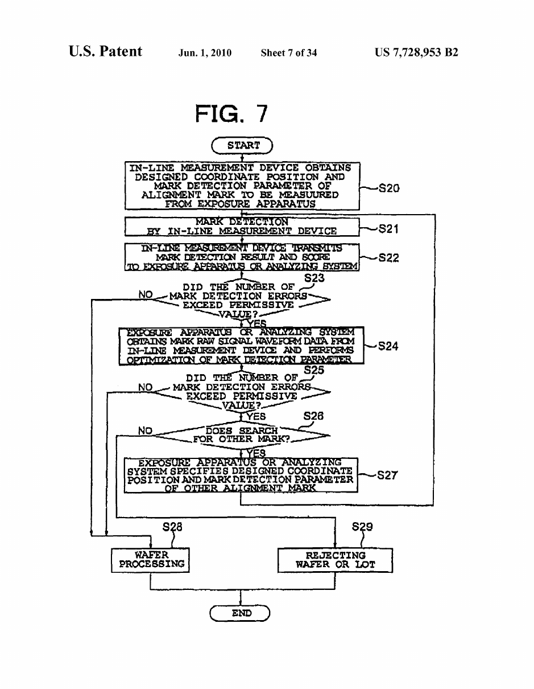
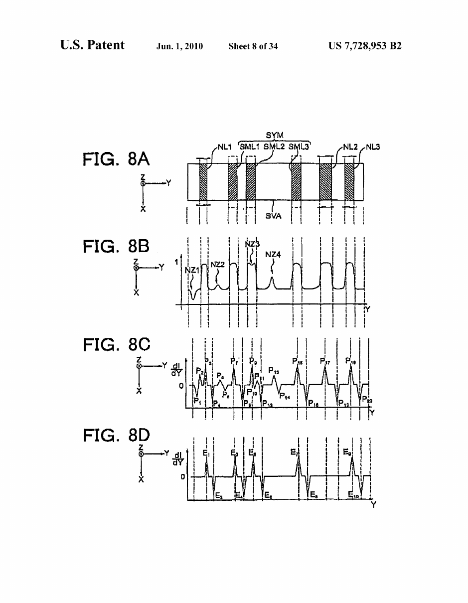
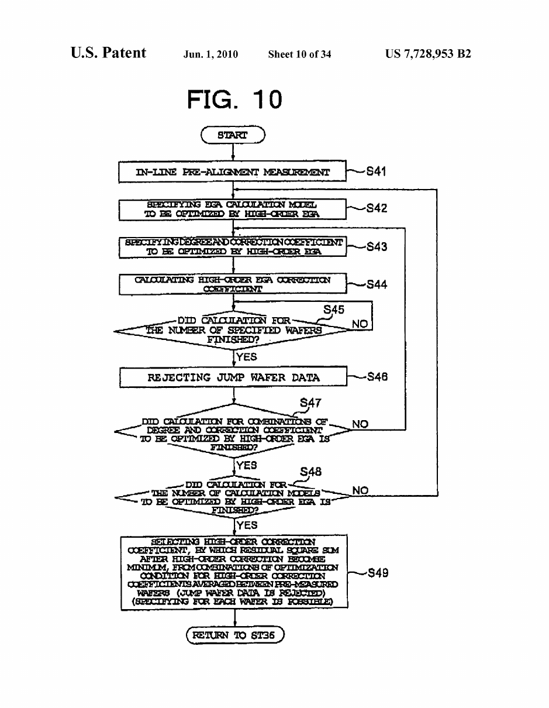

# US7728953B2 번역: 노광 방법, 노광 시스템 및 기판 처리 장치

번역 범위: 전문(초록, 기술 분야, 배경 기술, 발명의 개시, 도면 설명, 실시 형태, 청구항 13개). 인용 문헌은 원문 그대로 둔다.
원문: 같은 폴더의 `US7728953B2.pdf` (56쪽, 도면 34장). 번역 대본은 Google Patents 본문 텍스트이고, 식과 서지는 PDF 공보로 대조했다.
번역일: 2026-11-04. 번역문 안의 [역주]는 번역자가 덧붙인 설명이다.

## 서지 (공보 첫 장)

- (10) 특허 번호: US 7,728,953 B2
- (45) 등록일: 2010-06-01
- (54) 발명의 명칭: EXPOSURE METHOD, EXPOSURE SYSTEM, AND SUBSTRATE PROCESSING APPARATUS
- (75) 발명자: Hiroyuki Suzuki (Chofu, JP), Yuuiki Ishii (Yokohama, JP), Shinishi Okita (Nishi-tokyo, JP)
- (73) 권리자: Nikon Corporation, Tokyo (JP)
- (21) 출원 번호: 11/513,161
- (22) 출원일: 2006-08-31
- (65) 공개: US 2007/0052939 A1 (2007-03-08)
- (63) PCT/JP2005/003156 (2005-02-25 출원)의 계속 출원
- (60) 미국 가출원 60/717,329 (2005-09-15)
- (30) 우선권: JP 2004-056167 (2004-03-01)
- (51) Int. Cl.: G03B 27/52, G03B 27/42
- (52) U.S. Cl.: 355/55; 355/53
- 청구항 13개, 도면 34장

(56) 인용 문헌 (원문 그대로)

```
U.S. PATENT DOCUMENTS
5,120,134 A * 6/1992 Kosugi .......... 356/401
5,525,808 A * 6/1996 Irie et al. ..... 250/548
6,538,260 B1* 3/2003 Koga ............ 250/548
6,744,512 B2  6/2004 Takahashi ....... 356/401
7,265,841 B2* 9/2007 Matsumoto ....... 356/401
FOREIGN PATENT DOCUMENTS
DE 39 42 678 A1    6/1990
JP A 61-044429     3/1986
JP A 62-076622     4/1987
JP A 62-084516     4/1987
JP A 02-170515     7/1990
JP A 2000-036451   2/2000
JP A 2001-338860  12/2001
JP A 2001-345243  12/2001
JP A 2002-043217   2/2002
JP A 2002-353121  12/2002
JP A 2003-049421   2/2003
* cited by examiner
```

## 초록

고성능, 고품질의 마이크로 디바이스 등을 높은 처리량으로 효율 좋게 생산한다. 웨이퍼 W를 노광하는 노광 장치 200으로 웨이퍼 W를 옮기기 전에, 웨이퍼 W에 형성된 마크를 인라인 계측 장치 400이 계측한다. 그리고 계측 결과, 또는 계측 결과에 계산 처리를 한 결과, 또는 둘 다를 노광 장치 200에 통지한다. 노광 장치 200에서는 통지된 결과를 바탕으로 계측 조건을 최적화하고, 얼라인먼트 처리와 그 밖의 처리를 한다.

## 기술 분야

이 출원은 2005년 2월 25일 출원한 국제 출원 PCT/JP2005/003156의 계속 출원이다. 그 국제 출원은 2004년 3월 1일 출원한 일본 특허 출원 2004-056167을 우선권으로 주장한다. 이 출원은 또 2005년 9월 15일 출원한 미국 가출원 60/717,329를 우선권으로 주장한다. 앞선 출원들의 개시 내용 전체를 참조로 여기에 포함한다.

본 발명은 사전 계측 처리 방법, 노광 시스템, 기판 처리 장치에 관한 것이다. 반도체 소자, 액정 표시 소자, 촬상 소자, 박막 자기 헤드 등을 만드는 포토리소그래피 공정에서 회로 패턴을 높은 정밀도와 높은 처리량으로 만들기 위한 것이다.

## 배경 기술

반도체 소자, 액정 표시 소자, 촬상 소자(CCD, 전하 결합 소자), 박막 자기 헤드 같은 여러 디바이스는 기판 위에 많은 층의 패턴을 겹쳐 쌓고, 노광 장치로 노광해서 만든다. 그래서 두 번째 층 이후의 패턴을 기판에 노광할 때는, 이미 패턴이 만들어진 각 샷 영역과 마스크 패턴 상을 정확히 맞춰야 한다. 즉 기판과 레티클을 정확히 맞춰야 한다. 이를 위해 첫 번째 층 패턴을 노광할 때, 얼라인먼트 마크라는 정렬용 마크를 각 샷 영역(칩 패턴 영역)에 붙는 꼴로 스테이지 좌표계 위에 만든다.

얼라인먼트 마크가 있는 기판을 노광 장치로 옮기면, 노광 장치에 달린 마크 계측 장치가 스테이지 좌표계에서 마크 위치(좌표값)를 잰다. 다음으로, 잰 마크 위치와 마크의 설계 위치를 바탕으로, 기판 위 샷 영역 하나를 레티클 패턴에 맞추는 얼라인먼트를 한다.

얼라인먼트 방법으로는 기판 위 샷 영역마다 얼라인먼트 마크를 재서 맞추는 다이 바이 다이(D/D) 방식이 알려져 있다. 그러나 처리량을 높이려고, 일본 공개특허 61-44429와 62-84516에 개시된 것처럼 통계 방법으로 기판 위 샷 배열의 규칙성을 정확히 구하는 EGA(enhancement global alignment) 방식이 지금은 주류다.

EGA는 미리 고른 여러 개(예: 7~15개)의 샘플 샷에서 얼라인먼트 마크 위치를 재고, 최소제곱법 등으로 통계 계산을 해서 측정값과 설계 위치의 오차가 가장 작아지게 기판 위 모든 샷 영역의 위치 좌표(샷 배열)를 구한다. 그리고 그 샷 배열에 따라 기판 스테이지를 한 걸음씩 옮긴다. EGA는 주로 샷 배열에 생기는 선형 오차를 없앤다. 선형 오차에는 기판의 남은 회전 오차, 스테이지 좌표계(또는 샷 배열)의 직교도 오차, 기판의 선형 신축(스케일링), 기판(중심 위치)의 오프셋(평행 이동) 등이 있다.

또 연마 같은 가공과 열팽창 때문에 기판에 생기는 비선형 변형, 노광 장치 사이의 스테이지 격자 오차(스테이지 좌표계 사이의 오차), 기판의 흡착 상태 등 때문에 비선형 샷 배열 오차가 생긴다. 이런 비선형 오차(랜덤 오차)를 없애는 기술로 GCM(grid compensation matching)이 알려져 있다.

GCM에는 다음 방법들이 있다.
- 노광 시퀀스(공정 웨이퍼 노광 처리) 중에 EGA 계측을 다시 해서 EGA 결과를 기준으로 비선형 성분을 뽑고, 여러 웨이퍼에서 뽑은 비선형 성분의 평균을 맵 보정값으로 들고 있다가, 이후 노광 시퀀스에서 그 맵 보정값으로 샷 위치를 보정하는 방법(예: 일본 공개특허 2001-345243).
- 노광 시퀀스와 따로, 미리 노광 조건과 공정마다 표준 웨이퍼로 비선형 성분(샷마다의 어긋남 양)을 재서 맵 보정 파일로 저장해 두고, 노광 조건에 맞는 파일로 샷 위치를 보정하는 방법(예: 일본 공개특허 2002-353121).

또 본 발명자들은 위 EGA 방식으로 선형 오차 성분을 없앤 뒤의 샷 배열 위치와 설계 위치의 차이(비선형 오차 성분)를 정해진 평가 함수로 평가하고, 그 평가 결과로 비선형 성분을 나타내는 함수를 정해서 샷 배열을 보정하는 기술을 출원했다(일본 특허 출원 2003-49421).

회로 패턴의 겹침 정밀도를 더 높이려고 SDM(super distortion matching)이 알려져 있다. 앞 공정에서 노광에 쓴 노광 장치의 투영 광학계 왜곡을 미리 재서 왜곡 데이터로 데이터베이스에 등록한다. 그리고 왜곡 데이터와 기판의 노광 이력을 바탕으로, 다음 공정의 노광 장치에서도 앞 공정과 같은 상 왜곡이 생기도록 다음 공정 노광 장치의 투영 광학계 결상 특성 등을 로트 단위로 조정한다(예: 일본 공개특허 2000-36451, 2001-338860).

또 디바이스를 만드는 중인 기판 표면에는 앞 공정에서 만든 회로 패턴 등으로 높낮이 차가 있다. 그래서 초점 조정에 관한 기술로, 기판 표면 모양을 재는 표면 형상 계측 장치를 노광 장치에 달고, 노광 시퀀스 중에 기판 표면 모양을 재서 최적 초점 위치를 구하고 보정하는 기술이 제안됐다(예: 일본 공개특허 2002-43217). 또 노광 장치 투영 광학계의 초점 위치를 맞추는 기준인 최적 초점 위치를 정하는 기술로, 시험 패턴을 투영 광학계 광축 방향의 여러 위치에서 시험 기판에 노광, 전사하고, 현상 뒤 검사해서 가장 가는 패턴이 노광된 초점 위치를 최적 초점으로 쓰는 방법이 있다.

이처럼 노광 장치로 옮긴 기판은 노광 처리 직전에 마크 위치, 표면 모양 같은 여러 정보를 잰다. 그리고 그것으로 보정값 등을 알맞게 계산하고, 그 값으로 기판을 맞춘 뒤 노광 처리를 해서 기판에 회로 패턴을 정밀하게 만든다.

그러나 위 종래 기술에서는 기판 정보를 노광 장치로 옮긴 기판에서 노광 처리 직전에 잰다. 그래서 예를 들어 마크가 변형되거나 뭉개져서 충분히 정밀하게 잴 수 없으면 다음 단점이 있었다.
- 충분한 얼라인먼트 정밀도를 확보하지 못한다.
- 얼라인먼트 오류가 생겨 노광 처리를 멈추거나, 다른 마크를 다시 재야 한다.
- 그 결과 처리량(단위 시간당 처리량)이 떨어지는 경우가 있다.

특히 EGA, GCM, SDM 등은 복잡한 계산을 하므로 해(보정 계수)를 얻는 데 어느 정도 시간이 걸리는 경우가 있고, 그동안 기판 노광 처리는 기다려야 한다. 그래서 보정값 계산은 로트나 공정 단위로 해야 하고, 기판마다 또는 샷마다 최적 보정을 할 수 없다.

또 앞 공정에서 어떤 이상이 생겨 기판 위 패턴이 요구 정밀도를 만족하지 못하면, 다음 노광 공정을 하는 것은 헛된 일이 되므로 이를 효과적으로 막아야 한다.

```
Patent article 1: the Japanese Unexamined Patent Publications No. 61-44429
Patent article 2: the Japanese Unexamined Patent Publications No. 62-84516
Patent article 3: the Japanese Unexamined Patent Publications No. 2001-345243
Patent article 4: the Japanese Unexamined Patent Publications No. 2002-353121
Patent article 5: the Japanese Unexamined Patent Publications No. 2000-36451
Patent article 6: the Japanese Unexamined Patent Publications No. 2001-338860
Patent article 7: the Japanese Unexamined Patent Publications No. 2002-43217
```

## 발명의 개시

따라서 본 발명의 목적은 고성능, 고품질 마이크로 디바이스 등을 만드는 데 높은 처리량과 높은 효율을 얻는 것이다.

### 제1 형태

본 발명의 제1 형태에 따르면 다음을 포함하는 사전 계측 처리 방법을 제공한다.
- 기판을 노광하는 노광 장치로 기판을 옮기기 전에, 기판에 형성된 마크를 재는 사전 계측 단계(S21)
- 사전 계측 단계에서 잰 마크의 파형 데이터를 노광 장치, 노광 장치와 따로 둔 해석 장치, 그리고 이들보다 위에서 이들 중 하나 이상을 관리하는 관리 장치 중 하나 이상에 통지하는 통지 단계(S22)

여기서 "파형 데이터"는 마크를 잴 때 쓰는 계측 장치의 CCD 등 검출 센서가 내보내는 계측 신호(이른바 원 파형 데이터)이거나, 그 계측 신호에 어떤(정해진) 처리(예: 전기적 필터 처리 같은 전처리)를 해서 얻은, 계측 신호와 실질적으로 같은 내용을 가진 신호(실질적으로 같은 계측 결과를 낳는 정보)다. 즉 이 명세서에서 "파형 데이터"는 검출 센서가 내보낸 그대로의 "원 파형 데이터"에 더해, 위와 같은 처리를 한 "처리된 파형 데이터"를 포함하는 개념이다. 원 파형 데이터는 영상 데이터(예: XY 2차원 계측 마크라면 2차원 영상 데이터)를 포함한다. 위의 정해진 처리에는 압축, 솎아내기, 평활화 처리 등이 포함된다.

본 발명에서는 노광 장치로 옮기기 전에 기판 마크를 사전 계측한다. 그래서 예를 들어 노광 장치에서 마크를 본 계측할 때, 마크가 변형되거나 뭉개진 마크를 미리 빼 두거나, 통계 계산 처리 등을 미리 해서 오차가 작은 마크 조합을 정해 둘 수 있다. 따라서 노광 장치에서 본 계측할 때 최적의 마크나 최적의 마크 계측 조건을 고를 수 있다. 그 결과 노광 장치에서 얼라인먼트 오류로 인한 마크 재계측과 처리 중단이 줄고, 한 번의 본 계측으로 충분한 얼라인먼트 정밀도를 확보할 수 있다.

또 사전 계측 단계에서 마크를 잰 뒤 기판이 노광 처리를 위해 옮겨질 때까지 어느 정도 시간이 있으므로, 그동안 사전 계측 결과로 여러 복잡한 통계 계산 처리 등을 끝낼 수 있다. 따라서 노광 장치에서 통계 계산용 마크 계측이나 통계 계산 처리를 생략할 수 있다. 그 결과 기판을 노광 장치로 옮긴 뒤 바로 노광 처리를 할 수 있고, 기판마다 또는 샷마다 최적 위치 보정을 할 수 있다.

또 파형 데이터를 통지하므로, 예를 들어 사전 계측에 쓴 계측 장치와 노광 장치 본 계측에 쓴 계측 장치의 특성 차이를 로트 처리 중이나 미리 구해서 둘이 맞도록 보정하면, 두 계측 결과를 같은 기준으로 평가할 수 있다. 특성 차이에는 센서, 결상 광학계, 조명 광학계의 차이에서 오는 것, 환경 변화와 시간 경과에서 오는 것, 신호 처리 알고리즘 차이에서 오는 것 등이 있다.

제1 형태의 사전 계측 처리 방법은 사전 계측 단계에서 잰 마크를 정해진 평가 기준으로 평가하는 평가 단계(S22)를 더 갖는다. 그리고 통지 단계는 평가 단계의 평가 결과에 따라 파형 데이터를 통지할지 통지하지 않을지 고를 수 있다. 이때 파형 데이터를 통지하지 않으면 평가 결과를 통지해도 된다. 파형 데이터를 모두 통지해도 되지만, 데이터 양이 보통 커서 통신 부하 등을 생각하면 모두 통지하는 것은 바람직하지 않다. 위 방법을 쓰면 경우에 따라 파형 데이터 통지를 생략해서 통신 부하 등을 줄일 수 있다.

### 제2 형태

본 발명의 제2 형태에 따르면 다음을 포함하는 사전 계측 처리 방법을 제공한다.
- 기판을 노광하는 노광 장치로 기판을 옮기기 전에 기판에 형성된 마크를 재는 사전 계측 단계(S21)
- 사전 계측 단계에서 잰 마크를 정해진 평가 기준으로 평가하는 평가 단계(S22)
- 평가 단계에서 얻은 평가 결과나 평가 관련 정보를 노광 장치, 노광 장치와 따로 둔 해석 장치, 이들보다 위에서 이들 중 하나 이상을 관리하는 관리 장치 중 하나 이상에 통지하는 통지 단계(S22)

본 발명에서는 노광 장치로 옮기기 전에 기판 마크를 사전 계측하므로, 제1 형태와 같이 노광 장치 본 계측에서 얼라인먼트 오류가 줄어 처리량 향상과 충분한 얼라인먼트 정밀도를 얻는다. 또 여러 계산 처리를 미리 해 두어, 노광 장치로 옮긴 기판을 바로 노광할 수 있고, 처리량 향상과 기판마다 또는 샷마다 최적 위치 보정이 가능하다. 또 예를 들어 파형 데이터 대신 마크 위치를 나타내는 계측 결과를 통지하므로, 보낼 데이터 양이 적고 통신 부하가 작다.

### 제3 형태

본 발명의 제3 형태에 따르면 다음을 포함하는 사전 계측 처리 방법을 제공한다.
- 기판을 노광 장치로 옮기기 전에 기판에 형성된 여러 마크의 위치를 재는 사전 계측 단계(S41)
- 사전 계측 결과를 바탕으로, 각 마크의 설계 위치와의 오차가 가장 작아지는 선형 보정 계수와 비선형 보정 계수를 포함한 보정 정보를 계산하는 보정 정보 계산 단계(S42~S49, S36, S37)

이 발명에서는 사전 계측 결과로 보정 계수를 계산하므로, 노광 장치에서 그 보정 정보를 써서 기판을 빠르게 맞추고 노광 처리를 할 수 있다. 그래서 처리량 향상과 기판마다 또는 샷마다 최적 위치 보정이 가능하다.

### 제4 형태

본 발명의 제4 형태에 따르면 다음을 포함하는 사전 계측 처리 방법을 제공한다.
- 기판을 노광 장치로 옮기기 전에 기판에 형성된 여러 마크의 위치를 재는 사전 계측 단계(S61)
- 사전 계측 결과를 바탕으로, 이미 그 기판을 노광한 다른 노광 장치의 투영 광학계 상 왜곡 정보를 계산하는 상 왜곡 계산 단계(S55A 안의 S62~S67)
- 계산한 다른 노광 장치의 상 왜곡 정보와 미리 얻은 이 노광 장치 투영 광학계의 상 왜곡 정보를 바탕으로, 다른 노광 장치에서 생긴 상 왜곡을 이 노광 장치에서도 주도록 하는 상 왜곡 보정 정보를 계산하는 보정 정보 계산 단계(S55B, S55C)

이 발명에서는 사전 계측 결과로 앞 공정에서 생긴 상 왜곡과 상 왜곡 보정 정보를 계산한다. 그래서 다음 공정 노광 장치에서 그 정보로 투영 광학계의 결상 특성 등을 바꾸고, 옮겨 온 기판을 바로 노광할 수 있다. 처리량 향상과 기판마다 또는 샷마다 최적 상 왜곡 보정이 가능하다.

### 제5 형태

본 발명의 제5 형태에 따르면 다음을 포함하는 사전 계측 처리 방법을 제공한다.
- 기판을 노광 장치로 옮기기 전에 기판에 형성된 위상 시프트 초점 마크를 재는 사전 계측 단계
- 사전 계측 결과로, 이미 그 기판을 노광한 다른 노광 장치의 노광 때 초점 오차를 구해서, 이 노광 장치에서 기판을 노광할 때 쓸 초점 보정 정보를 계산하는 초점 보정 정보 계산 단계

이 발명에서는 기판의 위상 시프트 초점 마크를 사전 계측하고 그 결과로 초점 보정 정보를 계산한다. 다음 공정 노광 장치에서는 그 정보로 최적 초점 조정을 해서 옮겨 온 기판을 바로 노광한다. 그 결과 처리량 향상과 기판마다 또는 샷마다 최적 초점 조정이 가능하다.

### 제6 형태

본 발명의 제6 형태에 따르면 다음을 포함하는 사전 계측 처리 방법을 제공한다.
- 기판을 노광 장치로 옮기기 전에 기판 표면 모양을 재는 사전 계측 단계(S74)
- 사전 계측 결과로 노광 장치에서 노광할 때 쓸 초점 보정 정보를 계산하는 보정 정보 계산 단계(S76)

이 발명에서는 기판 표면 모양을 사전 계측하고 그 결과로 초점 보정 정보를 계산한다. 다음 공정 노광 장치에서 그 정보로 최적 초점 조정을 해서 옮겨 온 기판을 바로 노광한다. 그 결과 처리량 향상과 기판마다 또는 샷마다 최적 초점 조정이 가능하다.

### 제7 형태

본 발명의 제7 형태에 따르면 다음을 포함하는 사전 계측 처리 방법을 제공한다.
- 기판을 노광 장치로 옮기기 전에 기판에 형성된 여러 마크의 위치를 재는 사전 계측 단계
- 사전 계측에 쓴 계측 장치, 계측 장치에서 노광 장치로 기판을 옮기는 반송 장치, 노광 장치 중 하나 이상에서 온도 변화, 습도 변화, 기압 변화 중 하나 이상을 재는 단계
- 잰 온도, 습도, 기압 변화로 사전 계측한 마크 위치의 변화를 추정하는 추정 단계
- 추정 결과로, 각 마크의 설계 위치와의 오차가 가장 작아지는 선형 보정 계수와 비선형 보정 계수를 포함한 보정 정보를 계산하는 보정 정보 계산 단계

이 발명에서는 제3 형태처럼 기판 마크 위치를 사전 계측한다. 그런데 기판을 옮기는 중에 온도가 바뀌면 기판이 늘거나 줄어서, 사전 계측한 마크의 실제 위치가 온도 변화에 따라 바뀐다. 온도 변화에 따른 마크 위치 변화는 다음 방법으로 얻을 수 있다.
- 시험 기판 등으로 온도 변화와 마크 위치 변화의 관계를 미리 실측한다.
- 기판의 열팽창 계수 등으로 이론적으로 구한다.
- 노광 시퀀스 중에 온도 변화와 마크 위치 변화의 관계를 실측해서 학습한다.

이 발명에서는 온도 변화에 따른 마크 위치 변화를 예측하고, 그것으로 보정한 위치 정보로 보정 정보를 계산하므로 더 정확한 위치 보정을 할 수 있다.

### 제8 형태

본 발명의 제8 형태에 따르면 다음을 포함하는 사전 계측 처리 방법을 제공한다.
- 기판을 노광 장치로 옮기기 전에, 기판 위 마크 위치, 마크 모양, 패턴 선폭, 패턴 결함, 초점 오차, 표면 모양, 그리고 이미 그 기판을 노광한 다른 노광 장치 안의 온도, 습도, 기압 중 하나 이상을 재는 사전 계측 단계(S21)
- 사전 계측 결과로, 기판을 노광 장치로 옮기는 처리를 계속할지 정하는 판정 단계(S25, S26, S29)

앞 공정에서 어떤 이상이 생겨 기판 위 패턴을 요구 정밀도로 만들지 못했다면 다음 노광 공정을 하는 것은 헛일이다. 이 발명에서는 노광 장치로 옮기기 전에 기판의 마크와 패턴 등을 사전 계측하거나, 앞 공정 노광 장치 안의 온도 같은 환경 정보를 사전 계측한다. 그리고 실제로 이상이 생겼거나 이상이 생겼을 가능성이 높으면 기판을 노광 장치로 옮기는 것을 멈출 수 있다. 따라서 노광 장치의 실질 가동률을 높일 수 있다.

### 제9 형태

본 발명의 제9 형태에 따르면 다음을 포함하는 사전 계측 처리 방법을 제공한다.
- 기판을 노광 장치로 옮기기 전에 기판 정보를 재는 사전 계측 단계
- 노광 장치의 가동 상태에 따라 사전 계측 단계의 계측 조건을 최적화하는 최적화 단계

여기서 노광 장치의 가동 상태에는 다음이 포함된다.
- 노광 장치의 동작 기준과 정해진 기준이 어긋날 때 둘을 맞추려고 하는 교정(캘리브레이션)의 실제 상태
- 기판 정보 등의 계측 오류로 인한 재계측 같은 재시도 상태
- 노광 장치의 노광 처리 중단이나 정지 상태

또 계측 조건에는 마크 위치 계측, 기판 표면 모양 계측 같은 계측 항목, 잴 마크 수 같은 계측 횟수, 계측 한 번당 데이터 양 등이 포함된다. 계측 조건은 노광 처리 처리량을 떨어뜨리지 않는 범위에서 가장 크게 되도록 최적화하는 것이 바람직하다.

예를 들어 노광 장치에서 교정이나 재시도가 생기면 노광 처리는 그만큼 늦어진다. 바꿔 말하면 사전 계측 시간을 그만큼 늘려도 노광 처리 처리량에 나쁜 영향이 없다. 사전 계측 단계에서는 계측 항목, 계측 횟수, 데이터 양 등이 많을수록 더 정밀한 해석과 정확한 보정값 계산이 가능하다. 본 발명에서는 노광 장치의 가동 상태에 따라 계측 조건을 최적화하므로, 처리량을 떨어뜨리지 않고 더 정밀한 해석과 정확한 보정값 계산이 가능하고, 노광 정밀도도 높일 수 있다.

### 제10 형태

본 발명의 제10 형태에 따르면 다음을 포함하는 사전 계측 처리 방법을 제공한다.
- 기판을 노광 장치로 옮기기 전에 기판 정보를 재는 사전 계측 단계
- 사전 계측 결과에서 얻은 주기성에 따라 사전 계측 단계의 계측 조건을 최적화하는 최적화 단계

여기서 주기성에는 로트가 들어오는 주기, 로트 안 기판의 처리 주기, 연, 월, 일 같은 시간 주기가 포함된다. 또 계측 조건에는 이상 원인 해석에 유효한 계측 항목, 계측 횟수, 계측 한 번당 데이터 양 등이 포함된다.

예를 들어 앞 공정에 문제나 이상이 없으면 로트는 대개 일정한 주기로 들어온다. 그 주기가 길어지면 앞 공정에서 그 로트에 어떤 문제나 이상이 생겼다고 추정할 수 있다. 이 발명에서는 주기성에 따라 사전 계측 조건을 최적화한다. 즉 문제와 이상의 원인 해석에 유효한 계측 조건으로 사전 계측을 하므로, 원인을 더 정확히 알아낼 수 있다.

### 제11 형태

본 발명의 제11 형태에 따르면 다음을 포함하는 사전 계측 처리 방법을 제공한다.
- 기판을 노광 장치로 옮기기 전에 기판 정보를 사전 계측하는 사전 계측 단계
- 사전 계측 결과에서 얻은 오류 수에 따라 사전 계측 단계의 계측 조건을 최적화하는 최적화 단계

여기서 계측 조건에는 이상 원인 해석에 유효한 계측 항목, 계측 횟수, 계측 한 번당 데이터 양 등이 포함된다.

앞 공정에서 오류가 자주 생기면 그 원인을 알아내야 한다. 그래서 본 발명에서는 오류 수에 따라 사전 계측 조건을 최적화한다. 더 구체적으로는 문제와 이상의 원인 해석에 유효한 계측 조건으로 사전 계측을 하므로, 원인을 더 정확히 알아낼 수 있다.

### 제12 형태

본 발명의 제12 형태에 따르면 다음을 포함하는 사전 계측 처리 방법을 제공한다.
- 기판을 노광 장치로 옮기기 전에 기판 정보를 사전 계측하는 사전 계측 단계
- 사전 계측 결과를 바탕으로, 노광 장치에서 기판을 노광할 때 관련 데이터를 모으는 조건을 최적화하는 최적화 단계

여기서 데이터 수집 조건에는 데이터를 모을지 여부, 모을 데이터 종류, 데이터 양 등이 포함된다.

이 발명에서는 사전 계측 결과로 노광 장치의 데이터 수집을 최적화한다. 예를 들어 사전 계측 결과가 좋으면 노광 장치에서 사전 계측과 같은 데이터를 모을 필요가 없다고 본다. 반대로 사전 계측 결과가 나쁘면 다시 재서 데이터를 모으거나 관련된 다른 종류의 데이터를 잰다. 그래서 데이터 수집을 효율적으로 할 수 있다.

### 제13 형태

본 발명의 제13 형태에 따르면 다음을 포함하는 사전 계측 처리 방법을 제공한다.
- 기판을 노광 장치로 옮기기 전에 기판 정보를 사전 계측하는 사전 계측 단계
- 노광 장치에서 기판을 노광할 때 모을 데이터의 수집 조건을 바탕으로, 사전 계측 단계의 데이터 수집 조건을 최적화하는 최적화 단계

이 발명에서는 노광 장치의 데이터 수집 조건으로 사전 계측 때의 데이터 수집 조건을 최적화한다. 예를 들어 노광 장치에서 모을 데이터를 사전 계측에서도 모으면 같은 데이터를 두 번 모으게 되어 효과가 없는 경우가 있다. 이때 중복 수집을 막아 데이터 수집 효율을 높일 수 있다.

제1~제13 형태의 사전 계측 처리 방법에서 사전 계측 단계는 노광 장치에 인라인으로 연결된 도포 현상 장치 안의 계측 장치에서 하거나, 노광 장치와 따로 둔 계측 장치에서 한다.

### 제14 형태

본 발명의 제14 형태에 따르면 다음을 포함하는 노광 시스템을 제공한다.
- 기판을 노광하는 노광 장치(200, 13)
- 기판을 노광 장치로 옮기기 전에 기판에 형성된 마크를 재는 사전 계측 장치(400)
- 사전 계측 단계에서 잰 마크의 파형 데이터를 노광 장치, 노광 장치와 따로 둔 해석 장치(600), 이들보다 위에서 이들 중 하나 이상을 관리하는 관리 장치(500, 700) 중 하나 이상에 통지하는 통지 장치(400, 450, 연결 케이블)

이때 사전 계측 단계에서 잰 마크를 정해진 평가 기준으로 평가하는 평가 장치(450, 600, 13)를 더 두고, 통지 장치가 평가 결과에 따라 파형 데이터를 통지할지 말지 고를 수 있게 하는 것이 바람직하다. 제1 형태의 사전 계측 처리 방법과 같은 효과를 얻는다.

### 제15 형태

본 발명의 제15 형태에 따르면 다음을 포함하는 노광 시스템을 제공한다.
- 기판을 노광하는 노광 장치(200, 13)
- 기판을 노광 장치로 옮기기 전에 기판에 형성된 마크를 재는 사전 계측 장치(400)
- 사전 계측 단계에서 잰 마크를 정해진 평가 기준으로 평가하는 평가 장치(450)
- 평가 장치가 낸 평가 결과나 평가 관련 정보를 노광 장치, 노광 장치와 따로 둔 해석 장치(600), 관리 장치(500, 700) 중 하나 이상에 통지하는 통지 장치(400, 450, 연결 케이블)

제2 형태의 사전 계측 처리 방법과 같은 효과를 얻는다.

### 제16 형태

본 발명의 제16 형태에 따르면 다음을 포함하는 노광 시스템을 제공한다.
- 기판을 노광하는 노광 장치(200, 13)로 기판을 옮기기 전에, 기판 위 마크 위치, 마크 모양, 패턴 선폭, 패턴 결함, 초점 오차, 표면 모양, 이미 그 기판을 노광한 다른 노광 장치 안의 온도, 습도, 기압 중 하나 이상을 재는 사전 계측 장치(400)
- 사전 계측 장치의 계측 결과로 기판을 노광 장치로 옮기는 처리를 계속할지 정하는 판정 장치(450, 600, 13)

제8 형태의 사전 계측 처리 방법과 같은 효과를 얻는다.

### 제17 형태

본 발명의 제17 형태에 따르면, 기판에 패턴을 노광, 전사하는 노광 장치(200)에서의 노광 처리 전이나 후에 기판에 정해진 처리를 하는 기판 처리 장치(300)로서 다음을 포함하는 장치를 제공한다.
- 마스크 패턴을 거쳐 기판을 노광하는 노광 장치로 기판을 옮기기 전에, 기판 위 마크 위치, 마크 모양, 패턴 선폭, 패턴 결함, 초점 오차, 표면 모양, 이미 그 기판을 노광한 다른 노광 장치 안의 온도, 습도, 기압 중 하나 이상을 재는 사전 계측 장치(400)
- 사전 계측 장치의 계측 결과로 기판을 노광 장치로 옮기는 처리를 계속할지 정하는 판정 장치(450)

제3 형태의 사전 계측 처리 방법과 같은 효과를 얻는다. [역주: 원문이 "third aspect"라고 적었으나 내용상 판정 장치를 가진 제8 형태에 해당한다.]

예로서, 제14~제16 형태의 노광 시스템에서 사전 계측 장치는 노광 장치에 인라인으로 연결된 도포 현상 장치 안에 둔다.

본 발명에 따르면 고성능, 고품질 마이크로 디바이스 등을 높은 처리량과 높은 효율로 만들 수 있다.

## 도면의 간단한 설명

- 도 1: 본 발명 실시 형태에 따른 노광 시스템 전체 구성을 보이는 블록도.
- 도 2: 실시 형태의 노광 시스템에 있는 노광 장치의 개략 구성도.
- 도 3: 실시 형태에서 노광 장치에 인라인으로 연결한 도포 현상 장치 등의 개략 구성도.
- 도 4: 실시 형태에서 인라인 계측 장치와 오프라인 계측 장치에 쓰는 사전 계측 센서의 예.
- 도 5: 실시 형태의 처리 흐름을 보이는 흐름도.
- 도 6: 실시 형태의 파이프라인 처리를 설명하는 그림.
- 도 7: 실시 형태에서 인라인 사전 계측으로 얼라인먼트를 최적화하는 순서를 보이는 흐름도.
- 도 8A: 실시 형태의 서치 얼라인먼트 마크 예.
- 도 8B: 도 8A 서치 얼라인먼트 마크 계측 신호의 평균 신호 세기 분포.
- 도 8C: 도 8B 신호 세기 분포의 미분 파형.
- 도 8D: 도 8C 미분 파형에 줄임 처리를 한 뒤의 에지 후보.
- 도 9: 실시 형태에서 인라인 사전 계측에 의한 샷 배열 보정(GCM) 동작 순서 흐름도.
- 도 10: 실시 형태에서 인라인 사전 계측에 의한 고차 보정 계수(GCM 보정값) 최적화 순서 흐름도.
- 도 11A~11J: 실시 형태 보정 계수 성분의 내용. 차례로 오프셋 x (dx=Cx_00), 오프셋 y (dy=Cy_00), 스케일링 x (dx=Cx_10*x), 스케일링 y (dy=Cy_01*y), 회전 y (dx=Cx_01*y), 회전 x (dy=Cy_10*x), 편심 스케일링 x (dx=Cx_20*x²), 편심 스케일링 y (dy=Cy_02*y²), 사다리꼴 x (dx=Cx_11*x*y), 사다리꼴 y (dy=Cy_11*y*x).
- 도 12A~12J: 같은 보정 계수 성분의 내용. 차례로 부채꼴 x (dx=Cx_02*y²), 부채꼴 y (dy=Cy_20*x²), C자 스케일링 x (dx=Cx_30*x³), C자 스케일링 y (dy=Cy_03*y³), 아코디언 x (dx=Cx_21*x²*y), 아코디언 y (dy=Cy_12*y²*x), C자 왜곡 x (dx=Cx_12*x*y²), C자 왜곡 y (dy=Cy_21*y*x²), 강물 흐름 x (dx=Cx_03*y³), 강물 흐름 y (dy=Cy_30*x³).
- 도 13: 실시 형태에서 인라인 사전 계측에 의한 왜곡 보정(SDM) 동작 순서 흐름도.
- 도 14: 실시 형태에서 인라인 사전 계측에 의한 왜곡 보정 계수(SDM 보정값) 최적화 순서 흐름도.
- 도 15: 인라인 사전 계측에 의한 초점 단차 보정 동작 순서 흐름도.
- 도 16: 전자 디바이스 제조 순서 흐름도.

## 발명을 실시하기 위한 최선의 형태

아래에서 도면을 바탕으로 본 발명의 실시 형태를 자세히 설명한다.

### 노광 시스템

먼저 도 1을 보며 본 실시 형태 노광 시스템의 전체 구성을 설명한다. 노광 시스템 100은 반도체 웨이퍼나 유리판 같은 기판을 처리해 마이크로 디바이스 등을 만드는 기판 처리 공장에 설치한다. 같은 그림처럼 다음을 갖춘다.
- 레이저 광원 같은 광원을 갖춘 노광 장치 200
- 노광 장치 200 옆에 둔 도포 현상 장치 300 (그림에서는 "트랙")
- 도포 현상 장치 300 안에 둔 인라인 계측 장치 400

그림에서는 편의상 노광 장치 200과, 인라인 계측 장치 400을 품은 도포 현상 장치 300을 하나의 기판 처리 장치로 하나만 그렸다. 실제로는 기판 처리 장치가 여러 대 있다. 기판 처리 장치는 포토레지스트 같은 감광제를 기판에 바르는 도포 단계, 감광제를 바른 기판에 마스크나 레티클의 패턴 상을 투영 노광하는 노광 단계, 노광을 마친 기판을 현상하는 현상 단계를 수행한다.

노광 시스템 100은 또 다음을 갖춘다.
- 각 노광 장치 200의 노광 단계를 모아서 관리하는 노광 공정 관리 컨트롤러 500. 노광 장치보다 위에서 노광 장치들을 관리한다.
- 여러 계산 처리와 해석 처리를 하는 해석 시스템 600
- 오프라인 계측 장치 800, 해석 시스템 600(인라인 계측 장치 400), 노광 공정 관리 컨트롤러 500(노광 장치 200)보다 위에서 이들을 관리하는 공장 내 생산 관리 호스트 시스템 700
- 오프라인 계측 장치 800

노광 시스템 100의 장치 중 적어도 기판 처리 장치(200, 300)와 오프라인 계측 장치 800은 온도와 습도를 관리하는 클린룸 안에 둔다. 각 장치는 LAN 같은 네트워크나 전용선(유선 또는 무선)으로 이어져 서로 데이터를 주고받는다.

각 기판 처리 장치 안에서 노광 장치 200과 도포 현상 장치 300은 서로 인라인으로 연결된다. 인라인 연결이란 로봇 팔이나 슬라이더 같은, 기판을 자동으로 옮기는 반송 장치로 장치 사이나 장치 안의 처리 유닛 사이를 잇는 것을 말한다. 뒤에서 설명하겠지만, 인라인 계측 장치 400은 도포 현상 장치 300 안에 있는 여러 처리 유닛 중 하나다. 기판을 노광 장치 200으로 옮기기 전에 기판의 여러 정보를 미리 재는 장치다. 오프라인 계측 장치 800은 다른 장치와 따로 둔 계측 장치이고, 노광 시스템 100에 한 대 이상 있다.

### 노광 장치

도 2를 보며 각 기판 처리 장치에 있는 노광 장치 200의 구성을 설명한다. 노광 장치 200은 스텝 앤 스캔 방식(주사 노광 방식)이어도 되지만, 여기서는 스텝 앤 리피트 방식(일괄 노광 방식)을 예로 든다.

아래 설명에서는 도 2에 XYZ 직교 좌표계를 두고, 이 좌표계로 각 부재의 위치 관계를 설명한다. X축과 Z축은 종이 면에 나란하고, Y축은 종이 면에 수직이다. 실제로 XY 평면은 수평면에 나란하고, Z축은 연직 위쪽이다.

도 2에서 뒤에 설명할 노광 제어 장치 13이 노광광을 내라는 제어 신호를 내면, 조명 광학계 1은 거의 고른 조도의 노광광 EL을 내어 레티클 2를 비춘다. 노광광 EL의 광축은 Z축 방향에 나란하다. 노광광 EL로는 예를 들어 g선(파장 436 nm), i선(365 nm), KrF 엑시머 레이저(248 nm), ArF 엑시머 레이저(193 nm), F2 레이저(157 nm)를 쓴다. [역주: 원문은 "waveform: 436 mm"라고 적었으나 파장 436 nm의 오기다.]

레티클 2에는 포토레지스트를 바른 웨이퍼(기판) W에 옮길 미세 패턴이 있고, 레티클 홀더 3에 붙들려 있다. 레티클 홀더 3은 베이스 4 위에서 XY 평면을 따라 움직이고 조금 회전할 수 있다. 장치 전체 동작을 제어하는 노광 제어 장치 13은 베이스 4 위의 구동 장치 5로 레티클 스테이지 3을 움직여 레티클 2의 위치를 정한다.

조명 광학계 1에서 노광광 EL이 나오면, 레티클 2의 패턴 상이 투영 광학계 6을 거쳐 웨이퍼 W 위의 각 샷 영역(디바이스가 될 부분)에 투영된다. 투영 광학계 6에는 렌즈 같은 광학 소자가 여러 개 있다. 광학 소자의 유리 재료는 노광광 EL 파장에 맞춰 석영, 형석 등에서 고른다. 웨이퍼 W는 웨이퍼 홀더 7을 거쳐 Z 스테이지 8 위에 놓인다. 투영 광학계 안의 광학 소자는 Z축 방향으로 조금 움직이고 X축과 Y축 둘레로 조금 돌 수 있어서, 투영 광학계 6의 결상 특성(배율, 왜곡 등, 뒤에 설명)을 조정한다. 결상 특성은 광학 소자 사이의 기압을 바꿔서 조정해도 된다.

Z 스테이지 8은 웨이퍼 W의 Z축 위치를 미세 조정하는 스테이지이고, XY 스테이지 9 위에 있다. XY 스테이지 9는 웨이퍼 W를 XY 평면에서 움직인다. 그림에는 없지만, 웨이퍼 W를 XY 평면에서 조금 돌리는 스테이지와, Z축과의 각도를 바꿔 XY 평면에 대한 웨이퍼 기울기를 조정하는 스테이지도 있다.

웨이퍼 홀더 7 윗면 한쪽 끝에 L자 이동 거울 10을 붙이고, 그 거울 면과 마주 보는 자리에 레이저 간섭계 11을 둔다. 도 2는 간단히 그렸지만, 이동 거울 10은 X축에 수직인 평면 거울과 Y축에 수직인 평면 거울로 되어 있다. 레이저 간섭계 11은 X축을 따라 이동 거울 10에 빔을 쏘는 X축 간섭계 2개와 Y축을 따라 쏘는 Y축 간섭계 1개로 되어 있다. X축 간섭계 하나와 Y축 간섭계 하나가 웨이퍼 홀더 7의 X 좌표와 Y 좌표를 잰다.

또 두 X축 간섭계 측정값의 차이로 웨이퍼 홀더 7의 XY 평면 회전각을 잰다. 레이저 간섭계 11이 잰 X 좌표, Y 좌표, 회전각 정보는 스테이지 구동계 12로 가고, 스테이지 구동계 12가 위치 정보로 노광 제어 장치 13에 넘긴다. 노광 제어 장치 13은 이 위치 정보를 보면서 스테이지 구동계 12로 웨이퍼 홀더 7의 정렬 동작을 제어한다. 도 2에는 없지만 레티클 홀더 3에도 같은 이동 거울과 간섭계가 있어서, 레티클 홀더 3의 XYZ 위치 등이 노광 제어 장치 13으로 간다.

투영 광학계 6 옆에는 오프 액시스 방식의 촬상형 얼라인먼트 센서 14가 있다. 얼라인먼트 센서 14는 FIA(Field Image Alignment) 방식 정렬 장치이고, 웨이퍼 W에 만든 얼라인먼트 마크를 잰다. 할로겐 램프 15의 빛이 광섬유 16을 거쳐 얼라인먼트 센서 14로 와서 웨이퍼 W를 비춘다. 할로겐 램프를 광원으로 쓰는 이유는 두 가지다. 할로겐 램프 빛의 파장 대역 500~800 nm는 웨이퍼 W 윗면 포토레지스트가 감광하지 않는 대역이다. 또 대역이 넓어서 웨이퍼 W 표면 반사율의 파장 특성 영향을 줄일 수 있다.

얼라인먼트 센서 14에서 나온 조명광은 프리즘 거울 17에서 반사되어 웨이퍼 W 윗면을 비춘다. 얼라인먼트 센서 14는 웨이퍼 W 윗면의 반사광을 프리즘 거울 17을 거쳐 받아, 검출 결과를 전기 신호로 바꿔 얼라인먼트 신호 처리계 18에 낸다. 얼라인먼트 신호 처리계 18은 이 검출 결과로 XY 평면에서 얼라인먼트 마크의 위치를 구하고, 웨이퍼 위치 정보로 노광 제어 장치 13에 넘긴다.

노광 제어 장치 13은 스테이지 구동계 12의 위치 정보와 얼라인먼트 신호 처리계 18의 웨이퍼 위치 정보로 노광 장치 전체 동작을 제어한다. 구체적으로는, 얼라인먼트 신호 처리계 18의 위치 정보와, 필요하면 인라인 계측 장치 400이 보낸 여러 데이터(뒤에 설명)로 여러 계산(뒤에 설명)을 하고, 구동계 12에 구동 제어 신호를 낸다. 구동계 12는 이 신호로 XY 스테이지 9와 Z 스테이지 8을 스텝 구동한다. 이때 노광 제어 장치 13은 웨이퍼 W에 만든 기준 마크의 위치를 얼라인먼트 센서 14가 검출하도록 구동계 12에 구동 제어 신호를 낸다. 구동계 12가 XY 스테이지 9를 움직이면 얼라인먼트 센서 14의 검출 결과가 얼라인먼트 신호 처리계 18로 간다. 이 결과로 베이스라인 양을 잰다. 베이스라인 양은 예를 들어 얼라인먼트 센서 14의 검출 중심과 레티클 2 투영 상의 중심(투영 광학계 6의 광축 AX)의 어긋남이다. 그리고 얼라인먼트 센서 14가 잰 얼라인먼트 마크 위치에 베이스라인 양을 더한 값으로 웨이퍼 W의 X, Y 좌표를 제어해 각 샷 영역을 노광 위치에 맞춘다.

### 도포 현상 장치

다음으로 도 3을 보며 각 기판 처리 장치의 도포 현상 장치 300과 기판 반송 장치를 설명한다. 도포 현상 장치 300은 노광 장치 200을 둘러싼 챔버에 붙여 인라인으로 설치한다. 도포 현상 장치 300의 가운데를 가로질러 웨이퍼 W를 옮기는 반송 장치 라인 301이 있다. 반송 장치 라인 301의 한쪽 끝에는 웨이퍼 캐리어 302와 303이 있다. 302는 아직 노광하지 않았거나 앞 공정 기판 처리 장치에서 처리를 마친 웨이퍼를 많이 담고, 303은 이 기판 처리 장치에서 노광과 현상을 마친 웨이퍼 W를 많이 담는다. 다른 쪽 끝에는 노광 장치 200 챔버 옆면에 셔터가 달린 반송 장치 출입구(그림 없음)가 있다.

반송 장치 라인 301 한쪽을 따라 코터부(도포부) 310이, 다른 쪽을 따라 디벨로퍼부(현상부) 320이 있다. 코터부 310은 웨이퍼 W에 포토레지스트를 바르는 레지스트 코터 311, 웨이퍼 W 위 포토레지스트를 프리베이크하는 핫플레이트인 프리베이크 장치 312, 프리베이크한 웨이퍼 W를 식히는 냉각 장치 313으로 이루어진다.

디벨로퍼부 320은 노광 뒤 웨이퍼 W 위 포토레지스트를 굽는 이른바 PEB(Post-Exposure Baking)를 하는 포스트베이크 장치 321, PEB를 마친 웨이퍼 W를 식히는 냉각 장치 322, 웨이퍼 W 위 포토레지스트를 현상하는 현상 장치 323으로 이루어진다.

또 본 실시 형태에서는 웨이퍼 W를 노광 장치 200으로 보내기 전에 웨이퍼 W의 정보를 미리 재는 인라인 계측 장치 400을 인라인으로 설치한다.

그림에는 없지만, 현상 장치 323에서 현상한 웨이퍼 W 위 포토레지스트 패턴의 모양을 재는 계측 장치도 인라인으로 둘 수 있다. 이 계측 장치는 웨이퍼 W 위 레지스트 패턴의 모양(예: 패턴 선폭, 패턴 겹침 오차)을 잰다. 본 실시 형태에서는 장치 비용을 줄이려고 이런 패턴 모양 오차도 인라인 계측 장치 400이 잰다.

도 3에 그린 코터부 310의 유닛(레지스트 코터 311, 프리베이크 장치 312, 냉각 장치 313), 디벨로퍼부 320의 유닛(포스트베이크 장치 321, 냉각 장치 322, 현상 장치 323), 인라인 계측 장치 400의 구성과 배치는 편의상 그린 것이다. 실제로는 다른 처리 유닛과 버퍼 유닛이 더 있고, 유닛들은 공간에 입체로 배치된다. 유닛 사이에서 웨이퍼 W를 옮기는 로봇 팔과 승강기도 있다. 처리 순서도 늘 같지 않다. 웨이퍼 W가 어떤 경로로 유닛을 지나며 처리될지는 각 유닛의 처리 내용과 전체 처리 시간 단축을 고려해 최적화하고, 경우에 따라 동적으로 바뀐다.

노광 장치 200의 주 제어계인 노광 제어 장치 13, 코터부 310, 디벨로퍼부 320, 인라인 계측 장치 400, 해석 시스템 600은 유선이나 무선으로 이어져 각자의 처리 시작과 끝을 알리는 신호를 주고받는다. 또 인라인 계측 장치 400이 잰 원신호 파형 데이터, 그 데이터를 정해진 알고리즘으로 처리한 계측 결과, 또는 계측 결과를 평가한 평가 결과를 노광 제어 장치 13에 직접 또는 해석 시스템 600을 거쳐 보낸다(통지한다). 원신호 파형 데이터는 뒤에 설명할 촬상 소자 422의 1차 출력이거나, 그것을 신호 처리한 데이터로서 원래 파형과 같은 내용으로 되돌릴 수 있는 것이다. 노광 제어 장치 13은 받은 정보를 자신에 붙은 하드 디스크 같은 기억 장치에 기록한다.

노광 장치 200 안에는 도포 현상 장치 300 반송 장치 라인 301의 중심축 연장선을 거의 따라 제1 가이드 부재 201이 있고, 제1 가이드 부재 201의 끝 위쪽에 그것과 직교하는 제2 가이드 부재 202가 있다.

제1 가이드 부재 201에는 그것을 따라 미끄러지는 슬라이더 203이 있고, 슬라이더 203에는 웨이퍼 W를 잡고 자유롭게 돌고 오르내리는 제1 팔 204가 있다. 제2 가이드 부재 202에는 웨이퍼 W를 잡은 채 그것을 따라 미끄러지는 제2 팔 205가 있다. 제2 가이드 부재 202는 웨이퍼 스테이지 9의 웨이퍼 로딩 자리까지 뻗고, 제2 팔 205에는 제2 가이드 부재 202에 직교하는 방향으로 미끄러지는 기구도 있다.

제1 가이드 부재 201과 제2 가이드 부재 202가 만나는 자리 근처에는 웨이퍼 W를 사전 정렬(프리얼라인)하려고 돌고 오르내리는 전달 핀 206이 있다. 전달 핀 206 둘레에는 위치 검출 장치(그림 없음)가 있다. 이 장치는 웨이퍼 W 둘레의 노치와 웨이퍼 에지 두 곳의 위치, 또는 웨이퍼 둘레의 오리엔테이션 플랫과 웨이퍼 에지의 위치를 검출한다. 제1 가이드 부재 201, 제2 가이드 부재 202, 슬라이더 203, 제1 팔 204, 제2 팔 205, 전달 핀 206이 웨이퍼 로더계(기판 반송 장치)를 이룬다.

또 다음 센서들을 둔다.
- 노광 장치 200 챔버 안 온도를 재는 온도 센서와 습도를 재는 습도 센서, 기판 처리 장치 밖(클린룸 안) 온도를 재는 환경 센서 DT1
- 습도를 재는 습도 센서, 기압을 재는 기압 센서 같은 환경 센서 DT2
- 반송 장치 라인 301 둘레의 온도, 습도, 기압 등을 재는 환경 센서 DT3
- 인라인 계측 장치 400 안의 온도, 습도, 기압 등을 재는 환경 센서 DT4

센서 DT1~DT4의 검출 신호는 노광 제어 장치 13으로 가서, 거기 붙은 하드 디스크 같은 기억 장치에 일정 시간 기록된다.

### 인라인 계측 장치

다음으로 인라인 계측 장치 400을 설명한다. 인라인 계측 장치 400에는 사전 계측 센서가 있고, 사전 계측 센서는 기판 정보의 종류, 곧 계측 항목마다 하나 이상 둔다. 예를 들어 웨이퍼에 만든 얼라인먼트 마크나 다른 마크, 선폭, 모양, 결함을 재는 센서, 웨이퍼 표면 모양(평탄도)을 재는 센서, 초점 센서 등이 있다. 계측 항목, 웨이퍼 상태, 분해능 등에 유연하게 대응하려면 여러 종류 센서를 두고 사용 조건에 맞게 고르는 것이 좋다. 오프라인 계측 장치 800에도 같은 센서를 쓸 수 있으므로 설명은 생략한다. 인라인 계측 장치 400과 오프라인 계측 장치 800은 계측 방식(계측 원리 포함)과 계측 항목이 서로 달라도 된다.

아래에서는 예로서, 웨이퍼에 만든 얼라인먼트 마크 위치를 재는 사전 계측 센서를 쓴 인라인 계측 장치를 도 4를 보며 설명한다.

도 4처럼 인라인 계측 장치 400은 사전 계측 센서 410과 사전 계측 제어 장치 450으로 이루어진다. 그림에는 없지만, 잴 웨이퍼의 XYZ 위치와 Z축에 대한 기울기를 조정하는 스테이지 장치, 웨이퍼 W의 위치와 자세를 재는 레이저 간섭 시스템도 있다. 스테이지 장치는 XY 스테이지, Z 스테이지, 웨이퍼 홀더로 이루어지고, 앞에서 설명한 노광 장치 200의 XY 스테이지 9, Z 스테이지 8, 웨이퍼 홀더 7과 구성이 같다. 레이저 간섭 시스템도 노광 장치 200의 이동 거울 10, 레이저 간섭계 11과 구성이 같다.

인라인 계측 장치 400의 사전 계측 센서 410은 웨이퍼 W에 만든 얼라인먼트 마크 위치를 재는 센서이고, 기본적으로 노광 장치 200의 촬상형 얼라인먼트 센서 14와 같은 센서를 쓸 수 있다. 여기서는 FIA 방식 센서를 예로 설명하지만, LSA(Laser Step Alignment) 방식이나 LIA(Laser Interferometric Alignment) 방식 센서여도 된다.

LSA 방식 센서는 기판에 만든 얼라인먼트 마크에 레이저광을 쏘고, 회절광과 산란광으로 마크 위치를 재는 얼라인먼트 센서다. LIA 방식 센서는 기판 표면에 만든 회절 격자 모양 얼라인먼트 마크에 파장이 조금 다른 레이저광 두 줄기를 두 방향에서 쏘고, 생긴 두 회절광을 서로 간섭시켜 간섭광의 위상으로 마크 위치 정보를 검출하는 센서다. 인라인 계측 장치 400에서도 노광 장치 200처럼 세 방식 중 둘 이상의 센서를 두고 특성과 상태에 맞게 나눠 쓰는 것이 좋다. 또 일본 공개특허 2003-224057처럼 잴 마크의 비대칭을 재는 센서를 둘 수도 있다.

도 4에서 바깥 할로겐 램프 같은 조명 광원의 조명광 IL10이 광섬유 411을 거쳐 사전 계측 센서 410으로 들어온다. 조명광 IL10은 집광 렌즈 412를 거쳐 시야 분할 조리개 413을 비춘다. 시야 분할 조리개 413에는 (그림은 생략) 가운데의 넓은 직사각형 구멍인 마크 조명 조리개와, 그 양쪽에 놓인 좁은 직사각형 구멍 한 쌍인 초점 검출 슬릿이 있다.

조명광 IL10은 시야 분할 조리개 413에서 두 갈래로 나뉜다. 하나는 기판 W의 얼라인먼트 마크 영역을 비추는 마크 조명용 제1 광속이고, 다른 하나는 얼라인먼트 전에 초점 위치를 검출하는 제2 광속이다. 시야 분할된 조명광 IL20은 렌즈계 414를 지나 반거울 415와 거울 416에서 반사되고, 대물 렌즈 417을 거쳐 프리즘 거울 418에서 반사되어 웨이퍼 W의 얼라인먼트 마크 AM과 그 둘레를 포함하는 마크 영역을 비춘다.

조명광 IL20을 비출 때 기판 W 표면의 반사광은 프리즘 거울 418에서 반사되고, 대물 렌즈 417을 지나 거울 416에서 반사되고, 반거울 415를 투과한 뒤 렌즈계 419를 거쳐 빔 분할기 420에 닿아 두 방향으로 나뉜다. 빔 분할기 420을 투과한 제1 분기광은 얼라인먼트 마크 AM의 상을 지표판 421 위에 맺는다. 지표판 421 위의 상과 지표 마크에서 온 빛은 2차원 CCD인 촬상 소자 422를 비추고, 마크 AM과 지표 마크의 상이 촬상 소자 422의 수광면에 맺힌다.

한편 빔 분할기 420에서 반사된 제2 분기광은 차광판 423을 비춘다. 차광판 423은 정해진 직사각형 영역에 오는 빛은 막고 나머지 영역의 빛은 통과시킨다. 그래서 앞의 제1 광속에 해당하는 분기광은 막고 제2 광속에 해당하는 분기광은 통과시킨다. 차광판 423을 지난 분기광은 동공 분할 거울 424에서 텔레센트릭성이 깨진 상태로 1차원 CCD인 라인 센서 425를 비추고, 초점 검출 슬릿의 상이 라인 센서 425 수광면에 맺힌다.

기판 W와 촬상 소자 422 사이에는 텔레센트릭성이 확보되어 있다. 그래서 기판 W가 조명광과 반사광의 광축 방향으로 움직이면, 촬상 소자 422 수광면에 맺힌 얼라인먼트 마크 AM의 상은 수광면 위 위치는 그대로이고 초점만 흐려진다. 반면 라인 센서 425로 들어오는 반사광은 앞처럼 텔레센트릭성이 깨져 있다. 그래서 기판이 광축 방향으로 움직이면, 라인 센서 425 수광면에 맺힌 초점 검출 슬릿 상의 위치가 분기광 광축에 교차하는 방향으로 어긋난다. 이 성질을 써서 라인 센서 425 위 상의 기준 위치 대비 어긋남을 재면, 조명광과 반사광 광축 방향의 기판 W 위치(초점 위치)를 검출한다. 이 기술의 자세한 내용은 예를 들어 일본 공개특허 7-321030을 참고한다.

인라인 계측 장치 400의 사전 계측 단계는 웨이퍼 W를 도포 현상 장치 300으로 옮긴 뒤에 하고, 레지스트 도포 뒤, 노광 장치 200의 얼라인먼트 처리 전에 하는 것이 좋다. 인라인 계측 장치 400의 설치 위치는 본 실시 형태에 한정되지 않는다. 예를 들어 도포 현상 장치 300 안이나 노광 장치 챔버 안에 두어도 되고, 계측 전용 장치를 따로 두고 반송 장치로 이어도 된다. 다만 도포 현상 장치 300 안에 두면 노광한 레지스트 패턴의 크기와 모양을 바로 잴 수 있는 이점이 있다.

### 웨이퍼 처리

다음으로 도 5의 웨이퍼 W 처리를 각 장치 동작과 함께 쉽게 설명한다. 먼저 도 1의 공장 내 생산 관리 호스트 시스템 700이 네트워크와 노광 공정 관리 컨트롤러 500을 거쳐 노광 제어 장치 13에 처리 시작 지시를 낸다. 노광 제어 장치 13은 이 지시에 따라 노광 장치 200, 코터부 310, 디벨로퍼부 320, 인라인 계측 장치 400에 여러 제어 신호를 낸다. 제어 신호가 나오면 웨이퍼 캐리어 302에서 꺼낸 웨이퍼 한 장이 반송 장치 라인 301을 지나 레지스트 코터 311로 가서 포토레지스트가 발리고, 반송 장치 라인 301을 따라 프리베이크 장치 312와 냉각 장치 313을 차례로 지난다(S10). 그다음 인라인 계측 장치 400의 스테이지 장치로 옮겨져 얼라인먼트 마크의 사전 계측 처리를 받는다(S11). 여기서는 레지스트 처리(S10) 뒤에 사전 계측 처리(S11)를 하지만 순서를 바꿔도 된다.

인라인 계측 장치 400의 사전 계측 처리(S11)에서는 웨이퍼 W에 만든 얼라인먼트 마크의 위치를 잰다. 사전 계측 처리(S11)의 계측 결과(예: 마크 좌표 위치 정보)는 사전 계측 센서 410 촬상 소자 422의 출력인 원신호 파형 데이터와 함께 통신선으로 노광 제어 장치 13에 직접 또는 해석 시스템 600을 거쳐 통지된다. 노광 제어 장치 13은 통지받은 데이터로 노광 장치 200에서 웨이퍼 W의 얼라인먼트 마크를 잴 때의 조건을 최적화한다(S12). 최적화 대상은 잴 마크, 마크 개수, 조명 조건(예: 조명 파장, 조명 세기, 암시야 조명인지 명시야 조명인지, 위상차판을 거친 조명을 쓸지)이다. 노광 제어 장치 13의 처리 부담을 줄이려고 최적화 처리의 일부나 전부를 해석 시스템 600이 하고 해석 결과를 노광 제어 장치 13에 보내도 된다.

처리(S12) 뒤에, 또는 그와 나란히, 사전 계측 처리(S11)를 마친 웨이퍼 W는 노광 장치의 제1 팔 204로 넘어간다. [역주: 원문은 "exposure apparatus 30"이라 적었으나 노광 장치 200의 오기로 보인다.] 그 뒤 슬라이더 203이 제1 가이드 부재 201을 따라 전달 핀 206 근처에 오면 제1 팔 204가 돌아서 웨이퍼 W를 전달 핀 206 위 위치 A로 넘긴다. 여기서 윤곽 기준으로 웨이퍼 W의 중심 위치와 회전각을 맞춘다(프리얼라인). 그다음 웨이퍼 W는 제2 팔 205로 넘어가 제2 가이드 부재 202를 따라 웨이퍼 로딩 자리로 옮겨지고, 거기서 웨이퍼 스테이지 8, 9 위 웨이퍼 홀더 7에 실린다.

그다음 최적화한 계측 조건에서 마크 계측을 포함한 얼라인먼트 처리를 한 뒤, 레티클 패턴을 웨이퍼 W 위 각 샷 영역에 노광, 전사한다(S13).

노광을 마친 웨이퍼 W는 제2 가이드 부재 202와 제1 가이드 부재 201을 따라 도포 현상 장치 300의 반송 장치 라인 301로 옮겨지고, 라인을 따라 포스트베이크 장치 321과 냉각 장치 322를 차례로 지나 현상 장치 323으로 간다. 현상 장치 323에서 현상한 웨이퍼 W의 각 샷 영역에는 레티클 디바이스 패턴에 해당하는 요철을 가진 레지스트 패턴이 생긴다(S14). 이렇게 현상한 웨이퍼 W는 필요하면 인라인 계측 장치 400이나 따로 둔 계측 장치로 패턴 선폭과 겹침 오차 등을 검사받고, 반송 장치 라인 301로 웨이퍼 캐리어 303에 담긴다. 리소그래피 단계를 마치면 예를 들어 웨이퍼 캐리어 303의 한 로트 웨이퍼를 다른 처리 장치로 옮겨 식각(S15), 레지스트 제거(S16) 등을 한다.

위 설명에서는 웨이퍼 W의 사전 계측을 도포 현상 장치 300 안의 인라인 계측 장치 400이 했지만, 오프라인 계측 장치 800이 해도 된다.

위의 웨이퍼 처리는 각 기판 처리 장치에서 하고, 각 기판 처리 장치는 노광 공정 관리 컨트롤러 500이 통합 제어, 관리한다. 노광 공정 관리 컨트롤러 500은 노광 시스템 100에서 처리할 각 로트나 각 웨이퍼의 공정을 제어하는 여러 정보와, 그에 쓰는 여러 매개변수, 노광 이력 데이터 같은 여러 정보를 쌓아 둔다. 이 정보로 각 노광 장치 200이 각 로트에 알맞은 처리를 하도록 제어, 관리한다. 또 노광 공정 관리 컨트롤러 500은 각 노광 장치 200의 정렬 처리에 쓸 얼라인먼트 조건(샘플 샷의 수와 배치, 샷 안 다점 방식인지 단점 방식인지, 신호 처리에 쓸 파형 처리 알고리즘 등)과, 얼라인먼트 때 쓸 조건(뒤에 설명할 SDM, GCM을 고려한 얼라인먼트 보정량 등)을 구해 각 노광 장치 200에 등록한다. 노광 장치 200이 잰 EGA 로그 데이터 같은 여러 데이터도 저장하고, 이를 바탕으로 각 노광 장치 200을 알맞게 제어, 관리한다.

해석 시스템 600은 노광 장치 200, 도포 현상 장치 300, 노광 장치 200의 광원, 인라인 계측 장치 400, 오프라인 계측 장치 같은 여러 장치에서 네트워크로 여러 데이터를 모아 해석한다.

### 파이프라인 처리

위의 인라인 계측 장치 400에 의한 인라인 사전 계측 단계를 더하면 웨이퍼 처리가 늦어지는 것은 부정할 수 없다. 그러나 아래처럼 파이프라인 처리를 쓰면 지연을 억제할 수 있다. 도 6을 보며 설명한다.

인라인 사전 계측 단계를 더하면 웨이퍼 처리는 다음 단계로 이루어진다. [역주: 원문은 "여섯 단계"라 적었으나 나열한 것은 다섯이다.]
- 레지스트 막을 만드는 레지스트 처리 단계 A
- 인라인 계측 장치 400의 사전 계측 단계 B
- 얼라인먼트와 노광을 하는 노광 단계 C
- 노광 뒤 열처리와 현상을 하는 현상 단계 D
- 레지스트 패턴을 잴 때의 패턴 크기 계측 단계 E

이 단계들에 대해 여러 웨이퍼 W(그림에서는 3장)를 나란히 처리하는 파이프라인 처리를 한다. 구체적으로는 어떤 웨이퍼의 사전 계측 단계 B와 앞선 웨이퍼의 노광 단계 C를 나란히 하면, 전체 처리량에 주는 영향을 아주 작게 억제할 수 있다.

또 현상 단계 D 뒤에 레지스트 크기 계측 단계 E를 할 때, 인라인 계측 장치 400에서 사전 계측 단계 B와 레지스트 크기 계측 단계 E를 서로 겹치지 않는 시점에 파이프라인 처리로 재면, 레지스트 크기 계측 장치를 따로 둘 필요가 없고 처리량에도 큰 해가 없다.

### 얼라인먼트 최적화



도 7은 인라인 사전 계측에 의한 얼라인먼트 최적화의 순서 흐름이다.

먼저 인라인 계측 장치 400은 노광 장치 200, 해석 시스템 600, 또는 공장 내 생산 관리 호스트 시스템 700과 통신해서 두 가지를 받아 온다(S20). 하나는 노광 장치(얼라인먼트 센서 14)에서 잴 얼라인먼트 마크의 설계 위치 정보이고, 다른 하나는 마크 검출 매개변수(신호 파형 처리 알고리즘의 매개변수, 예: 슬라이스 레벨)다. 다음으로 인라인 계측 장치 400은 스테이지 장치를 움직여 웨이퍼 W의 정렬용 마크를 사전 계측 센서 410의 검출 위치 근처로 차례로 가져오면서 얼라인먼트 마크 위치를 잰다(S21).

다음으로 인라인 계측 장치 400은 촬상 소자 422가 낸 마크 원신호 파형 데이터나 신호 처리한 데이터로, 정해진 평가 기준에 따라 그 마크가 노광 장치 200이 검출할 마크로 알맞은지 평가하고, 평가 수준을 나타내는 점수를 계산한다. 본 실시 형태에서는 평가와 점수 계산을 사전 계측 제어 장치 450에서 하지만, 사전 계측 결과를 모두 해석 시스템 600과 노광 장치 200(노광 제어 장치 13)에 보내는 경우에는 받는 쪽에서 평가와 점수 계산을 해도 된다. 점수는 뒤에서 설명한다.

점수가 정해진 문턱값보다 좋으면, 점수와 함께 그 마크가 노광 장치 200에서 잴 마크로 알맞다는 정보(OK)를 노광 장치 200에 보낸다. 점수가 정해진 문턱값보다 나쁘면, 점수와 함께 알맞지 않다는 정보(NG)를 노광 장치 200에 보낸다(S22). 불량으로 판정했을 때는 점수와 NG 정보에 더해 마크 원신호 파형 데이터도 보내는 것이 좋다.

원칙적으로는 인라인 계측 장치에서 잰 모든 마크의 신호 파형 데이터를 노광 장치 200에 보내는 것이 좋다. 그러나 모든 계측 마크의 파형을 보내면 통신에 시간이 걸려 처리량이 떨어질 수 있고, 받는 쪽에 큰 저장 매체를 마련하는 부담도 생긴다. 그래서 본 실시 형태에서는 알맞지 않다고 판정한 마크와 잴 수 없다고 판정한 마크(계측 오류 마크)의 신호 파형 데이터만 보낸다. 본 실시 형태에서는 데이터를 보낼지 말지 정하는 동작도 사전 계측 제어 장치 450에서 한다. 이 정보와, 뒤에 설명할 인라인 계측 장치 400이 노광 장치 200에 통지하는 정보는 해석 시스템 600을 거쳐 통지해도 되지만, 설명을 간단히 하려고 아래에서는 노광 장치 200에 직접 통지한다고 본다. 해석 시스템 600을 거쳐 보낼 때는 노광 장치 200에서 하는 처리의 일부나 전부를 해석 시스템 600에서 하고 결과를 노광 장치 200에 보내도 된다.

해석 시스템 600의 정보를 공장 내 생산 관리 호스트 시스템 700과 노광 공정 관리 컨트롤러 500을 거쳐 노광 장치 200에 보내도록 구성해도 된다.

또 노광 장치(얼라인먼트 센서 14)가 웨이퍼 위 마크를 잰 결과(마크 위치 정보, 마크 신호 파형 데이터 등)를 노광 장치 안 메모리에 기록하고 해석 시스템 600의 메모리에 보내 기록하는 시스템에서는, 노광 장치 얼라인먼트 센서 14의 계측 결과를 평가해서 알맞지 않거나 잴 수 없다고 판정한 마크(계측 오류 마크)의 계측 결과만 기록해도 된다.

S22에서 보낸 정보를 받은 노광 장치 200은 마크 검출 오류(NG)가 허용 개수 이상인지 판정한다(S23). 허용 개수 이상이고 마크 원신호 파형 데이터를 받았으면, 그 데이터로 마크 검출 매개변수를 최적화한다. 원신호 파형 데이터를 받지 않았으면, 해당 원신호 파형 데이터의 전부나 일부를 인라인 계측 장치 400에서 받아 와서 마크 검출 매개변수를 최적화한다(S24). 마크 검출 매개변수 최적화는 인라인 계측 장치 400의 사전 계측 제어 장치 450에서 해도 된다. S23에서 마크 검출 오류가 허용 개수보다 적으면 웨이퍼 W를 노광 장치 200으로 옮기고 노광 처리를 계속한다(S28).

마크 검출 매개변수 최적화를 마친 뒤 마크 검출 오류가 허용 개수 이상인지 다시 판정한다(S25). 허용 개수보다 적으면 웨이퍼 W를 노광 장치 200으로 옮기고 노광 처리를 계속한다(S28). 매개변수를 최적화한 뒤에도 마크 검출 오류가 허용 개수 이상이면, 미리 정한 탐색 영역 안 다른 마크의 설계 좌표에 미리 매긴 우선순위로 등록해 둔 정보를 따라 다른 마크를 찾을지 정한다(S26).

S26에서 다른 마크 위치를 찾기로 하면, 노광 장치 200은 잴 다른 얼라인먼트 마크 위치와 마크 검출 매개변수를 더 지정해서 인라인 계측 장치 400에 통지한다(S27). 인라인 계측 장치 400은 S21의 마크 검출 처리로 돌아가 사전 계측 처리를 되풀이한다.

정해진 영역의 모든 마크(잴 마크 후보)를 쟀는데도 마크 검출 오류가 허용 개수 이상이면, 웨이퍼 W를 노광 장치 200으로 옮기지 않고 기각한다(처리 단계에서 뺀다)(S29). 또 S29에서 기각한 웨이퍼 W가 정해진 장수를 넘으면, 그 웨이퍼 W가 속한 로트의 모든 웨이퍼 W를 기각한다.

웨이퍼 W의 기각 처리는 위 실시 형태의 경우에만 하는 것이 아니다. 뒤에 설명할 모든 사전 계측 결과(마크 위치 정보뿐 아니라 초점 오차, 패턴 선폭, 패턴 결함, 장치 안 온도차로 예측한 웨이퍼 변형량 등)로 보아 그 웨이퍼에 패턴 노광 처리를 더 계속하는 것이 바람직하지 않다고(좋은 디바이스를 얻지 못한다고) 판정하면, 위 실시 형태처럼 그 웨이퍼를 기각 처리한다.

인라인 계측 장치 400과 노광 장치 200 사이의 센서 차이(신호 처리 알고리즘 차이를 포함한 사전 계측 센서 410과 얼라인먼트 센서 14의 특성 차이)는 보정해야 한다. 인라인 계측 장치 400이 보낸 마크 원신호 파형 데이터를 노광 장치 200(얼라인먼트 센서 14)이 잰 같은 마크의 원신호 파형 데이터와 맞대어, 인라인 계측 장치 400 결과로 낸 점수가 같은 마크를 노광 장치 200이 잰 결과로 낸 점수와 같아지도록 점수 보정값을 최적화한다. 보통 노광 장치 200의 얼라인먼트 처리에서는 적어도 검출 오류가 난 마크의 원신호 파형 데이터를 기록해 둔다. 그래서 그 원신호 파형 데이터, 검출 매개변수, 검출 오류 정보를 해석 시스템 600이나 인라인 계측 장치 400에 보내, 같은 마크의 검출 점수가 인라인 계측 장치 400이 잰 원신호 파형 데이터와 맞도록 점수 보정값을 최적화해도 된다.

위의 센서 특성 차이 보정은 인라인 계측 장치 400과 노광 장치 200 사이로 설명했지만, 오프라인 계측 장치 800과 노광 장치 200 사이의 센서 특성 차이에도 같은 처리를 해도 된다.

다음으로 위의 검출 결과 점수를 설명한다. 패턴마다 마크 신호 패턴의 특징량(예: 마크 패턴 폭 오차) 여러 개를 구한 뒤, 각 특징량에 최적화한 가중을 주고 합해 총합을 낸다. 이 총합을 검출 결과 점수로 정의하고, 정해진 문턱값과 비교해 마크가 있는지 판정하는 데 쓴다. 이때 "마크 원신호 파형 데이터가 알맞은지 아닌지"를 바르게 판정하려면, 여러 특징량의 가중을 노광 공정, 로트, 마크 구성마다 최적화하는 것이 좋다.

더 구체적으로는 마크 원신호 파형 데이터의 에지 부분을 검출하고, 마크로서의 특징인 패턴 폭의 규칙성(예: 균일성)과 패턴 간격의 규칙성(예: 균일성)을 특징량으로 구한다. 여기서 "에지"는 패턴부와 비패턴부의 경계를 말한다. 예를 들어 라인 앤 스페이스 마크에서 라인부와 스페이스부의 경계다.



서치 얼라인먼트 Y 마크(세 줄 마크)를 예로 설명한다. 먼저 여러 계측 신호의 평균을 내어 잡음을 지우고, 파형을 평탄하게 해서 도 8B의 평균 신호 세기 분포를 얻는다. 다음으로 도 8C의 신호 세기 분포 미분 파형을 계산해서, 라인 패턴과 스페이스 패턴 경계인 에지 후보로 피크 P1~P20 스무 개를 찾는다. 그리고 아래 세 조건을 확인해 라인 패턴 SML1, SML2, SML3의 에지 후보를 줄이면, 도 8D의 에지 후보 E1~E10이 남는다.

- [조건 1] 피크 값이 허용 범위 안에 있다. 이 조건으로 잡음 NZ2, NZ3에서 생긴 피크 P5, P6, P10, P11을 에지 후보에서 뺀다.
- [조건 2] 라인 패턴 에지에 관한 파형이라면, 파형을 Y 방향으로 따라갈 때 양의 피크 다음에 음의 피크가 온다. 이 조건으로 잡음 NZ1에서 생긴 피크 P1, P2를 뺀다.
- [조건 3] 파형을 Y 방향으로 따라갈 때 양의 피크에서 음의 피크까지 Y 거리를 라인 패턴의 Y 폭으로 본다. 이 폭은 Y 마크 SYM의 라인 패턴 SML1, SML2, SML3의 Y 폭 허용 범위 안에 있어야 한다. 이 조건으로 잡음 NZ4와 라인 패턴 NL2에서 생긴 피크 P13, P14, P17, P18을 뺀다.

다음으로 Y 좌표가 가장 작은 에지 후보 E1부터 Y 좌표 크기 순으로 에지 후보 E1~E6 여섯 개의 정보를 읽어, 아래 패턴 특징량을 계산한다.

[특징 1] "라인 패턴 폭이 정해진 값(=DLW)이다"에 관한 특징량 A1 계산.

```
ΔW1 = (YE2 − YE1) − DLW
ΔW2 = (YE4 − YE3) − DLW
ΔW3 = (YE6 − YE5) − DLW
```

라인 패턴 폭 오차 ΔWk (k=1~3)를 구하고, 그 표준편차를 특징량 A1로 한다. (에지 후보 E1~E6의 Y 좌표를 YE1~YE6으로 적는다.)

[특징 2] "라인 패턴 간격이 정해진 값(=DLD1, DLD2)이다"에 관한 특징량 A2 계산. [역주: 원문은 "line pattern width"라 적었으나 식의 내용은 간격이다.]

```
ΔD1 = (YE3 − YE2) − DLD1
ΔD2 = (YE5 − YE4) − DLD2
```

라인 패턴 간격 오차 ΔDm (m=1, 2)을 구하고, 그 표준편차를 특징량 A2로 한다.

[특징 3] "에지 모양 균일성"에 관한 특징량 A3 계산. 에지 후보 E1~E6 피크 값의 표준편차로 구한다.

라인 패턴 폭과 라인 패턴 간격은 설계값에서 벗어남이 작을수록 좋다. 에지 모양 균일성의 흩어짐도 작을수록 "마크 파형 신호가 알맞다"고 판정한다. 이 경우 점수는 낮을수록 좋다. 마크 파형 검출에 상관 알고리즘을 쓸 때는 상관값을 점수로 써도 된다. 이 경우 점수는 높을수록 좋다. [역주: 원문 "relative algorithm", "relative value"는 일본어 원출원의 "상관(相関)"을 옮긴 것으로 보인다.]

인라인 사전 계측에서는 마크와 마크 검출 매개변수 최적화에 더해, 마크 개수, 마크 배치, 얼라인먼트 초점 오프셋, 얼라인먼트 조명 조건(조명 파장, 명시야와 암시야, 조명 세기, 위상차 조명 여부 등), EGA 계산 모드도 최적화 대상으로 삼을 수 있다. 이때는 처리 조건마다 EGA 잔차 성분을 구하고, 잔차 성분이 가장 작은 처리 조건을 적용한다.

### 샷 배열 변형 보정 (GCM)

먼저 EGA에 쓸 샷 배열 변형 계산 모델을 설명한다.

(1) 보통 EGA(1차까지)의 샷 배열 변형 계산 모델은 다음과 같다.

```
ΔX = Cx_10*Wx + Cx_01*Wy + Cx_sx*Sx + Cx_sy*Sy + Cx_00   (식 1)
ΔY = Cy_10*Wx + Cy_01*Wy + Cy_sx*Sx + Cy_sy*Sy + Cy_00   (식 2)
```

각 변수의 뜻은 다음과 같다.
- Wx, Wy: 웨이퍼 중심을 원점으로 한 계측점 위치
- Sx, Sy: 샷 중심을 원점으로 한 계측점 위치
- Cx_10: 웨이퍼 스케일링 X
- Cx_01: 웨이퍼 회전 Y
- Cx_sx: 샷 스케일링 X
- Cx_sy: 샷 회전 Y
- Cx_00: 오프셋 X
- Cy_10: 웨이퍼 회전 X
- Cy_01: 웨이퍼 스케일링 Y
- Cy_sx: 샷 회전 X
- Cy_sy: 샷 스케일링 Y
- Cy_00: 오프셋 Y

이 변수로 쓰면 웨이퍼 직교도는 −(Cx_01+Cy_10), 샷 직교도는 −(Cx_sy+Cy_sx)이다.

아래에서는 위 매개변수 중 어느 것을 쓰는지에 따라 EGA 계산 모델(통계 처리 모드)을 6 매개변수 모델(보통 EGA 모델), 10 매개변수 모델(샷당 다점 모델), 샷 내 평균 모델이라고도 부른다.
- 6 매개변수 모델: 웨이퍼 스케일링 X와 Y, 웨이퍼 회전, 오프셋 X와 Y를 쓴다. [역주: 웨이퍼 회전은 X, Y 두 개라서 실제로 6개다.]
- 10 매개변수 모델: 6 매개변수 모델의 것에 샷 스케일링 X와 Y, 샷 회전 등 4개를 더 쓴다.
- 샷 내 평균 모델: 한 샷 안 여러 마크의 측정값을 평균해 샷 대표값 하나를 내고, 그것으로 6 매개변수 모델과 같은 매개변수 6개로 각 샷 위치에서 EGA 계산을 한다.

(2) 2차 좌표까지의 샷 배열 변형 계산 모델은 다음과 같다. (공보 PDF 26단 식으로 옮겼다. 좌변이 둘 다 Δx로 인쇄되어 있으나 두 번째는 Δy다.)

```
Δx = Cx_20*Wx² + Cx_11*Wx*Wy + Cx_02*Wy² + Cx_10*Wx + Cx_01*Wy
     + Cx_00 + Cx_sx*Sx + Cx_sy*Sy                                  (식 3)
Δy = Cy_20*Wx² + Cy_11*Wx*Wy + Cy_02*Wy² + Cy_10*Wx + Cy_01*Wy
     + Cy_00 + Cy_sx*Sx + Cy_sy*Sy                                  (식 4)
```

(3) 3차 스테이지 좌표까지의 샷 배열 변형 계산 모델은 다음과 같다.

```
Δx = Cx_30*Wx³ + Cx_21*Wx²*Wy + Cx_12*Wx*Wy² + Cx_03*Wy³
     + Cx_20*Wx² + Cx_11*Wx*Wy + Cx_02*Wy² + Cx_10*Wx + Cx_01*Wy
     + Cx_00 + Cx_sx*Sx + Cx_sy*Sy                                  (식 5)
Δy = Cy_30*Wx³ + Cy_21*Wx²*Wy + Cy_12*Wx*Wy² + Cy_03*Wy³
     + Cy_20*Wx² + Cy_11*Wx*Wy + Cy_02*Wy² + Cy_10*Wx + Cy_01*Wy
     + Cy_00 + Cy_sx*Sx + Cy_sy*Sy                                  (식 6)
```

샷당 한 점만 잴 때는 식 1~6의 샷 보정 계수 Cx_sx, Cx_sy, Cy_sx, Cy_sy를 뺀다(곧 0을 넣는다).

인라인 사전 계측에 의한 샷 배열 보정(GCM)의 동작 순서를 도 9에 보였다.

GCM(Grid Compensation for Matching)은 장치 사이 스테이지 격자 차이와 공정 변형에 의한 샷 배열 비선형 오차를 보정한다.

먼저 미리 정한 GCM 인라인 사전 계측 스위치(사용자가 자유롭게 켜고 끌 수 있다)가 켜졌는지 꺼졌는지 판정한다(S31). 꺼져 있으면 미리 지정한(준비한) 고차 보정 계수를 쓰기로 하고(S32), 노광 장치 200에서 EGA 계측, 계산을 하고(S36), S36의 EGA 계측, 계산 결과에 S32에서 정한 고차 보정 계수를 적용해 노광 처리를 한다(S38).

S31에서 스위치가 켜져 있으면 GCM 인라인 사전 계측 대상 웨이퍼인지 판정한다(S33). 대상이 아니면 앞 웨이퍼 노광에 쓴 고차 보정 계수를 쓰기로 하고(S34), 노광 장치 200에서 EGA 계측, 계산을 하고(S36), 그 결과에 S34에서 정한 고차 보정 계수를 적용해 노광 처리를 한다(S38).

S33에서 GCM 계측 대상 웨이퍼이면, 인라인 계측 장치 400에서 미리 지정한 계측 샷의 얼라인먼트를 재고, 그 결과로 도 10의 고차 보정 계수 최적화 흐름을 부프로그램으로 따라 최적화한 고차 보정 계수를 계산한다(S35). 고차 보정 계수 최적화 처리는 뒤에서 설명한다.

다음으로 노광 장치 200에서 EGA 계측, 계산을 하고(S36), 그 결과에 S35에서 정한 고차 보정 계수를 넣어 노광 처리를 한다(S38).

인라인 계측 장치 400과 노광 장치 200 사이의 장치 기인 비선형 성분 차이(웨이퍼 변형(웨이퍼 마크)을 재서 얻은 웨이퍼 변형의 비선형 성분)는 미리 기준 웨이퍼로 맞춤 보정값을 계산해 두어야 한다. 이때 기준 웨이퍼에서 잰 EGA 계측 결과나 겹침 계측 결과 중 하나를 쓴다. 인라인 사전 계측 단계에서 인라인 계측 장치 400이 계산한 샷 배열 변형의 대략적 경향을 보고, 노광 장치 200 쪽에 차수별로 미리 등록한 여러 고차 보정 계수 중에서 알맞은 차수의 고차 보정 계수와 보정 계수를 골라도 된다(보통 3차까지, 4차 이상도 가능).

노광 장치 200에서는 계측한 샷의 보통 EGA 계산 결과로 웨이퍼 변형의 선형 보정(선형 성분 보정)을 하고, 위의 고차 보정 계수로 웨이퍼 변형의 비선형 보정(비선형 성분 오차 보정)도 함께 써서 샷 배열 변형 보정을 한 뒤 노광 처리를 한다.

EGA 계측, 계산 결과에서 고차 보정 계수를 계산하면 0차와 1차 성분이 두 번 보정된다. 그래서 0차와 1차 보정 계수에서 보통 EGA로 계산한 0차와 1차 보정 계수를 빼야 한다. 샷 자체의 변형 성분 유무는 고차 EGA와 보통 EGA의 계산 조건을 같게 둔다. 고차 보정 계수는 고차 EGA 계산 결과를 그대로 쓴다. 고차(2차 이상)와 저차(0차와 1차) 성분을 나눠서 고차 보정 계수를 계산할 때는 보통 EGA 결과를 뺄 필요가 없다. 또 겹침 계측 결과에서 고차 보정 계수를 계산할 때는 보정되지 않고 남은 잔차를 얻게 되므로, 보정 계수의 부호를 뒤집어 쓴다.



다음으로 도 10을 보며 인라인 사전 계측에 의한 고차 보정 계수(GCM 보정값) 최적화 처리를 설명한다.

먼저 인라인 계측 장치 400으로 웨이퍼 W 위 얼라인먼트 마크를 사전 계측한다(S41). 다음으로 고차 EGA로 최적화할 EGA 계산 모델과, 최적화할 차수와 보정 계수를 지정한다(S42, S43). 그 뒤 고차 EGA 보정 계수를 계산하고(S44), 지정한 웨이퍼 장수만큼 보정 계수 계산을 되풀이한다(S44, S45). 고차 EGA로 최적화할 EGA 계산 모델에는 6 매개변수 모델, 10 매개변수 모델, 샷 내 평균 모델 등이 있다. 샷당 한 점을 잴 때는 6 매개변수 모델을 지정한다. 샷당 여러 점을 잴 때는 10 매개변수 모델, 샷 내 평균 모델, 샷당 아무 한 점을 쓰는 6 매개변수 모델 중 하나를 지정한다.

고차 EGA로 최적화할 차수를 지정할 때, 3차면 식 (5), (6)의 샷 배열 변형 계산 모델을, 2차면 식 (3), (4)의 모델을 쓴다. 식 (5), (6)의 0차~3차 보정 계수 각 성분의 뜻은 도 11A~11J와 도 12A~12J를 참고한다.

고차 EGA로 최적화할 보정 계수 지정은 고차 보정 결과를 안정시키려고 서로 상관이 높은 보정 계수를 빼는(=0) 것이다. 예를 들어 3차 항에서 Wx³, Wx²Wy, WxWy², Wy³ 중 Wx²Wy와 WxWy²를 빼면 고차 보정 결과가 안정되는 경우가 있다. 차수가 높을수록 상관이 높은 보정 계수를 빼는 효과가 커진다.

도 10의 S45에서 지정한 웨이퍼 장수만큼 보정 계수 계산을 마치면 튀는 웨이퍼 데이터를 기각한다(S46). 튀는 웨이퍼 데이터 기각은 웨이퍼별 고차 보정 뒤 잔차 제곱합이 문턱값을 넘는 웨이퍼 데이터를 빼는 처리다. 잔차 제곱합 대신 결정 계수를 문턱값 판정에 써도 된다. 결정 계수는 고차 보정 위치의 분산을 계측 결과 위치의 분산으로 나눈 값이다. 0~1 범위이고, 0에 가까울수록 잔차가 크다. 계측 결과 위치의 분산은 고차 보정점의 분산과 잔차의 분산을 더한 것이다.

다음으로 고차 EGA로 최적화할 차수와 보정 계수의 모든 조건 조합에 대해 고차 보정 계수 계산을 마쳤는지 판정한다(S47). 마치지 않았으면 S43으로 돌아가 되풀이하고, 마쳤으면 S48로 가서 고차 EGA로 최적화할 계산 모델 수만큼 계산을 마쳤는지 판정한다. 마치지 않았으면 S42로 돌아가 되풀이하고, 마쳤으면 S49로 간다. 다음으로 고차 EGA의 각 차수(2차, 3차, 4차, 5차 이상)마다, (튀는 웨이퍼 데이터를 기각한 뒤) 여러 웨이퍼 사이에서 평균한 고차 보정 계수 중, 최적화 조건 조합 가운데 고차 보정 뒤 잔차 제곱합이 가장 작은 고차 보정 계수를 골라 쓴다(S49).

본 실시 형태에서는 3차까지의 고차 EGA를 설명했지만, 4차 이상 고차 EGA도 같다.

인라인 계측 장치 400의 사전 계측 결과나, 사전 계측 제어 장치 450이 EGA나 GCM으로 계산한 샷 배열 보정값을 노광 장치 200에 통지할 때, 인라인 계측 장치 400 안, 인라인 계측 장치 400에서 꺼내 노광 장치 200에 넣기까지의 반송 경로, 노광 장치 200 안 사이에서 웨이퍼 W의 환경이 바뀌면(온도가 바뀌면), 웨이퍼 W는 온도 변화에 따라 자신의 열팽창률로 늘거나 줄어든다. 그래서 계측 결과나 계산 결과에 그만큼 오차가 생긴다.

그래서 본 실시 형태에서는 도 3처럼 기판 처리 장치(노광 장치 200과 도포 현상 장치 300) 안 여러 곳에 온도 등을 재는 센서를 여러 개 둔다. 각 센서의 검출 온도는 노광 제어 장치 13으로 가고, 노광 제어 장치 13은 센서들의 검출 온도로 웨이퍼 W의 늘고 줄음을 추정해, 통지받은 계측 결과나 계산 결과를 보정한다. 그러면 온도가 바뀌어도 그로 인한 오차를 작게 억제할 수 있다.

추정은 온도 변화와 웨이퍼 W의 열팽창률로 논리적으로 할 수 있다. 또는 노광 시퀀스 중에, 또는 시험 삼아, 인라인 계측 장치 400과 노광 장치 200에서 같은 기판의 같은 마크를 재고, 그때 센서 DT1~DT4의 온도 변화와의 관계를 구해서 그것으로 추정할 수 있다. 노광 시퀀스 중에 이 관계를 구해 학습하면 더 정확히 추정할 수 있다.

센서 DT1~DT4 중, 인라인 계측 장치 400에서 사전 계측한 뒤 노광 장치 200에서 노광 처리할 때까지 웨이퍼가 지나는 경로(장치 안)의 센서 DT1, DT3, DT4 측정값을 적어도 써서 웨이퍼의 늘고 줄음을 추정하는 것이 좋다. 다만 이 중 자유롭게 고른 여러 센서(예: DT1과 DT4, DT1과 DT3, DT3과 DT4)의 출력만으로, 또는 아무 센서 하나의 출력만으로 추정하도록 구성해도 된다.

### 왜곡 보정 (SDM)

보통 SDM(Super Distortion Matching)은 데이터베이스에 등록한 각 노광 장치 투영 광학계의 왜곡 데이터와 로트 이력으로, 로트마다 과거에 노광한 장치의 왜곡을 구하고, 지금 노광할 장치의 왜곡과 비교해 그 로트에 알맞은 왜곡 맞춤을 하는 기능이다.

왜곡 보정을 할 때는 각 노광 장치 200의 렌즈 같은 광학 소자 매개변수 파일, 스테이지 매개변수 파일, 레티클 제조 오차 파일을 얻는다. 노광 장치 투영 광학계의 결상 특성을 제어하려고 달아 둔, 투영 광학계 안 렌즈 같은 광학 소자의 위치와 기울기를 조정하는 결상 특성 조정 장치(MAC1)를 제어해 왜곡 모양을 바꾸고 장치 사이 맞춤을 최적화한다. 주사형 노광 장치면 스테이지 매개변수를 바꿔서도 결상 특성을 조정할 수 있다.

본 발명에서는 인라인, 오프라인 왜곡 사전 계측을 해서, 앞 공정과 뒤 공정 노광 장치를 비교하는 로트 단위 왜곡 보정에 더해, 지정한 웨이퍼 장수와 지정한 샷 수 단위로도 왜곡 보정을 할 수 있다.

인라인 사전 계측에 의한 왜곡 보정(SDM) 동작 순서를 도 13에 보였다.

먼저 미리 정한 SDM 인라인 사전 계측 스위치(사용자가 자유롭게 켜고 끌 수 있다)가 켜졌는지 꺼졌는지 판정한다(S51). 꺼져 있으면 SDM 서버(여기서는 도 1 노광 공정 관리 컨트롤러 500의 일부)가 지정한(준비한) 왜곡 보정 계수를 쓰기로 하고(S52), 노광 장치 200에서 EGA 계측을 하고(S56), S56의 EGA 계측 결과에 S52에서 정한 왜곡 보정 계수를 적용해 노광 처리를 한다(S57). S52에서 정한 왜곡 보정 계수는, 다른 장치(웨이퍼에 앞 층 패턴을 구운 노광 장치) 투영 광학계의 왜곡과 자기 장치(앞 층 위에 이제 겹쳐 노광할 이번 공정 노광 장치) 투영 광학계의 왜곡 차이를 고려해, 자기 장치로 다시 노광할 때를 위해 최적화한 왜곡 보정 계수다.

S51에서 스위치가 켜져 있으면 SDM 인라인 사전 계측 대상 웨이퍼인지 판정한다(S53). 대상이 아니면 앞 웨이퍼(앞 로트) 노광에 쓴 왜곡 보정 계수를 쓰기로 하고(S54), 노광 장치 200에서 EGA 계측을 하고(S56), 그 결과에 S54에서 정한 왜곡 보정 계수를 적용해 노광 처리를 한다(S57). S54에서 정한 왜곡 보정 계수도 위와 같이 다른 장치와 자기 장치의 왜곡 차이를 고려해 최적화한 계수다(최적화 시점은 앞 웨이퍼나 앞 로트).

S53에서 인라인 사전 계측 대상 웨이퍼이면, 인라인 계측 장치 400에서 미리 지정한 계측 샷을 인라인 사전 계측하고, 도 14의 최적화 처리 흐름(뒤에 설명)을 따라 최적화한 고차 보정 계수(다른 노광 장치 투영 광학계의 상 왜곡 정보)를 계산한다(S55A).

다음으로 이번 공정에 쓸 노광 장치 200 투영 광학계의 왜곡 정보(이번 공정 투영 광학계의 상 왜곡 정보)를 읽는다(S55B). 이 정보는 노광 장치 200 내부 메모리, 관리 컨트롤러 500(위의 SDM 서버)에 붙은 메모리, 또는 호스트 시스템 700에 붙은 메모리에 미리 저장, 관리되어 있다.

다음으로 S55A에서 계산한 고차 보정 계수(다른 장치의 왜곡 정보)와 S55B에서 읽은 자기 장치의 왜곡 정보를 비교해서, 자기 장치로 다시 노광할 때의 최적 왜곡 보정 계수를 계산한다(S55C). 이 계수는 자기 장치가 노광해 웨이퍼에 만들 패턴의 왜곡 정도를, 다른 장치가 웨이퍼에 이미 만든 패턴(앞 층 패턴)의 왜곡 정도와 맞추도록 최적화한 보정 계수와 상 왜곡 보정 정보다.

다음으로 노광 장치(자기 장치) 200에서 S55C에서 얻은 최적 왜곡 보정 계수를 적용하면서, 투영 광학계 결상 특성 조정 수단(투영 광학계 안 렌즈를 구동하고 렌즈 사이 기압을 제어하는 수단)의 구동량(매개변수)을 정하거나, 주사형 노광 장치면 패턴 전사 중 스테이지 주사 속도 같은 스테이지 매개변수를 정하고, 정한 매개변수로 노광 처리를 한다(S57).

인라인 계측 장치 400과 노광 장치 200 사이의 장치 기인 비선형 성분 차이는 미리 기준 웨이퍼로 맞춤 보정값을 계산해 두어야 한다. 기준 웨이퍼에서 잰 EGA 계측 결과나 겹침 계측 결과 중 하나를 쓴다. 인라인 사전 계측으로 계산한 왜곡 모양과 대략적 기울기를 보고, SDM 서버 쪽에 미리 등록한 여러 왜곡 보정 계수 중에서 알맞은 차수의 보정 계수를 골라도 된다.

다음으로 도 14를 보며 인라인 사전 계측에 의한 왜곡 보정 계수(SDM 보정값) 최적화 처리 순서를 설명한다.

먼저 인라인 계측 장치 400에서 인라인 사전 계측을 한다(S61). 다음으로 왜곡 보정에서 최적화할 차수와 보정 계수를 지정하고(S62), 보정 계수를 계산한다(S63). 최적화할 차수를 지정할 때 3차면 식 (5), (6)의 계산 모델을, 2차면 식 (3), (4)의 계산 모델을 쓴다. 왜곡 보정에서는 식 1~6의 샷 보정 계수 Cx_sx, Cx_sy, Cy_sx, Cy_sy를 뺀다(=0).

보정 계수 지정은 보정 결과를 안정시키려고 상관이 높은 보정 계수를 빼는(=0) 것이다. 예를 들어 3차 항에서 Wx³, Wx²Wy, WxWy², Wy³ 중 Wx²Wy와 WxWy²를 빼면 고차 보정 결과가 안정되는 경우가 있다. 차수가 높을수록 상관이 높은 보정 계수를 빼는 효과가 커진다.

다음으로 지정한 모든 웨이퍼와 지정한 샷의 계산을 마쳤는지 판정한다(S64). 마치지 않았으면 보정 계수 계산을 되풀이하고, 마쳤으면 튀는 데이터를 기각한다(S65). 그다음 최적화할 차수와 보정 계수의 모든 조합에 대해 계산을 마쳤는지 판정한다(S66). S66에서 마치지 않았으면 S52로 돌아가 되풀이한다. [역주: 도 14 흐름상 S62가 맞아 보인다.] 마쳤으면 각 차수(2차, 3차, 4차, 5차 이상)마다, 사전 계측한 웨이퍼와 샷(튀는 데이터 기각 뒤) 중에서, 최적화 조건 조합 가운데 고차 보정 뒤 잔차 제곱합이 가장 작은 고차 보정 계수를 골라 왜곡 보정에 쓴다(S67).

S65의 튀는 데이터 기각은 샷별 고차 보정 뒤 잔차 제곱합이 문턱값을 넘는 데이터를 빼는 것이다. 잔차 제곱합 대신, 고차 보정 위치의 분산을 계측 결과 위치의 분산으로 나눈 값(결정 계수. 0~1 범위이고, 0에 가까울수록 잔차가 크다. 계측 결과 위치의 분산은 고차 보정점의 분산과 잔차의 분산을 더한 것이다)을 문턱값 판정에 써도 된다.

본 실시 형태에서는 3차까지의 왜곡 보정을 설명했지만, 4차 이상 고차 보정도 같다.

### 초점 단차 보정

인라인 사전 계측에 의한 초점 단차 보정 동작 순서를 도 15에 보였다.

먼저 1ST 노광(첫 층 노광)인지 판정한다(S71). 1ST 노광이면 디바이스 단차 보정 없이 초점을 맞춰 노광한다(S78). S71에서 1ST 노광이 아니면 단차 데이터를 갱신할지 판정한다(앞 데이터가 없으면 단차 데이터를 새로 만든다)(S72). 갱신하면 인라인 계측 장치 400에서 얼라인먼트를 한 뒤(S73), 계측 샷 수만큼 디바이스 단차를 잰다(S74, S75).

다음으로 단차 보정량(데이터)을 계산해 노광 장치 200에 보낸다(S76). 단차 보정량을 계산할 때는 각 계측 샷의 단차 데이터를 계측 횟수만큼 읽어 샷 안 좌표계로 바꾸고 같은 샷 안에서 평균한다. 이때 검출점의 위치 어긋남을 최소제곱 근사, 스플라인, 푸리에 급수 등으로 보간해서 단차 데이터의 위치를 맞춘다. 각 계측 샷마다 샷 중심 위치 기준으로 X, Y 방향 지정 간격으로 놓인 격자 데이터를 얻는다. 이때도 필요하면 보간 함수를 쓴다.

격자 데이터 중 고른 위치의 데이터에 알맞은 오프셋과 가중을 두고, 계측 샷마다 근사면을 계산한다. 근사면은 평면이어도 곡면이어도 된다. 그다음 각 계측 샷의 높이 데이터를 근사 데이터와의 차분 데이터(오프셋 데이터)로 바꾼다. 매개변수로 정한 제1 문턱값 이상 근사면에서 떨어진 높이 데이터는 근사면 계산에서 뺀다.

또 매개변수로 정한 제2 문턱값 이상 근사면에서 떨어진 데이터(이상값 데이터)를 찾는다. 이상값 데이터가 매개변수로 정한 개수 이상인 계측 샷은 실패 샷으로 보고, 성공 샷의 단차 데이터만 평균해 디바이스 단차 보정량을 계산한다. 여기서 평균할 때도 필요하면 보간한다. 이때 찾은 이상값 데이터 등은 공장 내 생산 관리 호스트 시스템 700에 보낸다.

공장 내 생산 관리 호스트 시스템 700은 이상값 데이터를 외부 웨이퍼 결함 검사 장치나, 리뷰 스테이션 등으로 된 오프라인 계측 장치 600에 보낸다. [역주: 원문 번호 그대로. 앞에서 오프라인 계측 장치는 800이다.] 이렇게 해서 보정량을 얻는다.

노광 장치 200은 미리 잰 단차 데이터 보정량으로 초점을 조정하고(S77), 노광 처리를 한다(S79).

### 위상 시프트 초점 모니터

공정 웨이퍼에 위상 시프트 초점 모니터 마크를 미리 만들어 두고, 노광 장치 200에서 처리하기 전(공정 웨이퍼를 노광 장치에 넣기 전)에 공정 웨이퍼 W의 위상 시프트 초점 모니터 마크를 얼라인먼트 계측하면, 각 마크 위치의 초점 어긋남을 잴 수 있다. 그 계측(사전 계측) 결과로 노광 처리 전에 초점 오프셋과 레벨링 오프셋의 최적 보정값을 계산할 수 있다. 초점 모니터의 레티클 패턴은, 180°가 아닌 시프터를 쓰면 초점 변화에 따라 상이 비대칭으로 변하는 점을 이용해, 초점 오차 ΔZ를 겹침 오차 ΔX, ΔY로 바꿀 수 있게 설계한다. 시프터부와 비시프터부 사이에 크롬 선 하나를 둔다. 시프터부의 위상 시프트 양은 180°가 아니라 90°다. 한 샷에 위상 시프트 초점 모니터 패턴을 많이 넣고 인라인 사전 계측을 해서 초점 오프셋과 레벨링 오프셋을 계산하고, 노광 장치 200에 통지하면 최적 초점 보정을 할 수 있다.

### 장치 유지보수 개선

인라인 계측 장치 400은 웨이퍼 W에 만든 패턴의 선폭과 모양, 패턴 결함 정보를 재고, 패턴 품질을 평가해 수준에 따라 점수로 만든 뒤, 원신호 파형 데이터와 함께 노광 장치 200에 통지한다. 노광 장치 200은 인라인 계측 장치 400이 통지한 평가 결과로 패턴의 불량 부분이나 불량에 가까운 부분을 특정하고, 그 부분의 원신호 파형 데이터를 바탕으로 여러 추적(트레이스) 데이터, 겹침 계측 데이터, EGA(얼라인먼트) 계산 결과를 얻어 해석할 샷 위치를 고른다. 다음으로 불량 부분과 불량에 가까운 부분을 포함하는 여러 추적 데이터, 겹침 계측 데이터, EGA(얼라인먼트) 계산 결과를 노광 장치에서 얻어 패턴 결함과의 상관을 해석한다. 겹침 계측 데이터는 노광 장치가 아닌 다른 계측 장치에서 얻어도 된다. 해석 내용으로는 초점 추적 데이터, 노광량 추적 데이터, 동기 정밀도 추적 데이터를 따로 해석해 패턴 크기 제어 성능을 추정한다. 겹침 계측 데이터와 EGA(얼라인먼트) 계산 결과로 겹침 제어 성능을 추정한다. 결함과의 상관이 보이면 필요에 따라 장치 유지보수를 위해 노광 장치 200의 운전 매개변수를 고친다. 아래에서 각 해석 방법을 설명한다.

(1) 초점 추적 데이터에 의한 패턴 크기 제어 해석

노광 처리 중 초점 추적 데이터를 노광 장치 200 쪽에서 얻는다. 초점 추적의 Z 추종 오차, 피치 추종 오차, 롤 추종 오차를 사전 계측한 샷 평탄도에 반영해서 (A) Z 평균(mean)과 (B) Z 표준편차(msd)를 계산한다. [역주: 원문은 "mod"이나 뒤 문단의 msd와 같은 뜻으로 보인다.] Z 평균과 Z 표준편차마다의 선폭 값(SEM, OCD 방식 실측값이나 공간상 시뮬레이터 계산값)을 상 높이마다(주로 상면 만곡에 의한 광학 수차 영향을 고려해) 표로 저장한다. 또 선폭 값 표 파일을 노광 조건마다 둔다. 노광 조건으로는 노광 파장 λ, 투영 렌즈 개구수 NA, 조명 σ, 조명 조건(보통 조명, 변형 조명), 마스크 패턴 종류(바이너리, 하프톤, 레벤슨 등), 마스크 선폭, 목표 선폭, 패턴 피치 등이 있다. 샷마다 잰 평탄도와 노광 중 초점 추적 데이터로 선폭 값 표를 참조해, 해당 조건의 선폭 값을 계산한다. 그 결과 패턴 선폭을 실제로 재지 않고 실제 선폭 값을 추정하고, 선폭 이상이 감지되면 노광 직후 실시간으로 불량 방지 조치(스캔 속도 낮춤, 단차 보정 갱신, 초점 제어 방법 변경, 장치 유지보수 등)를 할 수 있다.

(2) 동기 정밀도 추적 데이터에 의한 패턴 크기 제어와 겹침 제어 해석

동기 정밀도는 주사 중 노광 슬릿 영역에서 웨이퍼 스테이지에 대한 레티클 스테이지의 추종 어긋남(X, Y, θ)을 말하고, 이동 평균값(mean)과 이동 표준편차값(msd)으로 평가한다. 이동 평균값(Xmean/Ymean)은 주사 중 위치 어긋남에 영향을 주어 겹침 정밀도에 영향을 준다. 이동 표준편차값(Xmsd/Ymsd)은 상면의 대비를 떨어뜨려 패턴 크기 정밀도에 영향을 준다. 이 값들이 허용값 안에 있는지 판정하고, 넘으면 노광 직후 실시간으로 불량 방지 조치(스캔 속도 낮춤, 단차 보정 갱신, 초점 제어 방법 변경, 장치 유지보수 등)를 할 수 있다.

(3) 노광량 추적 데이터에 의한 패턴 크기 제어 해석

일정 시간마다의 노광량 결과를 추적 데이터에 기록한다. 노광량은 주사 중 각 위치에서 슬릿 영역 안 노광량 평균으로 평가한다. 이 값이 허용값 안에 있는지 판정하고, 넘으면 노광 직후 실시간으로 불량 방지 조치(스캔 속도 낮춤, 노광량 제어 방법 변경, 장치 유지보수 등)를 할 수 있다.

(4) 겹침 계측 데이터와 EGA(얼라인먼트) 계산 결과에 의한 겹침 제어 해석

겹침 계측 장치나 노광 장치에 내장한 겹침 계측 시스템으로 얻은 데이터를 해석한다. 불량 부분의 겹침 계측 결과가 허용값 안에 있는지 판정한다. 또 겹침 어긋남에 EGA(얼라인먼트) 보정을 한 뒤 남는 잔차 성분(비선형 성분)이 허용값 안에 있는지 판정한다. 또 EGA(얼라인먼트) 계산 결과를 웨이퍼 사이, 로트 사이에서 비교해 큰 변화가 없는지 확인한다.

### 계측 조건 최적화

(1) 노광 장치 운전 상태에 따른 사전 계측 조건 최적화

예를 들어 노광 장치 200에서 교정(캘리브레이션)이나 재시도가 생기면 노광 처리는 그만큼 늦어진다. 바꿔 말해 사전 계측 시간을 그만큼 늘려도 노광 처리량에는 해가 없다. 한편 사전 계측 단계에서는 계측 항목, 계측 횟수, 데이터양 등이 많을수록 더 정밀한 해석과 정확한 보정값 계산이 가능하다. 그래서 노광 장치 200의 운전 상태(노광 처리 중단 상태 등)에 따라 사전 계측의 계측 조건을 최적화하는 것이 좋다. 이때 최적화는 노광 처리량을 떨어뜨리지 않는 범위에서 계측 항목, 계측점 수, 계측 데이터양이 가장 많아지도록 하는 것이 좋다. 그러면 처리량에 해를 주지 않고 더 정밀한 해석과 정확한 보정값 계산이 가능해지고, 노광 정밀도도 높아진다.

(2) 주기성에 따른 사전 계측 조건 최적화

위 실시 형태의 노광 시스템은 기본적으로 노광 장치 200으로 옮길 모든 공정 웨이퍼를 넣기 전에 인라인 계측 장치 400으로 사전 계측할 수 있다. 모든 공정 웨이퍼를 사전 계측해서 계측 결과로 어떤 이상 상태(예: 계측 후보 마크를 잴 수 없음)를 찾고, 그런 이상 발생 상태 데이터(이상이 생긴 시점과 빈도, 이상 내용)를 쌓을 수도 있다.

이렇게 모은 이상 발생 상태 데이터를 해석(평가)하면 이상 발생 경향(이상 내용별 발생 시점과 빈도)을 추정할 수 있다.

여기서 이상 발생 상태 데이터로, 어떤 오류(이상)가 어느 시점에 생기기 쉬운지, 그 오류가 생길 때 어떤 데이터(데이터 종류)를 얼마나(데이터양) 사전 계측해야 하는지를 추정한다(예: 이상 원인 규명을 돕기 위해). 그리고 그 추정으로 사전 계측 조건을 최적화한다.

예를 들어 주기에 주목해, 주기 안에서 어떤 이상이 어떤 빈도로 생기는지 해석하면, 주기마다 사전 계측할 내용(사전 계측할 데이터 종류와 데이터양)을 최적화할 수 있다. 주기로는 로트 단위로 노광 장치에 처리 웨이퍼를 넣는 주기(로트 사이 주기), 로트 안 웨이퍼 주기(n장마다), 시간 주기(시, 연, 월, 일) 등을 생각할 수 있다.

(3) 오류 빈도에 따른 사전 계측 조건 최적화

앞 공정에서 오류가 자주 생기면 오류 원인을 특정해야 한다. 그래서 본 발명에서는 오류 수에 따라 사전 계측 단계의 계측 조건을 최적화한다. 더 구체적으로는 문제와 이상의 원인 해석에 효과적인 계측 조건으로 사전 계측을 해서, 문제와 이상의 원인을 더 정확히 특정할 수 있다.

(4) 사전 계측의 계측 조건에 따른 노광 장치 쪽 계측 조건 최적화

예를 들어 사전 계측 결과가 아주 좋으면, 노광 장치 200에서 사전 계측과 같은 데이터를 모을 필요가 없고, 필요 없는 데이터를 다시 재는 것은 낭비라고 본다. 이 낭비를 없애려면 사전 계측 데이터로, 노광 장치에서 노광할 때 기판 관련 데이터를 모을지 말지를 포함해 데이터 수집 조건을 최적화하는 것이 좋다. 또 모을지 말지에 더해, 노광 장치 쪽에서도 데이터 수집(계측) 자체는 하되 (사전 계측 결과로) 데이터 수집량(데이터양, 계측량)을 늘리거나 줄이도록 구성해도 된다(사전 계측 결과가 좋으면 노광 장치에서 같은 데이터의 계측량을 줄인다).

(5) 노광 장치의 계측 조건에 따른 사전 계측 조건 최적화

예를 들어 노광 장치에서 모을 데이터를 사전 계측에서도 모으면, 같은 데이터를 두 번 모아서 효과가 없는 경우가 있다. 그래서 노광 장치 200에서 노광 때 모을 데이터의 수집 조건으로 사전 계측 단계의 데이터 수집 조건을 최적화해서, 예를 들어 중복 수집을 막으면 데이터 수집 효율을 높일 수 있다.

### 디바이스 제조 방법

다음으로 리소그래피 단계에서 노광 시스템을 쓰는 디바이스 제조 방법을 설명한다.

도 16은 IC, LSI 같은 반도체 칩, 액정 패널, CCD, 박막 자기 헤드, 마이크로머신 같은 전자 디바이스의 제조 단계를 보이는 흐름도다. 도 16처럼 전자 디바이스 제조에서는 먼저 디바이스의 기능과 성능을 설계한다. 곧 전자 디바이스 회로를 설계하고, 그 기능을 실현할 패턴을 설계한다(S81). 다음으로 설계한 회로 패턴을 만든 마스크를 제작한다(S82). [역주: 원문 "S32"는 S82의 오기.] 한편 실리콘 같은 재료로 웨이퍼(실리콘 기판)를 만든다(S83).

다음으로 S82에서 만든 마스크와 S83에서 만든 웨이퍼로 리소그래피 기술 등을 써서 웨이퍼 위에 실제 회로 등을 만든다(S84). 구체적으로는 먼저 웨이퍼 표면에 절연막, 전극 배선막, 반도체막 위 박막을 만든다(S841). 다음으로 레지스트 도포 장치(코터)로 박막 전체에 감광제(레지스트)를 바른다(S842). [역주: 원문 "S642"는 S842의 오기.] 다음으로 레지스트를 바른 기판을 노광 장치 웨이퍼 홀더에 싣고 S82에서 만든 마스크를 레티클 스테이지에 실은 뒤, 마스크 패턴을 웨이퍼에 축소 전사한다(S843). [역주: 원문은 "S83에서 만든 마스크"라 적었으나 S82가 맞다.] 이때 노광 장치에서는 위에서 설명한 본 발명의 얼라인먼트 방법으로 웨이퍼 위 각 샷 영역을 차례로 맞추고, 마스크 패턴을 각 샷 영역에 차례로 전사한다.

노광이 끝나면 웨이퍼를 웨이퍼 홀더에서 내리고 현상 장치(디벨로퍼)로 현상한다(S844). 그러면 웨이퍼 표면에 마스크 패턴의 레지스트 상이 생긴다. 그다음 현상을 마친 웨이퍼를 식각 장치로 식각하고(S845), 웨이퍼 표면에 남은 레지스트를 예를 들어 플라스마 애싱 장치로 없앤다(S846).

그 결과 웨이퍼 위 각 샷 영역에 절연막과 전극 배선 등의 패턴이 생긴다. 마스크를 바꿔 가며 이 처리를 차례로 되풀이하면 웨이퍼 위에 실제 회로 등이 생긴다. 웨이퍼 위에 회로 등이 생기면 다음으로 디바이스로 조립한다(S85). 구체적으로는 웨이퍼를 잘라 칩으로 나누고, 칩을 리드 프레임과 패키지에 올리고, 전극을 잇는 본딩을 하고, 수지 봉지 같은 패키징 처리를 한다. 그다음 만든 디바이스에 동작 확인 시험, 내구성 시험 같은 검사를 하고(S86), 그 결과를 완성 디바이스로 출하한다. [역주: 원문 "S96"은 S86의 오기.]

위 실시 형태는 본 발명을 이해하기 쉽게 하려고 적은 것이고 본 발명을 한정하지 않는다. 따라서 위 실시 형태에 개시한 각 요소는 본 발명의 기술 범위에 속하는 모든 설계 변경과 균등물을 포함한다.

또 위 실시 형태에서는 노광 장치로 스텝 앤 리피트 방식 노광 장치를 예로 들었지만, 본 발명은 스텝 앤 스캔 방식 노광 장치에도 적용할 수 있다. 반도체 소자와 액정 표시 소자 제조용 노광 장치뿐 아니라, 플라스마 디스플레이, 박막 자기 헤드, 촬상 소자(CCD 등) 제조용 노광 장치, 마스크 제조용으로 유리 기판이나 실리콘 웨이퍼에 회로 패턴을 전사하는 노광 장치에도 적용할 수 있다. 곧 본 발명은 노광 장치의 노광 방식과 용도 등에 관계없이 적용할 수 있다.

또 본 발명은 위 실시 형태 같은 스텝 앤 스캔 방식 노광 장치에 한정되지 않고, 스텝 앤 리피트 방식, 근접 방식 노광 장치(X선 노광 장치 등) 같은 여러 노광 장치에도 똑같이 적용할 수 있다.

또 노광 장치의 노광용 조명광(에너지 빔)은 자외선에 한정되지 않고, X선(EUV 포함), 전자빔과 이온빔 같은 하전 입자선이어도 된다. DNA 칩, 마스크, 레티클 등의 제조에 쓰는 노광 장치에도 적용할 수 있다.

또 위 실시 형태에서는 본 발명을 노광 시스템에 적용한 경우를 설명했지만, 본 발명은 반송 장치, 계측 장치, 검사 장치, 시험 장치처럼 물체의 정렬을 하는 장치 전반에 적용할 수 있다.

위 실시 형태에서는 광투과 기판에 정해진 차광 패턴(또는 위상 패턴, 감광 패턴)을 만든 광투과형 마스크나, 광반사 기판에 정해진 반사 패턴을 만든 광반사형 마스크를 썼다. 이런 마스크 대신, 노광할 패턴의 전자 데이터로 투과 패턴, 반사 패턴, 발광 패턴을 만드는 전자 마스크를 써도 된다. 이런 전자 마스크는 예를 들어 미국 특허 6,778,257에 개시되어 있다. 그 공보를 참조로 여기에 포함한다.

위의 전자 마스크는 비발광형 화상 표시 소자와 자발광형 화상 표시 소자를 모두 포함하는 개념이다. 비발광형 화상 표시 소자는 공간 광 변조기라고도 하며, 빛의 진폭, 위상, 편광 상태를 공간적으로 변조하는 소자다. 투과형 공간 광 변조기와 반사형 공간 광 변조기로 나뉜다. 투과형에는 투과형 액정 표시 소자, 일렉트로크로믹 디스플레이(ECD) 등이 있다. 반사형에는 DMD(디지털 미러 디바이스 또는 디지털 마이크로미러 디바이스), 반사 거울 배열, 반사형 액정 표시 소자, 전기영동 디스플레이(EPD), 전자 종이(또는 전자 잉크), 회절 격자 광 밸브 등이 있다.

또 자발광형 화상 표시 소자에는 CRT(음극선관), 무기 EL 디스플레이, 유기 EL 디스플레이, 전계 방출 디스플레이(FED), 플라스마 디스플레이 패널(PDP), 발광점이 여럿인 고체 광원 칩, 여러 칩을 배열한 고체 광원 칩 배열, 한 기판에 발광점을 여럿 넣은 고체 광원 배열(예: LED 디스플레이, OLED 디스플레이, LD 디스플레이) 등이 있다. 잘 알려진 플라스마 디스플레이의 각 화소에 둔 형광 물질을 없애면 자외선 영역 빛을 내는 자발광형 화상 표시 소자가 된다.

## 청구항 (13개)

1. 노광 방법으로서, 다음을 포함한다.
   - 기판을 노광하는 노광 장치로 기판을 옮기기 전에 기판에 만든 마크를 사전 계측하는 단계. 사전 계측은 노광 장치가 노광할 모든 기판에 대해 한다.
   - 사전 계측에서 잰 마크의 파형 데이터를 노광 장치, 노광 장치와 따로 둔 해석 장치, 노광 장치와 해석 장치보다 위에서 이들 중 하나 이상을 관리하는 관리 장치 중 하나 이상에 통지하는 단계.
   - 통지 단계에서 노광 장치, 해석 장치, 관리 장치 중 하나 이상에 통지한 마크 파형 데이터를 바탕으로 노광 장치에서 기판을 정렬하고 노광하는 단계.
   - 이때 사전 계측과 정렬을 파이프라인 처리로 나란히 한다.
2. 청구항 1의 노광 방법으로서, 사전 계측에서 잰 마크를 정해진 평가 기준으로 평가하는 단계를 더 포함하고, 통지 단계는 평가 단계의 평가 결과에 따라 파형 데이터를 통지할지 통지하지 않을지 고를 수 있다.
3. 청구항 2의 노광 방법으로서, 통지 단계는 파형 데이터를 통지하지 않을 때 평가 결과를 통지하고, 정렬과 노광은 통지 단계에서 통지한 파형 데이터와 평가 결과 중 하나 이상을 바탕으로 한다.
4. 청구항 1의 노광 방법으로서, 통지 단계에서 통지한 파형 데이터와 평가 결과 중 하나 이상을 바탕으로, 기판에 만든 여러 마크 중에서 노광 장치에서 기판 정렬에 쓰려고 잴 최적 마크를 고르는 단계를 더 포함한다.
5. 청구항 1의 노광 방법으로서, 통지 단계에서 통지한 파형 데이터와 평가 결과 중 하나 이상을 바탕으로, 노광 장치에서 기판 정렬에 쓸 마크를 잴 때의 최적 계측 조건을 고르는 단계를 더 포함한다.
6. 청구항 1의 노광 방법으로서, 기판에 만든 마크는 다음 중 하나 이상을 포함한다. 기판을 미리 대략 맞추기 위한 프리얼라인먼트 마크나 기판 윤곽 특징부, 기판을 정확히 맞추기 위한 파인 얼라인먼트 마크, 기판의 파인 얼라인먼트 마크를 찾기 위한 서치 얼라인먼트 마크.
7. 청구항 5의 노광 방법으로서, 계측 조건은 노광 장치에서 기판 정렬에 쓸 마크 개수, 마크 배치, 초점 오프셋, 계측에 쓸 조명 조건, 통계 처리 모드를 포함한다.
8. 청구항 2의 노광 방법으로서, 평가 단계는 정해진 평가 기준에 따라 점수로 만든 평가 결과를 낸다.
9. 청구항 1의 노광 방법으로서, 다음을 더 포함한다.
   - 기판을 노광 장치에 옮긴 뒤 기판에 만든 마크를 본 계측하는 단계.
   - 본 계측의 계측 결과와, 통지 단계에서 통지한 파형 데이터와 평가 결과 중 하나 이상을 바탕으로, 사전 계측에 쓴 계측 장치의 마크 평가 기준과 본 계측에 쓴 계측 장치의 마크 평가 기준을 맞추는 단계.
10. 청구항 1의 노광 방법으로서, 사전 계측은 노광 장치에 인라인으로 연결된 도포 현상 장치 안의 계측 장치로 한다.
11. 청구항 1의 노광 방법으로서, 사전 계측은 노광 장치와 따로 둔 계측 장치로 한다.
12. 노광 시스템으로서, 다음을 포함한다.
    - 기판을 노광 장치로 옮기기 전에 기판에 만든 마크를 재는 사전 계측 장치. 노광 장치가 노광할 모든 기판의 마크를 재도록 구성한다.
    - 사전 계측 장치에서 잰 마크의 파형 데이터를 노광 장치, 노광 장치와 따로 둔 해석 장치, 노광 장치와 해석 장치보다 위에서 이들 중 하나 이상을 관리하는 관리 장치 중 하나 이상에 통지하는 통지 장치.
    - 노광 장치는 통지 장치가 노광 장치, 해석 장치, 관리 장치 중 하나 이상에 통지한 마크 파형 데이터를 바탕으로 기판을 정렬하고 노광한다.
    - 사전 계측 장치와 노광 장치는 사전 계측, 그리고 정렬과 노광을 파이프라인 처리로 나란히 한다.
13. 청구항 12의 노광 시스템으로서, 사전 계측 장치에서 잰 마크를 정해진 평가 기준으로 평가하는 평가 장치를 더 포함하고, 통지 장치는 평가 장치의 평가 결과에 따라 사전 계측 결과나 파형 데이터, 또는 둘 다를 통지할지 통지하지 않을지 고를 수 있다.
