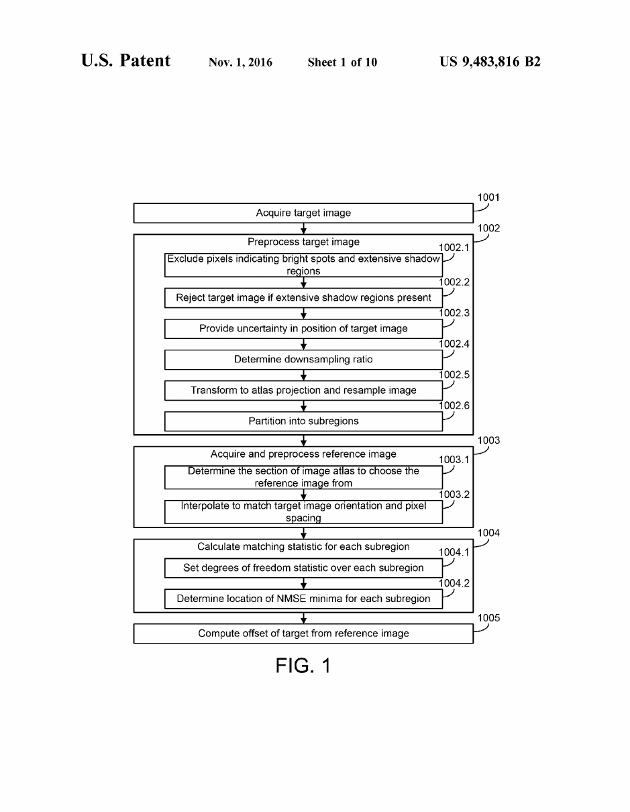
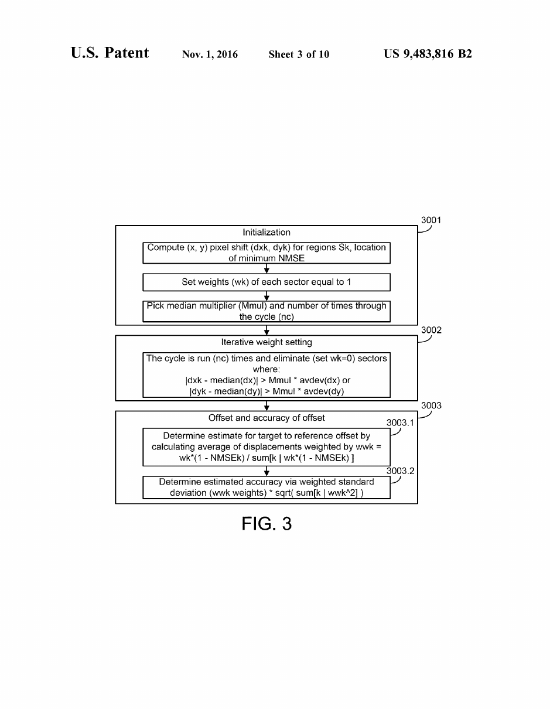
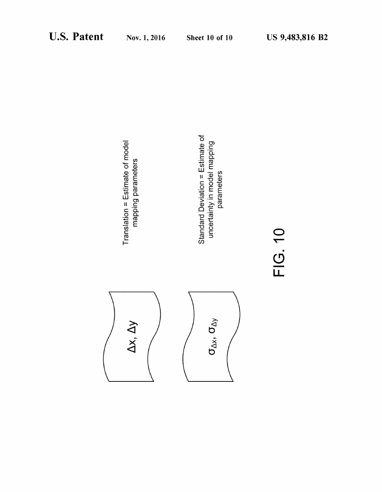

# US9483816B2 번역: 다중 모달 영상의 고정확도, 고신뢰도 정합 방법 및 시스템

번역 범위: 전문(서지, 초록, 기술 분야, 배경 기술, 요약, 도면 설명, 상세 설명, 청구항 19개). 인용 문헌은 원문 그대로 둔다.
원문: 같은 폴더의 `US9483816B2.pdf` (22쪽, 도면 10장). USPTO 공보 PDF(image-ppubs)에서 받았다. 번역 대본은 `pdftotext` 추출문이고, 글자로 뽑히지 않은 식(식 1~17)은 공보 쪽 이미지를 직접 읽어 옮겼다.
번역일: 2026-11-04. 번역문 안의 [역주]는 번역자가 덧붙인 설명이다.

## 서지 (공보 첫 장)

- (10) 특허 번호: US 9,483,816 B2
- (45) 등록일: 2016-11-01
- (54) 발명의 명칭: METHOD AND SYSTEM FOR HIGH ACCURACY AND RELIABILITY REGISTRATION OF MULTI MODAL IMAGERY
- (71) 출원인: Litel Instruments, San Diego, CA (US)
- (72) 발명자: Adlai H. Smith (Escondido, CA), Robert O. Hunter, Jr. (Snowmass Village, CO)
- (73) 권리자: Litel Instruments, San Diego, CA (US)
- (*) 존속 기간 조정: 35 U.S.C. 154(b)에 따라 293일 연장
- (21) 출원 번호: 14/475,102
- (22) 출원일: 2014-09-02
- (65) 공개: US 2015/0324989 A1 (2015-11-12)
- (60) 미국 가출원 61/873,016 (2013-09-03)
- (51) Int. Cl.: G06K 9/32 (2006.01), G06T 7/00 (2006.01)
- (52) CPC: G06T 7/00; G06T 7/0026; G06T 7/0034; G06T 7/0044; G06T 7/0081; G06T 2207/10044; G06T 2207/20076; G06T 2207/20212
- 심사관: Eueng-Nan Yeh. 대리인: Foley & Lardner LLP
- 청구항 19개, 도면 10장

(56) 인용 문헌 (원문 그대로, 추출 오류만 고침)

```
U.S. PATENT DOCUMENTS
5,828,793 A * 10/1998 Mann
6,141,433 A * 10/2000 Moed
6,654,690 B2  11/2003 Rahmes et al.
6,707,464 B2   3/2004 Ham et al.
6,900,760 B2   5/2005 Groves
6,937,349 B2   8/2005 Jones et al.
7,248,964 B2   7/2007 Bye
7,408,629 B2   8/2008 Qwarfort et al.
7,643,939 B2   1/2010 Zeng et al.
7,873,472 B2   1/2011 Zeng et al.
7,885,480 B2   2/2011 Bryll et al.
7,890,260 B2   2/2011 Ring
7,974,460 B2   7/2011 Elgersma
8,024,119 B2   9/2011 Zeng et al.
2006/0215935 A1*  9/2006 Oldroyd
2007/0096979 A1   5/2007 Hinnant et al.

OTHER PUBLICATIONS
U.S. Appl. No. 13/443,684, filed Apr. 10, 2012, Hunter et al.
U.S. Appl. No. 61/644,255, filed May 8, 2012, Hunter, Jr. et al.
Brewin, LightSquared Cellular Network Interferes With All GPS Applications, Latest Tests Show, Jun. 10, 2011.
Chave, A Lightweight Low-Power Magnetometer-Based UAV Flight Control System, ELEC 480, Nov. 3, 2005, 70 pgs.
Cramer, GPS/INS Integration, Photogrammetric Week '97, pp. 1-10.
Dickey-John Corporation, Radar III Ground Speed Sensor (2005), 2 pgs.
Easley et al., Geometric Transforms and Their Applications to SAR Speckle Reduction, Proc. SPIE vol. 5095 (2003), pp. 110-118.
Fjortoft et al., Optimal Edge Detection and Edge Localization in Complex SAR Images with Correlated Speckle, IEEE TGRS 37(5), Sep. 1999, pp. 2272-2281.
Frost et al., A Model for Radar Images and Its Application to Adaptive Digital Filtering of Multiplicative Noise, IEEE TPAMI PAMI-4(2), Mar. 1982, pp. 157-166.
Hong et al., A Robust Technique for Precise Registration of Radar and Optical Satellite Images, PE&RS 71(5), May 2005, pp. 585-593.
Hong, Image Fusion, Image Registration, and Radiometric Normalization for High Resolution Image Processing, UNB Technical Report No. 247, Apr. 2007, 218 pgs.
Huang et al., Feature-Based Image Registration Using the Shape Context, Int. J. Remote Sensing, 2010, 8 pgs.
Iran Hijacked US Drone, Says Iranian Engineer, The Christian Science Monitor, Dec. 2011.
Kopp, Almaz S-300, China's "Offensive" Air Defense.
Kopp, Self Propelled Air Defence System SA-11/17, Technical Report APA-TR-2009-0706, Jul. 2009.
Kostelec et al., Image Registration for MRI, Modern Signal Processing, MSRI Publications, vol. 46, 2003, pp. 161-184.
Li et al., Contour-Based Multisensor Image Registration, 1992 IEEE, pp. 182-186.
Lopes et al., Adaptive Speckle Filters and Scene Heterogeneity, IEEE TGRS 28(6), Nov. 1990, pp. 992-1000.
Maurer et al., Synthetic Aperture Radar/Landsat MSS Image Registration, NASA Reference Publication 1039, Jun. 1979, 237 pgs.
McGuire, An Image Registration Technique for Recovering Rotation, Scale and Translation Parameters, Mar. 25, 1998, pp. 1-46.
Merlin et al., Using Layovers in Fusion of Optical and SAR Data Application to Mustang Landscape Analysis, CEOS SAR Workshop, 1999, pp. 503-507.
Ndili et al., Coding Theoretic Approach to SAR Image Segmentation, Proc. SPIE vol. 4382 (2001), pp. 103-111.
O'Connor, Soviet/Russian SAM Site Configuration, Technical Report APA-TR-2009-1205-B, Jan. 2010.
Parekh, Design, Implementation and Performance Evaluation of Synthetic Aperture Radar Signal Processor on FPGAs, Masters Thesis, Jun. 23, 2000.
Pluim et al., Mutual Information Based Registration of Medical Images: A Survey, IEEE TMI, 2003, pp. 1-21.
Poulain et al., High-Resolution Optical and SAR Image Fusion for Building Database Updating, IEEE TGRS 49(8), Aug. 2011, pp. 2900-2910.
Rawnsley, North Korean Jammer Forces Down U.S. Spy Plane, Wired, 2011.
Reinartz et al., Orthorectification of VHR Optical Satellite Data Exploiting the Geometric Accuracy of TerraSAR-X Data, ISPRS J. 66 (2011), pp. 124-132.
Roche et al., The Correlation Ratio as a New Similarity Measure for Multimodal Image Registration, MICCAI'98, LNCS 1496, 1115-1124.
Shu et al., SAR and Spot Image Registration Based on Mutual Information with Contrast Measure, IEEE 2007, pp. 429-432.
Sijs et al., Optimal Decentralized Kalman Filter, 17th Mediterranean Conference on Control & Automation, 2009, pp. 803-808.
Subrahmanyam et al., Edge-Preserving Unscented Kalman Filter for Speckle Reduction, 2008 IEEE, 4 pgs.
TGSS True Ground Speed Sensor 740, User Manual HY33-5005-IB/US, Jan. 2012, 23 pgs.
Vassilaki et al., Geospatial Data Integration Using Automatic Global Matching of Free-Form Curves, ISDE 2008, 24 pgs.
Wegner, Automatic Fusion of SAR and Optical Imagery, Sep. 2007, 117 pgs.
Winn, North Korea's GPS Jammer Brigade, Sep. 16, 2011.
Wong et al., AISIR: Automated Inter-Sensor/Inter-Band Satellite Image Registration Using Robust Complex Wavelet Feature Representations, Pattern Recognition Lett. (2009), 8 pgs.
Yousif, Multitemporal Spaceborne SAR and Fusions of SAR and Optical Data for Unsupervised Change Detection in Shanghai, MSc Thesis, Dec. 2009.
Zhang et al., Bayesian-Based Speckle Supression for SAR Image Using Contourlet Transform, J. Electronic Science and Technology of China 6(1), Mar. 2008, pp. 79-82.
Zitova et al., Image Registration Methods: A Survey, Jun. 26, 2003, 24 pgs.
Averbuch et al., Image Registration Using Implicit Similarity and Pixel Migration, 2006, pp. 1-14.
Barbour et al., Inertial Instruments: Where to Now?, AIAA Guidance and Control Conference, Aug. 1992, pp. 566-574.
Bunting et al., An Area Based Technique for Image-To-Image Registration of Multi-Modal Remote Sensing Data, IGARSS, Aug. 2008, 2 pgs.
DeBonet et al., Structure-Driven SAR Image Registration, Proc. SPIE vol. 3370, Sep. 1998, 11 pgs.
GENS, Terrain Correction and Ortho-Rectification, 2005, pp. 1-11.
Glasbey, SAR Image Registration and Segmentation Using an Estimated DEM, EMMCVPR'97, LNCS 1223, 507-520, 1997.
Goncalves et al., Precise Orientation of Spot Panchromatic Images with Tie Points to a SAR Image, ISPRS PCV'02, vol. 34, 2002.
GPS Jamming, No Jam Tomorrow, The Economist, Mar. 10, 2011.
Hellwich et al., Sensor and Data Fusion Contest: Test Imagery to Compare and Combine Airborne SAR and Optical Sensors for Mapping, ISPRS PCV'02, vol. 34, 2002.
Jia et al., SAR Image and Optical Image Registration Based on Contour and Similarity Measures, Proc. GSEM, Sep. 14-16, 2009, pp. 341-345.
Kang et al., Automatic SAR Image Registration by Using Element Triangle Invariants, 9th Int. Conf. on Information Fusion, 2006, 7 pgs.
Lehureau et al., Registration of Metric Resolution SAR and Optical Images in Urban Areas, EUSAR 2008, 4 pgs.
Li et al., Registration of Radar and Optical Satellite Images Using Multiscale Filter Technique and Information Measure, Geoscience and Remote Sensing, New Achievements, Ch. 24, Feb. 1, 2010, pp. 457-476.
Olfati-Saber, Distributed Kalman Filtering and Sensor Fusion in Sensor Networks, LNCIS vol. 331, Jul. 2006, pp. 1-13.
Suri et al., Application of Generalized Partial Volume Estimation for Mutual Information based Registration of High Resolution SAR and Optical Imagery, 11th Int. Conf. on Information Fusion, 2008, pp. 1257-1264.
Suri et al., Combining Mutual Information and Scale Invariant Feature Transform for Fast and Robust Multisensor SAR Image Registration, 75th ASPRS Conference, Mar. 5, 2009, 12 pgs.
Suri et al., On the Possibility of Intensity Based Registration for Metric Resolution SAR and Optical Imagery, 12th AGILE Conference, Jun. 2-5, 2009, 19 pgs.
Wegner et al., Image Analysis of Fused SAR and Optical Images Deploying Open Source Software Library OTB, ISPRS Hannover Workshop, 2007, 5 pgs.
Wegner, Automatic Fusion of SAR and Optical Imagery based on Line Features, EUSAR 2008, 4 pgs.
Wessel et al., Registration of Near Real-Time SAR Images by Image-To-Image Matching, ISPRS Archives 36, PIA 2007, pp. 179-184.
* cited by examiner
```

## (57) 초록

목표 영상을 기준 영상에 사상하는 방법은 다음을 포함한다.

- 목표 영상을 받는다.
- 목표 영상과 겹치는 기준 영상을 받는다.
- 목표 영상을 전처리한다. 전처리는 다음을 포함한다.
  - 그림자 영역이 그림자 문턱보다 큰 목표 영상은 기각하고, 그림자 영역이 문턱보다 작은 목표 영상은 남긴다.
  - 남긴 목표 영상이 기준 영상에 대해 어디 있는지, 그 위치의 불확도를 준다.
  - 남긴 목표 영상을 아틀라스 투영으로 바꿔 기준 영상에 맞춘다.
  - 바꾼 목표 영상을 부분 영역으로 나눈다.
- 부분 영역마다 정합 통계를 구해, 각 부분 영역이 기준 영상의 어디에 있는지 정한다.



FIG. 1 (도면 1/10, 첫 장 대표 도면): 목표 영상을 기준 영상에 사상하는 방법의 흐름.

- 1001 목표 영상 획득
- 1002 목표 영상 전처리
  - 1002.1 밝은 점과 넓은 그림자를 나타내는 화소 제외
  - 1002.2 넓은 그림자 영역이 있으면 목표 영상 기각
  - 1002.3 목표 영상 위치의 불확도 제공
  - 1002.4 축소 비율 결정
  - 1002.5 아틀라스 투영으로 변환하고 다시 표본화
  - 1002.6 부분 영역으로 분할
- 1003 기준 영상 획득과 전처리
  - 영상 아틀라스에서 기준 영상을 고를 구간 결정
  - 목표 영상의 방향과 화소 간격에 맞게 보간
- 1004 부분 영역마다 정합 통계 계산
  - 1004.1 부분 영역마다 자유도 통계 설정
  - 1004.2 부분 영역마다 NMSE 최솟값 위치 결정
- 1005 기준 영상에 대한 목표 영상의 이동량 계산

## 관련 출원 상호 참조

이 출원은 2013년 9월 3일 출원한 미국 가출원 61/873,016 ("METHOD & SYSTEM FOR HIGH ACCURACY & RELIABILITY REGISTRATION OF MULTI MODAL IMAGERY")의 우선권을 주장한다. 이 가출원 전체를 참조로 여기에 포함한다.

## 기술 분야

이 개시는 서로 다른 물리 수단이나 방식(모달리티)으로 얻은 영상 둘 이상을 정확하고 믿을 수 있게 정합하는 방법에 관한 것이다. 여기서 드는 주된 예는 합성 개구 레이더(SAR) 영상을 광학 영상이나 적외선 영상에 정합하는 것이다. 평행이동보다 높은 차수의 왜곡이 있는 영상을 자동으로, 믿을 수 있게 맞추는 것도 이 개시의 또 다른 예시 측면이다.

## 배경 기술

영상 정합은 두 장 이상의 영상을 서로 정확히 겹치도록 맞추는 과정이다. 항공 식별과 표적 지정, 의료 진단과 치료, 지구물리 연구에서 일상적으로 필요하다. 같은 물체를 서로 다른 기법(레이더, 광학, 레이저 조명, 자기 공명 영상(MRI), X선 등)으로 얻은 영상을 정합하는 일은 일반적으로 다루기 어렵기 때문에 매우 힘들다. 이 다중 모달 정합은, 처음 정합 불확도 창이 너무 커서 상관 계수를 그대로 계산하면 그 창 안에서 거짓 최댓값을 많이 만나는 경우 더 어려워진다. 불확도 창 안의 여러 R2 최댓값을 다루는 방법이 있기는 하다. 그러나 가장 높은 R2 최댓값이 올바른 정합에 대응하지 않으면, 결과 영상은 어긋날 가능성이 크다. 사람이 감독하는 상황이면 바로잡을 수 있지만, 시간 제약이 있는 상황(곧 자동 과정이 아닌 경우)에서는 그렇지 못하다. 또 영상 오정합은 곧바로 무기의 오조준으로 이어져 파괴적인 결과를 낳는다.

합성 개구 레이더(SAR) 영상은 넓은 동적 범위(보통 16비트)와 강한 결맞음 효과(특히 스페클)가 특징이다. 반면 자연광으로 찍은 광학 영상은 동적 범위가 낮지만(보통 8비트) 채널이 더 많고(RGB) 결맞음 효과가 없다. 또 다른 차이는 파장(레이더 0.3 cm, 광학 0.00005 cm)에 따른 물체의 산란과 반사 응답, 그리고 그림자 위치가 뚜렷이 다르다는 점이다(그림자 위치는 광학 영상을 조명원(태양)과 장면 사이 바로 위에서 찍은 경우에만 같다). 이 응답 특성의 차이와 다양성은, SAR 신호와 광학 신호 사이의 대응 관계가 장면 안의 위치에 따라 크게 달라지는 형태로 나타날 수 있다.

SAR와 광학 정합의 한 부류는 각 영상에서 뚜렷한 특징이나 제어점을 찾고, 그 특징끼리 대응시킨 뒤, 대응된 특징으로 영상을 맞춘다. 특징 기반 기법은 SAR의 곱셈 스페클과, 광학 특징과 레이더 특징 사이의 일관된 대응이 대체로 없다는 점 때문에 어렵다. 특징을 어떻게 고르는지는 보통 알고리즘마다 다르며, 이런 특징은 밴들릿, 빔릿, 웨이블릿, 팁 점 등으로 불린다. 특징은 손이나 자동으로 고르고, 두 영상(목표와 기준)이 함께 가진 두드러지고 구별되는 물체여야 한다. 그 밀도와 위치는 전적으로 영상에 달려 있다.

또 다른 부류는 에지, 더 일반적으로는 윤곽(컨투어릿, 커블릿, 리지릿)을 정합 특징으로 쓴다. 결맞음 효과(모서리와 에지 반사) 때문에 SAR의 일부 윤곽은 광학 영상에 비해 지나치게 두드러진다(밝은 선이나 줄). 강한 스페클은 광학 쪽에 대응이 없는 윤곽을 더 만든다. 결국 특징 대응 전에 잘라 내야 하는 불필요한 SAR 에지가 생긴다. 이런 방식의 전형은 적응형 공간 이동 평균으로 SAR 스페클을 억누르는 것인데, 영상이 한 장일 때는 늘 해상도가 떨어진다.

많이 어긋나지 않은 영상의 정합에는 위 알고리즘들이 맞을 수 있다. 그러나 불확도 창이 큰 영상을 강건하게 정합하는 방법은 없다.

## 요약

한 실시 형태는 기계 명령을 저장한 비일시적 컴퓨터 판독 가능 저장 매체에 관한 것이다. 명령은 프로세서가 실행하여 다음 작업을 하게 한다. 목표 영상을 받는다. 목표 영상과 겹치는 기준 영상을 받는다. 목표 영상을 전처리한다. 전처리는 그림자 영역이 그림자 문턱보다 큰 목표 영상을 기각하고 그림자 영역이 문턱보다 작은 목표 영상을 남기는 것, 남긴 목표 영상의 기준 영상 대비 위치 불확도를 주는 것, 남긴 목표 영상을 아틀라스 투영으로 바꿔 기준 영상에 맞추는 것, 바꾼 목표 영상을 부분 영역으로 나누는 것을 포함한다. 그리고 부분 영역마다 정합 통계를 구해 각 부분 영역의 기준 영상 대비 위치를 정한다.

다른 실시 형태는 영상 처리 시스템에 관한 것이다. 시스템은 기준 영상과 목표 영상을 얻는 영상 획득 장치와 프로세서를 포함한다. 프로세서는 목표 영상을 전처리한다. 그 전처리는 목표 영상을 받는 것, 그림자 영역이 그림자 문턱보다 큰 목표 영상을 기각하고 작은 것을 남기는 것, 목표 영상과 기준 영상 사이의 사상 모델을 주는 것, 남긴 목표 영상을 아틀라스 투영으로 바꿔 기준 영상에 맞추는 것, 남긴 목표 영상을 부분 영역으로 나누는 것, 각 부분 영역에서 그림자가 진 면적 비율을 구하는 것을 포함한다. 프로세서는 기준 영상도 전처리한다. 그 전처리는 기준 영상을 받는 것, 기준 영상의 수치 표고 지도(DEM)를 주는 것, 기준 영상을 목표 경사면에 투영하는 것(투영에는 그림자 영역이 포함된다), 투영한 기준 영상을 목표 영상의 방향과 화소 간격에 맞게 보간하는 것을 포함한다. 프로세서는 목표 영상의 부분 영역마다 정합 통계를 구해 각 부분 영역의 기준 영상 대비 위치를 정한다.

또 다른 실시 형태는 SAR 영상을 기준 영상에 사상하는 방법에 관한 것이다. 이 방법은 프로세서가 목표 영상을 전처리하는 단계를 포함한다. 그 전처리는 그림자 영역이 그림자 문턱보다 큰 목표 영상을 기각하고 작은 것을 남기는 것, 바꾼 남긴 목표 영상을 부분 영역으로 나누는 것, 남긴 목표 부분 영역에서 그림자가 진 면적 비율을 구하는 것을 포함한다. 이 방법은 또 프로세서가 기준 영상을 전처리하는 단계를 포함한다. 그 전처리는 기준 영상을 목표 경사면에 투영하는 것(투영에는 그림자 영역이 포함된다)과 기준 영상에서 그림자가 진 면적 비율을 구하는 것을 포함한다. 이 방법은 또 프로세서가 부분 영역마다 정합 통계를 구하는 단계를 포함한다. 그 단계는 자유 매개변수가 없는 고정 형태를 기준 영상에 고르는 것, 부분 영역의 목표 영상 진폭을 기준 영상 진폭에 사상하는 기저 함수를 하나 이상 고르는 것, 면적 비율 덮임의 상한과 허용차를 주고, 그림자가 지나쳐서 목표 부분 영역을 고려하지 않는 상한을 주는 것, 목표 부분 영역마다 위치와 정규화 평균제곱오차(NMSE)를 구하는 것을 포함한다. 여기서 부분 영역의 정해진 위치는, 그 부분 영역의 그림자 함량이 기준 영상의 그림자 함량과 정해진 허용차 안에서 일치하는 위치에 해당한다.

## 도면의 간단한 설명

- FIG. 1: 한 실시 형태에 따라 목표 영상을 기준 영상에 사상하는 방법의 흐름도.
- FIG. 2: 한 실시 형태에 따라 투영된 목표 영상이 기준 면에서 차지하는 공간과, 투영된 목표 영상과 기본 방위계(동서남북)의 관계를 보인 모식도.
- FIG. 3: 한 실시 형태에 따라 기준 영상에 대한 목표 영상의 이동량을 정하는 방법의 흐름도.
- FIG. 4: 다른 실시 형태에 따라 기준 영상에 대한 목표 영상의 이동량을 정하는 방법의 흐름도.
- FIG. 5: 한 실시 형태에 따른 FIG. 1 방법의 결과 예.
- FIG. 6: 한 실시 형태에 따른 FIG. 1 방법의 다른 결과 예.
- FIG. 7: 한 실시 형태에 따라 목표 영상과 기준 영상을 잇는 아핀 변환을 정하는 방법의 흐름도.
- FIG. 8: 한 실시 형태에 따라 그림자 영역을 포함해 목표 영상을 기준 영상에 사상하는 방법의 흐름도.
- FIG. 9: 한 실시 형태에 따라 그림자 영역을 이용해 목표 영상을 기준 영상에 사상하는 방법의 흐름도.
- FIG. 10: 한 실시 형태에 따라 FIG. 1 방법으로 얻은 모델 사상 매개변수의 추정값과 그 불확도의 추정값.

## 상세한 설명

여기 개시하고 설명하는 실시 형태들은 영상 처리 시스템으로 구현할 수 있다. 영상 처리 시스템은 영상 획득 장치(예: FIG. 5의 5004)와, 여기 설명한 과정의 적어도 일부를 수행하도록 구성한 프로세서를 가진 처리 회로를 포함할 수 있다. 영상 획득 장치 5004 (FIG. 6에서는 6004)는 유선이나 무선 연결로 프로세서와 통신할 수 있다. 유선 연결은 직렬 케이블, 광섬유 케이블, CAT5 케이블 또는 다른 유선 형태일 수 있다. 무선 연결은 인터넷, Wi-Fi, 셀룰러, 무선 주파수(RF) 등일 수 있다.

앞서 말했듯이 처리 회로의 프로세서는 여러 실시 형태에 관해 여기 설명한 과정의 적어도 일부를 수행하도록 구성할 수 있다. 프로세서는 범용 프로세서, 주문형 집적 회로(ASIC), 하나 이상의 FPGA, 디지털 신호 프로세서(DSP), 처리 부품의 묶음 또는 다른 알맞은 전자 처리 부품으로 구현할 수 있다. 프로세서는 여기 설명한 작업을 수행하는 기계 판독 가능 명령을 담은 메모리 장치를 하나 이상 포함할 수 있다. 예시 명령은 아래에서 더 자세히 설명한다. 따라서 특정 실시 형태에서 프로세서를 늘 언급하지 않더라도, 이 개시의 방법, 장치, 실시 형태의 적어도 일부는 위와 같은 프로세서로 구현할 수 있다고 이해해야 한다.

일부 실시 형태에 따르면, 광학 영상 안에서 불확도 창이 큰 SAR 영상을 강건하게 정합하는 과정을 제공한다. 일부 실시 형태에 따르면, 큰 변위와 작은 변위 모두에 대해 다중 모달 영상을 강건하게 정합하는 방법을 제공한다. 일부 실시 형태에 따르면, 평행이동, 회전, 전단, 그리고 그보다 높은 차수의 왜곡이 있을 수 있는 다중 모달 영상을 강건하게 정합하는 방법을 제공한다.

### 제1 실시 형태

FIG. 1은 목표 영상을 기준 영상에 사상하는 제1 실시 형태를 개괄한다. 여기 설명하는 시스템과 방법은 주로 SAR 영상에 관한 것이지만, 다른 영상 시스템도 쓸 수 있다. 이 개시는 SAR 영상에 한정되지 않으며, 다른 영상 시스템과 방법도 이 개시의 정신과 범위에 든다.

#### 목표 영상 획득

계속 FIG. 1을 보면, 블록 1001에서 SAR 영상(목표 영상)은 보통 항공 플랫폼(대개 무인기)이나 위성으로 얻는다(예: FIG. 5의 5004, FIG. 6의 6004). 획득 방식(스포트라이트 또는 스캔 모드)이, 영상을 이루는 원시 교차 거리 × 거리 자료에 들어 있는 왜곡의 종류를 정한다. 영상 크기와 해상도는 레이더 대역(Ka, Ku, X, C 등), 이격 거리, 영상 모드에 크게 달라진다. 무인기용 현 세대 기술은 대개 약 1~3 km² 면적을 덮는다. 자료는 ncr(교차 거리 방향 화소 수) × nr(거리 방향 화소 수) 화소의 직사각 진폭 배열(icr=1:ncr, ir=1:nr 위치)로 나오며, icr, ir은 교차 거리 방향과 거리 방향을 나타낸다. 여기에 명목 지리 위치(위도, 경도), 영상 방향, 그 밖의 획득 매개변수를 담은 메타데이터가 붙는다. 반사 진폭 A는 실수나 복소수일 수 있고, 편광 송신기와 수신기의 결과일 수도 있다.

#### 목표 영상 전처리

과정 1002에서, FIG. 1은 목표 영상을 기준 영상에 대해 찾기 전에 목표 영상을 전처리하는 단계를 포함한다. 여기서 "기준 영상"과 "아틀라스 영상"은 같은 뜻으로 쓴다. 기준 영상이나 아틀라스 영상은 목표 영상을 맞추고자 하거나 맞추기로 고른 특정 영상을 말한다. 예를 들어 전역 아틀라스가 아틀라스나 기준을 줄 수 있다.

FIG. 1로 돌아가, 먼저 상자 1002.1에서 진폭 크기 |At(icr,ir)|의 통계로 어떤 화소를 남길지 정한다. 밝은 점을 나타내는 화소는 제외한다. 기준 영상도 SAR이면 목표 영상 진폭 |At|를 보통 그대로 쓰고, 기준 영상이 광학이면 대개 검열(잘라 내기)이 필요하다. 진폭 영상을 쓰면 그림자 화소와 밝은 화소를 알아낼 수 있고, 그 화소(일부 실시 형태에서는 영역)를 뺄 수 있다. 16비트 SAR 영상에서 |At|의 통계는 보통 거의 쌍봉형이며, 화소 대부분(약 98% 넘게)의 진폭이 4~8 × median(|At|)보다 작다. 최댓값 max(|At|)는 2^16−1이다. 목표 화소 값의 중앙값(median(|At|))의 몇 배(Xmed, 약 4~8)보다 큰 화소에는 가중 0을, 나머지 낮은 값 화소에는 1을 준다. 그 결과 배열 iont(icr,ir)=1/0이 생기며, 이는 해당 화소를 이후 계산에서 남기는지 버리는지를 뜻한다.

여전히 FIG. 1의 1002.1 단계 안에서, SAR 영상의 또 다른 측면은 그림자 영역이다. 산악 지형이나 굴곡이 심한 지형(도시 지역일 수도 있다)에서 특히 눈에 띈다. 과정 1002.2에서, 그림자 영역이 그림자 문턱보다 큰 목표 영상은 기각하고, 그림자 영역이 문턱보다 작은 목표 영상은 남긴다. 그림자 문턱은 목표 영상 한 장에 허용되는 그림자 면적을 말한다. 한 실시 형태에서 그림자 문턱은 검출기 잡음 수준이다. 그림자 면적이 검출기 잡음 수준보다 큰 목표 영상은 버리고, 작은 목표 영상은 남긴다. [역주: 원문 그대로 옮겼다. 문맥상 "검출기 잡음 수준 이하의 어두운 화소로 이루어진 그림자 면적이 허용치를 넘는가"로 읽힌다.]

FIG. 1의 방법은 덤불, 바위, 나무, 차량, 전선이나 전신주, 지상의 항공기, 외딴 건물 몇 채가 만드는 비교적 작은 그림자에는 거의 관심이 없고, 언덕, 협곡, 산, 계곡 같은 큰 지형이 만드는 그림자에 관심이 있다. 레이더 조명 기하에 따라 획득 영상 면적의 약 5%보다 큰, 이어진 그림자 영역이 생길 수 있다. 그 영역은 진폭이 낮다(전자 회로와 신호 처리 잡음 수준에 대기 연무 반사 수준을 더한 정도). 이 배경 잡음 수준은 위쪽(적어도 지면을 향하지 않은 방향)으로 향한 SAR의 반사를 영상으로 처리해 |At|의 공간 통계와 진폭 통계를 보면 쉽게 잴 수 있다. 이 공중 영상 통계를 시스템 자동 이득에 맞게 조정하면 목표 영상의 어느 영역이 그림자인지 쉽게 정할 수 있다. 이 간단하고 믿을 만한 방법이 안 되면, 목표 영상 진폭 |At|에서 그림자 위치를 추정하는 대안이 있다. 이 예시 방법은 큰(약 5%보다 큰) 이어진 그림자에 관심이 있으므로, 흔들림을 줄일 만큼 화소가 많이 든 창(면적의 약 1/2~1% 이하)으로 이동 평균을 내서 그림자 후보인 큰 연결 영역을 찾는다. 그런 다음 후보 영역 안의 진폭 통계를 비교해, 통계적으로 같은지와 잡동사니(클러터)나 특징 수준보다 통계적으로 낮은지를 볼 수 있다. 이 분석으로 그림자 배열 isht(icr,ir)=0/1을 계산한다. 이는 화소가 그림자 안에 있는지 아닌지를 나타낸다.

목표 화소를 고려 대상인지(iont), 그림자 안인지(isht)(일부 실시 형태에서는 밝은 점이라 제외되는지까지)로 나눈 뒤, FIG. 1의 방법은 상자 1002.2로 넘어간다. 기준 영상의 그림자는 SAR 그림자보다 대비가 훨씬 약하고(직사광이 아닌 하늘빛으로 흩어져 비친다), 대개 완전히 다른 기하로 비추고 관측된다. 그래서 크고 이어진 SAR 그림자(면적의 약 50~75%보다 큰)가 있으면 목표 영상의 정보량이 그만큼 줄어, 광학 영상과의 정합을 시도할 수 없는 수준이 된다. 이렇게 판정되면 이 지점에서 과정을 멈춘다. 계속하면 잘못된 정합의 확률이 크게 높아지기 때문이다. 이렇게 판정되지 않으면 과정을 계속할 수 있다. 그에 따라 그림자 배열을 on/off 배열과 합쳐, 그림자 영역의 화소가 이후 정합 과정에서 고려되지 않게 한다(수식으로는 iont(icr,ir) → iont(icr,ir)*isht(icr,ir)).

다음(하위 단계 1002.3)으로, 기준 영상에 대한 목표 영상 위치의 불확도(Δ)를 추정한다. 거친 위치 찾기 문제(정밀 위치 찾기보다 어렵다)에서는 몇 미터(약 10 m 미만) 수준의 오차는 중요하지 않다. 보통 수십 미터에서 몇 킬로미터(어쩌면 그 이상)의 불확도가 있다. 이 규모에서는 기준 영상의 자기 데이터베이스 대비 위치 불확도가 보통 작지만, 목표 영상 위치 불확도에 더할 수 있다. 목표 영상 위치 오차를 추정하는 자연스러운 출처는 목표 영상을 얻은 플랫폼(예: 무인 항공기, UAV)의 관성 항법 장치가 마지막으로 믿을 만한 GPS 위치 갱신이나 항법 경유점 갱신 뒤 보이는 특유의 표류다. 시간에 따른 이 표류는 UAV나 관성 항법을 쓰는 다른 플랫폼에서 잘 알려진 특성이다.

불확도(Δ)와 목표 영상 크기(wxt × wyt)를 알면 목표 영상과 기준 영상을 축소(과정 1002.4)할 수 있다. 보통 화소 간격을 2배 이상(ds배) 줄인다(영상 점 수는 그 제곱만큼 준다). 각 방향(ixt, iyt)에서 ds번째 화소만 남기거나, 같은 화소에서 ds×ds 크기 가중 창으로 국소 평균을 내면 된다. 가중 창은 평평한 평균이거나 끝이 가늘어지는 형태(삼각, 가우스, 해닝 창 등)일 수 있다. 가중 창은 보통 목표 영상과 기준 영상에 다르게 고른다.

다음으로 FIG. 1의 과정 1002.5로 넘어가, 목표 진폭을 기준 영상 투영에 맞게 변환(사상)한다. SAR 영상은 본래 경사면에서 얻는다. 경사면은 획득 플랫폼 기하가 정하는 지형의 특정 기하 투영이다. 그래서 교차 거리와 거리 좌표(화소로는 위의 nr×ncr 표기)를 쓴다. 기준 영상이나 아틀라스 영상은 위도와 경도, 또는 평평한 지구(지구의 국소 접평면) 좌표로 화소화되어 있을 수 있다. 어느 경우든 |At(icr,ir)|를 기준 영상이 놓인 같은 평면 또는 구면 기준 면으로 투영하고 보간한다. 정보를 최대한 지키려고 다음을 할 수 있다. 1) 축소가 필요 없을 때(ds=1)는 SAR 자료의 날카로운 기울기를 지키려고 최근접 보간을 쓴다. 2) 교차 거리(icr)와 거리(ir) 방향을 알맞게 변환해 새 주 방향(icr'=ixt, ir'=iyt)으로 유지한다. 그러면 변환한 목표 영상은 화소 행과 열이 투영된 목표 영상의 가장자리와 나란한 직사각 영상이 된다. FIG. 2는 투영된 목표 영상이 기준 면에서 차지하는 영역과 표준 북동 좌표계와의 관계의 예다. 결과는 변환하고 보간하고 축소했을 수 있는 진폭이다(앞으로는 |At'(ixt,iyt)|를 |At(ixt,iyt)|로 쓴다). on/off 배열(iont)을 변환할 때도 거의 같은 과정을 따른다. 다만 축소에 국소 평균이 들어가면, 가중 합(Σ[Δicr,Δir] wt(Δicr,Δir)*iont(icr+Δicr, ir+Δir), Δicr, Δir은 ds×ds 화소 창 위에서 변하며 합한다)이 문턱 ion_th보다 작으면 0, 크면 1로 결과(iont')를 정한다. 앞으로 iont'(ixt,iyt)를 iont(ixt,iyt)로 쓴다.

[역주: FIG. 2(도면 2/10)는 추출 글자가 없는 모식도라 이미지로 넣지 않았다. 내용은 위 문단의 설명과 같다.]

다음 단계(FIG. 1의 1002.6)로 가서, 목표 진폭을 부분 영역(S1, ..., Snsr)으로 나눈다. 이 부분 영역은 (보통 서로 겹치지 않으며) 가로세로 비가 약 1인 직사각형이 보통이다. 각 부분 영역은 on 화소가 10^4개보다 많고, on 화소 비율이 50%보다 크며, 전체 개수는 10개보다 많다(보통 50~100개). 기준 영상 안에서 처음 위치를 찾는 대상이 이 부분 영역이다. 목표 영상 안의 특징 유사성에 기반한 다른 기법도 가능하다.

#### 기준 영상 획득과 전처리

과정 1003에서, FIG. 1은 기준 영상을 목표 영상과 정합하기 전에 기준 영상을 얻고 전처리하는 단계를 포함한다.

목표 영상 크기와 주어진 위치 불확도를 합치면, 영상 아틀라스에서 기준 영상을 고를 구간을 정할 수 있다(하위 단계 1003.1). 곧 주어진 불확도 Δ는 기준 영상이 (ixt, iyt) 방향으로 (wxt+2*Δ, wyt+2*Δ) 크기여야 하고, 목표 영상의 명목 위치나 가정 위치를 중심으로 해야 한다는 뜻이다. 영상 아틀라스는 기체 탑재 데이터베이스일 수도 있고, 대역폭이 허락하면 필요한 기준 영상을 고속 데이터 링크로 받는 외부 데이터베이스일 수도 있다. 주어진 기준 영상에도 (예를 들어 구름이 일부 덮어서) 고려하지 말아야 할 화소가 있을 수 있으며, 이는 목표의 on/off 배열(iont)과 비슷한 배열로 전달된다. 주어진 기준 배열과 ionref의 격자 크기, 간격, 방향은 (다시 표본화했을 수 있는) 목표 배열과 맞지 않을 수 있다. 이 기준 영상을 이제 축소하고 보간해 전처리한 목표 영상의 격자 간격과 방향에 맞춘다. 여기서도 보간은 가중일 수 있고 ionref는 iont와 비슷하게 다룬다(위 참조). RGB 컬러 영상이면 채널 하나(보통 해상도가 가장 좋은 G)를 고르거나 세 채널의 가중 평균을 쓸 수 있다.

#### 부분 영역마다 정합 통계 계산

과정 1004에서, FIG. 1은 부분 영역마다 정합 통계를 계산하는 하위 단계를 포함한다. 정합 통계는 (크게 잡은) 기준 영역 안에서 목표 부분 영역의 정렬을 정하는 척도다. 정보 기반 척도일 수도 있고, 제곱오차 합(SSE)이나 정규화 평균제곱오차(NMSE) 같은 더 전통적인 척도일 수도 있다. 기준 영상 안에서 목표 부분 영역(Sk)의 위치를 믿을 수 있게 찾으려면 |At|의 히스토그램 분포를 적응적으로 다시 사상하는 것이 결정적일 수 있다. 이는 |At|와 |Ar| 사이의 알 수 없고 공간에 따라 변하는 상관을 수용하기 위해서다. 이를 위해 기저 함수 집합 f1(|At|), f2(|At|), ..., fn(|At|)을 고르고, 계수 C1, C2, ..., Cn을 Sk의 명목(움직이지 않은) 위치로부터의 시험 변위 (dx,dy)의 함수로 바꿔 NMSE를 최소로 만든다. 기준 영상 진폭도 정해지지 않은 매개변수가 없는 함수 하나 g(|Ar|)로 다시 사상한다. 그러면 부분 영역 Sk의 SSE 식은 다음과 같다.

```
SSEk(dx,dy) = Σk iont(ixt,iyt)*ionref(ixt+dx,iyt+dy)
              *( g(|Ar|(ixt+dx,iyt+dy)) − gav(dx,dy) − C1*f1(|At|(ixt,iyt)) − ... − Cn*fn(|At|(ixt,iyt)) )^2      (식 1)
```

여기서 합은 목표 부분 영역 Sk 안의 점들 위에서 한다. iont와 ionref 인자는 사실상 on 점만 기여하게 한다. dx와 dy는 모두 위치 불확도 범위(−Δ:+Δ) 위에서 변한다. gav(dx,dy)는 Sk로 창을 씌우고 (dx,dy)에 중심을 두며 ionref로 가중한 g(|Ar|)의 평균이다. 이 시점에서 C1, ..., Cn은 이 매개변수들에 대해 SSEk를 최소화해 정한다. 그 결과 C1, ..., Cn은 시험 변위 (dx,dy)의 함수가 된다. 부분 영역 Sk의 정규화 평균제곱오차(우리 척도)는 다음과 같다.

```
NMSEk(dx,dy) = SSEk(dx,dy) / ( nk(dx,dy) * σg^2(dx,dy) )      (식 2)
```

여기서 C1, ..., Cn은 이제 (dx,dy)의 함수로 알려져 있고,

```
nk(dx,dy) = 사용한 on 점 수 = Σk iont(ixt,iyt)*ionref(ixt+dx,iyt+dy)      (식 3)

σg^2(dx,dy) = Σk iont(ixt,iyt)*ionref(ixt+dx,iyt+dy)*( g(|Ar|(ixt+dx,iyt+dy)) − gav(dx,dy) )^2 / nk(dx,dy)      (식 4)
```

그리고

```
gav(dx,dy) = Σk iont(ixt,iyt)*ionref(ixt+dx,iyt+dy)*g(|Ar|(ixt+dx,iyt+dy))      (식 4.1)
```

[역주: 식 4.1은 공보에 nk로 나누는 항이 없이 인쇄되어 있다. 앞 문단의 "평균" 정의와 맞추려면 nk(dx,dy)로 나눠야 한다. 원문 그대로 옮겼다.]

부분 영역 Sk의 이동량은 식 2의 NMSEk를 최소로 하는 점 (dx=dxk, dy=dyk)으로 정한다. 기준 배열 점을 모두 쓸 때(ionref=1) NMSEk(식 2)를 경제적으로 계산하는 방법은 다음 내적에서 시작한다.

```
<R|T>(dx,dy) = Σk ionref(ixt+dx,iyt+dy)*R(ixt+dx,iyt+dy)*iont(ixt,iyt)*T(ixt,iyt)/nk(dx,dy)
             = Σk R(ixt+dx,iyt+dy)*iont(ixt,iyt)*T(ixt,iyt)/nk      (식 5)
```

이것은 합성곱으로 효율적으로 계산된다. R=1이면 (dx,dy)에 더 이상 의존하지 않으며 다음이 된다.

```
<1|T> = Σk iont(ixt,iyt)*T(ixt,iyt)/nk      (식 6)
```

다음으로, 어떤 최적화도 없이, 이동 창 안의 기준 영역 분산은 식 4와 4.1에서 정의한 σg^2(dx,dy)이다. [역주: 공보에 식 7 번호가 붙은 식은 인쇄되어 있지 않다.]

함수가 하나(f1)이면 다음을 만든다.

```
E1(|At|(ixt,iyt)) = f1(|At|(ixt,iyt)) / sqrt(<1|f1^2>)      (식 8)
```

그리고 최적 C1을 고른 효과로 다음 평균제곱오차가 나온다.

```
MSEk(dx,dy) = σg^2 − <g(|Ar|) − gav(dx,dy) | E1>^2      (식 9)
```

함수가 둘(f1, f2)이면 다음을 만든다.

```
E2(|At|(ixt,iyt)) = f2(|At|(ixt,iyt)) − <1|f2(|At|(ixt,iyt))*E1(|At|(ixt,iyt))>      (식 10)
```

그리고 E2를 E1처럼 정규화한다. 그러면 최적 C1과 C2를 고른 효과로 다음 평균제곱오차가 나온다.

```
MSEk(dx,dy) = σg^2 − <g(|Ar|) − gav(dx,dy) | E1>^2 − <g(|Ar|) − gav(dx,dy) | E2>^2      (식 11)
```

이는 식 9를 간단히 갱신한 것이다. [역주: 함수를 그람-슈미트로 직교화해 하나씩 더할 때마다 투영 제곱을 하나씩 빼는 구조다.] 이렇게 계속하면 함수 전체(n개) f1, ..., fn에 대한 MSEk를 효율적이고 간결하게 계산할 수 있고, 정규화 평균제곱오차 식에 이른다.

```
NMSEk(dx,dy) = MSEk(dx,dy) / σg^2(dx,dy)      (식 12)
```

이 식에서 NMSE가 최소인 위치 (dxk,dyk)를 정할 수 있으며, 이것이 기준 영상 안 부분 영역 Sk 위치의 최선 선택에 해당한다. ionref가 모두 1이 아닐 때도 NMSEk를 체계적으로 계산할 수 있지만, 그 추가 장부 정리는 이 개시의 다른 측면을 더 보여 주지 않는다.

목표 영상용 함수 f1, f2 등은 최소 두 개여야 하며, 가장 간단하게는 상수(f1(x)=1)와 진폭 자체(f2(x)=x)다. 그러면 기준 진폭에 대한 목표 진폭의 전체 밝기 수준 이동, 배율, 그리고 대비 반전까지 따라갈 수 있다. 0~n−1차 다항식 같은 더 큰 함수 집합도 가능하다. 기준 진폭의 배율 함수(g)는 진폭 자체(g(x)=x)가 가장 자연스럽지만, 약한 거듭제곱(g(x)=x^a, a≈0.4~1.25)이나 더 복잡한 형태(g(x)=x^a(b−x)^c)도 합리적이다.

위 설명은 부분 영역 하나 Sk에 대해 NMSEk를 최소화해 기준 영상 대비 이동량 (dxk, dyk)의 최선 추정을 얻는 방법이다. 이 과정을 모든 부분 영역(k=1:nsr)에 되풀이해 변위들을 얻는다(FIG. 1의 1004.2 단계).

#### 기준 영상에 대한 목표 영상의 이동량 계산 (FIG. 1의 1005 단계)

지금까지는 개별 영역의 이동량 (dxk,dyk)를 정하는 법을 다뤘다. FIG. 3은 이것들을 분석해, 목표 영상 전체가 기준 영상 위 명목 위치에서 얼마나 옮겨졌는지를 대표하는 이동량 하나를 만드는 한 방법이다. 계산된 부분 영역 이동량 (dxk, dyk)의 모음을 쓰며, 이를 차례로 순환하며 순환마다 "이상치"를 버린다. 최종 답은 가중 합(3003.1)이고, 그 정확도를 추정할 수 있다(3003.2).



FIG. 3 (도면 3/10): 기준 영상에 대한 목표 영상 이동량을 정하는 방법의 흐름.

- 3001 초기화
  - 영역 Sk마다 NMSE 최소 위치인 (x, y) 화소 이동 (dxk, dyk)를 계산
  - 각 구역의 가중 wk를 1로 둠
  - 중앙값 배수(Mmul)와 순환 횟수(nc)를 고름
- 3002 반복 가중 설정
  - 순환을 nc번 돌며, 다음을 만족하는 구역을 제거(wk=0)
    - |dxk − median(dx)| > Mmul * avdev(dx) 또는
    - |dyk − median(dy)| > Mmul * avdev(dy)
- 3003 이동량과 이동량의 정확도
  - 3003.1 가중 wwk = wk*(1 − NMSEk) / sum[k | wk*(1 − NMSEk)]로 변위의 가중 평균을 내서 목표 대 기준 이동량을 추정
  - 3003.2 (wwk 가중) 가중 표준편차 * sqrt( sum[k | wwk^2] )로 추정 정확도를 정함

[역주: avdev는 평균 절대 편차로 읽힌다. 3003.2의 식은 독립 표본의 가중 평균의 표준오차 식과 같은 형태다. 부분 영역 이동량들이 서로 독립이라고 보는 셈이다.]

FIG. 4는 대안 과정이다. 각 부분 영역 안의 최적 이동량을 중앙값 이동량 주변의 어떤 이웃 안으로 제한한다(4002.2). 나머지 과정은 FIG. 3과 비슷하다. 이 모든 것의 최종 결과는 모델 사상 매개변수(이 경우 평행이동)의 추정값과 그 불확도의 추정값이다(FIG. 10).

FIG. 4 (도면 4/10): 다른 실시 형태의 이동량 결정 흐름.

- 4001 초기화
  - 정규화 평균제곱오차 NMSk(dx, dy)를 정함
  - NMSk(dx, dy)의 최소 위치 (dxk, dyk)를 둠
  - 각 구역의 가중 wk를 1로 둠
  - 중앙값 배수(Mmul)와 순환 횟수(nc)를 고름
  - 탐색 영역을 제한할 중앙값 배수(Xmed)를 고름
- 4002 반복 가중 설정
  - 순환을 nc번 돌며, |dxk − median(dx)| > Mmul * avdev(dx) 또는 |dyk − median(dy)| > Mmul * avdev(dy)인 구역을 제거(wk=0)
  - median(dx, dy) 주변 영역 위에서 최소화해 (dxk, dyk)를 갱신
- 4003 이동량과 이동량의 정확도
  - 가중 wwk = wk*(1 − NMSEk) / sumk wk*(1 − NMSEk)로 변위의 가중 평균을 내서 목표 대 기준 이동량을 추정
  - (wwk 가중) 가중 표준편차 * sqrt(sumk wwk^2)로 추정 정확도를 정함



FIG. 10 (도면 10/10): 모델 사상 매개변수의 추정값과 그 불확도.

- Δx, Δy: 평행이동 = 모델 사상 매개변수의 추정값
- σΔx, σΔy: 표준편차 = 모델 사상 매개변수의 불확도 추정값

FIG. 5는 이 개시의 방법을 SAR 영상(항공 플랫폼, 위성 또는 다른 영상 획득 장치 5004로 얻은 목표 영상 5001)에 적용한 예다. 대응하는 광학 기준 영상(5002)은 선형 치수로 200%~300% 크게 잡았고(Δ≈0.8 km), 결과 이동량은 기준 영상 5002의 부분 구간 5003을 목표 SAR 영상 5001의 위치로 올바르게 찾았다. FIG. 6은 또 다른 예로, 이번에는 기준 영상을 400%~800% 크게 잡았고(Δ≈1.6 km), FIG. 1의 과정이 다시 훨씬 큰 광학 영상 안에서 SAR 영상의 위치를 올바르게 찾았다.

[역주: FIG. 5, FIG. 6(도면 5/10, 6/10)은 SAR 영상과 광학 영상 사진이라 글자가 추출되지 않았다. 이미지로 넣지 않았다.]

이 기법의 강건함을 보여 주는 또 다른 근거는, 다양한 지형에서 찍은 SAR 목표 영상 100장 넘게 써서 한 모의 실험이다. 목표 영상의 명목 위치에서, 완전히 다른 데이터베이스(SAR 획득 플랫폼이 찍지 않은 광학 영상)에서 대응하는 크게 잡은 광학 영상을 구했다. 광학 영상은 목표 영상 위치의 가정 불확도 Δ만큼 모든 방향으로 크게 잡았다. 목표 영상의 전체 면적은 약 0.5~1.5 km²였고, 표 1에 적은 Δ에서 전체 탐색 면적은 목표 영상 면적의 약 300%~1100%였다. 이 계산은 모두 g(x)=x, f1(x)=1, f2(x)=x로 했다. 표 1은 이 계산 결과를 요약한다. 목표 영상 위치 찾기와 영상 기각의 신뢰도가 높았다(영상의 약 6%가 지나친 SAR 그림자를 보였다).

표 1

| | Δ = 0.35 km | Δ = 0.80 km |
|---|---|---|
| 올바르게 위치를 찾았거나 영상을 기각함 | 97.3% | 91.4% |
| 잘못된 위치 | 2.7% | 8.6% |

SAR 영상의 화소 크기가 여러 가지였으므로(약 0.5 m~2.5 m보다 작은), 불확도 Δ를 화소로 재면 120~700+ 화소(Δ=0.35 km), 300~1600+ 화소(Δ=0.8 km) 범위였다. 이 영상들의 이동량은 다른 연구에 비해 비교적 크며(10~100+배), 결과는 최신 기술에 비해 예상 밖으로 좋다. 최신 기술에서는 영역 기반 정합 방법(이 기법도 여기에 속한다)이 다중 모달 정합을 대체로 못할 것이라고 본다. 사진 한 장에서 뽑은 적색과 청색 채널을 맞추는 일도 어렵다고 제시되어 있다. 따라서 이 개시는 기존 기술의 이런 한계를 훨씬 넘어선다.

이 과정의 계산 부하는, 큰 Δ(Δ/wxt > ~0.2)에서는 목표를 나눠 영역 이동량 (dxk, dyk)를 구하는 것이 부분 영역 하나(nsr=1) 전략보다 훨씬 많은(Δ에 따라 10배에서 거의 100배) 계산을 요구한다. 그러나 부분 영역 하나 전략은 결과가 매우 나쁘다(올바른 이동량을 낸 경우가 몇 퍼센트 미만). 작은 변위(Δ/wxt < ~1/100)에서는 여러 계산 기법(앞에서 본)이 있는데, 이 방법은 그보다 빠른 경우부터 약 10% 느린 경우까지 있다. 따라서 이 방법은 작은 Δ에서 속도를 희생하지 않으면서 모든 변위 Δ에서 매우 강건한 수단을 준다.

### 제2 실시 형태: 아핀 변환 복원

FIG. 7은 목표 영상과 기준 영상을 잇는 아핀 변환을 계산하는 이 제2 실시 형태의 단계를 개괄한다. 아핀 변환은 목표 영상과 기준 영상을 잇는 이동, 회전, 전단, 배율, 차등 배율일 뿐이다. 수식으로 아핀 변환은 다음과 같이 나타낼 수 있다.

```
ixr = ixt + dx + a*ixt + b*iyt      (식 13)
iyr = iyt + dy + c*ixt + d*iyt      (식 14)
```

여기서

- (ixr,iyr)/(ixt,iyt) = 기준/목표 영상의 화소 위치
- (dx,dy) = 기준 영상과 목표 영상 사이의 알 수 없는 평행이동량
- (a,b,c,d) = 기준 영상과 목표 영상 사이의 회전, 전단, 배율, 차등 배율 차이를 정하는 알 수 없는 계수

FIG. 7 (도면 7/10): 아핀 변환을 정하는 방법의 흐름.

- 7001 목표 영상 획득
- 7002 목표 영상 전처리
  - 7002.1 밝은 점과 넓은 그림자를 나타내는 화소 제외
  - 7002.2 넓은 그림자 영역이 있으면 목표 영상 기각
  - 7002.3 목표 영상의 위치, 회전, 전단, 배율, 차등 배율의 불확도 제공
  - 7002.4 축소 비율 결정
  - 7002.5 아틀라스 투영으로 변환하고 다시 표본화
  - 7002.6 부분 영역으로 분할
- 7003 기준 영상 획득과 전처리
  - 목표 영상 명목 크기에 목표 위치 불확도를 더한 크기의 구간 결정
  - 목표 영상 방향과 화소 간격에 맞게 보간
- 7004 부분 영역마다 정합 통계 계산
  - 7004.1 부분 영역마다 자유도 통계 설정
  - 부분 영역마다 NMSE 최소 위치 결정
- 7005 기준 영상에 대한 목표 영상의 위치, 회전, 전단, 배율, 차등 배율 계산

앞서 설명한 제1 실시 형태와의 차이는 먼저 7002.3 단계에서 나타난다. 여기서는 이동 (dx, dy)의 불확도(앞에서 Δ라 부른 것)에 더해, 회전, 전단, 배율, 차등 배율의 불확도, 곧 식 13, 14의 a, b, c, d의 불확도도 준다. 뒤에(7002.6, 이 단계는 제1 실시 형태와 같다) 부분 영역 Sk로 나누는 것은, 목표 영상과 기준 영상의 영상 방식이 다르기 때문만이 아니라, 특히 배율 오차 같은 왜곡을 고려할 때 필요한 기준 영상 안 올바른 위치로의 Sk 이동(7004.2와 7005)을 허용하려고 필요하다.

다음 차이는 전체 평행이동, 회전 등의 계산(과정 7005)이다. a, b, c, d의 유효 불확도가 1보다 훨씬 작은 경우(δa, δb, δc, δd < ~0.1), FIG. 3이나 FIG. 4의 방법을 마지막 단계(3003/4003)만 빼고 그대로 쓸 수 있다. 조정된 가중(wwk, Σk wwk=1로 정규화)과 부분 영역 이동량 (dxk, dyk)로 다음을 최소제곱으로 최소화한다.

```
E = Σk wwk*( dxk − dx − a*<ixt>k − b*<iyt>k )^2 + wwk*( dyk − dy − c*<ixt>k − d*<iyt>k )^2      (식 15)
```

이는 알 수 없는 평행이동 (dx, dy)와 a, b, c, d에 대한 것이다. 여기서 <ixt>k, <iyt>k는 영역 Sk의 질량 중심, 곧 목표 영상의 on/off 배열 iont(ixt,iyt)로 가중한 화소 위치 (ixt,iyt)다. 이 결정(dx, dy, a, b, c, d)의 정확도도 3003.2와 4003.2의 식을 알맞게 일반화해 추정할 수 있다. 알맞게 일반화한다는 것은, 식 13, 14의 아핀 변환 대신 다른 모델 사상이 다음과 같을 때를 말한다.

```
ixr = a0 + a1*P1(ixt,iyt) + a2*P2(ixt,iyt) + ... aM*PM(ixt,iyt)      (식 15.1)
iyr = b0 + b1*Q1(ixt,iyt) + b2*Q2(ixt,iyt) + ... bM*QM(ixt,iyt)      (식 15.2)
```

여기서 P1, P2, ..., QM은 알려진 함수이고 a0, a1, ..., bM은 알 수 없는 매개변수다. 진행은 위와 같으며, 바뀌는 것은 7005 단계에서 식 15와 a0, a1, ..., bM의 불확도 추정을 알맞은 (알려진) 일반화로 바꾸는 것뿐이다. 일반화된 원근 투영 모델(또 다른 모델 사상)처럼 미지수에 대해 선형이 아닌 관계라면,

```
ixr = (a + b*ixt + c*iyt) / (1 + d*ixt + e*iyt)      (식 15.3)
iyr = (a' + b'*ixt + c'*iyt) / (1 + d'*ixt + e'*iyt)      (식 15.4)
```

진행은 FIG. 7과 같을 수 있으며, 다만 7005 단계에서 E(식 15)에 해당하는 식을 세우고 알맞은 비선형 최소제곱 기법으로 최소화한다. 그 결과로 모델 사상 매개변수 a, b, ..., e'의 오차를 직접 추정한다.

### 추가 실시 형태: 그림자 포함

FIG. 8의 실시 형태는 예를 들어 FIG. 1에서 제외했던 그림자 영역을 포함한다. 지형 기복이 복잡한 곳(예: 협곡, 계곡, 산)에서 가장 잘 맞지만 완만한 지형에서도 작동한다. 목표 영상을 얻는 단계(8001)는 앞서 설명한 것과 같다. 다음으로 목표 영상 전처리(8002.1)에서, 그림자 배열 isht를 앞과 같이 만들고 목표 점의 on/off 배열 iont도 앞과 같이 만든다. 다만 둘을 합치지 않는다(iont(ic,ir) → iont(ic,ir)*isht(ic,ir) 단계를 하지 않는다). 목표 획득 기하를 준다(8002.2). SAR 영상에서는 보통 지리 좌표(위도, 경도, 타원체 위 높이)로 지정한 명목 플랫폼과 영상 중심, 그리고 플랫폼 진행 방향(지리 좌표에서 이동 방향)의 형태다. dx, dy, a, b, c, d(식 13, 14) 중 하나 이상의 불확도를 주고(8002.3), 이를 써서 기준 영상의 범위와, 필요하면 목표 영상 축소 비율(8002.4)을 정한다. dx, ..., d 가운데 불확도를 준 것만 이후에 정한다. 목표 영상은 다시 표본화(보간)하지만, (앞과 달리) 아틀라스 투영으로 변환하지는 않는다. SAR 영상이면 영상은 경사면에 그대로 남는다. 축소한 영상을 부분 영역 Sk로 나누고, (다시 표본화한) 그림자 배열 isht로 부분 영역에서 그림자가 진 비율(fTk)을 계산해 저장한다(8002.6).

다음으로 기준 영상을 얻고 전처리한다(8003). 이번에는 수치 표고 모델(DEM)이 획득 영상의 일부다(8003.1). DEM은 보통 기준 영상과 다른(더 거친) 격자 간격(1/3, 1, 2 각초, 또는 10, 31, 62 m)이며, 이는 유리하다. 더 고운(<10 m) 해상도의 DEM이면 이후 그림자 투영 지도에 잡음을 더하는 지상 잡동사니 효과를 줄이려고 (지면에서) 국소 평균을 내야 했을 것이기 때문이다. 이 시점에서 목표 영상 범위와 위치/방향 불확도를 감싸는 DEM과 보통의 2차원 기준 영상(보통 서로 다른 격자)을 얻는다(8003.2). 다음으로 2차원 기준 영상을 목표 영상의 경사면에 투영하고, 방향을 맞추고, 보간하며, DEM으로 투영한 기준 영상의 그림자 배열(ishr(ixr,iyr))을 만든다. 경사면은 8002.2에서 준 획득 기하로 정한다. 공통이거나 가장 흔한 부분 영역 Sk 크기가 있으면, 그 크기의 면적 가운데 그림자 안에 든 비율을 기준 영상 중심으로부터의 변위 (dx,dy)의 함수로 계산해 저장한다(결과 = fR(dx,dy)). 이는 공통 부분 영역 크기(직사각 부분 영역이면 nx×ny 크기의 1 배열)와 그림자 배열 ishr의 정규화 이동 평균일 뿐이다.

FIG. 8 (도면 8/10): 그림자 영역을 포함해 목표 영상을 기준 영상에 사상하는 흐름.

- 8001 목표 영상 획득
- 8002 목표 영상 전처리
  - 밝은 점을 나타내는 화소 제외
  - 영상 획득 기하 제공
  - 목표 영상의 위치, 회전, 전단, 배율, 차등 배율 중 하나 이상의 불확도 제공
  - 축소 비율 결정
  - 다시 표본화
  - 부분 영역으로 나누고 부분 영역마다 그림자 면적 비율 계산
- 8003 기준 영상 획득과 전처리
  - 기준 영상의 일부로 DEM 제공
  - 목표 영상 명목 크기에 목표 위치 불확도를 더한 구간 결정
  - 목표 경사면에 투영하고, 목표 영상 방향과 화소 간격에 맞게 보간
  - 기준 영상에서 공통 구역 크기 면적 가운데 그림자 비율 계산
- 8004 부분 영역마다 정합 통계 계산
  - 8004.1 부분 영역마다 자유도 통계 설정. 그림자 면적 비율의 상한과 허용차 제공
  - 부분 영역마다 NMSE 최소 위치 구함
  - 8004.3.1 그림자 함량이 상한보다 작으면 NMSEk를 계산하되 이동량도 계산
  - 8004.3.2 그림자 함량이 상한보다 크면 부분 영역 무시
- 8005 기준 영상에 대한 목표 영상의 위치, 회전, 전단, 배율, 차등 배율 중 하나 이상 계산

다음으로 부분 영역마다 정합 통계를 계산한다(8004). 과정 1004.1과 7004.1처럼, 기준 영상의 고정 변환(|Ar| → g(|Ar|), 보통 g(x)=x)과 목표 영상의 가변 변환(|At| → C1*f1(|At|)+ ... +Cn*fn(|At|), 앞 참조)을 지정한다(예: n, f1, f2, f3 = 3, 1, x, x^2). 이어서 그림자 면적 비율을 정합(dxk, dyk 결정)의 추가 판별 기준으로 쓴다. 이를 위해 허용차 dfR을 지정해야 한다. 이 허용차는 목표 부분 영역 Sk의 그림자 비율(fTk)과 기준 영상 위 제안 배치의 그림자 비율 fRk(dx,dy)가 믿을 만큼 가까운지 판단하는 데 쓴다. 또 매개변수 fRu는 그림자 덮임의 상한을 정하며, 이를 넘으면 영역 Sk를 고려에서 뺀다. 이 매개변수의 예는 dfR/fRu = 10%/60%이며, 이에 한정되지 않는다.

이어서 과정 8004.3은 Sk의 그림자 함량 fTk에 따라 영역 Sk의 이동량 (dxk, dyk)와, 경우에 따라 NMSEk(dx,dy)를 계산한다(8004.3.1~8004.3.2). 곧 8004.3.1에서 fTk < fRu이면 NMSEk(dx,dy)를 식 1~12처럼 계산하되, 다음도 계산해 저장한다.

```
fRk(dx,dy) = Σk ishr(ixt+dx,iyt+dy) / mk      (식 16)
```

여기서 Σk는 앞과 같이 목표 영역 Sk 안의 모든 점 ixt, iyt에 대한 합이고, mk는 그림자 안인지, on/off인지와 상관없는 점의 총수다. NMSEk(dx,dy)의 최소를 정할 때는 fRk(dx,dy)가 다음 범위 안에 있는 점 (dx,dy)만 dxk, dyk 후보로 본다.

```
fTk − DfR ≤ fRk(dx,dy) ≤ fTk + DfR      (식 17)
```

그림자 함량이 매우 높으면(fTk ≥ fRu) 보통 NMSEk(dx,dy)를 계산하지 않고 그 영역을 이후 고려에서 뺀다.

마지막 단계 8005에서는 FIG. 3이나 FIG. 4처럼 필요한 매개변수를 계산한다. 다만 이제 받아들일 수 있는 후보 이동량 (dx,dy)는 목표 영역에 있는 것과 같은 그림자 비율(정한 한계 안)을 가져야 한다. 달리 말해, 어떤 실시 형태에서는 받아들일 수 있는 이동량 (dxk, dyk)가 식 17의 제약도 만족해야 한다. 이 단계가 끝나면 위치, 회전, 전단, 배율, 차등 배율 중 하나 이상의 매개변수와 그 불확도의 추정값을 얻는다.

### 추가 실시 형태: 그림자 정합

FIG. 9의 실시 형태는 앞 실시 형태(그림자 포함)를 그림자 함량이 더 큰 상황으로 넓힌다. 절차는 9004.2 단계까지 그림자 포함 실시 형태와 같다. 여기서와 앞에서 fRu와 허용차 dfR은 어떤 그림자 함량의 상한과 그림자 면적 비율 정합의 허용차를 나타낸다. 새 매개변수 fR2u는 그림자 함량이 높아 부분 영역을 고려하지 않는 상한이다. 이제 정합에 그림자 영역의 면적뿐 아니라 모양까지 넣으므로, dfR/fRu/fR2u = 10%/50%/90%를 쓸 수 있다. 그래서 fTk < fRu(8004.3)이거나 fTk ≥ fR2u(8004.3.2)이면 앞과 같이 진행하지만, 중간인 fR2u > fTk ≥ fRu(9004.3.2)이면 목표와 기준 영상 진폭 자체를 쓰는 대신 두 그림자 배열(isht, ishr)로 NMSEk(dx,dy)를 계산한다.

FIG. 9 (도면 9/10): 그림자 영역을 이용해 목표 영상을 기준 영상에 사상하는 흐름.

- 목표 영상 획득
- 목표 영상 전처리
- 기준 영상 획득과 전처리
- 8004 부분 영역마다 정합 통계 계산
  - 8004.1 부분 영역마다 자유도 통계 설정. 그림자 면적 비율의 상한과 허용차를 주고, 그림자 정합을 끝낼 두 번째 상한을 줌
  - 부분 영역마다 NMSE 최소 위치 구함
  - 8004.3.1 그림자 함량이 상한보다 작으면 (앞과 같이)
  - 9004.3.2 두 번째 상한이 그림자 함량보다 크고 그림자 함량이 상한보다 크면 NMSEk 계산 (그림자 배열로)
  - 8004.3.2 그림자 함량이 상한보다 크면 부분 영역 무시
- 8005 기준 영상에 대한 목표 영상의 위치, 회전, 전단, 배율, 차등 배율 중 하나 이상 계산

### 이 개시의 추가 측면

SAR 대 광학을 주로 다룬 것은, 이 특정하고 중요한 영상 방식들의 정합이 어렵다는 데 이견이 없기 때문이다. 이 개시의 범위 안에서 바꾸면 다른 영상 종류의 정합도 가능하다. 자기 공명 전산화 단층 촬영(MR-CT, MRI, NMR) 대 자기 양전자 방출 단층 촬영(MR-PET), X선 대 CT, 적외선 대 광학 등이다. 초음파 영상은 스페클 때문에 SAR과 매우 비슷하며, 이 개시는 이를 다른(특히 스페클이 없는) 영상, 예를 들어 X선과 정합하는 데 잘 맞을 것이다. 또 제시한 기법은 한 영상 방식 안(SAR 대 SAR, 광학 대 광학)에서도 쓸 수 있다. 따라서 여기 설명한 기준 영상과 목표 영상은 합성 개구 레이더(SAR) 영상, 광학 영상, 적외선 영상, 밀리미터파 영상, 초음파 영상, 자기 공명 영상(MRI), X선 영상을 포함하며 이에 한정되지 않는다.

필요한 합성곱(특히 1004 단계와 관련 단계)은 FPGA로 고속 푸리에 변환과 다른 단계를 계산해 빠르게 할 수 있다. 또 부분 영역 NMSEk(dx,dy) 계산이 본래 서로 독립이므로, 이 개시는 부분 영역 일부만 여러 처리 노드(가장 간단한 구현에서는 독립 PC) 각각에 나눠 줘 계산을 바로 병렬화하는 방법을 준다.

이 방법의 또 다른 쓰임은, 영상 위치 찾기를 믿을 수 있으므로 비교적 긴 시간(대략 몇 달에서 몇 년 넘게) 간격으로 찍은 영상에 적용해, 단층 이동, 지열 발전소로 인한 침하, 일부 천연가스 생산(수압 파쇄)으로 생길 수 있는 지구물리 특징의 이동을 직접 보는 것이다.

위의 여러 실시 형태를 따로 제목 아래 제시했지만, 한 실시 형태에 관해 설명한 여러 특징을 다른 실시 형태의 맥락에 적용할 수 있다고 이해해야 한다. 여기 제시한 여러 실시 형태에 관해 설명한 특징의 모든 조합이 이 개시의 범위 안에서 고려된다.

여기 보인 예시 과정은 예시 목적일 뿐이며, 이 개시의 정신과 범위에 드는 다른 과정을 쓸 수 있다. 여기서 여러 실시 형태를 설명하는 데 쓴 "예시"라는 말은 그 실시 형태가 가능한 예, 표현, 예시라는 뜻이며, 그 실시 형태가 반드시 특별하거나 최상의 예라는 뜻이 아니다.

예시적이고 한정하지 않는 모듈 구현 요소는 다음을 포함한다. 여기서 정하는 어떤 값을 주는 센서, 여기서 정하는 값의 전 단계 값을 주는 센서, 데이터 링크와 네트워크 하드웨어(통신 칩, 발진 수정, 통신 링크, 케이블, 꼬임쌍선, 동축선, 차폐선, 송신기, 수신기, 송수신기), 논리 회로, 고정 배선 논리 회로, 모듈 명세에 따라 특정 비일시 상태로 구성한 재구성 가능 논리 회로, 전기, 유압, 공압 구동기를 적어도 하나 포함하는 구동기, 솔레노이드, 연산 증폭기, 아날로그 제어 요소(스프링, 필터, 적분기, 가산기, 분배기, 이득 요소), 디지털 제어 요소.

위의 개략 흐름도와 방법 개략도는 대체로 논리 흐름도로 제시했다. 그러므로 그려진 순서와 표시한 단계는 대표 실시 형태를 나타낸다. 예시한 방법의 하나 이상의 단계나 그 일부와 기능, 논리, 효과가 같은 다른 단계, 순서, 방법을 생각할 수 있다. 또 쓴 형식과 기호는 개략도의 논리 단계를 설명하려는 것이며, 개략도가 보이는 방법의 범위를 한정하지 않는다. 개략도에 여러 화살표와 선 종류를 쓸 수 있지만 대응 방법의 범위를 한정하지 않는다. 실제로 어떤 화살표나 연결선은 방법의 논리 흐름만 나타낼 수 있다. 예를 들어 화살표는 그려진 방법의 열거한 단계 사이에서 정하지 않은 기간의 대기나 감시를 나타낼 수 있다. 또 특정 방법이 일어나는 순서는 대응 단계의 순서를 엄격히 따를 수도, 따르지 않을 수도 있다. 블록도나 흐름도의 각 블록과 그 조합은, 지정한 기능이나 동작을 수행하는 전용 하드웨어 기반 시스템이나, 전용 하드웨어와 프로그램 코드(곧 컴퓨터 판독 가능 매체)의 조합으로 구현할 수 있다. 그러므로 구현은 위에 설명한 프로세서와 처리 회로로, 예를 들어 프로세서와 처리 회로에 통신 가능하게 연결한 하나 이상의 메모리 장치로 할 수 있다.

컴퓨터(여기서 기계 판독이라고도 한다) 판독 가능 매체는 컴퓨터 판독 가능 프로그램 코드를 저장한 유형의 컴퓨터 판독 가능 저장 매체일 수 있다. 컴퓨터 판독 가능 저장 매체는 예를 들어 전자, 자기, 광학, 전자기, 적외선, 홀로그램, 미세 기계, 반도체 시스템, 장치, 소자 또는 이들의 알맞은 조합일 수 있으며 이에 한정되지 않는다.

컴퓨터 판독 가능 매체의 더 구체적인 예는 휴대용 컴퓨터 디스켓, 하드 디스크, RAM, ROM, 소거 가능 프로그래머블 ROM(EPROM 또는 플래시 메모리), 휴대용 CD-ROM, DVD, 광 저장 장치, 자기 저장 장치, 홀로그램 저장 매체, 미세 기계 저장 장치 또는 이들의 알맞은 조합을 포함하며 이에 한정되지 않는다. 이 문서의 맥락에서 컴퓨터 판독 가능 저장 매체는 명령 실행 시스템, 장치, 소자가 쓰거나 그와 함께 쓰는 컴퓨터 판독 가능 프로그램 코드를 담거나 저장할 수 있는 모든 유형 매체일 수 있다.

컴퓨터 판독 가능 매체는 컴퓨터 판독 가능 신호 매체일 수도 있다. 컴퓨터 판독 가능 신호 매체는 예를 들어 기저 대역에서나 반송파의 일부로, 컴퓨터 판독 가능 프로그램 코드를 담은 전파되는 데이터 신호를 포함할 수 있다. 이런 전파 신호는 전기, 전자기, 자기, 광학 또는 이들의 알맞은 조합을 포함하며 이에 한정되지 않는 여러 형태를 띨 수 있다. 컴퓨터 판독 가능 신호 매체는 컴퓨터 판독 가능 저장 매체가 아니면서, 명령 실행 시스템, 장치, 소자가 쓰거나 그와 함께 쓰는 컴퓨터 판독 가능 프로그램 코드를 전달, 전파, 운반할 수 있는 모든 컴퓨터 판독 가능 매체일 수 있다. 컴퓨터 판독 가능 신호 매체에 담긴 프로그램 코드는 무선, 유선, 광섬유 케이블, RF 등 또는 이들의 알맞은 조합을 포함하며 이에 한정되지 않는 알맞은 매체로 보낼 수 있다.

한 실시 형태에서 컴퓨터 판독 가능 매체는 하나 이상의 컴퓨터 판독 가능 저장 매체와 하나 이상의 컴퓨터 판독 가능 신호 매체의 조합일 수 있다. 예를 들어 컴퓨터 판독 가능 프로그램 코드는 프로세서가 실행하도록 광섬유 케이블을 통해 전자기 신호로 전파되는 동시에, 프로세서가 실행하도록 RAM 저장 장치에 저장될 수 있다.

본 발명의 측면들을 위한 작업을 수행하는 컴퓨터 판독 가능 프로그램 코드는 Java, Smalltalk, C++ 같은 객체 지향 프로그래밍 언어와 "C" 프로그래밍 언어 같은 전통적 절차형 프로그래밍 언어를 포함해 하나 이상의 프로그래밍 언어의 조합으로 쓸 수 있다. 컴퓨터 판독 가능 프로그램 코드는 전부 사용자 컴퓨터에서, 일부를 사용자 컴퓨터에서 독립 컴퓨터 판독 가능 패키지로, 일부를 사용자 컴퓨터에서 일부를 원격 컴퓨터에서, 또는 전부를 원격 컴퓨터나 서버에서 실행할 수 있다. 마지막 경우 원격 컴퓨터는 근거리 통신망(LAN)이나 광역 통신망(WAN)을 포함한 어떤 종류의 네트워크로든 사용자 컴퓨터와 연결되거나, (예를 들어 인터넷 서비스 공급자를 통해 인터넷으로) 외부 컴퓨터와 연결될 수 있다.

프로그램 코드는 컴퓨터, 다른 프로그래머블 데이터 처리 장치, 다른 장치가 특정 방식으로 기능하게 지시할 수 있는 컴퓨터 판독 가능 매체에 저장할 수도 있다. 그래서 컴퓨터 판독 가능 매체에 저장한 명령이 개략 흐름도나 개략 블록도의 블록에 지정한 기능이나 동작을 구현하는 명령을 포함한 제조물을 만든다.

따라서 이 개시는 그 정신이나 본질적 특성에서 벗어나지 않고 다른 구체적 형태로 구현될 수 있다. 설명한 실시 형태는 모든 면에서 예시일 뿐 한정하지 않는 것으로 보아야 한다. 그러므로 이 개시의 범위는 앞의 설명이 아니라 첨부한 청구항으로 정해진다. 청구항의 의미와 균등 범위 안에 드는 모든 변경은 그 범위에 포함된다.

## 청구항

1. 명령을 저장한 비일시적 컴퓨터 판독 가능 저장 매체로서, 명령은 프로세서가 실행하여 다음을 포함하는 작업을 하게 한다.
   - 복수의 목표 영상을 받는 것
   - 복수의 목표 영상과 겹치는 기준 영상을 받는 것
   - 복수의 목표 영상을 전처리하는 것. 전처리는 다음을 포함한다.
     - 복수의 목표 영상 가운데 그림자 영역이 그림자 문턱보다 큰 하나 이상의 제1 목표 영상은 기각하고, 그림자 영역이 그림자 문턱보다 작은 하나 이상의 제2 목표 영상은 남기는 것
     - 각 제2 목표 영상에 대해
       - 제2 목표 영상을 아틀라스 투영으로 바꿔 기준 영상에 맞추는 것
       - 바꾼 목표 영상을 복수의 부분 영역으로 나누는 것
       - 부분 영역마다 정합 통계를 구해, 기준 영상의 대응 부분에 대한 각 부분 영역의 위치를 정하는 것
       - 부분 영역마다 정한 정합 통계에 따라 각 부분 영역과 기준 영상의 대응 부분의 정렬을 정하는 것
2. 청구항 1에서, 기준 영상에 대한 제2 목표 영상의 이동량과, 정한 이동량의 불확도를 정하는 것을 더 포함하는 비일시적 컴퓨터 판독 가능 저장 매체.
3. 청구항 1에서, 다음을 더 포함하는 비일시적 컴퓨터 판독 가능 저장 매체.
   - 기준 영상의 불확도를 정하는 것
   - 정한 기준 영상의 불확도에 따라 기준 영상을 제2 목표 영상의 방향과 화소 간격에 맞게 보간하는 것
4. 청구항 1에서, 부분 영역마다 정합 통계를 정하는 것은 부분 영역의 목표 영상 진폭을 기준 영상 진폭에 사상하는 기저 함수를 하나 이상 고르는 것을 포함하는 비일시적 컴퓨터 판독 가능 저장 매체.
5. 청구항 1에서, 다음을 더 포함하는 비일시적 컴퓨터 판독 가능 저장 매체.
   - 제2 목표 영상과 기준 영상 사이의 사상 모델을 주는 것
   - 사상에 쓰는 모델의 매개변수 불확도를 정하는 것
6. 청구항 1에서, 목표 영상은 합성 개구 레이더(SAR) 영상, 광학 영상, 적외선 영상, 밀리미터파 영상, 초음파 영상, 자기 공명 영상(MRI), X선 영상 중 하나를 포함하는 비일시적 컴퓨터 판독 가능 저장 매체.
7. 청구항 1에서, 기준 영상은 SAR 영상, 광학 영상, 적외선 영상, 밀리미터파 영상, 초음파 영상, MRI 영상, X선 영상 중 하나를 포함하는 비일시적 컴퓨터 판독 가능 저장 매체.
8. 영상 처리 시스템으로서, 다음을 포함한다.
   - 복수의 목표 영상과 기준 영상을 얻도록 구성한 영상 획득 장치
   - 복수의 목표 영상을 전처리하도록 구성한 프로세서. 목표 영상의 전처리는 다음을 포함한다.
     - 복수의 목표 영상을 받는 것
     - 그림자 영역이 그림자 문턱보다 큰 하나 이상의 제1 목표 영상은 기각하고, 그림자 영역이 그림자 문턱보다 작은 하나 이상의 제2 목표 영상은 남겨 남긴 목표 영상을 만드는 것
     - 남긴 목표 영상과 기준 영상 사이의 사상 모델을 주는 것
     - 남긴 목표 영상을 아틀라스 투영으로 바꿔 기준 영상에 맞추는 것
     - 바꾼 목표 영상을 부분 영역으로 나누는 것
     - 부분 영역마다 그림자가 진 면적 비율을 정하는 것
   - 프로세서는 기준 영상을 전처리하도록 구성되며, 기준 영상의 전처리는 다음을 포함한다.
     - 기준 영상을 받는 것
     - 기준 영상의 수치 표고 지도(DEM)를 주는 것
     - 기준 영상을 목표 경사면에 투영하는 것. 투영에는 그림자 영역이 포함된다.
     - 투영한 기준 영상을 남긴 목표 영상의 방향과 화소 간격에 맞게 보간하는 것
   - 프로세서는 목표 영상 부분 영역마다 정합 통계를 정해, 받은 기준 영상의 대응 부분에 대한 각 부분 영역의 위치와 정렬을 정하도록 구성된다.
9. 청구항 8에서, 프로세서는 받은 기준 영상의 그림자 면적을 정하도록 더 구성되는 영상 처리 시스템.
10. 청구항 9에서, 프로세서는 부분 영역마다 목표 영상 진폭을 기준 영상 진폭에 사상하는 기저 함수를 하나 이상 고르도록 구성되는 영상 처리 시스템.
11. 청구항 8에서, 정합 통계는 목표 영상 부분 영역의 그림자 함량이 받은 기준 영상의 대응 부분의 그림자 함량과 정해진 허용차 안에서 일치하는 것에 기반하는 영상 처리 시스템.
12. 청구항 8에서, 프로세서는 남긴 목표 영상과 받은 기준 영상 사이 사상의 모델 매개변수를 정하고, 그 모델 매개변수의 불확도를 정하도록 더 구성되는 영상 처리 시스템.
13. 청구항 8에서, 프로세서는 남긴 목표 영상의 축소 비율을 정하도록 구성되는 영상 처리 시스템.
14. 청구항 8에서, 받은 목표 영상은 합성 개구 레이더(SAR) 영상, 광학 영상, 적외선 영상, 밀리미터파 영상, 초음파 영상, 자기 공명 영상(MRI), X선 영상 중 하나를 포함하는 영상 처리 시스템.
15. 합성 개구 레이더(SAR) 영상을 기준 영상에 사상하는 방법으로서, 다음을 포함한다.
    - 프로세서가 복수의 목표 영상을 전처리하는 단계. 다음을 포함한다.
      - 그림자 영역이 그림자 문턱보다 큰 하나 이상의 제1 목표 영상은 기각하고, 그림자 영역이 그림자 문턱보다 작은 하나 이상의 제2 목표 영상은 남겨 남긴 목표 영상을 만드는 것
      - 남긴 목표 영상을 복수의 부분 영역으로 나누는 것
      - 남긴 복수의 목표 부분 영역 각각에서 그림자가 진 면적 비율을 정하는 것
    - 프로세서가 기준 영상을 전처리하는 단계. 다음을 포함한다.
      - 기준 영상을 목표 경사면에 투영하는 것. 투영에는 그림자 영역이 포함된다.
      - 투영한 기준 영상에서 그림자가 진 면적 비율을 정하는 것
    - 프로세서가 부분 영역마다 정합 통계를 정하는 단계. 다음을 포함한다.
      - 부분 영역마다 목표 영상 진폭을 기준 영상 진폭에 사상하는 기저 함수를 하나 이상 고르는 것
      - 면적 비율 덮임의 상한과 허용차를 주고, 그림자가 지나쳐서 부분 영역을 고려하지 않는 상한을 주는 것
      - 고려하는 부분 영역마다, 그 정합 통계에 따라 위치와 정규화 평균제곱오차(NMSE)를 정하는 것
    - 여기서 부분 영역의 정한 위치는, 그 부분 영역의 그림자 함량이 투영한 기준 영상의 그림자 함량과 정해진 허용차 안에서 일치하는 위치에 해당한다.
16. 청구항 15에서, 남긴 목표 영상의 전처리는 목표 영상의 밝은 점을 나타내는 화소를 목표 영상에서 제외하는 것을 더 포함하는 방법.
17. 청구항 15에서, 그림자 영역이 지나친 목표 영상은 이어진 SAR 그림자가 50% 이상인 목표 영상인 방법.
18. 청구항 15에서, 투영한 기준 영상에 대한 남긴 목표 영상의 이동량의 모델 매개변수와, 그 모델 매개변수의 불확도를 정하는 것을 더 포함하는 방법.
19. 청구항 15에서, 목표 영상은 합성 개구 레이더(SAR) 영상, 광학 영상, 적외선 영상, 밀리미터파 영상, 초음파 영상, 자기 공명 영상(MRI), X선 영상 중 하나를 포함하는 방법.
