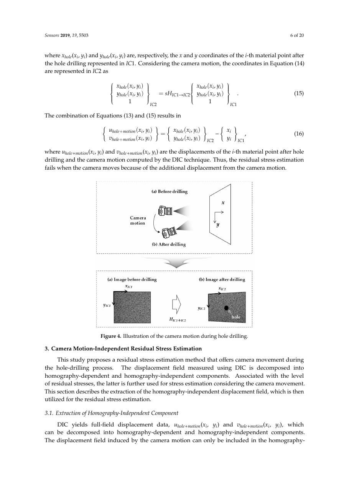
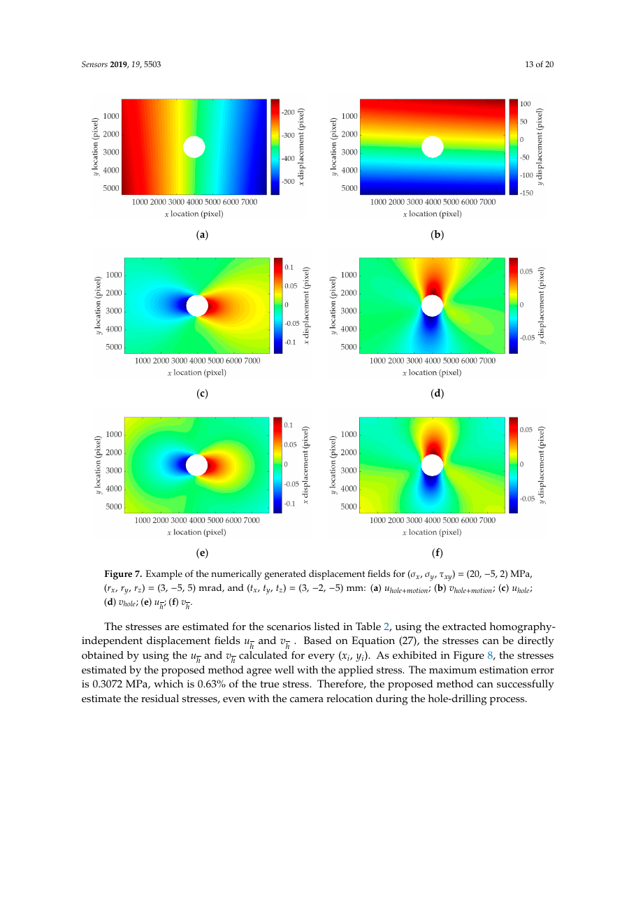
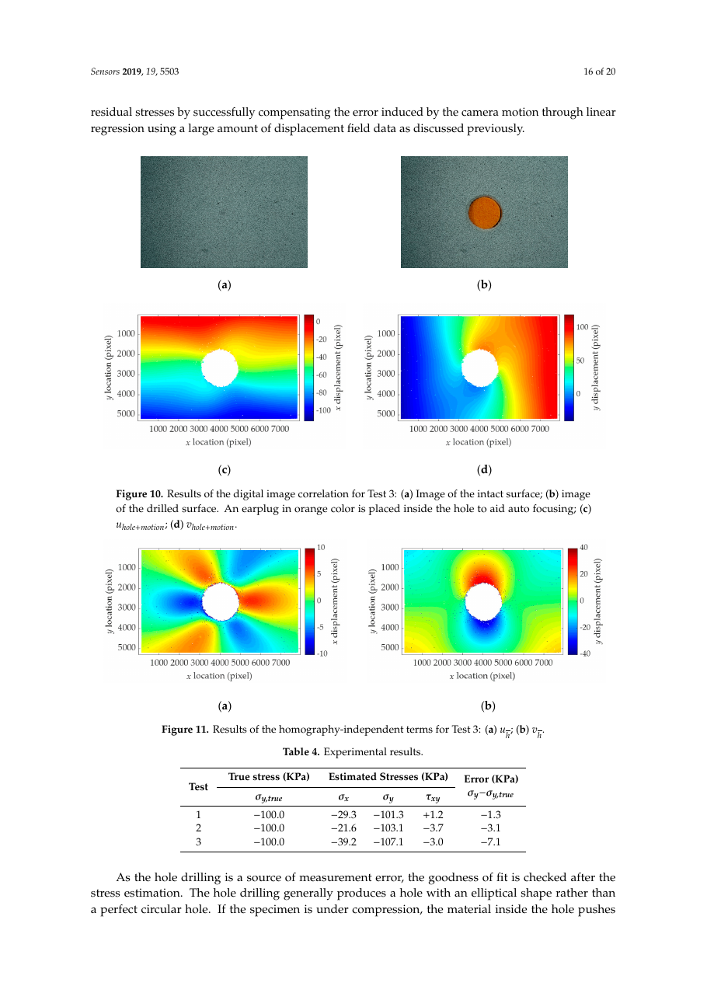

# 카메라 움직임으로 생긴 오차를 보정하는 디지털 영상 상관 기반 응력 추정 (번역)

번역 범위: 전문 (초록, 본문, 그림 캡션, 표, 명명법). 참고문헌은 원문 그대로 둔다.
원문: [Lee2019_Sensors_camera_motion_DIC.pdf](Lee2019_Sensors_camera_motion_DIC.pdf) (Sensors 2019, 19(24), 5503, doi:10.3390/s19245503, CC BY 4.0)
번역 기준: `pdftotext -layout` 추출본. 수식은 원문 기호를 살려 옮겼다. 원문에서 위 첨자 막대(h̄)로 쓴 "호모그래피 독립" 성분은 이 번역에서 `h̄`로 적는다.

원제: Stress Estimation Using Digital Image Correlation with Compensation of Camera Motion-Induced Error
저자: Junhwa Lee, Seunghoo Jeong, Young-Joo Lee, Sung-Han Sim
소속:
- 울산과학기술원(UNIST) 도시환경공학부 (Lee J., Jeong S., Lee Y.-J.)
- 성균관대학교 건설환경공학부 (Sim S.-H.)

접수 2019-11-08, 승인 2019-12-10, 게재 2019-12-12.

---

## 초록

사용 중인 구조물의 응력 수준을 재면 구조물의 현재 상태에 대한 중요하고 쓸모 있는 정보를 얻을 수 있다. 응력 이완법(SRM)은 가장 전통적이고 실용적인 방법이며, 금속 재료의 잔류응력 측정에 널리 쓰인다. SRM을 디지털 영상 상관(DIC)과 결합하면 토목 구조물의 응력 추정에 큰 가능성을 보였다. 그러나 지금까지 연구된 SRM/DIC 방법에는 구멍을 뚫는 동안 카메라가 진동하는 실무 문제가 있다. 카메라 움직임으로 생기는 오차를 줄이려고 촬영 장비를 시편에서 멀리 두므로, 화소 밀도가 낮아지고 시편에 내는 손상도 커진다.

이 연구는 구멍을 뚫는 동안 카메라를 떼어 냈다가, 뚫은 뒤 다시 설치해 사진을 찍는 SRM/DIC 응력 추정법을 제안한다. 촬영 장비를 시편에 최대한 가깝게 둘 수 있으므로 화소 밀도가 높아지고, 작은 손상이 만드는 미세한 변위 변화도 DIC로 잡을 수 있다. 이 연구는 DIC 결과에서 카메라 재배치로 생긴 거짓 변위장을 제거하는 수학식을 자세히 제시한다. 제안 방법은 수치 모의와 실험으로 검증한다.

핵심어: 디지털 영상 상관, 구멍 뚫기 방법, 응력 추정

## 1. 서론

잔류응력은 외력이 없는데도 재료 안에 남아 있는 내부 응력이다. 미세 구조부터 실제 크기의 토목 기반 시설까지, 어떤 고체 재료든 수명 동안 잔류응력을 겪을 수 있다. 경계가 구속된 상태에서 재료가 열이나 기계적 이유로 계속 늘거나 줄면 잔류응력이 생긴다 [1]. 잔류응력은 재료 특성을 높이고 제품 수명을 늘리려고 일부러 넣기도 한다. 그래서 산업계는 레이저 충격 피닝 [2], 마르텐사이트 [3], 프리스트레스 [4] 같은 여러 강화 방법을 개발했다. 반대로 원하지 않은 잔류응력은 구조물이 견딜 수 있는 응력의 일부를 늘 차지하므로, 수명을 줄이거나 최악의 경우 파손으로 이어진다. 잘 알려진 예가 더운 날 열팽창을 받는 장대 레일의 좌굴이다. 이때 선로는 작은 곡선에서도 휘기 쉽다. 많은 구조물이 이롭거나 해로운 잔류응력을 겪으므로 알맞은 측정 기술이 필요하다.

잔류응력 이완법(SRM) [5,6]은 가장 전통적이고 효과적인 잔류응력 추정법 가운데 하나다. 재료 표면에 작은 손상(예: 구멍)을 내면 손상 주변의 응력이 풀리며 변형이 생긴다. 이 변형의 크기와 무늬는 재료 안 잔류응력과 선형 관계다. 유한요소 모델 [7]이나 Kirsch 식에 근거한 해석해 [8,9]로 변형과 잔류응력을 연결한다. 보통 SRM에서는 변형률 게이지로 손상 주변 변형을 재고, 이것으로 응력을 추정한다. 변형률 로제트는 준비가 간단하고 직관적이어서 실험실에서 많은 연구가 검증했고 [10-16], ASTM 표준 [17]에 자세한 지침과 ±10% 오차 한계 [13]가 정리되어 있다. 그러나 변형률 게이지 방법에는 측정점이 적고, 작은 변형 변화를 잡기 어렵고, 구멍이 중심에서 벗어나면 오차가 생기는 한계가 있다. 그래서 응력 추정이 충분히 정확하지 않을 수 있다.

변형률 게이지 SRM의 대안으로, 구멍을 뚫어 생긴 작은 변화를 간섭계로 재어 전체 장 변형을 얻는 방법이 쓰였다 [18-23]. 간섭 무늬 연구는 보통 홀로그램 무늬, 모아레 무늬, 전자 스페클 무늬를 쓰며, 그 변화가 구멍 뚫기로 생긴 변형을 보여 준다. 간섭계 방법은 변형에 민감해서 작은 구멍을 써도 된다. 예를 들어 Steinzig와 Takahashi [21]는 두께 12 mm 2024-T351 알루미늄 링의 잔류응력을 지름 1.59 mm 구멍으로 8.5% 오차로 추정했다. Schmitt 등 [22]은 지름 5 mm 구멍과 전자 스페클 간섭계로 잔류응력을 구했는데 최악의 경우 오차가 37%였다. Albertazzi 등 [23]은 길이 3 m 탄소강 막대의 응력을 재며 변형률 게이지 방법과 디지털 스페클 간섭 방법을 비교했고, 두 방법의 최대 차이는 19%였다. 이처럼 간섭계 방법은 잔류응력 추정에 큰 가능성을 보인다. 간섭 무늬를 만드는 일이 간단하지 않아서, 연구자들은 실무용 소형 측정 장비를 만들려고 노력하고 있다.

디지털 영상 상관(DIC)은 실제 크기 구조물의 응력을 감시하는 데 쓰이기 시작했고 [24-29], 변형률 방법과 간섭계 방법을 대신할 수 있다. DIC는 변형 전과 후 두 장의 사진을 쓴다. 사진을 작은 화소 묶음(부분 영역, subset)으로 나누고, 묶음마다 상관이 가장 큰 위치를 찾아 변위장을 계산한다 [30,31]. 화소마다 변위를 계산하므로 DIC는 조밀한 변위장을 준다. 또 DIC는 레이저 없이 시편에 뿌린 무늬를 쓰므로, 조밀한 변형 자료와 간단한 측정 구성을 함께 제공하며 두 방법을 모두 대신할 수 있다. Trautner 등 [15]은 코어 뚫기와 DIC로 시편의 응력을 쟀다. 응력은 10% 오차로 추정됐지만, 실험에 쓴 지름 150 mm 코어는 일반 토목 구조물에 쓰기에는 비현실적이다. Lee 등 [29]도 SRM과 DIC로 콘크리트 시편의 응력을 쟀다. 지름 10 mm, 깊이 40 mm 구멍을 뚫었다. 손상은 작았지만 추정 결과의 흩어짐이 컸고, 오차가 5.67%에서 29.13%였다. DIC는 보통 카메라가 고정 위치에서 찍는다고 가정하므로, 이 실험에서는 드릴이 들어갈 자리를 마련하려고 카메라를 시편에서 2 m 떨어뜨렸다. 2 m 거리에서 화소 해상도 0.08 mm/pixel은 믿을 만하고 일관된 응력 추정에 충분하지 않았다. SRM/DIC 응력 추정은 현장 적용에 큰 가능성을 보이지만, 구멍을 뚫으며 생기는 카메라 진동이 변위장에 DIC 오차로 들어갈 수 있고, 기존 문헌은 이 문제를 다루지 않았다.

이 연구는 구멍을 뚫기 전과 후에 카메라를 재배치하는 것을 고려한 SRM/DIC 응력 추정법을 제안한다. 제안 방법은 화소 밀도를 최대로 하려고 카메라를 시편 가까이 두고, 구멍을 뚫는 동안 떼어 냈다가, 원래 위치에 다시 두고 손상 후 사진을 찍는다고 가정한다. 카메라를 정확히 같은 위치에 둘 수 없으므로, 카메라 위치 차이가 DIC 결과에 변위 오차로 나타난다. DIC가 잰 변위는 응력 이완과 카메라 이동이 함께 만든 것이므로, 제안 방법은 카메라 이동 성분을 보정한다. 수치 검증과 실험 검증으로 카메라 움직임 오차가 잘 제거되고 응력이 추정됨을 보인다.

## 2. 잔류응력 추정

잔류응력은 구멍 뚫기 방법과 DIC 기법을 함께 써서 추정할 수 있다. 그러나 이 방법은 구멍을 뚫는 동안 카메라가 움직여 응력 추정을 믿기 어렵다. 이 절은 잔류응력 추정의 기초를 짧게 소개하고, 이어서 이 방법의 실무 한계를 논의한다.

### 2.1. 잔류응력 추정

등방성 판에 구멍을 뚫으면 변위장이 다시 분포하며, 그 무늬는 Kirsch 식 [8,9]이 잘 설명한다. 기존 Kirsch 식은 선형 탄성으로 거동하는 등방성 재료를 다루므로, 소성이나 이방성 때문에 예상하지 못한 오차가 보일 수 있다 [13,32,33]. 그림 1처럼 재료 전체에 균일한 2축 응력을 받는 무한 판을 생각한다. Kirsch 식에 따르면 원형 구멍이 만드는 변화는 다음과 같다.

```
{u_hole(x_i,y_i); v_hole(x_i,y_i)} = {P_u; P_v} σ_x + {Q_u; Q_v} σ_y + {R_u; R_v} τ_xy      (1)
```

여기서 u_hole(x_i, y_i)와 v_hole(x_i, y_i)는 i번째 재료 위치 (x_i, y_i)에서 잔류응력 (σ_x, σ_y, τ_xy)이 만드는 x 방향, y 방향 변위다. 응력 계수 P_u, Q_u, R_u, P_v, Q_v, R_v는 다음과 같다.

```
P_u = [A_i + (B_i + C_i) cos(2θ_i) − C_i] cos(θ_i)                         (2)
Q_u = [A_i − B_i cos(2θ_i)] cos(θ_i) + C_i sin(2θ_i) sin(θ_i)              (3)
R_u = +2[(B_i + C_i) cos(2θ_i) + B_i] sin(θ_i)                            (4)
P_v = [A_i + (B_i + C_i) cos(2θ_i) + C_i] cos(θ_i)                         (5)
Q_v = [A_i − (B_i + C_i) cos(2θ_i) − C_i] sin(θ_i)                         (6)
R_v = −2[(B_i + C_i) cos(2θ_i) − B_i] cos(θ_i)                            (7)
```

θ_i는 극좌표계에서 위치 (x_i, y_i)의 각도 좌표다. 계수 A_i, B_i, C_i는 다음과 같다.

```
A_i = a²(1+ν)/(2E) × 1/r_i                                                (8)
B_i = 2a²/E × 1/r_i − a⁴(1+ν)/(2E) × 1/r_i³                               (9)
C_i = −a²(1−ν)/E × 1/r_i − a⁴(1+ν)/(2E) × 1/r_i³                          (10)
```

r_i는 극좌표계에서 위치 (x_i, y_i)의 반지름 좌표, a는 구멍 반지름, ν는 푸아송비, E는 영률이다. 식 (1)을 쓰면 2축 잔류응력을 선형 회귀 꼴로 다시 쓸 수 있다.

```
[σ_x; σ_y; τ_xy] = [ P_u(x_1,y_1) Q_u(x_1,y_1) R_u(x_1,y_1)
                     P_v(x_1,y_1) Q_v(x_1,y_1) R_v(x_1,y_1)
                     ...
                     P_u(x_n,y_n) Q_u(x_n,y_n) R_u(x_n,y_n)
                     P_v(x_n,y_n) Q_v(x_n,y_n) R_v(x_n,y_n) ]⁺ [u_hole(x_1,y_1); v_hole(x_1,y_1); ...; u_hole(x_n,y_n); v_hole(x_n,y_n)]   (11)
```

[ ]⁺는 무어-펜로즈 역행렬 [34]이다. n은 변위 u_hole, v_hole을 잰 위치의 수이고, P_u, Q_u, R_u, P_v, Q_v, R_v는 측정 위치마다 계산한 응력 계수다. 미리 아는 정보 (E, ν, a, x_i, y_i, 1 ≤ i ≤ n)로 식 (11)의 3 × 2n 앞곱 행렬을 만들면, 변형 측정 기술로 잰 변위장으로 2축 잔류응력을 추정할 수 있다.

> 그림 1. 구멍 뚫기 방법의 응력 구성과 좌표계. (무한 판에 σ_x, σ_y, τ_xy가 걸리고, 반지름 a의 구멍 중심에서 극좌표 (r, θ)를 잡는다.)

식 (11)에 필요한 전체 장 변위는 DIC 기법으로 얻을 수 있다. 페인트를 뿌려 표면에 무작위 스페클 무늬를 만든 시편을 변형 전과 후에 찍는다. 찍은 사진을 각각 기준 사진과 변형 사진이라 부른다. 기준 사진은 그림 2처럼 부분 영역으로 나눈다. 변형 사진에서 각 부분 영역의 새 위치를 상호상관, 정규화 상호상관, 영평균 정규화 상호상관 같은 상관 기준으로 찾는다 [30,31]. 마지막으로 부분 영역마다 계산한 변위를 모아 2차원 변위장을 만든다. 따라서 일반 DIC 방법은 상관 기준으로 재료점의 위치를 추적해 변위장을 계산하며, 이것을 식 (11)에 쓸 수 있다.

> 그림 2. 디지털 영상 상관(DIC) 기법을 이용한 변위장 계산.

잔류응력 추정의 전체 절차는 구멍 뚫기와 사진 획득으로 이루어진다. 구멍을 뚫으면 대상 재료 안의 잔류응력이 풀리며 구멍 주변 표면 무늬가 변형된다. 구멍을 뚫기 전과 후 사진으로 DIC가 변형장을 계산한다. 마지막으로 식 (11)처럼 풀린 변형량과 풀린 응력 수준의 선형 관계로 시편의 잔류응력을 추정한다. 이때 변위장을 잘못 재면 응력 추정이 나빠진다. 그래서 믿을 만한 응력 추정을 하려면 구멍을 뚫는 동안 카메라를 한 자리에 고정해야 한다.

### 2.2. 카메라 움직임 오차가 있는 잔류응력 추정

구멍 뚫기 과정 때문에 카메라 움직임은 피할 수 없다. 그림 3처럼 잔류응력 추정법의 일반적인 장비 구성을 생각한다. 여기서 카메라는 구멍을 뚫는 동안 고정되어 있어야 한다. 이 과정에는 가까운 곳의 진동이 따르고, 이것이 카메라를 움직인다. 이 진동을 피하려고 카메라를 시편에서 멀리 두지만, 작업 거리가 길면 카메라가 조금만 흔들려도 오차가 생긴다. 이처럼 구멍 뚫기 방법을 실제로 쓰면 카메라 움직임을 피하기 어렵다.

> 그림 3. DIC 기법과 결합한 구멍 뚫기 방법의 장비 구성.

카메라 움직임이 만드는 변위장은 호모그래피 변환으로 나타낼 수 있다. 그림 4처럼 구멍을 뚫기 전과 후의 영상 좌표계를 각각 IC1, IC2라 한다. IC1과 IC2의 관계는 다음과 같다.



> 그림 4. 구멍을 뚫는 동안의 카메라 움직임 설명. (위: (a) 뚫기 전, (b) 뚫은 뒤 카메라 위치. 아래: (a) 뚫기 전 사진의 좌표 x_IC1, y_IC1, (b) 뚫은 뒤 사진의 좌표 x_IC2, y_IC2, 두 사진은 H_IC1→IC2로 이어진다.)

```
{x_i; y_i; 1}_IC2 = s H_IC1→IC2 {x_i; y_i; 1}_IC1                          (12)
```

{x_i, y_i, 1}ᵀ_IC1과 {x_i, y_i, 1}ᵀ_IC2는 i번째 재료점을 IC1과 IC2에서 나타낸 영상 좌표다. H_IC1→IC2는 6자유도(6DOF) 카메라 움직임에 해당하는 호모그래피 변환 [35]이고, s는 {x, y, 1}ᵀ_IC2의 셋째 성분을 1로 유지하는 배율이다. 호모그래피 관계를 쓰면 카메라 움직임이 만드는 변위장은 다음과 같다.

```
{u_motion(x_i,y_i); v_motion(x_i,y_i)} = {x_i; y_i}_IC2 − {x_i; y_i}_IC1   (13)
```

u_motion과 v_motion은 카메라 움직임이 만든 i번째 재료점의 x, y 방향 변위다. 서로 다른 좌표계의 벡터 빼기는 성분끼리 뺀다. 따라서 카메라 움직임으로 정해지는 호모그래피 행렬 H_IC1→IC2가 모든 재료점의 변위를 결정한다.

카메라 움직임이 잔류응력 추정에 주는 영향은 식 (1)과 (12)로 간단히 정리할 수 있다. 구멍을 뚫은 뒤 i번째 재료점의 위치는 다음과 같다.

```
{x_hole(x_i,y_i); y_hole(x_i,y_i); 1}_IC1 = {x_i + u_hole(x_i,y_i); y_i + v_hole(x_i,y_i); 1}_IC1     (14)
```

x_hole, y_hole은 구멍을 뚫은 뒤 i번째 재료점의 x, y 좌표를 IC1에서 나타낸 것이다. 카메라 움직임을 고려하면 식 (14)의 좌표는 IC2에서 다음과 같다.

```
{x_hole; y_hole; 1}_IC2 = s H_IC1→IC2 {x_hole; y_hole; 1}_IC1               (15)
```

식 (13)과 (15)를 합치면 다음이 된다.

```
{u_hole+motion(x_i,y_i); v_hole+motion(x_i,y_i)} = {x_hole; y_hole}_IC2 − {x_i; y_i}_IC1     (16)
```

u_hole+motion과 v_hole+motion은 구멍 뚫기와 카메라 움직임 뒤에 DIC로 계산한 i번째 재료점의 변위다. 그러므로 카메라가 움직이면 카메라 움직임이 더한 변위 때문에 잔류응력 추정이 실패한다.

## 3. 카메라 움직임과 무관한 잔류응력 추정

이 연구는 구멍을 뚫는 동안 카메라가 움직여도 되는 잔류응력 추정법을 제안한다. DIC로 잰 변위장을 호모그래피 종속 성분과 호모그래피 독립 성분으로 나눈다. 잔류응력 수준과 관련된 뒤의 성분을, 카메라 움직임을 고려한 응력 추정에 쓴다. 이 절은 호모그래피 독립 변위장을 뽑는 방법과, 이것으로 잔류응력을 추정하는 방법을 설명한다.

### 3.1. 호모그래피 독립 성분 추출

DIC는 전체 장 변위 자료 u_hole+motion(x_i, y_i), v_hole+motion(x_i, y_i)를 주며, 이를 호모그래피 종속 성분과 독립 성분으로 나눌 수 있다. 카메라 움직임이 만든 변위장은 호모그래피 종속 항에만 들어간다(식 (12), (13)). 반면 구멍 뚫기가 만든 변위장은 호모그래피 종속 항과 독립 항을 모두 가진다.

```
{u_hole; v_hole} = {u_h; v_h} + {u_h̄; v_h̄}                                 (17)
```

아래 첨자 h와 h̄는 구멍 뚫기 변위장 안의 호모그래피 종속 성분과 독립 성분이다. 호모그래피 종속 항은 주 호모그래피 행렬 H_h를 앞에 곱하는 것으로 바꿀 수 있다.

```
{x_i + u_h + u_h̄; y_i + v_h + v_h̄; 1} = s H_h {x_i + u_h̄; y_i + v_h̄; 1}     (18)
```

식 (18)을 식 (15)와 합치면

```
{x_i + u_h + u_h̄; y_i + v_h + v_h̄; 1}_IC2 = s H_IC1→IC2 H_h {x_i + u_h̄; y_i + v_h̄; 1}     (19)
```

이고, 이는 다시 다음과 같다.

```
{x_i + u_hole+motion; y_i + v_hole+motion; 1} = s H_IC1→IC2 H_h {x_i + u_h̄; y_i + v_h̄; 1}     (20)
```

식 (20)은 호모그래피 종속 항을 호모그래피 행렬로 나타낸다. 반대로 호모그래피 독립 항은 호모그래피 행렬로 나타낼 수 없다. 따라서 DIC로 계산한 변위장 u_hole+motion, v_hole+motion은 H_IC1→IC2 H_h로 나타낼 수 있는 호모그래피 종속 항과, 호모그래피 독립 항 u_h̄, v_h̄로 이루어진다.

호모그래피 독립 항은 아는 정보 u_hole+motion, v_hole+motion, x_i, y_i로 뽑을 수 있다. 다음 잔차를 최소로 하면 유일한 호모그래피 변환을 찾을 수 있다.

```
residue = Σ_{i=1..n} | {x_i + u_hole+motion; y_i + v_hole+motion; 1} − s H {x_i; y_i; 1} |₂
        = Σ_{i=1..n} | {u_h̄(x_i,y_i); v_h̄(x_i,y_i); 0} |₂                                    (21)
```

| |₂는 벡터의 2-노름이다. 식 (21)로 얻은 유일한 호모그래피 변환은 사실상 식 (20)의 H_IC1→IC2 H_h다. 호모그래피 독립 항 u_h̄, v_h̄가 잔차로 남기 때문이다. 식 (21)을 쓰면 식 (20)을 근사적으로 다음처럼 정리할 수 있다.

```
{x_i + u_hole+motion; y_i + v_hole+motion; 1} = s H {x_i; y_i; 1} + {u_h̄; v_h̄; 0}           (22)
```

직접 선형 변환(DLT) [35]으로, 1 ≤ i ≤ n에 대해 {x_i + u_hole+motion, y_i + v_hole+motion}과 {x_i, y_i}의 대응점으로 식 (22)의 H를 계산한다. u_h̄와 v_h̄는 호모그래피 독립 항이므로 호모그래피 행렬을 정하는 데 들어가지 않는다. H를 정한 뒤 호모그래피 독립 항은 다음으로 뽑는다.

```
{x_i + u_h̄; y_i + v_h̄; 1} = s H⁻¹ {x_i + u_hole+motion; y_i + v_hole+motion; 1}              (23)
```

이를 더 풀면

```
{u_h̄(x_i,y_i); v_h̄(x_i,y_i)} = {x_i + u_h̄; y_i + v_h̄} − {x_i; y_i}                       (24)
```

이다. 따라서 식 (22)의 H를 구하고 식 (24)를 쓰면 1 ≤ i ≤ n의 호모그래피 독립 항 u_h̄, v_h̄를 뽑을 수 있다.

### 3.2. 호모그래피 독립 항을 이용한 잔류응력 추정

3.1절에서 뽑은 호모그래피 독립 항만으로 잔류응력을 추정할 수 있다. 식 (1)을 호모그래피 종속성으로 다시 쓰면

```
{u_hole; v_hole} = {P_uh + P_uh̄; P_vh + P_vh̄} σ_x + {Q_uh + Q_uh̄; Q_vh + Q_vh̄} σ_y + {R_uh + R_uh̄; R_vh + R_vh̄} τ_xy     (25)
```

이다. 덧붙은 아래 첨자 h와 h̄는 각각 호모그래피 종속 성분과 독립 성분이다. 식 (25)의 호모그래피 독립 항은 다음과 같다.

```
{u_h̄; v_h̄} = {P_uh̄; P_vh̄} σ_x + {Q_uh̄; Q_vh̄} σ_y + {R_uh̄; R_vh̄} τ_xy                    (26)
```

잔류응력은 다음으로 계산한다.

```
[σ_x; σ_y; τ_xy] = [ P_uh̄(x_1,y_1) Q_uh̄(x_1,y_1) R_uh̄(x_1,y_1)
                     P_vh̄(x_1,y_1) Q_vh̄(x_1,y_1) R_vh̄(x_1,y_1)
                     ...
                     P_vh̄(x_n,y_n) Q_vh̄(x_n,y_n) R_vh̄(x_n,y_n) ]⁺ [u_h̄(x_1,y_1); v_h̄(x_1,y_1); ...; v_h̄(x_n,y_n)]   (27)
```

모든 재료점에서 P_uh̄, Q_uh̄, R_uh̄, P_vh̄, Q_vh̄, R_vh̄를 계산하면, 호모그래피 독립 항과 식 (27)로 잔류응력을 얻을 수 있다.

호모그래피 독립 계수(P_uh̄, Q_uh̄, R_uh̄, P_vh̄, Q_vh̄, R_vh̄)는 변위장을 수치로 만들어 구할 수 있다. 먼저 주어진 평면 응력에 대한 구멍 변위장 u_hole(x_i, y_i; σ_x, σ_y, τ_xy), v_hole(x_i, y_i; σ_x, σ_y, τ_xy)를 수치로 만든다. 주어진 평면 응력에 대해 E, ν, a, n과 모든 화소의 위치 (x_i, y_i)를 써서 식 (1)-(10)으로 u_hole, v_hole을 만들 수 있다. 1 ≤ i ≤ n에 대해 {x_i + u_hole, y_i + v_hole}과 {x_i, y_i}의 대응점으로, 식 (18)의 주 호모그래피 변환 H_h를 DLT [35]로 근사 계산하며 잔차 항은 다음과 같다.

```
residue = Σ_{i=1..n} | {x_i + u_hole(x_i,y_i;σ_x,σ_y,τ_xy); y_i + v_hole(...); 1} − s H_h {x_i; y_i; 1} |₂
        = Σ_{i=1..n} | {u_h(x_i,y_i;σ_x,σ_y,τ_xy); v_h(...); 0} |₂                            (28)
```

계산한 H_h로 식 (18)을 다시 정리하면

```
{x_i + u_h(x_i,y_i;σ_x,σ_y,τ_xy); y_i + v_h(...); 1} = s H_h {x_i; y_i; 1}                     (29)
```

이다. 그 결과 어떤 응력 조합에 대해서도 u_hole, v_hole을 준비할 수 있다. 둘째 단계는 수치로 만든 여러 u_hole, v_hole로 호모그래피 계수를 찾는 것이다. 계산을 간단히 하려고 호모그래피 종속 항 P_uh, Q_uh, R_uh, P_vh, Q_vh, R_vh를 다음처럼 선형화한다고 가정한다.

```
{u_h; v_h} = {P_uh,x x_i + P_uh,y y_i; P_vh,x x_i + P_vh,y y_i} σ_x
           + {Q_uh,x x_i + Q_uh,y y_i; Q_vh,x x_i + Q_vh,y y_i} σ_y
           + {R_uh,x x_i + R_uh,y y_i; R_vh,x x_i + R_vh,y y_i} τ_xy                          (30)
```

P_uh,x, Q_uh,x, R_uh,x, P_vh,x, Q_vh,x, R_vh,x, P_uh,y, Q_uh,y, R_uh,y, P_vh,y, Q_vh,y, R_vh,y는 정해야 할 상수다. 식 (30)을 다시 쓰면

```
[P_uh,x; P_uh,y; Q_uh,x; Q_uh,y; R_uh,x; R_uh,y] = [ x_1σ_x y_1σ_x x_1σ_y y_1σ_x x_1τ_xy y_1τ_xy
                                                   ...
                                                   x_nσ_x y_nσ_x x_nσ_y y_nσ_x x_nτ_xy y_nτ_xy ]⁺ [u_h(x_1,y_1); ...; u_h(x_n,y_n)]   (31)
```

그리고

```
[P_vh,x; P_vh,y; Q_vh,x; Q_vh,y; R_vh,x; R_vh,y] = [ 같은 행렬 ]⁺ [v_h(x_1,y_1); ...; v_h(x_n,y_n)]                   (32)
```

이다. (원문 행렬의 넷째 열은 "y_1 σ_x"로 인쇄되어 있다. 문맥상 y_1 σ_y로 보이나 원문대로 옮긴다.)

호모그래피 종속 항 u_h, v_h (1 ≤ i ≤ n)는 식 (29)로 수치 계산하므로, 아는 (x_i, y_i)와 (σ_x, σ_y, τ_xy)로 식 (31), (32)를 써서 미지 상수를 계산할 수 있다. 미지 상수를 구하면 식 (25)로 P_uh̄, Q_uh̄, R_uh̄, P_vh̄, Q_vh̄, R_vh̄를 얻고, 이어서 호모그래피 독립 항 u_h̄, v_h̄ (1 ≤ i ≤ n)와 식 (27)로 잔류응력을 계산할 수 있다.

### 3.3. 제안 방법 요약

6자유도 카메라 움직임을 보정하는 제안 응력 추정 절차는 다음과 같다.

1. 재료 특성, 구멍 뚫기 방식, 영상 해상도로 측정 전에 E, ν, a, n, x, y를 정한다.
2. 1단계에서 정한 E, ν, a, n, x, y로 식 (2)-(10)에 따라 P_u, Q_u, R_u, P_v, Q_v, R_v를 구한다.
3. 변위장 (u_h, v_h)와 잔류응력 (σ_x, σ_y, τ_xy)의 쌍을 수치로 여러 개 만들어, 식 (31), (32)로 P_uh, Q_uh, R_uh, P_vh, Q_vh, R_vh를 구한다.
4. 식 (25)에 따라 2단계의 P_u, Q_u, R_u, P_v, Q_v, R_v에서 3단계의 P_uh, Q_uh, R_uh, P_vh, Q_vh, R_vh를 각각 빼서 P_uh̄, Q_uh̄, R_uh̄, P_vh̄, Q_vh̄, R_vh̄를 구한다.
5. 카메라 움직임이 함께 있는 구멍 뚫기 전후 사진에 DIC를 적용해 변위장 u_hole+motion, v_hole+motion을 얻는다.
6. 모든 재료점에 대해 {x, y}(1단계)와 {u_hole+motion, v_hole+motion}(5단계)의 대응점으로 DLT [35]를 써서 식 (22)의 H를 계산한다.
7. 식 (22)-(24)에 따라 u_hole+motion, v_hole+motion(5단계)과 H(6단계)로 u_h̄, v_h̄를 계산한다.
8. 식 (27)로 u_h̄, v_h̄(7단계)와 P_uh̄, Q_uh̄, R_uh̄, P_vh̄, Q_vh̄, R_vh̄(4단계)를 써서 잔류응력 σ_x, σ_y, τ_xy를 계산한다.

제안한 SRM/DIC 방법 전체는 그림 5처럼 변위장 측정과 응력 추정으로 이루어진다.

> 그림 5. 제안 응력 추정의 흐름도.
> - 측정 절차: 시편 표면에 무작위 스페클 무늬 뿌리기 → 손상 없는 표면 촬영 → 카메라 움직임과 구멍 뚫기 → 손상된 표면 촬영 → DIC로 변위장 계산
> - 응력 추정 절차: 아는 변수 준비 (E, ν, a, n, 모든 i의 (x_i, y_i)) → 호모그래피 독립 계수 P_uh̄, Q_uh̄, R_uh̄, P_vh̄, Q_vh̄, R_vh̄ 계산 → 변위장 u_hole+motion, v_hole+motion 얻기 → 호모그래피 독립 변위 u_h̄, v_h̄ 계산 → 식 (27)로 σ_x, σ_y, τ_xy 추정

## 4. 수치 검증

제안 방법을 검증하려고 구멍 뚫기와 카메라 움직임이 있는 응력 추정을 수치로 모의한다. 임의의 평면 응력과 임의의 6자유도 카메라 움직임에 대해, 제안 잔류응력 추정에 쓰는 변위장 u_hole+motion, v_hole+motion을 수치로 만든다. 제안 방법으로 추정한 응력을 실제 가한 응력과 비교한다. 이 절은 구멍을 뚫기 전후 카메라가 움직인 상태의 변위장 수치 생성 방법을 보이고, 추정 응력과 실제 응력을 비교한다.

### 4.1. 변위장의 수치 생성

구멍 뚫기가 만드는 변위장을 상용 카메라 장비에 대해 수치로 만든다. 표 1의 사양을 가진 매크로 렌즈 장착 카메라를 모델로 하며, 작업 거리를 100 mm로 맞춰 시야 79.52 × 53.04 mm가 되도록 했다. 7952 × 5304 해상도 사진의 각 화소에 그림 6처럼 번호를 매겨 i번째 화소의 (x_i, y_i)를 정한다. 영률(E), 푸아송비(ν), 구멍 지름(a)은 각각 206 GPa, 0.3, 12 mm로 가정한다. 따라서 평면 응력(σ_x, σ_y, τ_xy)이 주어지면 아는 변수 E, ν, a와 식 (1)로 변위장 u_hole, v_hole을 만들 수 있다.

표 1. 장비 사양.

| 항목 | 모델 | 사양 |
|---|---|---|
| 카메라 | Sony α7R III | 해상도 7952 × 5304 화소 |
| 렌즈 | SEL50M28 | 초점거리 50 mm |

> 그림 6. 수치 모의 시험 환경. (시야 79.52 mm × 53.04 mm 가운데 구멍, 화소 번호 매김 1, 2, 3, 4, ...)

응력 관련 항 u_hole, v_hole은 6자유도 카메라 움직임의 영향을 받고, 이것이 최종 변위장 자료 u_hole+motion, v_hole+motion에 영향을 준다. 표 1의 카메라는 내부 파라미터 K가 다음이 되도록 모델링했다.

```
K = [ 10000     0   3976   0
          0 10000   2652   0
          0     0      1   0 ]                                                (33)
```

처음 작업 거리를 100 mm로 가정하면, 대상 표면에서 IC1로의 좌표 변환은 다음과 같다.

```
K1 = K [ 1 0 0   0
         0 1 0   0
         0 0 1 100
         0 0 0   1 ]                                                          (34)
```

대상 표면에서 IC2로의 좌표 변환은 다음과 같다.

```
K2 = K [ R  T ; 0ᵀ 1 ] [ 1 0 0 0; 0 1 0 0; 0 0 1 100; 0 0 0 1 ]               (35)
```

R, T, 0ᵀ는 각각 3 × 3 회전 행렬, 3 × 1 평행 이동 벡터, 1 × 3 영벡터다. 식 (12)의 호모그래피 행렬 H_IC1→IC2는 다음으로 계산한다.

```
H_IC1→IC2 = [K2,1 K2,2 K2,4]⁻¹ [K1,1 K1,2 K1,4]                               (36)
```

(원문 인쇄 그대로 옮겼다. 역행렬이 첫째 괄호에 붙어 있다. IC1 좌표를 IC2 좌표로 보내는 식 (12)의 뜻에 맞추려면 [K2,1 K2,2 K2,4][K1,1 K1,2 K1,4]⁻¹ 순서가 되어야 한다. 이 차이는 번역자의 확인 메모이며 원문 내용이 아니다.)

K1,j와 K2,j는 각각 K1과 K2의 j번째 열이다. 임의의 카메라 움직임 R, T에 대해 표 1 카메라 모델의 H_IC1→IC2를 만들 수 있다. 결국 임의의 평면 응력과 카메라 움직임에 대해 u_hole, v_hole, H_IC1→IC2를 써서 식 (14)-(16)으로 변위장 u_hole+motion, v_hole+motion을 만들 수 있다.

### 4.2. 제안 방법을 이용한 응력 추정

제안 방법의 성능을 평가하려고 표 2처럼 여러 응력 조건과 카메라 움직임에 대해 변위장을 만든다. r_x, r_y, r_z는 각각 x, y, z축 둘레 회전으로 회전 행렬 R을 이룬다. t_x, t_y, t_z는 각각 x, y, z축 방향 이동으로 이동 벡터 T를 이룬다. 시험은 모두 100개다. 시험 1-60은 특정 응력 조합(σ_x = 20 MPa, σ_y = −5 MPa, τ_xy = 2 MPa)에서 회전과 이동이 있는 카메라 움직임을 다룬다. 이때 한 자유도 움직임을 회전은 −10에서 10 mrad, 이동은 −5에서 5 mm까지 점점 크게 준다. 시험 61-100은 응력과 카메라 움직임의 무작위 조합을 다룬다. unif(α, β)는 (α, β) 범위 균등분포에서 뽑은 변수다.

표 2. 수치 모의 시나리오.

| 시험 | σ_x (MPa) | σ_y (MPa) | τ_xy (MPa) | r_x (mrad) | r_y (mrad) | r_z (mrad) | t_x (mm) | t_y (mm) | t_z (mm) |
|---|---|---|---|---|---|---|---|---|---|
| 1-10 | 20 | −5 | 2 | [−10, 10] | 0 | 0 | 0 | 0 | 0 |
| 11-20 | 20 | −5 | 2 | 0 | [−10, 10] | 0 | 0 | 0 | 0 |
| 21-30 | 20 | −5 | 2 | 0 | 0 | [−10, 10] | 0 | 0 | 0 |
| 31-40 | 20 | −5 | 2 | 0 | 0 | 0 | [−5, 5] | 0 | 0 |
| 41-50 | 20 | −5 | 2 | 0 | 0 | 0 | 0 | [−5, 5] | 0 |
| 51-60 | 20 | −5 | 2 | 0 | 0 | 0 | 0 | 0 | [−5, 5] |
| 61-100 | unif(−50, 50)* | (같음) | (같음) | unif(−10, 10)* | (같음) | (같음) | unif(−5, 5)* | (같음) | (같음) |

\* unif(α, β)는 (α, β) 범위 균등분포에서 무작위로 고른 수다.

잔류응력을 추정하려고 수치 모의한 변위장 u_hole+motion, v_hole+motion에서 u_h̄, v_h̄를 뽑는다. 그림 7a, b에서 보듯 변위장은 주로 카메라 움직임 무늬가 차지하며, 그림 7c, d의 응력 이완 무늬를 가린다. 2.1절처럼 응력은 u_hole, v_hole로 계산할 수 있지만, 2.2절처럼 카메라 움직임 때문에 이 변위장을 바로 얻을 수 없다. 3.1절처럼 DLT로 호모그래피 독립 항을 뽑으면 그림 7e, f와 같다. 뽑은 u_h̄, v_h̄를 응력 추정에 쓴다.



> 그림 7. (σ_x, σ_y, τ_xy) = (20, −5, 2) MPa, (r_x, r_y, r_z) = (3, −5, 5) mrad, (t_x, t_y, t_z) = (3, −2, −5) mm일 때 수치로 만든 변위장 예: (a) u_hole+motion, (b) v_hole+motion, (c) u_hole, (d) v_hole, (e) u_h̄, (f) v_h̄.

뽑은 호모그래피 독립 변위장 u_h̄, v_h̄로 표 2의 시나리오에 대해 응력을 추정한다. 식 (27)에 따라 모든 (x_i, y_i)에서 계산한 u_h̄, v_h̄로 응력을 바로 얻을 수 있다. 그림 8처럼 제안 방법이 추정한 응력은 가한 응력과 잘 맞는다. 최대 추정 오차는 0.3072 MPa로, 참 응력의 0.63%다. 따라서 제안 방법은 구멍을 뚫는 동안 카메라를 재배치해도 잔류응력을 잘 추정할 수 있다.

> 그림 8. 응력 추정의 수치 모의 결과: (a) 추정 응력, (b) 추정 오차.

## 5. 실험실 규모 검증

실험실 환경에서 응력 추정을 실제로 해 보며 제안 방법을 검증한다. 코르크와 에틸렌-비닐 아세테이트(EVA)로 만든 시편 세 개를 준비했으며, 재료 특성과 치수는 표 3과 같다. 시편은 그림 9a처럼 만능 시험기(UTM)로 압축한다. 2차원 응력 상태를 만들려고 강봉으로 연결한 폴리카보네이트 판으로 가로 팽창을 막는다. 세로로 100 KPa 압축을 가한 뒤, 그림 9c의 카메라 장비로 그림 9b처럼 촬영과 구멍 뚫기를 한다. 카메라는 구멍 뚫기 전후에 완전히 떼었다가 다시 붙이므로, 카메라가 조금 움직인다. 실험은 시편 세 개로 반복하며, 구멍 뚫기 전후 사진을 후처리에 쓴다.

표 3. 시편과 실험 정보.

| 항목 | 값 |
|---|---|
| 영률 | 2.46 MPa |
| 푸아송비 | 0.1 |
| 치수 (높이 × 너비 × 깊이) | 230 × 150 × 75 mm |
| 구멍 지름 | 14 mm |
| 화소 해상도 | 7952 × 5304 |
| 화소 밀도 | 108.26 pixel/mm |

> 그림 9. 실험실 규모 실험: (a) 실험 구성, (b) 실험 절차, (c) 카메라 장비.

구멍 뚫기 전후 사진으로 변위장을 계산한다. 그림 10a, b처럼 전후 사진은 아주 비슷해 보이지만, 카메라 움직임은 분명히 있다. 변위장 계산에는 공개 DIC 소프트웨어 Ncorr [36]을 쓴다. 반지름 10 화소의 원형 부분 영역을 경험적으로 골랐다. 결과 변위장은 그림 10c, d와 같으며, 카메라 움직임 오차가 지배적이다. 이 DIC 결과를 제안 응력 추정법에 쓴다.



> 그림 10. 시험 3의 디지털 영상 상관 결과: (a) 손상 없는 표면 사진, (b) 구멍 뚫은 표면 사진. 자동 초점을 돕도록 구멍 안에 주황색 귀마개를 넣었다. (c) u_hole+motion, (d) v_hole+motion.
> (그림 속 색 막대: (c)는 약 −100에서 0 화소, (d)는 약 0에서 100 화소.)

변위장으로 잔류응력을 계산한다. 호모그래피 독립 항을 그림 11처럼 뽑고, 이것으로 잔류응력을 계산한다. 추정 응력을 UTM이 가한 응력과 비교한다. 표 4처럼 최대 오차는 7.1%다. 수치 모의의 오차는 0.7% 안이었지만, 실험실 시험은 구멍 뚫기 품질 같은 실험 조건 때문에 1.3%에서 7.1%의 오차를 보였다. 그래도 기존 연구가 ±10% 오차를 보고했으므로 [13], 7.1% 오차는 타당하다고 볼 수 있다. 따라서 제안 방법은 앞서 논의한 대로 많은 변위장 자료를 쓰는 선형 회귀로 카메라 움직임 오차를 잘 보정하여 잔류응력을 믿을 만하게 잰다.

> 그림 11. 시험 3의 호모그래피 독립 항 결과: (a) u_h̄, (b) v_h̄. (그림 속 색 막대: (a)는 약 −10에서 10 화소, (b)는 약 −40에서 40 화소.)

표 4. 실험 결과.

| 시험 | 참 응력 σ_y,true (KPa) | 추정 σ_x (KPa) | 추정 σ_y (KPa) | 추정 τ_xy (KPa) | 오차 σ_y − σ_y,true (KPa) |
|---|---|---|---|---|---|
| 1 | −100.0 | −29.3 | −101.3 | +1.2 | −1.3 |
| 2 | −100.0 | −21.6 | −103.1 | −3.7 | −3.1 |
| 3 | −100.0 | −39.2 | −107.1 | −3.0 | −7.1 |

구멍 뚫기는 측정 오차의 원인이므로, 응력 추정 뒤 적합도를 확인한다. 구멍 뚫기는 보통 완전한 원이 아니라 타원 모양 구멍을 만든다. 시편이 압축 상태이면 구멍 중심 쪽으로 변위가 생겨, 구멍 안 재료가 회전하는 드릴 날을 민다. 반대로 인장 영역은 구멍 중심에서 멀어지는 경향이 있어 인장 영역을 따라 작은 손상이 생긴다. 그 결과 구멍이 타원이 되기 쉽고, 이것이 응력 추정 오차를 만들 수 있다. 구멍 뚫기가 측정 정확도에 주는 영향을 보려고 적합도를 본다. 추정 응력과 식 (26)으로 호모그래피 독립 변위장을 다시 만들면 그림 12와 같다. 잰 변위장(그림 11)과 다시 만든 변위장(그림 12)은 무늬가 비슷하고, 변위 크기만 조금 다르다. 차이를 정량 평가하려고 두 변위장의 평균제곱근오차(RMSE)를 식 (37)로 계산한다.

```
RMSE = (1/n) Σ_{i=1..n} sqrt( (u_measured(x_i,y_i) − u_reconstructed(x_i,y_i))² + (v_measured(x_i,y_i) − v_reconstructed(x_i,y_i))² )     (37)
```

아래 첨자 measured와 reconstructed는 잰 변위장과 다시 만든 변위장이다. RMSE는 화소마다의 평균 오차를 보여 준다. 시험 1-3의 RMSE는 각각 1.89 × 10⁻⁴, 3.41 × 10⁻⁴, 3.98 × 10⁻⁴ 화소다. 이 값은 일반적인 DIC 오차 기준 0.02 화소보다 작다. 따라서 DIC가 타당한 오차 수준으로 알맞게 적용되었다.

> 그림 12. 추정 응력으로 다시 만든 시험 3의 호모그래피 독립 변위장: (a) 다시 만든 u_h̄, (b) 다시 만든 v_h̄.

## 6. 결론

이 논문은 고해상도 영상 획득을 위해 카메라 재배치를 허용하는 SRM/DIC 응력 추정법을 제안했다. 기존 DIC는 고정 카메라로 변형 전과 후 두 장을 찍는다. SRM은 구멍을 뚫어야 하므로 드릴 자리를 위해 카메라를 시편에서 멀리 두어야 했다. 카메라 화소 해상도를 최대로 하려고, 이 연구는 카메라를 시편 바로 앞에 설치할 수 있는 응력 추정법을 개발했다. 제안 방법에서는 구멍을 뚫는 동안 카메라를 떼고, 변형 후 사진을 찍으려고 다시 둔다. 카메라 재배치 오차를 보정하는 수식을 자세히 제시했다. 여러 카메라 움직임과 응력 수준의 시험 100개로 수치 모의를 했고, 최대 오차는 0.63%였다. EVA 시편으로 실험실 실험도 했다. UTM으로 압축력을 가해 시편에 100 KPa 응력을 주었다. 응력은 최대 오차 7.1%로 추정됐다. 따라서 수치 모의와 실험은 카메라를 재배치해도 제안 방법이 응력 수준을 정확히 잴 수 있음을 보였다.

저자 기여: S.-H.S.와 Y.-J.L.이 연구를 구상했다. J.L., S.-H.S., Y.-J.L.이 카메라 재배치가 가능한 응력 추정법을 제안했다. J.L.과 S.J.가 실험실 규모 실험을 설계하고 수행했다.

연구비: 이 연구는 대한민국 정부 국토교통부가 지원한 기술진흥연구사업(TARP)의 과제(19CTAP-C143249-02)로 수행되었다.

이해 상충: 저자들은 이해 상충이 없다고 밝힌다.

## 명명법

| 기호 | 뜻 |
|---|---|
| σ_x | 평면 잔류응력 (x 방향 수직 응력) |
| σ_y | 평면 잔류응력 (y 방향 수직 응력) |
| τ_xy | 평면 잔류응력 (전단 응력) |
| x_i | i번째 재료점의 x 좌표 |
| y_i | i번째 재료점의 y 좌표 |
| u_hole(x_i, y_i) | 구멍 뚫기가 만든 {x_i, y_i}의 x 방향 변위 |
| v_hole(x_i, y_i) | 구멍 뚫기가 만든 {x_i, y_i}의 y 방향 변위 |
| u_motion(x_i, y_i) | 카메라 움직임이 만든 {x_i, y_i}의 x 방향 변위 |
| v_motion(x_i, y_i) | 카메라 움직임이 만든 {x_i, y_i}의 y 방향 변위 |
| u_hole+motion(x_i, y_i) | 구멍 뚫기와 카메라 움직임이 만든 {x_i, y_i}의 x 방향 변위 |
| v_hole+motion(x_i, y_i) | 구멍 뚫기와 카메라 움직임이 만든 {x_i, y_i}의 y 방향 변위 |
| u_h(x_i, y_i) | u_hole+motion 안의 호모그래피 종속 x 방향 변위 |
| v_h(x_i, y_i) | v_hole+motion 안의 호모그래피 종속 y 방향 변위 |
| u_h̄(x_i, y_i) | u_hole+motion 안의 호모그래피 독립 x 방향 변위 |
| v_h̄(x_i, y_i) | v_hole+motion 안의 호모그래피 독립 y 방향 변위 |
| P_u, Q_u, R_u | σ_x, σ_y, τ_xy와 u_hole의 선형 관계 응력 계수 |
| P_v, Q_v, R_v | σ_x, σ_y, τ_xy와 v_hole의 선형 관계 응력 계수 |
| P_uh, Q_uh, R_uh | σ_x, σ_y, τ_xy와 u_h의 선형 관계 응력 계수 |
| P_vh, Q_vh, R_vh | σ_x, σ_y, τ_xy와 v_h의 선형 관계 응력 계수 |
| P_uh̄, Q_uh̄, R_uh̄ | σ_x, σ_y, τ_xy와 u_h̄의 선형 관계 응력 계수 |
| P_vh̄, Q_vh̄, R_vh̄ | σ_x, σ_y, τ_xy와 v_h̄의 선형 관계 응력 계수 |
| IC1 | 구멍 뚫기와 카메라 움직임 전의 영상 좌표계 |
| IC2 | 구멍 뚫기와 카메라 움직임 뒤의 영상 좌표계 |
| s | 동차 좌표 {x, y, w}ᵀ의 셋째 성분 w를 1로 유지하는 배율 |
| H_IC1→IC2 | 6자유도 카메라 움직임에 따른 IC1에서 IC2로의 호모그래피 변환 |
| H_h | 주 호모그래피 변환 |
| H | H_IC1→IC2 H_h |

(원문 명명법 표는 P_uh 계열 여섯 줄이 세 번 반복 인쇄되어 있다. 번역에서는 종속, 독립 계열로 정리했다.)

## 참고문헌 (원문 그대로)

1.    Schajer, G.S. Advances in hole-drilling residual stress measurements. Exp. Mech. 2010, 50, 159–168. [CrossRef]
2.    Montross, C.S.; Wei, T.; Ye, L.; Clark, G.; Mai, Y.W. Laser shock processing and its effects on microstructure and properties of metal alloys: A review. Int. J. Fatigue 2002, 24, 1021–1036. [CrossRef]
3.    Krauss, G. Martensite in steel: Strength and structure. Mater. Sci. Eng. A Struct. Mater. Prop. Microstruct. Process. 1999, 273, 40–57. [CrossRef]
4.    Nilson, A.H.; Winter, G.; Urquhart, L.C.; Charles Edward, O.R. Design of Concrete Structures; McGraw-Hill: New York, NY, USA, 1991.
5.    Mathar, J. Determination of initial stresses by measuring the deformation around drilled holes. Trans. ASME 1934, 56, 249–254.
6.    Rossini, N.S.; Dassisti, M.; Benyounis, K.Y.; Olabi, A.G. Methods of measuring residual stresses in components. Mater. Des. 2012, 35, 572–588. [CrossRef]
7.    Schajer, G.S. Application of finite element calculations to residual stress measurements. J. Eng. Mater. Technol. 1981, 103, 157–163. [CrossRef]
8.    Kirsch, C. Die theorie der elastizitat und die bedurfnisse der festigkeitslehre. Z. VDI 1898, 42, 797–807.
9.    Nelson, D.V.; Makino, A.; Fuchs, E.A. The holographic-hole drilling method for residual stress determination. Opt. Lasers Eng. 1997, 27, 3–23. [CrossRef]
10.   Rendler, N.J.; Vigness, I. Hole-drilling strain-gage method of measuring residual stresses. Exp. Mech. 1966, 6, 577–586. [CrossRef]
11.   Beaney, E.M. Accurate measurement of residual stress on any steel using the centre hole method. Strain 1976, 12, 99–106. [CrossRef]
12.   Keil, S. Experimental determination of residual stresses with the ring-core method and an on-line measuring system. Exp. Tech. 1992, 16, 17–24. [CrossRef]
13.   Scafidi, M.; Valentini, E.; Zuccarello, B. Error and uncertainty analysis of the residual stresses computed by using the hole drilling method. Strain 2011, 47, 301–312. [CrossRef]
14.   Owens, A. In-situ stress determination used in structural assessment of concrete structures. Strain 1993, 29, 115–124. [CrossRef]
15.   Trautner, C.; McGinnis, M.J.; Pessiki, S. Application of the incremental core-drilling method to determine in-situ stresses in concrete. ACI Mater. J. 2011, 108, 290–299.
16.   Ruan, X.; Zhang, Y. In-situ stress identification of bridge concrete components using core-drilling method. Struct. Infrastruct. Eng. 2015, 11, 210–222. [CrossRef]
17.   ASTM E837-13a. Standard Test Method for Determining Residual Stresses by the Hole-Drilling Strain-Gage Method; ASTM International: West Conshohocken, PA, USA, 2013.
18.   Lin, S.T.; Hsieh, C.T.; Hu, C.P. Two holographic blind-hole methods for measuring residual stresses. Exp. Mech. 1994, 34, 141–147. [CrossRef]
19.   Min, Y.; Hong, M.; Xi, Z.; Jian, L. Determination of residual stress by use of phase shifting moire interferometry and hole-drilling method. Opt. Lasers Eng. 2006, 44, 68–79. [CrossRef]
20.   Nelson, D.V. Residual stress determination by hole drilling combined with optical methods. Exp. Mech. 2010, 50, 145–158. [CrossRef]
21.   Steinzig, M.; Takahashi, T. Residual stress measurement using the hole drilling method and laser speckle interferometry part IV: Measurement accuracy. Exp. Tech. 2003, 27, 59–63. [CrossRef]
22.   Schmitt, D.R.; Diallo, M.S.; Weichman, F. Quantitative determination of stress by inversion of speckle interferometer fringe patterns: Experimental laboratory tests. Geophys. J. Int. 2006, 167, 1425–1438. [CrossRef]
23.   Albertazzi, G.; Viotti, M.R.; Kapp, W.A. A radial in-plane DSPI interferometer using diffractive optics for residual stresses measurement. In Proceedings of the SPIE 7155, Ninth International Symposium on Laser Metrology, Singapore, 30 June–2 July 2008; p. 21.
24.   Caminero, M.A.; Lopez-Pedrosa, M.; Pinna, C.; Soutis, C. Damage assessment of composite structures using digital image correlation. Appl. Compos. Mater. 2014, 21, 91–106. [CrossRef]
25.   Caminero, M.A.; Lopez-Pedrosa, M.; Pinna, C.; Soutis, C. Damage monitoring and analysis of composite laminates with an open hole and adhesively bonded repairs using digital image correlation. Compos. Part B 2013, 53, 76–91. [CrossRef]
26.   Baldi, A. Residual stress measurement using hole drilling and integrated digital image correlation techniques. Exp. Mech. 2014, 54, 379–391. [CrossRef]
27.   McGinnis, M.J.; Pessiki, S.; Turker, H. Application of three-dimensional digital image correlation to the core-drilling method. Exp. Mech. 2005, 45, 359–367. [CrossRef]
28.   Trautner, C.; McGinnis, M.J.; Pessiki, S. Analytical and numerical development of the incremental core-drilling method of non-destructive determination of in-situ stresses in concrete structures. J. Strain Anal. Eng. Des. 2010, 45, 647–658. [CrossRef]
29.   Lee, J.; Kim, E.J.; Gwon, S.; Cho, S.; Sim, S.-H. Uniaxial static stress estimation for concrete structures using digital image correlation. Sensors 2019, 19, 319. [CrossRef]
30.   Pan, B.; Qian, K.; Xie, H.; Asundi, A. Two-dimensional digital image correlation for in-plane displacement and strain measurement: A review. Meas. Sci. Technol. 2009, 20, 062001. [CrossRef]
31.   Sutton, M.A.; Orteu, J.J.; Schreier, H. Digital image correlation (DIC). In Image Correlation for Shape, Motion and Deformation Measurements: Basic Concepts, Theory and Applications, 1st ed.; Springer Science & Business Media: New York, NY, USA, 2009.
32.   Beghini, M.; Bertini, L.; Raffaelli, P. Numerical analysis of plasticity effects in the hole-drilling residual stress measurement. J. Test. Eval. 1994, 22, 522–529.
33.   Hutchings, M.T.; Krawitz, A.D. (Eds.) Measurement of Residual and Applied Stress Using Neutron Diffraction; Springer Science & Business Media: New York, NY, USA, 2012.
34.   Penrose, R. A generalized inverse for matrices. Proc. Camb. Philos. Soc. 1955, 51, 406–413. [CrossRef]
35.   Hartley, R.; Zisserman, A. Projective geometry and transformations of 2D. In Multiple View Geometry in Computer Vision, 2nd ed.; Cambridge University Press: New York, NY, USA, 2003.
36.   Blaber, J.; Adair, B.; Antoniou, A. Ncorr: Open-source 2D digital image correlation Matlab software. Exp. Mech. 2015, 55, 1105–1122. [CrossRef]

© 2019 by the authors. Licensee MDPI, Basel, Switzerland. This article is an open access article distributed under the terms and conditions of the Creative Commons Attribution (CC BY) license (http://creativecommons.org/licenses/by/4.0/).
