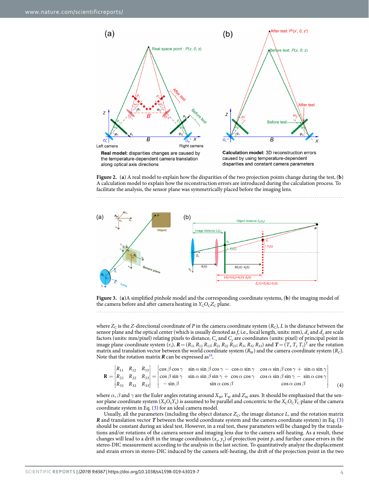
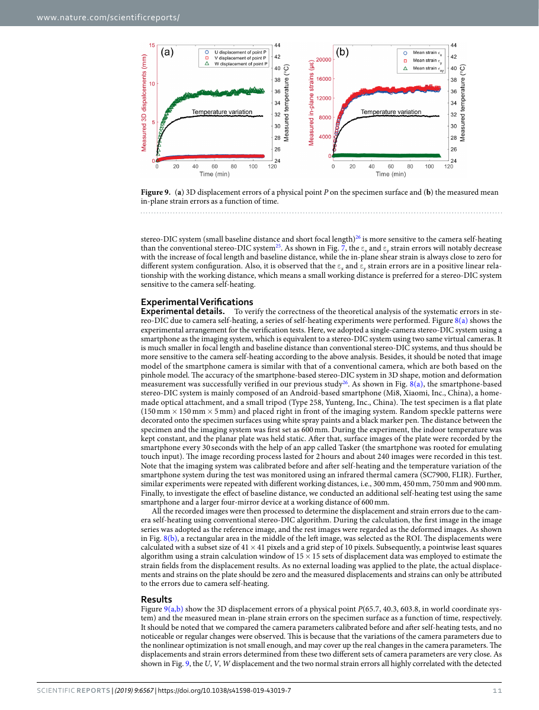
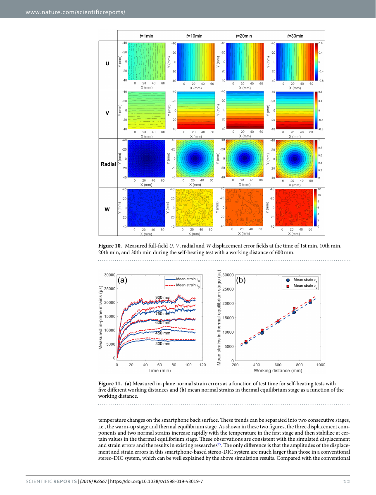

# 카메라 자기 가열로 생기는 스테레오 디지털 영상 상관의 계통 오차 모형화 (번역)

- 원제: Modeling of systematic errors in stereo-digital image correlation due to camera self-heating
- 원문: 같은 폴더의 `YuLubineau2019_SciRep_self_heating.pdf` (15쪽, nature.com에서 curl로 받음, CC BY 4.0)
- 저자: Liping Yu, Gilles Lubineau (KAUST, PSE, COHMAS 연구실, 사우디아라비아)
- 서지: Scientific Reports 9:6567 (2019). doi:10.1038/s41598-019-43019-7. PMC6484030. 접수 2019-02-11, 채택 2019-04-15, 온라인 게재 2019-04-25
- 번역 범위: 전문 (초록, 본문, 수식 설명, 표 1, 그림 1~12 캡션, 결론, 자료 공개, 사사, 저자 기여). 참고문헌은 원문 그대로 둔다.
- 번역 메모
  - 받은 PDF 첫 쪽에 "Corrected: Author Correction" 표시가 있다. 정정 공지 본문은 받지 않았고, 무엇이 정정됐는지는 확인하지 않았다.
  - 수식은 PDF 추출에서 행렬 모양이 깨졌다. 원문 쪽 그림을 보고 같은 뜻으로 다시 적었다. 기호는 원문을 따른다.
  - 그림 쪽 이미지는 `pdftoppm -r 110`으로 만든 쪽 전체 이미지다.

---

## 초록

카메라 자기 가열(self-heating)이 스테레오 디지털 영상 상관(stereo-DIC)의 변형률 측정에 오차를 만든다는 것은 앞선 연구에서 실험으로 관찰됐다. 그 크기는 장비 구성마다 크게 달랐다. 이런 "열 오차"는 때로 너무 커서 측정 정확도를 크게 해친다. 고정밀 측정을 하려면 이 오차를 꼭 보정해야 한다. 그런데 열 오차가 생기는 원리와, 그것이 stereo-DIC의 카메라 변수와 어떻게 이어지는지는 아직 분명하지 않다.

이 논문은 먼저 자기 가열이 어떻게 stereo-DIC 변형률에 큰 허상(artifact)을 만드는지 자세히 설명한다. 단순화한 스테레오 비전 모형으로, 3차원 좌표 복원과 3차원 변형 측정의 이론 오차를 나타내는 주요 식을 낸다. 유도한 이론식으로 여러 모의 실험을 해서, 자기 가열이 3차원 좌표, 변위, 변형률 측정에 주는 영향과, 카메라 변수가 열 오차에 주는 영향을 분명히 보인다. 끝으로 스마트폰 기반 단일 카메라 stereo-DIC 장비로 실제 자기 가열 실험을 여러 번 해서, 이론 분석과 모의 결과가 맞음을 확인한다.

## 서론

stereo-DIC는 넓은 길이와 시간 범위에서 3차원 형상과 변형을 재는, 검증이 잘 된 비접촉 광학 기법이다(1~3). 2차원 DIC(2D-DIC)와 비교하면, stereo-DIC는 시편 표면의 면 밖 이동과 회전에 영향을 받지 않고 평면과 곡면 물체 모두의 3차원 형상과 변형을 잴 수 있다. 그래서 쓰임이 더 넓고 정확도가 더 높다. 복원 알고리즘과 장비가 계속 좋아지면서, stereo-DIC는 과학 연구와 공학 응용에서 유망한 도구가 됐다. 예를 들어 여러 재료의 물성 평가(4, 5), 다중 척도 변형 측정(6, 7), 동적 변형 추적(8~10), 가혹 환경의 3차원 변형 측정(11, 12)에 쓰인다.

stereo-DIC를 할 때는 먼저, 위치나 방향을 바꿔 가며 찍은 교정판(calibration target) 영상 쌍과, 여러 하중 조건(시간이나 상태)의 시험 물체 영상 쌍을, 동기화한 카메라 두 대나 보조 광학 장치를 단 카메라 한 대로 기록한다(13). 교정판 영상 쌍으로 카메라 변수(내부 변수와 외부 변수)를 정한다. 시험 물체 영상 쌍에서는 상관 알고리즘으로 두 영상의 투영점 대응을 찾는다. 교정한 카메라 변수와, 두 카메라에서 정한 투영점의 영상 좌표로, 삼각측량 원리에 따라 측정점의 3차원 좌표를 복원한다.

보통 세계 좌표계를 세우는 교정 카메라 변수는 시험 중 일정하다고 가정한다. 곧 영상 장치 안의 모든 부품이 위치나 방향을 바꾸지 않는다고 본다. 그러나 실제로는 이 가정이 맞지 않는다. 일반 stereo-DIC 장비에서 두 카메라의 회로 기판은 켜진 뒤 열을 낸다. 이 열은 카메라의 다른 부품으로 옮겨 가, 카메라 기계 부품을 조금 열변형시킨다. 이를 흔히 카메라 자기 가열 또는 카메라 예열(warm-up) 효과라 한다. 그 결과 카메라 안의 구조 배치(예: 렌즈와 센서의 위치와 방향)가 조금 바뀐다. 다시 말해, 원래 교정한 카메라 변수와 stereo-DIC 장비가 세운 세계 좌표계가 온도 변화로 바뀐다. 이 작은 변화는 피할 수 없이 측정 결과에 오차를 만든다. 고정밀 3차원 형상과 변형 측정을 하려면, 카메라 자기 가열로 생기는 stereo-DIC 오차를 꼼꼼히 연구하고, 가능하면 없애야 한다.

문헌에서 카메라 자기 가열 현상은 1990년대 초 머신 비전 분야 여러 연구자가 관찰했다(14, 15). 그들은 카메라를 켠 뒤 첫 한 시간 동안 영상 좌표가 십분의 몇 화소만큼 드리프트한다는 것을 찾았다. 관찰한 영상 좌표 드리프트를 설명하려고, Handel(16)과 Podbreznik, Potocnik(17, 18)은 핀홀 모형에 바탕을 둔 수학 모형으로 자기 가열 효과를 모형화했다. 이 모형들은 온도가 카메라 내부 변수에 영향을 주지 않고, 카메라의 평행 이동만 생각하면 된다고 가정한다. 사실 온도 변화는 카메라의 모든 부품을 열팽창시키므로, 이 가정은 경우에 따라 정확하지 않을 수 있다. 이 한계를 풀려고 Yu 등(19)은 카메라 변수 변화와 영상 좌표 드리프트의 관계를 더 엄밀하게 나타내는 모형을 냈다. 이 모형은 내부 변수의 변화도 고려한다.

최근에는 2D-DIC 측정에서도 자기 가열 현상이 발견됐고, 카메라마다 최대 변형률 오차가 수십에서 수백 마이크로스트레인으로 측정됐다(20~24). 이어 Ma 등(22)은 카메라 부품의 변형을 실험으로 연구해, 카메라 렌즈와 카메라 센서의 면 밖(광축 방향) 이동이 서로 다르다는 것을 찾았다. 이 관찰에 따라 2D-DIC에서 자기 가열로 생기는 이론 변위 오차와 변형률 오차가 유도되고 충분히 이해됐다. 더 최근에는 Pan 등(25)이 stereo-DIC 측정에서도 비슷한 온도 의존 열 오차를 찾았다. 우리의 최근 연구는 기선 거리가 짧고 초점 거리가 짧은 단일 카메라 stereo-DIC 장비에서 열 오차가 수만 마이크로스트레인까지 크게 늘어남을 보였다(26).

그러나 카메라 한 대를 쓰는 2D-DIC와 비교하면, stereo-DIC에서 열 오차가 생기는 원리는 더 복잡하다. 삼각측량에서 두 카메라의 구조 변화를 함께 생각해야 하기 때문이다. stereo-DIC의 열 오차를 이해하고 장비 구성마다 오차가 다른 이유를 설명하려면, 카메라 자기 가열로 생기는 stereo-DIC 오차를 종합적으로 이론 분석할 필요가 있다.

이 연구에서는 먼저 두 모형으로 stereo-DIC의 열 오차 발생 원리를 분명히 설명한다. 그다음 단순화한 스테레오 비전 모형으로, 자기 가열로 생기는 stereo-DIC의 3차원 복원 오차와 변형 오차를 정량적으로 종합 분석한다. 일련의 모의 실험으로, 자기 가열이 전 영역 3차원 좌표, 변위, 변형률 측정에 주는 영향과 카메라 변수가 열 오차에 주는 영향을 보인다. 끝으로 스마트폰 기반 단일 카메라 stereo-DIC 장비로 평판에서 실제 자기 가열 실험을 해, 이론 분석과 모의 결과가 맞음을 확인한다.

## stereo-DIC 기법의 기본 원리

자기 가열로 생기는 stereo-DIC 열 오차를 분석하기 쉽도록, 핀홀 모형에 바탕을 둔 단순 영상 모형을 쓴다. 이 단순 모형에서는 렌즈 왜곡과 센서 면의 기울어짐(skew)을 무시하고, 주점(principal point)이 카메라 센서 정중앙에 있다고 가정한다. 그림 1은 stereo-DIC 장비의 영상 모형 개략도와 투영 평면의 기하 관계다.

*그림 1. (a) stereo-DIC 장비의 영상 모형 개략도, (b) XOZ 평면의 기하 관계 (O-XYZ는 왼쪽 카메라 광학 중심에 정한 스테레오 장비의 세계 좌표계).*

 그림처럼 물체 표면의 물리 점 P(X, Y, Z)가 왼쪽과 오른쪽 센서 면에서 P1(X1, Y1), P2(X2, Y2)로 찾아졌다고 하자. 그러면 세계 좌표계(O-XYZ, 왼쪽 카메라 광학 중심에 정함)에서 이 점의 3차원 좌표는 기하 관계로 다음과 같이 얻는다(27, 28).

$$X = \frac{B}{\cot\theta_1 + \cot\theta_2}\cot\theta_1,\quad Y = \frac{B}{\cot\theta_1 + \cot\theta_2}\frac{\tan\alpha_1}{\sin\theta_1},\quad Z = \frac{B}{\cot\theta_1 + \cot\theta_2} \tag{1}$$

여기서 θ1 = ω1 + ϕ1, θ2 = ω2 + ϕ2다. f1, f2는 두 카메라의 초점 거리, ϕ1, ϕ2는 카메라 광축과 기선(baseline) 사이 각, ω1, ω2는 광선 PP1, PP2의 수평 투영과 광축 사이 각, α1, α2는 그에 대응하는 수직 투영 각이다. D는 투영점 P'와 기선 사이 거리다(이 세계 좌표계에서 D는 Z와 같다). ω1, ω2, α1, α2는 독립 변수가 아니고, 다른 구조 변수와 센서 면 좌표로 tan ω1 = X1/f1, tan ω2 = X2/f2, tan α1 = Y1 cos ω1/f1, tan α2 = Y2 cos ω2/f2로 나타낼 수 있다. 이 변수와 기하 관계로 θ1, θ2, α1은 다음과 같다.

$$\theta_1 = \arctan\frac{X_1}{f_1} + \phi_1,\quad \theta_2 = \arctan\frac{X_2}{f_2} + \phi_2,\quad \alpha_1 = \arctan\left(\frac{Y_1}{f_1}\cos\left(\arctan\frac{X_1}{f_1}\right)\right) \tag{2}$$

카메라 변수(교정판으로 교정한 내부 변수 f1, f2와 외부 변수 ϕ1, ϕ2, B)와 두 투영점 좌표(스테레오 정합으로 추적한 P1(X1, Y1), P2(X2, Y2))가 정해지면, 식 (1)로 세계 좌표계(O-XYZ)에서 점 P의 3차원 좌표를 계산할 수 있다. 미리 정한 관심 영역(ROI) 안에 고르게 놓은 모든 계산점에 이 과정을 되풀이하면, 초기 상태 시험 물체의 3차원 형상을 얻는다. 그다음 같은 카메라 변수와 바뀐 두 투영점 좌표로 변형 상태의 3차원 형상을 정한다. 변형 상태의 복원 3차원 좌표에서 초기 상태의 좌표를 빼면, 여러 변형 상태에서 시편 표면의 3차원 전 영역 변위장을 얻는다. 끝으로 점별 최소제곱 변형률 추정법으로 변위장을 미분해 변형 상태의 전 영역 변형률 지도를 계산한다.

## 카메라 자기 가열로 생기는 stereo-DIC 오차의 이론 분석

### stereo-DIC에서 열 오차가 생기는 원리

앞에서 소개했듯이, 시험편 위 한 점의 3차원 좌표는 교정한 카메라 변수와 왼쪽, 오른쪽 영상의 두 투영점 좌표로 삼각측량 원리(식 (1))에 따라 정해진다. 보통 카메라 변수는 시험 전이나 후에 교정해, 한 시험에서 기록한 모든 영상 쌍에 대해 상수로 본다. 반면 두 투영점의 영상 좌표는 물체 표면의 점마다 다르다. 이상적으로는 카메라와 시편이 모두 안정하면 카메라 변수와 두 투영점의 영상 좌표가 일정해야 한다.

그러나 실제 시험에서는 카메라 안의 구조 배치(예: 렌즈와 센서의 위치와 방향)가 작은 열변형으로 바뀐다. 이 온도 의존 변화는 다시 두 투영점의 위치(곧 영상 좌표)를 조금 바꾼다. 영상 좌표는 온도에 따라 바뀌는데 카메라 변수는 상수로 두므로, 삼각측량 원리에 따라 복원 3차원 좌표가 온도에 따라 변한다.

자기 가열로 생기는 stereo-DIC 오차를 더 잘 이해하도록, 여기서 두 모형을 낸다. 실제 모형(real model)과 계산 모형(calculation model)이다. 각각 실제 시험 중 두 투영점의 영상 좌표와 시차(disparity)가 어떻게 바뀌는지, 그리고 계산 과정에서 복원 오차가 어떻게 들어오는지를 설명한다.

그림 2(a)처럼 두 카메라가 온도 때문에 광축 방향으로 이동했다고 하자. 그러면 실제 공간점 P의 두 투영점은 바깥쪽으로 움직인다. 곧 P1의 x 좌표는 줄고 P2의 x 좌표는 는다. 온도로 생기는 센서와 렌즈의 면 밖 이동은 실제 시험에서 분명히 관찰됐다(22). 그 결과 두 투영점의 x 방향 시차(곧 x 좌표 차이)가 카메라 이동으로 커진다. 계산할 때는, 그림 2(b)처럼 교정한 카메라 내부 변수와 외부 변수로 세계 좌표계를 세운다. 한 시험에서 기록한 모든 영상에 모든 변수가 고정되므로, 온도 의존 시차는 반드시 온도 의존 3차원 좌표를 낳고, 이 변하는 3차원 좌표는 다시 온도 의존 변위와 변형률을 낳는다.

*그림 2. (a) 시험 중 두 투영점의 시차가 어떻게 바뀌는지 설명하는 실제 모형, (b) 계산 과정에서 복원 오차가 어떻게 들어오는지 설명하는 계산 모형. 분석을 쉽게 하려고 센서 면을 결상 렌즈 앞에 대칭으로 놓았다.* (그림 속 글: 실제 모형, 시차 변화는 광축 방향의 온도 의존 카메라 이동 때문에 생긴다. 계산 모형, 온도 의존 시차와 일정한 카메라 변수를 쓰기 때문에 3차원 복원 오차가 생긴다.)

### 카메라 자기 가열로 생기는 영상 좌표 드리프트

#### 카메라 한 대의 영상 좌표 드리프트

stereo-DIC 측정과 온도 변화를 이으려면, 각 카메라에서 자기 가열로 생기는 영상 좌표 드리프트(또는 영상 왜곡)를 모형화해야 한다. 그림 3(a)는 단순 핀홀 모형이다. 여기서도 렌즈 왜곡과 센서 기울어짐을 무시한다. 이상 핀홀 모형에서 3차원 공간점과 센서 면 투영의 관계는 세 좌표 변환으로 세운다. (1) 세계 좌표계(RW)에서 카메라 좌표계(RC)로, (2) 카메라 좌표계(RC)에서 센서 면 좌표계(RS)로, (3) 센서 면 좌표계(RS)에서 영상 면 좌표계(rs)로. 세 변환을 합치면, 세계 좌표계(RW)의 공간점 P 좌표 (XW, YW, ZW)와 영상 면 좌표계(rs)의 좌표 (xs, ys) 사이 최종 변환은 다음과 같다(29).

$$\begin{pmatrix} x_s \\ y_s \\ 1 \end{pmatrix} = \frac{1}{Z_C}\begin{pmatrix} L/d_x & 0 & C_x \\ 0 & L/d_y & C_y \\ 0 & 0 & 1 \end{pmatrix}\left[\begin{pmatrix} R_{11} & R_{12} & R_{13} \\ R_{21} & R_{22} & R_{23} \\ R_{31} & R_{32} & R_{33}\end{pmatrix}\begin{pmatrix} X_W \\ Y_W \\ Z_W \end{pmatrix} + \begin{pmatrix} T_x \\ T_y \\ T_z \end{pmatrix}\right] \tag{3}$$

*그림 3. (a) 단순 핀홀 모형과 대응하는 좌표계, (b) 카메라 가열 전후의 YC OC ZC 평면 영상 모형.*

여기서 ZC는 카메라 좌표계(RC)에서 P의 Z 방향 좌표다. L은 센서 면과 광학 중심 사이 거리다(보통 f, 곧 초점 거리로 쓴다, 단위 mm). dx, dy는 화소와 거리를 잇는 축척 계수(단위 mm/화소)다. Cx, Cy는 영상 면 좌표계(rs)에서 주점의 좌표(단위 화소)다. R = (R11 R12 R13; R21 R22 R23; R31 R32 R33)과 T = (Tx Ty Tz)^T는 세계 좌표계(RW)와 카메라 좌표계(RC) 사이의 회전 행렬과 평행 이동 벡터다. 회전 행렬 R은 다음과 같이 쓸 수 있다(19).

$$\mathbf{R} = \begin{pmatrix} \cos\beta\cos\gamma & \sin\alpha\sin\beta\cos\gamma - \cos\alpha\sin\gamma & \cos\alpha\sin\beta\cos\gamma + \sin\alpha\sin\gamma \\ \cos\beta\sin\gamma & \sin\alpha\sin\beta\sin\gamma + \cos\alpha\cos\gamma & \cos\alpha\sin\beta\sin\gamma - \sin\alpha\cos\gamma \\ -\sin\beta & \sin\alpha\cos\beta & \cos\alpha\cos\beta \end{pmatrix} \tag{4}$$

여기서 α, β, γ는 XW, YW, ZW 축 둘레 회전의 오일러 각이다. 식 (3)에서는 이상 카메라 모형으로서 센서 면 좌표계(XS OS YS)가 카메라 좌표계의 XC OC YC 평면과 평행하고 중심이 같다고 가정한다는 점을 강조한다.

보통 식 (3)의 모든 변수(물체 거리 ZC, 영상 거리 L, 세계 좌표계와 카메라 좌표계 사이 회전 행렬 R과 평행 이동 벡터 T)는 이상적인 시험 동안 일정해야 한다. 그러나 실제 시험에서는 자기 가열로 카메라 센서와 결상 렌즈가 이동하거나 회전해 이 변수들이 바뀐다. 그 결과 투영점 p의 영상 좌표 (xs, ys)가 드리프트하고, 앞 절의 분석대로 stereo-DIC 측정에 오차가 생긴다. 자기 가열로 생기는 stereo-DIC 변위와 변형률 오차를 정량 분석하려면 두 카메라에서 투영점의 드리프트를 모형화해야 한다.

*그림 4. (a) stereo-DIC 장비의 영상 모형 개략도, (b) 카메라 자기 가열로 생기는 XW OW ZW 평면의 영상 모형 변화.*

문헌 22, 24가 보였듯이, 카메라 자기 가열에서 주된 요인은 카메라 렌즈와 센서 면의 광축 방향(곧 ZC 방향) 이동이다. 이 관찰이 stereo-DIC 열 오차 분석을 단순하게 해 준다. 이 실험 연구에 따라, 초기 시각(t = t0)의 원래 영상 거리와 물체 거리를 L(t0), ZC(t0)로 두고, 시험 중(t = ti) 열로 생긴 센서 면과 렌즈의 면 밖 이동을 dS(ti), dL(ti)로 둔다(그림 3(b)). dS(ti)와 dL(ti)는 카메라 구조의 작은 차이 때문에 카메라마다 다를 수 있다. 그러면 바뀐 영상 모형의 영상 거리 L(ti)와 물체 거리 ZC(ti)는 기하 관계로 정해진다. 또 세계 좌표계와 카메라 좌표계 사이 평행 이동 벡터 T는 결상 렌즈의 면 밖 이동으로 바뀌고, 회전 행렬 R은 시험 중 일정하다고 가정한다. 이렇게 바뀐 변수로, 센서 면의 투영점 p 위치는 다음과 같다.

$$\begin{pmatrix} x_s(t_i) \\ y_s(t_i) \\ 1 \end{pmatrix} = \frac{1}{Z_C(t_0) - d_L(t_i)}\begin{pmatrix} \frac{L(t_0)+d_L(t_i)-d_S(t_i)}{d_x} & 0 & C_x \\ 0 & \frac{L(t_0)+d_L(t_i)-d_S(t_i)}{d_y} & C_y \\ 0 & 0 & 1 \end{pmatrix}\left[\mathbf{R}\begin{pmatrix} X_W \\ Y_W \\ Z_W \end{pmatrix} + \begin{pmatrix} T_x \\ T_y \\ T_z - d_L(t_i) \end{pmatrix}\right] \tag{5}$$

#### stereo-DIC 장비의 영상 좌표 드리프트

왼쪽 카메라: 앞 절의 분석에 따라, stereo-DIC 장비 두 투영점의 영상 좌표 드리프트를 물체 표면의 공간점과 이을 수 있다. 그림 4는 stereo-DIC 장비의 영상 모형 개략도와, 자기 가열로 생기는 XW OW ZW 평면 영상 모형의 변화다. 앞의 분석과 같이, 세계 좌표계도 왼쪽 카메라의 광학 중심으로 옮긴다. 그림 4처럼 세계 좌표계의 Y축(YW)과 원점(OW)은 왼쪽 카메라 좌표계(OC1-XC1YC1ZC1)의 것과 겹친다. 두 좌표계의 Z축 사이 각은 βL = -(90° - ϕ1)로 정해진다. 그 결과 세계 좌표계와 왼쪽 카메라 좌표계 사이 회전 행렬 RL은 식 (4)로 정해지고, 평행 이동 벡터 TL은 (0 0 0)^T이다. 그러면 초기 시각(t = t0)에 공간점의 전역 좌표 (XW, YW, ZW)와 왼쪽 카메라 센서의 투영점 (x1, y1) 사이 수학 관계는 다음과 같다.

$$\begin{pmatrix} x_1(t_0) \\ y_1(t_0) \\ 1 \end{pmatrix} = \frac{1}{Z_{C1}(t_0)}\begin{pmatrix} L_1(t_0)/d_{x1} & 0 & C_{x1} \\ 0 & L_1(t_0)/d_{y1} & C_{y1} \\ 0 & 0 & 1 \end{pmatrix}\left[\begin{pmatrix} \sin\phi_1 & 0 & -\cos\phi_1 \\ 0 & 1 & 0 \\ \cos\phi_1 & 0 & \sin\phi_1 \end{pmatrix}\begin{pmatrix} X_W \\ Y_W \\ Z_W \end{pmatrix} + \begin{pmatrix} 0 \\ 0 \\ 0 \end{pmatrix}\right] \tag{6}$$

여기서 L1(t0)는 초기 시각 왼쪽 카메라의 영상 거리(곧 초점 거리)다. ZC1(t0)는 왼쪽 카메라의 물체 거리이고, 삼각형 P'OC1OC2의 기하 관계로 ZC1(t0) = √(XW² + ZW²) cos(arctan(ZW/XW) - ϕ1) = XW cos ϕ1 + ZW sin ϕ1로 추정한다.

카메라가 동작할 때, 시각 ti에 왼쪽 카메라 센서와 렌즈의 면 밖 이동을 dS1(ti), dL1(ti)로 둔다. 상대 회전을 무시하므로 세계 좌표계와 왼쪽 카메라 좌표계 사이 회전 행렬 RL은 그대로 두고, 평행 이동 벡터 TL은 왼쪽 카메라 좌표계에서 TL = (0 0 -dL1(ti))^T로 바뀐다. 그러면 시험 중(t = ti) 공간점의 전역 좌표 (XW, YW, ZW)와 왼쪽 카메라 센서의 투영점 (x1, y1) 사이 관계는 다음과 같다.

$$\begin{pmatrix} x_1(t_i) \\ y_1(t_i) \\ 1 \end{pmatrix} = \frac{1}{Z_{C1}(t_0) - d_{L1}(t_i)}\begin{pmatrix} \frac{L_1(t_0)+d_{L1}(t_i)-d_{S1}(t_i)}{d_{x1}} & 0 & C_{x1} \\ 0 & \frac{L_1(t_0)+d_{L1}(t_i)-d_{S1}(t_i)}{d_{y1}} & C_{y1} \\ 0 & 0 & 1 \end{pmatrix}\left[\begin{pmatrix} \sin\phi_1 & 0 & -\cos\phi_1 \\ 0 & 1 & 0 \\ \cos\phi_1 & 0 & \sin\phi_1 \end{pmatrix}\begin{pmatrix} X_W \\ Y_W \\ Z_W \end{pmatrix} + \begin{pmatrix} 0 \\ 0 \\ -d_{L1}(t_i) \end{pmatrix}\right] \tag{7}$$

오른쪽 카메라: 오른쪽 카메라에서는 세계 좌표계의 Y축(YW)이 오른쪽 카메라 좌표계(OC2-XC2YC2ZC2)의 Y축(YC2)과 겹치고, 두 좌표계의 Z축 사이 각은 βR = (90° - ϕ2)로 추정한다. 그 결과 세계 좌표계와 오른쪽 카메라 좌표계 사이 회전 행렬 RR과 평행 이동 벡터 TR을 계산할 수 있다. 그러면 초기 시각(t = t0)에 공간점의 전역 좌표와 오른쪽 카메라 센서의 투영점 (x2, y2) 사이 관계는 다음과 같다.

$$\begin{pmatrix} x_2(t_0) \\ y_2(t_0) \\ 1 \end{pmatrix} = \frac{1}{Z_{C2}(t_0)}\begin{pmatrix} L_2(t_0)/d_{x2} & 0 & C_{x2} \\ 0 & L_2(t_0)/d_{y2} & C_{y2} \\ 0 & 0 & 1 \end{pmatrix}\left[\begin{pmatrix} \sin\phi_2 & 0 & \cos\phi_2 \\ 0 & 1 & 0 \\ -\cos\phi_2 & 0 & \sin\phi_2 \end{pmatrix}\begin{pmatrix} X_W \\ Y_W \\ Z_W \end{pmatrix} + \begin{pmatrix} -B\sin\phi_2 \\ 0 \\ B\cos\phi_2 \end{pmatrix}\right] \tag{8}$$

여기서 L2(t0)는 초기 시각 오른쪽 카메라의 영상 거리(곧 초점 거리)다. ZC2(t0)는 오른쪽 카메라의 물체 거리이고 ZC2(t0) = √((B - XW)² + ZW²) cos(arctan(ZW/(B - XW)) - ϕ2) = (B - XW) cos ϕ2 + ZW sin ϕ2로 추정한다.

마찬가지로 카메라가 동작할 때 시각 ti에 오른쪽 카메라 센서와 렌즈의 면 밖 이동을 dS2(ti), dL2(ti)로 둔다. 세계 좌표계와 오른쪽 카메라 좌표계 사이 회전 행렬 RR도 바뀌지 않는다고 가정하고, 평행 이동 벡터 TR은 오른쪽 카메라 좌표계에서 TR = (-B sin ϕ2, 0, B cos ϕ2 - dL2(ti))^T로 바뀐다. 그러면 시험 중(t = ti) 관계는 다음과 같다.

$$\begin{pmatrix} x_2(t_i) \\ y_2(t_i) \\ 1 \end{pmatrix} = \frac{1}{Z_{C2}(t_0) - d_{L2}(t_i)}\begin{pmatrix} \frac{L_2(t_0)+d_{L2}(t_i)-d_{S2}(t_i)}{d_{x2}} & 0 & C_{x2} \\ 0 & \frac{L_2(t_0)+d_{L2}(t_i)-d_{S2}(t_i)}{d_{y2}} & C_{y2} \\ 0 & 0 & 1 \end{pmatrix}\left[\begin{pmatrix} \sin\phi_2 & 0 & \cos\phi_2 \\ 0 & 1 & 0 \\ -\cos\phi_2 & 0 & \sin\phi_2 \end{pmatrix}\begin{pmatrix} X_W \\ Y_W \\ Z_W \end{pmatrix} + \begin{pmatrix} -B\sin\phi_2 \\ 0 \\ B\cos\phi_2 - d_{L2}(t_i) \end{pmatrix}\right] \tag{9}$$

### 3차원 좌표, 변위, 변형률 측정의 열 오차

위 식들로, 카메라 렌즈와 센서의 이동을 재거나 미리 추정해 두면, 카메라 동작 전과 동작 중 두 카메라 센서의 두 투영점(p1, p2) 영상 좌표를 추정할 수 있다. 이 온도 의존 영상 좌표를 식 (1)에 넣으면 공간점 P의 복원 3차원 좌표를 얻고, 앞의 분석대로 그것도 온도 의존 경향을 보인다. 그다음 여러 시각의 복원 3차원 좌표로 자기 가열에 따른 변위와 변형률 오차를 평가할 수 있다.

#### 3차원 좌표 복원 오차

특정 공간점 P(XW, YW, ZW, 왼쪽 카메라 광학 중심에 정한 세계 좌표계)에 대해, 두 투영점의 드리프트한 영상 좌표는 식 (7)과 (9)로 추정한다. 이 온도 의존 영상 좌표를 식 (1)에 넣으면, 시각 ti에 공간점 P의 복원 3차원 좌표는 다음과 같다.

$$X_W(t_i) = \frac{B}{\cot\theta_1(t_i)+\cot\theta_2(t_i)}\cot\theta_1(t_i),\quad Y_W(t_i) = \frac{B}{\cot\theta_1(t_i)+\cot\theta_2(t_i)}\frac{\tan\alpha_1(t_i)}{\sin\theta_1(t_i)},\quad Z_W(t_i) = \frac{B}{\cot\theta_1(t_i)+\cot\theta_2(t_i)} \tag{10}$$

여기서 각은 다음과 같다.

$$\theta_1(t_i) = \arctan\frac{x_1(t_i)-C_{x1}}{f_1/d_{x1}} + \phi_1,\quad \theta_2(t_i) = \arctan\frac{x_2(t_i)-C_{x2}}{f_2/d_{x2}} + \phi_2,\quad \alpha_1(t_i) = \arctan\left(\frac{y_1(t_i)-C_{y1}}{f_1/d_{y1}}\cos\left(\arctan\frac{x_1(t_i)-C_{x1}}{f_1/d_{x1}}\right)\right) \tag{11}$$

f1, f2는 왼쪽과 오른쪽 카메라의 초점 거리로 L1(t0), L2(t0)와 같다. B는 기선 거리, ϕ1, ϕ2는 왼쪽과 오른쪽 카메라 광축과 기선 사이 각이다.

#### 변위와 변형률 측정 오차

시각 ti의 복원 3차원 좌표에서 시각 t0의 좌표를 빼면, 공간점 P의 3차원 변위 오차는 다음과 같다.

$$U(t_i) = X_W(t_i) - X_W(t_0) = B\left[\frac{\cot\theta_1(t_i)}{\cot\theta_1(t_i)+\cot\theta_2(t_i)} - \frac{\cot\theta_1(t_0)}{\cot\theta_1(t_0)+\cot\theta_2(t_0)}\right]$$

$$V(t_i) = Y_W(t_i) - Y_W(t_0) = B\left[\frac{\tan\alpha_1(t_i)/\sin\theta_1(t_i)}{\cot\theta_1(t_i)+\cot\theta_2(t_i)} - \frac{\tan\alpha_1(t_0)/\sin\theta_1(t_0)}{\cot\theta_1(t_0)+\cot\theta_2(t_0)}\right]$$

$$W(t_i) = Z_W(t_i) - Z_W(t_0) = B\left[\frac{1}{\cot\theta_1(t_i)+\cot\theta_2(t_i)} - \frac{1}{\cot\theta_1(t_0)+\cot\theta_2(t_0)}\right] \tag{12}$$

미리 정한 관심 영역에 고르게 놓은 모든 계산점에 이 과정을 되풀이하면, 여러 시각의 3차원 변위 오차장을 정할 수 있다. 점별 최소제곱 변형률 추정법으로 변위장을 미분하면, 각 배치의 전 영역 변형률 오차장을 계산할 수 있다.

## 카메라 자기 가열로 생기는 stereo-DIC 오차의 모의 실험

### 자기 가열이 3차원 좌표, 변위, 변형률 측정에 주는 영향

자기 가열로 생기는 stereo-DIC 오차의 분포와 경향을 먼저 파악하려고 모의 실험을 했다. 앞의 분석에 따르면, 오차 추정에 필요한 입력은 세계 좌표계를 세우는 카메라 변수, 자기 가열로 생기는 카메라 센서와 렌즈의 면 밖 이동, 그리고 세계 좌표계에서 시험 물체의 전역 좌표다. 모의를 단순하게 하려고, 카메라 변수는 실제 stereo-DIC 장비(25)의 구성을 참고했고, 섭씨 1도당 카메라 센서와 렌즈의 면 밖 이동은 실험 관찰값(22)을 가져왔다. 시험 물체는 80 mm × 80 mm 평면이고, 장비 앞 작업 거리 730 mm에 놓았다. 모의 입력은 모두 표 1에 정리했다. 이 입력으로 위 식들을 써서 자기 가열로 생기는 stereo-DIC 오차를 추정할 수 있다. 스테레오 정합의 정합 불확도를 모의하려고, 왼쪽과 오른쪽 카메라 센서의 두 투영점 영상 좌표에 평균 0, 표준편차 0.001화소의 무작위 잡음을 더했다.

*표 1. stereo-DIC 오차 추정에 쓴, 가정한 카메라 변수, 센서와 렌즈의 면 밖 이동, 시험 물체의 전역 좌표.*

| 입력 | 왼쪽 카메라 | 오른쪽 카메라 |
|---|---|---|
| 1 카메라 변수 | f1 = 50 mm, Cx1 = 1224 화소, Cy1 = 1024 화소, dx1 = dy1 = 3.45 × 10^-3 mm/화소, ϕ1 = 76° | f2 = 50 mm, Cx2 = 1224 화소, Cy2 = 1024 화소, dx2 = dy2 = 3.45 × 10^-3 mm/화소, ϕ2 = 76° |
| | 기선 거리 B = 330 mm | |
| 2 센서 이동 | dS1(ti) = kS1 × T(ti), kS1 = 3.1 µm/°C | dS2(ti) = kS2 × T(ti), kS2 = 3.1 µm/°C |
| 2 렌즈 이동 | dL1(ti) = kL1 × T(ti), kL1 = 4.4 µm/°C | dL2(ti) = kL2 × T(ti), kL2 = 4.4 µm/°C |
| | T(ti)는 실제 시험에서 얻은 온도 변화 곡선 | |
| 3 전역 좌표 | 평면 (XW = 125:1:205, YW = -40:1:40, ZW = 730, 단위 mm) | |

그림 5(a)는 영상 카메라를 켠 뒤의 전형적인 온도 변화 곡선과, 기존 연구(22)에 따라 추정한 카메라 센서와 결상 렌즈의 면 밖 이동이다. 이 온도 의존 면 밖 이동과 카메라 변수로, 물체 표면 물리 점들의 두 투영점 온도 의존 영상 좌표를 식 (7)과 (9)로 정할 수 있다. 두 투영점의 온도 의존 영상 좌표와 일정하다고 가정한 카메라 변수로 물리 점의 3차원 좌표를 복원할 수 있다. 여러 시각의 복원 3차원 좌표에서 초기 시각에 복원한 3차원 좌표를 빼면(식 (12)), 시험점들의 전 영역 3차원 변위 오차를 정한다.

그림 5(b)는 모든 시험점 가운데 점 P(205, 40, 730)의 3차원 변위 오차를 시간의 함수로 보인다. U, V, W 변위 오차 모두 온도와 비슷한 경향을 보이고, W 변위 오차가 U, V보다 크다. 그다음 변위장을 미분해 해당 변형률 오차장을 평가할 수 있고, 평균 면내 변형률을 그림 5(c)에 그렸다. 수직 변형률과 시간의 곡선은 온도 변화와 강한 양의 상관을 보이고, εx와 εy 값은 거의 같다. 면내 전단 변형률은 늘 0에 가깝다. 이 관찰은 앞선 연구의 실험 결과(25)와 잘 맞는다.

*그림 5. (a) 켠 뒤 영상 카메라의 전형적인 온도 변화 곡선과 추정한 카메라 센서와 결상 렌즈의 면 밖 이동, (b) 시편 표면 물리 점 P(205, 40, 730)의 3차원 변위 오차, (c) 측정한 평균 면내 변형률 오차를 시간의 함수로 나타냄.*

자기 가열이 stereo-DIC 측정에 주는 영향을 직관적으로 보이려고, 1분, 10분, 20분, 30분 시각의 전 영역 U, V, 반경 방향(√(U² + V²)), W 변위 오차장을 그림 6에 냈다. 그림처럼 U와 V 변위 오차장은 X와 Y 방향을 따라 고르게 분포한다. 이는 두 방향 모두에 가상 인장 변형률이 있다는 뜻이다. 동심원 모양의 반경 방향 변위 오차장에서 팽창 변형이 더 분명하다.

이상적으로, ROI 중심이 XOY 평면에서 기선의 수직 이등분선 위에 정확히 있으면 평균 U, V 변위는 0에 가까워야 한다. ROI가 수직 이등분선에서 벗어나면 평균 U, V 변위는 0이 아니게 되고 카메라 온도에 따라 변한다. 또 이 변위장들에서 X와 Y 방향 인장 변형률이 거의 같고 면내 전단 변형률은 무시할 만하다는 결론을 어렵지 않게 얻는다. 게다가 각 시각의 W 변위 오차는 시편 표면 전체에서 조금만 다르지만, 온도에 따라 뚜렷이 커진다는 점이 흥미롭다.

*그림 6. 가정한 카메라 변수와 카메라 부품 이동에 따라, 1분, 10분, 20분, 30분 시각에 모의한 전 영역 U, V, 반경 방향, W 변위 오차장.*

### 카메라 변수가 stereo-DIC 열 오차에 주는 영향

위 결과는 온도 변화에 따른 특정 stereo-DIC 장비의 오차만 보았으므로, 카메라 변수가 이 오차에 주는 영향은 아직 분명하지 않다. 이를 풀려고, 카메라 센서와 렌즈가 특정 시각(예: 60분)에 일정한 면 밖 이동을 겪을 때, 카메라 변수(곧 초점 거리 f, 기선 거리 B, 작업 거리 D, 사잇각 ϕ)를 바꿔 가며 stereo-DIC 장비의 오차를 모의했다. 구성이 다른 stereo-DIC 장비의 측정 변위와 변형률 오차를 비교해 카메라 변수가 열 오차에 주는 영향을 드러낸다.

모의 중 두 가지를 가정했다. 첫째, 정합 정확도는 일정하고 다른 변수(예: 형상 함수, 부분 영역(subset) 크기, 스페클 크기 등)의 영향을 받지 않는다. 둘째, 경우에 따라 투영이 센서 경계를 넘을 수 있으므로, 센서 면이 시험 물체의 투영을 다 담을 만큼 크다고 가정한다. 이 두 가정과 표 1의 변수로, 초점 거리, 기선 거리, 작업 거리, 사잇각이 다른 stereo-DIC의 열 변위와 변형률 오차를 각각 계산했다.

그림 7은 점 P의 3차원 변위 오차와 면내 변형률 오차를 카메라 변수(초점 거리, 기선 거리, 작업 거리, 사잇각)의 함수로 모의한 결과다. 이 모의에서 카메라 렌즈와 센서의 이동은 일정하고, 그림 5(a)의 60분 값을 가져왔다. 그림에서 다음을 결론지을 수 있다. 측정 W 변위 오차는 U, V 변위 오차보다 카메라 변수에 더 민감하다. 특히 기선 거리와 사잇각이 작은 구성에서 그렇다. 3차원 변위 오차는 모두 초점 거리와 기선 거리가 커지면 줄고, U와 V 변위 오차는 작업 거리와 사잇각의 영향을 거의 받지 않는다. 면내 변형률 오차에서는 εx와 εy 오차가 거의 같고, 초점 거리와 기선 거리에 매우 민감하다. 이것으로 스마트폰 기반 stereo-DIC 장비(기선 거리가 짧고 초점 거리가 짧음)(26)가 일반 stereo-DIC 장비(25)보다 카메라 자기 가열에 더 민감한 이유를 설명할 수 있다.

*그림 7. 점 P의 3차원 변위 오차와 면내 변형률 오차를 카메라 변수(초점 거리, 기선 거리, 작업 거리, 사잇각)의 함수로 모의한 결과. 카메라 렌즈와 센서의 이동은 일정하고, 그림 5(a)의 60분 값을 가져왔다.*

그림 7처럼 εx와 εy 변형률 오차는 초점 거리와 기선 거리가 커지면 눈에 띄게 줄고, 면내 전단 변형률은 장비 구성이 달라도 늘 0에 가깝다. 또 εx와 εy 변형률 오차는 작업 거리와 양의 선형 관계가 있다. 곧 자기 가열에 민감한 stereo-DIC 장비에서는 작업 거리가 짧은 편이 좋다.

## 실험 검증

### 실험 내용

자기 가열로 생기는 stereo-DIC 계통 오차의 이론 분석이 맞는지 확인하려고, 자기 가열 실험을 여러 번 했다. 그림 8(a)는 검증 시험의 실험 배치다. 여기서는 스마트폰을 영상 장치로 쓰는 단일 카메라 stereo-DIC 장비를 썼다. 이는 같은 가상 카메라 두 대를 쓰는 stereo-DIC 장비와 같다. 초점 거리와 기선 거리가 일반 stereo-DIC 장비보다 훨씬 작으므로, 위 분석에 따르면 자기 가열에 더 민감할 것이다. 또 스마트폰 카메라의 영상 모형은 일반 카메라와 비슷하고, 둘 다 핀홀 모형에 바탕을 둔다. 스마트폰 기반 stereo-DIC 장비의 3차원 형상, 운동, 변형 측정 정확도는 이전 연구(26)에서 검증했다.

그림 8(a)처럼 스마트폰 기반 stereo-DIC 장비는 주로 안드로이드 스마트폰(Mi8, Xiaomi, 중국), 직접 만든 광학 부착물, 작은 삼각대(Type 258, Yunteng, 중국)로 이뤄진다. 시험편은 평판(150 mm × 150 mm × 5 mm)이고, 영상 장치 바로 앞에 놓았다. 시편 표면은 흰 스프레이 페인트와 검은 마커로 무작위 스페클 무늬를 입혔다. 시편과 영상 장치 사이 거리는 먼저 600 mm로 했다. 실험 중 실내 온도는 일정하게 유지했고, 평판은 정지 상태로 두었다. 그다음 Tasker라는 앱의 도움으로(터치 입력을 흉내 내려고 스마트폰을 루팅했다) 30초마다 평판 표면 영상을 기록했다. 기록은 2시간 동안 이어졌고 이 시험에서 약 240장을 기록했다. 영상 장치는 자기 가열 전과 후에 교정했고, 시험 중 스마트폰의 온도 변화는 적외선 열화상 카메라(SC7900, FLIR)로 감시했다. 이어서 작업 거리를 바꿔, 곧 300 mm, 450 mm, 750 mm, 900 mm로 비슷한 실험을 되풀이했다. 끝으로 기선 거리의 영향을 보려고, 같은 스마트폰과 더 큰 4거울 장치로 작업 거리 600 mm에서 자기 가열 시험을 하나 더 했다.

*그림 8. (a) 검증 시험의 실험 배치, (b) ROI를 정한 기록 영상. 영상 장치는 스마트폰 기반 단일 카메라 stereo-DIC 장비로, 3차원 변형 측정에 효과적이고 일반 stereo-DIC 장비보다 카메라 자기 가열에 더 민감하다.*

기록한 영상은 모두 일반 stereo-DIC 알고리즘으로 처리해 자기 가열에 따른 변위와 변형률 오차를 구했다. 계산할 때 **영상 열의 첫 영상을 기준 영상으로 삼고**, 나머지 영상을 변형 영상으로 보았다. 그림 8(b)처럼 왼쪽 영상 가운데의 직사각형 영역을 ROI로 골랐다. 변위는 부분 영역 크기 41 × 41 화소, 격자 간격 10 화소로 계산했다. 이어서 변위 자료 15 × 15 묶음의 변형률 계산 창을 쓰는 점별 최소제곱 알고리즘으로 변위 결과에서 변형률장을 추정했다. 평판에 외부 하중을 주지 않았으므로, 평판의 실제 변위와 변형률은 0이어야 한다. 따라서 측정된 변위와 변형률은 카메라 자기 가열로 생긴 오차로만 볼 수 있다.

### 결과

그림 9(a, b)는 물리 점 P(65.7, 40.3, 603.8, 세계 좌표계)의 3차원 변위 오차와, 시편 표면의 측정 평균 면내 변형률 오차를 각각 시간의 함수로 보인다. 자기 가열 시험 전과 후에 교정한 카메라 변수를 비교했지만, 눈에 띄거나 규칙적인 변화는 보이지 않았다. 비선형 최적화로 생기는 카메라 변수 변동이 충분히 작지 않아 카메라 변수의 실제 변화를 가릴 수 있기 때문이다. 두 카메라 변수 묶음으로 정한 변위와 변형률 오차는 매우 비슷했다.

*그림 9. (a) 시편 표면 물리 점 P의 3차원 변위 오차, (b) 측정 평균 면내 변형률 오차를 시간의 함수로 나타냄.* (그림 읽기: 온도는 약 25 °C에서 시작해 약 40분 뒤 약 32 °C 근처에서 평형에 이른다. W 변위 오차는 약 9 mm까지 오르고, U, V는 1 mm보다 훨씬 작다. 평균 εx, εy는 약 14,000 µε에서 평형이다. 이 값은 그림에서 눈으로 읽은 것이다.)

그림 9처럼 U, V, W 변위와 두 수직 변형률 오차는 모두 스마트폰 뒷면에서 잰 온도 변화와 높은 상관을 보인다. 이 경향은 연속된 두 단계, 곧 예열 단계와 열평형 단계로 나눌 수 있다. 두 그림처럼 세 변위 성분과 두 수직 변형률은 첫 단계에서 온도와 함께 빠르게 늘고, 열평형 단계에서는 일정한 값에 머문다. 이 관찰은 모의한 변위, 변형률 오차와 기존 연구 결과(25)와 맞는다. 유일한 차이는 이 스마트폰 기반 stereo-DIC 장비의 변위와 변형률 오차 크기가 일반 stereo-DIC 장비보다 훨씬 크다는 점이다. 이는 위 모의 결과로 잘 설명된다. 모의 절의 일반 stereo-DIC 장비(f1 = f2 = 50 mm, B = 330 mm)와 비교하면, 스마트폰 기반 stereo-DIC 장비의 초점 거리와 기선 거리(f1 = f2 = 5 mm, B = 50 mm)는 훨씬 작다. 그림 7의 모의 결과에 따르면, 이 스마트폰 기반 stereo-DIC 장비의 변위와 변형률 오차는 피할 수 없이 훨씬 크다.

그림 10은 작업 거리 약 600 mm 자기 가열 시험에서 1분, 10분, 20분, 30분 시각에 측정한 전 영역 U, V, 반경 방향, W 변위 오차장이다. 그림 6의 모의 변위 오차와 마찬가지로, 실제 시험에서 측정한 U와 V 변위 오차장도 각각 X와 Y 방향을 따라 고르게 분포한다. 이는 시편 표면이 두 방향 모두에 가상 인장 변형률을 겪는다는 뜻이고, 가상 변형률은 변위 기울기로 정할 수 있다. 그림 10의 셋째 줄은 U, V 변위 오차장을 합친 반경 방향 변위장이다. 겹쳐 그린 등고선은 반경 방향 변위 벡터의 크기를 나타내고, 고른 열팽창이 분명하다. 또 1분, 10분, 20분, 30분의 W 변위 오차장을 그림 마지막 줄에 냈다. 각 시각에서 시편 표면의 W 변위는 거의 같지만, 그 크기는 일반 stereo-DIC 장비의 모의 W 변위 오차(그림 6)보다 훨씬 크다. 스마트폰 기반 stereo-DIC 장비의 W 변위 오차가 훨씬 큰 이유는 모의 분석으로 잘 설명된다.

*그림 10. 작업 거리 600 mm 자기 가열 시험에서 1분, 10분, 20분, 30분 시각에 측정한 전 영역 U, V, 반경 방향, W 변위 오차장.* (그림 읽기: 30분에 U, V는 시야 가장자리에서 약 ±0.8 mm, W는 약 10 mm다. 눈으로 읽은 값이다.)

작업 거리가 다른 자기 가열 시험의 열 오차를 더 비교해 작업 거리의 영향을 보였다. 그림 11(a)는 다섯 작업 거리(300 mm, 450 mm, 600 mm, 750 mm, 900 mm) 자기 가열 시험에서 측정한 면내 수직 변형률 오차를 시험 시간의 함수로 보인다. 열 변형률은 모두 빠르게 느는 단계(0~40분)와 평형 단계(40분~끝)를 보이고, 작업 거리가 길수록 열 오차가 더 크다. 두 방향의 면내 변형률 오차는 거의 같다. 몇 시험(예: 450 mm, 750 mm)의 작은 차이는 카메라의 작은 평행 이동이나 회전 때문일 수 있다. 평형 단계 열 변형률의 평균을 세로축 값으로 해서, 그림 11(b)는 평형 단계 평균 수직 변형률을 작업 거리의 함수로 보인다. 그림에서 보듯 두 변형률 오차는 작업 거리에 따라 거의 선형으로 늘고, 기울기는 약 23.51 µε/mm와 23.95 µε/mm다. 이 관찰은 그림 7의 모의 결과와 잘 맞고, 기울기 차이는 카메라 내부, 외부 변수의 차이 때문일 수 있다.

*그림 11. (a) 작업 거리가 다른 다섯 자기 가열 시험에서 측정한 면내 수직 변형률 오차를 시험 시간의 함수로 나타냄, (b) 열평형 단계 평균 수직 변형률을 작업 거리의 함수로 나타냄.* (그림 읽기: 평형 변형률은 300 mm에서 약 6,000 µε, 900 mm에서 약 20,000 µε다. 눈으로 읽은 값이다.)

그림 12는 광학 부착물이 다른 두 자기 가열 시험에서 측정한 면내 수직 변형률 오차를 시험 시간의 함수로 보인다. 시험 1은 그림 8의 원래 광학 부착물이고, 시험 2는 거울 사이 간격이 더 큰 4거울 장치다. 두 시험의 작업 거리는 모두 600 mm로 했다. 두 시험 장비의 카메라 변수를 교정해 그림 12(c)에 나열했다. 두 장비의 주된 차이는 두 가상 카메라 사이 기선 거리임이 분명하다. 그림 12(a, b)처럼 측정한 면내 수직 변형률 오차는 모두 스마트폰 온도 변화와 비슷한 경향을 보인다. 그러나 평형 단계에서 시험 1의 변형률 오차가 시험 2보다 크게 크다. 이는 기선 거리가 길수록 열 오차가 작다는 뜻이다. 이 관찰은 모의 시험과 잘 맞는다.

*그림 12. 광학 부착물이 다른 두 자기 가열 시험에서 측정한 면내 수직 변형률 오차를 시험 시간의 함수로 나타냄. (a) 그림 8의 원래 광학 부착물, (b) 거울 사이 간격이 더 큰 4거울 장치. 두 시험의 교정 카메라 변수와 작업 거리는 (c)에 있다. cx1, cy1, cx2, cy2는 왼쪽과 오른쪽 가상 카메라 주점의 영상 좌표이고, fx1, fy1, fx2, fy2는 두 가상 카메라의 두 방향 초점 거리다.*

## 결론과 논의

이 논문은 카메라 자기 가열로 생기는 stereo-DIC의 계통 오차를 이론과 실험으로 연구했다. 먼저 stereo-DIC에서 열 오차가 생기는 원리를 설명하고, 단순화한 스테레오 비전 모형으로 3차원 좌표 복원과 변위 측정의 이론 오차를 유도했다. 모의 결과는 자기 가열이 3차원 좌표, 변위, 변형률 측정에 주는 영향과 카메라 변수가 열 오차에 주는 영향을 분명히 보였다. 끝으로 스마트폰 기반 stereo-DIC 장비의 실험 결과가 이론 분석이 맞음을 확인했다.

카메라 자기 가열이나 환경 온도 변화로 생기는 열 오차는 모든 스테레오 비전 장비에서 피할 수 없다는 점에 주목할 만하다. 이 오차는 보통 3차원 측정에서 무시할 만큼 작지만, 고정밀 측정이 필요하거나 기선 거리가 짧거나 초점 거리가 짧은 스테레오 비전 장비를 쓸 때 같은 경우에는 주의해야 한다. 이런 경우 고정밀 3차원 측정을 하려면, 작업 거리를 줄이도록 시험 물체를 가능한 한 장비 가까이 두어야 한다. 그래도 열 오차가 무시할 만큼 작지 않으면 열 오차를 줄이는 해법이 필요하다.

또 카메라 자기 가열 과정에서, 세계 좌표계와 카메라 좌표계 사이 회전 행렬 R과 평행 이동 벡터 T도 카메라의 강체 이동과 회전, 또는 환경 진동으로 바뀔 수 있다. 주점 위치도 자기 가열로 바뀔 수 있다. 이 변화들은 측정 결과에 오차를 더한다. 그러나 분명히 관찰된 센서 면과 카메라 렌즈의 면 밖 이동에 비하면, 카메라의 강체 이동과 회전은 덜 뚜렷하고 재기 매우 어렵다. 카메라의 강체 이동과 회전을 정할 수 있으면, 이 논문의 해석 모형을 여전히 적용할 수 있다.

## 자료 공개

이 연구에서 만들거나 분석한 자료는 합리적인 요청이 있으면 교신 저자에게서 받을 수 있다.

## 사사

이 논문에 보고한 연구는 킹압둘라 과학기술대학교(KAUST)의 연구비(과제 번호 BAS/1/1315-01-01) 지원을 받았다.

## 저자 기여

L.Y.와 G.L.이 연구를 구상했다. L.Y.가 실험을 했다. L.Y.와 G.L.이 원고 초안을 썼다.

## 추가 정보

이해 충돌: 저자들은 이해 충돌이 없다고 밝힌다.

출판사 알림: Springer Nature는 출판된 지도와 기관 소속에 관한 관할권 주장에 대해 중립을 지킨다.

오픈 액세스: 이 논문은 Creative Commons Attribution 4.0 International License(CC BY 4.0)로 공개된다. 원저자와 출처를 적절히 밝히고, 라이선스 링크를 주고, 바꾼 부분을 표시하면 어떤 매체와 형식으로도 사용, 공유, 개작, 배포, 복제할 수 있다. 라이선스 사본: http://creativecommons.org/licenses/by/4.0/

© The Author(s) 2019

## 참고문헌 (원문 그대로)

1. Luo, P. F., Chao, Y. J., Sutton, M. A. & Peters, W. H. Accurate measurement of three-dimensional deformations in deformable and rigid bodies using computer vision. Exp. Mech. 33(2), 123–132 (1993).
2. Sutton, M. A. et al. Three-dimensional digital image correlation to quantify deformation and crack-opening displacement in ductile aluminum under mixed-mode I/III loading. Opt. Eng. 46(5), 051003 (2007).
3. Orteu, J. J. 3-D computer vision in experimental mechanics. Opt. Lasers Eng. 47(3-4), 282–291 (2009).
4. Gustafsson, A. et al. Linking multiscale deformation to microstructure in cortical bone using in situ loading, digital image correlation and synchrotron X-ray scattering. Acta Biomater. 69, 323–331 (2018).
5. Yu, L. & Pan, B. Experimental study of tensile properties and deformation evolutions of 2D and 2.5D woven SiO2f/SiO2 composites using single-camera stereo-digital image correlation. Compos. Struct. 200, 589–598 (2018).
6. Schreier, H. W., Garcia, D. & Sutton, M. A. Advances in light microscope stereo vision. Exp. Mech. 44(3), 278–288 (2004).
7. Hu, Z., Luo, H., Du, Y. & Lu, H. Fluorescent stereo microscopy for 3D surface profilometry and deformation mapping. Opt. Express 21(10), 11808–11818 (2013).
8. Helfrick, M. N., Niezrecki, C., Avitabile, P. & Schmidt, T. 3D digital image correlation methods for full-field vibration measurement. Mech. Syst. Signal Process. 25(3), 917–927 (2011).
9. Kumar, P., LeBlanc, J., Stargel, D. S. & Shukla, A. Effect of plate curvature on blast response of aluminum panels. Int. J. Impact Eng. 46, 74–85 (2012).
10. Yu, L. & Pan, B. High-speed stereo-digital image correlation using a single color high-speed camera. Appl. Opt. 57(31), 9257–9269 (2018).
11. Pan, B., Wu, D. & Yu, L. Optimization of a three-dimensional digital image correlation system for deformation measurements in extreme environments. Appl. Opt. 51(19), 4409–4419 (2012).
12. Berke, R. B., Sebastian, C. M., Chona, R., Patterson, E. A. & Lambros, J. High Temperature Vibratory Response of Hastelloy-X: Stereo-DIC Measurements and Image Decomposition Analysis. Exp. Mech. 56(2), 231–243 (2016).
13. Pan, B., Yu, L. P. & Zhang, Q. B. Review of single-camera stereo-digital image correlation techniques for full-field 3D shape and deformation measurement. Science China Technological Sciences 61(1), 2–20 (2018).
14. Wong, K. W., Lew, M. & Ke, Y. Experience with two vision systems. Close-Range Photogrammetry Meets Machine Vision. in Int. Soc. Opt. Phot. 1395, 139502 (1990).
15. Robson, S., Clarke, T. A. & Chen, J. Suitability of the Pulnix TM6CN CCD camera for photogrammetric measurement. Videometrics II. In Int. Soc. Opt. Phot. 2067, 66–78 (1993).
16. Handel, H. Analyzing the Influences of Camera Warm-Up Effects on Image Acquisition. IPSJ Trans. Comput. Vis. Appl. 1, 12–20 (2009).
17. Podbreznik, P. & Potočnik, B. Influence of Temperature Variations on Calibrated Cameras. Int. J. Comput. Inf. Eng. 2(4) (2008).
18. Podbreznik, P. & Potočnik, B. Assessing the influence of temperature variations on the geometrical properties of a low-cost calibrated camera system by using computer vision procedures. Mach. Vis. Appl. 23(5), 953–966 (2012).
19. Yu, Q. et al. The effects of temperature variation on videometric measurement and a compensation method. Image Vis. Comput. 32(12), 1021–1029 (2014).
20. Ma, S., Pang, J. & Ma, Q. The systematic error in digital image correlation induced by self-heating of a digital camera. Meas. Sci. Technol. 23(2), 025403 (2012).
21. Pan, B., Yu, L. & Wu, D. High-accuracy 2D digital image correlation measurements with bilateral telecentric lenses: error analysis and experimental verification. Exp. Mech. 53(9), 1719–1733 (2013).
22. Ma, Q. & Ma, S. Experimental investigation of the systematic error on photomechanic methods induced by camera self-heating. Opt. Express 21(6), 7686–7698 (2013).
23. Pan, B. Thermal error analysis and compensation for digital image/volume correlation. Opt. Lasers Eng. 101, 1–15 (2018).
24. Ma, S., Zhou, S. & Ma, Q. Image distortion of working digital camera induced by environmental temperature and camera self-heating. Opt. Lasers Eng. 115, 67–73 (2019).
25. Pan, B., Shi, W. & Lubineau, G. Effect of camera temperature variations on stereo-digital image correlation measurements. Appl. Opt. 54(34), 10089–10095 (2015).
26. Yu, L., Tao, R. & Lubineau, G. Accurate 3D shape, displacement and deformation measurement using a smartphone. Sensors 19(3), 719 (2019).
27. Qiong, L., Xiansheng, Q., Shenshun, Y. & Feng, H. Structural parameters optimal design and accuracy analysis for binocular vision measure system. In IEEE/ASME International Conference on Advanced Intelligent Mechatronics, AIM, 156–161 (2008).
28. Yang, L., Wang, B., Zhang, R., Zhou, H. & Wang, R. Analysis on Location Accuracy for the Binocular Stereo Vision System. IEEE Photonics J. 10(1), 1–16 (2018).
29. Sutton, M. A., Orteu, J. J. & Schreier, H. Image correlation for shape, motion and deformation measurements: Basic concepts, theory and applications. (Springer Science & Business Media, 2009).
