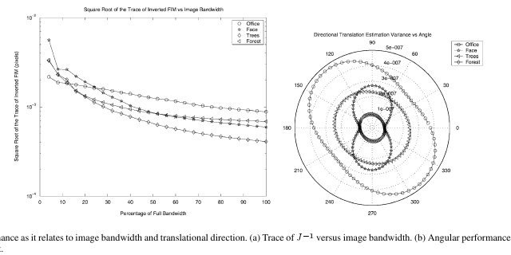
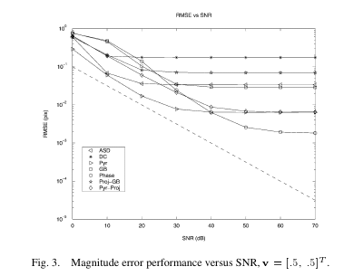
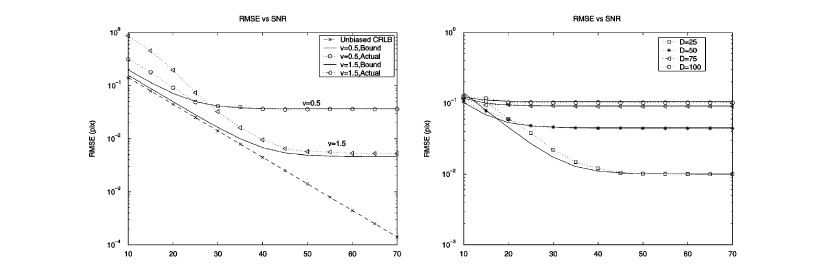
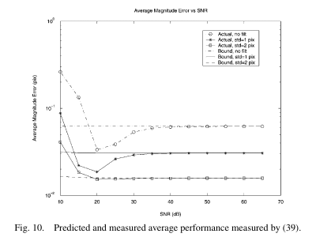

# 영상 정합의 근본 성능 한계 (번역)

- 원제: Fundamental Performance Limits in Image Registration
- 저자: Dirk Robinson, Peyman Milanfar (University of California, Santa Cruz)
- 서지: IEEE Transactions on Image Processing, 13(9), pp. 1185-1199, 2004년 9월. doi:10.1109/TIP.2004.832923
- 원문 파일: 같은 폴더의 `RobinsonMilanfar2004_TIP_registration_limits.pdf` (15쪽, 저자 사이트 공개본 https://users.soe.ucsc.edu/~milanfar/publications/journal/MotionPerformanceFinal.pdf, 2026-11-04 내려받음)
- 번역 범위: 전문 (초록, 본문, 그림 캡션, 부록). 참고문헌은 원문 그대로 둔다.
- 번역 방법: `pdftotext -layout`으로 본문을 뽑았다. 수식은 텍스트로 나오지 않아 쪽 이미지를 보고 옮겼다. 그림 안의 수치는 번역하지 않았고, 그림은 원문 쪽을 잘라 `그림/`에 넣었다.

---

## 초록

영상 정합은 영상 처리의 기본 작업이다. 많은 현대 영상 처리와 컴퓨터 비전 작업에서 중요한 전처리 단계이고, 정합 문제를 풀기 위한 알고리즘과 기법이 많이 제안되었다. 이 기법들의 성능은 흔히 서로 다른 추정기를 비교하는 여러 상대 척도로 제시되었고, 그래서 전체적으로 최적인가라는 핵심 질문은 열린 채로 남았다. 이 논문에서는 크라메르-라오 부등식으로부터 영상 정합 문제의 근본 성능 한계를 유도한다. 널리 쓰이는 몇 가지 방법의 실험 성능을 이 성능 한계와 비교하고, 영상 정합 문제에 본래 들어 있는 분산과 편향 사이의 맞바꿈을 설명한다. 특히 널리 쓰이는 기울기 기반 추정기의 편향을 유도하고 살펴, 성능을 높이려고 널리 쓰는 다중 해상도 방법을 이 편향 식으로 설명할 수 있음을 보인다. 끝으로 기울기 기반 영상 정합 기법의 일반적인 경험 성능 한계를 보여 주는 실험 모의 결과를 제시한다.

색인어: 편향, 크라메르-라오 한계, 오차 해석, 피셔 정보, 기울기 방법, 영상 정합, 운동 추정, 광류, 성능 한계.

## I. 서론

영상 정합은 영상 분야의 기본 역문제다. 움직임 보상 비디오 압축, 다중 프레임 영상 향상, 원격 탐사 같은 현대 영상 처리 작업과, 3차원 형상 추정이나 물체 식별 같은 많은 컴퓨터 비전 작업에서 중요한 전처리 단계다. 영상 정합 문제는 영상 열에서 운동을 추정하는 더 일반적인 문제의 특수한 경우다. 이때 관측 자료는 다음 꼴을 따른다.

$$z(x,y,t) = f(x - v_1(x,y,t),\ y - v_2(x,y,t)) + \epsilon(x,y,t) \qquad (1)$$

여기서 $f(x,y,t)$는 영상 함수, $\epsilon(x,y,t)$는 분산 $\sigma^2$인 더해지는 백색 가우스 잡음, $\vec v(x,y,t) = [v_1(x,y,t), v_2(x,y,t)]^T$는 영상 열이 시간에 따라 바뀌는 방식을 나타내는 미지의 벡터장이다. 이 논문에서는 문제를 두 프레임 사이의 상대 이동을 추정하는 것으로 좁힌다. 이 일반적으로 비선형인 추정 문제를 흔히 영상 정합이라 부른다. 이 모형은 조명 변화나 정반사처럼 영상의 변화에 영향을 주는 다른 요인은 무시한다.

실제로는 공간 표본 간격이 $T$이고 시간 표본은 촬영계의 프레임 속도로 정해지는, 표본화된 영상만 주어진다. 이 논문의 나머지에서는 표본화된 함수 $f(mT, nT)$를 가리키는 첨자로 $m, n$을 쓰고, 자료 생성 모형을 다음처럼 둔다.

$$z_1(m,n) = f(m,n) + \epsilon_1(m,n) \qquad (2)$$
$$z_2(m,n) = f(m - v_1(m,n),\ n - v_2(m,n)) + \epsilon_2(m,n) \qquad (3)$$

여기서 $z_1$과 $z_2$는 시각 $t_1$과 $t_2$에 관측한 영상 열 $z(x,y,t)$의 영상 한 쌍이다. 이 논문에서는 병진 운동에 집중한다. 이때 미지의 벡터장은 $\mathbf v = [v_1, v_2]^T$ 꼴이고 $v_1(m,n) = v_1$, $v_2(m,n) = v_2$는 상수다. 이 운동 모형은 매우 단순하지만, 더 복잡한 영상 변화 모형으로 해석을 넓히는 방법도 제시한다.

이 논문의 전체 목표는 두 영상 사이의 병진 이동을 추정하는 성능의 한계를 수치로 정하는 것이다. 이 문제가 매우 기본적이어서 여러 해 동안 많은 정합 알고리즘이 개발되었다. 이런 알고리즘의 성능을 설명하고 비교한 꽤 포괄적인 개관 논문도 있다 [1]-[3]. 아쉽게도 이런 알고리즘의 성능을 비교하는 기준은 기법 자체만큼이나 다양하고, 흔히 쓰는 성능 척도는 문제를 제대로 된 통계 틀에서 다루지 못한다. 성능 척도는 평균 각도 오차 같은 기하 오차 기준 [1]부터, 정답이 없을 때 벡터장을 눈으로 보는 방법까지 다양했다. 이런 척도는 운동 추정 방법론을 발전시키는 데 아주 유용했지만, 추정기 성능을 통계적으로 의미 있는 관점에서 평가하지는 못한다. 또 성능 평가는 서로 다른 알고리즘끼리의 비교에 의존해 왔고, 알고리즘이 도달 가능한 한계에 얼마나 가까운가라는 중요한 질문은 열려 있다.

병진 운동 추정을 위한 영상 정합 문제는 신호 처리 문헌의 고전 문제인 시간 지연 추정(TDE)과 비슷하다 [4]. TDE 문제에서 성능은 추정기의 평균제곱오차(MSE)로 잰다. 우리는 영상 정합의 성능도 같은 척도로 평가해야 한다고 제안한다. MSE를 쓰면 크라메르-라오 부등식으로 근본 성능 한계를 살필 수 있다. 놀랍게도 크라메르-라오 부등식은 통신, 레이더, 소나 분야의 시간 지연 추정에서는 널리 쓰였지만, 몇몇 단발 시도 [5], [6]를 빼면 영상 정합 문제 전반을 이해하는 데는 쓰이지 않았다. 이 논문에서는 이동한 영상을 정합하는 구체 문제에 대해 크라메르-라오 부등식의 꼴을 해석한다.

이런 성능 한계를 세우면 알고리즘의 성능을 엄밀하게 비교하는 수단이 생긴다. 운동 추정에서 쓰는 경험적 지식의 많은 부분을 이 성능 한계로 설명할 수 있음을 보일 것이다. 또 이런 근본 한계를 이해하면, 영상 정합을 전처리로 쓰는 영상 처리 문제 부류에 본래 있는 한계를 더 잘 이해하게 된다. 그리고 한계 식을 자세히 보면 문제 자체의 성격을 알게 되고, 개선 방법이 보인다. 특히 널리 쓰는 여러 운동 추정기에서 편향과 분산 사이의 본질적 맞바꿈을 보인다. 추정기의 편향은 식으로 나타내기 어려운 경우가 많지만, 널리 쓰는 기울기 기반 추정기에 대해서는 편향 식을 유도한다. 기울기 기반 추정기의 편향은 이전 연구 [7]-[11]에서도 다루었지만, 그 연구들은 편향을 지나치게 단순하게 일반화했다. 이 논문에서는 추정기 편향의 더 정확한 식을 제시하고 해석한다. 이 편향이 일반적인 촬영계에서 정확한 정합을 제한함을 보인다. 끝으로 이 편향 함수를 써서, 기울기 기반 추정기를 쓰는 영상 정합 정확도의 경험 한계를 (해석 결과에 근거해) 제안한다.

논문 구성은 다음과 같다. II절에서 크라메르-라오 부등식으로 이동 영상 정합의 성능 한계를 유도한다. 피셔 정보 행렬(FIM)을 해석해 이 한계가 영상 내용에 어떻게 달려 있는지 보인다. 영상 정합 문제의 본질적인 편향 문제를 보이고, 널리 쓰는 몇 가지 정합 알고리즘에서 그 편향의 실험 증거를 제시한다. III절에서는 기울기 기반 추정기 일반에 대한 구체 편향 식을 유도하고 실험으로 확인한다. 이 편향 함수를 자세히 해석하고, 흔한 촬영계에서 이 편향이 MSE 성능 한계를 지배하는 경향을 보인다. IV절에서는 영상 정합의 일반적 성능 한계를 시사하는 실험 결과를 제시한다. 마지막으로 이 연구를 확장할 방향을 제안하며 끝낸다.

## II. 영상 정합의 MSE 한계

이 절에서는 크라메르-라오 하한(CRLB) [12]으로 영상 정합의 근본 MSE 성능 한계를 수치로 정한다. CRLB는 주어진 자료 모형을 보고, 매개변수 집합을 추정하기가 얼마나 "어려운지"를 정보 이론 관점에서 나타낸다. 일반적으로 CRLB는 주어진 자료로부터 결정론적 매개변수 벡터 $\Phi$를 추정하는 *어떤* 방법이든 그 평균제곱오차의 하한을 준다. 구체적으로 임의의 추정기에 대해 오차 상관 행렬 $E[(\hat\Phi - \Phi)(\hat\Phi - \Phi)^T]$의 크라메르-라오 한계는 다음과 같다.

$$\mathrm{MSE}(\Phi) \ge \frac{\partial E[\hat\Phi]}{\partial \Phi} J^{-1}(\Phi) \frac{\partial E[\hat\Phi]}{\partial \Phi}^T + (E[\hat\Phi] - \Phi)(E[\hat\Phi] - \Phi)^T \qquad (4)$$

여기서 행렬 $J(\Phi)$를 FIM이라 부르고, $E[\hat\Phi] - \Phi$는 추정기의 편향이다 [13]. $E[(\hat\Phi - \Phi)(\hat\Phi - \Phi)^T]$의 대각 항이 MSE이므로 오차 상관 행렬을 $\mathrm{MSE}(\Phi)$로 부른다. 이 부등식은 MSE(좌변)와 CRLB(우변)의 차가 양의 준정부호 행렬이라는 뜻이다. 이 식에서 평균제곱오차 한계는 분산 항과, 추정기 편향의 제곱(외적) 항, 두 항으로 이루어짐을 알 수 있다.

이상적으로는 편향 없는 추정을 원한다. 그런 추정기가 있다고 하면 한계 (4)는 더 익숙한 다음 꼴로 단순해진다.

$$\mathrm{MSE}(\Phi) \ge J^{-1}(\Phi). \qquad (5)$$

따라서 편향 없는 추정기라면 $J(\Phi)$가 도달 가능한 최소 분산(따라서 MSE)을 정한다. FIM은 편향 있는 추정기와 편향 없는 추정기 모두에서 추정기 분산의 한계를 정하는 중심 역할을 하므로, 이제 영상 정합 문제의 FIM을 자세히 살펴본다.

### A. 영상 정합의 피셔 정보

FIM은 미지의 매개변수 벡터가 관측 자료를 만드는 데 얼마나 영향을 주는지 재는 척도다. 여기서 미지 벡터는 병진 벡터 $\mathbf v = [v_1, v_2]^T$다. FIM은 우도 함수의 기대 오목도를 보고 유도한다. 직관적으로, 우도를 최대화하는 추정기는 평평한 우도 함수보다 뾰족한 우도 함수에서 최댓값을 더 쉽게 찾는다. 자료의 결합 우도 함수를 $\mathbf P(z; \mathbf v)$로 쓰고, 로그 우도 함수는 다음과 같다.

$$\log \mathbf P(z;\mathbf v) = \frac{-1}{2\sigma^2}\sum_{m,n}[z_1(m,n) - f(m,n)]^2 + [z_2(m,n) - f(m - v_1, n - v_2)]^2 + \text{const}. \qquad (6)$$

FIM은 우도 봉우리의 뾰족함을 재며, 행렬은 $[J(\mathbf v)]_{ij} = -E[(\partial^2 \log \mathbf P(z;\mathbf v))/(\partial v_i \partial v_j)]$로 정의된다. FIM을 유도하기 위해 먼저 로그 우도 함수의 편미분 꼴을 구한다.

$$\frac{\partial^2 \log \mathbf P(z;\mathbf v)}{\partial v_i^2} = \frac{\partial}{\partial v_i}\left[\frac{1}{\sigma^2}\sum_{m,n}(z_2 - \tilde f)\frac{\partial \tilde f}{\partial v_i}\right] = \frac{1}{\sigma^2}\sum_{m,n}\left[(z_2 - \tilde f)\frac{\partial^2 \tilde f}{\partial v_i^2} - \left(\frac{\partial \tilde f}{\partial v_i}\right)^2\right]. \qquad (7)$$

표기를 줄이려고 변환된 영상 $f(m - v_1, n - v_2)$를 $\tilde f$로 쓴다. 확률적인 항은 $z_2$뿐이므로 (7)의 각 항의 음의 기댓값은 다음과 같다.

$$-E\left[\frac{\partial^2 \log \mathbf P}{\partial v_1^2}\right] = \frac{1}{\sigma^2}\left(\frac{\partial \tilde f}{\partial v_1}\right)^2,\quad -E\left[\frac{\partial^2 \log \mathbf P}{\partial v_2^2}\right] = \frac{1}{\sigma^2}\left(\frac{\partial \tilde f}{\partial v_2}\right)^2,\quad -E\left[\frac{\partial^2 \log \mathbf P}{\partial v_2 \partial v_1}\right] = \frac{1}{\sigma^2}\left(\frac{\partial \tilde f}{\partial v_2}\right)\left(\frac{\partial \tilde f}{\partial v_1}\right).$$

끝으로 연쇄 법칙에 따라

$$\frac{\partial \tilde f}{\partial v_1} = \frac{\partial \tilde f}{\partial x} = f_x(m - v_1, n - v_2),\qquad \frac{\partial \tilde f}{\partial v_2} = \frac{\partial \tilde f}{\partial y} = f_y(m - v_1, n - v_2).$$

따라서 FIM은 $J(\mathbf v) = (1/\sigma^2)\begin{bmatrix} a_1 & a_2 \\ a_2 & a_3 \end{bmatrix}$이고,

$$a_1 = \sum_{m,n} f_x^2(m - v_1, n - v_2),\quad a_2 = \sum_{m,n} f_x(m - v_1, n - v_2) f_y(m - v_1, n - v_2),\quad a_3 = \sum_{m,n} f_y^2(m - v_1, n - v_2).$$

첨자는 $x, y$ 방향 편미분을 뜻한다.

이 편미분에 대해 짚어 둘 것이 있다. FIM과 성능 한계는 연속 영상 $f(x,y)$를 이동한 것의 편미분을 표본 위치에서 잰 값에 달려 있다. 이론으로 나타내기는 쉽지만, 실제로는 영상 함수의 편미분을 알 수 없다. 사실 영상 함수의 표본만 주어지므로 FIM을 계산하기가 실제로 어렵다. 추정 전에 알 수 있는 정보에 따라 FIM을 계산하는 근사 방법이 몇 가지 있다. 예를 들어 비교적 잡음이 없는 영상, 그것도 정합할 영상보다 해상도가 높은 영상이 있으면 미분 필터로 편미분을 근사할 수 있다. 산업 응용처럼 관측할 장면을 추정 전에 알고 있으면, 장면을 나타내는 연속 영상 함수를 만들어 해석적으로 미분할 수 있다. 끝으로 이산 영상만 있으면 표본에서 직접 영상 함수를 근사할 수 있다. 그런 방법 하나는 영상이 주기적이라고 가정하고 다음처럼 둔다.

$$f(x,y) = \sum_m^M \sum_n^N F\left(\frac{2\pi m}{M}, \frac{2\pi n}{N}\right) e^{j2\pi(\frac{xm}{M} + \frac{yn}{N})} \qquad (8)$$

여기서 $F((2\pi m)/M, (2\pi n)/N)$은 영상의 이산 푸리에 변환(DFT) 계수다. 이 논문의 실험에서는 내내 이 마지막 가정을 쓴다.

더 깊이 보려고 FIM을 푸리에 영역에서 생각한다. 이를 위해 먼저 바탕 영상 함수 $f(x,y)$에 대해 몇 가지 일반 가정을 둔다. 특히 영상 함수가 대역 제한되어 있고 나이퀴스트보다 높은 율로 표본화되었다고 가정한다. 그러면 미분 함수 $f_x(m - v_1, n - v_2)$ 표본의 이산 시간 푸리에 변환(DTFT)은 $e^{j(v_1\theta_x + v_2\theta_y)} j\theta_x F(\theta_x, \theta_y)$로 쓸 수 있고, $y$ 편미분도 비슷하다. 이 영상 모형에서 파스발 관계로 FIM 항을 쓰면 다음과 같다.

$$a_1 = \frac{1}{4\pi^2}\int_{-\pi}^{\pi}\int_{-\pi}^{\pi}|F(\theta_x,\theta_y)|^2\theta_x^2\, d\theta_x d\theta_y,\quad a_2 = \frac{1}{4\pi^2}\iint |F|^2 \theta_x\theta_y\, d\theta_x d\theta_y,\quad a_3 = \frac{1}{4\pi^2}\iint |F|^2\theta_y^2\, d\theta_x d\theta_y.$$

이 식으로 보면 FIM은 미지 병진 벡터 $\mathbf v$에 의존하지 않고 영상 내용에만 달려 있다. 이 관찰은 영상이 시야 밖에서 주기적이라는 가정에 의존한다.

잘 알려진 *구경 문제*(aperture problem) [1]를 FIM으로 설명할 수 있다는 점이 흥미롭다. 이 문제는 영상의 스펙트럼 성분이 한쪽에 몰려 있을 때 생긴다. 예를 들어 스펙트럼 에너지 전부가 스펙트럼 원점을 지나는 각도 $\psi_0$의 한 단면에 놓인 경우다. 공간 영역으로 말하면 영상의 질감이 1차원이다. 극좌표에서 그런 스펙트럼은 다음과 같다.

$$F(\psi,\rho) = \begin{cases} F(\psi_0,\rho), & \psi = \psi_0 \\ 0, & \text{그 밖} \end{cases} \qquad (9)$$

해당 FIM 항은 극좌표로

$$a_1 = \frac{1}{4\pi^2}\int_{-\pi}^{\pi}|F(\psi_0,\rho)|^2\rho^3\cos^2\psi_0\, d\rho,\quad a_2 = \frac{1}{4\pi^2}\int |F(\psi_0,\rho)|^2\rho^3\cos\psi_0\sin\psi_0\, d\rho,\quad a_3 = \frac{1}{4\pi^2}\int |F(\psi_0,\rho)|^2\rho^3\sin^2\psi_0\, d\rho.$$

FIM의 행렬식은

$$\det J(v) = a_1 a_3 - a_2^2 = (\cos^2\psi_0\sin^2\psi_0 - \cos^2\psi_0\sin^2\psi_0)K = 0$$

($K$는 상수)이므로 $J(v)$는 역행렬이 없고, 편향 없는 어떤 추정기든 분산이 무한대가 된다. 요컨대 영상을 정합할 정보가 충분하지 않다.

다음으로, 영상 한 쌍에 담긴 정보는 영상의 기울기, 곧 질감에만 달려 있음을 본다. 추정기 성능과 영상 내용의 관계는 이전 연구에서도 지적되었고, 정합할 특징을 고르는 데 쓰였다 [14]. 다만 그 연구는 특정 추정기 하나를 보고, 고주파 성분이 많은 특징이 추적에 더 좋다는 경험적 제안만 했다. 여기서는 역 FIM의 대각합 $\mathrm{tr}(J^{-1})$($J^{-1}$의 고윳값 합)을 영상 내용과 관련된 성능의 스칼라 예측값으로 쓰자고 제안한다. 일반적으로 $J^{-1}$의 대각합이 작아질수록 추정기 성능이 좋아진다고 기대할 수 있다. 그림 2는 그림 1의 영상들에 대해 $J^{-1}$ 대각합의 제곱근(단위를 화소로 맞추려고)을 영상 대역폭에 따라 그린 것이다. 영상의 스펙트럼 대역폭은, 방사 차단 주파수 $\theta_c$를 전체 영상 대역폭의 백분율로 정한 저역 통과 필터로 걸러서 조절했다. 모든 영상은 같은 크기로 자르고 같은 밝기 범위로 맞추어 정규화했다. 그림 2처럼 영상 대역폭이 커질수록 $J^{-1}$ 대각합은 줄어든다. 질감이 많은 영상이 정합하기 쉽다는 일반 직관을 뒷받침한다.

그림 1. 실험 영상 (나무, 얼굴, 사무실, 숲). (영상 사진이라 따로 넣지 않았다.)

그림 2. 영상 대역폭과 병진 방향에 따른 성능. (a) 영상 대역폭에 따른 $J^{-1}$ 대각합. (b) 영상 내용에 따른 방향별 성능.

또 그림 2의 왼쪽 그래프를 보면, 주파수 성분이 많을수록 성능이 계속 좋아질 수는 있지만, 대역폭이 전체의 약 4분의 1을 넘으면 개선 폭이 줄어든다. 이 관찰은 자연 영상에서 흔히 보이는 $(1/\theta_c) = (1/\sqrt{\theta_x^2 + \theta_y^2})$ 스펙트럼 진폭 감쇠 [15]로 설명할 수 있다. 이는 $J^{-1}$ 대각합을 $\log(1/\theta_c)$ 같은 항으로 근사할 수 있음을 시사한다. 여기서 $\theta_c$는 방사 차단 주파수(영상 대역폭)다. 그림 2의 왼쪽 그래프는 $\log(1/\theta_c)$ 꼴의 거동을 보인다. 이 결과는 촬영계가 만드는 본래의 대역폭 제한이 영상 정합의 근본 성능 한계에 영향을 준다는 것도 시사한다. 영상의 스펙트럼 대역폭이 정합 능력을 예측하므로, 촬영계의 본래 대역 제한이 결국 도달 가능한 성능 한계를 지배한다.

영상 내용에 따른 정합 성능 한계를 살피는 또 하나의 흥미로운 방법은 특정 방향을 따라 한계를 보는 것이다. 병진의 $v_1$, $v_2$ 성분을 모두 추정하는 대신, 미지 매개변수의 선형 결합 $v_\psi = v_1\cos\psi + v_2\sin\psi = \mathbf w^T\mathbf v$를 생각한다. CRLB 부등식 (5)는 미지 매개변수의 선형 결합 추정 성능의 한계로 넓힐 수 있다. 특히 $\mathrm{Var}(\mathbf w^T\mathbf v) \ge \mathbf w^T J^{-1}(\mathbf v)\mathbf w$다. 이 부등식에서 특정 영상에서는 어떤 각도가 본래 더 좋은 성능을 가짐이 분명해지며, 이 최적 각도는 행렬 $J^{-1}$의 고유벡터에 달려 있다. 그림 2의 오른쪽 그래프는 그림 1의 네 예제 영상에 대해 병진의 방향 성분 추정 분산 한계를 각도 방향에 따라 보여 준다. 얼굴 영상과, 그보다 덜하지만 사무실 영상은 추정이 가장 믿을 만한 특정 방향이 있다. 구체적으로 얼굴 영상의 세로 막대는 $x$ 방향으로 많은 스펙트럼 에너지를 준다. 이 스펙트럼 특징은 이 각도 방향의 추정기 분산이 작음을 뜻한다. 마찬가지로 사무실 영상은 약 45° 돌아가 있어서 주된 미분 에너지가 약 45° 근처에 있다.

### B. 영상 정합의 편향

이 절에서는 영상 정합이라는 역문제에서 편향 없는 추정기는 일반적으로 존재하지 않음을 보인다. 이는 (5)의 한계가 지나치게 낙관적이고, 추정기 성능을 정확히 예측하려면 완전한 한계 (4)를 써야 함을 뜻한다.

병진 운동 추정기에 본래 있는 편향을 이해하려고 최대 우도(ML) 추정기를 본다. 많은 영상 정합 알고리즘은 근사 최대 우도 해를 낸다고 볼 수 있다. ML 해를 찾으려고 이동 매개변수에 대한 로그 우도 함수를 다시 본다.

$$\log \mathbf P(z;\mathbf v) = \frac{-1}{2\sigma^2}\sum_{m,n}[z_1(m,n) - f(m,n)]^2 + [z_2(m,n) - f(m - v_1, n - v_2)]^2 + \text{const}.$$

둘째 항만 미지 매개변수에 의존하므로 최대화 문제는 다음 목적 함수의 최소화로 쓸 수 있다.

$$Q_{\mathrm{LS}}(\mathbf v) = \sum_{m,n}[z_2(m,n) - f(m - v_1, n - v_2)]^2. \qquad (10)$$

이것이 ML 해를 정의하는 데 쓰는 일반 비선형 최소제곱 목적 함수다. (10)의 제곱을 전개하면

$$\sum_{m,n}[z_2^2(m,n) - 2z_2(m,n)f(m - v_1, n - v_2) + f^2(m - v_1, n - v_2)]. \qquad (11)$$

첫째 항은 매개변수 $\mathbf v$에 의존하지 않으므로 무시하고 함수 전체의 부호를 바꾸면 목적 함수를 다음처럼 다시 쓸 수 있다.

$$\sum_{m,n} 2z_2(m,n)f(m - v_1, n - v_2) - \sum_{m,n} f^2(m - v_1, n - v_2). \qquad (12)$$

비용 함수 전체를 (12)의 둘째 항인 영상 에너지로 정규화하면 직접 상관기 목적 함수를 얻는다.

$$Q_{\mathrm{DC}}(\mathbf v) = \frac{\sum_{m,n} z_2(m,n) f(m - v_1, n - v_2)}{\sum_{m,n} f^2(m - v_1, n - v_2)}. \qquad (13)$$

일반적으로 이 두 목적 함수를 미지 매개변수 $\mathbf v$에 대해 최소화 또는 최대화하면 ML 해를 얻는다. 그러나 앞서 말했듯 함수 $f(m - v_1, n - v_2)$는 보통 모른다. 근사 ML 해는 이 미지 함수의 추정값을 써서 구하며, 가장 흔히 $z_1(m - v_1, n - v_2)$를 쓴다. 신호 대 잡음비(SNR)가 매우 높으면 이 추정값이 $f(m - v_1, n - v_2)$에 매우 가깝다는 것은 쉽게 알 수 있다. 그러나 이렇게 SNR이 높은(잡음이 적은) 경우에도 목적 함수 (10), (13)은 $v_1$, $v_2$의 정수 값에서만 계산할 수 있어서, 추정이 화소 단위 정수배 운동으로 묶인다. 이 문제를 다루는 진전 [4], [16], [3]이 있었지만, 제안된 알고리즘은 흔히 편향된 추정을 낸다고 알려진 지나치게 단순한 근사에 기초한다 [17].

영상 처리의 많은 응용에는 정확한 부화소 영상 정합이 필요하다. 영상을 부화소 정확도로 정합하려면 사실상 $z_1(m,n)$의 잡음 섞인 표본에서 영상 함수 $f(x,y)$를 재구성해야 한다. 일반적으로 이 재구성은 부적정(ill-posed) 문제다. 모든 추정기는 관측하는 연속 영상의 공간에 대한 사전 가정을 품고 있다. 이 사전 가정은 문제를 정칙화해 해를 찾게 해 준다. 그러나 실제 바탕 함수가 모형 가정과 맞지 않으면 추정기는 어쩔 수 없이 편향된 추정을 낸다. 문제가 부적정하지 않은 영상 부류는 아주 작다. 예외는 바탕 연속 영상이 (8)처럼 가정한 과정대로 *만들어진* 경우다. 아쉽게도 이 조건은 실제 영상 처리 문제에서 거의 만족되지 않으며, 따라서 모든 영상 정합 알고리즘은 본래 편향되어 있다.

기존 알고리즘에 이 편향이 있는지 확인하려고, 여러 영상 정합 알고리즘의 실제 추정 성능을 계산하는 몬테카를로(MC) 모의를 했다. 실험에 쓴 추정기는 다음과 같다.

1. **근사 최소 평균 제곱 차 (ASD)** ([4]의 2차원판). 평균 제곱 차 함수

   $$\mathrm{ASD}(v_1, v_2) = \frac{1}{MN}\sum_{m,n}(z_1(m - v_1, n - v_2) - z_2(m,n))^2 \qquad (14)$$

   의 표본((10)의 근사)을 어떤 범위의 화소 이동 값 $v_1$, $v_2$에서 계산한다. 그다음 정수 화소 이동에서 구한 비용 함수의 최솟값 주변에 2차식을 맞추어 그 최솟값을 찾아 부화소 이동을 계산한다.

2. **근사 최대 직접 상관기 (DC)** [3]. 표본 상관 추정으로 (13)을 근사한다. 본질적으로 (13)의 분모가 바탕 영상 이동 $\mathbf v$와 무관하게 거의 일정하다고 가정한다. 따라서 단순화한 표본 상관 추정

   $$\mathrm{Cor}(v_1, v_2) = \frac{1}{MN}\sum_{m,n} z_1(m - v_1, n - v_2) z_2(m,n) \qquad (15)$$

   을 정수 화소 이동에서 계산한다. 그다음 표본 상관 함수의 최댓값 주변에 2차식을 맞추어 그 최댓값으로 부화소 이동을 추정한다.

3. **선형 기울기 기반 방법 (GB)** [18], [19]. 본질적으로 두 영상의 차를 영상의 공간 기울기와 연결해 다음 선형 식을 만든다.

   $$z_2 - z_1 = f_x v_1 + f_y v_2 + \epsilon. \qquad (16)$$

   그다음 영상 안 한 영역(또는 영상 전체)에 대해 선형 연립 방정식을 만든다. 이 방정식을 흔히 광류 방정식이라 부른다. 이 연립 방정식을 최소제곱으로 풀어 병진 $\mathbf v$의 추정을 얻는다. 이 모형은 다음 절에서 더 자세히 살핀다.

4. **다중 해상도(피라미드) 기울기 기반 방법 (Pyr)** [20]. 먼저 영상을 다중 해상도 피라미드로 분해한다. 알고리즘은 피라미드의 가장 거친 영상에서 병진을 추정하며 시작한다. 이 추정으로 다음 거친 단계의 영상 하나를 와핑한다. 본질적으로 운동을 "되돌리려는" 것이다. 그다음 남은 운동을 GB 방법으로 다시 추정하고 이전 운동 추정과 합친다. 이 과정을 다중 해상도 반복 방식으로 피라미드 아래까지 이어 간다. 우리 구현에서는 피라미드 각 단계에서 영상을 와핑할 때 3차 스플라인 기반 재표본화를 쓴다. 실험에서는 3단 다중 해상도 피라미드를 쓴다.

5. **투영 기울기 기반 방법 (Proj-GB)** [21]. 영상을 $x$축과 $y$축을 따라 적분해 두 자료 집합 $z^x_{1,2}(m) = \sum_n z_{1,2}(m,n)$과 $z^y_{1,2}(n) = \sum_m z_{1,2}(m,n)$을 만든다. 그다음 2차원 GB 방법과 비슷한 방정식 쌍을 만든다.

   $$z^x_2 - z^x_1 = f^x_x v_1 + \epsilon^x,\qquad z^y_2 - z^y_1 = f^y_y v_2 + \epsilon^y.$$

   끝으로 독립인 선형 연립 방정식 두 묶음을 만들고 최소제곱으로 풀어 $\mathbf v$의 성분 추정을 얻는다.

6. **투영 다중 해상도 기울기 기반 방법 (Pyr-Proj)** [22]. 다중 해상도 기울기 기반(Pyr) 방법처럼 먼저 영상을 피라미드로 분해한다. 피라미드 각 단계에서 2차원 GB 방법 대신 투영 기울기 기반(Proj-GB) 방법으로 운동을 추정한다.

7. **상대 위상 (Phase)** [23]. 푸리에 변환의 이동 성질을 쓰면 $(F_1F_2^*)/(|F_2|^2) = (F_1/F_2) = e^{j2\pi(\theta_x v_1 + \theta_y v_2)}$임을 안다. 벡터 $\mathbf v$는 위상 함수의 선형 연립 방정식

   $$\angle \frac{Z_1}{Z_2} = j2\pi(\theta_x v_1 + \theta_y v_2) \qquad (17)$$

   의 해를 찾아 추정한다. 여기서 $Z_{1,2}$는 입력 영상 $z_{1,2}$의 DFT이고 $\angle$는 측정한 위상각이다. 가중 최소제곱으로 해를 구하는 [23]의 구현을 썼다.

실험용 영상 한 쌍은 [10]의 방법을 따라 이산 푸리에 변환(DFT) 방식으로 만든다. 이는 사실상 연속 모형이 (8)로 주어진다고 가정해 영상 쌍을 만드는 것이다. 이 실험에 쓴 영상은 [1]의 나무 영상이다. 추정 전에 영상 쌍에 백색 가우스 잡음을 더했고, 각 SNR 값마다 전체 과정을 500번 반복했다. SNR은 0 dB(잡음이 매우 많음)부터 70 dB(사실상 잡음 없음)까지 살폈다. 오차를 하나의 값으로 나타내려고 각 추정기와 한계 (5)에 대해 MSE 행렬 대각합의 제곱근을 계산했다. MSE 행렬 대각합의 제곱근은 평균 크기 오차의 타당한 척도이고, CRLB가 주는 성능 한계와 비교하기에 유용하다 [24]. 그림 3은 SNR에 따른 실제 추정기 성능을 보여 준다. 점선은 편향 없는 추정기 부류에 대한 (5)의 성능 한계다. 이 한계는 잡음이 줄수록 계속 좋아진다고 말하지만, 어떤 SNR 이상에서는 각 추정기의 성능이 평평해진다. 성능 곡선이 이렇게 평평해지는 것은 각 추정기에 편향이 있다는 표시다.

그림 3. SNR에 따른 크기 오차 성능, $\mathbf v = [.5, .5]^T$.

이 편향의 효과는 실험으로 볼 수 있지만, 어떤 추정기의 실제 편향 함수를 식으로 나타내기는 보통 매우 어렵다. 편향은 흔히 결정론적 모형 오차와 추정기의 통계적 편향이 섞인 것이다. 추정기가 ML 추정기라면 이론적으로 추정은 점근적으로 편향이 없어야 하고, 그러면 모형 오차에서 오는 편향만 남는다. 그림 3에서 편향이 영상 잡음과 무관하듯, 높은 SNR에서는 이것이 주된 편향으로 보인다. 이 모형 오차는 영상 정합 문헌에서 드물게만 다루어졌다. [25]에서는 근사 직접 상관기(DC) 방법이 상관 함수 봉우리 주변의 2차 근사 때문에 편향된 추정을 낸다. 기본적으로, 표본 상관 함수의 평균 주변에서 2차 근사를 쓰는 DC 방법은 바탕 연속 함수에 대한 암묵적 가정을 품는다. [25]와 비슷하게 [17]에서도, 우도 함수가 흔히 가정하듯 최댓값 주변에서 2차식이 아닐 때 생기는 편향을 유도했다. 기울기 기반 추정기도 편향 측면에서 연구되었다 [7]-[10]. 그래도 추정기 편향을 나타내는 정확한 함수식은 없다. 다음 절에서는 기울기 기반 추정기 편향을 이해하려는 이런 시도들을 설명하고, 기울기 기반 추정기에 본래 있는 편향의 새 함수식을 유도하고 확인한다.

## III. 기울기 기반 추정기의 편향

추정기 편향의 효과를 더 분명히 이해하려고 이제 기울기 기반 추정기에 본래 있는 편향의 함수식을 유도한다. 단순한 선형 추정기를 만들 때 쓰는 근사가 어떻게 본래의 편향을 만드는지 보인다. 거의 모든 경우 기울기 기반 추정기에 편향이 있음을 보인다. 초점을 유지하고 설명을 쉽게 하려고, 기울기 기반 영상 정합 알고리즘의 1차원 판에 대한 편향 식을 유도하고 나중에 해석한다. 2차원 경우의 전체 유도는 부록에 있다.

### A. 기울기 기반 추정기

1차원 경우 측정 자료가 다음 꼴이라고 하자.

$$z_1(k) = f(k) + \epsilon_1(k) \qquad (18)$$
$$z_2(k) = f(k - v) + \epsilon_2(k). \qquad (19)$$

기울기 기반 추정기를 유도할 때는 자료를 $z(k) = z_1(k) - z_2(k) = f(k + v) - f(k) + \epsilon(k)$로 다시 써야 한다. 여기서 $\epsilon$은 분산 $\sigma^2$인 가우스 백색 잡음 과정이다.

기울기 기반 방법은 함수 $f(k + v)$를 점 $v = 0$ 주변에서 테일러 급수로 선형화해 이 방정식을 $v$에 대해 푼다. 이 전개는 다음과 같다.

$$f(k + v) - f(k) = v f'(k) + R(k, v) \qquad (20)$$

여기서 $R$은 테일러 전개의 나머지 항이다. 이 나머지는 $R(k,v) = \sum_{r=2}^{\infty}(v^r/r!)f^{(r)}(k)$ 꼴이다. 따라서 새 자료 모형은 $z(k) = vf'(k) + R(k,v) + \epsilon(k)$가 된다. 나머지 항 $R$을 무시하면 선형화한 자료 모형은 $z(k) = f'(k)v + \epsilon(k)$가 된다. 미분 값을 쓰면 최소제곱으로 속도 $v$의 선형 추정기를 얻는다.

$$\hat v = \frac{\sum f'(k) z(k)}{\sum (f'(k))^2}. \qquad (21)$$

합은 영상 전체일 수도 있는 어떤 영역에서 취한다. 이런 추정기를 흔히 기울기 기반 또는 미분 추정 방법이라 부른다 [19], [18]. 이 추정기 유도는 $f(k)$의 표본에 더해 함수 $f(k)$의 미분 표본도 있다고 가정한다. 나중에 이 가정을 어떻게 완화하는지 보인다.

나머지 항이 실제로 0이라면 기울기 기반 추정기의 분산이 $\mathrm{var}(\hat v) = (\sigma^2)/(\sum(f'(k))^2)$라는 점이 흥미롭다. 이 분산은 편향 없는 추정기의 CRLB인 $(\sigma^2)/(\sum(f'(k + v))^2)$와 거의 정확히 같다. 이 관계는 나머지 항이 실제로 0인 경우에 기울기 기반 추정기가 최대 우도 추정기가 됨을 뜻한다.

### B. 급수 절단에서 오는 편향

기울기 기반 추정 방법의 계통 오차, 곧 편향의 한 원천은 선형 추정기를 만들려고 처음에 무시한 (20)의 나머지 항 $R(k, v)$다.

나머지 항을 추정기에 포함하면 추정기 (21)의 기댓값으로 $E[\hat v] = v + (\sum f'(k)R(k,v))/(\sum(f'(k))^2)$를 얻는다. 따라서 둘째 항이 0이 아니면 고차 항이 추정기에 계통 편향을 넣는다.

이것은 주파수 영역에서 보면 조금 더 많은 것을 알려 준다. 먼저 원래 함수 $f(x)$의 푸리에 변환을 $F(\omega)$로 정의한다. 함수가 나이퀴스트 율보다 높게 표본화되었다는 가정에서, 미분 열 $f'(k)$의 DTFT는 $j\theta F(\theta)$로 나타낼 수 있다. 파스발 관계로 추정기 (21)을 다시 쓰면

$$\hat v = \frac{\int_{-\pi}^{\pi} j\theta F(\theta) Z^*(\theta)\, d\theta}{\int_{-\pi}^{\pi} |F|^2\theta^2\, d\theta}. \qquad (22)$$

덧붙이면, 자료 자체를 주파수 영역에서 직접 모형화해도 같은 추정기 꼴에 이른다. 이동한 열 $f(k + v)$의 DTFT는 $F(\theta)e^{jv\theta}$이고 자료 모형의 DTFT는

$$Z(\theta) = F(\theta)[e^{jv\theta} - 1] + \xi(\theta). \qquad (23)$$

지수를 다시 테일러 급수 $e^{jv\theta} = 1 + jv\theta - ((v\theta)^2)/(2) + \cdots$로 전개하고 선형 항 뒤에서 자르면 선형 관계 $Z(\theta) = [F(\theta)j\theta]v + \xi(\theta)$를 얻는다. 여기서 선형 추정기 (22)를 얻는다.

완전한 자료 모형을 쓰는 경우로 돌아가면, 추정의 기댓값은 다음과 같다.

$$E[\hat v] = \frac{\int_{-\pi}^{\pi}|F(\theta)|^2 j\theta(e^{-jv\theta} - 1)\, d\theta}{\int_{-\pi}^{\pi}|F(\theta)|^2\theta^2\, d\theta} = \frac{\int |F|^2\theta\sin(v\theta)\, d\theta}{\int |F|^2\theta^2\, d\theta} + j\frac{\int |F|^2\theta(\cos(v\theta) - 1)\, d\theta}{\int |F|^2\theta^2\, d\theta} = \frac{\int_{-\pi}^{\pi}|F(\theta)|^2\theta\sin(v\theta)\, d\theta}{\int_{-\pi}^{\pi}|F(\theta)|^2\theta^2\, d\theta} \qquad (24)$$

마지막 등호에서는 $\mathrm{Im}[j\theta(e^{-jv\theta} - 1)] = \theta(\cos(v\theta) - 1)$이 홀함수라서 적분이 0이 됨을 썼다. 추정의 기댓값으로 다음 꼴의 편향 함수를 얻는다.

$$b(v) = E[\hat v] - v = \frac{\int_{-\pi}^{\pi}|F(\theta)|^2(\theta\sin(v\theta) - v\theta^2)\, d\theta}{\int_{-\pi}^{\pi}|F(\theta)|^2\theta^2\, d\theta}. \qquad (25)$$

이 편향 함수를 실험으로 확인하려고, 실제 미분 값을 추정기에 줄 수 있도록 무작위로 만든 함수에서 병진 추정의 편향을 쟀다. 실험에 쓴 실제 함수 $f(k)$는 그림 4의 왼쪽 그래프에 있다. 쓴 함수의 진폭 스펙트럼은 자연 영상 스펙트럼을 본떠 $F(\theta) \approx (1/\theta)$로 두었다. 위상각은 균등 분포에서 뽑았다. 순수하게 결정론적 편향만 재려고 추정 전에 자료에 잡음을 더하지 않았다. 그림 4는 병진 $v$에 따른 실험 추정기 편향을 보여 준다. 곡선 세 개는 전체 대역 함수 $f(k)$와, 전체 대역의 50%와 75%로 대역 제한한 $f(k)$ 두 가지의 편향이다. 연속 곡선은 (25)로 예측한 편향이다.

그림 4. (왼쪽) $f(k)$ 그래프와 (오른쪽) 추정기 편향. 연속 곡선은 예측값이다.

편향 함수는 편향 식을 거의 정확히 따르는 것으로 보인다. 또 그림 4에서 $f(k)$의 대역폭이 커질수록 편향이 더 심해진다. 이것은 대역폭이 커지면 추정기 분산이 좋아진다는 편향 없는 CRLB와 어긋난다. 여기서 기울기 기반 추정기의 편향과 분산의 맞바꿈이 보이기 시작한다. 이 생각은 뒤의 IV절에서 더 자세히 살핀다.

### C. 기울기 근사에서 오는 편향

앞 절에서는 표본점의 미분 값을 추정 전에 안다고 가정했다. 앞서 말했듯 대부분의 응용에서는 미분 정보가 없다. 기울기 기반 추정의 또 다른 오차 원천은 신호 $f(k)$의 기울기, 곧 미분을 근사해야 한다는 데서 온다. (21)에서 실제 $f'(k)$ 대신 잡음 섞인 미분 근사 $f'(k) \approx z_2(k) * g(k) = [f_2(k) + \epsilon_2(k)] * g(k)$를 쓴다($*$는 합성곱). 이는 결정론적 편향이 $f'(k)$ 근사 오차와, 테일러 급수를 자르고 나머지 항 $R(k,v)$를 무시해서 생긴 오차의 조합임을 뜻한다.

이런 미분 근사에서 오는 오차는 문헌에서 전에도 지적되었다. 예를 들어 [10]에서는 $f$가 사인파 하나인 경우에만 편향 함수를 유도했다. 또 [7]과 [8]은 국소 추정에서 기울기 추정의 근사 오차 효과를 살폈다. 그러나 이 연구들의 해석 대부분은 광류 모형이 영상 열에 정확히 맞거나 나머지 항이 무시할 만하다는 가정에서 출발한다. 구체적으로 [8]의 결과는 영상 스펙트럼 성분으로 추정기 편향을 정성적으로 설명했고, 전진 차분 기울기 근사의 2차 근사 오차만 보는 지나치게 단순한 편향 근사에 기초했다. [7]의 저자들은 영상 함수의 2계 미분 $f''(k)$ 에너지가 클수록 기울기 근사 오차가 커진다고 지적했다. 이 관찰을 써서, 영상의 2계 미분을 보고 문턱값 방식으로 특정 추정을 버리는 후처리 방식을 제안했다. [9] 같은 다른 연구는 기울기 근사 오차가 편향된 추정을 내는 경향이 있다고 지적했다. 그러나 [9]에서는 이 오차가 완전히 무작위이고 단순한 분포에서 나온다고 가정한다. 그들은 기울기 근사 오차에 대한 이런 분포에 기초해 지나치게 단순한 통계 편향 모형을 세운다. 최근 [11]은 차량 추적 응용에서 이런 무작위 오차에 따른 편향을 최소화하는 방법을 연구했다. 이 오차를 무작위로 다루는 대신, 우리가 보이듯 일반적인 촬영계 SNR에서는 결정론적 계통 모형 오차에서 오는 근사 오차가 기울기 기반 추정기의 편향을 지배한다.

기울기 근사를 쓰면 추정기 (22)는 다음이 된다.

$$\hat v = \frac{\int_{-\pi}^{\pi} jG(\theta)Z_2(\theta)Z^*(\theta)\, d\theta}{\int_{-\pi}^{\pi}|G(\theta)Z_2(\theta)|^2\, d\theta} = \frac{\int_{-\pi}^{\pi} jG(\theta)[F(\theta) + \xi_2(\theta)]Z^*(\theta)\, d\theta}{\int_{-\pi}^{\pi}|G(\theta)[F(\theta) + \xi_2(\theta)]|^2\, d\theta} \qquad (26)$$

여기서 $G(\theta)$는 $g(k)$의 DTFT, $\xi_2(\theta)$는 잡음 표본 $\epsilon_2(k)$의 DTFT다. 일반적으로 미분 필터 $g(k)$는 대칭인 선형 위상 FIR 필터이고, 그래서 변환 $jG(\theta)$는 사인파의 합 $G(\theta) = \sum_l^L c_l \sin(l\theta)$로 쓸 수 있다. 아쉽게도 (26)의 기댓값을 구하기는 매우 어렵다. 식을 단순하게 하려고 미분 근사의 잡음을 무시한다. 통계 오차가 아니라 모형 오차에서 오는 결정론적 편향을 보는 높은 SNR 상황에서는 이 가정이 꽤 타당하다. V절에서 이 모형이 추정기 성능을 정확히 설명하는 SNR 영역을 보이고, 이 SNR 영역이 상용 비디오 카메라를 쓰는 촬영계에서 흔한 영역임을 보인다. 따라서 편향 함수를 다음처럼 근사한다.

$$b(v) \simeq \frac{\int_{-\pi}^{\pi}|F(\theta)|^2[G(\theta)\sin(v\theta) - vG^2(\theta)]\, d\theta}{\int_{-\pi}^{\pi}|G(\theta)F(\theta)|^2\, d\theta}. \qquad (27)$$

이 식은 원래 식 (25)와 정확한 미분 연산자 $j\theta$가 주파수 응답 $jG(\theta)$인 미분 필터로 바뀐 점만 다르다.

이 편향 함수 근사를 확인하려고, 그림 4와 같은 함수에서 기울기 커널 $g(k) = [.1069\ .2846\ 0\ -.2846\ -.1069]$를 써서 실제 추정기 편향을 쟀다. 이 미분 커널은 [26]에서 왔다. 그림 5의 왼쪽 그래프가 편향 결과다. 실험 편향은 다시 (27)이 예측한 편향을 거의 정확히 따른다. [10]에 실린 측정 편향 함수도 이 경향을 따르는 것으로 보여 우리 편향 식을 한 번 더 뒷받침한다. 다시 말하지만 신호 대역폭이 커지면 추정기 편향이 커진다.

## IV. 기울기 기반 추정기 편향의 해석

이 절에서는 결정론적 편향 근사 (27)을 더 살핀다. 편향 함수의 구조가 기울기 기반 추정기에 대한 경험적 지식의 많은 부분을 설명하고, 성능 개선 방법을 시사함을 보인다. 특히 영상 스펙트럼, 병진, 기울기 커널이 기울기 기반 추정기의 편향에 어떻게 영향을 주는지 살핀다.

그림 5. 실제 추정기 편향과 예측 편향(실선). 왼쪽 그래프는 (27), 오른쪽 그래프는 (32)로 예측.

먼저 정확한 미분을 추정기가 아는 편향 함수 (25)를 해석한다. 편향을 이해하려고 $\sin$ 함수를 $v = 0$ 주변에서 테일러 급수로 전개하면

$$b(v) = \frac{\int_{-\pi}^{\pi}|F(\theta)|^2[v\Lambda_1(\theta) - v^3\Lambda_2(\theta) + v^5\Lambda_3(\theta)\cdots]\, d\theta}{\int_{-\pi}^{\pi}|F(\theta)|^2\theta^2\, d\theta} \qquad (28)$$

여기서 열의 항은 $\Lambda_1(\theta) = 0$, $\Lambda_2(\theta) = (\theta^4/3!)$, $\Lambda_3(\theta) = (\theta^6/5!)$ 등이다. 분모의 계승이 이 $\Lambda$ 함수들을 지배하므로 테일러 근사의 계수는 빨리 줄어든다. 일반적인 정합 문제보다 큰 경우가 많은 아주 큰 병진에서만 이 고차 항이 편향 함수에 영향을 준다. 이는 작은 $v$에서 편향을 병진 $v$의 3차 함수로 근사할 수 있음을 시사한다.

$$b(v) \approx -\frac{v^3}{3!}\frac{\int_{-\pi}^{\pi}|F(\theta)|^2\theta^4\, d\theta}{\int_{-\pi}^{\pi}|F(\theta)|^2\theta^2\, d\theta}. \qquad (29)$$

이 계수비는 $f(x)$의 2계 미분 에너지를 1계 미분 에너지로 나눈 값으로 해석할 수 있다. 일반적으로 테일러 급수는 공간 영역에서 다음처럼 설명할 수 있다.

$$b(v) = -\frac{v^3}{3!}\frac{\sum[f''(k)]^2}{\sum[f'(k)]^2} + \frac{v^5}{5!}\frac{\sum[f^{(4)}(k)]^2}{\sum[f'(k)]^2} - \cdots \qquad (30)$$

기본적으로 이 고차 항은 함수 $f(x)$의 매끄러움에 달려 있다. 충분히 매끄러운 함수에서는 이 고차 미분의 에너지가 무시할 만하므로, 편향은 (29)의 3차 함수로 잘 근사된다. 이 편향 근사의 정확도는 그림 4의 오른쪽 그래프에서 분명하다.

더 완전한 편향 함수 (27)에 대해 같은 해석을 반복해, $v = 0$ 주변에서 테일러 급수로 전개하면

$$b(v) = \frac{\int_{-\pi}^{\pi}|F(\theta)|^2[v\Lambda_1(\theta) - v^3\Lambda_2(\theta) + v^5\Lambda_3(\theta)\cdots]\, d\theta}{\int_{-\pi}^{\pi}|G(\theta)F(\theta)|^2\, d\theta} \qquad (31)$$

여기서 열의 항은 $\Lambda_1(\theta) = \theta G(\theta) - G^2(\theta)$, $\Lambda_2(\theta) = (\theta^3/3!)G(\theta)$, $\Lambda_3(\theta) = (\theta^5/5!)G(\theta)$ 등이다. 이 근사에서 다항식 계수가 기울기 커널 $G(\theta)$와 영상 진폭 스펙트럼 $|F(\theta)|$의 관계에 달려 있음을 안다. 다시 거듭제곱 급수를 $v$의 3차 함수까지 잘라 편향 식을 단순하게 한다.

$$b(v) \approx v\left(\frac{\int_{-\pi}^{\pi}|F(\theta)|^2\Lambda_1(G,\theta)\, d\theta}{\int_{-\pi}^{\pi}|G(\theta)F(\theta)|^2\, d\theta}\right) - v^3\left(\frac{\int_{-\pi}^{\pi}|F(\theta)|^2\Lambda_2(G,\theta)\, d\theta}{\int_{-\pi}^{\pi}|G(\theta)F(\theta)|^2\, d\theta}\right). \qquad (32)$$

그림 5의 오른쪽 그래프에는 왼쪽 그래프와 같은 실험 편향 곡선을, 이번에는 3차 근사 (32)와 함께 보인다. 부화소 영역의 $v$에서 근사가 꽤 가깝다.

### A. 편향과 영상 스펙트럼

영상(함수)의 스펙트럼은 편향 식 (27)에서 중요한 역할을 한다. 영상 스펙트럼을 바꾸는 한 방법은 영상 필터를 쓰는 것이다. 예를 들어 추정 전에 영상을 미리 평활하면 기울기 기반 추정기의 성능이 좋아진다는 것은 잘 알려져 있다 [1], [26]. 이 사전 평활은 저역 통과 필터 $H(\theta)$의 꼴을 띤다. 이를 이해하려고 그림 6의 왼쪽 그래프에 (31)의 $\Lambda$ 함수들을, 다시 [26]의 기울기 커널 $G(\theta)$를 써서 그렸다.

기본적으로 $\Lambda$ 함수들과 $|G|^2$ 항($|G|^2 = |G(\theta)|^2$)이 편향 다항식 계수의 분자와 분모를 좌우한다. 그림 6의 왼쪽 그래프를 보면 $|G|^2$ 항이 $\Lambda_1$에서는 약 $(\pi/3)$, $\Lambda_2$에서는 $(\pi/2)$, $\Lambda_3$에서는 약 $(2\pi/3)$ 주파수까지 모든 $\Lambda$ 함수보다 크다. 함수의 스펙트럼이 대역 제한되어 영상이 이 주파수 밖에 스펙트럼 에너지를 갖지 않는다면, 편향 함수의 편향 계수는 1보다 작다. 이 임계 주파수를 넘으면 분자의 $\Lambda$ 함수들이 분모 $|G|^2$ 함수보다 스펙트럼에 더 큰 가중을 주어 편향 계수가 커진다. 보이겠지만, 이것이 영상을 미리 평활하면 추정기 성능이 좋아진다는 잘 알려진 주장을 설명한다. 직관적으로 영상 사전 평활은 고주파 스펙트럼 성분을 줄여 계수의 분자를 분모보다 더 많이 줄인다. 또 고차 항은 저차 항보다 고주파 정보를 더 강조하므로, 사전 평활은 고차 편향 다항식 항을 저차 항보다 더 많이 줄이는 효과도 있다.

(그림 6, 7, 8은 이미지로 넣지 않고 캡션만 옮겼다.)

그림 6. (왼쪽) 원래와 (오른쪽) 걸러진 $\Lambda$ 함수와 $|G|^2$ 함수. 필터 함수 $h(k) = [0.035\ 0.248\ 0.432\ 0.248\ 0.035]$는 [26]이 제안한 것이다.

그림 7. 병진에 따른 편향. (왼쪽) 서로 다른 사전 필터, (가운데와 오른쪽) 서로 다른 기울기 필터.

예를 들어 [26]의 저자들은 5탭 사전 평활 저역 통과 필터 $h(k)$를 쓰자고 제안한다. 이 사전 평활은 사실상 가중 함수를 $|GH|^2$, $\Lambda_1|H|^2$, $\Lambda_2|H|^2$ 등으로 바꾼다. 그림 6의 오른쪽 그래프에 걸러진 $\Lambda$ 함수를 보였다. 원래 $\Lambda$ 함수와 달리 평활된 판은 $|G|^2$ 함수보다 크기가 훨씬 작고, 분자가 분모보다 스펙트럼 $F$에 더 큰 가중을 주는 영역이 아주 작다. 이 현상은 편향 다항식 계수를 줄이는 경향이 있다. 편향이 MSE를 지배하는 높은 SNR 상황에서 사전 평활은 일반적으로 편향을 줄인다. 이것을 그림 7에 보였다. 그림 4의 함수를 서로 다른 사전 평활 필터로 거른 뒤 병진에 따라 편향을 그렸다. 각 필터는 탭 10개짜리 가우스 커널이고, 저역 통과 차단 주파수는 가우스의 표준편차(SD)로 조절했다. 이 저역 통과 필터들은 어떤 최적 방식으로 설계한 것이 아닌데도 편향이 크게 줄어든다. 이 실험에서는 더 큰 $v$에서 극적인 개선을 보이려고 병진 범위를 부화소 너머로 넓혔다.

영상을 미리 평활하면 평균 효과가 더해져 사실상 잡음 분산이 줄어드는 이점도 있다. 그러나 이 사전 평활은 신호의 유효 대역폭을 줄여 피셔 정보를 줄인다. 흥미롭게도, [27]과 비슷한 의미로 편향을 최소화하는 사전 필터 $H(\theta)$를 찾는 최적화 문제를 세울 수 있다. 물론 이 최적화는 아주 높은 SNR 상황에서만 의미가 있다. 영상을 미리 평활하면 FIM이 작아져 추정기가 잡음에 더 민감해지기 때문이다. 이 흥미로운 문제는 후속 연구로 남긴다.

### B. 편향과 기울기 커널

편향 함수의 또 다른 중요한 요소는 기울기 필터 $G(\theta)$의 선택이다. 기울기 커널이 $\Lambda$ 함수의 모양을 정하고, $\Lambda$ 함수가 편향 계수를 좌우한다. 그림 7의 가운데 그래프는 [1]과 [26]의 서로 다른 필터 세 가지와 정확한 미분을 써서 병진을 추정한 성능을 보여 준다. 실험 구성은 앞 실험과 비슷하다. 그림 4의 함수를 썼고, 무한 SNR을 모의하려고 잡음을 더하지 않았다.

편향 곡선을 보면 Nestares/Heeger 필터가 편향을 가장 줄이고, 추정 전에 정확한 미분을 알 때보다도 더 좋은 추정을 내는 것처럼 보일 수 있다. 그림 7의 오른쪽 그래프에서 $v \in [-2, 2]$ 범위를 더 자세히 보고 편향의 절댓값을 그렸다. 부화소 범위($v \in [-1, 1]$)에서는 사실 Nestares/Heeger 필터가 편향 크기가 가장 큰 추정을 낸다.

이 그래프에서 큰 병진과 작은 병진을 추정하는 성능 사이에 맞바꿈이 있음을 본다. 이 맞바꿈은 편향 다항식 근사의 선형 항과 관련된 것으로 보인다. [1]의 중심 차분 필터와 Fleet 미분 필터는 무한 차수의 이상 미분 필터에 대한 2차와 4차 최적 근사다. 그래서 이 필터들은 Nestares/Heeger 필터보다 정확한 미분에 더 가까운 미분 추정을 낸다. 미분 근사가 더 정확하면 편향 다항식의 선형 항이 작아져, (29)의 경우처럼 사실상 3차 항만 남는다. 그러나 Nestares/Heeger 필터는 이상 미분 필터의 근사가 아니어서 선형 계수가 더 크다. 이 큰 선형 계수가 부화소 범위 근처에서 성능이 나쁘면서도 더 큰 병진에서는 선형 개선을 내는 이유를 설명한다. 이 현상도 [27]과 비슷하게, 어떤 병진 범위에 대해 기울기 커널을 최적화하는 틀을 시사한다.

### C. 편향과 병진

끝으로 편향이 미지 병진 $v$에 따라 어떻게 바뀌는지 본다. 예상대로 선형 기울기 기반 추정기를 만들 때 쓴 1차 근사는 작은 병진에서만 정확하다. 따라서 영상 미분을 완벽히 알 때는 편향 크기가 병진에 따라 커지는 경향이 있고, 추정은 언제나 0 쪽으로 편향된다. 곧 과소 추정된다. 그러나 미분을 기울기 커널로 근사만 할 때는, 추정이 과대 추정될 수도 과소 추정될 수도 있는 두 운용 영역이 본질적으로 생긴다. 이 영역은 편향의 3차 근사 (32)를 보면 쉽게 찾을 수 있다. 3차 다항식 근사의 근은

$$\pm\tilde v = \left(\frac{\int_{-\pi}^{\pi}|F(\theta)|^2\Lambda_1(G,\theta)\, d\theta}{\int_{-\pi}^{\pi}|F(\theta)|^2\Lambda_2(G,\theta)\, d\theta}\right)^{\frac12}. \qquad (33)$$

미분을 정확히 알 때처럼 추정을 0 쪽으로 편향시키는 대신, 이 추정기는 $\pm\tilde v$ 쪽으로 편향된 추정을 낸다. 그림 7의 오른쪽 그래프의 편향을 보면 이 값은 Nestares/Heeger에서 약 $\tilde v = 1.5$, 중심 차분에서 $\tilde v = 1$, Fleet 기울기 필터에서 $\tilde v = .5$다. 실제로 각 미분 필터마다 이 $\tilde v$ 값은 영상이 달라도 크게 바뀌지 않았다.

어떤 기울기 커널을 쓰든, 커널이 미분을 근사한다면 $|v| > |\tilde v|$인 값에서 편향 크기가 나빠지는 경향이 있다. 사실 편향의 3차 근사는 상대 편향 $((b(v))/v)$조차 $v$의 2차 함수로 커짐을 시사한다. 이것이 큰 병진을 추정할 때 다중 해상도 기울기 기반 방법이 성공하는 이유를 일부 설명한다. 다중 해상도 피라미드는 저역 통과 필터링과 다운샘플링 과정으로 만든다. 저역 통과 필터링이 추정 성능을 어떻게 높이는지는 이미 보였다. 다운샘플링은 병진 크기를 다운샘플 인자만큼 줄이며, 흔한 인자는 2다. 이 인자를 쓰면 피라미드의 $q$번째 단계에서 추정할 병진은 $v_q = (v/2^q)$가 된다. 이렇게 병진 크기를 인위로 줄이면 더 작은 상대 편향으로 추정할 수 있다. 편향 감소는 미지 병진이 몇 화소보다 클 때 가장 효과적이다. 이 경우 다운샘플링이 병진을 편향이 꽤 작은 범위로 옮긴다. 실제로 피라미드 높이 $Q$는 가장 거친 단계의 다운샘플된 기대 속도가 상대 편향 크기가 그리 크지 않은 $v_Q \in [-2, 2]$ 화소/프레임에 들도록 정한다.

다중 해상도 피라미드의 반복 성질은 반복 기울기 기반 추정기의 수렴에 대한 중요한 질문을 낳는다. 성능을 높이려고 기울기 기반 추정의 반복 방법이 쓰였다 [20], [26], [19]. 이 방법들은 운동을 추정하고, 추정한 운동을 *되돌리고*, 이전 추정이 잡지 못한 남은 운동을 다시 추정하는 식으로 반복한다. 아주 높은 SNR에서는 남은 운동이 추정기 편향에 지배된다. 실제로는 이전에 추정한 운동을 되돌리는 데 여러 방법을 쓰며, 흔히 어떤 와핑(재표본화) 방식에 의존한다. 이런 반복 방법이 수렴하는지, 수렴한다면 $v$의 편향 없는 추정으로 수렴하는지 알고 싶다.

해석을 단순하게 하려고, 와핑 방법이 이동한 영상을 완벽하게 합성한다고 가정한다(영상 재표본화가 부적정하다는 점을 생각하면 그럴 것 같지는 않다). 사실 기울기 근사 오차가 반복 기울기 기반 추정기에서 진동 불안정을 일으킬 수 있음을 보게 된다. 이를 보려고, 기울기 기반 추정기로 얻은 병진 초기 추정이 $\hat v_0 = v + b(v)$라고 하자. 와핑 뒤 남은 병진은 그냥 $r_0 = -b(v)$다. 이 남은 운동의 추정은 $\hat r_0 = -b(v) + b(-b(v))$가 되어 갱신된 운동 추정은 $\hat v_1 = \hat v_0 + \hat r_0 = v + b(-b(v))$가 된다. 따라서 모든 $v$에서 $|b(v)| < |v|$이면 $|b(-b(v))| < |b(v)|$이고 이후도 마찬가지여서, 편향 없는 추정으로 수렴함을 시사한다. 실제로는 남은 운동이 흔히 $[-\tilde v, \tilde v]$ 범위 안에 있으므로 아주 작은 $v$에서의 이 관계에만 관심이 있다. 이 영역에서는 (32)의 3차 근사를 다음처럼 나타내어 쓴다.

$$b(v) = \frac{\gamma_1}{\gamma_2}v - \frac{\gamma_3}{\gamma_2}v^3 \qquad (34)$$

여기서 $\gamma$ 변수들은 다항식 편향 근사의 분자와 분모를 나타낸다. 편향 함수가 대칭이므로 모든 $v \in [0, \tilde v]$에서 $|b(v)| < |v|$인지 살펴야 한다. 이 함수는 단순한 다항식이므로 먼저 방정식 $(b(v))/(v) - 1 = 0$의 근이 있는지 본다. 대수 계산을 조금 하면 근은

$$v^* = \left(\frac{\gamma_1 - \gamma_2}{\gamma_3}\right)^{\frac12}. \qquad (35)$$

따라서 $\gamma_2 \ge \gamma_1$이면 작은 병진에서 $|b(v)| < |v|$라고 안전하게 가정할 수 있고, 매 반복마다 편향이 줄어들므로 반복 방법이 편향 없는 추정으로 수렴함이 보장된다. 그러나 $\gamma_2 < \gamma_1$이면 추정기는 $\hat v = v \pm v^*$ 사이를 오간다.

수렴 조건은

$$\gamma_1 - \gamma_2 = \int_{-\pi}^{\pi}|F(\theta)|^2[\theta G(\theta) - 2G^2(\theta)]\, d\theta \qquad (36)$$

에 달려 있으므로, 그림 8의 왼쪽 그래프에 $\theta G(\theta) - 2G^2(\theta)$를 그렸다. 반복 추정기가 수렴하려면 스펙트럼 에너지의 대부분이 가중 함수 $\theta G(\theta) - 2G^2(\theta)$가 음의 가중을 주는 저주파 범위에 있어야 한다. 고주파 성분이 너무 많으면 차 $\gamma_1 - \gamma_2$가 양이 되고 알고리즘은 편향 없는 추정으로 수렴하지 않는다. 가중 함수 $\theta G(\theta) - 2G^2(\theta)$의 대부분이 음이 되므로, 영상을 미리 평활하면 $\gamma_1 - \gamma_2 > 0$이 될 가능성이 작아진다. 실제로 다중 해상도 반복 방법은 그림 3에서 보듯 추정기 편향을 크게 줄이지만, 여전히 추정기 편향을 품을 수 있다.

그림 8. (왼쪽) 원래와 (오른쪽) 걸러진 $\theta G(\theta) - 2G^2(\theta)$ 그래프.

## V. 기울기 기반 방법의 MSE 성능

편향 함수의 근사식을 손에 쥐었으니, 이제 기울기 기반 추정기에 대해 (4)의 완전한 성능 한계를 살필 수 있다. 이 한계를 보면, SNR이 높은 일반적인 촬영계에서는 편향이 MSE 성능을 지배함을 알게 된다. 끝으로 2차원 기울기 기반 영상 정합 성능의 일반적인 경험 규칙을 뒷받침하는 실험 증거를 보인다.

(4)의 성능 한계를 쓰려면 먼저 편향 함수의 미분을 살펴야 한다. 편향 식 (27)을 쓰면 $b'(v) + 1 = (\int_{-\pi}^{\pi}|F(\theta)|^2 G(\theta)\theta\cos(v\theta)\, d\theta)/(\int_{-\pi}^{\pi}|G(\theta)F(\theta)|^2\, d\theta)$임을 안다. 이 식들을 쓰면 완전한 MSE 성능 한계는 다음과 같다.

$$\mathrm{MSE}(v) \ge \frac{[b'(v) + 1]^2}{J(v)} + b^2(v) \qquad (37)$$

$$= \frac{J^{-1}\left(\int_{-\pi}^{\pi}|F(\theta)|^2 G(\theta)\theta\cos(v\theta)\, d\theta\right)^2}{\left(\int_{-\pi}^{\pi}|G(\theta)F(\theta)|^2\, d\theta\right)^2} + \frac{\left(\int_{-\pi}^{\pi}|F(\theta)|^2[G(\theta)\sin(v\theta) - vG^2(\theta)]\, d\theta\right)^2}{\left(\int_{-\pi}^{\pi}|G(\theta)F(\theta)|^2\, d\theta\right)^2} \qquad (38)$$

여기서 피셔 정보는 $J = (1/\sigma^2)\int_{-\pi}^{\pi}|F(\theta)|^2\theta^2\, d\theta$다. 실제로는 미분 근사로 피셔 정보를 계산한다.

여기서 완전한 MSE 한계의 정확도를 확인하려고 MC 모의를 한다. 이상적으로는 높은 SNR에서 완전한 한계 (38)이 실제 추정기 성능을 예측한다. 대역 제한 신호 $f(k) = \sum_{d=1}^{D}(1/d)\sin((\pi kd)/(100) - \phi_d)$, $k = 1 \ldots 100$을 만든다. 여기서 $\phi_d$는 균등 분포에서 뽑은 고정 위상이다. MSE 한계 (38)을 계산하는 데 쓴 FIM에 함수 미분의 정확한 값을 줄 수 있도록 $f$를 닫힌 식으로 두었다. 실제 추정기 성능은 각 SNR 값에서 MC 500회를 돌려 오차를 평균해 쟀다. 추정기가 쓴 기울기 커널은 [26]의 필터다. 모의 결과는 그림 9의 왼쪽 그래프에 있다. 기울기 기반 추정기의 RMSE를 편향 없는 CRLB (5)(곧 역 피셔 정보)와 완전한 한계 (38) 둘 다와 비교한다. 실제 추정기 성능은 높은 SNR에서 (38)이 예측한 성능 한계에 매우 가깝다. 이는 (27)의 편향 함수가 실제로 정확함을 확인해 준다. 그러나 낮은 SNR에서는 두 한계 모두 지나치게 낙관적이다. 이는 단순화한 편향 함수를 얻을 때 쓴 근사 때문일 수 있다. 일반적으로 비선형 추정 문제는 문턱 효과라 불리는 현상을 겪는다 [12]. 문턱 효과는 SNR이 나빠질수록 CRLB에서 크게 벗어나는 것이 특징이다. 또 $v$에 따른 성능 차이는 그림 7의 오른쪽 그래프로 예측되며, 그 그래프는 $v = 1.5 \approx \tilde v$에서 $v = 0.5$보다 편향이 작아야 함을 시사한다.

그림 9. SNR에 따른 실제 RMSE와 예측 RMSE. (왼쪽) 병진과의 관계, (오른쪽) 대역폭과의 관계.

대역폭과 성능 한계의 관계를 이해하려고, 그림 9의 오른쪽 그래프에 $v = 0.1$에서 $D$(사실상 $f$의 정의에서 대역폭을 정한다)의 여러 값에 대한 기대 성능 한계를 그렸다. 이 그림은 영상 대역폭에 관한 편향과 분산의 맞바꿈을 보여 준다. $D$는 전체 대역폭의 백분율이다. 앞서 말했듯 고주파 에너지는 피셔 정보를 키워 추정기 분산을 좋게 하지만, 편향의 영향은 나쁘게 한다. 전체적으로 고주파 스펙트럼 에너지가 많은 영상에서는 편향이 MSE를 지배함이 분명하다.

마지막으로 이 완전한 MSE 성능 한계를 2차원 영상 정합의 경우로 넓힌다. 부록 I에서 유도한 편향 식으로 하한 MSE 행렬을 만들었다. 기대 추정기 성능의 경험 규칙 값을 주려고 다음 성능 척도를 쓴다.

$$P = \frac{1}{4V_1V_2}\int_{-V_1}^{V_1}\int_{-V_2}^{V_2}\sqrt{\mathrm{Tr}(\mathrm{MSE}(\mathbf v))}\, dv_1 dv_2. \qquad (39)$$

이것은 미지 병진의 어떤 범위에 대한 평균 성능 한계의 척도다. 부화소 병진 $\mathbf v \in [-1, 1] \times [-1, 1]$에서 추정기 성능을 살피기로 한다. 그림 10은 나무 영상에 대해 (39)로 예측한 성능과 MC 모의로 잰 실제 성능을 보여 준다.

그림 10. (39)로 잰 예측 평균 성능과 측정 평균 성능.

나무 영상은 앞에서처럼 [10]의 방법으로 인위로 이동시켰다. 각 SNR 값마다 MC 500회를 돌려 평균해 MSE 행렬을 얻었다. 영상 사전 평활에 따른 개선을 평가하려고 표준편차 1화소와 2화소인 9탭 가우스 필터를 적용했다. MSE 한계를 계산하려고 DFT 계수로 스펙트럼 $F$를 추정한다. 영상 사전 평활에 따른 잡음 감소를 반영하려고 FIM 계산에 쓰는 잡음 분산을 $\tilde\sigma^2 = (\sigma^2)/(\sum h^2(k))$로 바꾸었다. $h(k)$는 가우스 필터 계수다. 기울기 필터는 이번에도 [26]의 것을 썼다. 기대 성능 한계는 높은 SNR에서 추정기 성능을 근사하는 것으로 보인다. 약 20~40 dB SNR의 추정기 성능은 높은 SNR 경우보다 뜻밖에 좋다. 이는 낮은 SNR에서 추정기에 있는 통계적 편향 때문일 가능성이 크다. [9]와 [11]에서, 잡음 섞인 영상의 통계적 편향은 병진을 과소 추정하는, 곧 음의 편향을 내는 경향이 있음이 보여졌다. [26] 필터를 쓴 결정론적 편향은 부화소 운동에서 양이므로, 두 편향이 대략 서로 상쇄되어 낮은 SNR에서 추정기 편향이 오히려 줄어든다고 추론한다. 영상에 강한 저역 통과 필터를 걸면 추정기 성능이 극적으로 좋아진다. 기본적으로 결정론적 편향이 다시 추정기 편향을 지배하고, 예측대로 추정기 성능이 좋아진다. 이 실험은 이상적인 상황에서 기울기 기반 추정기가 거의 100분의 1화소까지 부화소 영상 정합 정확도를 낼 가능성을 보여 준다. 이 실험도 그림 3의 결과와 잘 맞는다. 따라서 이상적인 상황에서 반복하지 않는 기울기 기반 추정의 영상 정합 성능을, 정확도 100분의 1화소 위로 제한하는 경험 규칙 성능 한계를 기대할 수 있다.

## VI. 결론과 후속 연구

이 논문은 크라메르-라오 한계로 MSE 성능을 추정해 영상 정합의 근본 성능 한계를 유도했다. 알고리즘 사이의 불공정한 비교를 막고 통계적으로 정확한 해석을 이끌기 위해 MSE를 표준 성능 척도로 쓰자고 제안한다. 이 성능 한계를 영상 정합과 관련해 살피면 추정기 분산과 편향 사이의 본질적 맞바꿈에 대해 많은 것을 알 수 있음을 보였다. 일반적으로 모든 추정기가 편향되어 있음을 시사하는 해석과 실험 증거를 제시했다. 특히 아주 널리 쓰이는 기울기 기반 영상 정합 알고리즘 부류에 본래 있는 편향의 정확한 식을 유도했다. 또 기울기 기반 추정기의 이 편향 꼴을 살펴, 여러 해 쌓인 경험적 지식의 많은 부분을 설명했다.

이 논문은 많은 후속 연구의 바탕이 된다. 예를 들어 우리는 영상 병진 추정에 집중했다. 이 해석을 아핀이나 쌍선형 운동 같은 더 복잡한 매개변수 운동 모형으로 넓힐 수 있다. 이런 해석이, 넓은 영상 영역에 대한 복잡한 운동 모형과 더 작거나 국소적인 운동 추정을 위한 단순 병진 모형 사이에서 고르는 실무자에게 길잡이가 되기를 바란다. 이런 성능 해석은 나이퀴스트 미만 표본율의 촬영계 같은 다른 여러 상황으로 넓힐 수 있다. 영상 융합과 다중 프레임 해상도 향상 같은 많은 응용은 정확한 영상 정합을 중요한 전처리로 필요로 한다. 이런 상위 영상 처리 작업의 성능 한계를 설명하려면 영상 정합의 성능 한계가 필요하다.

기울기 기반 운동 추정과 관련해, 우리 편향 식을 쓰는 여러 확장을 제안했다. 예를 들어 완전한 MSE 한계를 비용 함수로 써서 [27]처럼 미분 필터나 영상 사전 평활기 같은 여러 운용 매개변수를 최적화할 수 있다. 일반적으로 편향 함수를 이해하면 그 편향을 없애는 방법이 보일 것이다. 다중 해상도 반복 기울기 기반 추정의 편향은 살폈지만, 그런 반복 방법의 완전한 MSE 한계 유도는 아직 남아 있다. 그런 유도로 넓히면, 단순화한 선형 추정기를 반복 방법으로 개선하는 다양한 문제의 성능을 이해할 수 있을 것이다. 이런 해석이 운동 추정과 영상의 다른 역문제를 평가하는 공통 틀을 세우기를 바란다.

## 부록 I. 기울기 기반 추정의 완전한 2차원 CRLB

이 절에서는 III절과 비슷하게 2차원 경우의 편향 식을 유도하고, 이 편향 함수를 (4)의 완전한 CRLB 한계에 넣는다. 여기서는 벡터 표기를 쓴다. 곧 $\mathbf v = [v_x, v_y]^T$, $\underline\theta = [\theta_x, \theta_y]^T$, $\mathbf m = [m, n]^T$다. 따라서 자료 모형은

$$z(\mathbf m) = f(\mathbf m + \mathbf v) - f(\mathbf m) + \epsilon(\mathbf m). \qquad (40)$$

편향을 주파수 영역에서 바로 유도한다. 이동한 열 $f(\mathbf m + \mathbf v)$의 DTFT는 $F(\underline\theta)e^{j(\underline\theta^T\mathbf v)}$이고, 자료 모형의 DTFT는 $Z(\underline\theta) = F(\underline\theta)[e^{j(\underline\theta^T\mathbf v)} - 1] + \xi(\underline\theta)$가 된다. 지수를 테일러 급수 $e^{j(\underline\theta^T\mathbf v)} = 1 + j(\underline\theta^T\mathbf v) - \cdots$로 전개하고 선형 항 뒤에서 잘라 식 $Z(\underline\theta) = jF(\underline\theta)\underline\theta^T\mathbf v + \xi(\underline\theta)$를 얻고, 여기서 선형 추정기를 얻는다.

$$\hat{\mathbf v} = \mathbf Q^{-1}\int|F(\underline\theta)|^2 j\underline\theta Z^*(\underline\theta)\, d\underline\theta \qquad (41)$$

여기서 $\mathbf Q = \int|F(\underline\theta)|^2[\underline\theta\underline\theta^T]\, d\underline\theta$다.

1차원 경우와 비슷하게 추정의 기댓값은 $E[\hat{\mathbf v}] = \mathbf Q^{-1}\int|F(\underline\theta)|^2\underline\theta\sin(\underline\theta^T\mathbf v)\, d\underline\theta$다. 이 꼴을 얻으려고 III절과 같은 단순화, 곧 피적분 함수의 허수부가 홀함수라 없앤다는 단순화를 했다. 따라서 편향 함수를 얻는다.

$$\mathbf b(\mathbf v) = \mathbf Q^{-1}\int|F(\underline\theta)|^2\underline\theta\sin(\underline\theta^T\mathbf v)\, d\underline\theta - \mathbf v. \qquad (42)$$

이 편향 함수를 해석하려고, 피적분 함수 안의 사인 함수를 $v = 0$ 주변의 잘린 테일러 급수 $\sin(\underline\theta^T\mathbf v) \approx \underline\theta^T\mathbf v - (1/6)(\underline\theta^T\mathbf v)^3$으로 근사한다. $\underline\theta^T\mathbf v = |\mathbf v|\underline\theta^T\mathbf n_\psi$($\mathbf n_\psi$는 단위 벡터 $[\cos(\psi)\ \sin(\psi)]$)임을 쓰면 편향 함수를 다음처럼 근사한다.

$$\mathbf b(\mathbf v) \approx \mathbf Q^{-1}\int|F|^2\underline\theta[\underline\theta^T\mathbf v - (\underline\theta^T\mathbf v)^3]\, d\underline\theta - \mathbf v = \mathbf v - \frac16\mathbf Q^{-1}\int|F|^2\underline\theta(\underline\theta^T\mathbf v)^3\, d\underline\theta - \mathbf v = -\frac{|\mathbf v|^3}{6}\mathbf Q^{-1}\int|F|^2\underline\theta(\underline\theta^T\mathbf n)^3\, d\underline\theta = -\frac{|\mathbf v|^3}{6}\mathbf Q^{-1}\mathbf s \qquad (43)$$

여기서 $\mathbf s = \int|F(\underline\theta)|^2\underline\theta(\underline\theta^T\mathbf n)^3\, d\underline\theta$다. 따라서 편향은 병진 크기의 3차 함수로 거동하고, 그 계수는 영상 스펙트럼에 달려 있다.

1차원 경우처럼 실제로는 주파수 표현 $G_x(\underline\theta)$, $G_y(\underline\theta)$, 벡터 표기로 $\mathbf G(\underline\theta)$를 가진 기울기 커널 $g_x(\mathbf m)$, $g_y(\mathbf m)$로 기울기를 근사해야 한다. 그러면 추정기는

$$\hat{\mathbf v} = \mathbf Q^{-1}\int|F(\underline\theta)|^2 j\mathbf G(\underline\theta)Z^*(\underline\theta)\, d\underline\theta \qquad (44)$$

이고, 이제 $\mathbf Q = \int|F(\underline\theta)|^2[\mathbf G(\underline\theta)\mathbf G(\underline\theta)^T]\, d\underline\theta$다. III절과 같은 낮은 잡음 가정을 써서 결정론적 편향만 보면

$$\mathbf b(\mathbf v) = \mathbf Q^{-1}\int|F(\underline\theta)|^2\mathbf G(\underline\theta)\sin(\underline\theta^T\mathbf v)\, d\underline\theta - \mathbf v. \qquad (45)$$

이 편향 식으로 2차원 병진의 기울기 기반 추정에 대한 완전한 CRLB를 유도할 수 있다. 먼저 $(\partial E[\hat{\mathbf v}])/(\partial\mathbf v) = \mathbf Q^{-1}\int|F(\underline\theta)|^2[\mathbf G(\underline\theta)\underline\theta^T]\cos(\underline\theta^T\mathbf v)\, d\underline\theta = \mathbf A$임을 본다. 또 $\mathbf B = \mathbf b(\mathbf v)\mathbf b(\mathbf v)^T$로 나타낸다. 이 식으로 완전한 CRLB 한계를 얻는다.

$$\mathrm{MSE}(\mathbf v) \ge \mathbf A J^{-1}\mathbf A^T + \mathbf B. \qquad (46)$$

## 저자 소개

Dirk Robinson (S'01)은 미국 미시간주 그랜드래피즈의 Calvin College에서 1999년 전기공학 학사, University of California, Santa Cruz(UCSC)에서 2001년 컴퓨터공학 석사를 받았다. 현재 UCSC에서 전기공학 박사 과정 중이다. 관심 분야는 신호와 영상 처리, 기계 학습이다.

Peyman Milanfar (SM'98)는 University of California, Berkeley에서 전기공학과 수학 학사를, Massachusetts Institute of Technology에서 1988, 1990, 1992, 1993년에 전기공학 S.M., E.E., 박사를 받았다. 1999년까지 SRI International(캘리포니아주 멘로파크)의 선임 연구 엔지니어였다. 현재 University of California, Santa Cruz 전기공학 부교수다. 1998년부터 2000년까지 Stanford University 컴퓨터과학 자문 조교수였고, 2002년 6월부터 12월까지 같은 곳의 방문 부교수였다. 관심 분야는 통계 신호와 영상 처리, 역문제다. 2000년 미국 국립과학재단 CAREER 상을 받았고, 1998년부터 2001년까지 IEEE Signal Processing Letters 부편집인이었다.

원고 접수 2003년 5월 5일, 수정 2003년 12월 22일. 미국 국립과학재단 과제 CCR-9984246과 AFOSR 과제 F49620-03-1-0387의 일부 지원을 받았다. 담당 부편집인은 Christoph Stiller 박사다. 저자 소속: Department of Electrical Engineering, University of California at Santa Cruz, Santa Cruz, CA 95064 USA (e-mail: dirkr@ee.ucsc.edu; milanfar@ee.ucsc.edu).

## 참고문헌 (원문 그대로)

[1] J. Barron, D. Fleet, S. Beauchemin, and T. Burkitt, "Performance of optical flow techniques," in CVPR, vol. 92, 1992, pp. 236-242.
[2] L. Brown, "A survey of image registration techniques," ACM Comput. Surv., vol. 24, no. 4, pp. 325-376, Dec. 1992.
[3] Q. Tian and M. Huhns, "Algorithms for subpixel registration," Comput. Vis., Graph., and Image Process., vol. 35, pp. 220-233, 1986.
[4] G. Jacovitti and G. Scarano, "Discrete time techniques for time delay estimation," IEEE Trans. Signal Processing, vol. 41, pp. 525-533, Feb. 1993.
[5] W. F. Walker and G. E. Trahey, "A fundamental limit on the performance of correlation based phase correction and flow estimation techniques," IEEE Trans. Ultrason., Ferroelect., Freq. Contr., vol. 41, pp. 644-654, Sept. 1994.
[6] S. Auerbach and L. Hauser, "Cramer-Rao bound on the image registration accuracy," Proc. SPIE, vol. 3163, pp. 117-127, July 1997.
[7] J. Kearney, W. Thompson, and D. Boley, "Optical flow estimation: An error analysis of gradient-based methods with local optimization," IEEE Trans. Pattern Anal. Machine Intell., vol. 9, pp. 229-244, Mar. 1987.
[8] J. W. Brandt, "Analysis of bias in gradient-based optical flow estimation," in IEEE Asilomar Conf. Signals, Systems and Computers, 1995, pp. 721-725.
[9] C. Fermuller, D. Shulman, and Y. Aloimonos, "The statistics of optical flow," AP Comput. Vis. Image Understanding, vol. 82, pp. 1-32, 2001.
[10] C. Q. Davis and D. M. Freeman, "Statistics of subpixel registration algorithms based on spatiotemporal gradients or block matching," Opt. Eng., vol. 37, no. 4, pp. 1290-1298, 1998.
[11] H.-H. Nagel and M. Haag, "Bias-corrected optical flow estimation for road vehicle tracking," in Proc. Int. Conf. Computer Vision, 1998, pp. 1006-1011.
[12] S. M. Kay, Fundamentals of Statistical Signal Processing: Estimation Theory. Englewood Cliffs, NJ: Prentice-Hall, 1993.
[13] H. L. V. Trees, Detection, Estimation, and Modulation Theory, Part I. New York: Wiley, 1968.
[14] J. Shi and C. Tomasi, "Good features to track," in Proc. IEEE Conf. Computer Vision and Pattern Recognition, June 1994, pp. 593-600.
[15] D. J. Field, "Relations between the statistics of natural images and the response properties of cortical cells," J. Opt. Soc. Amer. A, vol. 4, no. 12, pp. 2379-2393, Dec. 1987.
[16] S. Dooley and A. Nandi, "Comparison of discrete subsample time delay estimation methods applied to narrowband signals," IOP Meas. Sci. Technol., vol. 9, pp. 1400-1408, Sept. 1998.
[17] R. Moddemeijer, "On the determination of the position of extremum of sample correlators," IEEE Trans. Signal Processing, vol. 39, pp. 216-219, Jan. 1991.
[18] B. K. Horn, Robot Vision. Cambridge, MA: MIT, 1986.
[19] B. Lucas and T. Kanade, "An iterative image registration technique with an application to stereo vision," in DARPA81, 1981, pp. 121-130.
[20] J. R. Bergen, P. Anandan, K. J. Hanna, and R. Hingorani, "Hierachical model-based motion estimation," in Proc. Eur. Conf. Computer Vision, 1992, pp. 237-252.
[21] D. Robinson and P. Milanfar, "Accuracy and efficiency tradeoffs in using projections for motion estimation," in Proc. 35th Asilomar Conf. Signals, Systems, and Computers, Nov. 2001.
[22] D. Robinson and P. Milanfar, "Fast local and global projection-based methods for affine motion estimation," J. Math. Imag. Vis., vol. 18, pp. 35-54, Jan. 2003.
[23] H. S. Stone, M. Orchard, and E.-C. Chang, "Subpixel registration of images," in Proc. Asilomar Conf. Signals, Systems, and Computers, Oct. 1999.
[24] A. Nehorai and M. Hawkes, "Performance bounds for estimating vector systems," IEEE Trans. Signal Processing, vol. 48, pp. 1737-1749, June 2000.
[25] V. Dvornychenko, "Bounds on (determinisitic) correlation functions with applications to registration," IEEE Trans. Pattern Anal. Machine Intell., vol. 5, pp. 206-213, Mar. 1983.
[26] O. Nestares and D. Heeger, "Robust multiresolution alignment of MRI brain volumes," Magn. Res. Med., vol. 43, pp. 705-715, 2000.
[27] M. Elad, P. Teo, and Y. Hel-Or, "On the design of optimal filters for gradient-based motion estimation," Int. Int. J. Math. Imag. Vis., submitted for publication.
