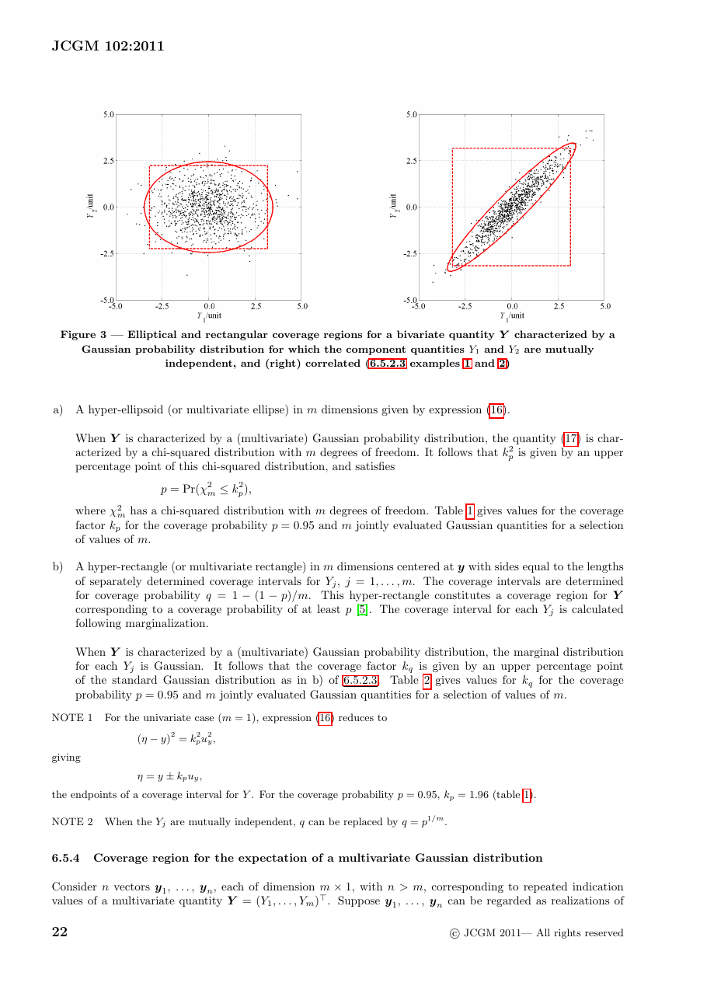
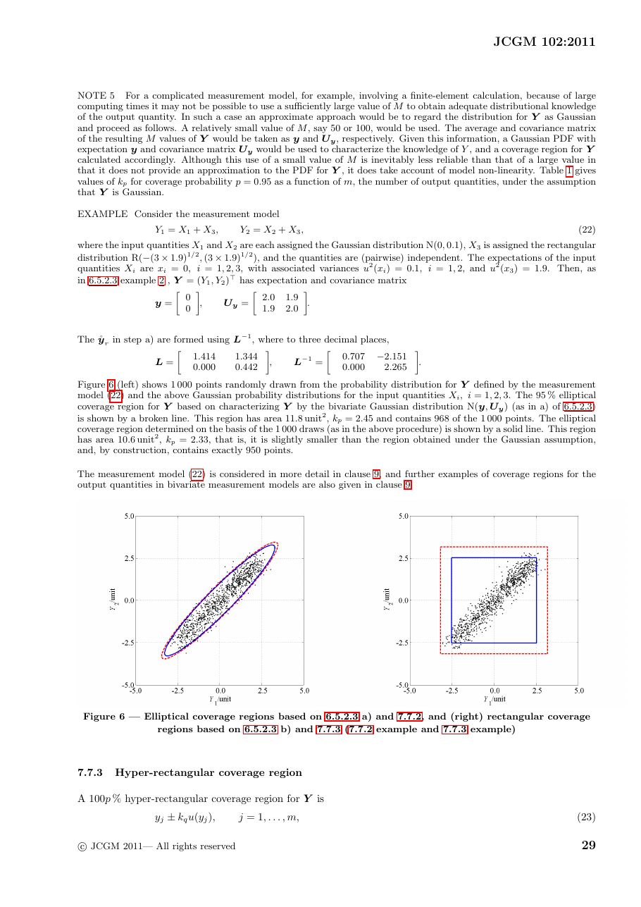
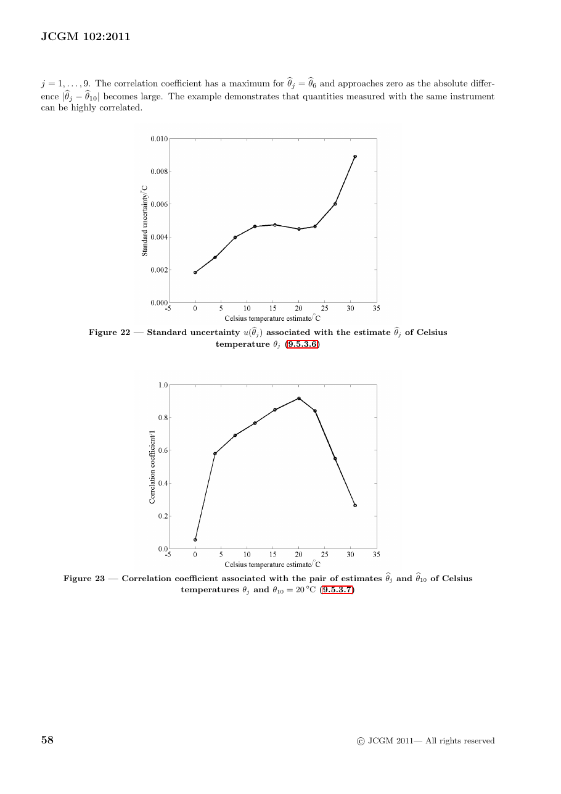

# JCGM 102:2011 번역: 측정 자료의 평가, GUM 보충 2, 출력량 개수의 확장

- 번역 범위: 전문 (머리말, 서론, 1~9절, 부속서 A~D, 그림과 표 캡션). 참고문헌은 원문 그대로 두었다. 알파벳 색인은 쪽 번호 목록이라 옮기지 않았다.
- 원문: 같은 폴더의 `JCGM_102_2011_E.pdf` (80쪽, BIPM 무료 배포본, 2026-11-04 내려받음)
- 원문 쪽 번호와 PDF 쪽 번호: 본문 1쪽 = PDF 9쪽.
- 이 번역은 팀 내부 연구용이다. JCGM은 공식 번역에 사전 허가를 요구한다. 공식본은 JCGM이 낸 원어본뿐이다. 이 문서를 외부에 배포하지 않는다.
- 수식 기호는 원문을 그대로 쓴다. `ᵀ`는 전치, `U_x`는 공분산 행렬이다.

---

## 표지와 저작권 (원문 i~ii쪽)

JCGM 102:2011. 측정 자료의 평가, "측정 불확도 표현 지침(GUM)" 보충 2, 출력량 개수의 확장. 2011년 10월.

이 문서는 계측 지침 합동위원회(JCGM) 제1작업반(JCGM/WG 1)이 만들었다. 저작권은 JCGM 회원 기관(BIPM, IEC, IFCC, ILAC, ISO, IUPAC, IUPAP, OIML)이 함께 가진다.

**저작권.** 전자판을 BIPM 누리집에서 무료로 받을 수 있어도 저작권은 회원 기관이 함께 가진다. 로고와 상징은 국제적으로 보호된다. 제3자는 이 문서를 고쳐 쓰거나, 상표를 바꾸거나, 공중에 팔거나, 방송하거나, 온라인에 올릴 수 없다. 상업적 사용, 복제, 번역에는 BIPM 국장의 사전 서면 허가가 필요하다.

**공식판과 번역.** 공식판은 JCGM이 원어로 낸 것뿐이다. 번역에는 JCGM의 사전 허가가 필요하다. 번역은 원문의 수식과 단위 형식을 그대로 지켜야 하고, 정해진 저작권 문구를 번역해 넣어야 한다. JCGM은 번역의 정확성에 책임지지 않는다. 출판 때 번역본 한 부를 JCGM에 보내야 한다.

**복제.** 서면 허가를 받으면 복제할 수 있다. 복제본 견본을 JCGM에 보내고 정해진 문구를 넣어야 한다.

**면책.** JCGM과 회원 기관은 계측 정보 접근을 넓히려고 이 문서를 냈다. 정기적으로 고치려 하지만 언제나 정확하다고 보장하지 못한다. 사용으로 생긴 직간접 손해에 책임지지 않는다. 상용 제품이나 외부 누리집 언급은 승인이나 추천을 뜻하지 않는다.

## 목차 (원문 iii~iv쪽)

머리말, 서론, 1 적용 범위, 2 인용 표준, 3 용어와 정의, 4 표기 약속, 5 기본 원리, 6 GUM 불확도 체계, 7 몬테카를로 방법, 8 몬테카를로 방법으로 GUM 불확도 체계 검증, 9 예제, 부속서 A 복소 다변량 측정 함수의 도함수, 부속서 B 다변량 측정 모형의 감도 계수와 공분산 행렬 계산, 부속서 C 좌표계 변환, 부속서 D 주요 기호, 참고문헌, 알파벳 색인.

## 머리말 (원문 v쪽)

1997년, "측정 불확도 표현 지침(GUM)"과 "국제 계측 기본 용어집(VIM)"을 1993년에 만든 7개 국제기구가 계측 지침 합동위원회(JCGM)를 세웠다. 의장은 국제도량형국(BIPM) 국장이다. JCGM은 이 두 문서의 책임을 ISO 기술자문그룹 4(TAG4)에서 넘겨받았다.

합동위원회는 BIPM과 국제전기기술위원회(IEC), 국제임상화학연합(IFCC), 국제시험소인정협력체(ILAC), 국제표준화기구(ISO), 국제순수응용화학연합(IUPAC), 국제순수응용물리연합(IUPAP), 국제법정계량기구(OIML)로 이루어진다.

JCGM에는 작업반이 둘 있다. 제1작업반 "측정 불확도 표현"은 GUM 사용을 넓히고 보충 문서를 만든다. 제2작업반은 VIM을 고치고 보급한다.

이런 보충 문서는 GUM이 직접 다루지 않는 불확도 평가 문제에 지침을 주어 GUM의 가치를 높인다. 지침은 GUM의 확률적 기초와 되도록 맞춘다.

이 보충 2는 JCGM 제1작업반이 만들었다. JCGM 회원 기관과 국가 측정 표준 기관의 자세한 검토를 거쳤다.

## 서론 (원문 vi쪽)

GUM [JCGM 100:2008]은 주로 **단변량 측정 모형**, 곧 출력량이 스칼라 하나인 모형을 다룬다. 그러나 계측 곳곳에서 출력량이 둘 이상인 모형이 나온다. GUM에도 출력량이 셋인 전기 계측 예제 [H.2]와 둘인 열 계측 예제 [H.3]가 있다. 이 보충 문서는 **다변량 측정 모형**, 곧 출력량이 몇 개든 되는 모형을 다룬다. 이런 출력량들은 **공통 입력량에 의존하므로 대개 서로 상관된다.** GUM 불확도 체계 [JCGM 100:2008 5절]를 일반화해서 다음을 구한다.

- 출력량의 추정값
- 추정값의 표준 불확도
- 추정값 쌍의 공분산

입력량과 출력량은 실수일 수도, 복소수일 수도 있다.

GUM 보충 1 [JCGM 101:2008]은 측정 모형을 통해 확률 분포를 전파하는 방법(분포 전파)을 불확도 평가의 기초로 삼고, 이를 몬테카를로 방법으로 구현한다. 보충 1도 GUM처럼 출력량이 스칼라 하나인 모형만 다룬다. 이 보충 문서는 그 몬테카를로 방법을 일반화해서 다변량 모형 출력량의 결합 확률 분포를 이산적으로 나타낸다. 이 이산 표현으로 출력량의 추정값, 표준 불확도, 공분산을 구한다. 몬테카를로 방법을 알맞게 쓰면 GUM 불확도 체계가 맞는지 의심스러울 때도 타당한 결과를 줄 것으로 기대한다. 의심스러운 경우는 다음 둘이다.

- (a) 모형을 선형화하면 모형을 제대로 나타내지 못할 때
- (b) 출력량의 확률 분포가 (다변량) 가우스 분포에서 꽤 벗어날 때

정해진 포함 확률에 맞는 출력량의 **포함 영역**을 정하는 지침도 준다. 포함 영역은 스칼라 출력량의 포함 구간에 해당한다. 초타원체 모양과 초직육면체 모양의 포함 영역을 다룬다. 몬테카를로 결과로 가장 작은 포함 영역의 근사를 구하는 계산 절차도 설명한다.

---

## 1 적용 범위

이 보충 문서는 입력량이 몇 개든(GUM, 보충 1과 같음), 출력량도 몇 개든 되는 측정 모형을 다룬다. 양은 실수나 복소수일 수 있다. 두 가지 방법을 다룬다.

1. GUM 불확도 체계의 일반화
2. 분포 전파를 구현하는 몬테카를로 방법. GUM 불확도 체계가 맞는지 의심스러울 때 알맞게 쓰면 타당한 결과를 줄 것으로 기대한다.

GUM 불확도 체계 방법은 입력량을 (GUM처럼) 추정값(예: 측정값), 그 표준 불확도, 필요하면 추정값 쌍의 공분산으로 요약할 때 쓴다. 출력량의 추정값을 구하고 그 표준 불확도와 공분산을 평가하는 식과 절차를 준다. 식과 절차는 두 가지 모형에 맞춰 나뉜다.

- (a) 출력량을 입력량의 측정 함수로 바로 쓸 수 있는 모형
- (b) 입력량과 출력량을 암묵적으로 잇는 측정 모형을 풀어서 출력량을 얻는 모형

GUM의 표준 불확도 식을 그대로 다변량으로 옮기면 대수적으로 번거롭다. 그래서 식을 행렬과 벡터로 간결하게 쓴다. 행렬의 원소는 분산(표준 불확도의 제곱), 공분산, 감도 계수다. 이 형식은 행렬 연산을 지원하는 여러 컴퓨터 언어로 바로 구현할 수 있다는 장점이 있다.

몬테카를로 방법은 다음 세 단계다.

- (i) 측정 모형의 입력량에 확률 분포를 준다 [JCGM 101:2008 6절].
- (ii) 출력량의 (결합) 확률 분포를 이산적으로 나타낸다.
- (iii) 이 이산 표현에서 출력량의 추정값을 구하고 표준 불확도와 공분산을 평가한다.

이것은 스칼라 출력량 하나에 쓰는 보충 1의 몬테카를로 방법을 일반화한 것이다.

정해진 포함 확률에 대해, 이 문서로 다변량 모형 출력량의 포함 영역을 줄 수 있다. 초타원체나 초직육면체 모양의 포함 영역을 두 방법의 결과로 만든다. 몬테카를로 결과로 가장 작은 포함 영역을 근사하는 절차도 준다.

지침을 보여 주는 자세한 예제가 있다.

이 문서는 GUM 보충이므로 GUM, 보충 1과 함께 쓴다. 독자는 GUM과 그 보충 문서의 독자와 같다. JCGM 104도 참고한다.

## 2 인용 표준

다음 문서는 이 문서를 적용하는 데 꼭 필요하다. 발행일을 적은 문서는 그 판만 적용한다. 발행일이 없는 문서는 (개정을 포함한) 최신판을 적용한다.

- JCGM 100:2008. Guide to the expression of uncertainty in measurement (GUM).
- JCGM 101:2008. Evaluation of measurement data, Supplement 1 to the GUM, Propagation of distributions using a Monte Carlo method.
- JCGM 104:2009. Evaluation of measurement data, An introduction to the GUM and related documents.
- JCGM 200:2008. International Vocabulary of Metrology, Basic and General Concepts and Associated Terms (VIM).

## 3 용어와 정의

따로 밝히지 않으면 GUM과 VIM의 정의를 쓴다. 아래는 그중 중요한 정의를 필요에 따라 고치거나 일반화한 것과, 이 문서에 특히 중요한 다른 정의다. 주요 기호는 부속서 D에 있다.

**3.1 실수량.** 수치값이 실수인 양.

**3.2 복소량.** 수치값이 복소수인 양.
비고: 복소량 Z는 직교 형식 Z ≡ (Z_R, Z_I)ᵀ = Z_R + iZ_I 로 쓸 수 있다. ᵀ는 전치, i² = −1, Z_R과 Z_I는 실수부와 허수부다. 극 형식으로는 Z ≡ (Z_r, Z_θ)ᵀ = Z_r(cos Z_θ + i sin Z_θ) = Z_r e^{iZ_θ} 이다. Z_r은 크기(진폭), Z_θ는 위상이다.

**3.3 벡터량.** 열이 하나인 행렬로 배열한 양들의 묶음.

**3.4 실수 벡터량.** 성분이 실수인 벡터량.
예: 실수량 N개 X_1, ..., X_N 을 담은 N × 1 행렬 X = (X_1, ..., X_N)ᵀ.

**3.5 복소 벡터량.** 성분이 복소수인 벡터량.
예: 복소량 N개를 담은 N × 1 행렬 Z = (Z_1, ..., Z_N)ᵀ.

**3.6 벡터 측정 대상량.** 측정하려는 벡터량. 비고: JCGM 200:2008 정의 2.3을 일반화했다.

**3.7 측정 모형 (모형).** 측정에 관여한다고 알려진 모든 양 사이의 수학적 관계.
- 비고 1: JCGM 200:2008 정의 2.48을 고쳤다.
- 비고 2: 일반형은 h(Y, X_1, ..., X_N) = 0 이다. 출력량 Y가 측정 대상량이고, 그 값은 입력량 X_1, ..., X_N 의 정보로 추론한다.
- 비고 3: 출력량이 둘 이상이면 측정 모형은 식 여러 개로 이루어진다.

**3.8 다변량 측정 모형 (다변량 모형).** 출력량이 몇 개든 되는 측정 모형.
- 비고 1: 일반형은 h_1(Y_1, ..., Y_m, X_1, ..., X_N) = 0, ..., h_m(Y_1, ..., Y_m, X_1, ..., X_N) = 0 이다. m개의 출력량 Y_1, ..., Y_m 이 측정 대상량이다.
- 비고 2: 벡터로 쓰면 h(Y, X) = 0 이다. Y = (Y_1, ..., Y_m)ᵀ, h = (h_1, ..., h_m)ᵀ 는 m × 1 행렬이다.
- 비고 3: m = 1 이면 단변량 측정 모형이다.

**3.9 다변량 측정 함수 (다변량 함수).** 출력량을 입력량으로 나타낸 다변량 측정 모형의 함수.
- 비고 1: JCGM 200:2008 정의 2.49를 일반화했다.
- 비고 2: h(Y, X) = 0 을 Y = f(X) 로 바로 쓸 수 있으면 f = (f_1, ..., f_m)ᵀ 가 다변량 측정 함수다. 더 넓게는 f가 알고리즘일 수도 있다. 입력값 x = (x_1, ..., x_N)ᵀ 에 대해 유일한 출력값 y_1 = f_1(x), ..., y_m = f_m(x) 을 내면 된다.
- 비고 3: m = 1 이면 단변량 측정 함수다.

**3.10 실수 측정 모형 (실수 모형).** 실수량을 다루는 측정 모형. 대개 다변량이다.

**3.11 복소 측정 모형 (복소 모형).** 복소량을 다루는 측정 모형. 대개 다변량이다.

**3.12 다단계 측정 모형 (다단계 모형).** 하위 모형이 이어진 측정 모형. 앞 하위 모형의 출력량이 뒤 하위 모형의 입력량이 된다.
- 비고: 결합 확률 밀도 함수에 근거한 포함 영역은 마지막 단계에서만 고려하면 된다.
- 예: 교정에서 흔한 하위 모형 한 쌍. 첫 하위 모형은 측정 표준이 준 값과 그에 맞는 지시값을 입력으로, 교정 함수의 매개변수를 출력으로 가진다. 예를 들어 최소제곱 문제를 풀어서 출력을 얻는다. 둘째 하위 모형은 교정 함수 매개변수와 새 지시값을 입력으로, 그 지시값에 해당하는 양을 출력으로 가진다.

**3.13 결합 분포 함수 (분포 함수).** 모든 값 ξ = (ξ_1, ..., ξ_N)ᵀ 에 대해 확률 변수 X의 각 원소 X_i 가 ξ_i 이하일 확률을 주는 함수. G_X(ξ) = Pr(X_1 ≤ ξ_1, ..., X_N ≤ ξ_N).

**3.14 결합 확률 밀도 함수 (확률 밀도 함수).** G_X(ξ) = ∫_{−∞}^{ξ_1} ... ∫_{−∞}^{ξ_N} g_X(z) dz_N ... dz_1 을 만족하는 음이 아닌 함수 g_X(ξ).

**3.15 주변 확률 밀도 함수.** 확률 밀도 함수 g_X(ξ)를 가진 X의 성분 X_i 하나만의 확률 밀도 함수. 나머지 변수로 적분해서 얻는다. 비고: 성분들이 독립이면 g_X(ξ) = g_{X_1}(ξ_1) g_{X_2}(ξ_2) ... g_{X_N}(ξ_N).

**3.16 기댓값.** E(X_i) = ∫ ξ_i g_X(ξ) dξ = ∫ ξ_i g_{X_i}(ξ_i) dξ_i. 비고 1: JCGM 101:2008 정의 3.6을 일반화했다. 비고 2: X의 기댓값은 N × 1 행렬 E(X) = (E(X_1), ..., E(X_N))ᵀ.

**3.17 분산.** V(X_i) = ∫ [ξ_i − E(X_i)]² g_{X_i}(ξ_i) dξ_i. 비고: JCGM 101:2008 정의 3.7을 일반화했다.

**3.18 공분산.** Cov(X_i, X_j) = Cov(X_j, X_i) = ∫∫ [ξ_i − E(X_i)][ξ_j − E(X_j)] g_{X_i,X_j}(ξ_i, ξ_j) dξ_i dξ_j. g_{X_i,X_j}는 두 변수의 결합 PDF다.
- 비고 1: JCGM 101:2008 정의 3.10을 일반화했다.
- 비고 2: X의 공분산 행렬 V(X)는 Cov(X_i, X_j)를 담은 N × N 대칭 양의 준정부호 행렬이다. 어떤 연산은 양의 정부호를 요구한다.

**3.19 상관.** Corr(X_i, X_j) = Cov(X_i, X_j) / √(V(X_i)V(X_j)). 비고: 차원이 1인 양이다.

**3.20 측정 공분산 행렬 (공분산 행렬).** N × 1 실수 벡터량 추정값에 딸린 N × N 대칭 양의 준정부호 행렬. 대각에는 각 성분 추정값의 표준 불확도 제곱을, 대각 밖에는 성분 쌍의 공분산을 둔다.
- 비고 1: JCGM 101:2008 정의 3.11을 고쳤다.
- 비고 2: 추정값 x에 딸린 공분산 행렬 U_x 의 (i, j) 원소는 u(x_i, x_j)이다. u(x_i, x_i) = u²(x_i)는 분산, u(x_i, x_j)는 공분산이다. X_i와 X_j가 상관이 없으면 u(x_i, x_j) = 0.
- 비고 3: 보충 1에서는 이것을 "불확도 행렬"이라 불렀다.
- 비고 4: 공분산 행렬로 계산할 때 수치 문제가 가끔 생긴다. 예를 들어 U_x 가 계산 방식 때문에 양의 정부호가 아닐 수 있다. 그러면 U_x 의 숄레스키 인자가 없을 수 있다. 숄레스키 인자는 U_x 로 수치 계산할 때 쓴다 [7] (부속서 B 참고). 또 x 원소들의 선형 결합 분산이 작은 양수여야 하는데 음수가 될 수도 있다. 이럴 때 U_x 를 "고쳐서" 양의 정부호로 만드는 절차가 있다. 그러면 숄레스키 인자가 생기고 선형 결합 분산도 양수가 된다. 참고문헌 [27]의 절차를 고친 방법은 다음과 같다. 고유분해 U_x = Q D Qᵀ 를 구한다. Q는 정규직교, D는 고윳값 대각 행렬이다. D에서 d_min 보다 작은 원소를 d_min 으로 바꾼 D' 를 만든다. d_min 은 컴퓨터의 단위 반올림 오차와 D의 가장 큰 원소의 곱이다. 이후 계산에는 U_x' = Q D' Qᵀ 를 쓴다.
- 비고 5: U_x 를 쓰는 어떤 연산은 양의 정부호를 요구한다.

**3.21 상관 행렬.** N × 1 실수 벡터량 추정값에 딸린 N × N 대칭 양의 준정부호 행렬. 성분 쌍의 상관을 담는다.
- 비고 1: R_x 의 대각 r(x_i, x_i) = 1, 대각 밖 r(x_i, x_j)는 상관이다. 상관이 없으면 0.
- 비고 2: 상관은 상관 계수라고도 한다.
- 비고 3: U_x = D_x R_x D_x. D_x 는 대각이 u(x_1), ..., u(x_N)인 대각 행렬이다. 원소로는 u(x_i, x_j) = r(x_i, x_j) u(x_i) u(x_j).
- 비고 4: R_x 가 양의 정부호이거나 특이이면 U_x 도 그렇고, 그 반대도 같다.
- 비고 5: 상관 행렬의 대각 밖 원소는 대개 소수 셋째 자리까지 반올림하면 충분하다. 그러나 상관 행렬이 특이에 가까우면 불확도 평가의 입력으로 쓸 때 수치 문제를 피하려고 자릿수를 더 남겨야 한다. 남길 자릿수는 뒤 계산에 따라 다르지만, 상관 행렬의 가장 작은 고윳값을 유효숫자 두 자리로 나타내는 데 필요한 소수 자릿수를 기준으로 삼을 수 있다. 2 × 2 상관 행렬의 고윳값은 1 ± |r| 이고, 작은 값 λ_min 은 1 − |r| 이다. r은 대각 밖 원소다. 반올림 전에 특이인 줄 아는 상관 행렬은 0 쪽으로 반올림하면, 반올림 뒤 양의 준정부호가 아니게 될 위험이 줄어든다.

**3.22 감도 행렬.** 실수 측정 모형을 입력량이나 출력량으로 1차 편미분해서, 그 양들의 추정값에서 계산한 행렬. 비고: 입력량 N개, 출력량 m개이면 X에 대한 감도 행렬은 m × N, Y에 대한 감도 행렬은 m × m이다.

**3.23 포함 구간.** 가진 정보에 근거해, 참값을 정해진 확률로 담는 구간.
- 비고 1: JCGM 101:2008 정의 3.12를 고쳤다.
- 비고 2: 확률 대칭 포함 구간은 참값이 구간 최솟값보다 작을 확률과 최댓값보다 클 확률이 같은 구간이다.
- 비고 3: 최단 포함 구간은 같은 포함 확률을 가진 포함 구간 중 가장 짧은 것이다.

**3.24 포함 영역.** 가진 정보에 근거해, 참 벡터값을 정해진 확률로 담는 영역.

**3.25 포함 확률.** 참값이 정해진 포함 구간이나 포함 영역 안에 있을 확률. 비고 1: JCGM 101:2008 정의 3.13을 고쳤다. 비고 2: "신뢰 수준"이라고도 한다 [JCGM 100:2008 6.2.2].

**3.26 최소 포함 영역.** 같은 포함 확률을 가진 포함 영역 중 (초)부피가 가장 작은 영역. 비고: 스칼라에서는 최단 포함 구간이다. 2변량에서는 넓이가 가장 작은 영역이다.

**3.27 다변량 가우스 분포.** N × 1 확률 변수 X의 결합 PDF가
g_X(ξ) = 1 / ((2π)^{N/2} [det(V)]^{1/2}) × exp(−½ (ξ − μ)ᵀ V⁻¹ (ξ − μ))
인 분포. 비고: μ는 기댓값, V는 공분산 행렬이고 V는 양의 정부호여야 한다.

**3.28 다변량 t 분포.** N × 1 확률 변수 X의 결합 PDF가
g_X(ξ) = Γ((ν+N)/2) / (Γ(ν/2)(πν)^{N/2}) × 1/[det(V)]^{1/2} × [1 + (1/ν)(ξ − μ)ᵀ V⁻¹ (ξ − μ)]^{−(ν+N)/2}
인 분포. 매개변수는 μ, V, ν이고 V는 대칭 양의 정부호다. Γ(z) = ∫_0^∞ t^{z−1} e^{−t} dt 는 감마 함수다.
- 비고 1: N × 1 벡터 확률 변수 Q가 기댓값 0, 공분산 V인 가우스 분포를 따르고, 스칼라 W가 자유도 ν인 카이제곱 분포를 따르며, 둘이 독립이고 (ν/W)^{1/2} Q = X − μ 이면 X가 이 분포를 따른다.
- 비고 2: V가 대각이어도 g_X(ξ)는 N개 PDF의 곱으로 나뉘지 않는다. 성분들은 대개 통계적으로 의존한다.
- 예: N = 2, ν = 5, V가 2 × 2 단위 행렬일 때 X_1 > 1 일 확률은 18 %이고, X_2 > 2 라는 조건에서 X_1 > 1 일 조건부 확률은 26 %다.

## 4 표기 약속

**4.1** GUM [4.1.1 비고 1]은 기호를 아끼려고 같은 대문자로 (i) 본질적으로 유일한 참값을 가진다고 보는 (물리)량과 (ii) 그에 맞는 확률 변수를 함께 나타낸다.

비고: 확률 변수는 A형 평가와 B형 평가에서 역할이 다르다. A형 평가에서는 "양을 관측했을 때 나올 수 있는 결과"를 나타낸다. B형 평가에서는 확률 변수의 분포가 그 양에 대한 지식 상태를 나타낸다.

이 모호함은 대부분 해가 없다.

이 문서와 보충 1에서는 A형 평가를 받는 입력량에 대해 같은 대문자가 세 개념을 나타낸다.

- a) 양
- b) 양을 관측했을 때 나올 수 있는 결과를 나타내는 확률 변수
- c) 양에 대한 지식 상태를 분포로 나타내는 확률 변수

이 두 확률 변수 사이의 모호함은 GUM에 없던 것이라 오해를 낳을 수 있다. 특히 이 문서와 보충 1의 몬테카를로 절차가 GUM 4.1.4 비고의 절차와 같다고 여길 수 있다. 두 절차는 확률 분포에서 뽑은 입력값으로 모형을 되풀이 계산한다는 원리는 같지만, 뽑는 분포가 다르다. GUM 4.1.4 비고는 확률 변수 b)의 빈도 분포에서 뽑는다. 보충 문서들은 확률 변수 c)의 확률 분포에서 뽑는다. 앞의 방법은 대부분의 실험 상황에서 권하지 않는다 [2].

**4.2** 입력량은 X_1, ..., X_N, 묶어서 N × 1 행렬 X = (X_1, ..., X_N)ᵀ 로 쓴다. ᵀ는 전치다.

**4.3** 출력량은 Y_1, ..., Y_m, 묶어서 m × 1 행렬 Y = (Y_1, ..., Y_m)ᵀ 로 쓴다.

**4.4** Y_i 를 X의 식으로 바로 쓸 수 있으면 측정 모형은

Y = f(X)    (1)

이다. f는 다변량 측정 함수다. 같은 뜻으로 Y_1 = f_1(X), ..., Y_m = f_m(X) 이다.

**4.5** Y_i 를 X의 식으로 바로 쓸 수 없으면 측정 모형은

h(Y, X) = 0    (2)

또는 h_1(Y, X) = 0, ..., h_m(Y, X) = 0 이다.

**4.6** X의 추정값은 N × 1 행렬 x = (x_1, ..., x_N)ᵀ, 그 공분산 행렬은 N × N 행렬 U_x 다.

**4.7** Y의 추정값은 m × 1 행렬 y = (y_1, ..., y_m)ᵀ, 그 공분산 행렬은 m × m 행렬 U_y 다.
비고: U_y 는 GUM과 보충 1의 단변량 모형에서 y의 분산 u²(y)에 해당한다. GUM은 u(y)를 u_c(y)로 쓰고 c는 "합성"을 뜻한다. 보충 1 4.10의 이유로 c는 필요 없다고 보아 이 문서도 쓰지 않는다.

**4.8** 출력량 추정값을 하나씩 따로 쓸 때는 각 양을 해당 단변량 모형의 출력량으로 볼 수 있다. **출력량들을 함께 쓸 때, 예를 들어 다음 계산에 함께 넣을 때는 출력량 추정값 쌍의 상관을 반드시 고려해야 한다.**

**4.9** 양의 값 x의 표준 불확도는 u(x)로 쓴다. 오해할 여지가 없으면 u_x 로도 쓴다. 첨자나 꾸밈이 붙은 값(x_i, x̂ 등)에는 이 약식을 권하지 않는다.

**4.10** x는 "입력량들의 추정값" 또는 "(벡터) 입력량의 추정값"이라 할 수 있다. 이 문서는 주로 뒤의 표현을 쓴다. 출력량도 같다.

**4.11** 4.2~4.10처럼 양은 대문자로, 추정값이나 고정값(기댓값 등)은 해당 소문자로 쓴다. 일반 논의에는 유용하지만, 물리량에는 이미 굳은 기호가 있어서(열역학 온도 T, 시간 t 등) 잘 맞지 않는다. 그래서 일부 예제에서는 양을 관례 기호로 쓰고, 그 기댓값이나 추정값을 기호 위에 모자(^)를 씌워 쓴다. 예를 들어 교류 전류 진폭(6.2.2 예 1)은 I, 그 추정값은 Î 다.

**4.12** PDF와 분포 함수의 흔한 기호에서 벗어난다. GUM은 모형과 PDF를 모두 f로 쓴다. GUM에서는 혼동이 적었지만 이 문서에서는 다르다. 측정 함수, PDF, 분포 함수 개념이 지침의 중심이므로 PDF는 g, 분포 함수는 G로 쓰고, f는 측정 함수에만 쓴다. 벡터 기호도 같은 규칙을 따른다.

**4.13** PDF는 스칼라 X나 벡터 X에 준다. 스칼라에서 X의 PDF는 g_X(ξ)이고, ξ는 X가 가질 수 있는 값을 나타내는 변수다. X는 기댓값 E(X), 분산 V(X)를 가진 확률 변수로 본다.

**4.14** 벡터에서 X의 PDF는 g_X(ξ), ξ = (ξ_1, ..., ξ_N)ᵀ 다. X는 기댓값 E(X), 공분산 행렬 V(X)를 가진 확률 변수로 본다.

**4.15** 마찬가지로 Y의 PDF는 스칼라에서 g_Y(η), 벡터에서 g_Y(η)로 쓴다.

**4.16** 제22차 CGPM(2003) 결의 10에 따라 소수점은 줄 위의 점 또는 쉼표다. JCGM은 영어 문서에 점을 쓴다.

## 5 기본 원리

### 5.1 일반

**5.1.1** GUM [4.1]은 측정계를 실수 입력량 X_1, ..., X_N 과 실수 출력량 Y 하나로 된 함수 Y = f(X)로 모형화한다. X ≡ (X_1, ..., X_N)ᵀ 를 실수 벡터 입력량이라 한다. 이 함수를 실수 단변량 측정 함수라 한다.

**5.1.2** 실제 측정계가 모두 스칼라 출력량 하나의 측정 함수로 모형화되지는 않는다. 다음 중 하나일 수 있다.

- a) 출력량이 여러 개(Y ≡ (Y_1, ..., Y_m)ᵀ)이고 Y = f(X) 꼴인 경우
- b) 더 일반적인 h(Y, X) = 0 꼴인 경우

**5.1.3** 또 X와 Y의 성분 일부나 전부가 복소 입력량의 성분(실수부와 허수부, 또는 크기와 위상)일 수 있다. 그래서 모든 측정 모형을 (일반성을 잃지 않고) 실수 모형으로 볼 수 있다. 그러나 복소수 경우에는 실수부, 허수부로 나눠 다루는 것보다 간단한 방법이 있다 [14]. 이 방법은 복소 모형에 불확도 전파 법칙을 쓸 때 간결한 행렬식을 준다. 6.4와 부속서 A를 본다.

**5.1.4** 이 문서는 5.1.2와 5.1.3의 더 일반적인 모형을 다룬다.

### 5.2 불확도 평가의 주요 단계

**5.2.1** 주요 단계는 정식화, 전파, 요약이다.

a) 정식화

1. 측정하려는 출력량 Y(벡터 측정 대상량)를 정의한다.
2. Y가 의존하는 입력량 X를 정한다.
3. X와 Y를 잇는 측정 함수(식 (1)의 f) 또는 측정 모형 (2)를 세운다.
4. 가진 지식에 따라 X의 성분에 PDF(가우스(정규), 직사각형(균일) 등)를 준다. 쌍별로 독립이 아닌 성분들에는 결합 PDF를 준다.

b) 전파

X 성분의 PDF를 모형에 통과시켜 Y의 (결합) PDF를 얻는다.

c) 요약

Y의 PDF로 다음을 구한다.

1. Y의 기댓값. Y의 추정값 y로 쓴다.
2. Y의 공분산 행렬. y에 딸린 공분산 행렬 U_y 로 쓴다.
3. Y를 정해진 확률 p(포함 확률)로 담는 포함 영역.

**5.2.2** 정식화 단계는 측정자가 한다. PDF를 주는 방법(5.2.1 a) 4단계)은 보충 1에 흔한 경우들이, 5.3에 추가 내용이 있다. 전파와 요약 단계 b), c)는 여기서 자세히 다룬다. 이 두 단계에는 계측 정보가 더 필요하지 않고, 원리상 정식화 단계에서 정한 문제를 원하는 수치 허용오차까지 풀 수 있다.

비고: 정식화 a)를 마치면 Y의 PDF는 수학적으로 완전히 정해진다. 다만 기댓값, 공분산 행렬, 포함 영역 계산에는 대개 어느 정도 근사가 들어가는 수치 방법이 필요하다.

### 5.3 입력량의 확률 밀도 함수

#### 5.3.1 일반

보충 1은 흔한 상황에서 입력량 X_i 에 PDF를 주는 지침을 준다 [JCGM 101:2008 6절]. 보충 1이 다루는 다변량 분포는 다변량 가우스 분포뿐이다 [6.4.8]. 추정값 x와 공분산 행렬 U_x 가 X에 대한 유일한 정보일 때 X에 이 분포를 준다. 5.3.2에서 다른 다변량 분포인 다변량 t 분포를 설명한다. 기댓값과 공분산 행렬을 모르는 다변량 가우스 분포를 가진 벡터량에서 독립으로 얻었다고 보는 지시값 계열이 X에 대한 유일한 정보일 때 이 분포가 나온다. 6.5.4도 본다.

#### 5.3.2 다변량 t 분포

**5.3.2.1** N × 1 지시값 n개 x_1, ..., x_n (n > N)이 있다고 하자. 기댓값 μ와 N × N 공분산 행렬 Σ를 모르는 다변량 가우스 분포 N(μ, Σ)를 가진 양에서 독립으로 얻었다고 본다. 원하는 입력량 X(N × 1)는 μ와 같다고 본다. μ와 Σ에 무정보 결합 사전 분포를 주고 베이즈 정리를 쓰면, X의 주변 (결합) PDF는 자유도 ν = n − N 인 다변량 t 분포 t_ν(x̄, S/n)이다 [11]. 여기서

x̄ = (1/n)(x_1 + ... + x_n),  S = (1/ν)[(x_1 − x̄)(x_1 − x̄)ᵀ + ... + (x_n − x̄)(x_n − x̄)ᵀ].

비고: 사전 분포를 다르게 줄 수도 있다. 그러면 자유도나 분포 자체가 달라질 수 있다.

**5.3.2.2** X의 PDF는

g_X(ξ) = Γ(n/2) / (Γ(ν/2)(πν)^{N/2}) × [det(S/n)]^{−1/2} × [1 + (1/ν)(ξ − x̄)ᵀ (S/n)⁻¹ (ξ − x̄)]^{−n/2}

이다. Γ(z)는 감마 함수다.

**5.3.2.3** X의 기댓값과 공분산 행렬은

E(X) = x̄,  V(X) = (ν/(ν − 2)) (S/n)

이다. E(X)는 ν > 1 (곧 n > N + 1)일 때만, V(X)는 ν > 2 (곧 n > N + 2)일 때만 정의된다.

**5.3.2.4** t_ν(x̄, S/n)에서 무작위로 뽑으려면, 표준 가우스 N(0, 1)에서 z_i 를 N개 뽑고 자유도 ν인 카이제곱 분포 χ²_ν 에서 w를 하나 뽑아

ξ = x̄ + L z √(ν/w),  z = (z_1, ..., z_N)ᵀ

를 만든다. L은 숄레스키 분해 S/n = L Lᵀ 로 얻는 N × N 하삼각 행렬이다 [13].

비고: L은 예를 들어 참고문헌 [13]처럼 구할 수 있다.

#### 5.3.3 다변량 확률 밀도 함수 만들기

입력량들이 상관되어 있을 때 흔히 가진 정보는 다음과 같다. PDF의 모양(하나는 가우스, 하나는 직사각형 등), 기댓값으로 쓰는 추정값 x_1, ..., x_N, 표준편차로 쓰는 표준 불확도 u(x_1), ..., u(x_N), 그리고 x_i 쌍의 공분산이다. 코퓰라 [20]라는 수학 도구로 이 정보와 맞는 X의 PDF를 만들 수 있다. 이런 PDF는 유일하지 않다.

### 5.4 분포의 전파

**5.4.1** 그림 1(왼쪽)은 서로 독립인 입력량 N = 3개 X = (X_1, X_2, X_3)ᵀ 와 출력량 m = 2개 Y = (Y_1, Y_2)ᵀ 인 측정 모형의 예다. 측정 함수는 f = (f_1, f_2)ᵀ 이다. i = 1, 2, 3 에 대해 X_i 에 PDF g_{X_i}(ξ_i)를 주고, Y는 결합 PDF g_Y(η) ≡ g_{Y_1,Y_2}(η_1, η_2)로 나타낸다. 그림 1(오른쪽)은 X_1과 X_2가 서로 의존해서 결합 PDF g_{X_1,X_2}(ξ_1, ξ_2)로 나타내는 경우다.

**5.4.2** Y에 의존하는 출력량 Q가 더 있을 수 있다. 그러면 Y를 다른 측정 모형 Q = t(Y)의 입력량으로 본다. 예를 들어 Y는 질량 표준 묶음의 질량 벡터이고 Q는 그중 일부의 합이다.

> **그림 1** 입력량 N = 3, 출력량 m = 2 일 때 분포의 전파. 왼쪽은 X_1, X_2, X_3 가 서로 독립인 경우, 오른쪽은 X_1과 X_2가 서로 의존하는 경우 (5.4.1). (원문은 상자와 화살표 글자 도식이다. g_{X_i}가 Y_1 = f_1(X_1, X_2, X_3), Y_2 = f_2(X_1, X_2, X_3)로 들어가 g_{Y_1,Y_2}(η_1, η_2)가 나온다.)

**5.4.3** 측정 함수 f와 t를 하위 모형으로 보고 합성하면 Q를 X의 함수로 쓸 수 있다. 그러나 두 하위 모형이 기능상 다른 단계이면 따로 두는 편이 좋을 수 있다. 이 두 하위 모형은 다단계 모형(3.12)의 예다.

**5.4.4** 다단계 모형의 마지막 단계 출력량이 스칼라 하나이고 관심 있는 출력량이 그것뿐이면 보충 1로 다룰 수 있다.

### 5.5 요약 정보 얻기

**5.5.1** 출력량 Y의 추정값 y는 기댓값 E(Y)다. y에 딸린 공분산 행렬 U_y 는 공분산 행렬 V(Y)다.

**5.5.2** 포함 확률 p에 대해 Y의 포함 영역 R_Y 는 ∫_{R_Y} g_Y(η) dη = p 를 만족한다.

- 비고 1: 어떤 양의 확률 변수는 기댓값이나 공분산 행렬이 없는 분포를 가질 수 있지만(5.3.2 참고), Y의 포함 영역은 언제나 있다.
- 비고 2: 정해진 포함 확률 p에 대해 포함 영역은 대개 여럿이다.

**5.5.3** 보충 1의 확률 대칭 100p % 포함 구간에 바로 대응하는 다변량 개념은 없다. 그러나 최단 100p % 포함 구간에 대응하는 것은 있다. 초부피가 가장 작은 Y의 100p % 포함 영역이다.

### 5.6 분포 전파의 구현

**5.6.1** 분포 전파는 여러 방법으로 구현한다.

- a) 해석적 방법. Y의 PDF를 수식으로 준다.
- b) 모형을 1차 테일러 급수로 근사해서 불확도를 전파하는 방법. GUM [5.1.2] 방법의 일반화로, (일반화된) 불확도 전파 법칙이다.
- c) 분포 전파를 구현하는 수치 방법 [JCGM 100:2008 G.1.5], 특히 몬테카를로 방법(MCM).

- 비고 1: 해석해는 근사가 없어서 이상적이지만 간단한 경우에만 쓸 수 있다. 이 문서에서는 예제에서 비교용으로만 다룬다.
- 비고 2: 여기서 MCM은 벡터 출력량 분포의 수치 표현을 얻는 수단이지, 그 자체로 모의실험 방법은 아니다. 불확도 평가의 전파 단계에서 풀 문제는 결정론적이다. 모의할 무작위 물리 과정이 없다.

**5.6.2** 불확도 전파에서는 X의 추정값 x = E(X)와 공분산 행렬 U_x = V(X)를 (선형화한) 측정 모형에 통과시킨다. 이 문서는 다루는 모형 종류마다 그 절차를 준다.

**5.6.3** 그림 2(왼쪽)는 서로 독립인 입력량 N = 3개와 출력량 m = 2개인 모형에 대한 (일반화된) 불확도 전파 법칙을 보여 준다. X는 x = (x_1, x_2, x_3)ᵀ 와 표준 불확도 u(x_1), u(x_2), u(x_3)로 추정한다. Y는 y = (y_1, y_2)ᵀ 와 공분산 행렬 U_y 로 추정한다. 그림 2(오른쪽)는 X_1과 X_2가 서로 의존해서 x_1, x_2 의 공분산 u(x_1, x_2)가 있는 경우다.

> **그림 2** 서로 독립인 입력량 X_1, X_2, X_3 (N = 3)과 (거의 언제나) 서로 의존하는 출력량 2개 (m = 2)에 대한 일반화된 불확도 전파 법칙. 오른쪽은 X_1과 X_2가 서로 의존하는 경우 (5.6.3). (원문은 글자 도식이다. x_i, u(x_i)가 들어가 y, U_y 가 나온다. 오른쪽은 u(x_1, x_2)가 함께 들어간다.)

**5.6.4** MCM에서는 X의 (결합) 확률 분포의 이산 표현을 측정 모형에 통과시켜 Y의 (결합) 확률 분포의 이산 표현을 얻고, 거기서 필요한 요약 정보를 구한다.

## 6 GUM 불확도 체계

### 6.1 일반

**6.1.1** GUM의 Y = f(X)보다 일반적인 모형의 불확도 전파를 6.2와 6.3에서 설명한다. 이런 모형은 GUM이 직접 다루지 않지만, 같은 원리로 입력량 추정값과 그 불확도를 모형에 통과시켜 출력량 추정값과 불확도를 얻을 수 있다. 수식은 GUM의 첨자 합 대신 행렬과 벡터로 쓴다. 대개 더 간결하고 최신 소프트웨어와 컴퓨터 언어로 구현하기 자연스럽다.

**6.1.2** 불확도 전파 법칙에는 GUM의 단변량 모형과 같은 입력 정보를 쓴다.

- a) 입력량 X의 추정값 x = (x_1, ..., x_N)ᵀ
- b) x에 딸린 공분산 행렬 U_x. x_i 와 x_j 의 공분산 u(x_i, x_j) (i, j = 1, ..., N)를 담는다.

**6.1.3** 6.2와 6.3의 설명은 실수 모형용이다. 실수량으로 쓴 복소 모형도 포함한다. 복소 모형 방법은 6.4에 있다. 5.1.3도 본다.

**6.1.4** 벡터 출력량의 포함 영역은 6.5에서 설명한다.

### 6.2 명시적 다변량 측정 모형의 불확도 전파

#### 6.2.1 일반

**6.2.1.1** 명시적 다변량 측정 모형은 출력량 Y = (Y_1, ..., Y_m)ᵀ 와 입력량 X = (X_1, ..., X_N)ᵀ 의 관계를

Y = f(X),  f = (f_1, ..., f_m)ᵀ

꼴로 정한다. f는 다변량 측정 함수다.
비고: 각 함수 f_j(X)는 X의 일부에만 의존할 수 있다. 각 X_i 는 적어도 한 함수에 나온다.

**6.2.1.2** X의 추정값 x가 주어지면 Y의 추정값은 y = f(x) 이다.

**6.2.1.3** y에 딸린 m × m 공분산 행렬 U_y 는 (i, j) 원소가 u(y_i, y_j)이고 u(y_j, y_j) = u²(y_j)이며,

**U_y = C_x U_x C_xᵀ    (3)**

이다. C_x 는 m × N 감도 행렬로, (j, i) 원소가 ∂f_j/∂X_i 인 행렬 C_X 를 X = x 에서 계산한 것이다 [19, 29쪽].

#### 6.2.2 예

**예 1 회로 소자의 저항과 리액턴스 [JCGM 100:2008 H.2].** 회로 소자의 저항 R과 리액턴스 X를, 소자에 건 사인파 교류 전위차의 진폭 V, 흐르는 교류 전류의 진폭 I, 둘 사이 위상각 φ로 구한다. 2변량 측정 모형은

R = f_1(V, I, φ) = (V/I) cos φ,  X = f_2(V, I, φ) = (V/I) sin φ    (4)

이다. 일반 표기로 N = 3, m = 2, X ≡ (V, I, φ)ᵀ, Y ≡ (R, X)ᵀ 이다. 저항과 리액턴스의 추정값 y ≡ (R̂, X̂)ᵀ 는 입력 추정값 x ≡ (V̂, Î, φ̂)ᵀ 에서 식 (4)를 계산해 얻는다. 2 × 2 공분산 행렬 U_y 는 식 (3)으로 구한다. C_x 는 2 × 3 감도 행렬로

[[cos φ / I, −V cos φ / I², −V sin φ / I], [sin φ / I, −V sin φ / I², V cos φ / I]]

를 X = x 에서 계산한 것이고, U_x 는 x에 딸린 3 × 3 공분산 행렬이다.
비고: GUM에서 리액턴스를 X로 쓰므로 여기서도 그렇게 쓴다. 벡터 출력량 Y의 성분인 리액턴스 X를 벡터 입력량 X와 헷갈리지 않는다.

**예 2 마이크로파 반사계로 잰 반사 계수 (방법 1).** 교정된 마이크로파 반사계(자동 네트워크 분석기 등)로 잰 (복소) 반사 계수 Γ는 복소 측정 모형

Γ = (aW + b) / (cW + 1)    (5)

으로 주어진다. W는 보정 전 (복소) 반사 계수, a, b, c는 반사계를 나타내는 (복소) 교정 계수다 [10, 16, 26]. 실수부와 허수부로 나눠 쓰면 N = 8, m = 2, X ≡ (a_R, a_I, b_R, b_I, c_R, c_I, W_R, W_I)ᵀ, Y ≡ (Γ_R, Γ_I)ᵀ 이다. 추정값 y ≡ (Γ̂_R, Γ̂_I)ᵀ 는 입력 추정값 x에서 식 (5) 우변의 실수부와 허수부를 계산한 것이다. 2 × 2 공분산 행렬 U_y 는 식 (3)으로 구한다. C_x 는 Γ_R, Γ_I 를 8개 입력 성분으로 편미분한 2 × 8 감도 행렬을 X = x 에서 계산한 것이고, U_x 는 8 × 8 공분산 행렬이다.

**예 3 질량 표준의 교정.** 다단계 모형(3.12, 5.4.2, 5.4.3)의 예다. 질량을 모르는 질량 표준 q개 m = (m_1, ..., m_q)ᵀ 를 기준 킬로그램과 비교해 교정한다. 질량 비교기, 비교기 감도를 정하는 감도 추, 공기 부력 보정을 위한 온도계, 기압계, 습도계 같은 보조 기기를 쓴다. 기준 킬로그램과 감도 추의 질량은 m_R, m_S 다. 알맞은 측정 절차로 표준 묶음 사이 비교를 충분히 k번 해서 겉보기(공기 중) 차이 δ = (δ_1, ..., δ_k)ᵀ 를 얻는다. 그에 맞는 부력 보정 b = (b_1, ..., b_k)ᵀ 를 계산한다. 진공 중 질량 차이 X는 하위 모형 X = f(W), W = (m_R, m_S, δᵀ, bᵀ)ᵀ 로 얻는다.

질량 m의 추정값 y ≡ (m̂_1, ..., m̂_q)ᵀ 는 대개 과결정 방정식 A m = X 의 최소제곱해로 구한다. A는 k × q 행렬로, 각 비교에 관여한 표준에 따라 원소가 +1, −1, 0이다. x의 불확도를 반영하면 추정값은

y = U_y Aᵀ U_x⁻¹ x    (6)

이고, y에 딸린 q × q 공분산 행렬은 U_y = (Aᵀ U_x⁻¹ A)⁻¹ 이다. U_x 는 x에 딸린 k × k 공분산 행렬이다. 하위 모형과, w의 공분산 행렬 U_w 로 U_x 를 구하는 절차는 [3]에 자세히 있다.

이 예의 다변량 측정 모형은 Y = U_y Aᵀ U_x⁻¹ X 로 쓸 수 있고, 측정 함수는 U_y Aᵀ U_x⁻¹ X 다. 일반 표기로 N = k, m = q, Y ≡ m 이다.

비고: 식 (6)을 바로 쓰기보다 직교 분해 기반 알고리즘 [13]으로 추정값을 구하는 편이 계산상 낫다.

### 6.3 암묵적 다변량 측정 모형의 불확도 전파

#### 6.3.1 일반

**6.3.1.1** 암묵적 다변량 측정 모형은 출력량 Y와 입력량 X의 관계를

h(Y, X) = 0,  h = (h_1, ..., h_m)ᵀ

꼴로 정한다.

**6.3.1.2** X의 추정값 x가 주어지면 Y의 추정값 y는 연립 방정식

h(y, x) = 0    (7)

의 해다.
비고: 식 (7)은 대개 수치적으로 풀어야 한다. 예를 들어 근사해 y^(0)에서 시작하는 뉴턴법 [12]이나 그 변형을 쓴다.

**6.3.1.3** y에 딸린 m × m 공분산 행렬 U_y 는 연립 방정식

**C_y U_y C_yᵀ = C_x U_x C_xᵀ    (8)**

로 구한다. C_y 는 편미분 ∂h_ℓ/∂Y_j (ℓ, j = 1, ..., m)를 담은 m × m 감도 행렬, C_x 는 ∂h_ℓ/∂X_i (ℓ = 1, ..., m, i = 1, ..., N)를 담은 m × N 감도 행렬이다. 모든 도함수는 X = x, Y = y 에서 계산한다.

- 비고 1: C_y 가 특이이면 식 (8)의 U_y 는 정의되지 않는다.
- 비고 2: 식 (8)은 음함수 정리를 써서 식 (3)과 비슷하게 얻는다.

**6.3.1.4** 형식상 U_x 와 U_y 는

U_y = C U_x Cᵀ    (9)

로 이어진다. 여기서

C = C_y⁻¹ C_x    (10)

는 m × N 감도 계수 행렬이다.

**6.3.1.5** 부속서 B에 U_y 를 만드는 절차가 있다. 식 (10)을 계산한 다음 식 (9)를 계산해서 U_y 를 바로 구하는 것은 권하지 않는다. 그 절차는 수치적으로 덜 안정하다.

#### 6.3.2 예

**예 1 압력 저울이 만드는 압력 묶음.** 압력 저울이 만드는 압력 p는 다음 식으로 암묵적으로 정의된다.

p = m_w (1 − ρ_a/ρ_w) g_ℓ / (A_0 (1 + λp)(1 + α δθ))    (11)

m_w 는 건 질량의 합, ρ_a 와 ρ_w 는 공기와 추의 밀도, g_ℓ 은 그 지역 중력 가속도, A_0 는 압력 0에서 저울의 유효 단면적, λ는 피스톤-실린더 조립체의 변형 계수, α는 열팽창 계수, δθ는 기준 셀시우스 온도 20 °C에서 벗어난 정도다 [17].

p_1, ..., p_q 를 질량 m_{w,1}, ..., m_{w,q}, 온도 편차 δθ_1, ..., δθ_q 에 대해 만든 압력이라 하자. 일반 표기로 N = 6 + 2q, m = q, X ≡ (A_0, λ, α, δθ_1, m_{w,1}, ..., δθ_q, m_{w,q}, ρ_a, ρ_w, g_ℓ)ᵀ, Y ≡ (p_1, ..., p_q)ᵀ 이다. X와 Y는

h_j(Y, X) = A_0 p_j (1 + λ p_j)(1 + α δθ_j) − m_{w,j}(1 − ρ_a/ρ_w) g_ℓ = 0,  j = 1, ..., q    (12)

로 이어진다. p_j 의 추정값 p̂_j 는 A_0, λ, α, δθ_j, m_{w,j}, ρ_a, ρ_w, g_ℓ 의 추정값을 넣고 식 (12) 꼴 방정식을 풀어 얻는다. **그러나 이 추정값들은 모두 측정량 A_0, λ, α, ρ_a, ρ_w, g_ℓ 에 의존하므로 서로 공분산을 가진다.**

y ≡ (p̂_1, ..., p̂_q)ᵀ 에 딸린 q × q 공분산 행렬 U_y 는 식 (8)로 구한다. C_y 는 ∂h_ℓ/∂Y_j 를 담은 q × q 감도 행렬, C_x 는 ∂h_ℓ/∂X_i 를 담은 q × (6 + 2q) 행렬이고, 둘 다 X = x, Y = y 에서 계산한다. U_x 는 x에 딸린 (6 + 2q) × (6 + 2q) 공분산 행렬이다.

- 비고 1: 이 경우 2차 방정식의 해로 측정 함수(Y_j ≡ p_j 를 X로 바로 쓴 식)를 구할 수 있다. 그러나 그 꼴이 수치적으로 꼭 안정하지는 않다. 또 p의 고차 항을 더 넣은 모형도 쓰인다 [9]. 그러면 명시식을 대개 구할 수 없다.
- 비고 2: 측정 모형 (12)를 쓰는 방법은 여럿이다. 예를 들어 식 (11)의 좌변과 우변의 차를 0으로 두는 모형을 쓸 수도 있다. 수치 풀이의 효율과 안정성은 이 선택에 달렸다.
- 비고 3: 표면 장력 보정 등을 넣은 더 완전한 압력 저울 모형도 있다 [17].
- 비고 4: 모든 입력량이 모든 식에 나오지는 않는다. j번째 식에는 A_0, λ, α, δθ_j, m_{w,j}, ρ_a, ρ_w, g_ℓ 만 나온다.

**예 2 마이크로파 반사계로 잰 반사 계수 (방법 2).** 6.2.2 예 2를 다르게 다룬다. 입력량 X ≡ (a_R, a_I, b_R, b_I, c_R, c_I, W_R, W_I)ᵀ 와 출력량 Y ≡ (Γ_R, Γ_I)ᵀ 를 2변량 측정 모형

h_1(Y, X) = 0,  h_2(Y, X) = 0    (13)

으로 잇는다. h_1, h_2 는 (cW + 1)Γ − (aW + b)의 실수부와 허수부다. 이 방법은 도함수와 감도 계수 계산이 더 쉽다는 장점이 있다. 추정값 y ≡ (Γ̂_R, Γ̂_I)ᵀ 는 식 (13)에 X = x 를 넣고 수치적으로 풀어 얻는다. 2 × 2 공분산 행렬 U_y 는 식 (8)로 구한다. C_y 는 2 × 2, C_x 는 2 × 8 감도 행렬이고 X = x, Y = y 에서 계산한다. U_x 는 8 × 8 공분산 행렬이다.

**예 3 반사계 교정.** 반사계 교정(6.2.2 예 2)은 대개 반사 계수 Γ를 아는 표준 여러 개에 대해 보정 전 반사 계수 W를 재서 한다. 흔히 표준 셋을 써서 (복소) 연립 방정식 셋을 얻는다.

(c W_j + 1) Γ_j − (a W_j + b) = 0,  j = 1, 2, 3    (14)

이 식들을 실수부와 허수부로 나누면 연립 선형 방정식 여섯 개가 된다. 표준들의 W_j 와 Γ_j 의 실수부, 허수부 추정값을 넣고 풀어 교정 계수 a, b, c의 실수부, 허수부 추정값을 얻는다. 일반 표기로 N = 12, m = 6, X ≡ (W_{1,R}, W_{1,I}, Γ_{1,R}, Γ_{1,I}, W_{2,R}, ..., Γ_{3,I})ᵀ, Y ≡ (a_R, a_I, b_R, b_I, c_R, c_I)ᵀ 이다. j = 1, 2, 3 에 대해 h_{2j−1}(Y, X)와 h_{2j}(Y, X)는 식 (14) 좌변의 실수부와 허수부다. 추정값 y는 W_j 와 Γ_j 의 추정값을 식 (14)에 넣고 수치적으로 풀어 얻는다. 6 × 6 공분산 행렬 U_y 는 식 (8)로 구한다. C_y 는 6 × 6, C_x 는 6 × 12 감도 행렬이고 X = x, Y = y 에서 계산한다. U_x 는 12 × 12 공분산 행렬이다.

- 비고 1: 복소량을 다루는 컴퓨터 시스템이 있으면 실수부와 허수부로 나눌 필요가 없다. a, b, c를 "바로" 풀면 된다.
- 비고 2: j번째 식에는 입력량 W_{j,R}, W_{j,I}, Γ_{j,R}, Γ_{j,I} 넷만 나온다.

### 6.4 복소량을 포함한 모형의 불확도 전파

부속서 A는 복소 다변량 측정 함수의 1차 편미분을 대수적으로 효율 있게 구하는 방법을 다룬다. 이 도함수는 불확도 전파 법칙을 이런 모형에 맞게 쓸 때 필요하다. 이 방법은 일반 복소 다변량 측정 모형으로 넓힐 수 있다.

**예 마이크로파 반사계로 잰 반사 계수 (방법 3).** 6.2.2 예 2를 다시 본다. 복소 출력량 Y ≡ Γ 는 복소 입력량 X = (X_1, ..., X_4)ᵀ ≡ (a, b, c, W)ᵀ 와 측정 모형 (5)로 이어진다. 부속서 A를 쓰면 2 × 8 감도 행렬 C_x 는

C_X = [C_a  C_b  C_c  C_W],  C_t = M(∂Γ/∂t),  t ≡ a, b, c, W

를 x에서 계산한 것이다. 예를 들어

∂Γ/∂b = 1/(cW + 1)    (15)

이므로 부속서 A를 다시 쓰면 C_b = [[Q_R, −Q_I], [Q_I, Q_R]] 이다. Q_R 과 Q_I 는 식 (15) 우변의 실수부와 허수부다. y ≡ Γ̂ 에 딸린 2 × 2 공분산 행렬 U_y (원소 u²(Γ̂_R), u(Γ̂_R, Γ̂_I), u(Γ̂_I, Γ̂_R), u²(Γ̂_I))는 부속서 A의 식 (A.1)로 구한다. U_x 는 x에 딸린 8 × 8 공분산 행렬이다.

### 6.5 벡터 출력량의 포함 영역

#### 6.5.1 일반

**6.5.1.1** 예를 들어 전기 계측에서는 벡터 출력량을 하나의 실체로 다루고, 그 결합 확률 분포를 요약할 때 정보를 되도록 많이 지키는 것이 알맞다.

**6.5.1.2** 출력량 Y = (Y_1, ..., Y_m)ᵀ 의 추정값 y, 공분산 행렬 U_y, 포함 확률 p가 주어지면, Y를 확률 p로 담는 m차원 공간의 영역 R_Y 를 정해야 한다.

**6.5.1.3** y와 U_y 가 Y에 대한 유일한 정보이면, 최대 엔트로피 원리에 따라 가우스 PDF N(y, U_y)로 Y에 대한 지식 상태를 나타낸다 [JCGM 101:2008 6.4.8].
비고: 이 선택은 GUM 불확도 체계 안에서, 자유도가 무한일 때 스칼라 출력량 Y를 단변량 가우스 PDF로 나타내는 것과 맞는다.

**6.5.1.4** 일반적으로 Y의 PDF가 정해지면, 정해진 포함 영역의 포함 확률이나 정해진 포함 확률의 포함 영역을 구할 수 있다. 가우스 PDF에서는 쉽다(6.5.2, 6.5.3, 6.5.4). 다른 PDF에서는 몬테카를로 방법(7절) 같은 수치 방법이 실용상 받아들일 만한 근사해를 얻는 데 도움이 된다.

**6.5.1.5** 2변량 양의 포함 영역(6.5.2)을 먼저 보고, 이를 바탕으로 더 일반적인 다변량 경우(6.5.3)를 다룬다. 다변량 가우스 분포에서 독립으로 뽑았다고 보는 지시값들의 평균을 나타내는 양의 포함 영역도 다룬다(6.5.4).

#### 6.5.2 2변량 경우

**6.5.2.1** 2변량 포함 영역 문제는 다변량 포함 영역을 단변량과 다르게 만드는 점들을 보여 준다. 직교 좌표 Y_1(가로축)과 Y_2(세로축)를 가진 평면의 점 Y = (Y_1, Y_2)ᵀ 를 생각하자. **두 좌표 모두 같은 교정된 기기로 잰다.** Y에 대한 정보는 좌표 추정값 y_1, y_2, 표준 불확도 u(y_1), u(y_2), 그리고 **같은 기기로 추정값을 얻었기 때문에 생긴 공분산 u(y_1, y_2)**다.

**6.5.2.2** GUM 불확도 체계에서는 다른 정보가 없으므로 Y의 결합 PDF g_{Y_1,Y_2}(η_1, η_2)는 2변량 가우스 PDF N(y, U_y)다(6.5.1.3). 여기서 y = (y_1, y_2)ᵀ, U_y = [[u²(y_1), u(y_1, y_2)], [u(y_2, y_1), u²(y_2)]] 이다.

**6.5.2.3** 두 가지 포함 영역을 본다.

a) y를 중심으로 한 타원 [19, 38쪽]:

(η − y)ᵀ U_y⁻¹ (η − y) = k_p²    (16)

k_p 는 타원 영역 위 PDF 넓이가 p가 되도록 정하는 상수다. 이 방법은 Y_1과 Y_2의 상호 의존을 반영한다.
Y가 (2변량) 가우스 분포를 따르면

(Y − y)ᵀ U_y⁻¹ (Y − y)    (17)

는 자유도 2인 카이제곱 분포를 따른다. 따라서 k_p² 는 이 카이제곱 분포의 위쪽 백분점이고 p = Pr(χ²_2 ≤ k_p²) 를 만족한다. 포함 확률 p = 0.95 이면 k_p = 2.45 (6.5.3 참고).

b) y를 중심으로, 변이 축에 평행하고 Y_1, Y_2 각각 따로 정한 포함 구간 길이와 같은 직사각형. Y_1의 포함 구간은 주변화로 얻은 Y_1의 PDF

g_{Y_1}(η_1) = ∫_{−∞}^{∞} g_{Y_1,Y_2}(η_1, η_2) dη_2    (18)

로 정한다. Y_2에 대한 지식 상태와 상관없다. Y_2도 같다. 포함 구간 y_j ± k_q u(y_j) 는 포함 확률

q = 1 − (1 − p)/2 = (1 + p)/2    (19)

로 정한다. 이 직사각형은 포함 확률이 적어도 p인 Y의 포함 영역이다 [5].
Y가 (2변량) 가우스 분포를 따르면 Y_1과 Y_2의 주변 분포 (18)도 가우스다. 따라서 k_q 는 표준 가우스 분포의 위쪽 백분점이고 q = Pr(|Z| ≤ k_q) 를 만족한다. Z는 N(0, 1)을 따른다. p = 0.95 이면 포함 구간은 y_j ± k_q u(y_j) (j = 1, 2), q = 0.975, k_q = 2.24 다(6.5.3 참고).

- 비고 1: GUM 불확도 체계에서는 a)의 타원 포함 영역이 가장 작은 100p % 포함 영역이다.
- 비고 2: Y_1과 Y_2가 서로 독립이면 식 (19)의 q를 q = p^{1/2} 로 바꿀 수 있다.

**예 1.** 가우스 분포 N(y, U_y), y = (0, 0)ᵀ, U_y = [[2.0, 0.0], [0.0, 1.0]] 을 따르는 2변량 양 Y. 그림 3(왼쪽)은 a)와 b)로 얻은 95 % 타원과 직사각형 포함 영역, 그리고 이 분포에서 무작위로 뽑은 점 1 000개를 보여 준다. 타원이 정해진 포함 확률에서 가장 작은 포함 영역이다. 1 000개 중 950개가 넓이 26.6 unit²인 타원 안에, 953개가 넓이 28.4 unit²인 직사각형 안에 있다.

**예 2.** 같은 꼴이지만 U_y = [[2.0, 1.9], [1.9, 2.0]]. 그림 3(오른쪽)은 a)와 b)로 얻은 95 % 타원과 직사각형 포함 영역이다. 예 1과 달리 Y_1과 Y_2는 (양의) 상관이 있다. 1 000개 중 957개가 넓이 11.8 unit²인 타원 안에, 972개가 넓이 40.1 unit²인 직사각형 안에 있다. 직사각형의 포함 확률은 0.95를 넘는다. **직사각형은 상관된 성분과 무작위 점들의 분포를 모양에 반영하지 못하므로 Y의 포함 영역으로 알맞지 않다고 볼 수 있다.** 변이 타원 축과 평행한 직사각형은 넓이가 더 작아 더 알맞을 수 있지만, 응용 관점에서 인위적인 변수로 표현되어 불편할 수 있다.

**6.5.2.4** 2변량 측정 모형 출력량의 포함 영역 예는 9절에 더 있다.

#### 6.5.3 다변량 경우

양이 셋 이상이면 포함 영역을 쉽게 그려 볼 수는 없지만, 6.5.2.3 a), b)와 같은 방식으로 만든다. 출력량 Y = (Y_1, ..., Y_m)ᵀ 의 m차원 공간에서, Y가 그 안에 있을 확률이 정해진 포함 확률 p와 같은 영역 R_Y 를 구한다. 6.5.2.3 a), b)에 대응하는 두 꼴을 볼 수 있다.

> **그림 3** 가우스 분포를 따르는 2변량 양 Y의 타원과 직사각형 포함 영역. 왼쪽은 성분 Y_1, Y_2 가 서로 독립인 경우, 오른쪽은 상관된 경우 (6.5.2.3 예 1, 예 2). (원문 22쪽. 실선이 타원, 점선이 직사각형, 점은 무작위 표본 1 000개.)

a) 식 (16)으로 주어지는 m차원 초타원체(다변량 타원).
Y가 (다변량) 가우스 분포를 따르면 식 (17)의 양은 자유도 m인 카이제곱 분포를 따른다. 따라서 k_p² 는 그 위쪽 백분점이고 p = Pr(χ²_m ≤ k_p²) 를 만족한다. 표 1은 p = 0.95 와 함께 평가한 가우스 양 m개에 대한 포함 인자 k_p 값이다.

b) y를 중심으로, 변이 Y_j (j = 1, ..., m) 각각 따로 정한 포함 구간 길이와 같은 m차원 초직육면체(다변량 직사각형). 포함 구간은 포함 확률 q = 1 − (1 − p)/m 으로 정한다. 이 초직육면체는 포함 확률이 적어도 p인 Y의 포함 영역이다 [5]. 각 Y_j 의 포함 구간은 주변화한 뒤 계산한다.
Y가 (다변량) 가우스 분포를 따르면 각 Y_j 의 주변 분포는 가우스다. 따라서 포함 인자 k_q 는 6.5.2.3 b)처럼 표준 가우스 분포의 위쪽 백분점이다. 표 2는 p = 0.95 에서 m개에 대한 k_q 값이다.

- 비고 1: 단변량(m = 1)이면 식 (16)은 (η − y)² = k_p² u_y² 가 되어 η = y ± k_p u_y, 곧 Y의 포함 구간 끝점이 된다. p = 0.95 이면 k_p = 1.96 (표 1).
- 비고 2: Y_j 들이 서로 독립이면 q를 q = p^{1/m} 로 바꿀 수 있다.

**표 1** 포함 확률 p = 0.95 에 대한 초타원체 포함 영역의 포함 인자 (6.5.2, 6.5.3)

| m | k_p | m | k_p | m | k_p | m | k_p |
|---|---|---|---|---|---|---|---|
| 1 | 1.96 | 6 | 3.55 | 11 | 4.44 | 20 | 5.60 |
| 2 | 2.45 | 7 | 3.75 | 12 | 4.59 | 25 | 6.14 |
| 3 | 2.80 | 8 | 3.94 | 13 | 4.73 | 30 | 6.62 |
| 4 | 3.08 | 9 | 4.11 | 14 | 4.87 | 40 | 7.47 |
| 5 | 3.33 | 10 | 4.28 | 15 | 5.00 | 50 | 8.22 |

**표 2** 표 1과 같으나 초직육면체 포함 영역 (6.5.2, 6.5.3)

| m | k_q | m | k_q | m | k_q | m | k_q |
|---|---|---|---|---|---|---|---|
| 1 | 1.96 | 6 | 2.64 | 11 | 2.84 | 20 | 3.02 |
| 2 | 2.24 | 7 | 2.69 | 12 | 2.87 | 25 | 3.09 |
| 3 | 2.39 | 8 | 2.73 | 13 | 2.89 | 30 | 3.14 |
| 4 | 2.50 | 9 | 2.77 | 14 | 2.91 | 40 | 3.23 |
| 5 | 2.58 | 10 | 2.81 | 15 | 2.94 | 50 | 3.29 |

#### 6.5.4 다변량 가우스 분포의 기댓값에 대한 포함 영역

다변량 양 Y = (Y_1, ..., Y_m)ᵀ 의 반복 지시값에 해당하는 m × 1 벡터 n개 y_1, ..., y_n (n > m)을 생각하자. 이것들을, 각각 기댓값 μ와 공분산 행렬 Σ를 가진 다변량 가우스 분포를 따르는 독립 확률 벡터 Y_1, ..., Y_n 의 실현값으로 볼 수 있다고 하자. 평균과 공분산 행렬을

A = (1/n)(Y_1 + ... + Y_n),  V = (1/n)[(Y_1 − A)(Y_1 − A)ᵀ + ... + (Y_n − A)(Y_n − A)ᵀ]

로 정의한다(각각 m × 1, m × m). 그러면 확률 변수

((n − m)/m) (A − μ)ᵀ V⁻¹ (A − μ)

는 자유도 m과 n − m인 F 분포(피셔-스네데코 분포) F_{m,n−m} 을 따른다 [19, 따름정리 3.5.2.1].

비고: 단변량에 대응하는 결과는 다음과 같다. 기댓값 μ, 분산 σ²인 단변량 가우스 분포를 각각 따르는 독립 확률 변수 Y_1, ..., Y_n 에 대해 (n − 1)^{1/2}(A − μ)/S 는 자유도 n − 1 인 t 분포를 따른다. 여기서 A = (1/n)(Y_1 + ... + Y_n), S² = (1/n)[(Y_1 − A)² + ... + (Y_n − A)²].

**예.** G-2 화강암 박편 하나에서 잰 미사장석(A_1)과 흑운모(A_2) 부피 분율 쌍 n = 12개의 반복 지시값 [4, 25]. 그림 4는 이 쌍들을 점으로, 2 × 1 양 A의 기댓값에 대한 95 % 타원 포함 영역과 함께 보여 준다. 지시값의 기댓값과 공분산 행렬은 a = (27.0, 6.2)ᵀ, v = [[1.202, −0.396], [−0.396, 0.381]] 이다. F_{2,10} 분포의 95번째 백분위수는 4.10이다. A의 95 % 포함 영역은 방정식 (A − a)ᵀ v⁻¹ (A − a) = 4.10 × 2/(12 − 2) 인 타원이다. 지시값이 적어서 이 포함 영역을 뒷받침하는 가정이 맞는지 의미 있게 비판적으로 평가할 수는 없다.

> **그림 4** 쌍으로 된 지시값 12개와, 이 쌍들의 평균으로 잡은 기댓값의 95 % 타원 포함 영역 (6.5.4 예). (원문 24쪽)

## 7 몬테카를로 방법

### 7.1 일반

**7.1.1** 이 절은 분포 전파를 위한 몬테카를로 방법(MCM) 구현 정보를 준다. 7.1.7의 절차와, 이를 도식으로 나타낸 그림 5를 본다.

**7.1.2** MCM은 Y의 분포 함수 G_Y(η)의 근사 수치 표현 G를 얻는 일반적인 방법이다 [18, 75쪽]. 핵심은 X_i 의 PDF(또는 X의 결합 PDF)에서 되풀이해 뽑고, 그때마다 벡터 출력량을 계산하는 것이다.

**7.1.3** G_Y(η)는 Y에 대해 아는 모든 정보를 담으므로, 기댓값, 분산, 공분산, 포함 영역 같은 Y의 성질은 모두 G로 근사할 수 있다. 계산 결과의 품질은 대개 뽑은 횟수가 늘수록 좋아진다.

**7.1.4** 7.1.2에서 얻은 출력값 묶음은 Y의 결합 확률 분포에서 독립으로 뽑은 것으로 본다. 기댓값, 분산(과 고차 적률), 공분산은 이 값들에서 바로 구한다. 포함 영역은 이 값들을 알맞게 분석해서 구한다(7.7).

**7.1.5** y_r (r = 1, ..., M)을 7.1.4의 출력값이라 하자. Y의 기댓값 E(Y)와 분산 V(Y)는 y_r 로 근사한다. 일반적으로 Y의 적률(E(Y), V(Y) 포함)은 이 값들의 적률로 근사한다. 임의의 m × 1 수치 벡터 y_0 에 대해, 모든 성분이 y_0 의 해당 성분 이하인 y_r 의 개수를 M_{y_0} 라 하면 확률 Pr(Y ≤ y_0)는 M_{y_0}/M 으로 근사한다. 이렇게 y_1, ..., y_M 은 분포 함수 G_Y(η)의 이산 표현이 된다.

**7.1.6** MCM의 주 출력 G는 m × M 행렬 G = (y_1, ..., y_M)이다.

**7.1.7** Y를 X로 바로 쓸 수 있고 M을 미리 정한 경우(아니면 7.8)의 MCM을 그림 5에 도식으로 나타냈다. 단계별 절차는 다음과 같다.

- a) 몬테카를로 시행 횟수 M을 고른다. 7.2를 본다.
- b) 입력량 X_i 에 준 PDF(또는 X의 결합 PDF)에서 무작위로 뽑아 (N개) X_i 의 실현값으로 벡터 M개를 만든다. 7.3을 본다.
- c) 각 벡터에 대해 Y 값을 계산해 벡터 출력값 M개를 얻는다. 7.4를 본다.
- d) M개의 벡터 출력값 묶음을 Y의 분포 함수 표현 G로 삼는다. 7.5를 본다.
- e) G로 Y의 추정값 y와 공분산 행렬 U_y 를 구한다. 7.6을 본다.
- f) G로 정해진 포함 확률 p에 맞는 Y의 포함 영역을 구한다. 7.7을 본다.

비고: 수학적으로 M개 벡터 출력값의 평균은 기댓값 E(Y), 분산 V(Y)/M 인 확률 변수의 실현값이다. 그래서 이 평균과 E(Y)의 일치 정도는 M^{−1/2} 에 비례할 것으로 기대한다.

**7.1.8** MCM으로 y, U_y, 포함 영역을 잘 구하려면 M이 충분히 커야 한다(7.1.7 a)). 그런 값을 구하는 방법과 MCM 구현 일반에 대한 지침이 있다 [8]. 7.2와 7.8도 본다.

### 7.2 몬테카를로 시행 횟수

**7.2.1** 시행 횟수 M, 곧 벡터 출력값 개수를 골라야 한다. 미리 정할 수도 있지만, 그러면 MCM 결과 품질을 직접 통제하지 못한다. 결과를 정해진 수치 허용오차까지 얻는 데 필요한 시행 횟수는 출력량 PDF의 "모양"과 요구하는 포함 확률에 달렸기 때문이다. 또 계산이 무작위 추출에 기반하므로 본질적으로 확률적이다.

**7.2.2** 미리 정한 수가 충분하다는 보장이 없으므로, 시행하면서 M을 적응적으로 고르는 절차를 쓸 수 있다. 7.8에 그런 절차가 있다. 그 절차는 요구한 수치 허용오차를 달성할 것으로 기대되는 만큼만 경제적으로 시행한다.

비고: 모형이 복잡하면(예: 유한요소 모형 풀이) 계산 시간이 길어서 출력량 분포를 충분히 알 만큼 M을 크게 하지 못할 수 있다. 그럴 때는 근사적으로 g_Y(η)를 (GUM처럼) 가우스로 보고 다음처럼 한다. 50이나 100 같은 비교적 작은 M을 쓴다. 얻은 Y 값 M개의 평균과 공분산 행렬을 y와 U_y 로 삼는다. 이 정보로 가우스 PDF N(y, U_y)를 Y에 준다 [JCGM 101:2008 6.4.7]. 그리고 원하는 포함 영역을 계산한다. 작은 M은 Y의 PDF를 근사하지 못하므로 큰 M보다 덜 믿을 만하지만, 모형의 비선형성은 반영한다.

### 7.3 확률 분포에서 뽑기

**7.3.1** MCM 구현에서는 입력량 X_1, ..., X_N 의 PDF g_{X_i}(ξ_i)에서 벡터 x_r (r = 1, ..., M)을 M개 뽑는다. 알맞으면 결합 (다변량) PDF g_X(ξ)에서 뽑는다.

**7.3.2** 직사각형, 가우스, t, 다변량 가우스 같은 흔한 분포에서 뽑는 방법은 보충 1 [6.4, 부속서 C]에 있다. 다른 어떤 분포에서도 무작위로 뽑을 수 있다 [C.2]. 그중 일부는 앞선 불확도 계산의 몬테카를로 결과에 근거한 분포의 근사일 수 있다 [6.5, 부속서 D].

**7.3.3** 다른 다변량 분포인 다변량 t 분포에서 뽑는 절차는 5.3.2.4에 있다.

비고: MCM 결과가 통계적으로 타당하려면 쓰는 의사난수 생성기가 알맞은 성질을 가져야 한다. 생성기가 낸 수의 무작위성 검정 몇 가지는 보충 1 C.3.2에 있다.

> **그림 5** 벡터 출력량을 입력량으로 바로 쓸 수 있을 때, MCM으로 분포 전파를 구현하는 불확도 평가의 전파와 요약 단계 (7.1.7). (원문 26쪽 흐름도. MCM 입력: 입력량의 결합 PDF g_X(ξ) (4.14), 포함 확률 p (3.25), 측정 모형 Y = f(X) (4.4), 시행 횟수 M (7.2). MCM 전파: g_X(ξ)에서 벡터 x_1, ..., x_M 뽑기 (7.3), 벡터 출력값 y_r = f(x_r) 계산 (7.4). MCM 주 출력: 출력량 분포 함수의 이산 표현 G (7.5). MCM 요약: Y의 추정값 y와 공분산 행렬 U_y (7.6), Y의 포함 영역 (7.7).)

### 7.4 벡터 출력량 계산

**7.4.1** N개 입력량의 PDF에서 뽑은 M번 각각에 대해 벡터 출력량을 계산한다. M번 뽑은 것을 x_1, ..., x_M (각각 N × 1)이라 하고, r번째 x_r 은 x_{1,r}, ..., x_{N,r} 을 담는다. x_{i,r} 은 X_i 의 PDF에서 뽑은 값이다. 모형이 명시적이면 벡터 출력값은 y_r = f(x_r), r = 1, ..., M 이다.

비고: 정확한 도함수로 불확도 전파 법칙을 쓸 때는 입력 추정값에서 측정 함수와 도함수를 계산한다. 수치 (유한 차분) 도함수로 쓸 때는 측정 함수만 계산한다. GUM 권고 [5.1.3 비고 2]를 따르면 입력 추정값, 그리고 추정값 x_i 를 하나씩 u(x_i)와 −u(x_i)만큼 바꾼 점에서 계산한다. MCM은 이 추정값 근처, 곧 추정값에서 표준 불확도 몇 배까지 떨어질 수 있는 점에서 측정 함수를 계산한다. 방법에 따라 계산하는 점이 다르므로, 함수 계산의 수치 절차에 문제가 생길 수 있다. 예를 들어 반복 방식을 쓸 때 수렴 보장, 수치 안정성이다. 사용자는 측정 함수 계산에 쓰는 수치 방법이 추정값을 담는 충분히 넓은 영역에서 타당한지 확인해야 한다. 이것이 결정적인 경우는 드물 것이다.

**7.4.2** X_i 가 독립이 아니라 결합 PDF를 줄 때는 7.4.1을 그에 맞게 고친다.

**7.4.3** 모형이 암묵적이면 7.4.1을 그에 맞게 고친다. 벡터 출력값 y_r 은 방정식 h(y_r, x_r) = 0, r = 1, ..., M 의 해로 얻는다.

### 7.5 출력량 분포 함수의 이산 표현

7.4에서 얻은 벡터 출력값 M개로 벡터 출력량 분포 함수의 이산 표현을 만든다. 일반적으로 이것은 m × M 행렬 G이고, r번째 열이 r번째 벡터 출력값이다. 단변량 모형이면 G는 행 벡터다.

- 비고 1: G의 j번째 행은 Y_j 의 주변 분포 근사의 이산 표현이다.
- 비고 2: m = 1, 2, 3 이면 G를 그림으로 볼 수 있다. m = 2 일 때 r = 1, ..., M 에 대해 G의 r번째 열 두 원소를 좌표로 Y_1, Y_2 평면에 점을 찍는다. M이 충분히 크면 평면의 작은 영역마다 점의 밀도가 그곳 확률 밀도에 대략 비례한다.
- 비고 3: G에서 고차 적률 같은 여러 정보를 끌어낼 수 있다. 그러나 GUM 불확도 체계의 다음 불확도 평가 단계 [JCGM 100:2008 0.4]에서 불확도 전파의 기초로 쓸 것은 기댓값과 분산뿐이다. 각각 Y의 추정값과 공분산 행렬의 근사로 쓴다.
- 비고 4: Y가 다음 불확도 계산의 벡터 입력량이 되면, y_r (r = 1, ..., M)(곧 G의 열)에서 같은 확률로 무작위로 뽑으면 그 분포에서 뽑는 것이 된다 [JCGM 101:2008 6.5].

### 7.6 출력량 추정값과 공분산 행렬

평균과 공분산 행렬

ỹ = (1/M)(y_1 + ... + y_M),  U_ỹ = (1/(M − 1))[(y_1 − ỹ)(y_1 − ỹ)ᵀ + ... + (y_M − ỹ)(y_M − ỹ)ᵀ]

를 각각 Y의 추정값 y와 y에 딸린 공분산 행렬 U_y 로 삼는다.

비고: 측정 모형이 선형이든 비선형이든, M이 무한으로 가면 ỹ는 E(f(X))가 있을 때 확률적으로 그 값에 다가간다.

### 7.7 벡터 출력량의 포함 영역

#### 7.7.1 일반

Y의 100p % 포함 영역은 얼마든지 많다. 여기서는 실용 가치가 있다고 보는 세 꼴을 준다. 특별한 상황에서는 다른 포함 영역이 쓸모 있을 수도 있다. 각 꼴은 G, 곧 몬테카를로 방법(7.5) 등으로 Y의 PDF에서 무작위로 뽑은 점 y_r M개에 기반한다.

- a) 초타원체 포함 영역. Y의 PDF가 가우스에 잘 가까우면 최소 포함 영역에 가깝다.
- b) 초직육면체 포함 영역. 해석이 쉽지만 비관적으로 클 때가 많다.
- c) 최소 포함 영역. 일반적으로 특정한 기하 정의가 없고, M에 따라 정해지는 정도까지 근사로 얻는다.

#### 7.7.2 초타원체 포함 영역

Y의 100p % 초타원체 포함 영역은

(η − y)ᵀ U_y⁻¹ (η − y) = k_p²    (20)

이다. y는 위치, U_y 는 모양, k_p 는 크기를 정한다. 구하는 절차는 다음과 같다.

- a) 점 y_r 을 다음처럼 변환해 ẙ_r 이라 한다.
  ẙ_r = L⁻¹ (y_r − y),  r = 1, ..., M    (21)
  L은 숄레스키 분해 U_y = L Lᵀ 로 얻는 m × m 하삼각 행렬이다.
- b) 변환한 점 ẙ_r 을 d_r 이 커지는 순서로 정렬한다. d_r² = ẙ_rᵀ ẙ_r = Σ_j ẙ_{j,r}², r = 1, ..., M.
- c) 정렬한 ẙ_r 로, 비율 p의 ẙ_r 이 d_r < k_p 를 만족하도록 포함 인자 k_p 를 정한다.
- d) 식 (20)의 초타원체를 Y의 100p % 포함 영역 경계로 삼는다.

- 비고 1: 이 절차는 다차원 자료를 거리 (y_r − a)ᵀ Σ⁻¹ (y_r − a) 로 정렬하는 참고문헌 [1]에 기반한다. a는 위치 통계량, Σ는 퍼짐 통계량이다. 여기서는 a = y, Σ = U_y 로 고른다. 또 점들을 변환해서 공분산 행렬이 단위 행렬이 되게, 곧 변환한 점들 사이 상관이 없게 한 다음 정렬한다. y를 중심으로 모인 점 y_r 은 얻는 방식 때문에 Y의 분포를 근사한다. 이 y_r 의 100p %를 (겨우) 담는, y 중심의 초타원체로 포함 영역을 정의할 수 있다.
- 비고 2: 얻은 포함 영역이 얼마나 알맞은지는 상황에 달렸다. 점 y_r 의 분포가 다변량 가우스 PDF에서 꽤 벗어나면 알맞지 않을 수 있다.
- 비고 3: a)의 L은 예를 들어 [13]처럼 구한다. 예를 본다.
- 비고 4: 이 절차는 Y 성분 쌍의 상호 의존을 반영한다.
- 비고 5: 유한요소 계산 같은 복잡한 모형은 계산 시간 때문에 M을 충분히 크게 못 할 수 있다. 그럴 때는 Y의 분포를 가우스로 보고 50이나 100 같은 작은 M을 쓴다. 얻은 Y 값 M개의 평균과 공분산 행렬을 y와 U_y 로 삼고, 기댓값 y, 공분산 행렬 U_y 인 가우스 PDF로 Y를 나타내 포함 영역을 계산한다. 작은 M은 Y의 PDF를 근사하지 못하므로 덜 믿을 만하지만, 모형의 비선형성은 반영한다. 표 1은 Y가 가우스라는 가정에서 p = 0.95 일 때 출력량 개수 m에 따른 k_p 값이다.

**예.** 측정 모형

Y_1 = X_1 + X_3,  Y_2 = X_2 + X_3    (22)

를 본다. 입력량 X_1, X_2 에는 각각 가우스 분포 N(0, 0.1)을, X_3 에는 직사각형 분포 R(−(3 × 1.9)^{1/2}, (3 × 1.9)^{1/2})를 주고, 양들은 (쌍별로) 독립이다. 입력량의 기댓값은 x_i = 0 (i = 1, 2, 3), 분산은 u²(x_i) = 0.1 (i = 1, 2), u²(x_3) = 1.9 다. 그러면 6.5.2.3 예 2처럼 Y = (Y_1, Y_2)ᵀ 의 기댓값과 공분산 행렬은 y = (0, 0)ᵀ, U_y = [[2.0, 1.9], [1.9, 2.0]] 이다.

a)의 ẙ_r 은 L⁻¹ 로 만든다. 소수 셋째 자리까지 L = [[1.414, 1.344], [0.000, 0.442]], L⁻¹ = [[0.707, −2.151], [0.000, 2.265]] 이다(원문 표기 그대로).

그림 6(왼쪽)은 측정 모형 (22)와 위 입력 분포로 정해진 Y의 분포에서 무작위로 뽑은 점 1 000개를 보여 준다. Y를 2변량 가우스 N(y, U_y)로 나타내서(6.5.2.3 a)) 얻은 95 % 타원 포함 영역은 파선이다. 넓이 11.8 unit², k_p = 2.45 이고 점 1 000개 중 968개를 담는다. 위 절차로 1 000개 표본에서 정한 타원 포함 영역은 실선이다. 넓이 10.6 unit², k_p = 2.33 으로 가우스 가정 영역보다 조금 작고, 정의상 정확히 950개를 담는다.

측정 모형 (22)는 9절에서 더 자세히 다루고, 2변량 측정 모형 출력량의 포함 영역 예도 9절에 더 있다.

> **그림 6** 왼쪽은 6.5.2.3 a)와 7.7.2에 근거한 타원 포함 영역, 오른쪽은 6.5.2.3 b)와 7.7.3에 근거한 직사각형 포함 영역 (7.7.2 예, 7.7.3 예). (원문 29쪽. 파선은 가우스 가정, 실선은 몬테카를로 표본 1 000개로 정한 영역.)

#### 7.7.3 초직육면체 포함 영역

Y의 100p % 초직육면체 포함 영역은

y_j ± k_q u(y_j),  j = 1, ..., m    (23)

이다. y = (y_1, ..., y_m)ᵀ 는 위치, u(y) = (u(y_1), ..., u(y_m))ᵀ 는 모양, k_q 는 크기를 정한다. 구하는 절차는 다음과 같다.

- a) 점 y_r 을 식 (21)로 변환해 ẙ_r 이라 한다. 이번에는 L이 대각 원소 u(y_1), ..., u(y_m)인 m × m 대각 행렬이다.
- b) 변환한 점 ẙ_r 을 d_r 이 커지는 순서로 순위를 매긴다. 이번에는 d_r = max_{j=1..m} |ẙ_{j,r}|, r = 1, ..., M.
- c) 순위를 매긴 ẙ_r 로, 비율 p의 ẙ_r 이 d_r < k_q 를 만족하도록 포함 인자 k_q 를 정한다.
- d) 식 (23)의 초직육면체를 Y의 100p % 포함 영역 경계로 삼는다.

비고: 이 방법은 Y 성분 쌍의 상호 의존을 반영하지 않는다.

**예.** 그림 6(오른쪽)은 그림 6(왼쪽)과 같은 점 1 000개다. Y_j (j = 1, 2)를 가우스 N(y_j, u²(y_j))로 나타내고 y_1, y_2 의 상관을 무시해서(6.5.2.3 b)) 얻은 95 % 직사각형 포함 영역은 파선이다. 넓이 40.1 unit², k_q = 2.24 이고 점 1 000개를 모두 담는다. 위 절차로 1 000개 표본에서 정한 직사각형 포함 영역은 실선이다. 넓이 25.5 unit², k_q = 1.78 로 가우스 가정 영역보다 작고, 정의상 정확히 950개를 담는다.

#### 7.7.4 최소 포함 영역

최소 100p % 포함 영역을 근사하는 절차는 다음과 같다.

- a) 출력량 공간에 (초)직육면체 영역을 만든다.
- b) 이 영역을 작은 직사각형 격자로 나눈다.
- c) 각 출력값을 그 값을 담는 작은 직사각형에 배정한다.
- d) 각 직사각형에 배정된 출력값의 비율을, Y가 그 직사각형 안에 있을 근사 확률로 삼는다.
- e) 직사각형들을 확률이 줄어드는 순서로 나열한다.
- f) 나열한 직사각형들의 확률을 누적해서 합이 p 이상이 되면 멈춘다.
- g) 그 직사각형 묶음을 최소 포함 영역으로 삼는다.

- 비고 1: 이 절차는 [20]에 기반한다. 출력량 공간을 작은 (초)직육면체 여럿으로 나누고, Y가 각 직사각형에 있을 확률을 거기 배정된 출력값 비율로 근사하고, 출력값 M개의 100p %를 담는 가장 작은 직사각형 묶음으로 최소 포함 영역을 근사한다.
- 비고 2: a)의 직사각형 영역은 모든 y_r 을 겨우 담아야 한다.
- 비고 3: b)의 격자 크기가 근사 포함 영역에 영향을 준다.
- 비고 4: 근사 품질은 대개 M이 클수록 좋아진다. 특히 출력량이 대략 두셋보다 많으면 충분히 좋은 근사를 얻는 데 아주 큰 M이 필요할 수 있다.
- 비고 5: 특히 M이 충분히 크지 않으면 얻은 영역이 끊어져 있을 수 있다.
- 비고 6: d)는 각 직사각형의 확률을 거기 배정된 출력값의 상대 빈도로 둔다. d)를 더 정교한 확률 밀도 근사 [23]로 바꾸면 덜 끊어지고 경계가 더 매끄러운 포함 영역을 얻을 것으로 기대한다.
- 비고 7: d)의 근사 확률 일부가 같을 수 있다. 그러면 e)의 나열 순서가 유일하지 않고, 순서마다 다른 근사 포함 영역이 나올 수 있다.
- 비고 8: 2변량(m = 2)에서는 a)~d)가 Y의 PDF 근사를 그리는 전형적인 등고선 알고리즘의 앞 단계와 같다(9.1.6).

**예.** 7.7.2 예와 같은 문제. 그림 7은 이 절차로 얻은 95 % 최소 포함 영역의 근사다. 왼쪽은 10 × 10 격자, 오른쪽은 100 × 100 격자다. 그림 7(왼쪽)은 Y의 PDF에서 무작위로 뽑은 점 1 000개로 얻었고, 넓이 11.3 unit², 955개를 담는다. 그림 7(오른쪽)은 점 1 000 000개로 얻었고, 넓이 9.4 unit², 950 074개를 담는다. 비교를 위해 두 그림 모두 7.7.2 절차로 얻은 95 % 타원 포함 영역을 실선으로 그렸다.

> **그림 7** 7.7.2에 근거한 타원 포함 영역과 7.7.4에 근거한 최소 포함 영역 근사. 왼쪽은 10 × 10 격자와 Y의 PDF에서 뽑은 점 1 000개, 오른쪽은 100 × 100 격자와 점 1 000 000개 (7.7.4 예). (원문 31쪽)

### 7.8 적응형 몬테카를로 절차

#### 7.8.1 일반

**7.8.1.1** MCM으로 출력량 Y의 추정값 y, 공분산 행렬 U_y, 포함 영역을 잘 구하려면 시행 횟수 M이 충분히 커야 한다. M은 7.2처럼 미리 정할 수도 있다. 아니면 관심 결과들이 통계적으로 안정될 때까지 시행 횟수를 늘려 가는 적응형 몬테카를로 절차를 쓸 수 있다. 수치 결과의 표준편차의 두 배가 정해진 수치 허용오차보다 작으면 그 결과가 안정되었다고 본다(7.8.2).

**7.8.1.2** 7.8.3의 적응형 절차의 목적은 다음 값들을 각각 정해진 수치 허용오차를 맞출 것으로 기대되게 주는 것이다.

- a) Y의 추정값 y = (y_1, ..., y_m)ᵀ
- b) 추정값의 표준 불확도 벡터 u(y) = (u(y_1), ..., u(y_m))ᵀ
- c) 추정값 쌍의 상관 계수 r_ij = r(y_i, y_j)를 담은 m × m 양의 정부호 행렬 R_y
- d) m차원 초타원체 모양인 Y의 100p % 포함 영역을 정하는 포함 인자 k_p

- 비고 1: 확률적 성질 때문에 이 절차가 허용오차를 맞춘다고 보장할 수는 없다.
- 비고 2: 대개 포함 확률 p가 클수록 주어진 수치 허용오차에서 k_p 를 정하는 데 시행이 더 필요하다.
- 비고 3: 표준 불확도 u(y)와 상관 행렬 R_y 가 함께 공분산 행렬 U_y 를 정한다(3.21 비고 3, 7.8.2.4).
- 비고 4: m차원 초타원체가 아닌 포함 영역을 구할 때는 영역을 정하는 매개변수로 안정성을 검사한다. 예를 들어 초직육면체 포함 영역이면 포함 인자 k_q 와 그 수치 허용오차로 검사한다. 7.8.3 절차를 그에 맞게 고친다.
- 비고 5: 포함 영역이 필요 없으면 y, u(y), R_y 가 안정될 때까지 시행 횟수를 늘린다.
- 비고 6: 출력량들 사이에 의존 관계가 있으면 R_y 가 양의 정부호가 아닐 수 있다. 예는 9.4(특히 9.4.2.3 비고 2)를 본다.

#### 7.8.2 수치값의 수치 허용오차

**7.8.2.1** 수치값 z에서 의미 있다고 보는 유효숫자 개수를 n_dig 라 하자. z의 수치 허용오차 δ는 다음과 같다.

- a) z를 c × 10^ℓ 꼴로 쓴다. c는 n_dig 자리 정수, ℓ은 정수다.
- b) δ = ½ × 10^ℓ 로 둔다.

**7.8.2.2** j = 1, ..., m 에 대해, 7.8.3 절차에서 추정값 y_j 와 표준 불확도 u(y_j)의 안정성을 검사하는 수치 허용오차 δ_j 는 u(y_j) 값에서 의미 있다고 보는 유효숫자 개수로 계산한다.

**7.8.2.3** 추정값 y의 상관 계수 행렬 R_y 의 안정성을 검사하는 수치 허용오차 ρ는 R_y 의 가장 큰 고윳값 λ_max 의 유효숫자 개수로 계산한다(3.21 비고 3).

**7.8.2.4** R_y 는 흔히 뒤 불확도 평가에 쓰인다. 흔한 경우는 Y_i 의 선형 결합인 스칼라 양

Q = c_1 Y_1 + ... + c_m Y_m = cᵀ Y

이다. U_y = D_y R_y D_y (3.21 비고 3)를 쓰면 Q의 추정값 q = cᵀ y 의 표준 불확도 u(q)는

u²(q) = cᵀ U_y c = dᵀ R_y d,  d = D_y c

이다.

**7.8.2.5** u(q)의 수치 정확도는 R_y 와 d의 정확도에 달렸다. d는 D_y, 곧 u(y) = (u(y_1), ..., u(y_m))ᵀ 에 달렸다.

**7.8.2.6** 뒤 불확도 평가가 더 복잡하면, 예를 들어 U_y 의 역행렬을 명시적으로나 암묵적으로 쓰는 최소제곱 계산이면, 다른 안정성 검사가 필요하다. 최소제곱 계산이면 7.8.2.3의 ρ를 R_y 의 가장 작은 고윳값의 유효숫자 개수로 계산하는 것이 알맞다(3.21 비고 5도 본다). **최소제곱 문제 해의 민감도는 R_y 의 조건수 λ_max/λ_min 에 달렸다. 그래서 몬테카를로 시행 횟수를 줄이려면 조건수를 되도록 작게 만드는 매개변수화를 써야 한다.**

**7.8.2.7** 포함 인자 k_p 의 안정성을 검사하는 수치 허용오차 κ_p 는 k_p 값에서 의미 있다고 보는 유효숫자 개수로 계산한다.

**7.8.2.8** G(7.5)를 Y의 분포 함수 근사로 써서 뒤 불확도 평가를 할 때는, 특히 포함 영역을 줄 때 이 이산 표현이 목적에 충분한지 확인해야 한다. 이에 대한 자세한 조언은 이 문서 범위 밖이다.

#### 7.8.3 적응형 절차

몬테카를로를 여러 번 잇달아 적용하는 실용적인 방법을 제안한다.

- a) n_dig 를 알맞은 작은 양의 정수로 둔다(7.8.2).
- b) M = max(J, 10⁴) 로 둔다. J는 100/(1 − p) 이상인 가장 작은 정수다.
- c) h = 1 로 둔다. 첫 번째 MCM 적용을 뜻한다.
- d) 7.3과 7.4처럼 몬테카를로 시행을 M번 한다.
- e) 얻은 벡터 출력값 y_1, ..., y_M 으로 h번째 적용의 y^(h), u(y^(h)), R_y^(h), k_p^(h) 를 계산한다. 각각 Y의 추정값, 표준 불확도, 상관 행렬, 100p % 포함 영역의 포함 인자다.
- f) h ≤ 10 이면 h를 하나 늘리고 d)로 돌아간다.
- g) j = 1, ..., m 에 대해 Y_j 의 추정값 y_j^(1), ..., y_j^(h) 평균의 표준편차 s_{y_j} 를 계산한다.
  s²_{y_j} = (1/(h(h − 1))) Σ_{r=1}^{h} (y_j^(r) − ȳ_j)²,  ȳ_j = (1/h) Σ_{r=1}^{h} y_j^(r)
- h) u(y^(h))의 성분, λ_max, k_p^(h) 에 대해서도 같은 통계량을 계산한다.
- i) 지금까지의 모형값 h × M 개를 모두 써서 u(y), R_y, k_p 를 구한다.
- j) j = 1, ..., m 에 대해 7.8.2.1과 7.8.2.2처럼 u(y_j)의 수치 허용오차 δ_j 를 계산한다.
- k) 7.8.2.1과 7.8.2.3처럼 R_y 의 수치 허용오차 ρ를 계산한다.
- l) 7.8.2.1과 7.8.2.7처럼 k_p 의 수치 허용오차 κ_p 를 계산한다.
- m) 어떤 j에서라도 2s_{y_j} 나 2s_{u(y_j)} 가 δ_j 를 넘거나, 2s_{λmax} 가 ρ를 넘거나, 2s_{k_p} 가 κ_p 를 넘으면 h를 하나 늘리고 d)로 돌아간다.
- n) 전체 계산이 안정되었다고 보고, 얻은 벡터 출력값 h × M 개를 모두 써서 7.6과 7.7처럼 y, U_y, 100p % 포함 영역의 포함 인자 k_p 를 계산한다.

- 비고 1: 적응형 절차가 (확률적으로) 수렴하려면 Y의 기댓값과 공분산 행렬이 있어야 한다.
- 비고 2: b)의 M 선택은 임의적이지만 실제로 알맞다고 알려졌다.
- 비고 3: d)~f)에서 처음에 M번 시행하는 MCM을 열 번 적용하면 절차가 너무 일찍 수렴하는 것을 막고, 비고 6이 함축하는 가정을 더 그럴듯하게 만든다. 스칼라 출력량 하나일 때의 대응 절차 [JCGM 101:2008 7.9.4]에도 비슷하게 바꾸면 어떤 문제에서는 성능이 좋아질 것이다.
- 비고 4: g)에서 ȳ_j 는 표준편차 s_{y_j} 인 확률 변수의 실현값으로 본다.
- 비고 5: g)와 h)의 표준편차는 h^{−1/2} 에 비례해 줄어드는 경향이 있다(7.1.7 비고).
- 비고 6: m)의 인자 2는 평균들을 가우스 변수의 실현값으로 보는 데 근거하며, 포함 확률 약 95 %에 해당한다.
- 비고 7: 참고문헌 [28]은 보충 1의 적응형 방법 [JCGM 101:2008 7.9]의 개선을 다룬다.

## 8 몬테카를로 방법으로 GUM 불확도 체계 검증

**8.1** (일반화된) GUM 불확도 체계(GUF)는 많은 상황에서 잘 맞을 것으로 기대한다. 그러나 적용 조건이 모두 맞는지 판단하기는 늘 쉽지 않다 [JCGM 101:2008 5.7, 5.8]. 알맞은 소프트웨어가 있다면, 그 판단은 MCM을 적용하는 것보다 대개 훨씬 어렵다 [8]. 이런 상황은 쉽게 검사할 수 없으므로 의심스러운 경우는 검증해야 한다. MCM의 타당 범위가 GUM 불확도 체계보다 넓으므로, **두 방법을 모두 적용해서 결과를 비교하기를 권한다.** 비교가 만족스러우면 이번과 앞으로 충분히 비슷한 문제에 GUM 불확도 체계를 써도 된다. 아니면 MCM이나 다른 알맞은 방법을 대신 쓰는 것을 검토한다.

**8.2** 구체적으로 아래 a), b)와 8.3의 비교 과정을 권한다.

- a) GUM 불확도 체계(6절)로 (i) Y의 추정값 y_GUF, (ii) 표준 불확도 u(y_GUF), (iii) 상관 행렬 R_y^GUF, (iv) m차원 초타원체 모양인 Y의 100p % 포함 영역의 포함 인자 k_p^GUF 를 얻는다.
- b) 적응형 몬테카를로 절차(7.8.3)로 마찬가지로 y_MCM, u(y_MCM), R_y^MCM, k_p^MCM 을 얻는다.

**8.3** 비교 절차의 목적은 GUM 불확도 체계와 MCM의 결과가 정해진 수치 허용오차 안에서 일치하는지 정하는 것이다. 절차는 다음과 같다.

- a) n_dig 를 알맞은 작은 양의 정수로 둔다(7.8.2).
- b) j = 1, ..., m 에 대해 7.8.2.1과 7.8.2.2처럼 u(y_j)의 수치 허용오차 δ_j 를 계산한다.
- c) 7.8.2.1과 7.8.2.3처럼 상관 계수 행렬 R_y 의 수치 허용오차 ρ를 계산한다.
- d) 7.8.2.1과 7.8.2.7처럼 k_p 의 수치 허용오차 κ_p 를 계산한다.
- e) 두 방법으로 얻은 추정값, 표준 불확도, 상관 계수, 포함 인자를 비교해서 GUM 불확도 체계 결과가 요구한 정확한 소수 자릿수를 얻었는지 정한다. 구체적으로 각 수치 결과의 절대 차

  d_{y_j} = |y_j^GUF − y_j^MCM|,  d_{u(y_j)} = |u(y_j^GUF) − u(y_j^MCM)|,  d_{λmax} = |λ_max^GUF − λ_max^MCM|,  d_{k_p} = |k_p^GUF − k_p^MCM|

  를 구한다. 모든 j에서 d_{y_j} 와 d_{u(y_j)} 가 δ_j 이하이고, d_{λmax} 가 ρ 이하이며, d_{k_p} 가 κ_p 이하이면 비교는 만족스럽고, 이 경우 GUM 불확도 체계가 검증된 것이다.

- 비고 1: 고른 100p % 포함 영역이 비교에 영향을 준다. 그래서 검증은 정한 포함 확률 p와 포함 영역에만 적용된다.
- 비고 2: 포함 영역이 필요 없으면 d)의 검사를 d_{y_j}, d_{u(y_j)}, d_{λmax} 만으로 한다. m차원 초타원체가 아닌 포함 영역이면 영역을 정하는 매개변수로 검사한다. 예를 들어 초직육면체이면 k_q 와 그 수치 허용오차 κ_q 로 검사한다.
- 비고 3: GUM 불확도 체계 결과를 검증하려고 MCM 결과를 얻을 때는 시행 횟수 M을 충분히 해야 한다. 7.8의 적응형 절차에서 정하는 수치 허용오차를 검증 절차의 해당 허용오차의 5분의 1 이하로 하기를 권한다 [JCGM 101:2008 8.2]. 아니면 적응형 절차의 유효숫자 개수를 검증 절차보다 하나 크게 둔다.

## 9 예제

### 9.1 이 문서 내용의 예시

**9.1.1** 첫 예(9.2)는 출력량들이 **공통 효과**와 출력량마다 다른 효과에 의존하는 선형 측정 모형이다. 몇몇 특수한 경우에 해석해가 있다.

**9.1.2** 둘째 예(9.3)는 복소량의 직교 표현(실수부, 허수부)에서 극 표현(크기, 위상)으로 바꾸는 비선형 측정 모형이다. 몇몇 특수한 경우에 해석해가 있다 [6].

**9.1.3** 셋째 예(9.4)는 또 다른 비선형 모형으로, GUM의 저항과 리액턴스 동시 측정 [JCGM 100:2008 H.2]이다. 독립으로 얻은 벡터량의 동시 지시값 계열을 다루는 법을 보여 준다.

**9.1.4** 넷째 예(9.5)는 저항 온도계로 셀시우스 온도를 재는 문제다. 단변량과 다변량 측정 모형을 다루는 법을 보여 준다.

**9.1.5** 예제 결과 그림 다수는 컬러로 보는 것이 좋다. 등고선 그림에서 같은 색 등고선은 같은 등고선 값이다. 따로 밝히지 않으면 같은 그림 안의 등고선 그림끼리 이 대응을 지킨다. 둘 이상의 그림으로 결과(예: GUM 불확도 체계와 몬테카를로 방법)를 비교할 때는 대개 같은 축을 쓴다. 방법들의 PDF 등이 아주 다를 때는 예외가 있다.

**9.1.6** MCM의 주 출력은 m × M 행렬 G에 모은 벡터량 Y의 값 M개이므로(7.1.6), 이를 해당 확률 밀도 함수의 근사로 요약하고 등고선으로 나타내는 것이 바람직할 때가 많다. 이 절 그림들은 출력량이 m = 2 차원일 때 그런 등고선을 보여 준다. 등고선은 출력량 분포에서 뽑은 수 M이 커질수록 해당 확률 밀도 함수의 등고선에 수렴하도록 그려야 한다. 그러려면 알맞은 평활화가 필요하다 [22, 24]. 이 절의 일부 등고선 그림은 해당 확률 밀도 함수 근사에서 바로 계산했다. 다른 것은 알맞은 평활화 알고리즘을 적용해 평활화한 등고선을 그렸다. 한 경우(그림 10)는 평활화 효과를 보이려고 평활화 전후 등고선을 함께 보였다.

### 9.2 덧셈 측정 모형

#### 9.2.1 정식화

이 예(7.7.2 예와 비교)는 덧셈(선형) 2변량 측정 모형

Y_1 = X_1 + X_3,  Y_2 = X_2 + X_3    (24)

을, 독립으로 보는 입력량 X_i 에 준 PDF g_{X_i}(ξ_i) 세 묶음에 대해 다룬다. 입력량은 X_1, X_2, X_3 셋이다. **X_3 은 출력량 Y_1, Y_2 에 공통인 효과를, X_1과 X_2는 Y_1과 Y_2에 각각 다른 효과를 나타낸다.** 첫 묶음(9.2.2)은 모든 g_{X_i}(ξ_i)를 기댓값 0, 표준편차 1인 표준 가우스 분포로 둔다. 둘째 묶음(9.2.3)은 첫째와 같되 g_{X_3}(ξ_3)를 역시 기댓값 0, 표준편차 1인 직사각형 분포로 둔다. 셋째 묶음(9.2.4)은 둘째와 같되 X_3 의 표준편차를 3으로 둔다. 공통 효과가 지배하는 경우다.

#### 9.2.2 전파와 요약: 경우 1

**9.2.2.1** 각 X_i 를 표준 가우스 분포로 나타낸다. 추정값은 x_i = 0 (i = 1, 2, 3), 표준 불확도는 u(x_i) = 1 이다. GUM 불확도 체계(6절)와 MCM(7절) 결과는 표 3과 그림 8~10에 요약했다. 비교를 쉽게 하려고 표의 일부 결과는 유효숫자 넷째 자리까지 적었다.

**표 3** 각 X_i 를 표준 가우스 분포로 나타낸 덧셈 모형 (24)에 GUM 불확도 체계(GUF)와 MCM을 적용한 결과 (9.2.2)

| 방법 | M | y_1 | y_2 | u(y_1) | u(y_2) | r(y_1, y_2) | k_p | k_q |
|---|---|---|---|---|---|---|---|---|
| GUF | | 0.000 | 0.000 | 1.414 | 1.414 | 0.500 | 2.45 | 2.24 |
| MCM | 1 × 10⁵ | 0.003 | 0.005 | 1.412 | 1.408 | 0.498 | 2.45 | 2.22 |
| MCM | 1 × 10⁶ | 0.000 | 0.000 | 1.416 | 1.415 | 0.500 | 2.45 | 2.21 |
| MCM | 1 × 10⁷ | 0.000 | 0.000 | 1.414 | 1.414 | 0.500 | 2.45 | 2.21 |
| 적응형 MCM | 0.35 × 10⁶ | 0.001 | −0.001 | 1.417 | 1.417 | 0.502 | 2.45 | 2.22 |
| 적응형 MCM | 0.45 × 10⁶ | 0.001 | −0.001 | 1.416 | 1.414 | 0.501 | 2.45 | 2.21 |

**9.2.2.2** (일반화된) GUM 불확도 체계는 Y의 추정값 y = (0, 0)ᵀ 를 준다. 이 추정값의 공분산 행렬은

U_y = [[2, 1], [1, 2]]

이고, 식 (3) U_y = C_x U_x C_xᵀ 에 U_x = diag(1², 1², 1²), C_x = [[1, 0, 1], [0, 1, 1]] 을 넣어 얻는다. 추정값 y_1 과 y_2 의 상관 계수(3.21)는 r(y_1, y_2) = 0.5 다. 타원과 직사각형 꼴의 Y의 95 % 포함 영역은 각각 포함 인자 k_p = 2.45 (표 1)와 k_q = 2.24 (표 2)로 정한다. 이 결과는 표 3의 1행(GUF)에 있다. GUM 불확도 체계에서는 가진 정보로 Y를 2변량 가우스 PDF N(y, U_y)로 나타낸다.

**9.2.2.3** M = 10⁵, 10⁶, 10⁷ 으로 MCM을 적용한 결과는 표 3의 2~4행(MCM)이다. 5, 6행(적응형 MCM)의 M 값 0.35 × 10⁶ 과 0.45 × 10⁶ 은 적응형 몬테카를로 절차(7.8.3)를 두 번 적용했을 때 쓴 시행 횟수다. n_dig (결과 수치값에서 의미 있다고 보는 유효숫자 개수)는 3으로 두었다(8.3 비고 3). 적응형 절차에서는 y_1, y_2, u(y_1), u(y_2), r(y_1, y_2), k_p, k_q 결과가 모두 통계적으로 안정되기를 요구했다.

**9.2.2.4** 해석적으로 얻은 Y의 PDF는 9.2.2.2의 y와 U_y 를 가진 2변량 가우스 PDF N(y, U_y)다.

**9.2.2.5** 그림 8(왼쪽)은 GUM 불확도 체계(또는 해석해)로 얻은 Y의 2변량 가우스 PDF 등고선이다. 등고선은 여러 k 값에 대해 방정식 (η − y)ᵀ U_y⁻¹ (η − y) = k² 인 타원이다. 그림 8(오른쪽)은 M = 10⁷ 인 MCM으로 얻은 Y의 PDF 근사의 등고선이다. 근사 PDF는 Y의 정의역에 깐 (충분히 큰) 격자의 각 칸에 든 모형값 개수로 나타내고, PDF 아래 부피(각 칸 안에서 일정하다고 봄)가 1이 되도록 같은 배율로 맞춘다. 등고선 알고리즘으로 이 근사 PDF에서 그림 8(왼쪽) 타원과 같은 k 값의 등고선을 정한다. 그림 8(오른쪽)의 등고선은 평활화하지 않았다(9.1.6).

비고: 그림 8과 이후 등고선 그림에는 등고선 높이를 색으로 나타내는 색 막대가 있다.

**9.2.2.6** 그림 9는 GUM 불확도 체계로 얻은 Y_1의 주변 PDF N(y_1, u²(y_1))와, M = 10⁷ 인 MCM의 근사 PDF를 보여 준다. 근사는 몬테카를로 계산의 Y_1 모형값을 배율 맞춘 빈도 분포(히스토그램)로 나타냈다. 두 PDF는 눈으로 거의 구별되지 않는다. Y_2 도 비슷하다.

**9.2.2.7** 그림 10(왼쪽)은 0.45 × 10⁶ 번 시행한 MCM의 Y의 PDF 근사 등고선이다. 훨씬 많이 시행한 그림 8(오른쪽)보다 등고선이 훨씬 덜 "매끄럽다". 그림 10(오른쪽)은 등고선 평활화의 예다(9.1.6).

비고: MCM으로 얻은 Y의 근사 PDF 등고선을 매끄럽게 그리려면 대개 큰 M과 Y의 정의역의 촘촘한 이산화가 필요하다. 스칼라 출력량에서도 비슷해서, 근사 PDF를 히스토그램(배율 맞춘 빈도 분포)으로 매끄럽게 그리려면 대개 큰 M과 많은 계급(구간)이 필요하다.

**9.2.2.8** 8절의 검증 절차로 GUM 불확도 체계 결과를 적응형 몬테카를로 계산 두 번의 결과와 비교해 검증한다. n_dig 는 2로 둔다. 이때 수치 허용오차는 δ_1 = δ_2 = 0.05, ρ = 0.05, κ_p = κ_q = 0.05 다.

GUM 불확도 체계 결과는 두 경우 모두 검증되었다. k_q 를 빼면, GUM 불확도 체계의 적용 조건이 모두 맞으므로 결과 일치는 기대한 바다. GUM 불확도 체계의 k_q 계산은 Y_1과 Y_2의 상호 의존을 반영하지 않는다(6.5.2.3). 그런데도 k_q 값은 요구한 유효숫자 자릿수까지 일치했다.

> **그림 8** 덧셈 측정 모형 (24)의 출력량 결합 PDF 등고선. 왼쪽은 GUM 불확도 체계, 오른쪽은 등고선 평활화 없는 MCM. 모형의 입력량은 표준 가우스 분포로 나타냈다 (9.2.2). (원문 38쪽)

> **그림 9** 그림 8과 같으나 Y_1의 주변 PDF (9.2.2). (원문 38쪽)

#### 9.2.3 전파와 요약: 경우 2

**9.2.3.1** 9.2.2와 같되 X_3 을 기댓값 0, 표준편차 1인 직사각형 분포로 나타낸다. 추정값은 역시 x_i = 0, 표준 불확도는 u(x_i) = 1 이다. GUM 불확도 체계와 MCM 결과는 표 4와 그림 11, 12에 요약했다.

**9.2.3.2** X_3 의 PDF가 가우스(9.2.2)이든 직사각형(여기)이든 GUM 불확도 체계는 Y의 PDF로 똑같은 (2변량 가우스) PDF를 준다(그림 11 왼쪽). 두 경우 입력량의 기댓값과 표준편차가 같기 때문이다. 측정 모형이 입력량에 선형으로 의존하므로, 불확도 전파 법칙으로 Y의 추정값 y와 공분산 행렬 U_y 를 얻는 데 근사가 없다. 그러나 GUM 불확도 체계가 주는 PDF는 해석해와 같지 않다. 해석해는 X_3 의 기댓값과 표준편차뿐 아니라 X_3 을 나타내는 분포 자체에 달렸기 때문이다.

> **그림 10** 덧셈 측정 모형 (24)의 출력량 결합 PDF 등고선. 왼쪽은 적응형 MCM 절차, 오른쪽은 등고선 평활화를 한 것. 모형의 입력량은 표준 가우스 분포로 나타냈다 (9.2.2). (원문 39쪽)

**표 4** 표 3과 같으나 X_3 을 직사각형 분포로 나타냄 (9.2.3)

| 방법 | M | y_1 | y_2 | u(y_1) | u(y_2) | r(y_1, y_2) | k_p | k_q |
|---|---|---|---|---|---|---|---|---|
| GUF | | 0.000 | 0.000 | 1.414 | 1.414 | 0.500 | 2.45 | 2.24 |
| MCM | 1 × 10⁵ | 0.008 | 0.010 | 1.414 | 1.410 | 0.500 | 2.38 | 2.15 |
| MCM | 1 × 10⁶ | 0.001 | 0.001 | 1.414 | 1.414 | 0.499 | 2.38 | 2.15 |
| MCM | 1 × 10⁷ | 0.000 | 0.000 | 1.414 | 1.414 | 0.500 | 2.38 | 2.15 |
| 적응형 MCM | 0.36 × 10⁶ | 0.000 | −0.002 | 1.413 | 1.414 | 0.500 | 2.38 | 2.15 |
| 적응형 MCM | 0.35 × 10⁶ | 0.002 | −0.001 | 1.418 | 1.415 | 0.502 | 2.38 | 2.15 |

**9.2.3.3** 그림 11(오른쪽)과 그림 12는 X_3 을 나타내는 분포가 MCM으로 얻은 Y의 PDF 근사와 Y_1의 주변 PDF 근사에 주는 영향을 보여 준다.

**9.2.3.4** 8절의 검증 절차를 다시 적용한다(9.2.2). 이번에는 GUM 불확도 체계의 y_1, y_2, u(y_1), u(y_2), r(y_1, y_2)는 적응형 몬테카를로 절차 두 번의 결과로 검증되었지만, k_p 와 k_q 는 검증되지 않았다.

> **그림 11** 입력량 X_3 을 직사각형 분포로 나타낸 경우의 그림 8 대응 (9.2.3). (원문 40쪽)

> **그림 12** 입력량 X_3 을 직사각형 분포로 나타낸 경우의 그림 9 대응 (9.2.3). (원문 40쪽)

#### 9.2.4 전파와 요약: 경우 3

**9.2.4.1** 9.2.3 예와 같되 X_3 의 표준편차를 1이 아니라 3으로 둔다. GUM 불확도 체계와 MCM 결과는 표 5와 그림 13, 14에 요약했다.

**표 5** 표 4와 같으나 X_3 의 표준편차가 3 (9.2.4)

| 방법 | M | y_1 | y_2 | u(y_1) | u(y_2) | r(y_1, y_2) | k_p | k_q |
|---|---|---|---|---|---|---|---|---|
| GUF | | 0.000 | 0.000 | 3.162 | 3.162 | 0.900 | 2.45 | 2.24 |
| MCM | 1 × 10⁵ | 0.023 | 0.025 | 3.159 | 3.157 | 0.900 | 2.28 | 1.87 |
| MCM | 1 × 10⁶ | 0.003 | 0.002 | 3.161 | 3.161 | 0.900 | 2.28 | 1.87 |
| MCM | 1 × 10⁷ | 0.000 | 0.000 | 3.162 | 3.161 | 0.900 | 2.28 | 1.87 |
| 적응형 MCM | 1.49 × 10⁶ | 0.002 | 0.002 | 3.163 | 3.162 | 0.900 | 2.28 | 1.87 |
| 적응형 MCM | 1.85 × 10⁶ | 0.001 | 0.001 | 3.163 | 3.162 | 0.900 | 2.28 | 1.87 |

**9.2.4.2** GUM 불확도 체계는 Y의 추정값 y = (0, 0)ᵀ 를 준다. 이 추정값의 공분산 행렬은

U_y = [[10, 9], [9, 10]]

이고, 식 (3)에 U_x = diag(1², 1², 3²), C_x = [[1, 0, 1], [0, 1, 1]] 을 넣어 얻는다. 상관 계수는 r(y_1, y_2) = 0.9 다. 타원과 직사각형 꼴의 95 % 포함 영역은 각각 k_p = 2.45 (표 1)와 k_q = 2.24 (표 2)로 정한다. 이 결과는 표 5의 1행(GUF)에 있다. GUM 불확도 체계에서는 Y에 대해 가진 정보로 Y를 2변량 가우스 PDF N(y, U_y)로 나타내고, 그 등고선은 그림 13(왼쪽)에 있다. **앞 예들보다 Y_1과 Y_2의 상관이 더 강하다. Y_1과 Y_2 추정값 불확도에서 공통 효과 X_3 이 차지하는 몫이 더 크기 때문이다.**

**9.2.4.3** 그림 13(오른쪽)과 그림 14는 X_3 을 나타내는 분포가 MCM으로 얻은 Y의 PDF 근사와 Y_1의 주변 PDF 근사에 (9.2.3보다) 더 큰 영향을 준다는 것을 보여 준다.

**9.2.4.4** 8절의 검증 절차를 다시 적용한다(9.2.2, 9.2.3). 이번에도 y_1, y_2, u(y_1), u(y_2), r(y_1, y_2)는 검증되었지만 k_p 와 k_q 는 검증되지 않았다. GUM 불확도 체계의 k_p 는 MCM보다 약 7 %, k_q 는 약 20 % 크다.

> **그림 13** 입력량 X_3 의 표준편차가 3인 경우의 그림 11 대응 (9.2.4). (원문 42쪽)

> **그림 14** 입력량 X_3 의 표준편차가 3인 경우의 그림 12 대응 (9.2.4). (원문 42쪽)

### 9.3 좌표계 변환

#### 9.3.1 정식화

**9.3.1.1** 직교 형식 X_1 + iX_2 (X_1 ≡ Z_R, X_2 ≡ Z_I 는 실수부와 허수부) 또는 극 형식 R(cos Θ + i sin Θ) = R e^{iΘ} (R과 Θ는 크기와 위상)로 나타낸 복소량 Z를 생각하자. 이 예는 Z를 직교 표현에서 극 표현으로 바꾸는 2변량 측정 모형

Y_1² = X_1² + X_2²,  tan Y_2 = X_2/X_1    (25)

을 다룬다. 입력량은 X = (X_1, X_2)ᵀ ≡ (Z_R, Z_I)ᵀ, 출력량은 Y = (Y_1, Y_2)ᵀ ≡ (R, Θ)ᵀ 다.

비고: 식 (25)는 R과 Θ의 2변량 측정 모형이다. R은 크기라서 음이 아니므로 R²의 양의 제곱근으로 유일하게 정한다. "4사분면 역탄젠트 함수"(흔히 "atan2")를 쓰면 Θ는 −π < Θ ≤ π 에서 유일하게 정해진다. 그래서 식 (25)를 2변량 측정 모형으로 쓸 수 있다.

**9.3.1.2** 알맞은 측정계로 얻은 X_1과 X_2의 추정값 x_1, x_2, 표준 불확도 u(x_1), u(x_2), 공분산 u(x_1, x_2) = r u(x_1) u(x_2)가 주어진다. r = r(x_1, x_2)는 상관 계수다 [JCGM 100:2008 5.2.2]. 이 정보에 근거해 [JCGM 101:2008 6.4.8.1] X에 기댓값 (x_1, x_2)ᵀ, 공분산 행렬 [[u²(x_1), r u(x_1) u(x_2)], [r u(x_1) u(x_2), u²(x_2)]] 인 2변량 가우스 PDF를 준다. X_1과 X_2는 차원이 1이라고 가정한다.

**9.3.1.3** x_1, x_2, u(x_1), u(x_2), r(x_1, x_2)를 여러 가지로 골라서 Y의 추정값 y와 공분산 행렬 U_y 를 구한다.

**9.3.1.4** 여섯 경우를 본다. 모두 x_2 = 0, u(x_1) = u(x_2) = u_x = 0.010 이다. 앞 세 경우는 x_1 = 0.001, 0.010, 0.100 이고 r(x_1, x_2) = 0 이다(9.3.2). 뒤 세 경우는 같은 x_1 에 r(x_1, x_2) = 0.9 다(9.3.3). 그림 15는 경우 1(x_1 = 0.001, r = 0)과 경우 4(x_1 = 0.001, r = 0.9)의 입력량 X 결합 PDF 등고선이다. (이 그림의 두 등고선 그림은 같은 등고선 값 묶음을 쓰지 않았다.) 다른 경우의 결합 PDF 등고선은 보인 등고선을 X_1 축을 따라 옮겨 x_1 = 0.010 (경우 2, 5)이나 x_1 = 0.100 (경우 3, 6)에 중심이 오게 한 것이다.

> **그림 15** 좌표계 변환 모형의 입력량 결합 PDF 등고선. 왼쪽은 경우 1, 오른쪽은 경우 4 (9.3.1.4). (원문 43쪽)

#### 9.3.2 전파와 요약: 공분산 0

##### 9.3.2.1 일반

**9.3.2.1.1** 분포 전파를 (a) (비교용) 해석적으로, (b) (일반화된) GUM 불확도 체계로, (c) MCM으로 적용해 불확도를 평가한다.

**9.3.2.1.2** X_1이 가우스 분포 N(x_1, u_x²), X_2가 N(x_2, u_x²)를 따르고 서로 독립이면 Y의 (결합) PDF와 Y_1, Y_2 의 주변 PDF를 해석적으로 얻을 수 있다. C.2를 본다.

**9.3.2.1.3** GUM 불확도 체계에서 Y는 2변량 가우스 분포 N(y, U_y)로 나타낸다. Y의 추정값 y = (y_1, y_2)ᵀ 는 방정식 y_1² = x_1² + x_2², tan y_2 = x_2/x_1 의 해이고, 공분산 행렬 U_y 는 불확도 전파 법칙의 일반화로 얻는다. 6절과 C.3을 본다.

**9.3.2.1.4** MCM은 M = 10⁷ 번 시행한다. 7절을 본다.

##### 9.3.2.2 입력 추정값 x_1 = 0.001

**9.3.2.2.1** 입력 추정값 x_1 = 0.001, 상관 계수 r(x_1, x_2) = 0 일 때, 표 6의 1~3행은 해석적, GUM 불확도 체계(GUF), MCM 결과다.

비고: 표 6의 해석적 결과 y_1 과 u(y_1)은 해석적으로 얻은 Y_1의 주변 분포(부속서 C 식 (C.2))를 포함한 정적분 꼴인 E(Y_1)과 V(Y_1)을 높은 정밀도로 수치 계산해서 구했다. 마찬가지로 y_2 와 u(y_2)는 해석적으로 얻은 Y_2의 주변 분포(식 (C.3))를 포함한 E(Y_2)와 V(Y_2)를 수치 계산해서 구했다. Cov(Y_1, Y_2) = 0 임을 쉽게 보일 수 있으므로 해석적 결과는 r(y_1, y_2) = 0 이다.

**표 6** 공분산이 0인 입력 추정값에 대한 좌표계 변환 결과 (9.3.2.2.1, 9.3.2.3.1, 9.3.2.4.1)

| x_1 | 방법 | y_1 | y_2 | u(y_1) | u(y_2) | r(y_1, y_2) |
|---|---|---|---|---|---|---|
| 0.001 | 해석적 | 0.013 | 0.000 | 0.007 | 1.744 | 0.000 |
| | GUF | 0.001 | 0.000 | 0.010 | 10.000 | 0.000 |
| | MCM | 0.013 | −0.001 | 0.007 | 1.744 | 0.000 |
| 0.010 | 해석적 | 0.015 | 0.000 | 0.008 | 1.118 | 0.000 |
| | GUF | 0.010 | 0.000 | 0.010 | 1.000 | 0.000 |
| | MCM | 0.015 | 0.000 | 0.008 | 1.117 | 0.000 |
| 0.100 | 해석적 | 0.101 | 0.000 | 0.010 | 0.101 | 0.000 |
| | GUF | 0.100 | 0.000 | 0.010 | 0.100 | 0.000 |
| | MCM | 0.101 | 0.000 | 0.010 | 0.101 | 0.000 |

**9.3.2.2.2** 그림 16의 위 세 그래프는 해석적, GUM 불확도 체계, MCM으로 얻은 Y의 결합 PDF 등고선이다. MCM이 준 PDF는 해석해와 맞는다. 그러나 GUM 불확도 체계가 준 PDF는 해석해와 아주 달라서, 이 PDF를 그리려면 다른 등고선 값 묶음을 써야 한다(9.1.5). 게다가 GUM 불확도 체계의 PDF는 출력량이 가질 수 없는 값, 곧 η_1 < 0, η_2 ≤ −π, η_2 > π 에서도 양수라서, 그런 불가능한 값에 0이 아닌 확률 밀도가 있다고 잘못 암시한다.

**9.3.2.2.3** 그림 16의 아래 두 그래프는 Y의 결합 분포에서 얻은 출력량 Y_1과 Y_2의 주변 PDF다. MCM의 주변 PDF(히스토그램 또는 배율 맞춘 빈도 분포)는 해석해(파선)와 맞는다. 그러나 GUM 불확도 체계의 주변 분포(실선)는 해석해와 아주 다르다. 보기 편하게 GUM 불확도 체계의 Y_2 주변 PDF는 (가능한) 값 −π < η_2 ≤ π 에서만 그렸지만, 이 PDF는 가우스 N(0, 10²)이라 이 구간 밖으로 훨씬 넓게 퍼진다. GUM 불확도 체계의 주변 PDF는 출력량의 불가능한 값에 0이 아닌 확률 밀도가 있다고 암시한다(9.3.2.2.2도 본다).

> **그림 16** 입력 추정값 x_1 = 0.001, 공분산 r(x_1, x_2) = 0 일 때의 좌표계 변환 결과. (a) 해석적(위), GUM 불확도 체계(가운데 왼쪽), MCM(가운데 오른쪽)으로 얻은 Y의 결합 PDF 등고선. (b) 해석적(파선), GUM 불확도 체계(실선), MCM(히스토그램)으로 얻은 Y_1(아래 왼쪽)과 Y_2(아래 오른쪽)의 주변 PDF (9.3.2.2.2, 9.3.2.2.3). (원문 46쪽)

##### 9.3.2.3 입력 추정값 x_1 = 0.010

**9.3.2.3.1** 입력 추정값 x_1 = 0.010, r(x_1, x_2) = 0 일 때, 표 6의 4~6행은 해석적, GUF, MCM 결과다. 그림 17은 세 방법으로 얻은 Y의 결합 PDF 등고선과, 각 결합 PDF에서 얻은 Y_1, Y_2 의 주변 PDF다.

**9.3.2.3.2** MCM 결과는 해석해와 맞는다. GUM 불확도 체계 결과는 해석해와 다르지만 x_1 = 0.001 만큼 다르지는 않다. GUM 불확도 체계와 해석해의 표준 불확도 u(y_1), u(y_2) 상대 차이는 약 25 %와 10 %다(x_1 = 0.001 에서는 약 40 %와 470 %).

> **그림 17** 그림 16과 같으나 x_1 = 0.010 (9.3.2.3.1). (원문 47쪽)

##### 9.3.2.4 입력 추정값 x_1 = 0.100

**9.3.2.4.1** 입력 추정값 x_1 = 0.100, r(x_1, x_2) = 0 일 때, 세 방법의 결과는 표 6의 7~9행과 그림 18에 있다.

**9.3.2.4.2** GUM 불확도 체계와 MCM 결과 모두 해석해와 맞는다. 그림 18의 세 방법 주변 분포는 사실상 구별되지 않는다. 세 방법의 추정값, 표준 불확도, 상관 계수는 유효숫자 두 자리까지 일치한다.

> **그림 18** 그림 16과 같으나 x_1 = 0.100 (9.3.2.4.1). (원문 48쪽)

#### 9.3.3 전파와 요약: 공분산이 0이 아님

**9.3.3.1** 분포 전파를 (a) (일반화된) GUM 불확도 체계(6절, C.3)와 (b) M = 10⁷ 인 MCM(7절)으로 적용해 불확도를 평가한다.

**9.3.3.2** 입력 추정값 x_1 = 0.001, 0.010, 0.100 에 상관 계수 r(x_1, x_2) = 0.9 일 때의 결과는 표 7에 있다. 두 방법으로 얻은 Y의 결합 PDF와 Y_1, Y_2 의 주변 PDF는 세 경우에 대해 각각 그림 19, 20, 21에 있다.

**표 7** 공분산 r(x_1, x_2) = 0.9 인 입력 추정값에 대한 좌표계 변환 결과 (9.3.3.2)

| x_1 | 방법 | y_1 | y_2 | u(y_1) | u(y_2) | r(y_1, y_2) |
|---|---|---|---|---|---|---|
| 0.001 | GUF | 0.001 | 0.000 | 0.010 | 10.000 | 0.900 |
| | MCM | 0.012 | −0.556 | 0.008 | 1.599 | −0.070 |
| 0.010 | GUF | 0.010 | 0.000 | 0.010 | 1.000 | 0.900 |
| | MCM | 0.015 | −0.343 | 0.008 | 0.903 | 0.352 |
| 0.100 | GUF | 0.100 | 0.000 | 0.010 | 0.100 | 0.900 |
| | MCM | 0.101 | −0.009 | 0.010 | 0.102 | 0.882 |

**9.3.3.3** x_1 = 0.001 과 x_1 = 0.010 에서는 GUM 불확도 체계와 MCM 결과가 아주 다르다. 특히 이 두 경우 MCM은 봉우리가 둘인 Y_2 주변 PDF를 주며, 이는 GUM 불확도 체계의 (봉우리 하나인) 가우스 분포와 아주 다르다. 이 주변 PDF의 봉우리 위치는 대략 η_2 = π/4 ≈ 0.785 와 η_2 = π/4 − π ≈ −2.356 이다. 이 값들은 입력량 X의 결합 PDF 타원 등고선 장축 방향을 정하는 극각이다(그림 15 오른쪽).

**9.3.3.4** x_1 = 0.100 에서는 GUM 불확도 체계와 MCM 결과가 훨씬 잘 맞는다.

> **그림 19** 입력 추정값 x_1 = 0.001, 공분산 r(x_1, x_2) = 0.9 일 때의 좌표계 변환 결과. (a) GUM 불확도 체계(GUF, 위 왼쪽)와 MCM(위 오른쪽)으로 얻은 Y의 결합 PDF 등고선. (b) GUF(실선)와 MCM(히스토그램)으로 얻은 Y_1(아래 왼쪽)과 Y_2(아래 오른쪽)의 주변 PDF (9.3.3.2). (원문 49쪽)

#### 9.3.4 논의

**9.3.4.1** 공분산이 0이든 아니든, x_1 이 0에서 멀어질수록 GUM 불확도 체계와 MCM 결과가 가까워진다.

**9.3.4.2** x_1 = 0.001 과 x_1 = 0.010, 그리고 대개 0에 가까운 x_1 에서는 공분산이 0이 아니면 MCM 결과가 눈에 띄게 바뀐다.

> **그림 20** 그림 19와 같으나 x_1 = 0.010 (9.3.3.2). (원문 50쪽)

> **그림 21** 그림 19와 같으나 x_1 = 0.100 (9.3.3.2). (원문 51쪽)

**9.3.4.3** 표 6과 표 7의 (수치) 결과는 그림의 (결합, 주변) PDF를 요약한 것이다. 어떤 상황에서는 이런 요약이 알맞지 않거나, 출력량을 나타내는 PDF의 성질을 설명하기에 모자랄 수 있다. 입력 추정값 x_1 = 0.001, 공분산 r(x_1, x_2) = 0.9 인 결과(그림 19)를 보자. MCM으로 얻은 Y_2 주변 PDF는 사실상 봉우리가 둘이고, **Y_2의 추정값 y_2 는 분포의 두 봉우리 사이, 확률 밀도가 작은 구간의 한가운데에 있다.**

비고: 다변량 가우스 분포를 따르는 출력량은 기댓값 벡터와 공분산 행렬이 분포를 완전히 설명한다.

**9.3.4.4** x_1 = 0.001 과 x_1 = 0.010, 그리고 대개 0에 가까운 측정값 x_1 에서는 타원이나 직사각형 꼴의 포함 영역을 정하는 것이 알맞지 않다.

### 9.4 저항과 리액턴스의 동시 측정

#### 9.4.1 정식화

**9.4.1.1** 회로 소자의 저항 R과 리액턴스 X를, 단자 사이 사인파 교류 전위차의 진폭 V, 흐르는 교류 전류의 진폭 I, 전류에 대한 전위차의 위상각 φ를 재서 구한다. 입력량은 V, I, φ이고 출력량은 임피던스 성분 R, X, Z 셋이다. Z² = R² + X² 이다.

**9.4.1.2** 옴의 법칙으로 3변량 측정 모형

R = (V/I) cos φ,  X = (V/I) sin φ,  Z = V/I    (26)

을 얻는다. 입력량 X = (X_1, X_2, X_3)ᵀ ≡ (V, I, φ)ᵀ 와 출력량 Y = (Y_1, Y_2, Y_3)ᵀ ≡ (R, X, Z)ᵀ 의 관계다.

- 비고 1: 간단히 하려고 V, I, φ에 있을 수 있는 계통 오차는 무시한다.
- 비고 2: GUM에서 리액턴스를 X로 쓰므로 여기서도 그렇게 쓴다. 벡터 출력량 Y의 성분인 리액턴스 X를 벡터 입력량 X와 헷갈리지 않는다.

**9.4.1.3** 비슷한 조건에서 입력량의 동시 지시값 n = 6 묶음 x_1, ..., x_n 을 독립으로 얻었다. 자료는 표 8에 있다.

비고: GUM에서는 독립으로 얻은 동시 지시값 다섯 묶음(표 8의 1~5)이 자료다. 9.4.2.5의 공분산 행렬이 정의되려면 적어도 여섯 묶음이 필요하다. 그래서 6번 묶음을 넣었고, 1~5 묶음의 평균으로 골랐다. 이 선택이 꼭 필요하지는 않지만, 넣어도 계열 평균이 바뀌지 않는다.

**표 8** 저항과 리액턴스 측정에서 독립으로 얻은 입력량의 동시 지시값 n = 6 묶음 (9.4.1.3)

| 묶음 | V/V | I/mA | φ/rad |
|---|---|---|---|
| 1 | 5.007 | 19.663 | 1.045 6 |
| 2 | 4.994 | 19.639 | 1.043 8 |
| 3 | 5.005 | 19.640 | 1.046 8 |
| 4 | 4.990 | 19.685 | 1.042 8 |
| 5 | 4.999 | 19.678 | 1.043 3 |
| 6 | 4.999 | 19.661 | 1.044 5 |

#### 9.4.2 전파와 요약

**9.4.2.1** Y의 추정값 y와 공분산 행렬 U_y 를 구한다. 여기서는 측정 모형 (26)과, 표 8의 독립 지시값 묶음 x_1, ..., x_n 꼴로 주어진 입력량 정보로 정의한 문제를 다룬다. GUM은 이 문제를 GUM 불확도 체계로 다룬다 [JCGM 100:2008 H.2.3]. 여기서는 MCM과 다변량 t 분포(5.3.2)를 쓰는 방법까지 넓힌다.

**9.4.2.2** (일반화된) GUM 불확도 체계를 쓰려고, 입력량 X ≡ (V, I, φ)ᵀ 의 추정값 x ≡ (V̂, Î, φ̂)ᵀ 를 표 8 지시값의 평균으로 정한다 [JCGM 100:2008 4.2].

x = (1/n)(x_1 + ... + x_n).

x에 딸린 공분산 행렬 U_x 는 평균의 분산 [4.2]과 평균 쌍의 공분산 [5.2.3]을 담고,

U_x = (1/(n(n − 1))) M,  M = (x_1 − x)(x_1 − x)ᵀ + ... + (x_n − x)(x_n − x)ᵀ

로 구한다. M은 제곱합과 곱합 행렬이다. 이렇게 정한 추정값과 표준 불확도는 표 9에, 추정값 쌍의 상관 계수는 표 10에 있다.

비고: GUM에는 GUM 4.1.4 비고에 근거한 방법 2도 있다. 4.1의 이유로 여기서는 따르지 않는다.

**표 9** 저항과 리액턴스 동시 측정의 입력량 X ≡ (V, I, φ)ᵀ 추정값과 표준 불확도 (9.4.2.2)

| | V/V | I/mA | φ/rad |
|---|---|---|---|
| 추정값 | 4.999 0 | 19.661 0 | 1.044 46 |
| 표준 불확도 | 0.002 6 | 0.007 7 | 0.000 61 |

**표 10** 저항과 리액턴스 동시 측정의 입력량 추정값 쌍의 상관 계수 (9.4.2.2)

| | V | I | φ |
|---|---|---|---|
| V | 1 | −0.355 | 0.858 |
| I | | 1 | −0.645 |
| φ | | | 1 |

**9.4.2.3** GUM 불확도 체계에서 출력량 Y ≡ (R, X, Z)ᵀ 의 추정값 y ≡ (R̂, X̂, Ẑ)ᵀ 는 입력 추정값 x로 측정 모형 (26)을 계산해서 얻는다.

y = ((V̂/Î) cos φ̂, (V̂/Î) sin φ̂, V̂/Î)ᵀ.

y에 딸린 공분산 행렬 U_y 는 6.2.1.3의 식 (3) U_y = C_x U_x C_xᵀ 로 구한다. C_x 는 감도 행렬

C_x = [[cos φ̂ / Î, −V̂ cos φ̂ / β, −V̂ sin φ̂ / Î], [sin φ̂ / Î, −V̂ sin φ̂ / β, V̂ cos φ̂ / Î], [1/Î, −V̂/β, 0]]    (27)

이다. GUM 불확도 체계 결과는 표 11의 1행(GUF)에 있다.

- 비고 1: 표 11의 맨 오른쪽 열은 상관 계수 r(X, Z)가 1에 가까워서 1 − r(X, Z)로 적었다(3.21 비고 5).
- 비고 2: 공분산 행렬 U_y 는 3변량 측정 모형 (26)의 의존 관계

  Z² = R² + X²    (28)

  때문에 특이다. 관계 (28) 때문에 R, X, Z 최선 추정값의 상관 행렬도 특이다. 그러나 반올림 때문에 표 11의 1행 상관 행렬은 특이도 아니고 양의 정부호도 아니다. 입력 추정값의 표준 불확도가 작아서 이 특이성은 결과에 실질적인 영향을 주지 않는다 [20, 4절].

**표 11** 저항과 리액턴스 동시 측정 결과 (9.4.2.3, 9.4.2.4, 9.4.2.5)

| 방법 | R/Ω | X/Ω | Z/Ω | u(R)/Ω | u(X)/Ω | u(Z)/Ω | r(R, X) | r(R, Z) | 1 − r(X, Z) |
|---|---|---|---|---|---|---|---|---|---|
| GUF | 127.732 | 219.847 | 254.260 | 0.058 | 0.241 | 0.193 | −0.588 | −0.485 | 0.749 × 10⁻² |
| MCM | 127.732 | 219.847 | 254.260 | 0.130 | 0.536 | 0.429 | −0.587 | −0.482 | 0.770 × 10⁻² |
| 대안 GUF | 127.732 | 219.847 | 254.260 | 0.130 | 0.540 | 0.431 | −0.588 | −0.485 | 0.749 × 10⁻² |

**9.4.2.4** 입력량에 대한 정보가 표 8의 지시값 계열뿐이고, 각 묶음의 세 값을 같은 다변량 가우스 분포의 실현값으로 볼 수 있다고 하자. 그러면 X는 자유도 ν = n − N = 3 인 다변량 t 분포 t_ν(x, M/(νn))로 나타낸다. x는 (9.4.2.2처럼) 지시값의 평균이다. 5.3.2를 본다. M = 10⁶ 번 시행한 MCM 결과는 표 11의 2행(MCM)에 있다.

**9.4.2.5** 9.4.2.4의 다변량 t 분포를 따르는 X의 공분산 행렬은

V(X) = (1/((ν − 2)n)) M

이다. 9.4.2.3보다 나은 대안은, 식 (3) U_y = C_x U_x C_xᵀ 에서 C_x 는 감도 행렬 (27)로 두고 U_x 를 V(X)로 바꿔 계산하는 것이다. 이 대안 결과는 표 11의 3행(대안 GUF)에 있다. 참고문헌 [15]도 본다.

- 비고 1: V(X)는 9.4.2.4에서 고려한 추가 정보에 맞는 공분산 행렬이다.
- 비고 2: 이렇게 얻은 X의 공분산 행렬은 ν = n − N > 2 일 때만 정의된다. 그래서 이 예에서는 입력량 N = 3 개의 동시 지시값이 적어도 n = 6 개 필요하다.

**9.4.2.6** X를 나타내는 분포에서 얻은 공분산 행렬 V(X)와 GUM 불확도 체계에 쓴 공분산 행렬 U_x 는

V(X) = ((n − 1)/(n − N − 2)) U_x

로 이어진다.

**9.4.2.7** MCM 결과와 대안 GUM 불확도 체계 결과의 차이는 무시할 만하다. 이는 측정 모형 (26)의 측정 함수들을 입력 추정값 근처에서 아주 잘 선형화할 수 있다는 뜻이다.

**9.4.2.8** 이 예에서는 유효 자유도를 계산하는 GUM 불확도 체계의 웰치-새터스웨이트 식 [JCGM 100:2008 식 (G.2b)]의 적용 조건이 맞지 않는다. 표준 불확도의 자유도가 유한한 양들이 있고, 그 양들이 독립이 아니기 때문이다.

### 9.5 저항 온도계로 셀시우스 온도 측정

#### 9.5.1 일반

이 절의 예는 산업용 백금 저항 온도계의 저항을 저항 브리지로 표준 저항기와 비교해 셀시우스 온도를 재는 문제다. 온도 하나는 단변량 측정 모형(9.5.2)으로, 온도 여럿은 다변량 측정 모형(9.5.3)으로 나타낸다. 이 예는 (일반화된) GUM 불확도 체계로 이 (단변량, 다변량) 모형을 다루는 법을 보여 준다.

#### 9.5.2 셀시우스 온도 하나 측정

**9.5.2.1** 셀시우스 온도 θ는 저항 브리지로 저항 온도계의 저항 R(θ)를 표준 저항기의 저항 R_S 와 비교해서 잰다. 0 °C에서 30 °C 구간에서 온도계 저항은 셀시우스 온도 θ의 포물선 함수로 근사한다.

R(θ) = (1 + Aθ + Bθ²) R_0    (29)

R_0, A, B는 온도계 교정으로 정한다. R_0, A, B의 추정값과 표준 불확도는 표 12에, 추정값 쌍의 0이 아닌 상관 계수는 표 13에 있다.

**표 12** 셀시우스 온도 하나 측정의 입력량 X ≡ (R_0, A, B, R_S, r)ᵀ 추정값과 표준 불확도 (9.5.2.1, 9.5.2.2, 9.5.2.3)

| | R_0/Ω | A/°C⁻¹ | B/°C⁻² | R_S/Ω | r/1 |
|---|---|---|---|---|---|
| 추정값 | 99.996 10 | 0.003 909 6 | −6.0 × 10⁻⁷ | 99.999 47 | 1.078 005 7 |
| 표준 불확도 | 0.000 50 | 0.000 002 7 | 1.1 × 10⁻⁷ | 0.000 10 | 0.000 005 0 |

**표 13** 셀시우스 온도 하나 측정의 입력량 추정값 쌍의 0이 아닌 상관 계수 (9.5.2.1, 9.5.2.2, 9.5.2.3)

| | R_0 | A | B |
|---|---|---|---|
| R_0 | 1 | −0.155 | 0.092 |
| A | | 1 | −0.959 |
| B | | | 1 |

**9.5.2.2** 교정으로 정한 R_S 의 추정값과 표준 불확도는 표 12에 있다. R_S 는 매개변수 R_0, A, B와 독립이다.

**9.5.2.3** 저항 브리지로 재는 양은 저항비

r = R(θ)/R_S    (30)

이다. r의 측정값과 표준 불확도는 표 12에 있다. 저항비는 온도계 매개변수 R_0, A, B와 표준 저항기 저항 R_S 와 독립이다. 그래서 표 13 밖에 0이 아닌 상관 계수는 없다.

**9.5.2.4** 식 (29)와 (30)을 합치면 셀시우스 온도 θ의 측정 모형

(1 + Aθ + Bθ²) R_0 − r R_S = 0    (31)

을 얻는다. 일반 표기로 N = 5, m = 1, X ≡ (R_0, A, B, R_S, r)ᵀ, Y ≡ θ, h(Y, X) = (1 + Aθ + Bθ²) R_0 − r R_S 이다.

비고: 2차 방정식 근의 공식으로 측정 모형 (31)을 명시형으로 바꿀 수 있다. 그러나 바꾼 모형을 수치 계산하면 뺄셈 상쇄가 생길 수 있고, 감도 계수 계산도 더 어려워진다.

**9.5.2.5** 측정한 저항비 r을 만드는 셀시우스 온도의 추정값 y ≡ θ̂ 는 표 12의 추정값을 식 (31)에 넣고 풀어서 얻는다. 해는 θ̂ = 20.023 2 °C 다.

**9.5.2.6** 추정값 y의 표준 불확도 u_y ≡ u(θ̂)는 6.3.1.3의 식 (8) C_y U_y C_yᵀ = C_x U_x C_xᵀ 로 구한다. 6.3.1.3의 행렬

C_Y = ∂h/∂θ = (A + 2Bθ) R_0,
C_X = (∂h/∂R_0, ∂h/∂A, ∂h/∂B, ∂h/∂R_S, ∂h/∂r) = (1 + Aθ + Bθ², R_0 θ, R_0 θ², −r, −R_S)

를 표 12의 입력 추정값과 그에 맞는 출력 추정값에서 계산하면 감도 행렬

c_y = 0.389 Ω °C⁻¹,
C_x = (1.08, 2.00 × 10³ Ω °C, 4.01 Ω °C², −1.08, −1.00 × 10² Ω)

를 얻는다. 입력 추정값의 공분산 행렬 U_x 원소는 표 12의 표준 불확도와 표 13의 상관 계수로 계산한다. 결과는 u(θ̂) = 0.004 5 °C 다.

#### 9.5.3 셀시우스 온도 여럿 측정

**9.5.3.1** 9.5.2의 저항 온도계, 표준 저항기, 저항 브리지로 셀시우스 온도 열 개 θ_1, ..., θ_10 이 만드는 저항비 r_1, ..., r_10 을 잰다.

**9.5.3.2** 입력량 R_0, A, B, R_S 의 추정값과 표준 불확도는 표 12에, r_1, ..., r_10 의 추정값은 표 14에 있다. 추정값 쌍의 0이 아닌 상관 계수는 여전히 표 13의 것뿐이다. 저항비들은 독립이라고 가정한다. 측정한 저항비의 무작위 오차 크기가 지배적이면 맞는 가정이다.

**표 14** 셀시우스 온도 여럿 측정의 저항비 추정값과 표준 불확도 (9.5.3.2)

| | r_1 | r_2 | r_3 | r_4 | r_5 |
|---|---|---|---|---|---|
| (추정값 − 1)/10⁻⁷ | 53 | 150 054 | 300 055 | 450 056 | 600 056 |
| 표준 불확도/10⁻⁷ | 50 | 50 | 50 | 50 | 50 |

| | r_6 | r_7 | r_8 | r_9 | r_10 |
|---|---|---|---|---|---|
| (추정값 − 1)/10⁻⁷ | 780 057 | 900 058 | 1 050 059 | 1 200 060 | 780 057 |
| 표준 불확도/10⁻⁷ | 50 | 50 | 50 | 50 | 50 |

**9.5.3.3** 각 저항비 r_j 는 식 (31) 꼴의 방정식으로 해당 셀시우스 온도 θ_j 와 이어진다.

(1 + Aθ_j + Bθ_j²) R_0 − r_j R_S = 0,  j = 1, ..., 10    (32)

일반 표기로 N = 14, m = 10, X ≡ (R_0, A, B, R_S, r_1, ..., r_10)ᵀ, Y ≡ (θ_1, ..., θ_10)ᵀ 이고 h(Y, X)의 j번째 성분은 R_0(1 + Aθ_j + Bθ_j²) − r_j R_S 다.

비고: 측정 모형 (32)도 명시형으로 바꿀 수 있다(9.5.2.4).

**9.5.3.4** 셀시우스 온도 Y의 추정값 y ≡ (θ̂_1, ..., θ̂_10)는 표 12의 1~4열과 표 14의 추정값을 식 (32)에 넣고 풀어서 얻는다. 추정값은 표 15에 있다.

**표 15** 셀시우스 온도 여럿 측정의 출력량 Y 추정값과 표준 불확도 (9.5.3.4, 9.5.3.5)

| | θ_1 | θ_2 | θ_3 | θ_4 | θ_5 | θ_6 | θ_7 | θ_8 | θ_9 | θ_10 |
|---|---|---|---|---|---|---|---|---|---|---|
| 추정값/°C | 0.010 0 | 3.849 1 | 7.692 8 | 11.541 0 | 15.393 8 | 20.023 2 | 23.113 1 | 26.979 7 | 30.850 9 | 20.023 2 |
| 표준 불확도/°C | 0.001 8 | 0.002 7 | 0.004 0 | 0.004 6 | 0.004 7 | 0.004 5 | 0.004 6 | 0.006 0 | 0.008 9 | 0.004 5 |

(원문 표 머리에는 일곱째 열이 "θ6"으로 두 번 적혀 있다. 순서상 θ_7 이다.)

**표 16** 셀시우스 온도 여럿 측정의 출력량 Y 추정값 쌍의 상관 계수 (9.5.3.5)

| | θ_1 | θ_2 | θ_3 | θ_4 | θ_5 | θ_6 | θ_7 | θ_8 | θ_9 | θ_10 |
|---|---|---|---|---|---|---|---|---|---|---|
| θ_1 | 1 | 0.252 | 0.127 | 0.079 | 0.059 | 0.054 | 0.056 | 0.054 | 0.050 | 0.054 |
| θ_2 | | 1 | 0.815 | 0.800 | 0.755 | 0.580 | 0.312 | −0.092 | −0.358 | 0.580 |
| θ_3 | | | 1 | 0.902 | 0.868 | 0.691 | 0.400 | −0.057 | −0.365 | 0.691 |
| θ_4 | | | | 1 | 0.909 | 0.766 | 0.495 | 0.040 | −0.281 | 0.766 |
| θ_5 | | | | | 1 | 0.847 | 0.629 | 0.208 | −0.115 | 0.847 |
| θ_6 | | | | | | 1 | 0.841 | 0.549 | 0.264 | 0.918 |
| θ_7 | | | | | | | 1 | 0.812 | 0.613 | 0.841 |
| θ_8 | | | | | | | | 1 | 0.909 | 0.549 |
| θ_9 | | | | | | | | | 1 | 0.264 |
| θ_10 | | | | | | | | | | 1 |

**9.5.3.5** y에 딸린 공분산 행렬 U_y 는 6.3.1.3의 식 (8) C_y U_y C_yᵀ = C_x U_x C_xᵀ 로 구한다. C_y 와 C_x 는 C_Y 와 C_X 를 입력과 출력 추정값에서 계산한 감도 행렬이다. C_Y 는 대각이 R_0(A + 2Bθ_1), ..., R_0(A + 2Bθ_10)인 10 × 10 대각 행렬이다. C_X 는 10 × 14 행렬 C_X = [C_X^(1)  C_X^(2)] 이다. C_X^(1) 은 j번째 행이 (1 + Aθ_j + Bθ_j², R_0 θ_j, R_0 θ_j², −r_j)인 10 × 4 행렬이고, C_X^(2) 는 대각 원소가 모두 −R_S 인 10 × 10 대각 행렬이다. 공분산 행렬 U_x 는 표 12의 1~4열과 표 13의 표준 불확도로 계산한다. U_y 에서 얻은 셀시우스 온도 추정값의 표준 불확도와 추정값 쌍의 상관 계수는 각각 표 15와 표 16에 있다.

**9.5.3.6** 표 15와 그림 22는 표준 불확도 u(θ̂_j)가 셀시우스 온도 θ_j 의 추정값 θ̂_j 에 따라 어떻게 바뀌는지 보여 준다. 불확도는 0 °C 근처에서 가장 작고 25 °C 위에서 빠르게 커진다. 온도계를 0 °C, 15 °C, 20 °C, 25 °C에서 교정했고, 교정 때 0 °C는 표준 불확도가 나머지 세 온도(기름 중탕으로 만듦)보다 세 배 작은 얼음 중탕으로 만들었기 때문이다.

비고: 그림 22와 23에서 점을 잇는 선분은 보기 편하게 넣은 것이다.

**9.5.3.7** 그림 23은 표 16의 마지막 열을 써서, 셀시우스 온도 θ_j 와 θ_10 = 20 °C 의 추정값 쌍 θ̂_j 와 θ̂_10 의 상관 계수가 θ̂_j (j = 1, ..., 9)에 따라 어떻게 바뀌는지 보여 준다. 상관 계수는 θ̂_j = θ̂_6 에서 가장 크고, |θ̂_j − θ̂_10| 이 커질수록 0에 가까워진다. **이 예는 같은 기기로 잰 양들이 강하게 상관될 수 있음을 보여 준다.**

> **그림 22** 셀시우스 온도 θ_j 의 추정값 θ̂_j 에 딸린 표준 불확도 u(θ̂_j) (9.5.3.6). (원문 58쪽, 위 이미지의 위쪽 그래프. 그림 16~21은 원문 46~51쪽에 있다.)

> **그림 23** 셀시우스 온도 θ_j 와 θ_10 = 20 °C 의 추정값 쌍 θ̂_j 와 θ̂_10 의 상관 계수 (9.5.3.7). (원문 58쪽, 위 이미지의 아래쪽 그래프)

---

## 부속서 A (참고) 복소 다변량 측정 함수의 도함수

**A.1** 이 부속서는 복소 다변량 측정 모형 Y = f(X)의 측정 함수 f를 1차 편미분하는 대수적으로 효율 있는 방법을 다룬다. X = (X_1, ..., X_N)ᵀ, Y = (Y_1, ..., Y_m)ᵀ, f = (f_1, ..., f_m)ᵀ 이다. X_i 는 복소량 X_{i,R} + iX_{i,I} 이고, X_{i,R} 과 X_{i,I} 는 실수 스칼라, i² = −1 이다. Y_j 와 f_j 도 같다.

**A.2** X의 추정값 x에 딸린 2N × 2N 공분산 행렬 U_x 는 (i, j) 블록이 U(x_i, x_j)인 블록 행렬이다. U(x_i, x_j) = [[u(x_{i,R}, x_{j,R}), u(x_{i,R}, x_{j,I})], [u(x_{i,I}, x_{j,R}), u(x_{i,I}, x_{j,I})]] 는 X_i 와 X_j 의 (복소) 추정값 x_i, x_j 에 딸린 2 × 2 공분산 행렬이다.

**A.3** Y의 추정값 y = f(x)에 딸린 2m × 2m 공분산 행렬 U_y 는 (ℓ, j) 블록이 U(y_ℓ, y_j) = [[u(y_{ℓ,R}, y_{j,R}), u(y_{ℓ,R}, y_{j,I})], [u(y_{ℓ,I}, y_{j,R}), u(y_{ℓ,I}, y_{j,I})]] 인 블록 행렬이고, 일반화된 불확도 전파 법칙

U_y = C_x U_x C_xᵀ    (A.1)

로 주어진다.

**A.4** C_x 는 (j, i) 블록이 C_{j,i} 인 2m × 2N 감도 행렬 C_X 를 X = x 에서 계산한 것이다. C_{j,i} 는 f_j 의 실수부와 허수부를 X_i 의 실수부와 허수부로 1차 편미분한 2 × 2 행렬 [[∂f_{j,R}/∂X_{i,R}, ∂f_{j,R}/∂X_{i,I}], [∂f_{j,I}/∂X_{i,R}, ∂f_{j,I}/∂X_{i,I}]] 이다.

**A.5** 임의의 복소 스칼라 Q = Q_R + iQ_I 에 대해 2 × 2 행렬 표현 [14]

M(Q) = [[Q_R, −Q_I], [Q_I, Q_R]]

를 생각하자. 그러면 C_{j,i} = M(∂f_j/∂X_i) 로 쓸 수 있다. 이것이 편미분을 대수적으로 효율 있게 구하는 바탕이다. f_j 를 X_i 로 미분한 복소 1차 도함수만 구하면 된다.

## 부속서 B (참고) 다변량 측정 모형의 감도 계수와 공분산 행렬 계산

**B.1** 수치 선형대수의 알려진 개념 [13]을 쓰면, 연립 선형 방정식 (8)의 해 U_y 를 수치적으로 안정하게 만드는 방법은 다음과 같다.

- a) U_x 의 숄레스키 인자 R_x, 곧 R_xᵀ R_x = U_x 인 상삼각 행렬을 만든다.
- b) C_x 를 C_x = Q_x W_x 로 분해한다. Q_x 는 직교 행렬, W_x 는 상삼각 행렬이다.
- c) C_y 를 C_y = L_y W_y 로 분해한다. L_y 는 하삼각, W_y 는 상삼각 행렬이다.
- d) 행렬 방정식 W_yᵀ M_1 = I 를 M_1 에 대해 푼다.
- e) L_yᵀ M_2 = M_1 을 M_2 에 대해 푼다.
- f) M_3 = Q_xᵀ M_2 를 만든다.
- g) K = W_xᵀ M_3 를 만든다.
- h) M = R_x K 를 만든다.
- i) M을 직교 삼각화해서 상삼각 행렬 R을 얻는다.
- j) U_y = Rᵀ R 을 만든다.

**B.2** 이 절차는 기초 행렬 대수로 확인할 수 있다. 자세한 내용은 [7]에 있다.

## 부속서 C (참고) 좌표계 변환

### C.1 일반

이 부속서는 좌표계 변환 문제(9.3)의 세부를 다룬다. C.2는 X_1이 가우스 분포 N(x_1, u_x²), X_2가 N(x_2, u_x²)를 따르고 서로 독립일 때 Y의 결합 PDF를 해석적으로 준다. C.3은 상관된 입력량과 상관없는 입력량에 GUM 불확도 체계를 적용한다.

### C.2 특수한 경우의 해석해

**C.2.1** X가 PDF g_X(ξ)를 가지고, ξ = f⁻¹(η)가 Y의 값 η = (η_1, ..., η_N)ᵀ 에서 X의 값 ξ = (ξ_1, ..., ξ_N)ᵀ 로 가는 일대일 변환이라 하자. 그러면 [19, 35쪽] Y의 PDF는

g_Y(η) = g_X(f⁻¹(η)) |det(J)|    (C.1)

이다. det(J)는 (i, j) 원소가 ∂ξ_i/∂η_j 인 야코비 행렬 J의 행렬식이다. J는 η의 함수로 보고, det(J)는 어디서도 0이나 무한이 아니라고 가정한다.

- 비고 1: 식 (C.1)은 "변수 변환 정리"라고도 한다.
- 비고 2: 양 하나(N = 1)를 변환하면 결과는 다음과 같다 [21, 57~61쪽]. η = f(ξ)가 미분 가능하고 단조이면 Y의 PDF는 g_Y(η) = g_X(f⁻¹(η)) |df⁻¹(η)/dη| 이다.

**C.2.2** 9.3의 좌표계 변환 문제에서 X ≡ (X_1, X_2)ᵀ 의 값은 ξ = (ξ_1, ξ_2)ᵀ, Y ≡ (R, Θ)ᵀ 의 값은 η = (η_1, η_2)ᵀ 이고 ξ_1 = η_1 cos η_2, ξ_2 = η_1 sin η_2 다. 따라서 J = [[cos η_2, −η_1 sin η_2], [sin η_2, η_1 cos η_2]], det(J) = η_1 이다. η_1 > 0 이면

g_{Y_1,Y_2}(η_1, η_2) = η_1 g_{X_1,X_2}(η_1 cos η_2, η_1 sin η_2)

이다.

**C.2.3** X_1이 가우스 분포 N(x_1, u_x²), X_2가 N(x_2, u_x²)를 따르고 서로 독립이면

g_{X_1,X_2}(ξ_1, ξ_2) = g_{X_1}(ξ_1) g_{X_2}(ξ_2) = (1/(2π u_x²)) exp(−[(ξ_1 − x_1)² + (ξ_2 − x_2)²]/(2u_x²))

이므로

g_{Y_1,Y_2}(η_1, η_2) = (η_1/(2π u_x²)) exp(−[(η_1 cos η_2 − x_1)² + (η_1 sin η_2 − x_2)²]/(2u_x²))

이다.

**C.2.4** Y_1 ≡ R 의 주변 분포는

g_{Y_1}(η_1) = ∫_{−π}^{π} g_{Y_1,Y_2}(η_1, η_2) dη_2 = (η_1/u_x²) exp(−(η_1² + y_1²)/(2u_x²)) I_0(η_1 y_1 / u_x²)    (C.2)

이다. y_1² = x_1² + x_2² 이고, I_0 는 0차 제1종 변형 베셀 함수다.

- 비고 1: 이 분포는 매개변수 y_1 과 u_x 인 라이스 분포다.
- 비고 2: y_1 = 0 이면 매개변수 u_x 인 레일리 분포다.
- 비고 3: u_x = 1 이면 자유도 2, 비중심 매개변수 y_1² 인 비중심 카이제곱 분포다.

**C.2.5** Y_2 ≡ Θ 의 주변 분포는

g_{Y_2}(η_2) = ∫_0^∞ g_{Y_1,Y_2}(η_1, η_2) dη_1 = (1/(2π)) exp(−y_1²/(2u_x²)) [1 + √π τ exp(τ²) erfc(−τ)]    (C.3)

이다. τ = (x_1 cos η_2 + x_2 sin η_2)/(√2 u_x) 이고, erfc(z) = 1 − (2/√π) ∫_0^z exp(−t²) dt 는 여오차 함수다.

**C.2.6** x_1 = x_2 = 0 이기도 하면

g_{Y_1,Y_2}(η_1, η_2) = (η_1/(2π u_x²)) exp(−η_1²/(2u_x²))

이고, 따라서 Y_1과 Y_2는 서로 독립이며 분포는 각각 g_{Y_1}(η_1) = (η_1/u_x²) exp(−η_1²/(2u_x²)) (매개변수 u_x 인 레일리 분포)와 g_{Y_2}(η_2) = 1/(2π) (−π와 π 사이 직사각형 분포)다.

### C.3 GUM 불확도 체계의 적용

**C.3.1** 9.3의 좌표계 변환 문제는 2변량 측정 모형

Y_1 = f_1(X_1, X_2) = √(X_1² + X_2²),  Y_2 = f_2(X_1, X_2) = tan⁻¹(X_2/X_1)

로 쓸 수 있다. Y_1 ≥ 0, −π < Y_2 ≤ π 로 이해한다. 입력량 X_1, X_2 는 추정값 x_1, x_2, 불확도 u(x_1), u(x_2), 공분산 u(x_1, x_2)를 가진다.

**C.3.2** 6.2.1.2를 적용하면 Y_1과 Y_2의 추정값은 y_1 = √(x_1² + x_2²), y_2 = tan⁻¹(x_2/x_1) 이다.

**C.3.3** 2 × 2 감도 행렬 C_x 는

C_X = [[X_1/√(X_1² + X_2²), X_2/√(X_1² + X_2²)], [−X_2/(X_1² + X_2²), X_1/(X_1² + X_2²)]]

을 X_1 = x_1, X_2 = x_2 에서 계산한 것이다. 따라서 y_1 = √(x_1² + x_2²) > 0 이면

C_x = [[cos y_2, sin y_2], [−(sin y_2)/y_1, (cos y_2)/y_1]]

이다.

**C.3.4** 6.2.1.3을 적용하면 추정값 y = (y_1, y_2)ᵀ 의 공분산 행렬은 U_y = [[u²(y_1), u(y_1, y_2)], [u(y_2, y_1), u²(y_2)]] 이고, u(y_2, y_1) = u(y_1, y_2) 이며

- u²(y_1) = u²(x_1) cos² y_2 + u²(x_2) sin² y_2 + 2u(x_1, x_2) cos y_2 sin y_2
- u(y_1, y_2) = (u²(x_2) − u²(x_1))(sin y_2 cos y_2)/y_1 + u(x_1, x_2)(cos² y_2 − sin² y_2)/y_1
- u²(y_2) = u²(x_1)(sin² y_2)/y_1² + u²(x_2)(cos² y_2)/y_1² − 2u(x_1, x_2)(sin y_2 cos y_2)/y_1²

이다.

**C.3.5** GUM 불확도 체계에서 Y는 2변량 가우스 분포 N(y, U_y)로 나타내고, 이를 바탕으로 정해진 포함 확률 p에 맞는 Y의 포함 영역을 정할 수 있다(6.5).

**C.3.6** u(x_1) = u(x_2) = u_x, u(x_1, x_2) = 0 인 경우(C.2.3 참고)를 보자. 그러면 u²(y_1) = u_x², u(y_1, y_2) = 0, u²(y_2) = u_x²/y_1² 이고, Y는 C.3.5처럼 2변량 가우스 분포로 나타낸다. 이 특별한 상황, 곧 2변량 가우스 분포를 준 상관없는 양에서는 Y_1과 Y_2가 서로 독립이다 [19, 정리 3.1.3]. 따라서 Y_1과 Y_2는 각각 단변량 가우스 분포 N(y_1, u²(y_1))과 N(y_2, u²(y_2))로 나타낸다.

비고: 대조적으로 Y가 2변량 가우스 분포로 나타나지 않는 C.2의 해석적 방법에서는 u(x_1) = u(x_2) 와 u(x_1, x_2) = 0 만으로 Y_1과 Y_2가 독립이 되지 않는다. x_1 = x_2 = 0 이라는 조건이 더 필요하다(C.2.6).

## 부속서 D (참고) 주요 기호

| 기호 | 뜻 |
|---|---|
| C_x | x에 딸린 m × N 감도 행렬 |
| C_y | y에 딸린 m × m 감도 행렬 |
| c | n_dig 자리 정수 |
| Corr(X_i, X_j) | 두 확률 변수 X_i, X_j 의 상관 |
| Cov(X_i, X_j) | 두 확률 변수 X_i, X_j 의 공분산 |
| det(J) | 야코비 행렬식 |
| E(X_i) | 확률 변수 X_i 의 기댓값 |
| E(X) | 확률 변수 X의 기댓값 |
| F_{m,n} | 자유도 m과 n − m 인 피셔-스네데코 분포 |
| f | 입력량 X에 의존하는 단변량 측정 함수 |
| f (굵은 글꼴) | 입력량 X에 의존하는 다변량 측정 함수 |
| G | 몬테카를로 절차로 얻은 출력량 Y의 분포 함수 G_Y(η)의 이산 표현 |
| G_X(ξ) | 변수 ξ인 입력량 X의 분포 함수 |
| g_{X_i}(ξ_i) | 변수 ξ_i 인 입력량 X_i 의 확률 밀도 함수 |
| g_X(ξ) | 변수 ξ인 입력량 X의 결합 (다변량) 확률 밀도 함수 |
| G_Y(η) | 변수 η인 출력량 Y의 분포 함수 |
| g_Y(η) | 변수 η인 출력량 Y의 결합 (다변량) 확률 밀도 함수 |
| h | 출력량 Y와 Y가 의존하는 입력량 X의 관계로 나타낸 단변량 측정 모형 |
| h (굵은 글꼴) | 출력량 Y와 입력량 X의 관계로 나타낸 다변량 측정 모형 |
| i | i² = −1 인 허수 단위 |
| J | 야코비 행렬 |
| k_p | 포함 확률 p에 맞는 초타원체 포함 영역의 포함 인자 |
| k_q | 포함 확률 p에 맞는 초직육면체 포함 영역의 포함 인자 |
| L | 하삼각 행렬 |
| ℓ | 수치값 표현 c × 10^ℓ 의 정수 (c는 n_dig 자리 정수) |
| m | 출력량 Y_1, ..., Y_m 의 개수 |
| M | 몬테카를로 시행 횟수 |
| M (굵은 글꼴) | 제곱합과 곱합 행렬 |
| N | 입력량 X_1, ..., X_N 의 개수 |
| N(0, 1) | 표준 가우스 분포 |
| N(μ, σ²) | 매개변수 μ, σ²인 가우스 분포 |
| N(μ, V) | 매개변수 μ, V인 다변량 가우스 분포 |
| n | 계열의 지시값 개수 |
| n_dig | 수치값에서 의미 있다고 보는 유효숫자 개수 |
| Pr(z) | 사건 z의 확률 |
| p | 포함 확률 |
| R_Y | Y의 m차원 포함 영역 |
| R_y | y에 딸린 m × m 상관 행렬 |
| R(0, 1) | 구간 [0, 1]의 표준 직사각형 분포 |
| R(a, b) | 구간 [a, b]의 직사각형 분포 |
| r(x_i, x_j) | 입력량 X_i, X_j 의 추정값 x_i, x_j 에 딸린 상관 계수 |
| s | 지시값 n개 x_1, ..., x_n 계열의 표준편차 |
| s_z | 적응형 몬테카를로 절차에서 값 z^(1), ..., z^(h) 평균의 표준편차. z는 출력량 Y_j 의 추정값 y_j, 그 표준 불확도 u(y_j), 상관 행렬 R_y 의 최대 고윳값 λ_max, 또는 Y의 포함 영역 포함 인자 k_p |
| ᵀ | 행렬 전치를 뜻하는 위첨자 |
| t_ν(μ, S) | 매개변수 μ, S, 자유도 ν인 다변량 t 분포 |
| U_p | 포함 확률 p에 맞는 확장 불확도 |
| U_x | 입력량 X의 추정값 x에 딸린 공분산 행렬 |
| U_y | 출력량 Y의 추정값 y에 딸린 공분산 행렬 |
| u_x, u(x) | 입력량 X의 추정값 x에 딸린 표준 불확도 |
| u(x_i) | 입력량 X_i 의 추정값 x_i 에 딸린 표준 불확도 |
| u(x_i, x_j) | 입력량 X_i, X_j 의 추정값 x_i, x_j 에 딸린 공분산 |
| u(x) | 입력량 X의 추정값 x에 딸린 표준 불확도 벡터 (u(x_1), ..., u(x_N))ᵀ |
| V(X_i) | 확률 변수 X_i 의 분산 |
| V | 공분산 (분산-공분산) 행렬 |
| V(X) | 확률 변수 X의 공분산 행렬 |
| X_i | 확률 변수로 본 i번째 입력량 |
| X | 입력량 벡터 (X_1, ..., X_N)ᵀ |
| x̄ | 지시값 n개 x_1, ..., x_n 계열의 평균 |
| x_i | X_i 의 추정값(기댓값), 또는 계열의 i번째 지시값 |
| x | X의 추정값(기댓값) (x_1, ..., x_N)ᵀ |
| x_{i,r} | X_i 의 확률 밀도 함수에서 뽑은 r번째 몬테카를로 값 |
| x_r | N개 입력량의 확률 밀도 함수 또는 X의 결합 확률 밀도 함수에서 뽑은 x_{1,r}, ..., x_{N,r} 을 담은 r번째 몬테카를로 값 |
| Y_j | 확률 변수로 본 j번째 출력량 |
| Y | 확률 변수로 본 출력량 벡터 (Y_1, ..., Y_m)ᵀ |
| y_j | Y_j 의 추정값(기댓값) |
| y | Y의 추정값(기댓값) (y_1, ..., y_m)ᵀ |
| ỹ | 몬테카를로 실행의 모형값 y_r M개 평균으로 얻은 Y의 추정값 |
| y_r | r번째 모형값 f(x_r) |
| ẙ_r | 알맞게 변환한 r번째 모형값 f(x_r) |
| z^(h) | 적응형 몬테카를로 절차의 h번째 값 (z는 y_j, u(y_j), λ_max, k_p 중 하나) |
| α | 확률값 |
| Γ(z) | 변수 z인 감마 함수 |
| δ | 수치값에 딸린 수치 허용오차 |
| η | 출력량 Y가 가질 수 있는 값을 나타내는 변수 |
| κ_p | 초타원체 포함 영역의 포함 인자 k_p 에 딸린 수치 허용오차 |
| κ_q | 초직육면체 포함 영역의 포함 인자 k_q 에 딸린 수치 허용오차 |
| λ_max | 상관 행렬의 가장 큰 고윳값 |
| λ_min | 상관 행렬의 가장 작은 고윳값 |
| μ | 확률 분포로 나타낸 양의 기댓값 |
| μ (굵은 글꼴) | 결합 확률 분포로 나타낸 양의 기댓값 |
| ν | t 분포나 카이제곱 분포의 자유도 |
| ν_eff | 표준 불확도 u(y)에 딸린 유효 자유도 |
| ξ_i | 입력량 X_i 가 가질 수 있는 값을 나타내는 변수 |
| ξ | 입력량 X가 가질 수 있는 값을 나타내는 변수 (ξ_1, ..., ξ_N)ᵀ |
| ρ | 상관 행렬의 가장 큰 고윳값 λ_max 에 딸린 수치 허용오차 |
| σ | 확률 분포로 나타낸 양의 표준편차 |
| σ² | 확률 분포로 나타낸 양의 분산 (표준편차의 제곱) |
| Σ | 결합 확률 분포로 나타낸 벡터량의 공분산 행렬 |
| χ²_ν | 자유도 ν인 카이제곱 분포 |

## 참고문헌 (원문 그대로)

[1] Barnett, V. The ordering of multivariate data. J. R. Statist. Soc. A 139 (1976), 318.

[2] Bich, W., Callegaro, L., and Pennecchi, F. Non-linear models and best estimates in the GUM. Metrologia 43 (2006), S196–S199.

[3] Bich, W., Cox, M. G., and Harris, P. M. Uncertainty modelling in mass comparisons. Metrologia 30 (1993), 1–12.

[4] Chayes, F. Petrographic Modal Analysis: An Elementary Statistical Appraisal. John Wiley & Sons, New York, 1956.

[5] Comtet, L. Bonferroni Inequalities – Advanced Combinatorics: The Art of Finite and Infinite Expansions. Reidel, Dordrecht, Netherlands, 1974.

[6] Cox, M. G., Esward, T. J., Harris, P. M., McCormick, N., Ridler, N. M., Salter, M. J., and Walton, J. P. R. B. Visualization of uncertainty associated with classes of electrical measurement. Tech. Rep. CMSC 44/04, National Physical Laboratory, Teddington, UK, 2004.

[7] Cox, M. G., and Harris, P. M. SSfM Best Practice Guide No. 6, Uncertainty evaluation. Tech. Rep. MS 6, National Physical Laboratory, Teddington, UK, 2010.

[8] Cox, M. G., Harris, P. M., and Smith, I. M. Software specifications for uncertainty evaluation. Tech. Rep. MS 7, National Physical Laboratory, Teddington, UK, 2010.

[9] EAL. Calibration of pressure balances. Tech. Rep. EAL-G26, European Cooperation for Accreditation of Laboratories, 1997.

[10] Engen, G. F. Microwave Circuit Theory and Foundations of Microwave Metrology. Peter Peregrinus, London, 1992.

[11] Gelman, A., Carlin, J. B., Stern, H. S., and Rubin, D. B. Bayesian Data Analysis. Chapman & Hall/CRC, Boca Raton, Florida, 2004. Second edition.

[12] Gill, P. E., Murray, W., and Wright, M. H. Practical Optimization. Academic Press, London, 1981.

[13] Golub, G. H., and Van Loan, C. F. Matrix Computations. John Hopkins University Press, Baltimore, MD, USA, 1996. Third edition.

[14] Hall, B. D. On the propagation of uncertainty in complex-valued quantities. Metrologia 41 (2004), 173–177.

[15] Kacker, R., Toman, B., and Huang, D. Comparison of ISO-GUM, draft GUM Supplement 1 and Bayesian statistics using simple linear calibration. Metrologia 43 (2006), S167–S177.

[16] Kerns, D. M., and Beatty, R. W. Basic Theory of Waveguide Junctions and Introductory Microwave Network Analysis. Pergamon Press, London, 1967.

[17] Lewis, S., and Peggs, G. The Pressure Balance: A Practical Guide to its Use. Second edition. HMSO, London, 1991.

[18] Lira, I. Evaluating the Uncertainty of Measurement. Fundamentals and Practical Guidance. Institute of Physics, Bristol, UK, 2002.

[19] Mardia, K. V., Kent, J. T., and Bibby, J. M. Multivariate Analysis. Academic Press, London, UK, 1979.

[20] Possolo, A. Copulas for uncertainty analysis. Metrologia 47 (2010), 262–271.

[21] Rice, J. R. Mathematical Statistics and Data Analysis, second ed. Duxbury Press, Belmont, Ca., USA, 1995.

[22] Scott, D. W. Multivariate Density Estimation: Theory, Practice, and Visualization. John Wiley & Sons, New York, 1999.

[23] Scott, D. W., and Sain, S. R. Multi-dimensional density estimation. In Handbook of Statistics, Volume 23, Data Mining and Computational Statistics (Amsterdam, 2004), C. Rao and E. Wegman, Eds., Elsevier, pp. 229–261.

[24] Silverman, B. W. Density Estimation. Chapman and Hall, London, 1986.

[25] Smith, D. B. Granite, G–2. Certificate of Analysis. United States Geological Survey, Denver, Colorado, 1998.

[26] Somlo, P. I., and Hunter, J. D. Microwave Impedance Measurement. Peter Peregrinus, London, 1985.

[27] Strang, G., and Borre, K. Linear Algebra, Geodesy and GPS. Wiley, Wellesley-Cambridge Press, 1997.

[28] Wübbeler, G., Harris, P. M., Cox, M. G., and Elster, C. A two-stage procedure for determining the number of trials in the application of a Monte Carlo method for uncertainty evaluation. Metrologia 47, 3 (2010), 317.
