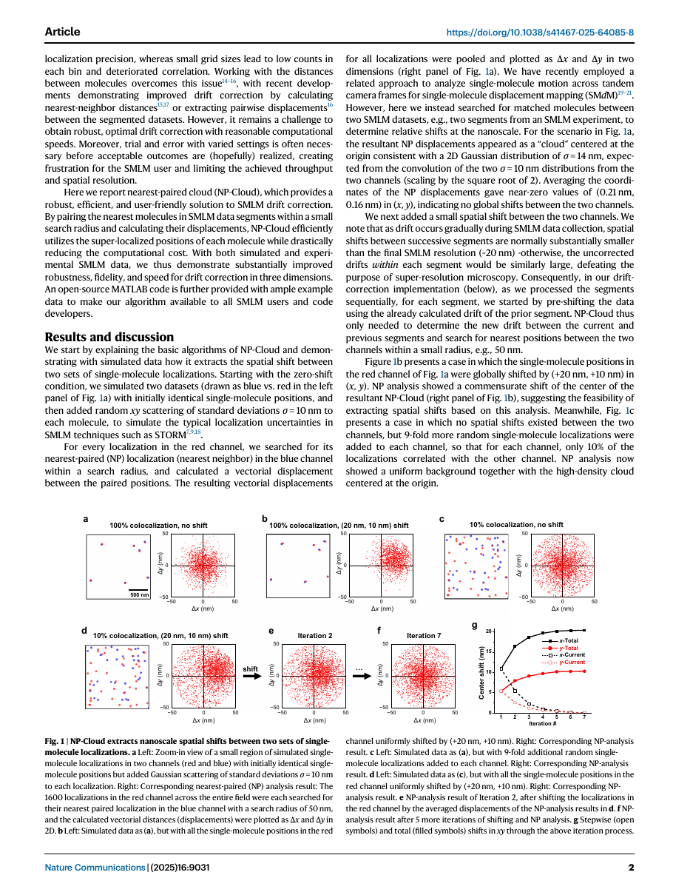
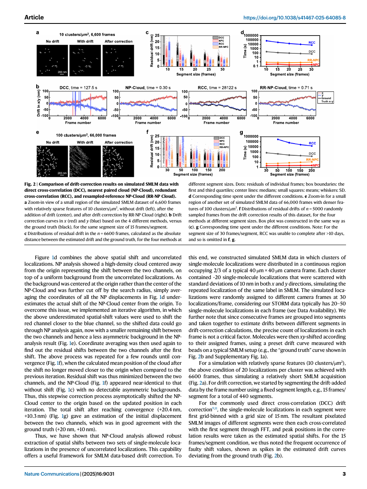
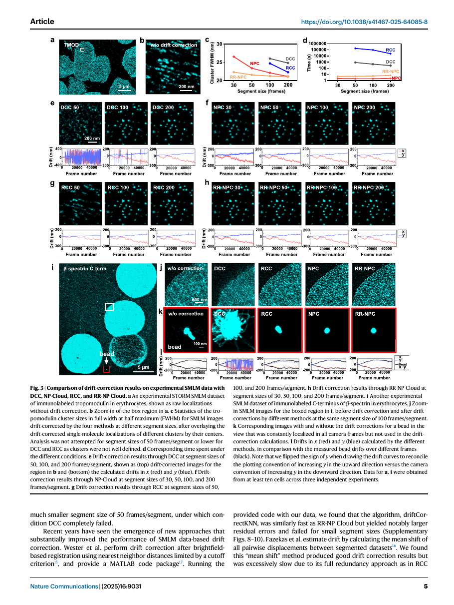

# 단일 분자 위치결정 현미경을 위한 빠르고 강건한 드리프트 보정 (번역)

- 원제: Fast and robust drift correction for single-molecule localization microscopy
- 원문: 같은 폴더의 `Hou2025_NatCommun_drift_correction.pdf` (9쪽, Nature 사이트에서 받음, CC BY 4.0)
- 저자: Mengdi Hou, Jianyu Yang, Mingjie Yang, Fen Hu, Rongge Zhao, Yuhang Pan, Wan Li, Mingxin Chen, Jingjun Xu, Ke Xu, Leiting Pan
- 서지: Nature Communications 16:9031 (2025). doi:10.1038/s41467-025-64085-8. 접수 2024-09-12, 채택 2025-09-02
- 번역 범위: 전문 (초록, 본문, 그림 캡션, 방법, 자료와 코드 공개, 사사, 저자 기여). 참고문헌은 원문 그대로 둔다.
- 번역 메모: 원문의 ">104", ">105"는 PDF 추출 때 위첨자가 빠진 것으로, 각각 10^4, 10^5배를 뜻한다.

---

## 초록

단일 분자 위치결정 현미경(SMLM)은 분자 위치를 조금씩 쌓아 영상을 만든다. 그래서 자료를 모으는 동안 생기는 시료 드리프트를 제대로 보정해야 한다. 그런데 지금의 자료 기반 SMLM 드리프트 보정법은 믿기 어려운 경우가 많고 시간이 오래 걸린다. 이 때문에 얻을 수 있는 해상도와 처리량이 제한된다.

이 논문은 NP-Cloud(nearest paired cloud, 최근접 쌍 구름)를 보고한다. 빠르고 강건한 SMLM 드리프트 보정법이다. SMLM 자료 구간들에서 가장 가까운 분자끼리 짝을 짓고, 작은 탐색 반경 안에서 그 변위를 계산한다. 이렇게 하면 초정밀로 위치를 잡은 각 분자의 연속값 위치를 효율적으로 쓰면서 계산량은 크게 줄인다.

모의 자료와 실험 자료 모두에서, 3차원 드리프트 보정의 강건성과 정확도가 크게 좋아졌다. 속도는 기존의 단일 기준 방식보다 100배 넘게, 기존의 교차 기준 중복 방식보다 10^4배 넘게 빨랐다. 다양한 시료에서 몇 초 안에 훌륭한 드리프트 보정을 얻었다. 따라서 이 방법은 SMLM 드리프트 보정의 강건하고 빠르며 실용적인 해법이다.

## 서론

최근 몇 년 동안, 단일 분자 위치를 대량으로 쌓아 만드는 초해상 현미경(SRM), 곧 단일 분자 위치결정 현미경(SMLM)이 빠르게 성장했다(1~4). SMLM에서는 카메라 한 프레임마다 형광 표지 전체 가운데 무작위로 고른 일부인 수십 개의 발광 분자를, 넓은 시야 전체에서 약 10 nm 정밀도로 위치를 잡는다. 형광이 켜지고 꺼지는 전환이 여러 프레임에 걸쳐 서로 다른 표지 분자를 무작위로 표본 추출하고, 그렇게 초해상 영상이 조금씩 만들어진다.

주사형 현미경과 달리, SMLM에서는 원 카메라 프레임 하나가 시야 전체 정보의 일부만 준다. 그래서 바탕의 생물 구조를 촘촘히 덮으려면 보통 10^4장이 넘는 프레임에 걸쳐 단일 분자 위치를 모은다. 이 긴 수집 동안 시료가 드리프트하면, 최종 초해상 영상의 시야 전체가 번진다.

수집 중 드리프트를 물리적으로 보상할 수도 있지만(5, 6), 기계 부품을 넣으면 기술적 어려움과 불확실성이 생긴다. 그래서 자료에서 계산으로 드리프트를 보정하는 쪽이 더 실용적이다. 초기 SMLM 실험은 형광 비드 같은 기준 표지(fiducial marker)로 시료 드리프트를 추적해 사후 보정했다(7, 8). 그러나 곧, 이 번거로운 방법 대신 모은 SMLM 자료 자체로 드리프트를 정할 수 있음이 밝혀졌다(9~11).

자료 기반 SMLM 드리프트 보정은 보통 전체 자료를 프레임 순서로 구간(segment)으로 나누고, 구간 사이의 공간 이동을 계산하는 데서 시작한다. 흔한 방식(9~13)에서는 각 구간의 단일 분자 위치를 미리 정한 격자 크기로 공간 묶음(binning)하고, 그렇게 화소화한 초해상 영상끼리 교차상관을, 예를 들어 고속 푸리에 변환(FFT)으로 계산한다.

개념은 단순하지만, 첫 단계의 공간 묶음에서 문제가 생길 수 있다. 격자가 크면(예: 30 nm 초과) 초정밀 위치 정보를 다 쓰지 못한다. 격자가 작으면 칸마다 개수가 적어 상관이 나빠진다. 분자 사이 거리를 직접 쓰면 이 문제를 피할 수 있다(14~16). 최근에는 최근접 이웃 거리(15, 17)를 계산하거나, 구간 자료 사이의 쌍별 변위(16)를 뽑아 드리프트 보정을 개선한 연구가 있다. 그러나 적당한 계산 속도로 강건하고 최적인 드리프트 보정을 얻는 것은 여전히 어렵다. 게다가 받아들일 만한 결과를 (운이 좋으면) 얻기까지 설정을 바꿔 가며 시행착오를 거쳐야 하는 경우가 많다. 이는 SMLM 사용자에게 좌절을 주고, 얻는 처리량과 공간 해상도를 제한한다.

이 논문은 NP-Cloud를 보고한다. SMLM 드리프트 보정의 강건하고 효율적이며 쓰기 쉬운 해법이다. SMLM 자료 구간들에서 작은 탐색 반경 안의 가장 가까운 분자끼리 짝짓고 변위를 계산해, 각 분자의 초정밀 위치를 효율적으로 쓰면서 계산 비용을 크게 줄인다. 모의 자료와 실험 자료로 3차원 드리프트 보정의 강건성, 정확도, 속도가 크게 좋아짐을 보인다. 또한 예제 자료가 풍부한 오픈소스 MATLAB 코드를 함께 공개해, 모든 SMLM 사용자와 코드 개발자가 이 알고리즘을 쓸 수 있게 했다.

## 결과와 논의

먼저 NP-Cloud의 기본 알고리즘을 설명하고, 두 단일 분자 위치 집합 사이의 공간 이동을 어떻게 뽑아내는지 모의 자료로 보인다.

이동이 없는 조건에서 시작한다. 처음에는 단일 분자 위치가 똑같은 두 자료(그림 1a 왼쪽의 파랑과 빨강)를 만들었다. 그리고 STORM 같은 SMLM 기법의 전형적인 위치결정 불확도를 흉내 내려고, 각 분자에 표준편차 σ = 10 nm의 무작위 xy 흩어짐을 더했다(7, 9, 18).

빨강 채널의 각 위치에 대해, 탐색 반경 안에서 파랑 채널의 최근접 쌍(NP) 위치(최근접 이웃)를 찾고, 짝지은 두 위치 사이의 벡터 변위를 계산했다. 모든 위치의 벡터 변위를 모아 Δx, Δy의 2차원으로 그렸다(그림 1a 오른쪽).

저자들은 최근에 비슷한 방법으로 연속한 카메라 프레임 사이의 단일 분자 움직임을 분석해 단일 분자 변위 지도(SMdM)를 만든 바 있다(19~21). 그러나 이번에는 두 SMLM 자료, 예를 들어 한 SMLM 실험의 두 구간 사이에서 짝이 맞는 분자를 찾아 나노 단위의 상대 이동을 정한다.

그림 1a의 경우, NP 변위는 원점을 중심으로 한 "구름"으로 나타났다. 이것은 σ = 14 nm의 2차원 가우스 분포와 맞는다. 두 채널의 σ = 10 nm 분포 두 개를 합성곱하면 √2배가 되기 때문이다. NP 변위 좌표를 평균하면 (x, y)로 (0.21 nm, 0.16 nm)이 나왔다. 거의 0이므로, 두 채널 사이에 전역 이동이 없음을 뜻한다.

**그림 1 | NP-Cloud는 두 단일 분자 위치 집합 사이의 나노 단위 공간 이동을 뽑아낸다.**
a 왼쪽: 두 채널(빨강, 파랑)의 모의 단일 분자 위치 가운데 작은 영역을 확대한 것. 처음에는 두 채널의 분자 위치가 같지만, 각 위치에 표준편차 σ = 10 nm의 가우스 흩어짐을 더했다. 오른쪽: 이에 대응하는 최근접 쌍(NP) 분석 결과. 시야 전체에서 빨강 채널의 1600개 위치마다, 탐색 반경 50 nm 안에서 파랑 채널의 최근접 짝을 찾았다. 계산한 벡터 거리(변위)를 Δx, Δy의 2차원으로 그렸다.
b 왼쪽: (a)와 같은 모의 자료이지만, 빨강 채널의 모든 분자 위치를 (+20 nm, +10 nm)만큼 똑같이 이동했다. 오른쪽: 이에 대응하는 NP 분석 결과.
c 왼쪽: (a)와 같은 모의 자료이지만, 각 채널에 9배 많은 무작위 단일 분자 위치를 더했다. 오른쪽: 이에 대응하는 NP 분석 결과.
d 왼쪽: (c)와 같은 모의 자료이지만, 빨강 채널의 모든 분자 위치를 (+20 nm, +10 nm)만큼 똑같이 이동했다. 오른쪽: 이에 대응하는 NP 분석 결과.
e 반복 2회차의 NP 분석 결과. (d)의 NP 분석 결과에서 평균한 변위만큼 빨강 채널의 위치를 옮긴 뒤 얻었다.
f 이동과 NP 분석을 5번 더 반복한 뒤의 NP 분석 결과.
g 위 반복 과정에서 xy의 단계별 이동(빈 기호)과 누적 이동(채운 기호).

다음으로 두 채널 사이에 작은 공간 이동을 넣었다. SMLM 자료 수집 중에는 드리프트가 서서히 일어난다. 그래서 연속한 구간 사이의 공간 이동은 보통 최종 SMLM 해상도(약 20 nm)보다 훨씬 작다. 그렇지 않다면 각 구간 안의 보정되지 않은 드리프트도 그만큼 커서, 초해상 현미경의 목적이 무너진다.

그래서 저자들의 드리프트 보정 구현(아래)에서는 구간을 차례로 처리하면서, 각 구간마다 앞 구간에서 이미 계산한 드리프트만큼 자료를 먼저 옮겨 두었다(사전 이동). 그러면 NP-Cloud는 현재 구간과 앞 구간 사이에 새로 생긴 드리프트만 정하면 되고, 두 채널 사이의 최근접 위치도 작은 반경, 예를 들어 50 nm 안에서만 찾으면 된다.

그림 1b는 그림 1a의 빨강 채널 단일 분자 위치를 (x, y)로 (+20 nm, +10 nm)만큼 전역 이동한 경우다. NP 분석 결과, NP-Cloud의 중심도 그만큼 이동했다(그림 1b 오른쪽). 이 분석으로 공간 이동을 뽑아낼 수 있음을 보여 준다.

한편 그림 1c는 두 채널 사이에 공간 이동은 없지만, 각 채널에 9배 많은 무작위 단일 분자 위치를 더한 경우다. 그래서 각 채널에서 위치의 10%만 다른 채널과 상관된다. 이때 NP 분석은 원점 중심의 고밀도 구름과 함께 균일한 배경을 보였다.

그림 1d는 위의 공간 이동과 상관되지 않은 위치를 함께 넣은 경우다. NP 분석 결과, 두 채널 사이의 이동을 나타내는, 원점에서 벗어난 고밀도 구름이 나타났고, 그 위에 상관되지 않은 위치에서 나온 균일한 배경이 겹쳤다. 이 배경은 NP-Cloud의 중심이 아니라 원점을 중심으로 하고, 게다가 탐색 반경에서 잘린다. 그래서 그림 1d의 모든 NP 변위 좌표를 그냥 평균하면, NP-Cloud 중심이 원점에서 벗어난 실제 이동을 과소추정한다.

이 문제를 풀기 위해 반복 알고리즘을 구현했다. 위에서 과소추정한 공간 이동 값만큼 빨강 채널을 파랑 채널 쪽으로 옮긴다. 옮긴 자료로 NP 분석을 다시 하면, 두 채널 사이에 남은 이동이 더 작고, NP 분석 결과의 배경도 덜 비대칭이 된다(그림 1e). 다시 좌표 평균으로 첫 이동 뒤 두 채널 사이에 남은 이동을 찾는다. 이 과정을 수렴할 때까지 몇 번 반복했다(그림 1f). 수렴은, 이동 뒤 계산한 구름의 평균 위치가 앞 반복보다 더 이상 원점에 가까워지지 않을 때로 정했다.

이렇게 두 채널 사이의 남은 이동을 최소화했고, NP-Cloud(그림 1f)는 이동이 없을 때(그림 1c)와 거의 같아 보였으며, 비대칭 배경은 검출되지 않았다. 즉 이 단계적 보정 과정은 반복마다 갱신한 위치를 바탕으로 NP-Cloud 중심을 점근적으로 원점으로 옮긴다. 수렴한 뒤의 누적 이동 (+20.4 nm, +10.3 nm)(그림 1g)은 두 채널 사이의 처음 변위 추정치이며, 참값 (+20 nm, +10 nm)과 잘 맞았다.

이렇게 NP-Cloud 분석은 상관되지 않은 위치가 있어도 두 단일 분자 위치 집합 사이의 공간 이동을 강건하게 뽑아낼 수 있음을 보였다. 이 능력은 SMLM 자료 기반 드리프트 보정에 쓸모 있는 틀을 준다.

이를 위해, 단일 분자 위치의 군집이 전형적인 40 µm × 40 µm 카메라 프레임의 2/3를 차지하는 연속 영역에 퍼진 모의 SMLM 자료를 만들었다. 각 군집에는 단일 분자 위치가 약 20개 있고, x와 y 방향 모두 표준편차 10 nm로 흩어지게 해서, SMLM에서 같은 표지를 반복해 위치결정하는 것을 흉내 냈다. 모의 위치는 프레임당 30개씩 서로 다른 카메라 프레임에 무작위로 배정했다. 저자들의 STORM 자료는 보통 프레임당 20~50개의 단일 분자 위치를 가지기 때문이다(자료 공개 참고). 또한 드리프트 보정 계산에서는 연속한 프레임을 구간으로 묶어 함께 써서 구간 사이 드리프트를 추정하므로, 프레임당 정확한 위치 개수는 중요한 요인이 아니다. 그다음, 전형적인 SMLM 장비에서 비드로 잰 미리 정한 드리프트 곡선(예: 그림 2b와 보충 그림 1a의 "참값" 곡선)에 따라, 배정된 프레임별로 분자를 xy 이동했다.

비교적 성긴 특징(10 군집/µm²)의 모의에서는, 위의 군집당 20개 위치 조건을 6600 프레임으로 맞췄다. 비교적 짧은 SMLM 수집을 흉내 낸 것이다(그림 2a). 드리프트 보정은, 드리프트를 더한 자료를 고정 구간 길이, 예를 들어 15 프레임/구간으로 나누어 모두 440 구간을 만드는 데서 시작했다.

흔히 쓰는 직접 교차상관(DCC) 드리프트 보정(9, 11)에서는, 각 구간의 단일 분자 위치를 먼저 15 nm 격자로 묶었다. 그렇게 화소화한 구간별 SMLM 영상을 각각 첫 구간과 FFT로 교차상관하고, 상관 결과의 정점 위치를 공간 이동 추정치로 삼았다. 15 프레임/구간 조건에서는 잘못된 이동 값이 자주 나왔고, 추정 드리프트 곡선에서 참값을 벗어나는 뾰족한 튐으로 보였다(그림 2b).

**그림 2 | 모의 SMLM 자료에서 직접 교차상관(DCC), 최근접 쌍 구름(NP-Cloud), 중복 교차상관(RCC), 재표본 기준 NP-Cloud(RR-NP Cloud)의 드리프트 보정 결과 비교.**
a 비교적 성긴 특징(10 군집/µm²)을 가진 6,600 프레임 모의 SMLM 자료의 작은 영역 확대. 드리프트 없음(왼쪽), 드리프트 추가 뒤(가운데), RR-NP Cloud로 드리프트 보정 뒤(오른쪽).
b 같은 구간 크기 15 프레임/구간에서 네 방법으로 얻은 x(빨강)와 y(파랑) 드리프트 보정 곡선과 참값(검정).
c n = 6600 프레임의 남은 드리프트 분포. 추정 드리프트와 참값 사이의 절대 거리로 계산했다. 구간 크기별 네 방법. 점: 개별 프레임의 잔차. 상자 경계: 1사분위와 3사분위. 가운데 선: 중앙값. 작은 사각형: 평균. 수염: 표준편차.
d 각 조건에서 걸린 시간.
e 더 촘촘한 특징(100 군집/µm²)을 가진 66,000 프레임 모의 SMLM 자료의 작은 영역 확대.
f 이 자료의 드리프트 보정 결과에서 무작위로 뽑은 n = 5000 프레임의 남은 드리프트 분포. 구간 크기별 네 방법. 상자 그림은 (c)와 같은 방식으로 그렸다.
g 각 조건에서 걸린 시간.
주: 30 프레임/구간에서 RCC는 10일이 넘도록 끝나지 않아 f, g에서 뺐다.

NP-Cloud 기반 드리프트 보정에서는, 위에서 말한 대로 각 구간의 단일 분자 위치를 앞 구간에서 계산한 드리프트(첫 구간 대비)만큼 먼저 옮겼다. 그다음 위에서 소개한 반복 알고리즘(그림 1d~g)으로 작은(약 50 nm) 탐색 반경 안에서 첫 구간 대비 남은 공간 이동을 정했다. 이 작은 이동을 앞 구간의 드리프트 값에 더해 현재 구간의 추정 드리프트로 기록했다. 앞 구간의 드리프트로 사전 이동을 했지만, 상관은 언제나 첫(기준) 구간과 계산했다는 점에 주의한다. 그래서 계산한 드리프트의 오차가 시간에 따라 쌓이지 않는다.

15 프레임/구간 조건에서 NP-Cloud는 모든 구간에서 시료 드리프트를 충실히 따라갔다(그림 2b). 더 작은 10 프레임/구간에서도 NP-Cloud는 강건하게 동작했지만 DCC는 쓸 수 없게 되었다(그림 2c, 보충 그림 1). 구간이 크면 두 방법 모두 동작했지만, 드리프트에서 빨리 변하는 성분의 세부가 사라졌다(보충 그림 1). 살펴본 모든 구간 크기에서, 참값과 비교해 NP-Cloud가 DCC보다 언제나 더 충실한 드리프트 보정을 주었다(그림 2c). 이런 이점은 NP-Cloud가 격자를 쓰지 않아, 초정밀 분자 위치를 모두 최대한 쓰기 때문이다.

또한 NP-Cloud 기반 드리프트 보정은 DCC보다 약 400배 빨라, 위 자료에서 한 번 실행에 약 0.2 s가 걸렸다(그림 2d). 이렇게 빠른 이유는 사전 이동 방식 덕분에 NP 분석에 필요한 탐색 반경이 작아, NP-Cloud의 계산 비용이 크게 줄기 때문이다. 반면 DCC에서는 드리프트 크기와 상관없이 전체 프레임 크기로 FFT 영상 상관을 계산한다.

다음으로 100 군집/µm²의 더 촘촘한 특징을 가진 다른 모의 자료를 살폈다. 이번에는 군집당 약 20개 위치 조건을 66,000 모의 프레임으로 맞춰, 더 긴 SMLM 수집을 흉내 냈다(그림 2e). DCC는 50 프레임/구간 이하에서 쓸 수 없었다(그림 2f, 보충 그림 2). 반대로 NP-Cloud는 30 프레임/구간까지 여러 구간 크기에서 강건했고, 여러 구간 크기에서 언제나 더 충실한 드리프트 보정을 주었다(그림 2f, 보충 그림 2). 시간으로도 NP-Cloud가 DCC보다 다시 100배 넘게 빨랐다(그림 2g).

DCC와 NP-Cloud의 뚜렷한 한계는, 각 구간을 첫 구간 하나만 기준으로 비교한다는 점이다. SMLM은 무작위성이 있어, 첫 구간에 시료의 구조 특징이 다 들어 있지 않을 수 있다. 중복 교차상관(RCC)(11)은 모든 구간 사이의 상관을 서로 교차 검토해 이 문제에서 DCC보다 낫다(그림 2b, c). 그러나 이 방식은 계산 부담을 크게 늘린다. 위의 66,000 프레임 모의 SMLM 자료를 100 프레임/구간으로 나누어 660 구간을 만들면, RCC는 단일 기준 DCC보다 약 660/2 = 330배 많은 교차상관을 계산해야 하고, 계산 시간도 그만큼 는다(그림 2g).

NP-Cloud도 같은 중복 방식으로 구현해 RCC보다 약 500배 빠르게 훌륭한 드리프트 보정을 할 수 있다(보충 그림 3). 그러나 저자들은 RCC의 지나친 중복을 피하는 전략을 따로 보고한다. 이 방식에서는 첫 번째 NP-Cloud 기반 드리프트 보정 뒤, 드리프트를 보정한 단일 분자 위치를 전체 자료에서 고르게 부분 추출해 재표본 기준 영상을 만들었다. 이 기준 영상은 첫 구간 하나보다 훨씬 많은 단일 분자 위치(예: 12배로 설정)를 담아, 더 많은 구조 특징을 담는다. 이렇게 특징을 보강한 재표본 기준 영상에 대해, 각 구간의 원래 단일 분자 위치로 두 번째 NP-Cloud 기반 드리프트 보정을 해서 더 강건한 이동 추정을 얻었다. 이 방식을 재표본 기준 NP-Cloud(RR-NP Cloud)라고 이름 붙였다.

6,600 프레임 모의 자료에서 RR-NP Cloud는 RCC와 비슷한 드리프트 보정 결과를 얻었고, 작은 구간 크기에서는 더 안정적이었다(그림 2b, c, 보충 그림 1). 한편 RR-NP Cloud의 두 번 계산은 시간을 NP-Cloud의 두 배로만 늘리며, RCC보다 10^4배 넘게 빠르다(그림 2d).

66,000 프레임 모의 자료에서, 50 프레임/구간의 RCC는 약 3 × 10^5 s, 곧 약 3.5일이라는 감당하기 어려운 계산 시간이 들었고, 결과도 드리프트를 충실히 따라가지 못했다(그림 2f, g, 보충 그림 2). 같은 구간 크기에서 DCC의 오차가 컸으므로 예상한 결과다. 이에 비해 RR-NP Cloud는 몇 초 안에 훌륭한 드리프트 보정을 했다. 게다가 RR-NP Cloud는 RCC가 전혀 동작하지 못한 더 어려운 30 프레임/구간 조건에서도 잘 동작했다(그림 2f, g, 보충 그림 2). 100 프레임/구간보다 큰 구간(그래서 구간 수가 적은 경우)에서는 RCC가 10^4~10^5 s, 곧 수십 시간에 걸쳐 받아들일 만한 결과를 냈다(그림 2g). 그래도 최종 드리프트 보정 충실도에서는 RR-NP Cloud가 언제나 앞섰고(그림 2f), 역시 몇 초 안에 끝났다(그림 2g).

다음으로 NP-Cloud와 RR-NP Cloud를 실험 자료에 적용했다. 비교적 낮은 밀도로 잘 떨어진 군집을 가진 시료, 곧 적혈구의 트로포모듈린(그림 3a, b)(22)에서 시작했다. NP-Cloud와 RR-NP Cloud는 30 프레임/구간까지 여러 구간 크기에서 강건한 드리프트 보정을 했다(그림 3f, h). 반면 DCC와 RCC는 100 프레임/구간에서 오류가 있었고, 50 프레임/구간 이하에서는 실패했다(그림 3e, g).

여러 방법으로 드리프트를 보정한 SMLM 영상에서 군집을 겹쳐 보면, NP-Cloud와 RR-NP Cloud가 DCC와 RCC보다 반치폭(FWHM)이 더 작아 30 nm까지 내려갔다(그림 3c). 보정이 더 좋았다는 뜻이다. 또한 NP-Cloud와 RR-NP Cloud 모두 몇 초 안에 끝났고, DCC보다 100배 넘게, RCC보다 10^4배 넘게 빨랐다(그림 3d). 이 결과는 위의 모의 자료 결과와 일치한다.

**그림 3 | 실험 SMLM 자료에서 DCC, NP-Cloud, RCC, RR-NP Cloud의 드리프트 보정 결과 비교.**
a 적혈구에서 면역 표지한 트로포모듈린의 실험 STORM SMLM 자료. 드리프트 보정 없는 원 위치로 보였다.
b a의 상자 영역 확대.
c 네 방법으로 여러 구간 크기에서 드리프트를 보정한 SMLM 영상에서, 서로 다른 군집의 드리프트 보정 단일 분자 위치를 중심 기준으로 겹친 뒤 잰 트로포모듈린 군집 크기의 반치폭(FWHM) 통계. 50 프레임/구간 이하에서 DCC와 RCC는 군집이 잘 정의되지 않아 분석하지 않았다.
d 각 조건에서 걸린 시간.
e DCC로 50, 100, 200 프레임/구간에서 보정한 결과. (위) b 영역의 드리프트 보정 영상, (아래) 계산한 x(빨강)와 y(파랑) 드리프트.
f NP-Cloud로 30, 50, 100, 200 프레임/구간에서 보정한 결과.
g RCC로 50, 100, 200 프레임/구간에서 보정한 결과.
h RR-NP Cloud로 30, 50, 100, 200 프레임/구간에서 보정한 결과.
i 적혈구에서 면역 표지한 β-스펙트린 C 말단의 다른 실험 SMLM 자료.
j i의 상자 영역 확대 SMLM 영상. 드리프트 보정 전과, 같은 구간 크기 100 프레임/구간에서 여러 방법으로 보정한 뒤.
k 시야 안의 비드 하나에 대해 드리프트 보정 전후 영상. 이 비드는 모든 카메라 프레임에서 늘 위치가 잡혔지만 드리프트 보정 계산에는 쓰지 않았다.
l 여러 방법으로 계산한 x(빨강)와 y(파랑) 드리프트를, 프레임에 따라 잰 비드 드리프트(검정)와 비교. 그림에서 y는 위로 갈수록 커지는 관례이고 카메라는 아래로 갈수록 커지는 관례라, 드리프트 곡선을 그릴 때 y의 부호를 뒤집었다.
a, i의 자료는 독립 실험 세 번에서 적어도 세포 10개로 얻었다.

다음으로 더 어려운 시료를 살폈다. 적혈구의 β-스펙트린 C 말단으로, 고밀도 구조가 SMLM 수준에서 잘 분해되지 않는다(그림 3i)(22). 이 시료에는 드리프트 보정 결과를 평가하기 쉽도록 늘 발광하는 형광 비드를 기준 표지로 넣었다. 그러나 모든 드리프트 보정은 비드 위치를 빼고 수행했다.

같은 구간 크기 100 프레임/구간에서 DCC는 드리프트 값이 흩어져 크게 실패했다(그림 3j~l). RCC는 쓸 만한 드리프트 보정을 주었지만, 최종 보정 SMLM 영상(그림 3j, k)과, 형광 비드로 따로 정한 드리프트 곡선과의 비교(그림 3l) 모두에서 상당한 남은 드리프트가 보였다. 반면 NP-Cloud와 RR-NP Cloud는 훌륭한 드리프트 보정을 주었다. 드리프트 보정 계산에 쓰지 않은 형광 비드까지 포함해 선명한 SMLM 영상을 얻었고(그림 3j, k), 드리프트 곡선은 비드로 독립적으로 정한 것과 잘 맞았다(그림 3l).

보충 그림 4~7은 NP-Cloud와 RR-NP Cloud를 다양한 구조의 SMLM 자료에 적용한 추가 예를 보인다. 고정한 대식세포의 팔로이딘 표지 액틴 섬유(보충 그림 4), 고정한 COS-7 세포의 면역 표지 미세소관(보충 그림 5), 소포체(보충 그림 6), 미토콘드리아(보충 그림 7)다. 시험용으로 모든 자료를 보충 자료로 제공한다(코드 공개와 자료 공개 참고). NP-Cloud와 RR-NP Cloud는 드리프트 보정 곡선, 최종 보정 영상, 푸리에 고리 상관(FRC) 분석(23)으로 보았을 때, DCC와 RCC로 제대로 보정할 수 없던 어려운 경우까지 포함해 몇 초 안에 언제나 훌륭한 드리프트 보정을 주었다.

이 가운데 보충 그림 6은, 200 프레임/구간에서 DCC가 처음에는 동작했지만, 광표백 때문에 프레임당 위치 개수가 줄어든 자료 뒷부분에서 실패한 예를 보인다. 이는 SMLM에서 흔한 상황이다. RR-NP Cloud는 자료 전체를 강건하게 처리했고, DCC가 완전히 실패한 훨씬 작은 50 프레임/구간에서도 잘 동작했다.

최근 몇 년 동안 SMLM 자료 기반 드리프트 보정 성능을 크게 높인 새 방법들이 나왔다. Wester 등은 명시야 기반 정합 뒤, 차단 기준으로 제한한 최근접 이웃 거리를 써서 드리프트 보정을 하고(15), MATLAB 코드 패키지를 제공한다(17). 저자들이 제공한 코드를 우리 자료로 돌려 보니, 그 알고리즘(driftCorrectKNN)은 RR-NP Cloud와 비슷하게 빨랐지만, 남은 오차가 눈에 띄게 컸고 작은 구간 크기에서는 실패했다(보충 그림 8~10). Fazekas 등은 구간 자료 사이의 모든 쌍별 변위의 평균 이동(mean shift)을 계산해 드리프트를 추정한다(16). 이 "mean shift" 방법은 좋은 드리프트 보정 결과를 냈지만, RCC처럼 완전 중복 방식이라 지나치게 느렸다(보충 그림 8~10). 큰 구간에서 RR-NP Cloud보다 약 100배 느렸고, 작은 구간에서는 더 느렸다. 66,000 프레임 모의 SMLM 자료에서 mean shift 방식은 50 프레임/구간에서 6 × 10^5 s(약 7일)가 걸렸고, 30 프레임/구간에서는 15일이 넘도록 끝나지 않았다. 반면 RR-NP Cloud는 두 경우 모두 10 s 안에 좋은 결과로 끝났다.

가장 최근에 Ma 등은 적응 교집합 최대화(AIM)(13)를 보고했다. 격자화, 화소화한 SMLM 자료를 작은 탐색 영역 안에서 국소적으로 상관하고, 첫 드리프트 보정 뒤 각 구간을 전체 자료와 상관하는 두 번째 단계를 둔다. 이 설계는 계산 비용을 크게 줄이지만, AIM은 단일 분자 위치를 공간 묶음한다는 점에서 DCC, RCC와 같은 문제를 겪는다. 그래서 각 격자 칸에 위치가 충분히 세어지지 않는 작은 구간 크기에서 실패한다(보충 그림 8~10). 따라서 RR-NP Cloud는 여러 매개변수에서 가장 강건한 드리프트 보정을 훌륭한 속도와 최종 결과로 제공한다.

NP-Cloud와 RR-NP Cloud를 3차원(3D) 드리프트 보정으로 더 넓혔다. 3D-SMLM 자료를 모의하려고(그림 4a), 위와 같이 100 군집/µm²의 특징을 가진 66,000 프레임의 단일 분자 위치를 만들고, 각 군집에 −400~+400 nm 범위의 처음 깊이(z) 값을 무작위로 배정했다. 그다음 모든 위치에 표준편차 22 nm의 z 흩어짐을 더했다. 이 z 범위와 표준편차 값은 원통 렌즈 기반 3D-STORM에서 보통 얻는 값에 바탕을 둔다(18). 그다음 미리 정한 참값 드리프트 궤적으로 모의 위치를 3차원에서 이동했다. 평면 xy 이동은 위의 2D 모의 자료에 쓴 것(보충 그림 2a)과 같고, z 이동은 그림 4b에 보였다.

3차원 드리프트 보정에서는, 기준 자료와 비교 자료에서 NP 위치를 짝지어 NP-Cloud를 만들 때 모든 분자의 z 위치를 함께 고려했다. z 위치결정 불확도의 반치폭이 약 50 nm이므로 z 탐색 반경은 100 nm로 했다. NP-Cloud 중심은 xy와 z에 대해 따로 계산했다. 50 프레임/구간에서 NP-Cloud-3D는 몇 초 안에 3차원 드리프트를 충실히 잡았다(그림 4a~c, 보충 그림 11). 첫 회 뒤 기준 프레임을 재표본해 두 번째 드리프트 보정을 하는 RR-NP Cloud-3D는, 참값과 구별되지 않는 훌륭한 z 드리프트 곡선을 더 얻었다(그림 4b, c). 이에 비해 AIM(13) 같은 새 방법은 z 드리프트 보정에서 남은 오차가 상당히 컸다(그림 4b, c).

**그림 4 | NP-Cloud와 RR-NP Cloud를 3차원 드리프트 보정으로 확장.** (이 그림은 쪽 이미지를 넣지 않았다. 원문 6쪽.)
a 100 군집/µm²의 특징을 가진 66,000 프레임 모의 3D-SMLM 자료의 작은 영역 확대. 드리프트 없음(왼쪽), 3차원 드리프트 추가 뒤(가운데), RR-NP Cloud-3D로 드리프트 보정 뒤(오른쪽). 색은 z 값을 나타낸다.
b 참값 z 드리프트 곡선(검정)과, 같은 구간 크기 50 프레임/구간에서 NP-Cloud-3D, RR-NP Cloud-3D, AIM-3D로 모의 3D-SMLM 자료에서 계산한 곡선(초록) 비교.
c 드리프트 보정 결과에서 무작위로 뽑은 n = 5000 프레임의 남은 z 드리프트 분포. 추정 드리프트와 참값 사이의 거리로 계산했다. 구간 크기별 세 방법. 점: 개별 프레임의 잔차. 상자 경계: 1사분위와 3사분위. 가운데 선: 중앙값. 작은 사각형: 평균. 수염: 표준편차. AIM-3D는 30 프레임/구간 조건에서 실패해 의미 있는 드리프트 보정을 만들지 못했다.
d 커버슬립에 흡착한 염료 표지 항체의 실험 3D-STORM 자료에서 RR-NP Cloud-3D로 계산한 z 드리프트. z는 현미경 초점 고정으로 안정화했다.
e 히스토그램: 3차원 드리프트 보정 전(왼쪽)과 뒤(오른쪽)의 단일 분자 위치 z 값 분포. 빨간 곡선: 정규분포 맞춤. 반치폭은 각각 57 nm와 55 nm.
f, g d, e와 비슷하지만 초점 고정을 끄고 촬영 중 초점면을 손으로 계속 조정했다. 정규분포 맞춤의 반치폭은 RR-NP Cloud-3D 드리프트 보정 전 75 nm, 뒤 55 nm.
h 고정한 COS-7 세포에서 면역 표지한 미토콘드리아 외막(TOM20)의 실험 3D-STORM 자료에서 RR-NP Cloud-3D로 계산한 z 드리프트. 이 자료를 모을 때 초점 고정을 껐고, 시료가 z로 매번 약 200 nm씩 계속 드리프트하도록 두었다가 손으로 초점을 맞춰 되돌렸다.
i 자료의 한 영역(보충 그림 12에 표시)의 가상 수직(xz) 단면. 드리프트 보정 없음(왼쪽), RR-NP Cloud로 평면(xy) 드리프트만 보정한 뒤(가운데), RR-NP Cloud-3D로 3차원 드리프트 보정한 뒤(오른쪽).

다음으로 실험 3D 자료를 살폈다. 초점 고정을 켜고 얻은 3D-STORM 자료에서는, 시료 z 드리프트가 자료 전체에서 보통 50 nm 미만이었다(그림 4d, 보충 그림 7). 이 경우 z 드리프트 보정은 최종 결과를 조금만 개선했다(커버슬립에 흡착한 염료 표지 항체 분자는 그림 4e, 고정 세포의 미토콘드리아는 보충 그림 7). 반대로 초점 고정을 끄고 수집 중 z 드리프트를 손으로 초점을 맞춰 보상한 경우, RR-NP Cloud-3D는 z 해상도 저하를 효과적으로 보정해 초점 고정을 켜고 모은 것과 비슷한 결과를 만들었다. 커버슬립 위 항체는 그림 4f, g에, 고정 세포의 미토콘드리아 외막의 속이 빈 단면을 분해한 결과는 그림 4h, i와 보충 그림 12에 보였다.

결론적으로, 저자들은 NP 분석에 바탕을 둔 강건하고 빠른 드리프트 보정법을 개발했다. SMLM 자료 구간들에서 가장 가까운 분자끼리 짝짓고 작은 탐색 반경 안에서 변위를 계산해, NP-Cloud와 RR-NP Cloud는 각 분자의 초정밀 위치를 효율적으로 써서 매우 강건하고 정확한 드리프트 보정을 이룬다. NP 분석을 작은 탐색 반경으로 제한하는 사전 이동 방식을 구현해, NP-Cloud는 계산 비용도 크게 줄여 기존 DCC보다 100배 넘게 빠르다. 두 번 계산하는 RR-NP Cloud는 NP-Cloud로 드리프트를 보정한 SMLM 자료를 재표본해 기준 프레임의 구조 특징을 보강하고, 두 번째 NP-Cloud 분석을 한다. 그래서 계산 시간을 NP-Cloud의 두 배로만 늘리면서 드리프트 보정을 더 개선한다.

이렇게 다양한 SMLM 자료에서 몇 초 안에 훌륭한 드리프트 보정을 얻었고, 감당하기 어렵게 오래 걸리는 RCC보다 10^4배 넘게 빨랐다. 기존 드리프트 보정법과 비교해, RR-NP Cloud가 훌륭한 속도로 가장 강건한 드리프트 보정을 준다. 특히 구간 크기를 줄인 경우, 곧 프레임마다 위치가 적거나 프레임 사이에 상관된 위치가 적은 상황을 흉내 낸 경우에, 다른 방법이 실패할 때 RR-NP Cloud만 강건한 드리프트 보정을 준다. NP-Cloud와 RR-NP Cloud를 3D SMLM 드리프트 보정으로 넓힌 것도 모의와 실험 자료 모두에서 훌륭한 결과를 냈고, 초점 고정 없이도 좋은 3D-SMLM 결과를 얻게 해 준다.

쓰기 쉬운 오픈소스 코드를 풍부한 예제 자료와 함께 제공해, SMLM 사용자와 코드 개발자가 이 알고리즘을 쓸 수 있게 했다(크리에이티브 커먼즈 저작자표시 비영리 4.0 국제 라이선스(CC BY-NC 4.0). 코드 공개와 자료 공개 참고). 또한 구간 크기 외에는, NP-Cloud와 RR-NP Cloud는 다양한 자료에 돌릴 때 매개변수를 조정할 필요가 없다는 점도 짚어 둔다. 이렇게 SMLM 자료 기반 드리프트 보정의 빠르고 강건하며 실용적인 해법을 제공한다.

## 방법

코드와 시험 자료는 크리에이티브 커먼즈 저작자표시 비영리 4.0 국제(CC BY-NC 4.0) 라이선스로 https://doi.org/10.5281/zenodo.16513620 에서 제공한다. 코딩은 MATLAB으로 했다. 계산은 Intel Core i7-13700K CPU, 64 G RAM (2400 MHz), 1 Tb SSD (Samsung 980 Pro)의 PC에서 했다.

### 모의

참값이 있는 자료를 얻기 위해 단일 분자 위치를 모의했다. NP-Cloud가 두 단일 분자 위치 집합 사이의 공간 이동을 어떻게 뽑는지 보이려고(그림 1), 먼저 전형적인 카메라 프레임 크기 40 µm × 40 µm 위에 2 분자/µm²로 고르게 퍼진 무작위 위치로 단일 분자 위치를 모의했다. 같은 위치를 두 채널(파랑과 빨강)에 배정하고, 단일 분자 위치결정 불확도를 흉내 내려고 각 위치에 x와 y 방향 모두 표준편차 σ = 10 nm의 무작위 가우스 흩어짐을 따로 더했다(그림 1a). 그다음 빨강 채널의 모든 단일 분자 위치에 (x = +20 nm, y = +10 nm)의 전역 이동을 더해 그림 1b를 만들었다. 그림 1c를 만들려고, 그림 1a의 이동 없는 자료의 각 채널에 9배의 무작위 단일 분자 위치를 더했다. 그다음 그림 1c의 빨강 채널 모든 단일 분자 위치를 (x = +20 nm, y = +10 nm)만큼 전역 이동해 그림 1d를 만들었다.

그림 2의 SMLM 자료 모의에서는, 단일 분자 위치의 군집을 40 µm × 40 µm 카메라 프레임의 2/3를 차지하는 연속 영역에 퍼뜨렸다. 각 군집에는 x와 y 방향 모두 표준편차 10 nm로 흩어진 단일 분자 위치가 약 20개 있어, SMLM에서 같은 표지를 반복 위치결정하는 것을 흉내 냈다. 모의 위치는 프레임당 30개로 서로 다른 카메라 프레임에 무작위 배정했다. 그래서 성긴 특징(10 군집/µm²)과 촘촘한 특징(100 군집/µm²)의 두 시나리오를 각각 6600과 66,000 모의 프레임으로 얻어, 짧은(그림 2a) 수집과 긴(그림 2e) 수집을 흉내 냈다. 그다음 전형적인 SMLM 장비에서 비드로 잰 미리 정한 드리프트 곡선(아래)에 따라, 배정된 프레임별로 분자를 xy 이동했다.

### 공간 이동을 뽑는 NP-Cloud 구현

NP-Cloud는 두 단일 분자 위치 집합 사이의 최근접 쌍(NP) 위치에 대한 벡터 변위를 분석한다. 단일 분자 변위/확산 지도(SMdM)(19, 20)에서 착안했다. 그러나 SMdM에서는 일시적 변위를 검출하려고 연속한 프레임 사이에서 분자를 짝짓지만, NP-Cloud에서는 두 SMLM 자료, 예를 들어 SMLM 자료의 연속한 두 구간 사이에서 분자를 짝지어 나노 단위 상대 이동을 정한다. 또한 SMdM에서는 모은 벡터 변위를 원점 중심 분포로 맞추지만, NP-Cloud에서는 두 자료 사이 공간 이동을 뽑기 위해 분포 구름의 중심을 찾는 것이 목표다.

이를 위해 먼저 모든 NP 변위 좌표를 평균한다. 이 계산은 본문에서 말한 비대칭 배경 때문에 공간 이동을 과소추정한다. 이 문제를 풀기 위해 반복 수렴 알고리즘을 구현했다. 위 좌표 평균에서 얻은 과소추정 공간 이동만큼 빨강 채널을 파랑 채널 쪽으로 옮긴다. 옮긴 자료로 NP 분석을 다시 하면, 두 채널 사이에 남은 이동이 더 작고 NP 분석 결과의 배경이 덜 비대칭이 된다(그림 1e). 다시 좌표 평균으로 첫 이동 뒤 두 채널 사이 남은 이동을 찾는다. 이 과정을 수렴할 때까지 몇 번 반복했다(그림 1f). 곧, 이동 뒤 계산한 구름의 평균 위치가 앞 반복보다 원점에 더 가깝지 않을 때까지다. 이렇게 단계적 보정 과정은 반복마다 갱신한 위치로 NP-Cloud 중심을 점근적으로 원점으로 옮기고, 수렴 뒤의 누적 이동이 두 채널 사이 처음 변위의 추정치가 된다.

### SMLM 자료 드리프트 보정을 위한 NP-Cloud 구현

모의든 실험이든 SMLM 자료는 먼저 고정 구간 길이로 프레임 번호에 따라 나누었다. 흔히 쓰는 DCC 드리프트 보정(9, 11)에서는 각 구간의 단일 분자 위치를 먼저 15 nm 격자로 묶었다. 그렇게 화소화한 구간별 SMLM 영상을 각각 첫 구간과 FFT로 교차상관하고, 상관 결과의 정점 위치를 공간 이동 추정치로 삼았다.

NP-Cloud 기반 드리프트 보정에서는 구간을 차례로 처리했다. 각 구간에서 앞 구간에서 계산한 드리프트(첫 구간 대비)만큼 단일 분자 위치를 먼저 옮기고, NP-Cloud(위)를 적용해 작은(약 50 nm) 탐색 반경 안에서 첫 구간 대비 남은 공간 이동을 정했다. 이 작은 이동을 앞 구간의 드리프트 값에 더해 현재 구간의 추정 드리프트로 기록했다. 모든 구간을 처리한 뒤, 추정 드리프트 값을 선형 보간해 각 프레임의 드리프트 값을 만들고, 이를 써서 전체 자료의 단일 분자 위치를 옮겨 드리프트를 보정했다.

### RR-NP Cloud 구현

RR-NP Cloud에서는 위와 같이 모든 구간에 NP-Cloud 계산을 한 뒤, 단일 분자 위치를 구간별로 옮겨 첫 회의 대략 드리프트 보정 자료를 만들었다. 이 자료를 모든 프레임에 걸쳐 고르게 부분 추출해 새 기준 영상을 만들었다. 이 기준 영상은 첫 구간보다 훨씬 많은 단일 분자 위치(예: 12배로 설정)를 담아 더 많은 구조 특징을 잡는다. 이렇게 특징을 보강한 재표본 기준 영상에 대해, 각 구간의 원래 단일 분자 위치로 두 번째 NP-Cloud 기반 드리프트 보정을 했다.

### 3차원 드리프트 보정으로 확장

모의 3D-SMLM 자료는 위의 촘촘한 모의 시료처럼 100 군집/µm²의 특징을 가진 66,000 프레임의 단일 분자 위치로 만들되, 각 군집에 −400~+400 nm 범위의 처음 깊이(z) 값을 무작위로 배정했다. 그다음 모든 위치에 표준편차 22 nm의 z 흩어짐을 더했다. 모의 위치는 미리 정한 참값 드리프트 궤적으로 3차원 이동했다. 3차원 드리프트 보정은 위의 2차원 보정과 같은 방식으로 하되, 기준 자료와 비교 자료에서 NP 위치를 짝지어 NP-Cloud를 만들 때 모든 분자의 z 위치를 함께 고려했다. z 위치결정 불확도의 반치폭이 보통 약 50 nm이므로, NP 위치를 짝지을 때 z 탐색 반경 100 nm를 썼다. 기준 자료와 비교 자료 사이의 3차원 상대 이동을 추정하려고 NP-Cloud 중심을 xy와 z에 대해 따로 계산했다.

### 실험 자료

실험 자료는 Nikon Ti-E 도립 형광 현미경(24, 25)에 기반한 SMLM 장비에서 100× 유침 대물렌즈(Nikon CFI Plan Apochromat λ)로 모았다. 전형적인 드리프트 곡선은 비드 시료(Invitrogen, F8783, 1:1000000 희석)로 얻었다. SMLM 자료는 전형적인 STORM 절차(18)로 얻었다.

COS-7 세포(26, 27)는 코팅하지 않은 유리 커버슬립에서 배양하고, DPBS의 3% 파라포름알데히드와 0.1% 글루타르알데히드로 20분 고정한 뒤, 새로 만든 DPBS의 0.1% 수소화붕소나트륨 용액으로 씻었다. 이어서 항튜불린(Sigma, T6199), 항TOM20(Proteintech, 11802-1-AP), 또는 항Rtn4a/b(ThermoFisher, PA1-41220) 1차 항체와 Alexa Fluor 647(AF647) 결합 2차 항체(Invitrogen, A31571, A21245)로 면역형광 염색했다.

적혈구(22)는 먼저 폴리-L-라이신 코팅 유리 커버슬립에 붙이고, 둘베코 인산완충식염수(DPBS)의 4% 파라포름알데히드로 10분 고정한 뒤, 항트로포모듈린(OriGene, TA503146) 또는 항β-스펙트린(C 말단, NeuroMab, 73-374) 1차 항체와 AF647 결합 2차 항체로 면역형광 염색했다.

대식세포(25)는 먼저 세포골격 완충액(CB, 10 mM MES, pH 6.1, 150 mM NaCl, 5 mM EGTA, 5 mM 포도당, 5 mM MgCl2)의 0.3% 글루타르알데히드와 0.25% Triton X-100으로 1분 동안 고정과 추출을 하고(28), CB의 2% 글루타르알데히드로 15분 후고정한 뒤, DPBS의 0.1% 수소화붕소나트륨으로 씻고, AF647 결합 팔로이딘(Invitrogen, A22287)으로 표지했다.

STORM은 5% 포도당, 100 mM 시스테아민(Sigma-Aldrich, 30070), 0.8 mg/mL 포도당 산화효소(Sigma-Aldrich, G2133), 40 μg/mL 카탈레이스(Sigma-Aldrich, C30)를 담은 Tris-HCl 기반 영상 완충액으로 했다. 647 nm 레이저로 시료를 약 2 kW/cm²로 비춰 표지된 AF647 분자 대부분을 어두운 상태로 광전환하고, 약한(0~1 W/cm²) 405 nm 레이저로 어두운 상태의 AF647 분자 일부를 다시 발광 상태로 바꿔 단일 분자를 검출했다. 그렇게 얻은 단일 분자 영상은 Andor iXon Ultra 897 EM-CCD로 초당 110 프레임으로 기록했다. 3D-STORM은 영상 경로에 원통 렌즈를 넣어 단일 분자 영상에 비점수차를 주는 방식으로 했다(18). 대부분 자료에서는 내장 Nikon Perfect Focus System으로 수집 중 시료 초점을 고정했다. 초점 고정 없이 얻은 자료에서는 실시간 단일 분자 영상을 지켜보며 초점 드리프트를 눈으로 찾아 수집 중에 손으로 보정했다.

## 보고 요약

연구 설계에 대한 추가 정보는 이 논문에 연결된 Nature Portfolio Reporting Summary에 있다.

## 자료 공개

이 연구의 모의 자료와 실험 자료는 크리에이티브 커먼즈 저작자표시 비영리 4.0 국제(CC BY-NC 4.0)로 https://doi.org/10.5281/zenodo.16513620 에서 받을 수 있다.

## 코드 공개

이 연구에 쓴 코드는 크리에이티브 커먼즈 저작자표시 비영리 4.0 국제 라이선스(CC BY-NC 4.0)로 https://doi.org/10.5281/zenodo.16513620 에서 받을 수 있다.

## 사사

L.P.는 중국 국가 중점 연구개발 계획(2022YFC3400600), 중국 국가자연과학기금(32227802, 12174208), 광둥성 기초 및 응용기초 연구 중대 과제(2020B0301030009), 중앙 대학 기본 연구비(63241509), 톈진시 자연과학기금(23JCYBJC01250), 111 프로젝트(B23045)의 지원을 받았다. K.X.는 Packard Fellowships for Science and Engineering과 Heising-Simons Faculty Fellows Award의 지원에 감사한다.

## 저자 기여

L.P.가 연구를 구상했다. L.P., K.X., M.H.가 이론 모형과 실험을 설계했다. M.H.와 J.Y.가 실험을 했다. M.H., M.Y., F.H., R.Z., Y.P.가 자료를 분석했다. W.L., M.C., J.X.가 결과 해석에 기여했다. K.X.와 L.P.가 원고를 썼다. L.P., K.X., J.X.가 연구를 지도했다.

## 이해 상충

저자들은 이해 상충이 없다고 밝혔다.

## 추가 정보

보충 정보: 온라인 판에 보충 자료가 있다. https://doi.org/10.1038/s41467-025-64085-8
교신 저자: Ke Xu 또는 Leiting Pan (xuk@berkeley.edu, plt@nankai.edu.cn). 소속: 1 난카이대학 약광 비선형 광자학 교육부 중점 실험실, TEDA 응용물리연구소, 물리학과(중국 톈진). 2 캘리포니아대학 버클리 화학과(미국). 3 난카이대학 고등 학제 연구원 약물 화학생물학 국가 중점 실험실(중국 톈진). 4 현 주소: 중국전자과기집단 제27연구소(중국 정저우).
동료 심사: Nature Communications는 Michael Wester와 익명 심사자들의 심사에 감사한다. 심사 기록 파일이 공개되어 있다.
오픈 액세스: 이 논문은 크리에이티브 커먼즈 저작자표시 4.0 국제 라이선스(CC BY 4.0)로 공개된다. 원저자와 출처를 적절히 밝히고, 라이선스 링크를 주고, 변경 여부를 표시하면 어떤 매체와 형식으로든 사용, 공유, 개작, 배포, 복제할 수 있다. http://creativecommons.org/licenses/by/4.0/
© The Author(s) 2025

## 참고문헌 (원문 그대로)

1. Sigal, Y. M., Zhou, R. & Zhuang, X. Visualizing and discovering cellular structures with super-resolution microscopy. Science 361, 880–887 (2018).
2. Möckl, L. & Moerner, W. E. Super-resolution microscopy with single molecules in biology and beyond-essentials, current trends, and future challenges. J. Am. Chem. Soc. 142, 17828–17844 (2020).
3. Lelek, M. et al. Single-molecule localization microscopy. Nat. Rev. Methods Prim. 1, 39 (2021).
4. Xiang, L., Chen, K. & Xu, K. Single molecules are your quanta: A bottom-up approach toward multidimensional super-resolution microscopy. ACS Nano 15, 12483–12496 (2021).
5. McGorty, R., Kamiyama, D. & Huang, B. Active microscope stabilization in three dimensions using image correlation. Optical Nanoscopy 2, 3 (2013).
6. Grover, G., Mohrman, W. & Piestun, R. Real-time adaptive drift correction for super-resolution localization microscopy. Opt. Express 23, 23887–23898 (2015).
7. Rust, M. J., Bates, M. & Zhuang, X. Sub-diffraction-limit imaging by stochastic optical reconstruction microscopy (STORM). Nat. Methods 3, 793–795 (2006).
8. Betzig, E. et al. Imaging intracellular fluorescent proteins at nanometer resolution. Science 313, 1642–1645 (2006).
9. Bates, M., Huang, B., Dempsey, G. T. & Zhuang, X. W. Multicolor super-resolution imaging with photo-switchable fluorescent probes. Science 317, 1749–1753 (2007).
10. Mlodzianoski, M. J. et al. Sample drift correction in 3D fluorescence photoactivation localization microscopy. Opt. Express 19, 15009–15019 (2011).
11. Wang, Y. et al. Localization events-based sample drift correction for localization microscopy with redundant cross-correlation algorithm. Opt. Express 22, 15982–15991 (2014).
12. Cnossen, J., Cui, T. J., Joo, C. & Smith, C. Drift correction in localization microscopy using entropy minimization. Opt. Express 29, 27961–27974 (2021).
13. Ma, H., Chen, M., Nguyen, P. & Liu, Y. Toward drift-free high-throughput nanoscopy through adaptive intersection maximization. Sci. Adv. 10, eadm7765 (2024).
14. Han, R. et al. Drift correction for single-molecule imaging by molecular constraint field, a distance minimum metric. BMC Biophys. 8, 1 (2015).
15. Wester, M. J. et al. Robust, fiducial-free drift correction for super-resolution imaging. Sci. Rep. 11, 23672 (2021).
16. Fazekas, F. J., Shaw, T. R., Kim, S., Bogucki, R. A. & Veatch, S. L. A mean shift algorithm for drift correction in localization microscopy. Biophys. Rep. 1, 100008 (2021).
17. Schodt, D. J. et al. SMITE: Single Molecule Imaging Toolbox Extraordinaire (MATLAB). J. Open Source Softw. 8, 5563 (2023).
18. Huang, B., Wang, W., Bates, M. & Zhuang, X. Three-dimensional super-resolution imaging by stochastic optical reconstruction microscopy. Science 319, 810–813 (2008).
19. Xiang, L., Chen, K., Yan, R., Li, W. & Xu, K. Single-molecule displacement mapping unveils nanoscale heterogeneities in intracellular diffusivity. Nat. Methods 17, 524–530 (2020).
20. Yan, R., Chen, K. & Xu, K. Probing nanoscale diffusional heterogeneities in cellular membranes through multidimensional single-molecule and super-resolution microscopy. J. Am. Chem. Soc. 142, 18866–18873 (2020).
21. Li, W. & Xu, K. Super-resolution mapping and quantification of molecular diffusion via single-molecule displacement/diffusivity mapping (SMdM). Acc. Chem. Res. 58, 1224–1235 (2025).
22. Pan, L., Yan, R., Li, W. & Xu, K. Super-resolution microscopy reveals the native ultrastructure of the erythrocyte cytoskeleton. Cell Rep. 22, 1151–1158 (2018).
23. Nieuwenhuizen, R. P. J. et al. Measuring image resolution in optical nanoscopy. Nat. Methods 10, 557–562 (2013).
24. Wojcik, M., Hauser, M., Li, W., Moon, S. & Xu, K. Graphene-enabled electron microscopy and correlated super-resolution microscopy of wet cells. Nat. Commun. 6, 7384 (2015).
25. Hu, F. et al. Super-resolution microscopy reveals nanoscale architecture and regulation of podosome clusters in primary macrophages. iScience 25, 105514 (2022).
26. Wang, B., Zhao, Z., Xiong, M., Yan, R. & Xu, K. The endoplasmic reticulum adopts two distinct tubule forms. Proc. Natl. Acad. Sci. USA. 119, e2117559119 (2022).
27. Wang, B. et al. Transforming rhodamine dyes for (d)STORM super-resolution microscopy via 1,3-disubstituted imidazolium substitution. Angew. Chem. Int. Ed. 61, e202113612 (2022).
28. Xu, K., Babcock, H. P. & Zhuang, X. Dual-objective STORM reveals three-dimensional filament organization in the actin cytoskeleton. Nat. Methods 9, 185–188 (2012).
