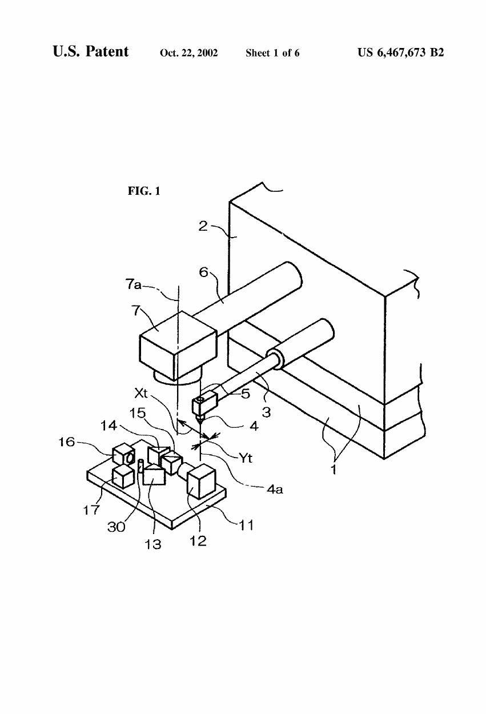
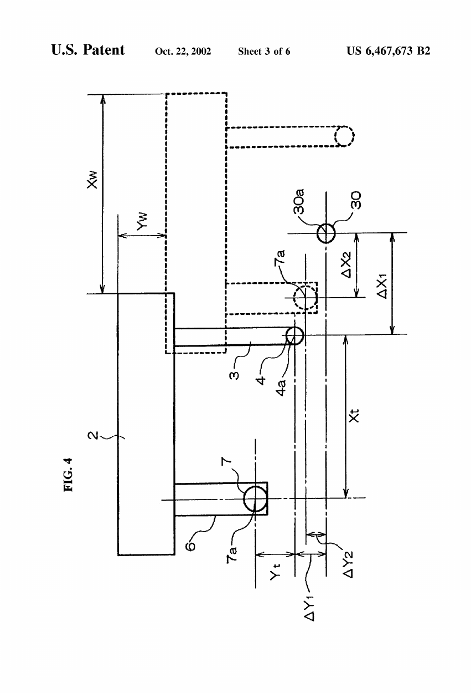
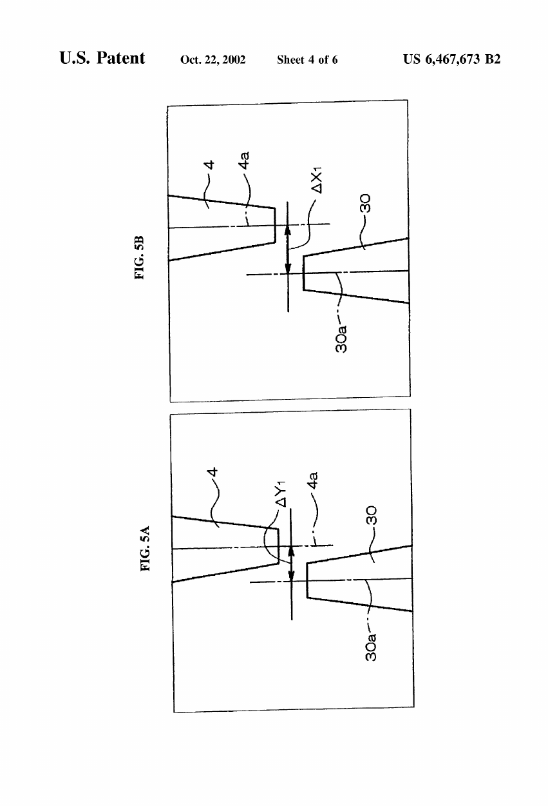

# US6467673B2 번역: 본딩 장치와 본딩 방법

- 원제: Bonding apparatus and bonding method
- 원문: 같은 폴더의 `US6467673B2.pdf` (등록 공보, 14쪽, 도면 6장, 청구항 9)
- 번역 범위: 전문. 서지, 초록, 발명의 배경, 발명의 요약, 도면의 간단한 설명, 상세한 설명, 청구항 1~9. 인용 문헌 목록은 원문 그대로 둔다.
- 번역 원본 텍스트: `pdftotext -layout`으로 뽑은 본문은 두 단이 섞이고 OCR 오류가 있다(예: "Sin", "AX"). 같은 내용인 Google Patents 공개 본문(https://patents.google.com/patent/US6467673B2/en, 2026-11-04 확인)과 대조해 번역했다.
- 도면 부호(4, 7, 30 등)는 원문 부호를 그대로 둔다.
- 번역 2026-11-04.

## 서지

| 항목 | 내용 |
|---|---|
| 공보 | US 6,467,673 B2 (등록 2002-10-22) |
| 출원 | US 09/750,841, 2000-12-28 출원 |
| 공개 | US 2001/0016062 A1 (2001-08-23) |
| 우선권 | 일본 특허출원 11-375077 (1999-12-28) |
| 출원인, 권리자 | Kabushiki Kaisha Shinkawa (주식회사 신카와), 도쿄 |
| 발명자 | Satoshi Enokido (하치오지), Ryuichi Kyomasu (고다이라), Shigeru Hayata (다치카와), Toshiaki Sasano (사가미하라). 모두 일본 |
| 존속기간 | 35 U.S.C. 154(b)에 따라 96일 연장. 존속기간 포기(terminal disclaimer) 대상 |
| 국제 분류 | H01L 21/607 |
| 미국 분류 | 228/105; 228/180.5; 228/1.1; 228/9 |
| 검색 분야 | 228/105, 103, 4.5, 9, 10, 11, 1.1, 110.1, 180.5 |
| 심사관 | M. Alexandra Elve (주심), Len Tran (보조) |
| 대리인 | Koda & Androlia |
| 규모 | 청구항 9, 도면 6장 |

인용 문헌 (원문 그대로)

```
U.S. PATENT DOCUMENTS
4,671,446 A    6/1987 Sherman ............ 228/105
5,516,023 A    5/1996 Kono ............... 228/105
5,702,049 A * 12/1997 Biggs et al. ....... 228/105
5,803,341 A    9/1998 Abe ................ 228/102
6,337,480 B1   1/2002 Andrien et al. ..... 250/281
FOREIGN PATENT DOCUMENTS
JP 2982000 9/1999
* cited by examiner
```

## 초록

와이어 본딩 방법과 장치다.
본딩 툴의 축 중심을 기준 부재 가까이 가져가고, 발광 다이오드를 차례로 켠다.
그러면 오프셋 보정 카메라가 기준 부재와 본딩 툴의 X 방향 영상과 Y 방향 영상을 얻는다.
이렇게 본딩 툴과 기준 부재 사이의 어긋남 양을 잰다.
다음으로 위치 검출 카메라를 기준 부재 가까이 가져가고, 위치 검출 카메라의 광축과 기준 부재 사이의 어긋남 양을 위치 검출 카메라로 잰다.
이 측정값들과 이동량으로 정확한 오프셋 양을 정한다.

## 발명의 배경

### 1. 발명의 분야

이 발명은 본딩 장치와 본딩 방법에 관한 것이다.
더 구체적으로는, 툴과 본딩 위치를 검출하는 위치 검출 카메라처럼 두 처리 부재 사이의 오프셋 양을 정확하게 계산하는 장치와 방법에 관한 것이다.

### 2. 종래 기술

아래에서는 와이어 본딩 장치를 예로 설명한다.
XY 테이블 위에 본딩 헤드가 실려 있다.
본딩 헤드에는 반도체 소자 위 본딩 점의 위치를 검출하는 위치 검출 카메라와, 한쪽 끝에 본딩하는 툴이 달린 본딩 암이 설치된다.
위치 검출 카메라가 본딩 점의 위치를 검출할 때 툴과 본딩 암이 카메라 시야를 가리지 않도록, 카메라의 광축과 툴의 축 중심을 일정 거리만큼 떨어뜨려 본딩 헤드에 붙인다.
일반적으로 위치 검출 카메라의 광축과 툴의 축 중심 사이 거리를 이 두 부품의 "오프셋"이라고 부른다.

위치 검출 카메라는 툴을 어디로 옮길지 정하는 데 쓰는 기준점을 정한다.
그래서 위치 검출 카메라가 툴에서 얼마나 떨어져 있는지 아는 것이 매우 중요하다.
그런데 고온의 본딩 스테이지에서 나오는 복사열 때문에 카메라 홀더와 본딩 암이 열팽창한다.
그 결과 실제 오프셋 양은 시시각각 바뀐다.
따라서 본딩 작업을 시작할 때와 본딩 작업 중 알맞은 시점에 오프셋 양을 교정해야 한다.

이를 위해 이 출원의 출원인이 가진 일본 특허 2982000호의 본딩 방법과 장치는 다음과 같이 한다.

- 기준 부재를 정해진 위치에 둔다.
- 위치 검출 카메라를 기준 부재의 기준부 위로 옮기고, 기준부와 위치 검출 카메라 광축 사이의 위치 관계를 잰다.
- 미리 메모리에 저장한 오프셋 양에 따라 툴을 기준부 위로 옮기고, 기준부와 툴 사이의 위치 관계를 오프셋 보정 카메라로 잰다.
- 미리 메모리에 저장한 오프셋 양을 보정해 정확한 오프셋 양을 정한다.

이 구조에서는 기준 부재를 써서 위치 검출 카메라와 툴 사이 오프셋 양을 좋은 정밀도로 정할 수 있다.

이 구조에서는 기준 부재의 한 예로 거의 원기둥 모양인 돌기를 쓴다.
기준 부재와 툴을 서로 마주 보게 한 상태에서, 오프셋 보정 카메라로 옆에서 두 부품을 잰다.
그런데 기준 부재와 툴 사이 어긋남은 X 방향뿐 아니라 Y 방향 성분도 있다.
그래서 이런 돌기 모양 기준 부재를 쓰려면 X 방향 영상과 Y 방향 영상을 재는 오프셋 보정 카메라 두 대가 필요하다.
그 결과 설치 공간이 커지고 장치가 커진다.

## 발명의 요약

이 발명은 위 문제를 풀기 위한 것이다.

이 발명의 목적은 돌기 모양 기준 부재를 쓰는 경우에도 오프셋 보정 카메라를 여러 대 쓰지 않아도 되는 장치와 방법을 주는 것이다.
(역주: 원문은 "requires no offset correction cameras"라고 적었지만, 문맥상 "두 대의 카메라가 필요 없다"는 뜻이다.)

위 목적은 본딩 장치에 대한 첫째 고유 구조로 이룬다. 이 구조는 다음을 갖춘다.

- 본딩 장치 안의 정해진 위치에 놓인 기준 부재
- 기준 부재를 검출하는 단일 영상 검출 부재
- 영상을 영상 검출 부재로 이끄는 광학 부재. 이 영상은 가공 대상을 처리하는 처리 부재와 기준 부재의 영상이며, 서로 다른 여러 방향에서 얻는다.
- 연산 처리 장치. 서로 다른 여러 방향에서 얻어 영상 검출 부재가 찍은 처리 부재와 기준 부재의 영상을 바탕으로, 처리 부재와 기준 부재의 위치 좌표를 계산한다.

위 구조에서 광학 부재는 여러 방향에서 얻은 처리 부재와 기준 부재의 영상을 영상 검출 부재로 이끈다.
그 결과 돌기 모양 기준 부재를 쓰더라도 영상 검출 부재를 두 개 쓸 필요가 없다.
이 명세서의 아래 설명에서 "처리 부재"는 반도체 소자에 물리적 가공을 하는 작업 헤드뿐 아니라 카메라 같은 검출 부재도 포함한다.

위 목적은 둘째 고유 구조로도 이룬다. 이 본딩 장치에서는 제1 처리 부재와 제2 처리 부재가 서로 오프셋되게 설치되고, 장치는 다음을 갖춘다.

- 정해진 위치에 놓인 기준 부재
- 오프셋 보정에 쓰는 단일 영상 검출 부재. 기준 부재를 검출한다.
- 제1 처리 부재나 제2 처리 부재, 또는 둘 다의 영상과 기준 부재의 영상을 오프셋 보정용 영상 검출 부재로 이끄는 광학 부재. 영상은 서로 다른 여러 방향에서 얻는다.
- 다음 (a), (b), (c)를 바탕으로 정확한 오프셋 양을 정하는 연산 제어 장치
  - (a) 제1 자세에서 처리 부재 하나와 기준 부재 사이 위치 관계를 잰 측정값. 제1 자세는 제1 처리 부재나 제2 처리 부재를 기준 부재에 가까이 가져간 자세다.
  - (b) 제2 자세에서 다른 처리 부재와 기준 부재의 영상을 오프셋 보정용 영상 검출 부재로 잰 측정값. 제2 자세는 다른 처리 부재를 기준 부재에 가까이 가져간 자세다. 영상은 여러 방향에서 얻고 광학 부재가 오프셋 보정용 영상 검출 부재로 이끈다.
  - (c) 제1 자세와 제2 자세 사이 제1, 제2 처리 부재의 이동량

둘째 구조에서 연산 제어 장치는 (a), (b), (c)를 바탕으로 정확한 오프셋 양을 정한다.
처리 부재와 기준 부재의 영상을 여러 방향에서 얻어 광학 부재가 오프셋 보정용 영상 검출 부재로 이끌므로, 영상 검출 부재 두 개를 쓰지 않아도 된다.

위 목적은 셋째 고유 구조로도 이룬다. 이 본딩 장치는 다음을 갖춘다.

- 본딩 대상의 위치를 검출하는 위치 검출용 영상 검출 부재
- 위치 검출용 영상 검출 부재에 대해 오프셋되게 설치된 본딩 툴
- 정해진 위치에 놓인 기준 부재
- 기준 부재를 검출하는 오프셋 보정용 단일 영상 검출 부재
- 본딩 툴과 기준 부재의 영상을 오프셋 보정용 영상 검출 부재로 이끄는 광학 부재. 영상은 서로 다른 여러 방향에서 얻는다.
- 다음 (a), (b), (c)를 바탕으로 정확한 오프셋 양을 정하는 연산 제어 장치
  - (a) 위치 검출용 영상 검출 부재와 기준 부재 사이 위치 관계를 잰 측정값. 이때 위치 검출용 영상 검출 부재는 기준 부재에 가까이 간 제1 자세에 있다.
  - (b) 본딩 툴과 기준 부재의 영상을 오프셋 보정용 영상 검출 부재로 잰 측정값. 이때 본딩 툴은 기준 부재에 가까이 간 제2 자세에 있다. 영상은 여러 방향에서 얻고 광학 부재가 오프셋 보정용 영상 검출 부재로 이끈다.
  - (c) 제1 자세와 제2 자세 사이 위치 검출용 영상 검출 부재와 본딩 툴의 이동량

셋째 구조에서는 처리 부재 하나가 위치 검출용 영상 검출 부재이고, 다른 하나가 툴이다.
위치 검출용 영상 검출 부재와 기준 부재 사이 정확한 오프셋 양은 앞 구조와 같은 절차로 정한다.
셋째 구조는 첫째, 둘째 구조와 같은 장점이 있다.
여기에 더해, 위치 검출용 영상 검출 부재와 기준 부재 사이 위치 관계를 위치 검출용 영상 검출 부재 자신으로 잰다.
그래서 반도체 소자 위 본딩 점의 위치를 검출하는 데 쓰는 그 카메라를 오프셋 양 계산에도 쓸 수 있다.

위 목적은 넷째 고유 구조로도 이룬다. 이 본딩 장치는 다음을 갖춘다.

- 정해진 위치에 놓인 기준 부재
- 기준 부재를 검출하는 오프셋 보정용 단일 영상 검출 부재
- 본딩 툴과 기준 부재의 영상을 오프셋 보정용 영상 검출 부재로 이끄는 광학 부재. 영상은 서로 다른 여러 방향에서 얻는다.
- 광학 부재는 다음으로 이뤄진다.
  - 툴과 기준 부재의 영상을 반사해 오프셋 보정용 영상 검출 부재로 이끄는 제1 반사체
  - 제1 반사체와 다른 위치에 설치되고, 툴과 기준 부재의 영상을 반사해 오프셋 보정용 영상 검출 부재로 이끄는 제2 반사체

위 구조에서는 툴과 기준 부재의 영상이 제1 반사체에서 반사되어 오프셋 보정용 영상 검출 부재로 가고, 다른 위치의 제2 반사체에서도 반사되어 같은 검출 부재로 간다.
그 결과 여러 방향의 영상을 오프셋 보정용 영상 검출 부재로 이끌 수 있다.

넷째 구조에서 광학 부재는 다음처럼 구성할 수도 있다.

- 툴과 기준 부재의 영상을 반사해 오프셋 보정용 영상 검출 부재로 이끄는 제1 반사체
- 제1 반사체와 오프셋 보정용 영상 검출 부재 사이 광로에 설치한 하프 미러
- 툴과 기준 부재의 영상을 반사해 하프 미러로 이끄는 제2 반사체

그러면 제2 반사체에서 온 영상은 하프 미러에서 반사되어 오프셋 보정용 영상 검출 부재로 간다.

이 구조에서 툴과 기준 부재의 영상은 한편으로 제1 반사체에서 반사되고 하프 미러를 지나 검출 부재로 간다.
다른 한편으로 제2 반사체에서 반사되고 하프 미러에서 반사되어 검출 부재로 간다.
따라서 여러 방향의 영상을 오프셋 보정용 영상 검출 부재로 이끌 수 있다.
또 각 반사체에서 온 영상이 검출 부재에 들어가는 입사각을 서로 같게 설계할 수 있어, 영상 처리가 쉬워진다.

이 구조에 영상 전환 수단을 더 둘 수 있다.
영상 전환 수단은 제1 반사체의 영상이나 제2 반사체의 영상을 골라서 오프셋 보정용 영상 검출 부재로 이끈다.

그러면 각 반사체의 영상을 골라서 이끌 수 있으므로 두 영상을 쉽게 구분할 수 있다.
그 결과 영상 처리가 더 쉬워진다.

또 이 구조에서 영상 전환 수단은 다음으로 이룰 수 있다.

- 툴과 기준 부재의 영상을 제1 반사체에 공급하는 제1 광원
- 툴과 기준 부재의 영상을 제2 반사체에 공급하는 제2 광원
- 제1 광원이나 제2 광원의 밝기 비를 바꾸는 밝기 비 변경 수단

이 구조에서는 밝기 비 변경 수단으로 제1 광원이나 제2 광원의 밝기 비를 바꿔, 각 반사체의 영상을 쉽게 전환할 수 있다.

또 이 구조에서 영상 전환 수단은 차폐율 변경 수단으로 이룰 수 있다. 차폐율 변경 수단은 다음 두 광로의 차폐율을 바꾼다.

- 툴과 기준 부재에서 제1 반사체를 거쳐 하프 미러로 가는 제1 광로
- 툴과 기준 부재에서 제2 반사체를 거쳐 하프 미러로 가는 제2 광로

이 구조에서는 차폐율 변경 수단으로 제1 광로나 제2 광로의 차폐율을 바꿔, 각 반사체의 영상을 쉽게 전환할 수 있다.

위 목적은 이 발명의 와이어 본딩 방법의 고유 단계로도 이룬다.
이 방법은 본딩 대상의 위치를 검출하는 위치 검출용 영상 검출 부재, 위치 검출용 영상 검출 부재에 대해 오프셋되게 설치된 본딩 툴, 정해진 위치에 놓인 기준 부재를 쓴다. 고유 단계는 다음과 같다.

- 위치 검출용 영상 검출 부재로, 위치 검출용 영상 검출 부재와 기준 부재 사이 위치 관계를 잰다. 이때 위치 검출용 영상 검출 부재는 기준 부재에 가까이 간 제1 자세에 있다.
- 툴과 기준 부재의 영상을 이끌어, 오프셋 보정용 영상 검출 부재로 툴과 기준 부재 사이 위치 관계를 잰다. 이때 본딩 툴은 기준 부재에 가까이 간 제2 자세에 있고, 영상은 서로 다른 여러 방향에서 얻는다.
- 측정 결과와, 제1 자세와 제2 자세 사이 위치 검출용 영상 검출 부재와 툴의 이동량을 바탕으로 정확한 오프셋 양을 정한다.

이 방법으로 앞에서 설명한 셋째 구조와 같은 효과를 얻는다.

## 도면의 간단한 설명

- 도 1은 이 발명의 한 실시예에 따른 본딩 장치의 주요 요소를 보인 사시도다.
- 도 2는 기준 부재, 오프셋 보정 카메라, 관련 광학계를 보인 평면도다.
- 도 3은 제어계 구조의 블록도다.
- 도 4는 오프셋 보정 때 툴, 위치 검출 카메라, 기준 부재의 배치를 보인 평면도다.
- 도 5A와 5B는 툴을 기준 부재에 가까이 가져간 자세에서 얻은 영상을 보인 설명도다.
- 도 6은 이 발명의 구조 변형을 보인 평면도다.
- 도 7은 오프셋 보정 때 툴을 기준 부재에 가까이 가져간 자세에서 얻은 영상을 보인 설명도다(도 6의 변형).

## 발명의 상세한 설명

아래에서 첨부 도면을 참조해 이 발명의 실시예를 설명한다. 도 1은 이 발명의 첫째 실시예를 보인다.



*도 1. 본딩 장치의 주요 요소 사시도 (공보 도면 1/6쪽).*

도 1처럼, XY 테이블(1)에 실린 본딩 헤드(2) 위에 본딩 암(3)이 위아래로 움직일 수 있게 설치된다.
본딩 암(3)은 수직 구동 수단(그림에 없음)으로 위아래로 움직인다.
본딩 암(3) 끝에 툴(4)이 달리고, 와이어(5)가 툴(4)을 지난다.
또 카메라 홀더(6)가 본딩 헤드(2)에 고정되고, 카메라 홀더(6) 끝에 위치 검출 카메라(7)가 고정된다.
위치 검출 카메라(7)는 전하결합소자(CCD)를 갖춘 광전 변환형 영상 검출 부재다.
위치 검출 카메라(7)의 광축(7a)과 툴(4)의 축 중심(4a)은 둘 다 수직 아래를 향한다.
광축(7a)과 축 중심(4a)은 X 방향과 Y 방향으로 오프셋 양 Xt, Yt만큼 떨어져 있다.
XY 테이블(1)은 그 근처에 설치된 펄스 모터 두 개(그림에 없음)로 X 방향과 Y 방향으로 정확하게 움직일 수 있다.
여기까지는 널리 알려진 구조다.

반도체 소자를 놓고 싣는 본딩 스테이지(그림에 없음) 근처에 기준부 지지대(11)를 설치한다.
지지대(11)에는 기준 부재(30)와 오프셋 보정 카메라(12) 등이 실린다.
지지대(11) 위에는 프리즘(13, 14), 하프 미러(15), 조명 광원인 발광 다이오드(16, 17)를 둔다.

도 2처럼 프리즘(13)은 기준 부재(30)의 오른쪽(도 2 기준)에, 프리즘(14)은 기준 부재(30)의 위쪽(도 2 기준)에 설치한다.
발광 다이오드(16)는 기준 부재(30)를 사이에 두고 프리즘(13)의 반대쪽에, 발광 다이오드(17)는 기준 부재(30)를 사이에 두고 프리즘(14)의 반대쪽에 설치한다.
하프 미러(15)는 프리즘(14)과 오프셋 보정 카메라(12) 사이 광로에 설치한다.

프리즘(13, 14)의 반사면과 하프 미러(15)의 반사면은 서로 평행하다.
모든 반사면은 X 방향(발광 다이오드 16과 프리즘 13을 잇는 방향)과 45도로 만난다.
따라서 발광 다이오드(17)의 빛은 프리즘(14)에서 반사되고 하프 미러(15)를 지나 오프셋 보정 카메라(12)로 간다.
발광 다이오드(16)의 빛은 프리즘(13)에서 반사되고 하프 미러(15)의 반사면에서 반사되어 오프셋 보정 카메라(12)로 간다.
오프셋 보정 카메라(12)는 CCD를 갖춘 광전 변환형 영상 검출 부재이고, 렌즈(19)가 있다.
프리즘(13, 14) 대신 거울 같은 경면체를 쓸 수도 있다.

도 3처럼 XY 테이블(1)은 연산 제어 장치(20)의 명령으로 XY 테이블 제어 장치(21)를 거쳐 구동된다.
위치 검출 카메라(7)와 오프셋 보정 카메라(12)가 얻은 영상은 전기 신호로 바뀌어 영상 처리 장치(22)에서 처리된다.
정확한 오프셋 양 Xt, Yt는 뒤에서 설명할 방법으로 연산 제어 장치(컴퓨터)가 계산한다.
오프셋 양 Xw, Yw는 메모리(23)에 미리 저장되어 있다.
정확한 오프셋 양 Xt, Yt와 미리 저장한 오프셋 양 Xw, Yw의 차이, 곧 오프셋 보정량을 ΔX, ΔY라고 하면, 셋의 관계는 식 1과 같다.
도 3에서 부호 24는 입출력 장치다.

```
Xt = Xw + ΔX
Yt = Yw + ΔY        (식 1)
```

다음으로 오프셋 양 Xt, Yt를 계산하는 방법을 설명한다.



*도 4. 오프셋 보정 때 툴, 위치 검출 카메라, 기준 부재의 배치 평면도 (공보 도면 3/6쪽). 실선은 툴(4)을 기준 부재(30) 가까이 가져간 자세, 점선은 저장된 오프셋 Xw, Yw만큼 옮겨 위치 검출 카메라(7)를 기준 부재 가까이 가져간 자세다. ΔX1, ΔY1은 툴과 기준 부재의 어긋남, ΔX2, ΔY2는 카메라 광축과 기준 부재의 어긋남이다.*

먼저 도 4의 실선처럼, 연산 처리 장치(20)의 명령으로 XY 테이블 제어 장치(21)를 거쳐 XY 테이블(1)을 구동한다(도 3 참조).
그래서 툴(4)의 축 중심(4a)을 기준 부재(30) 근처에 놓고, 툴(4)을 기준 부재(30)에 거의 닿을 높이까지 내린다.
이때 툴(4)은 오프셋 보정 카메라(12)가 툴(4)과 기준 부재(30)를 찍을 수 있는 자리면 충분하다.
툴(4)의 축 중심(4a)을 기준 부재(30)의 축 중심(30a)에 맞출 필요는 없다.

그다음 오프셋 보정 카메라(12)로 툴(4)과 기준 부재(30)를 함께 찍고, 두 부품의 위치 관계, 곧 ΔX1과 ΔY1을 잰다.

먼저 발광 다이오드(16)를 켜고 발광 다이오드(17)를 끈 상태를 만든다.
그러면 툴(4)과 기준 부재(30)의 영상이 발광 다이오드(16)의 빛에 대한 그림자로서 프리즘(13)의 반사면과 하프 미러(15)에서 반사되어 오프셋 보정 카메라(12)로 간다.
그 결과 오프셋 보정 카메라(12)는 도 5A 같은 영상을 찍는다.
이 영상에 알맞은 영상 처리를 해서, 툴(4)의 축 중심(4a)과 기준 부재(30)의 축 중심(30a) 사이 Y 방향 어긋남 ΔY1을 계산한다.



*도 5A, 5B. 툴(4)을 기준 부재(30) 가까이 가져간 자세에서 얻은 영상 (공보 도면 4/6쪽). 5A는 Y 방향 어긋남 ΔY1, 5B는 X 방향 어긋남 ΔX1을 보인다. 두 영상 모두 툴과 기준 부재가 한 화면에 함께 찍힌다.*

다음으로 발광 다이오드(16)를 끄고 발광 다이오드(17)를 켠 상태를 만든다.
그러면 툴(4)과 기준 부재(30)의 영상이 발광 다이오드(17)의 빛에 대한 그림자로서 프리즘(14)에서 반사되고 하프 미러(15)를 지나 오프셋 보정 카메라(12)로 간다.
그 결과 오프셋 보정 카메라(12)는 도 5B 같은 영상을 찍는다.
이 영상에 알맞은 영상 처리를 해서, 툴(4)의 축 중심(4a)과 기준 부재(30)의 축 중심(30a) 사이 X 방향 어긋남 ΔX1을 계산한다.

툴(4)과 기준 부재(30)의 위치 관계를 나타내는 ΔX1, ΔY1을 잰 뒤, 연산 제어 장치(20)는 메모리(23)에 미리 저장된 오프셋 양 Xw, Yw에 따라 XY 테이블 제어 장치(21)를 거쳐 XY 테이블(1)을 구동한다.
그래서 도 4의 점선처럼 위치 검출 카메라(7)를 기준 부재(30) 근처로 옮긴다.
이때 위치 검출 카메라(7)는 기준 부재(30)를 찍을 수 있는 자리면 충분하다.
위치 검출 카메라(7)의 광축(7a)을 기준 부재(30)의 중심에 맞출 필요는 없다.
이 상태에서 위치 검출 카메라(7)로 기준 부재(30)를 찍고, 이 영상에 알맞은 영상 처리를 해서 기준 부재(30)의 축 중심(30a)과 위치 검출 카메라(7)의 광축(7a) 사이 어긋남 ΔX2, ΔY2를 계산한다.

미리 메모리에 저장한 오프셋 양 Xw, Yw가 정확한 오프셋 양 Xt, Yt와 같다면, 오프셋 보정량 ΔX, ΔY는 0이다.
그러면 ΔX1, ΔY1은 ΔX2, ΔY2와 같아야 한다.
그러나 메모리에 미리 저장한 Xw, Yw가 근삿값인 경우, 또는 카메라 홀더(6)나 본딩 암(3)이 열 영향으로 열팽창해 오프셋 양 Xt, Yt가 바뀐 경우에는 ΔX1, ΔY1이 ΔX2, ΔY2와 같지 않다.
그래서 오차(오프셋 보정량) ΔX, ΔY가 생긴다.
따라서 오프셋 보정량 ΔX, ΔY는 측정값 ΔX1, ΔY1과 측정값 ΔX2, ΔY2로 식 2처럼 계산한다.

```
ΔX = ΔX1 − ΔX2
ΔY = ΔY1 − ΔY2      (식 2)
```

따라서 연산 제어 장치(20)는 식 2로 오프셋 보정량 ΔX, ΔY를 계산한다.
그리고 메모리에 미리 저장한 오프셋 양 Xw, Yw에 ΔX, ΔY를 더해 식 1로 정확한 오프셋 양 Xt, Yt를 계산한다.
그다음 연산 제어 장치(20)는 메모리(23)에 저장된 Xw, Yw를 정확한 오프셋 양 Xt, Yt로 고친다(갱신한다).
이렇게 정한 Xt, Yt를 이후 본딩 작업에서 위치 검출 카메라(7)와 툴(4)의 오프셋 양으로 쓴다.

이처럼 이 실시예에서는 여러 방향에서 얻은 툴(4)과 기준 부재(30)의 영상을 카메라로 이끄는 프리즘(13, 14)과 하프 미러(15)를 설치한다.
그 결과 돌기 모양 기준 부재(30)를 쓰더라도 오프셋 보정 카메라(12) 한 대로 충분하며, 카메라 두 대를 쓸 필요가 없다.

또 이 실시예에서는 위치 검출 카메라(7)와 기준 부재(30)의 위치 관계를 위치 검출 카메라(7) 자신으로 잰다.
그래서 반도체 소자의 본딩 점 위치를 검출하는 데 쓰는 위치 검출 카메라(7)를 오프셋 양 계산에도 쓸 수 있다는 장점이 있다.

또 이 실시예에서는 툴(4)과 기준 부재(30)의 영상이 한편으로 프리즘(14)에서 반사되고 하프 미러(15)를 지나 오프셋 보정 카메라(12)로 가고, 다른 한편으로 프리즘(13)에서 반사되고 하프 미러(15)의 반사면에서 반사되어 오프셋 보정 카메라로 간다.
그래서 여러 방향의 영상을 오프셋 보정 카메라(12)로 이끌 수 있다.
또 프리즘(13, 14)의 반사면과 하프 미러(15)의 반사면을 위처럼 배치하므로, 프리즘(13, 14)에서 온 영상이 오프셋 보정 카메라(12)에 들어가는 입사각이 서로 같다.
그래서 영상 처리를 단순하게 할 수 있다.

또 이 실시예에서는 발광 다이오드(16, 17)를 골라 켜서, 프리즘(14)의 영상(X 방향 어긋남 검출용)과 프리즘(13)의 영상(Y 방향 어긋남 검출용)을 골라 오프셋 보정 카메라(12)로 이끌 수 있다.
그래서 각 프리즘의 영상을 쉽게 구분할 수 있어 영상 처리가 더 단순해진다.
또 위 실시예에서는 발광 다이오드(16, 17)를 조명 광원으로 쓰고 기준 부재(30)를 뒷면 쪽에서 비춘다.
이 구조 대신 오프셋 보정 카메라(12)에 광원을 넣고 기준 부재(30)를 앞면 쪽에서 비출 수도 있다.

또 위 실시예에서는 발광 다이오드(16, 17)를 골라 켠다. 곧 하나를 켜고 다른 하나를 끈다.
그 대신 발광 다이오드(16, 17) 중 하나의 밝기를 올리고 다른 하나의 밝기를 내려 두 발광 다이오드의 밝기 비를 바꿀 수도 있다.
또 발광 다이오드(16, 17)의 빛 파장을 서로 다르게 정하고, 오프셋 보정 카메라(12)가 얻은 영상을 파장별로 나눈 뒤, 나눈 파장별 영상에 영상 처리를 해서 ΔX1, ΔY1을 계산하는 구조도 쓸 수 있다.
이 경우 발광 다이오드(16, 17)를 동시에 켤 수 있다.

또 기계식 셔터나 액정 셔터 등을 기준 부재(30)에서 프리즘(14)을 거쳐 하프 미러(15)로 가는 광로와, 기준 부재(30)에서 프리즘(13)을 거쳐 하프 미러(15)로 가는 광로에 각각 설치해도 같은 효과를 얻는다.
이 셔터로 프리즘(13, 14)의 영상을 골라서, 또는 차폐 정도(또는 투과율)를 달리해서 오프셋 보정 카메라(12)로 이끈다.
이 경우 셔터의 차폐 정도 변경과 동기를 맞춰 오프셋 보정 카메라(12)가 찍은 영상을 나누면, 프리즘(13, 14)의 영상을 서로 분리할 수 있다.

또 위에서는 툴(4)과 기준 부재(30)의 어긋남을 두 부품을 90도 각도 차이로 본 영상으로 잰다.
그러나 두 방향의 상대 각도가 꼭 90도일 필요는 없다.
또 서로 다른 각도에서 얻은 두 종류의 영상을 하프 미러(15)를 거쳐 오프셋 보정 카메라(12)로 이끈다.
그러나 하프 미러를 거치지 않고 오프셋 보정 카메라(12)로 이끌 수도 있다.

(역주: 아래 문단은 도 6의 변형을 설명한다. 원문은 도 6을 직접 가리키는 문장 없이 "More specifically"로 시작한다. 도 6과 도 7은 이 번역에 그림으로 넣지 않았다. 원문 PDF 5, 6쪽에 있다.)

더 구체적으로는, 거울(33, 34)을 서로 직각이 아닌 방향으로 설치한다.
XY 테이블 좌표축 기준으로 X 방향에서 본 기준 부재(30)의 투영 영상은 거울(33)을 거쳐 오프셋 보정 카메라(32)로 간다.
Y 방향에서 본 기준 부재(30)의 투영 영상은 거울(34)을 거쳐 같은 오프셋 보정 카메라(32)로 간다.
기준 부재(30)를 비추는 발광 다이오드(36)는 오프셋 보정 카메라(32) 근처에 설치한다.

이 경우 오프셋 보정 카메라(32)가 찍은 영상은 도 7과 같다.
도 7의 왼쪽에는 툴(4)의 반사 영상(4c)과 기준 부재(30)의 반사 영상(30c)이, 오른쪽에는 툴(4)의 반사 영상(4d)과 기준 부재(30)의 반사 영상(30d)이 찍힌다.
이 영상들에 알맞은 영상 처리를 해서 툴(4)과 기준 부재(30)의 어긋남 ΔX1, ΔY1을 정한다.
또 이 영상들에서는 거울(33, 34)이 이루는 각에 따라 비직교 좌표계가 생기므로, 측정값을 그 각에 맞춰 삼각함수로 처리한다.

또 위 실시예에서는 툴(4)과 기준 부재(30)의 위치 관계를 잰 뒤 툴을 옮겨 위치 검출 카메라(7)와 기준 부재(30)의 위치 관계를 잰다.
그러나 두 측정은 반대 순서로 해도 된다.
또 이 발명의 처리 부재는 위치 검출 카메라(7)와 툴(4)이다.
그러나 이 발명의 처리 부재는 이 조합에 한정되지 않는다. 이 발명은 카메라 두 대 사이, 또는 작업 헤드 두 개 사이의 오프셋 양을 재는 데에도 쓸 수 있다.

또 위 실시예에서는 광학 부재로 프리즘(13, 14)과 하프 미러(15), 또는 거울(33, 34)을 쓴다.
그러나 이 발명의 광학 부재는 여러 방향에서 얻은 영상을 영상 검출 부재로 이끌 수 있는 구조면 무엇이든 된다.
예를 들어 기준 부재(30)를 서로 다른 각도로 마주 보게 설치한 광섬유를 쓸 수도 있다.
또 위 실시예에서는 영상 검출 부재로 카메라를 쓴다.
그러나 이 발명의 영상 검출 부재는 영상을 검출할 수 있는 구조면 무엇이든 된다. 예를 들어 라인 센서를 쓸 수도 있다.

또 위에서는 와이어 본딩 장치를 예로 이 발명을 설명했다.
그러나 이 발명은 다이 본딩 장치, 테이프 본딩 장치, 플립칩 본딩 장치 같은 여러 다른 본딩 장치에도 쓸 수 있음은 말할 필요도 없다.

## 청구항

청구하는 바는 다음과 같다.

**1.** 본딩 장치로서,
- 상기 본딩 장치 안의 정해진 위치에 놓인 기준 부재,
- 상기 기준 부재를 검출하는 단일 영상 검출 부재,
- 영상을 상기 영상 검출 부재로 이끄는 광학 부재로서, 상기 영상은 가공 대상을 처리하는 처리 부재와 상기 기준 부재의 영상이며 서로 다른 여러 방향에서 얻는 광학 부재, 그리고
- 상기 여러 방향에서 얻어 상기 영상 검출 부재가 찍은 상기 처리 부재와 상기 기준 부재의 영상을 바탕으로, 상기 처리 부재와 상기 기준 부재의 위치 좌표를 계산하는 연산 처리 장치를 포함하는 본딩 장치.

**2.** 제1 처리 부재와 제2 처리 부재가 서로 오프셋되게 설치된 본딩 장치로서,
- 정해진 위치에 놓인 기준 부재,
- 상기 기준 부재를 검출하는, 오프셋 보정에 쓰는 단일 영상 검출 부재,
- 상기 제1 처리 부재나 제2 처리 부재 또는 둘 다의 영상과 상기 기준 부재의 영상을 상기 오프셋 보정용 영상 검출 부재로 이끄는 광학 부재로서, 상기 영상은 서로 다른 여러 방향에서 얻는 광학 부재, 그리고
- 다음을 바탕으로 정확한 오프셋 양을 정하는 연산 제어 장치를 포함하는 본딩 장치:
  - (a) 상기 처리 부재 하나와 상기 기준 부재 사이 위치 관계를 잰 측정값. 상기 처리 부재는 상기 제1, 제2 처리 부재이며, 상기 제1 또는 제2 처리 부재를 상기 기준 부재에 가까이 가져간 제1 자세에 있다,
  - (b) 상기 처리 부재 중 다른 하나와 상기 기준 부재의 영상을 상기 오프셋 보정용 영상 검출 부재로 잰 측정값. 상기 처리 부재는 상기 제1, 제2 처리 부재이며, 상기 다른 처리 부재를 상기 기준 부재에 가까이 가져간 제2 자세에 있다. 상기 영상은 서로 다른 여러 방향에서 얻고 상기 광학 부재가 상기 오프셋 보정용 영상 검출 부재로 이끈다, 그리고
  - (c) 상기 제1 자세와 상기 제2 자세 사이 상기 제1, 제2 처리 부재의 이동량.

**3.** 본딩 장치로서,
- 본딩 대상의 위치를 검출하는 위치 검출용 영상 검출 부재,
- 상기 위치 검출용 영상 검출 부재에 대해 오프셋되게 설치된 본딩 툴,
- 정해진 위치에 놓인 기준 부재,
- 상기 기준 부재를 검출하는, 오프셋 보정에 쓰는 단일 영상 검출 부재,
- 상기 본딩 툴과 상기 기준 부재의 영상을 상기 오프셋 보정용 영상 검출 부재로 이끄는 광학 부재로서, 상기 영상은 서로 다른 여러 방향에서 얻는 광학 부재, 그리고
- 다음을 바탕으로 정확한 오프셋 양을 정하는 연산 제어 장치를 포함하는 본딩 장치:
  - (a) 상기 위치 검출용 영상 검출 부재와 상기 기준 부재 사이 위치 관계를 잰 측정값. 상기 위치 검출용 영상 검출 부재는 상기 기준 부재에 가까이 간 제1 자세에 있다,
  - (b) 상기 본딩 툴과 상기 기준 부재의 영상을 상기 오프셋 보정용 영상 검출 부재로 잰 측정값. 상기 본딩 툴은 상기 기준 부재에 가까이 간 제2 자세에 있다. 상기 영상은 서로 다른 여러 방향에서 얻고 상기 광학 부재가 상기 오프셋 보정용 영상 검출 부재로 이끈다, 그리고
  - (c) 상기 제1 자세와 상기 제2 자세 사이 상기 위치 검출용 영상 검출 부재와 상기 본딩 툴의 이동량.

**4.** 본딩 장치로서,
- 정해진 위치에 놓인 기준 부재,
- 상기 기준 부재를 검출하는, 오프셋 보정에 쓰는 단일 영상 검출 부재,
- 본딩 툴과 상기 기준 부재의 영상을 상기 오프셋 보정용 영상 검출 부재로 이끄는 광학 부재로서, 상기 영상은 서로 다른 여러 방향에서 얻는 광학 부재를 포함하고,
- 상기 광학 부재는
  - 상기 툴과 상기 기준 부재의 영상을 반사해 상기 오프셋 보정용 영상 검출 부재로 이끄는 제1 반사체, 그리고
  - 상기 제1 반사체와 다른 위치에 설치되고, 상기 툴과 상기 기준 부재의 영상을 반사해 상기 오프셋 보정용 영상 검출 부재로 이끄는 제2 반사체를 포함하는 본딩 장치.

**5.** 본딩 장치로서,
- 정해진 위치에 놓인 기준 부재,
- 상기 기준 부재를 검출하는, 오프셋 보정에 쓰는 단일 영상 검출 부재,
- 본딩 툴과 상기 기준 부재의 영상을 상기 오프셋 보정용 영상 검출 부재로 이끄는 광학 부재로서, 상기 영상은 서로 다른 여러 방향에서 얻는 광학 부재를 포함하고,
- 상기 광학 부재는
  - 상기 툴과 상기 기준 부재의 영상을 반사해 상기 오프셋 보정용 영상 검출 부재로 이끄는 제1 반사체,
  - 상기 제1 반사체와 상기 오프셋 보정용 영상 검출 부재 사이 광로에 설치한 하프 미러, 그리고
  - 상기 툴과 상기 기준 부재의 영상을 반사해 상기 하프 미러로 이끄는 제2 반사체를 포함하며,
- 상기 제2 반사체에서 온 영상은 상기 하프 미러에서 반사되어 상기 오프셋 보정용 영상 검출 부재로 가는 본딩 장치.

**6.** 청구항 5에 있어서, 상기 제1 반사체의 영상이나 상기 제2 반사체의 영상을 골라 상기 오프셋 보정용 영상 검출 부재로 이끄는 영상 전환 수단을 더 포함하는 본딩 장치.

**7.** 청구항 6에 있어서, 상기 영상 전환 수단은
- 상기 툴과 상기 기준 부재의 영상을 상기 제1 반사체에 공급하는 제1 광원,
- 상기 툴과 상기 기준 부재의 영상을 상기 제2 반사체에 공급하는 제2 광원, 그리고
- 상기 제1 또는 제2 광원의 밝기 비를 바꾸는 밝기 비 변경 수단을 포함하는 본딩 장치.

**8.** 청구항 6에 있어서, 상기 영상 전환 수단은 다음의 차폐율을 바꾸는 차폐율 변경 수단을 포함하는 본딩 장치:
- 상기 툴과 상기 기준 부재에서 상기 제1 반사체를 거쳐 상기 하프 미러로 가는 제1 광로의 차폐율, 그리고
- 상기 툴과 상기 기준 부재에서 상기 제2 반사체를 거쳐 상기 하프 미러로 가는 제2 광로(의 차폐율).

**9.** 본딩 방법으로서, 이 방법은
- 본딩 대상의 위치를 검출하는 위치 검출용 영상 검출 부재,
- 상기 위치 검출용 영상 검출 부재에 대해 오프셋되게 설치된 본딩 툴, 그리고
- 정해진 위치에 놓인 기준 부재를 쓰며,
다음 단계를 포함한다.
- 상기 위치 검출용 영상 검출 부재로 상기 위치 검출용 영상 검출 부재와 상기 기준 부재 사이 위치 관계를 재는 단계. 상기 위치 검출용 영상 검출 부재는 상기 기준 부재에 가까이 간 제1 자세에 있다,
- 상기 툴과 상기 기준 부재의 영상을 이끌어, 오프셋 보정용 영상 검출 부재로 상기 툴과 상기 기준 부재 사이 위치 관계를 재는 단계. 상기 본딩 툴은 상기 기준 부재에 가까이 간 제2 자세에 있고, 영상은 서로 다른 여러 방향에서 얻는다, 그리고
- 측정 결과와, 상기 제1 자세와 상기 제2 자세 사이 상기 위치 검출용 영상 검출 부재와 상기 툴의 이동량을 바탕으로 정확한 오프셋 양을 정하는 단계.
