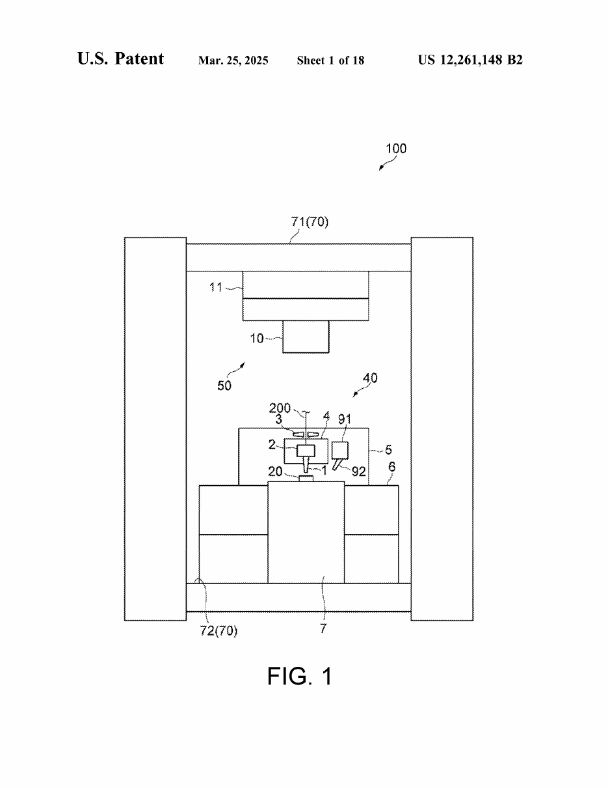
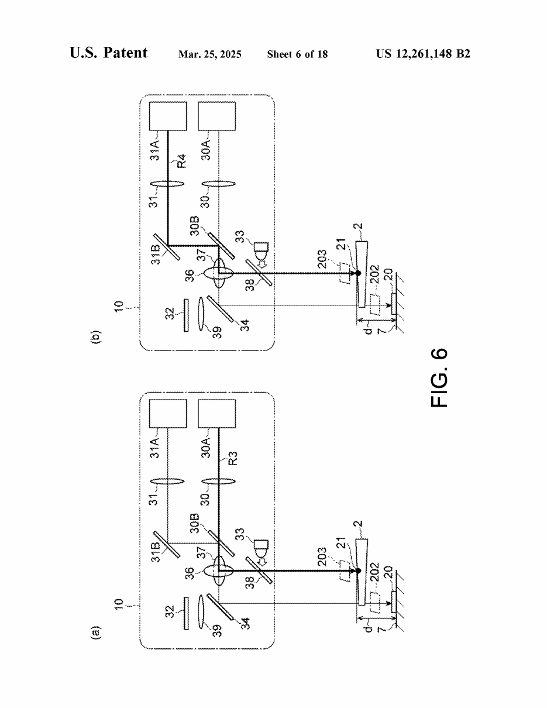
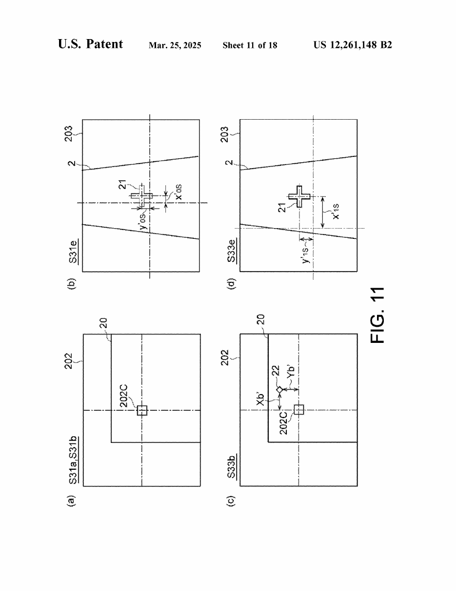

# US 12,261,148 B2 와이어 본딩 장치 (번역)

번역 범위: 전문 (요약, 명세서 본문, 도면 설명, 청구항 17개).
원문: 같은 폴더의 `US12261148B2.pdf` (USPTO 등록 공보, 31쪽, 이미지 PDF).
본문 텍스트: 공보가 글자 없는 이미지 PDF라서 pdftotext로 글자가 나오지 않았다. 그래서 Google Patents 페이지(https://patents.google.com/patent/US12261148B2/en)의 본문 텍스트를 번역했다. 도면은 공보 PDF 쪽을 이미지로 바꿔 넣었다.
번역 날짜: 2026-11-04.

- 출원인/권리자: Shinkawa Ltd. (주식회사 신카와)
- 발명자: Shigeru Hayata (Google Patents 표기)
- 국제출원: PCT/JP2021/020814, 2021-06-01 출원
- 우선권: 일본 특허출원 2020-098350, 2020-06-05
- 공개: US 2023/0178510 A1
- 등록: US 12,261,148 B2, 2025-03-25

---

## 요약 (Abstract)

와이어 본딩 장치는 다음을 갖춘다.

- 반도체 칩을 올려놓는 본딩 스테이지
- 와이어 본딩 유닛. 이 유닛은 본딩 와이어를 반도체 칩에 붙이는 캐필러리, 캐필러리를 위아래로 왕복시키는 Z축 구동부, 캐필러리와 Z축 구동부를 왕복 방향과 교차하는 2차원 평면을 따라 움직이는 툴 XY 스테이지를 포함한다.
- 베이스. 베이스에는 광학계와, 광학계를 왕복 방향과 교차하는 2차원 평면을 따라 움직이는 광학계 XY 스테이지가 있고, 와이어 본딩 유닛이 붙어 있다.

와이어 본딩 유닛은 베이스의 제1 부분에 붙고, 광학계 XY 스테이지는 제1 부분과 떨어진 베이스의 제2 부분에 붙는다.

---

## 관련 출원

이 출원은 국제출원 PCT/JP2021/020814(2021년 6월 1일 출원)의 371 출원이다. 그 국제출원은 일본 특허출원 2020-098350(2020년 6월 5일 출원)의 우선권을 주장한다. 위 특허출원들의 전체 내용은 참조로 이 명세서에 포함된다.

## 기술 분야

본 발명은 와이어 본딩 장치에 관한 것이다.

## 배경 기술

특허문헌 1과 2는 와이어 본딩 장치를 개시한다. 와이어 본딩 장치는 캐필러리로 본딩 와이어를 기판이나 반도체 칩의 원하는 위치에 붙인다. 캐필러리를 본딩 위치로 정확히 옮기기 위해, 예를 들어 영상 처리에 기반한 위치 제어를 한다.

## 인용 목록

특허문헌

- 특허문헌 1: Japanese Patent Laid-Open No. H08-306732
- 특허문헌 2: Japanese Patent Laid-Open No. H10-242191

## 발명의 요약

### 해결하려는 과제

와이어 본딩 분야에서는 본딩 와이어를 대상에 확실히 붙이는 것이 바람직하다. 접합부의 성질인 본딩성(bondability)은 본딩 작업 중 여러 요인의 영향을 받는다. 예를 들어 본딩 작업 중 밖에서 캐필러리에 진동이 가해져 캐필러리에 의도하지 않은 진동이 생기면 본딩성이 나빠진다.

본 발명의 목적은 본딩성 저하를 줄일 수 있는 와이어 본딩 장치를 제공하는 것이다.

### 과제의 해결 수단

본 발명의 한 측면에 따른 와이어 본딩 장치는 다음을 포함한다.

- 본딩 대상을 올려놓는 본딩 스테이지
- 와이어 본딩 유닛. 본딩 와이어를 본딩 대상에 붙이는 캐필러리, 캐필러리를 왕복시키는 캐필러리 구동부, 캐필러리와 캐필러리 구동부를 왕복 방향과 교차하는 2차원 평면을 따라 움직이는 XY 스테이지를 포함한다.
- 본딩 스테이지 위의 본딩 대상을 찍는 촬상 유닛
- 와이어 본딩 유닛과 촬상 유닛이 붙는 베이스

와이어 본딩 유닛은 베이스의 제1 부분에 붙는다. 촬상 유닛은 베이스의 제1 부분과 다른 제2 부분에 붙는다.

이 장치에서는 와이어 본딩 유닛과 촬상 유닛이 베이스의 서로 다른 부분에 붙는다. 그래서 촬상 유닛의 동작으로 생긴 진동이 와이어 본딩 유닛에 닿기 전에 충분히 줄어든다. 그 결과 촬상 유닛의 진동이 와이어 본딩 유닛의 동작에 영향을 주기 어렵다. 따라서 좋은 상태로 본딩할 수 있고 본딩성 저하를 줄일 수 있다.

한 측면에서, 촬상 유닛은 와이어 본딩 유닛의 위치를 나타내는 기준점을 찍고, 본딩 스테이지 위의 본딩 대상도 찍을 수 있다. 이 구성으로 와이어 본딩 유닛에 대한 촬상 유닛의 교정(calibration)을 알맞게 할 수 있다.

한 측면에서, 촬상 유닛은 기준점이 담긴 제1 영상과, 본딩 대상이 담기고 제1 영상과 다른 제2 영상을 얻을 수 있다. 이 구성으로도 와이어 본딩 유닛에 대한 촬상 유닛의 교정을 알맞게 할 수 있다.

한 측면에서, 와이어 본딩 장치는 제어부를 더 포함할 수 있다. 제어부는 제1 영상 안 기준점의 시야 좌표와 XY 스테이지의 위치 좌표 사이 상관을 계산해 교정값을 얻는다. 이 구성으로도 교정을 알맞게 할 수 있다.

한 측면에서, 기준점은 와이어 본딩 유닛의 초음파 혼 윗면에 둘 수 있다. 이 구성으로도 교정을 알맞게 할 수 있다.

한 측면에서, 촬상 유닛은 촬상 소자와, 본딩 대상과 기준점에서 오는 빛을 촬상 소자로 이끄는 광학계를 포함할 수 있다. 광학계는 렌즈와 광 분할부를 포함할 수 있다. 광 분할부는 촬상 소자와 본딩 대상 사이, 촬상 소자와 기준점 사이의 광축 위에 놓인다. 렌즈는 촬상 소자 쪽에, 광 분할부는 본딩 대상 쪽과 기준점 쪽에 놓일 수 있다. 이 구성으로 교정을 간단히 할 수 있다.

한 측면에서, 광 분할부는 하프 미러와 하프 미러에 빛을 비추는 조명을 포함할 수 있다. 광 분할부는 하프 미러에 비추는 빛으로 제1 영상을 얻는 광로와 제2 영상을 얻는 광로를 서로 바꿀 수 있다. 이 구성으로도 교정을 간단히 할 수 있다.

### 발명의 효과

본 발명에 따르면 본딩성 저하를 줄일 수 있는 와이어 본딩 장치가 제공된다.

## 도면의 간단한 설명

- 도 1: 실시예에 따른 와이어 본딩 장치를 앞에서 본 그림
- 도 2: 같은 장치를 옆에서 본 그림
- 도 3: 촬상 유닛을 앞에서 본 그림
- 도 4: 촬상 유닛을 옆에서 본 그림
- 도 5 (a): 제1 광로, (b): 제2 광로
- 도 6 (a): 제3 광로, (b): 제4 광로
- 도 7: 촬상 유닛의 제3 광로를 비스듬히 본 그림
- 도 8: 컨트롤러의 기능 블록도
- 도 9: 와이어 본딩 방법의 주요 과정 흐름도
- 도 10: 카메라 오프셋 값 설정 과정의 세부 공정표
- 도 11 (a)~(d): 카메라 오프셋 값 설정 과정에서 얻는 영상 예
- 도 12 (a), (b): 위치 결정 동작 과정의 세부 공정표
- 도 13: 위치 결정 동작 과정을 설명하는 영상 예
- 도 14: 촬상 유닛의 변형예를 옆에서 본 그림
- 도 15: 같은 변형예를 옆에서 자세히 본 그림
- 도 16: 촬상 유닛의 또 다른 변형예를 옆에서 본 그림
- 도 17: 기준점 위치의 변형예를 보여 주는 와이어 본딩 장치 옆면도
- 도 18: 카메라 오프셋 값 설정 과정의 변형예 세부 공정표

## 실시 형태의 설명

아래에서 첨부 도면을 참조해 본 발명을 실시하는 형태를 자세히 설명한다. 도면 설명에서 같은 요소에는 같은 부호를 붙이고 반복 설명은 생략한다.

도 1은 본 발명의 실시예에 따른 와이어 본딩 장치 100의 앞면도다. 도 2는 도 1 장치의 옆면도다. 와이어 본딩 장치 100은 본딩 와이어 200을 반도체 칩 20에 붙인다.



*도 1. 와이어 본딩 장치 100 앞면도 (공보 3쪽, 도면 1/18).*

와이어 본딩 장치 100은 주요 구성으로 와이어 본딩 유닛 40, 촬상 유닛 50, 컨트롤러 60(제어부, 도 2 참조), 베이스 70을 포함한다. 와이어 본딩 유닛 40은 본딩 와이어 200을 반도체 칩 20에 붙인다. 촬상 유닛 50은 와이어 본딩 유닛 40의 동작을 제어하기 위한 영상을 얻는다. 컨트롤러 60은 와이어 본딩 유닛 40과 촬상 유닛 50의 동작을 제어한다. 예를 들어 컨트롤러 60이 촬상 유닛 50을 제어해, 반도체 칩 20, 캐필러리 1 등이 담긴 영상을 얻는다.

컨트롤러 60은 영상 처리로 와이어 본딩 유닛 40을 제어한다. 이 제어에는 반도체 칩 20에 대한 캐필러리 1 끝의 위치 제어, 캐필러리 1의 와이어 본딩 동작 제어 같은 일련의 동작이 포함된다. 베이스 70에는 적어도 와이어 본딩 유닛 40과 촬상 유닛 50이 붙는다. 베이스 70은 와이어 본딩 유닛 40에 대한 촬상 유닛 50의 상대 위치를 유지한다. 컨트롤러 60은 베이스 70에 붙을 수도 있고 붙지 않을 수도 있다.

### 와이어 본딩 유닛

와이어 본딩 유닛 40은 캐필러리 1, 초음파 혼 2, 와이어 클램퍼 3, 혼 홀더 4, Z축 구동부 5(캐필러리 구동부), 툴 XY 스테이지 6(XY 스테이지)을 포함한다.

본딩 툴인 캐필러리 1은 본딩 와이어 200을 반도체 칩 20에 붙인다. 캐필러리 1은 초음파 혼 2의 끝 쪽에 떼었다 붙였다 할 수 있게 달린다. 초음파 혼 2의 뿌리 쪽은 혼 홀더 4의 끝 쪽에 붙는다. 혼 홀더 4의 끝 쪽에는 초음파 혼 2와 함께 와이어 클램퍼 3의 뿌리 쪽도 붙는다. 와이어 클램퍼 3의 끝 쪽은 캐필러리 1의 거의 바로 위에 있다.

혼 홀더 4의 뿌리 쪽은 Z축 구동부 5에 붙는다. 본딩 헤드인 Z축 구동부 5는 혼 홀더 4를 원호 궤적으로 움직인다. 혼 홀더 4가 원호 궤적으로 움직이면, 혼 홀더 4에 직접 또는 간접으로 붙은 캐필러리 1, 초음파 혼 2, 와이어 클램퍼 3도 원호 궤적으로 움직인다. 캐필러리 1이 원호 궤적으로 움직이면서 본딩 동작을 한다. Z축 구동부 5에는 토치 암 91도 붙는다. 토치 암 91의 끝 쪽에는 토치(그림에 없음)용 어댑터 92가 붙는다. Z축 구동부 5는 툴 XY 스테이지 6에 붙는다. 캐필러리 1, 초음파 혼 2, 와이어 클램퍼 3, 혼 홀더 4, 그리고 Z축 구동부 5는 XY 평면을 따라 평행 이동할 수 있다. 툴 XY 스테이지 6은 서보 모터를 쓰는 고속, 고정밀 스테이지다. 본딩 스테이지 7은 캐필러리 1 아래에 있다. 본딩 스테이지 7은 캐필러리 1 아래에서 반도체 칩 20을 잡는다.

정리하면, 와이어 본딩 유닛 40에서는 초음파 혼 2에 달린 본딩 툴인 캐필러리 1과, 캐필러리 1을 원호 궤적으로 움직여 본딩하는 Z축 구동부 5가 툴 XY 스테이지 6 위에 설치된다.

### 촬상 유닛

촬상 유닛 50은 캐필러리 1의 위치 결정에 쓰는 영상을 얻는다. 위치 결정용 광학계인 촬상 유닛 50은 툴 XY 스테이지 6과 독립된 별도의 광학계 XY 스테이지 11을 가진다.

촬상 유닛 50은 광학계 10(촬상부)과 광학계 XY 스테이지 11(카메라 구동부)을 포함한다. 광학계 10은 서로 다른 촬영 범위의 영상을 얻는다. 예를 들어 광학계 10은 반도체 칩 20의 위치를 정하는 마커가 담긴 영상과, 캐필러리 1의 위치를 정하는 기준점 21(뒤에서 설명)이 담긴 영상을 얻는다. 광학계 10은 서로 다른 배율의 영상을 얻는다. 광학계 XY 스테이지 11은 광학계 10을 촬영 대상에 대해 움직인다. 촬영 대상은 반도체 칩 20, 기준점 21이 있는 초음파 혼 2 등이다.

도 3은 광학계 10을 앞에서 본 그림이다. 도 4는 옆에서 본 그림이다. 도 3과 도 4처럼 광학계 10은 제1 촬상 소자 30A, 제2 촬상 소자 31A, 미러 36, 하프 미러 30B, 31B, 34, 37, 38, 제1 조명 32, 제2 조명 33, 제1 광학부 30, 제2 광학부 31, 제3 광학부 39를 포함한다.

제1 촬상 소자 30A는 고배율 영상을 얻는다. 제2 촬상 소자 31A는 저배율 영상을 얻는다. 두 촬상 소자는 예를 들어 고화소 카메라일 수 있다. 1.1인치, 1200만 화소 카메라를 쓰고 배율을 2배로 가정하면 시야 크기는 4.2 mm × 3.5 mm다. 이는 기존 와이어 본더의 2렌즈 경통 저배율 시야의 약 2배다. 이때 화소 분해능은 1.7 μm/화소다. 영상 처리로 화소 분해능의 몇 분의 1에서 10분의 1 수준의 인식 정밀도를 얻을 수 있다. 예를 들어 요구 본딩 정밀도가 2 μm이면, 고정밀 와이어 본더에 충분한 인식 정밀도를 확보할 수 있다. 저배율과 고배율의 2렌즈 경통이면, 뒤에서 설명할 리드 로케이터에서 촬영 횟수를 줄일 수 있다. 고화소 카메라로 넓은 시야를 확보할 수 있으면 광학계 10은 렌즈 하나만 가질 수도 있다.

광학계 10은 제1 시야 202 안 물체의 영상과 제2 시야 203 안 물체의 영상을 얻는다. 이를 위해 광학계 10은 제1 광로 R1(도 5 (a))과 제2 광로 R2(도 5 (b))를 만든다. 제1 광로 R1은 제1 시야 202의 빛을 제1 촬상 소자 30A로 이끈다. 제2 광로 R2는 제1 시야 202의 빛을 제2 촬상 소자 31A로 이끈다. 또 광학계 10은 제3 광로 R3(도 6 (a))과 제4 광로 R4(도 6 (b))를 만든다. 제3 광로 R3은 제2 시야 203의 빛을 제1 촬상 소자 30A로, 제4 광로 R4는 제2 시야 203의 빛을 제2 촬상 소자 31A로 이끈다.

제1 시야 202의 위치는 제2 시야 203의 위치와 다르다. 제1 광학부 30에서 촬영 대상인 반도체 칩 20까지의 광로 길이는, 제2 광학부 31에서 촬영 대상인 기준점 21까지의 광로 길이와 같다. 구체적으로 a1+a2=b1+b2로 나타낼 수 있다. a1은 반도체 칩 20에서 하프 미러 34까지, a2는 하프 미러 34에서 하프 미러 37까지의 광로 길이다. b1은 기준점 21에서 미러 36까지, b2는 미러 36에서 하프 미러 37까지의 광로 길이다. 뒤에서 설명할 교정값에 관계되는 배율은 제1 시야 202와 제2 시야 203에서 같다.

도 5 (a)처럼 제1 광로 R1은 제1 시야 202의 빛을 제1 촬상 소자 30A로 이끈다. 반도체 칩 20은 제1 시야 202 안에 있다. 그래서 제1 광로 R1은 반도체 칩 20의 빛을 제1 촬상 소자 30A로 이끈다. 제1 광로 R1은 하프 미러 34(광 분할부)와 제1 광학부 30으로 이루어진다.

도 5 (b)처럼 제2 광로 R2는 제1 시야 202의 빛을 제2 촬상 소자 31A로 이끈다. 그래서 반도체 칩 20의 빛을 제2 촬상 소자 31A로 이끈다. 제2 광로 R2는 하프 미러 34, 37, 30B, 31B와 제2 광학부 31로 이루어진다.

정리하면, 반도체 칩 20의 빛은 하프 미러 34와 37을 지난 뒤 하프 미러 30B에서 두 갈래로 나뉜다. 한 갈래는 고배율 쪽 제1 광학부 30으로, 다른 갈래는 저배율 쪽 제2 광학부 31로 간다. 제1 광학부 30으로 간 빛은 고배율용 제1 촬상 소자 30A가 찍는다. 제2 광학부 31로 간 빛은 저배율용 제2 촬상 소자 31A가 찍는다. 이 광로들로 반도체 칩 20을 찍는 시야를 제1 시야 202라 한다.

도 6 (a)와 도 7처럼 제3 광로 R3은 제2 시야 203의 빛을 제1 촬상 소자 30A로 이끈다. 초음파 혼 2에 있는 기준점 21이 제2 시야 203 안에 있다. 그래서 제3 광로 R3은 기준점 21의 빛을 제1 촬상 소자 30A로 이끈다. 제3 광로 R3은 미러 36, 하프 미러 37, 제1 광학부 30으로 이루어진다.



*도 6. (a) 제3 광로 R3, (b) 제4 광로 R4. 초음파 혼 위 기준점 21이 있는 제2 시야 203의 빛을 고배율, 저배율 촬상 소자로 이끈다 (공보 8쪽, 도면 6/18).*

제2 시야 203은 툴 XY 스테이지 6 위 임의 위치의 기준점 21을 찍기 위한 시야다. 기준점 21은 초음파 혼 2의 윗면에 만든 마커다. 기준점 21은 툴 XY 스테이지 6으로 움직일 수 있는 부분에 있다.

기준점 21은 예를 들어 초음파 혼 2에 둔다. 기준점 21은 캐필러리 1에서 가까운 위치에 두는 것이 바람직하다. 와이어 클램퍼 3이 초음파 혼 2 위에 설치되지만, 와이어 클램퍼 3의 틈으로 초음파 혼 2의 윗면을 볼 수 있다. 초음파 혼 2의 윗면에는 영상 인식이 쉽고 원하는 정밀도를 만족하는 인식 마크(예: 십자 모양)를 넣을 수 있다. 이 인식 마크가 기준점 21이다. 일부러 만든 인식 마크 대신 초음파 혼 2의 모서리를 기준점 21로 쓸 수도 있다. 초음파 혼 2를 이루는 금속 부재의 표면 무늬를 기준점 21로 쓸 수도 있다.

본딩 영역은 기준점 21의 위치에 따라 제한된다. 예를 들어 위치 결정에 필요한 정밀도가 비교적 낮으면, 기준점 21을 두는 위치의 자유도를 높일 수 있다. 기준점 21을 캐필러리 1에서 먼 곳에 둘 수도 있다. 그러면 제1 시야 202와 제2 시야 203의 광로 길이를 맞추기 위한 부품 배치 자유도가 커진다. 기준점 21의 변형예는 뒤에서 설명한다.

도 6 (b)처럼 제4 광로 R4는 제2 시야 203의 빛을 제2 촬상 소자 31A로 이끈다. 그래서 기준점 21의 빛을 제2 촬상 소자 31A로 이끈다. 제4 광로 R4는 미러 36, 하프 미러 37, 30B, 31B와 제2 광학부 31로 이루어진다.

제2 조명 33이 기준점 21에 비춘 빛은 미러 36과 하프 미러 37을 지난 뒤, 하프 미러 30B에서 고배율 쪽 제1 광학부 30으로 가는 광로와 저배율 쪽 제2 광학부 31로 가는 광로로 나뉜다.

고배율 쪽 제1 광학부 30으로 간 빛은 고배율용 제1 촬상 소자 30A가 찍는다. 저배율 쪽 제2 광학부 31로 간 빛은 저배율용 제2 촬상 소자 31A가 찍는다.

렌즈인 제1 광학부 30과 제2 광학부 31은 광축 방향으로 움직여 초점을 맞춘다.

광학계 10은 제1 시야 모드와 제2 시야 모드를 서로 바꿀 수 있다. 제1 시야 모드는 제1 광로 R1과 제2 광로 R2를 만들고, 제2 시야 모드는 제3 광로 R3과 제4 광로 R4를 만든다. 즉 제1 시야 202의 빛을 두 촬상 소자로 이끄는 모드와, 제2 시야 203의 빛을 두 촬상 소자로 이끄는 모드를 바꿀 수 있다.

모드 전환은 제1 조명 32와 제2 조명 33을 켜고 끄는 것으로 제어할 수 있다. 제1 조명 32는 제3 광학부 39를 사이에 두고 하프 미러 34 뒤에 있다. 제1 조명 32는 하프 미러 34에서 제1 시야 202로 가는 광축의 연장선 위에 있다. 제1 조명 32는 제3 광학부 39와 하프 미러 34를 거쳐 본딩 대상인 반도체 칩 20에 빛을 비춘다. 제2 조명 33은 하프 미러 37에서 제2 시야 203으로 가는 광축과 교차하는 하프 미러 38(광 분할부) 뒤에 있다. 제2 조명 33은 하프 미러 38을 거쳐 기준점 21에 빛을 비춘다.

제1 시야 모드에서는 제1 조명 32를 켜고 제2 조명 33을 끈다(도 5 (a), (b)). 제2 시야 모드에서는 제1 조명 32를 끄고 제2 조명 33을 켠다(도 6 (a), (b)). 두 조명의 켜고 끄기는 컨트롤러 60의 제어 신호로 할 수 있다.

도 4처럼 광학계 10의 각 부품은 그림에 없는 프레임 등에 고정된다. 그래서 각 부품의 상대 위치가 유지된다. 부품이 달린 프레임은 광학계 XY 스테이지 11에 붙는다. 광학계 XY 스테이지 11은 베이스 70에 붙는다. 예를 들어 광학계 XY 스테이지 11은 와이어 본딩 유닛 40 위에 매달린 천장 현수 구조다. 광학계 XY 스테이지 11에는 위치 정밀도가 요구되지 않는다. 예를 들어 광학계 XY 스테이지 11의 위치 정밀도는 툴 XY 스테이지 6보다 낮아도 된다.

제1 시야 202와 제2 시야 203은 X 방향으로 어긋나 있다. 즉 제1 시야 202는 제2 시야 203에 대해 오프셋되어 있다. 이렇게 오프셋한 이유는, 제2 시야 203에 놓이는 툴(초음파 혼 2) 윗면에서 본딩 와이어 공급부(그림에 없음)로부터 뻗어 나온 본딩 와이어 200과의 간섭을 피하기 위해서다. 와이어 공급 구조에 따라서는 오프셋 없이 툴 윗면을 제2 시야 203으로 정할 수도 있다. 이 경우의 광학계 구성은 뒤의 변형예에서 자세히 설명한다.

제1 시야 202와 제2 시야 203의 빛은 하프 미러 37에서 광로가 합쳐지기 전까지 몇몇 광학 부품을 지난다. 이 광학 부품들이 온도 변화로 변형되거나 위치가 어긋나면 위치 결정 오차가 생긴다. 이 오차에 대한 대책은 여러 가지다. 첫째, 영상 어긋남을 온도로 보정한다. 둘째, 선팽창계수가 작은 재료로 만든 광학 부품을 쓴다. 셋째, 온도가 바뀌어도 영상 어긋남이 작은 광학계 구성을 쓴다. 다시 말해 온도가 바뀌어도 영상 어긋남을 상쇄할 수 있는 구성을 쓴다. 첫째에서 셋째와 다른 대책을 써도 된다.

본 실시예의 촬상 유닛 50에서는 반도체 칩 20을 데우는 히터에서 촬상 유닛 50까지의 거리가, 기존 구조 장치에서 히터와 촬상 유닛 사이 거리보다 길다. 한 예로 약 3배다. 그래서 히터 열로 촬상 유닛 50이 데워져 생기는 온도 변화의 영향이 줄어든다.

### 베이스

베이스 70은 와이어 본딩 유닛 40에 대한 촬상 유닛 50의 위치를 유지하기만 하면 된다. 그래서 베이스 70의 구체 구성은 와이어 본딩 유닛 40의 구성, 촬상 유닛 50의 구성, 둘의 상대 위치 등에 따라 알맞게 바꿀 수 있다. 아래에 베이스 70 구성의 예를 설명한다.

도 1과 도 2처럼 베이스 70은 메인 프레임 71과 서브 프레임 72를 포함한다. 메인 프레임 71은 강성이 높은 구조물이다. 와이어 본딩 유닛 40과 촬상 유닛 50이 붙어도, 메인 프레임 71은 그 무게와 동작에서 오는 힘에 크게 변형되지 않는다. 예를 들어 Z축 구동부 5가 캐필러리 1을 원호 궤적으로 왕복시키면 가진력이 생긴다. 메인 프레임 71은 이 가진력에도 본딩 정밀도와 품질에 영향을 줄 만큼 변형되지 않는다. 서브 프레임 72는 와이어 본딩 장치 100을 이루는 유닛과 부품을 메인 프레임 71에 고정하는 기계적 연결부다. 서브 프레임 72도 메인 프레임 71과 마찬가지로 실린 요소의 무게와 외력으로 큰 변형을 일으킨다. (원문 표현 그대로 옮김. 앞 문장과 맞추면 "큰 변형을 일으키지 않는다"의 오기로 보인다.)

도 2의 예에서 서브 프레임 72는 메인 프레임 71의 제1 부분 71a에 고정된다. 와이어 본딩 유닛 40은 서브 프레임 72에 고정된다. 더 구체적으로 툴 XY 스테이지 6과 본딩 스테이지 7이 서브 프레임 72에 고정된다. 와이어 본딩 유닛 40은 서브 프레임 72를 거쳐 메인 프레임 71에 고정된다. 이 구성은 한 예다. 예를 들어 와이어 본딩 유닛 40을 메인 프레임 71에 직접 고정해도 된다. 한편 촬상 유닛 50은 메인 프레임 71의 제2 부분 71b에 직접 고정된다.

와이어 본딩 유닛 40과 촬상 유닛 50은 공통 베이스 70에 나란히 고정된다. 즉 촬상 유닛 50은 와이어 본딩 유닛 40 위에 바로 놓이지 않는다. 예를 들어 이 실시예에서 촬상 유닛 50은 와이어 본딩 유닛 40의 툴 XY 스테이지 6에 실리지 않는다. 와이어 본딩 유닛 40과 촬상 유닛 50 사이에는 어떤 구조물이 끼어 있다. 예를 들어 메인 프레임 71과 서브 프레임 72가 그 사이에 있다.

### 컨트롤러

도 8처럼 컨트롤러 60은 몇 가지 기능 구성 요소를 포함한다. 컨트롤러 60은 컴퓨터와 그에 연결된 전자 회로이고, 기능 구성 요소는 CPU가 정해진 프로그램을 실행해 구현된다. 컨트롤러 60은 기능 구성 요소로 제1 스테이지 제어부 61, 본딩 제어부 62, 제2 스테이지 제어부 63, 촬상 제어부 64, 조명 제어부 65, 연산 처리부 66, 저장부 67을 포함한다. 컨트롤러 60은 이 밖에 와이어 본딩 장치 100에 필요한 동작을 위한 기능 구성 요소를 더 포함할 수 있다.

제1 스테이지 제어부 61은 툴 XY 스테이지 6에 제어 신호를 낸다. 본딩 제어부 62는 Z축 구동부 5에 제어 신호를 낸다. 제2 스테이지 제어부 63은 광학계 XY 스테이지 11에 제어 신호를 낸다. 촬상 제어부 64는 제1 촬상 소자 30A와 제2 촬상 소자 31A에 제어 신호를 내고, 두 소자에서 영상 데이터를 받는다. 조명 제어부 65는 제1 조명 32와 제2 조명 33에 제어 신호를 낸다. 연산 처리부 66은 영상 데이터 등으로 정해진 연산을 한다. 연산 처리부 66은 제어 신호를 만들기 위한 좌표 정보 등을 제1 스테이지 제어부 61과 제2 스테이지 제어부 63에 낸다. 저장부 67은 와이어 본딩 장치 100의 동작에 필요한 여러 정보를 저장한다.

### 와이어 본딩 방법

아래에서 도 9를 참조해 와이어 본딩 장치 100을 쓰는 와이어 본딩 방법을 설명한다. 이 방법은 장치 설정 과정과 실제 본딩 과정을 포함한다. 구체적으로 설정 과정 1(S10), 설정 과정 2(S20), 본딩 과정(S30)을 포함한다.

설정 과정 1(S10)은 장치가 스스로 시작하지 않는 과정이다. 설정 과정 1(S10)은 제1 교정을 하는 과정 S1, 제2 교정을 하는 과정 S2, 카메라 오프셋 값을 설정하는 과정 S3을 포함한다.

설정 과정 2(S20)는 장치가 시작하는 과정이다. 본딩 대상이 바뀔 때마다 한다. 설정 과정 2(S20)는 제1 얼라인먼트 점을 등록하는 과정 S4, 제2 얼라인먼트 점을 등록하는 과정 S5, 패드 센터링을 하는 과정 S6을 포함한다.

본딩 과정(S30)은 리드 로케이터를 하는 과정 S7과 위치 결정 동작을 하는 과정 S8을 포함한다.

### 제1 교정 과정

제1 교정은 툴 XY 스테이지 6의 엔코더 값과 촬상 유닛 50의 제2 시야 203 안 화소 좌표 사이의 상관을 얻는 동작이다. 이 상관은 툴 XY 스테이지 6의 XY 좌표계와 카메라 제2 시야 203의 XY 좌표계 사이의 축척과 좌표 회전의 상관이다. 이 상관을 얻는 작업을 카메라 교정이라 한다. 툴 XY 스테이지 6의 XY 좌표계 원점은 엔코더로 읽을 수 있는 임의 위치에 둔다. 카메라 XY 좌표계 원점은 시야 안 임의 위치에 둔다. 아래에서는 설명을 쉽게 하려고 카메라 XY 좌표계 원점을 시야 중심으로 가정한다. 제2 시야 203 안 화소 좌표는 시야 좌표의 한 예다. 엔코더 값은 위치 좌표의 한 예다.

제1 교정 과정 S1로 카메라 교정을 한다. 과정 S1에서는 툴 XY 스테이지 6과 촬상 유닛 50의 관계를 보정하기 위한 정보로 카메라 교정값을 얻는다. 카메라 교정값은 저배율 쪽 제1 촬상 소자 30A에 대해 설정하고, 고배율 쪽 제2 촬상 소자 31A에 대해서도 설정한다. (원문 그대로. 앞 설명에서는 30A가 고배율, 31A가 저배율이다.)

과정 S1에서는 다음을 한다.

1. 먼저 툴 XY 스테이지 6을 움직여 기준점 21을 제2 시야 203 안에 둔다. 그다음 기준점 21이 담긴 저배율 영상과 고배율 영상을 얻는다.
2. 얻은 영상에서 특징 패턴을 등록한다.
3. 툴 XY 스테이지 6을 정해진 간격(pitch)만큼 움직이는 동작과, 움직인 뒤 기준점 21의 영상을 얻는 동작을 반복한다. XY 스테이지 6을 움직일 때마다 엔코더로 이동량을 얻는다.
4. 툴 XY 스테이지 6을 움직일 때마다 얻은 영상으로, 영상 인식 처리를 해 패턴의 이동량과 이동 방향을 계산한다.
5. 패턴의 이동량과 이동 방향을 통계 처리해, 툴 XY 스테이지 6의 엔코더와 제1 촬상 소자 30A, 제2 촬상 소자 31A의 화소 사이 관계(크기와 방향)를 계산한다. 이 관계가 제1 교정값이다.

### 제2 교정 과정

제2 교정은 광학계 XY 스테이지 11의 엔코더 값 또는 펄스 값과 촬상 유닛 50의 제1 시야 202 안 화소 사이의 상관을 얻는 동작이다. 이 상관은 광학계 XY 스테이지 11의 XY 좌표계와 카메라 제2 시야 203의 XY 좌표계 사이의 축척과 좌표 회전의 상관이다. (원문 그대로. 앞 문장과 맞추면 "제1 시야 202"의 오기로 보인다.) 이 동작도 카메라 교정이라 한다. 제2 교정 과정 S2로 카메라 교정을 한다. 과정 S2에서는 광학계 XY 스테이지 11과 촬상 유닛 50의 관계를 보정하기 위한 정보로 카메라 교정값을 얻는다. 이 값은 저배율 쪽 제1 촬상 소자 30A와 고배율 쪽 제2 촬상 소자 31A 모두에 설정한다.

과정 S2에서는 다음을 한다.

1. 광학계 XY 스테이지 11을 움직여 반도체 칩 20을 제1 시야 202 안에 둔다. 그다음 반도체 칩 20이 담긴 저배율 영상과 고배율 영상을 얻는다.
2. 얻은 영상에서 특징 패턴을 등록한다.
3. 광학계 XY 스테이지 11을 정해진 간격만큼 움직이는 동작과, 움직인 뒤 반도체 칩 20의 영상을 얻는 동작을 반복한다. 광학계 XY 스테이지 11을 움직일 때마다 엔코더로 이동량을 얻는다. 이동량은 광학계 XY 스테이지 11을 움직이는 펄스 값으로 얻어도 된다.
4. 광학계 XY 스테이지 11을 움직일 때마다 얻은 영상으로, 영상 인식 처리를 해 패턴의 이동량과 이동 방향을 계산한다.
5. 패턴의 이동량과 이동 방향을 통계 처리해, 광학계 XY 스테이지 11의 위치(엔코더 또는 펄스 위치)와 두 촬상 소자의 화소 사이 관계(크기와 방향)를 계산한다. 이 관계가 제2 교정값이다.

### 카메라 오프셋 값 설정 과정

카메라 오프셋 값은, 툴 XY 스테이지 6에 실린 와이어 본딩 유닛 위 기준점 21이 제2 시야 203 중심에 있을 때, 툴 XY 스테이지 6이 제1 시야 202 중심에 본딩하려면 움직여야 하는 거리다. 이 실시예의 카메라 오프셋 값은 기존 와이어 본더에서 쓰는 용어인 카메라 오프셋과 다른 개념이다. 도 10은 카메라 오프셋 값 설정 과정 S3의 세부 공정표다. 과정 S3에서는 광학계 10과 본딩 툴 사이 상관을 설정한다. 이 상관을 카메라 오프셋 값이라고도 한다. 과정 S3은 본딩점을 설정하는 제1 동작 S31, 본딩 또는 압흔을 만드는 제2 동작 S32, 본딩 위치를 계산하는 제3 동작 S33을 포함한다.

*도 10. 카메라 오프셋 값 설정 과정 S3의 세부 공정표 (공보 12쪽, 도면 10/18). 이 번역에는 이미지로 넣지 않았다.*

제1 동작 S31은 다음과 같다. 광학계 XY 스테이지 11을 움직여 반도체 칩 20을 제1 시야 202 안에 둔다(S31a, S31b, 도 11 (a)). 다음으로 제1 시야 202의 중심 202C를 본딩점으로 정한다(S31c). 그다음 툴 XY 스테이지 6을 움직여 기준점 21을 제2 시야 203 안에 둔다(S31d). 다음으로 제2 시야 203을 찍는다(S32e, 도 11 (b)). (원문 표기 그대로. 순서상 S31e로 보인다.) 그다음 계산한다(S31f). 구체적으로 엔코더에서 읽은 툴 XY 스테이지 좌표를 (x0, y0)로 둔다. 그리고 제2 시야 203의 카메라 좌표에서 기준점 21의 위치 (x0s′, y0s′)를 영상 인식으로 구한다(S31e, 도 11 (b)). 다음으로 화소 단위인 카메라 좌표를, 앞서 구한 제1 교정값으로 실제 길이(μm)로 바꾼다. 그 결과 좌표 (x0s, y0s)를 얻는다. 이 좌표는 툴 XY 스테이지 6과 XY 좌표 방향, 축척이 같다. 원점은 제2 시야 203의 카메라 좌표와 같다. 그러므로 툴 XY 스테이지 6을 (−x0s, −y0s)만큼 움직이면 기준점 21은 제2 시야 203의 중심에 온다. 실제 동작에서는 기준점 21을 시야 중심으로 옮길 필요가 없다. 제1 동작 S31이 끝나면 광학계 XY 스테이지 11이 물러난다(S31g).



*도 11. 카메라 오프셋 값 설정 과정에서 얻는 영상 예. (a) 제1 시야 202에서 반도체 칩과 시야 중심 202C, (b) 제2 시야 203에서 기준점 21과 그 위치 (x0s′, y0s′), (c) 본딩 뒤 제1 시야 202에서 본딩점 22, (d) 다시 찍은 제2 시야 203에서 기준점 21과 그 위치 (x1s′, y1s′) (공보 13쪽, 도면 11/18).*

제2 동작 S32는 다음과 같다. 장치에 저장된 카메라 오프셋 값만큼 툴 XY 스테이지 6을 움직여 캐필러리 1을 본딩점으로 옮긴다(S32a). 다음으로 Z축 구동부 5가 본딩한다(S32b). 본딩 대신 압흔을 만드는 동작을 해도 된다. 제2 동작 S32가 끝나면 광학계 XY 스테이지 11이 물러난다(S32c).

제3 동작 S33은 다음과 같다. 광학계 XY 스테이지 11을 움직여 본딩점 22를 제1 시야 202 안에 둔다(S33a). S33a에서 광학계 XY 스테이지 11의 위치는 S31a, S31c에서의 위치와 같다. 즉 광학계 XY 스테이지 11의 엔코더 출력값, 또는 광학계 XY 스테이지 11에 준 펄스가 같은 값이다. 다음으로 제1 시야 202를 찍는다(S33b, 도 11 (c)). 그다음 계산한다(S33c). 이 계산에서는 제1 시야 202 중심에 대한 본딩 위치를 구한다. 먼저 제1 시야 202의 카메라 좌표로 본딩점 22의 좌표 (Xb′, Yb′)를 구한다. 다음으로 이 좌표를 툴 XY 스테이지 6의 좌표로 바꾼다. 그 결과 좌표 (Xb, Yb)를 얻는다. 다음으로 툴 XY 스테이지 6을 움직여 기준점 21을 제2 시야 203 안에 둔다(S33d). 그다음 제2 시야 203을 찍는다(S33e, 도 11 (d)). 그다음 계산한다(S33f). 구체적으로 엔코더에서 읽은 툴 XY 스테이지 좌표를 (x1, y1)로 둔다. 제2 시야 203의 카메라 좌표에서 기준점 21의 위치 (x1s′, y1s′)를 영상 인식으로 구한다. 기준점 21의 위치를 툴 XY 스테이지 6의 좌표 축척으로 바꾼다. 그 결과 좌표 (x1s, y1s)를 얻는다.

와이어 본딩 장치 100은 카메라 오프셋 값 (Xc0, Yc0)을 저장한다. 카메라 오프셋 값은 온도 변화 등으로 바뀐다. 위 값들을 쓰면 카메라 오프셋 값의 변화 (ΔXc, ΔYc)는 아래 식 (1)과 같다.

```
(ΔXc, ΔYc) = ((x1s − x1) − (x0s − x0) + Xb,  (y1s − y1) − (y0s − y0) + Yb)    (1)
```

따라서 새로 설정하는 카메라 오프셋 값 (Xc, Yc)는 아래 식 (2)와 같다.

```
(Xc, Yc) = (Xc0 + ΔXc, Yc0 + ΔYc)
         = (Xc0 + (x1s − x1) − (x0s − x0) + Xb,  Yc0 + (y1s − y1) − (y0s − y0) + Yb)    (2)
```

### 제1 얼라인먼트 점 등록 과정

본딩 대상인 부품 종류마다 얼라인먼트 점을 등록한다(과정 S4). 과정 S4에서는 칩 쪽 얼라인먼트 점을 정한다. 구체적으로 다음을 한다.

1. 먼저 광학계 XY 스테이지 11을 움직여, 본딩할 반도체 칩 20을 제1 시야 202로 옮긴다.
2. 반도체 칩 20이 제1 시야 202 안에 있는 상태에서 제1 촬상 소자 30A와 제2 촬상 소자 31A로 각각 영상을 얻는다.
3. 얻은 영상에서 반도체 칩 20의 특징 영역을 제1 얼라인먼트 점으로 등록한다.

### 제2 얼라인먼트 점 등록 과정

본딩 대상인 부품 종류마다 얼라인먼트 점을 등록한다(과정 S5). 과정 S5에서는 리드 쪽 얼라인먼트 점을 정한다. 구체적으로 다음을 한다.

1. 광학계 XY 스테이지 11을 움직여, 본딩할 반도체 칩 20의 리드가 제1 시야 202에 들어오게 한다. 반도체 칩 20의 제1 얼라인먼트 점을 등록한 시야 안에 리드 쪽 제2 얼라인먼트 점이 들어 있으면 광학계 XY 스테이지 11을 움직일 필요가 없다. 이때는 과정 S4에서 얻은 영상을 써도 된다.
2. 반도체 칩 20의 리드 쪽이 제1 시야 202 안에 있는 상태에서 제1 촬상 소자 30A와 제2 촬상 소자 31A로 각각 영상을 얻는다.
3. 얻은 영상에서 반도체 칩 20 리드 쪽의 특징 영역을 제2 얼라인먼트 점으로 등록한다.

### 패드 센터링 과정

각 패드가 제1 시야 202 안에 있는 상태에서 찍는다(과정 S6). 각 영상은 시야 끝의 특정 영역에서 서로 겹친다. 그 결과 여러 영상으로 전체 패드의 위치를 알 수 있다. 광학계 XY 스테이지 11의 정밀도가 높으면 영상 끝을 겹치게 할 필요가 없다.

### 리드 로케이터 과정

리드 로케이터를 하는 과정 S7을 한다(도 12 (a)). 툴 XY 스테이지 6을 움직여 각 리드 204가 제1 시야 202 안에 오게 한다(도 13)(S7a). 다음으로 제1 시야 202의 영상을 얻는다(S7b). 이 영상에는 각 리드 204가 담긴다. 각 리드 204가 제1 시야 202 안에 있는 상태에서 찍는다. 각 영상은 시야 끝의 특정 영역에서 서로 겹친다. 그 결과 여러 영상으로 전체 리드 204의 위치를 알 수 있다. 광학계 XY 스테이지 11의 정밀도가 높으면 영상 끝을 겹치게 할 필요가 없다.

### 위치 결정 과정

위치 결정은 도 12 (b) 공정표의 일련의 동작으로 한다(과정 S8). 과정 S8은 얼라인먼트를 하는 제4 동작 S81, 상관을 얻는 제5 동작 S82, 얼라인먼트를 하는 제6 동작 S83, 상관을 얻는 제7 동작 S84를 포함한다. 도 13은 제4 동작 S81에서 얻는 제1 시야 202 영상의 예다. 반도체 칩 20의 대부분이 제1 시야 202 안에 있다. 부품 102는 와인드 클램퍼처럼 반도체 칩 20의 위치를 잡아 주는 부품이다.

제4 동작 S81은 다음과 같다. 광학계 XY 스테이지 11을 움직여 제1 리드 얼라인먼트 점 L1, 제1 칩 얼라인먼트 점 A1, 제2 칩 얼라인먼트 점 A2가 제1 시야 202 안에 오게 한다(S81a). 다음으로 제1 촬상 소자 30A로 제1 시야 202의 고배율 영상을 얻는다(S81b). 이 영상에는 제1 칩 얼라인먼트 점 A1과 제2 칩 얼라인먼트 점 A2가 담긴다. 다음으로 제2 촬상 소자 31A로 제1 시야 202의 저배율 영상을 얻는다(S81c). 이 영상에는 제1 리드 얼라인먼트 점 L1이 담긴다.

제5 동작 S82에서는 툴 XY 스테이지 6과 제1 촬상 소자 30A 사이 상관을 얻는다. 또 툴 XY 스테이지 6과 제2 촬상 소자 31A 사이 상관도 얻는다. 툴 XY 스테이지 6을 움직여 기준점 21이 제2 시야 203 안에 오게 한다(S82a). 다음으로 제2 시야 203의 영상을 얻는다(S82b). 그다음 툴 XY 스테이지 6으로 툴을 물린다.

제6 동작 S83은 다음과 같다. 광학계 XY 스테이지 11을 움직여 제2 리드 얼라인먼트 점이 제1 시야 202 안에 오게 한다(S83a). 다음으로 제2 촬상 소자 31A로 제1 시야 202의 저배율 영상을 얻는다(S83b). 이 영상에는 제2 리드 얼라인먼트 점이 담긴다.

제7 동작 S84에서는 툴 XY 스테이지 6과 제1 촬상 소자 30A 사이 상관을 얻는다. 또 툴 XY 스테이지 6과 제2 촬상 소자 31A 사이 상관도 얻는다. 툴 XY 스테이지 6을 움직여 기준점 21이 제2 시야 203 안에 오게 한다(S84a). 그다음 제2 시야 203의 영상을 얻는다(S84b). 다음으로 툴 XY 스테이지 6으로 기준점 21이 있는 툴을 물린다(S84c).

시야가 충분히 넓으면 저배율 광학계와 고배율 광학계로 된 2렌즈 구성은 필요 없다. 즉 시야가 충분히 넓으면 렌즈 하나를 써도 된다. "단일 렌즈"와 "2렌즈"는 서로 다른 배율의 광학계 등의 개수를 뜻한다고 이해해도 된다.

### 효과

와이어 본딩 장치 100은 다음을 포함한다. 반도체 칩 20을 올려놓는 본딩 스테이지 7. 본딩 와이어 200을 반도체 칩 20에 붙이는 캐필러리 1, 캐필러리 1을 왕복시키는 Z축 구동부 5, 캐필러리 1과 Z축 구동부 5를 왕복 방향과 교차하는 2차원 평면을 따라 움직이는 툴 XY 스테이지 6을 포함하는 와이어 본딩 유닛 40. 광학계 10. 광학계 10을 왕복 방향과 교차하는 2차원 평면을 따라 움직이는 광학계 XY 스테이지 11. 와이어 본딩 유닛 40이 붙는 베이스 70. 와이어 본딩 유닛 40은 베이스 70의 제1 부분 71a에 붙는다. 광학계 XY 스테이지 11은 베이스 70의 제1 부분 71a와 다른 제2 부분 71b에 붙는다.

와이어 본딩 장치 100에서는 와이어 본딩 유닛 40과 촬상 유닛 50이 베이스 70의 서로 다른 부분에 붙는다. 그래서 XY 스테이지와 캐필러리 구동부의 동작으로 생긴 진동이, 기존 구조처럼 촬상 유닛 50의 외팔보 구조에 작용해 캐필러리 1에 의도하지 않은 진동을 일으키지 않는다. 촬상 유닛 50의 동작으로 생긴 진동은 와이어 본딩 유닛 40에 닿기 전에 충분히 줄어들므로, 와이어 본딩 유닛 40의 동작에 영향을 주기 어렵다. 따라서 좋은 상태로 본딩할 수 있고 본딩성 저하를 줄일 수 있다.

이 실시예의 와이어 본딩 장치 100에서는 위치 결정용 광학계 10이 Z축 구동부 5를 포함한 본딩 툴과 같은 툴 XY 스테이지 6에 실리지 않는다. 이 구성으로 다음 장점이 있다. 첫째, 툴 XY 스테이지 6이 지는 질량이 줄어든다. 그래서 툴 XY 스테이지 6의 부하가 줄어든다. 그 결과 본딩 툴의 이동 시간을 더 줄일 수 있고, 부품 하나를 처리하는 데 드는 시간을 나타내는 지표(UPH, 시간당 처리 개수)를 높일 수 있다. 또 촬상 유닛 50과 와이어 본딩 유닛 40 사이에 끼는 계가 단순하고 거리가 짧다. 그 결과 촬상 유닛 50과 와이어 본딩 유닛 40 사이 온도 변화로 생기는 열변형을 보정하기 쉽다.

광학계 10과 본딩 헤드인 Z축 구동부 5의 진동은 제어계에 영향을 줄 수 있다. 하지만 위치 결정용 광학계 10이 본딩 툴과 같은 툴 XY 스테이지 6에 실리지 않는다. 그래서 광학계 10의 진동이 Z축 구동부 5에 주는 영향이 줄어든다. 그 결과 광학계 10, Z축 구동부 5, 툴 XY 스테이지 6의 진동이 가라앉기를 기다리는 시간(진동 안정 타이머)을 둘 필요가 없다. 따라서 UPH를 더 높일 수 있다. 또 광학계 10이 고속 툴 XY 스테이지 6에 실리지 않으므로, 광학계 10의 모양과 질량에 대한 제한을 줄일 수 있다. 그 결과 검사 같은 새 기능을 광학계 10에 실을 수 있다.

이 실시예의 와이어 본딩 장치 100은 다음 효과와 장점도 낸다. 첫째, 툴 XY 스테이지 6에 실리는 부분의 질량이 줄어든다. 구체적으로 촬상 유닛 50의 질량이 빠진다. 그 결과 툴 XY 스테이지 6을 움직이는 모터의 부하를 줄일 수 있다. 예를 들어 툴 XY 스테이지 6 모터의 부하를 약 절반으로 줄일 수 있다. 그 결과 단순 계산으로 이동 시간을 30% 줄일 수 있다. 따라서 본딩 속도를 더 높일 수 있고, UPH를 높일 수 있다.

또 예전에는 촬상 유닛 50을 이루는 광학계 10을 고속으로 움직이는 스테이지에 실어야 했다. 그래서 고속 이동을 위해 촬상 유닛 50의 모양, 질량, 구조 등에 큰 제한이 있었다. 하지만 촬상 유닛 50을 와이어 본딩 유닛 40과 별개 요소로 두면 이 제한을 어느 정도 줄일 수 있다. 그 결과 검사 같은 새 기능을 구현하는 부품을 촬상 유닛 50이나 와이어 본딩 유닛 40에 실을 수 있다.

촬상 유닛 50을 이루는 광학계 10의 진동이, 캐필러리 1을 포함한 와이어 본딩 유닛 40의 제어계에 주는 영향을 줄일 수 있다. 그 결과 와이어 본딩 유닛 40을 제어하기 쉬워진다. 또 광학계 10의 진동이 본딩 툴인 캐필러리 1에 영향을 주지 않는다. 그 결과 본딩성을 높일 수 있다. 또 광학계 10의 진동 영향을 무시할 수 없으면, 장치 각 부분의 진동이 가라앉기를 기다려야 한다. 하지만 와이어 본딩 장치 100에서는 광학계 10의 진동 영향이 줄어든다. 다시 말해 사실상 무시할 수 있다. 그래서 진동이 가라앉기를 기다리는 시간이 필요 없다. 그 결과 앞에서 말한 UPH를 높일 수 있다.

위치 결정용 광학계로 툴 XY 스테이지 6의 기준점 21 영상을 얻는다. 광학계 10과 툴 XY 스테이지 6 사이 상관을 얻는다. 이 상관을 얻음으로써, 온도 변화 등에 따른 본딩 오프셋 변화도 보정할 수 있다. 이것은 캐필러리 1 끝 위치를 찍는 기능(기준 위치 결정 시스템, RPS) 대신 쓸 수 있다. 그래서 와이어 본딩 장치 100에 RPS 기능을 싣지 않아도 된다. 그 결과 Y 방향 본딩 영역을 넓힐 수 있다.

오프셋 변화에 대해 온도 보정을 할 때 보정에서 고려할 요인은 기준점 21의 이동과 제1 시야 202의 이동이다. 기준점 21의 이동은 예를 들어 본딩 툴의 늘어남과 초음파 혼 2의 늘어남으로 생긴다. 제1 시야 202의 이동은 예를 들어 광학계 끝부분의 늘어남으로 생긴다. 광학계 끝부분은 분할용 하프 미러보다 물체면 쪽에 가까운 부분을 뜻한다. 다시 말해 보정에서 고려할 요인 수가 적고 요인이 단순하다. 그래서 온도 보정을 쉽게 할 수 있다.

정리하면, 이 실시예의 장치는 움직이는 스테이지인 툴 XY 스테이지 6에 본딩 툴을 실은 와이어 본더다. 이 와이어 본더는 움직이는 스테이지 밖에 설치한 광학계로 본딩 대상의 영상과 움직이는 스테이지 위 기준점 21의 영상을 얻는다. 그리고 영상에서 얻은 좌표와 움직이는 스테이지의 좌표로 본딩 대상과 본딩 툴 사이의 위치 관계를 계산한다.

위 와이어 본더의 광학계는 움직이는 스테이지에 실을 수도 있다. 또 위 와이어 본더는 같은 촬상 소자로 본딩 대상 영상과 기준점 21 영상을 얻을 수 있다. 또 기준점 21을 초음파 혼이나 혼 홀더에 둘 수 있다. 또 같은 렌즈로 본딩 대상 영상과 기준점 21 영상을 얻을 수 있다.

위 구성의 와이어 본딩 장치 100에 따르면 본딩 속도 향상, UPH 향상, 본딩 정밀도 향상, 본딩성 향상을 이룰 수 있다. 또 본딩 영역도 넓힐 수 있다.

지금까지 와이어 본딩 장치의 실시예를 설명했다. 와이어 본딩 장치는 위 실시예에 한정되지 않는다.

### 광로 구성의 변형예

제1 시야 202에서 두 촬상 소자까지의 광로 길이와 제2 시야 203에서 두 촬상 소자까지의 광로 길이를 맞추는 구성은 원하는 대로 쓸 수 있다. 도 14가 그런 광로 구성의 예다. 도 14와 도 15처럼 여러 미러로 광로를 접어 공기 중 거리를 맞추는 구성을 쓸 수 있다. 촬상 유닛 50A는 실시예의 촬상 유닛 50 구성에 광로 길이 보정 부재 95를 더 포함한다. 촬상 유닛 50A는 필요하면 추가 광학 부품 30C, 30D(도 15)를 포함할 수 있다. 광로 길이 보정 부재 95는 하프 미러 37과 하프 미러 38 사이에 있다. 광로 길이 보정 부재 95는 도 15처럼 미러 41, 42, 43, 44로 네 번 반사하는 광로를 만든다. 이 광로 구성으로 광로 길이를 보정한다. 미러 41~44 대신 프리즘을 써도 된다.

도 16의 광학계 10B는 렌즈 30E, 30F와 광로 길이 보정 부재 95A를 포함한다. 광로 길이 보정 부재 95A는 광로 위에 놓인, 공기와 굴절률이 다른 재료로 만든 광학 부재 96이다. 광로 길이 보정 부재 95A는 광로를 접는 미러, 공기와 굴절률이 다른 광학 부재 등을 포함한다. 렌즈의 성질상, 유리 속을 지나는 광로 때문에 상면에서 렌즈 뒤쪽 주평면까지의 광로 길이가 짧아지면 초점 위치가 짧아진다. 그래서 도 16 같은 구성이 가능하다.

도 15의 변형예에서는 도 3의 변형예와 달리, 기준점 21이 제2 시야 203에 보일 때 제1 시야 202가 캐필러리 바로 위에 있다. 즉 X 방향 카메라 오프셋 값이 0에 가깝다. 그래서 기준점 21이 제2 시야 203에 보이는 상태에서 툴을 물리면, 본딩점 근처의 본딩 대상을 제1 시야 202에서 그대로 볼 수 있다. 이 구조를 쓰면 도 3의 변형예보다 광학계 구조와 위치 결정 방법을 단순하게 할 수 있다.

광학계 10의 구성은 제1 시야 202와 제2 시야 203에서 두 촬상 소자까지의 광로 길이를 맞추는 구성에 한정되지 않는다. 광로 길이가 달라도 제1 시야 202와 제2 시야 203에 모두 초점이 맞는 구성을 쓸 수도 있다. 예를 들어 광학계가 렌즈, 곡률이 있는 미러, 프리즘을 포함하도록 구성할 수 있다.

렌즈, 미러 같은 광학 요소의 위치를 기계적으로 움직이는 구성을 쓸 수도 있다. 렌즈를 구동해 초점을 맞추는 기능을 가진 광학계가 그런 구성이다. 광학 요소의 곡률을 바꿔 보정하는 기능을 가진 광학계를 쓸 수도 있다. 그런 광학계로 액체 렌즈를 쓴다. 이 경우 제1 시야 202의 배율과 제2 시야 203의 배율이 그대로는 같지 않다. 그래서 배율을 보정해야 한다.

### 기준점 위치의 변형예

도 17처럼 기준점 21을 두는 부재는 초음파 혼 2에 한정되지 않는다. 예를 들어 툴 XY 스테이지 6 위에서 튀어나오게 둔 암 부재인 토치 암 91의 끝에 기준점 21A를 둘 수 있다. 혼 홀더 4에 기준점 21B를 둘 수 있다. 본딩 헤드인 Z축 구동부 5의 윗면에 기준점 21C를 둘 수 있다.

### 카메라 오프셋 값 설정 과정의 변형예

카메라 오프셋 값 설정 과정은 도 10 등의 일련의 동작에 한정되지 않는다. 도 18은 위 과정 S3 대신 쓸 수 있는 다른 일련의 동작(과정 S9)이다. 이 변형예에서는 특징 패턴의 영상 인식을 한다. 그 결과 기준점 21을 쓰지 않고 카메라 오프셋 값을 설정할 수 있다.

도 18은 카메라 오프셋 값 설정 과정 S9 변형예의 세부 공정표다. 과정 S9는 본딩점을 설정하는 제8 동작 S91, 본딩 또는 압흔을 만드는 제9 동작 S92, 본딩 위치를 계산하는 제10 동작 S93을 포함한다.

제8 동작 S91은 다음과 같다. 광학계 XY 스테이지 11을 움직여 반도체 칩 20이 제1 시야 202 안에 오게 한다(S91a, S91b). 다음으로 제1 시야 202에서 레티클로 본딩점을 정한다(S91c). 그다음 계산한다(S91d). 구체적으로 제1 시야 202 안 특징 패턴에 대한, 정한 본딩점의 상대 위치를 구한다. 상대 위치는 카메라 좌표 (Xb2′, Yb2′)를 따른다. 제8 동작 S91이 끝나면 광학계 XY 스테이지 11이 물러난다(S91e). 다음으로 툴 XY 스테이지 6을 움직여(S91f) 기준점 21을 제2 시야 203 안에 둔다(S91g). 그다음 기준점 21을 영상 인식해, 제2 시야 203 안 기준점 21의 위치를 구한다(S91h).

제9 동작 S92는 다음과 같다. 툴 XY 스테이지 6을 움직여 캐필러리 1을 본딩점으로 옮긴다(S92a). 이동 거리는 장치에 저장된 카메라 오프셋에서, S91에서 구한 제2 시야 203 중심 대비 기준점 21의 어긋남을 뺀 값이다. 다시 말해 툴 XY 스테이지 6은 기준점 21이 제2 시야 203 중심에 있고 저장된 카메라 오프셋만큼 움직인 경우와 같은 방식으로 움직인다. 다음으로 Z축 구동부 5가 본딩한다(S92b). 본딩 대신 압흔을 만드는 동작을 해도 된다. 그 뒤 툴 XY 스테이지 6이 물러난다(S92c).

제10 동작 S93은 다음과 같다. 광학계 XY 스테이지 11을 움직여 본딩점이 제1 시야 202 안에 오게 한다(S93a). 다음으로 제1 시야 202 안의 본딩점을 찍는다(S93b). 그다음 계산한다(S93c). 구체적으로 제1 시야 202 안 특징 패턴에 대한, 정한 본딩점의 상대 위치를 구한다. 상대 위치는 카메라 좌표 (Xb3′, Yb3′)를 따른다.

장치에 저장된 카메라 오프셋 값을 (Xc0, Yc0)라 하자. 카메라 오프셋 값으로는 미리 정한 값이나 장치 생산 때의 설계값을 쓸 수 있다. 카메라 좌표 기준의 카메라 오프셋 값 변화는 (Xb3′ − Xb2′, Yb3′ − Yb2′)다. 이를 툴 XY 스테이지 6의 좌표로 바꾼 변화는 (Xb3 − Xb2, Yb3 − Yb2)다. 그 결과 광학계 시야 중심 위치와 툴을 내리는 위치 사이 상관은 (Xc, Yc) = (Xc0 + Xb3 − Xb2, Yc0 + Yb3 − Yb2)다.

### 다른 변형예

이 실시예에서는 공통 촬상 소자로 본딩 대상인 반도체 칩 20과 기준점 21의 영상을 얻는다. 예를 들어 와이어 본딩 장치 100은 본딩 대상 영상을 얻는 촬상 소자와 기준점 21 영상을 얻는 촬상 소자를 따로 둘 수도 있다.

이 실시예에서는 본딩 대상을 제1 시야 202 안에 두고 영상을 얻고, 기준점 21을 제2 시야 203 안에 두고 영상을 얻는다. 예를 들어 본딩 대상과 기준점 21을 제1 시야 202나 제2 시야 203 중 하나에 함께 두고 영상을 얻을 수도 있다. 다시 말해 제1 시야 202와 제2 시야 203을 합치는 동작을 할 수도 있다.

프레임 안 와인드 클램퍼의 개구부를 여러 번 찍어 여러 영상을 얻을 수 있다. 그리고 그 영상들을 합성해, 기준점 21을 기준으로 본딩할 수 있다.

---

## 청구항 (17개)

본 발명이 청구하는 것은 다음과 같다.

**1.** 와이어 본딩 장치로서,

- 본딩 대상을 올려놓는 본딩 스테이지,
- 본딩 와이어를 본딩 대상에 붙이는 캐필러리, 캐필러리를 왕복시키는 캐필러리 구동부, 캐필러리와 캐필러리 구동부를 왕복 방향과 교차하는 2차원 평면을 따라 움직이는 제1 XY 스테이지를 포함하는 와이어 본딩 유닛,
- 본딩 스테이지 위의 본딩 대상을 찍고, 제1 XY 스테이지와 독립된 제2 XY 스테이지를 포함하는 촬상 유닛,
- 와이어 본딩 유닛과 촬상 유닛이 붙는 베이스를 포함하고,

와이어 본딩 유닛은 베이스의 제1 부분에 붙고,
촬상 유닛은 베이스의 제1 부분과 다른 제2 부분에 붙고,
와이어 본딩 유닛에는 와이어 본딩 유닛의 위치를 나타내는 기준점이 촬상 유닛이 찍을 수 있는 면에 있고,
베이스는 서브 프레임과, 서브 프레임에서 솟은 메인 프레임을 포함하고,
제1 XY 스테이지는 서브 프레임에, 제2 XY 스테이지는 메인 프레임에 붙고,
메인 프레임은 제1 XY 스테이지와 직접 닿지 않는,
와이어 본딩 장치.

**2.** 청구항 1에 있어서, 촬상 유닛은 기준점을 찍고 본딩 스테이지 위의 본딩 대상을 찍는, 와이어 본딩 장치.

**3.** 청구항 2에 있어서, 촬상 유닛은 기준점이 담긴 제1 영상과, 본딩 대상이 담기고 제1 영상과 다른 제2 영상을 얻는, 와이어 본딩 장치.

**4.** 청구항 3에 있어서, 제1 영상 안 기준점의 시야 좌표와 제1 XY 스테이지의 위치 좌표 사이 상관을 계산해 얻은 교정값을 얻는 제어부를 더 포함하는, 와이어 본딩 장치.

**5.** 청구항 4에 있어서, 기준점은 와이어 본딩 유닛의 초음파 혼 윗면에 있는, 와이어 본딩 장치.

**6.** 청구항 1에 있어서, 촬상 유닛은 촬상부와, 촬상부를 왕복 방향과 교차하는 2차원 평면을 따라 움직이는 카메라 구동부를 포함하는, 와이어 본딩 장치.

**7.** 청구항 5에 있어서,

- 촬상 유닛은 촬상 소자와, 본딩 대상과 기준점에서 오는 빛을 촬상 소자로 이끄는 광학계를 포함하고,
- 광학계는 렌즈와, 촬상 소자와 본딩 대상 사이 및 촬상 소자와 기준점 사이의 광축 위에 놓인 광 분할부를 포함하고,
- 렌즈는 촬상 소자와 광 분할부 사이의 광축 위에 놓이고,
- 광 분할부는 본딩 대상과 렌즈 사이 및 기준점과 렌즈 사이의 광축 위에 놓이는,

와이어 본딩 장치.

**8.** 청구항 7에 있어서,

- 광 분할부는 하프 미러와 하프 미러에 빛을 비추는 조명을 포함하고,
- 광 분할부는 하프 미러에 비추는 빛으로 제1 영상을 얻는 광로와 제2 영상을 얻는 광로를 서로 바꾸는,

와이어 본딩 장치.

**9.** 청구항 2에 있어서, 촬상 유닛은 촬상부와, 촬상부를 왕복 방향과 교차하는 2차원 평면을 따라 움직이는 카메라 구동부를 포함하는, 와이어 본딩 장치.

**10.** 청구항 3에 있어서, 촬상 유닛은 촬상부와, 촬상부를 왕복 방향과 교차하는 2차원 평면을 따라 움직이는 카메라 구동부를 포함하는, 와이어 본딩 장치.

**11.** 청구항 4에 있어서, 촬상 유닛은 촬상부와, 촬상부를 왕복 방향과 교차하는 2차원 평면을 따라 움직이는 카메라 구동부를 포함하는, 와이어 본딩 장치.

**12.** 청구항 5에 있어서, 촬상 유닛은 촬상부와, 촬상부를 왕복 방향과 교차하는 2차원 평면을 따라 움직이는 카메라 구동부를 포함하는, 와이어 본딩 장치.

**13.** 청구항 6에 있어서,

- 촬상 유닛은 기준점이 담긴 제1 영상과, 본딩 대상이 담기고 제1 영상과 다른 제2 영상을 얻고,
- 와이어 본딩 장치는 제1 영상 안 기준점의 시야 좌표와 제1 XY 스테이지의 위치 좌표 사이 상관을 계산해 얻은 교정값을 얻는 제어부를 더 포함하고,
- 제어부는 제2 영상에서 교정값으로 변환한 기준점의 좌표를 계산하고, 카메라 구동부를 구동해 본딩점이 제1 영상을 얻는 시야 안에 오도록 본딩점의 좌표를 얻은 다음, 제1 XY 스테이지를 구동해 기준점이 제2 영상을 얻는 시야 안에 오도록 하여 카메라 오프셋 값을 얻는,

와이어 본딩 장치.

**14.** 청구항 9에 있어서, 청구항 13의 세 한정(제1, 제2 영상, 교정값을 얻는 제어부, 카메라 오프셋 값을 얻는 제어부 동작)을 그대로 갖는, 와이어 본딩 장치.

**15.** 청구항 10에 있어서, 청구항 13의 세 한정을 그대로 갖는, 와이어 본딩 장치.

**16.** 청구항 11에 있어서, 청구항 13의 세 한정을 그대로 갖는, 와이어 본딩 장치.

**17.** 청구항 12에 있어서, 청구항 13의 세 한정을 그대로 갖는, 와이어 본딩 장치.

(청구항 14~17은 원문에서 인용 청구항만 다르고 본문 문장이 청구항 13과 글자 그대로 같다. 같은 문장을 반복하지 않고 이렇게 적었다. 청구항 13에서 "제1 영상", "제2 영상"의 쓰임이 본문 설명과 반대로 보이는 부분은 원문 그대로 옮겼다.)
