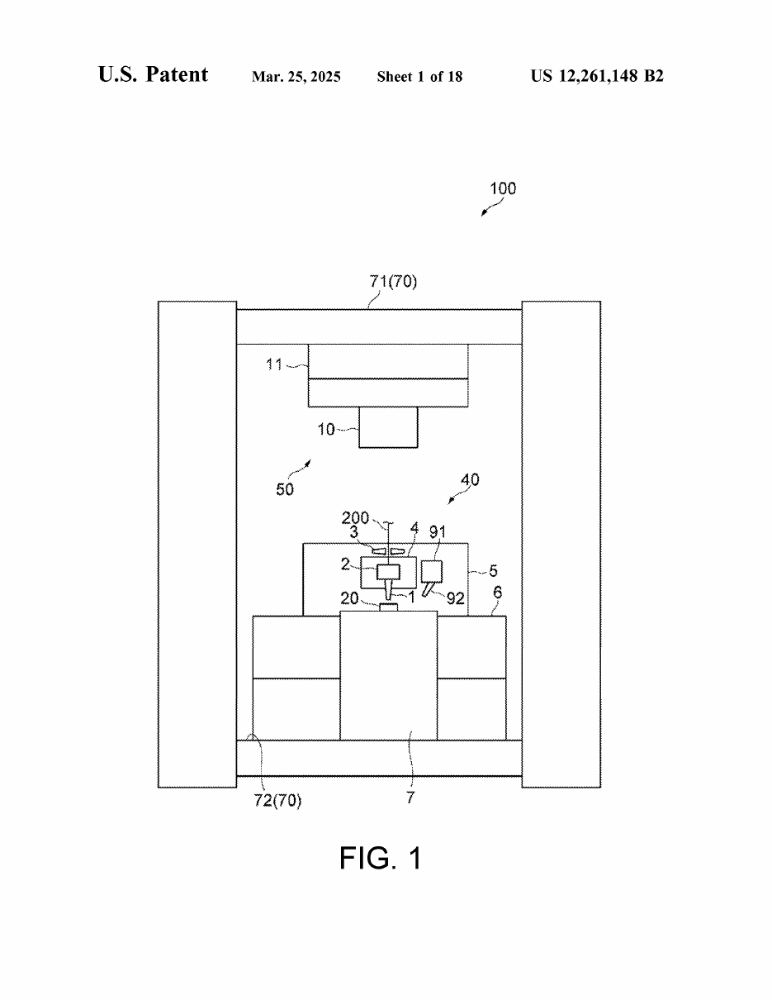
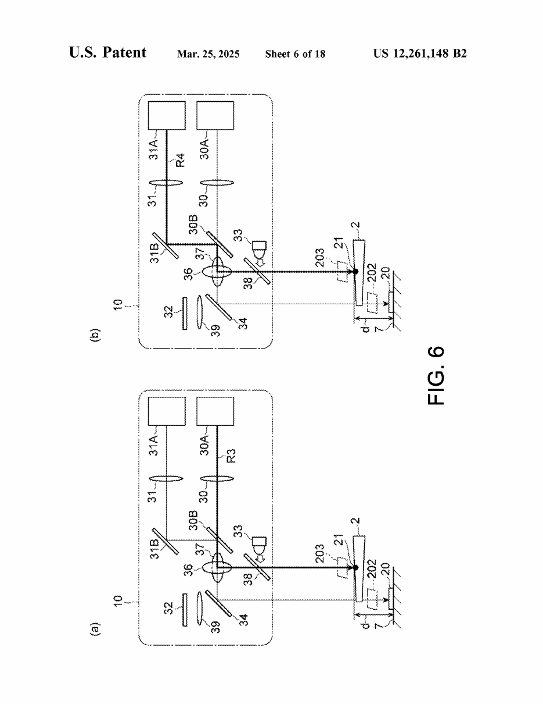
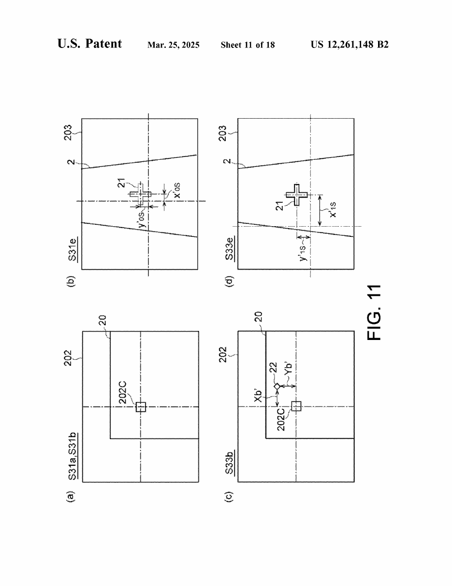

# US12261148 Shinkawa 2025, 툴 위 기준점을 별도 시야로 찍어 카메라 오프셋 변화 보정 (와이어 본딩 장치)

- 원제: Wire bonding apparatus
- 원문: 같은 폴더의 `US12261148B2.pdf` (USPTO 등록 공보, 31쪽, 글자 없는 이미지 PDF). 번역은 [번역.md](번역.md). 본문 텍스트는 Google Patents 페이지에서 가져왔다.
- 저자/출원인: 발명자 Shigeru Hayata, 출원인 Shinkawa Ltd.
- 서지: US 12,261,148 B2, 2025-03-25 등록. 국제출원 PCT/JP2021/020814 (2021-06-01 출원), 우선권 JP 2020-098350 (2020-06-05). 공개 US 2023/0178510 A1. 청구항 17개.
- 핵심 (원문 확인)
  - 청구항의 주 내용은 진동 분리 구조다. 본딩 유닛(툴 XY 스테이지)과 촬상 유닛(별도 광학계 XY 스테이지)을 베이스의 다른 부분에 붙이고, 메인 프레임이 툴 스테이지에 직접 닿지 않게 한다(청구항 1).
  - 우리에게 쓸모 있는 부분은 교정 방법이다. 툴과 함께 움직이는 기준점 21(초음파 혼 윗면의 십자 마크, 혼 모서리, 금속 표면 무늬도 가능)을 칩을 보는 시야(제1 시야)와 다른 제2 시야로 따로 찍는다. 두 시야는 하프 미러로 같은 촬상 소자에 합쳐지고, 조명을 켜고 꺼서 바꾼다. 광로 길이를 같게 맞춰 두 시야의 배율이 같다.
  - 제1 교정(S1): 툴 스테이지를 정해진 간격으로 여러 번 움직이고, 매번 엔코더 이동량과 기준점 영상 이동량을 잰다. 통계 처리로 엔코더와 화소 사이의 축척과 회전을 구한다. 제2 교정(S2)은 광학계 스테이지와 제1 시야에 대해 같은 일을 한다.
  - 카메라 오프셋 변화 식 (1): ΔXc = (x1s − x1) − (x0s − x0) + Xb. 기준점의 "영상 위치 − 엔코더 위치"를 두 시점에서 재서 빼고, 실제 본딩 자국의 어긋남 Xb를 더한다. 스테이지가 어디 있든 스테이지 이동은 지워지고 카메라와 툴 사이 관계 변화만 남는다. 새 오프셋은 Xc = Xc0 + ΔXc.
  - 온도 보정에서 따질 요인을 두 가지로 줄였다고 적는다: 기준점의 이동(툴, 혼의 열팽창)과 제1 시야의 이동(광학계 끝부분의 열팽창). 광로가 합쳐지기 전 부품의 열변형도 오차원으로 적고, 대책 셋(온도로 보정, 저팽창 재료, 상쇄 구조)을 든다.
  - 이 기준점 측정은 캐필러리 끝을 직접 찍는 기존 RPS 기능을 대신할 수 있다고 적는다.
  - 변형예: 기준점 없이 특징 패턴 기준 상대 위치 (Xb3′ − Xb2′)로 오프셋 변화를 구하는 방식(S9), 기준점을 토치 암, 혼 홀더, 본딩 헤드 위에 두는 방식, 두 시야를 하나로 합치는 방식.
- 정량 수치 (원문 확인, 모두 설계 예시이며 실험 결과가 아니다)
  - 1.1인치 1200만 화소 카메라, 배율 2배 가정에서 시야 4.2 mm × 3.5 mm, 화소 분해능 1.7 μm/px.
  - 영상 처리 인식 정밀도는 화소의 몇 분의 1에서 1/10. 요구 본딩 정밀도 예 2 μm.
  - 히터에서 촬상 유닛까지 거리는 기존 구조의 약 3배.
  - 툴 스테이지 모터 부하 약 절반, 단순 계산으로 이동 시간 30% 감소.
  - 오프셋 보정의 정확도, 반복성, 온도별 드리프트 크기는 공보에 없다.
- 우리와의 관계: ○ 질문 2, 6. 장치와 분야는 다르지만, "기준을 무엇에 붙여 두고, 무엇으로 빼는가"의 구조가 우리 문제와 같다.
  - 질문 2 (카메라 이동을 사진 안에서 빼기): 식 (1)은 차이의 차이다. 우리의 (QR − 가로선)_현재 − (QR − 가로선)_센터와 같은 꼴이다. 공보는 카메라 쪽 변화(제1 시야 이동)와 기준 쪽 변화(기준점 이동)를 서로 다른 독립 측정(엔코더)에 대어 분리한다. 우리에겐 엔코더가 없고, 명령값은 백래시 β −0.34px와 하루 드리프트 0.84px가 섞여 있다는 점이 다르다.
  - 질문 6 (기준점이 신호에 반응하는지 확인): 제1 교정 S1이 바로 그 확인 절차다. 알려진 간격으로 움직이고 기준 영상 이동을 엔코더에 회귀해 축척과 회전을 구한다. 우리는 Y80, T200 단일축 자료로 가로선 측정값을 명령 Y, T에 회귀해 가로선의 반응 계수를 구할 수 있다. 반응이 0이 아니면 단순 빼기는 신호 일부를 지운다.
- 링크
  - Google Patents: https://patents.google.com/patent/US12261148B2/en
  - 공보 PDF: https://patentimages.storage.googleapis.com/81/d1/9e/33c75833bb9e87/US12261148.pdf
  - USPTO 공보: https://image-ppubs.uspto.gov/dirsearch-public/print/downloadPdf/12261148

---

## 상세 요약 (번역본 기반)

### 1. 배경과 문제

- 와이어 본더에서 카메라를 툴 스테이지에 함께 실으면, 카메라의 외팔보 구조가 흔들려 캐필러리에 진동이 전해지고 본딩성이 나빠진다. 또 스테이지가 무거워져 속도가 떨어진다.
- 카메라를 툴 스테이지에서 떼어 내면, 카메라와 툴 사이 관계(카메라 오프셋)를 따로 알아야 한다. 이 관계는 온도로 변한다.

### 2. 구조



*도 1. 장치 앞면도. 촬상 유닛 50은 메인 프레임에, 본딩 유닛 40은 서브 프레임에 붙는다.*

- 두 시야. 제1 시야 202는 칩을, 제2 시야 203은 툴 위 기준점 21을 본다. 두 시야는 X 방향으로 어긋나 있다(본딩 와이어와 간섭을 피하려고).
- 하프 미러 37에서 광로를 합치고, 조명 32, 33을 켜고 꺼서 시야를 바꾼다. a1+a2=b1+b2로 광로 길이를 맞춰 배율을 같게 한다.



*도 6. 제2 시야의 기준점 21 빛이 고배율, 저배율 촬상 소자로 가는 광로.*

### 3. 교정과 오프셋 갱신 절차

1. 제1 교정 S1: 기준점 21을 제2 시야에 두고, 툴 스테이지를 일정 간격으로 움직이며 기준점을 반복 촬영한다. 엔코더 이동량과 영상 이동량을 통계 처리해 축척, 회전을 구한다.
2. 제2 교정 S2: 광학계 스테이지와 제1 시야에 대해 같은 방식으로 구한다.
3. 오프셋 설정 S3: 시야 중심을 본딩점으로 정하고(S31), 저장된 오프셋으로 본딩해 자국을 만들고(S32), 자국 위치 Xb와 기준점 위치를 다시 잰다(S33). 식 (1), (2)로 오프셋을 갱신한다.
4. 운용 중 위치 결정 S8: 얼라인먼트 점을 찍을 때마다 기준점 21도 다시 찍어(S82, S84) 툴 스테이지와 촬상 소자 사이 상관을 다시 얻는다.



*도 11. 오프셋 설정에서 얻는 영상. (b), (d)에서 기준점의 시야 내 위치를 두 시점에서 잰다.*

### 4. 핵심 식

```
ΔXc = (x1s − x1) − (x0s − x0) + Xb
ΔYc = (y1s − y1) − (y0s − y0) + Yb
Xc  = Xc0 + ΔXc,   Yc = Yc0 + ΔYc
```

- x0s, x1s: 두 시점에서 기준점의 시야 내 위치(교정값으로 μm 변환).
- x0, x1: 두 시점의 툴 스테이지 엔코더 값.
- Xb: 시야 중심 대비 실제 본딩 자국 위치(툴 좌표로 변환).
- 해석(우리 추론): 기준점의 "영상 위치 − 엔코더"는 스테이지 이동과 무관한 양이다. 그래서 두 시점의 차이는 카메라와 툴 사이 관계의 변화만 담는다. 단 Xb를 함께 재야 제1 시야 쪽 이동까지 닫힌다.

### 5. 근거의 한계

- 공보는 구조와 절차만 적고, 보정 전후 정확도나 온도 실험 결과를 내지 않는다. 효과는 출원인 주장이다.
- 기준점은 일부러 움직이는 부재(툴) 위에 두고 엔코더로 그 움직임을 따로 안다. 우리 가로선은 움직이지 않길 기대하는 고정물이고, 움직임을 따로 재는 장치가 없다.

---

## 리뷰 카드

- 어떻게 해결했나: 툴과 함께 움직이는 기준점을 별도 시야로 찍고, 알려진 간격 이동으로 기준점의 영상 반응(축척, 회전)을 먼저 교정한 뒤, 두 시점의 "기준점 영상 위치 − 엔코더"를 빼서 카메라와 툴 사이 오프셋 변화만 남긴다(식 1, 2).
- 같은 점: 기준과 대상을 같은 카메라로 찍어 차이의 차이로 카메라 쪽 변화를 지운다. 우리의 QR − 가로선 빼기(A15, 날짜 간 세로 +0.44px 상쇄)와 같은 꼴이다. 열에 의한 느린 변화가 대상이라는 점도 우리 하루 드리프트(가로 ≤ 0.84px)와 닮았다.
- 다른 점: 공보는 기준점의 움직임을 엔코더로 따로 안다. 우리는 엔코더가 없고 명령값에 백래시 β −0.34px가 섞인다. 공보 기준점은 일부러 움직이는 쪽에 있고, 우리 가로선은 움직이지 않는다고 가정하는 쪽이다. 공보는 두 시야를 따로 찍지만 우리는 한 장(3840x2160) 안에 QR과 가로선이 같이 있다. 공보는 정확도 수치가 없다.
- 가져올 해결책: (1) 제1 교정 S1처럼 가로선의 반응을 먼저 교정한다. 20261014 날짜의 단일축 Y80장, T200장에서 위, 아래 가로선 측정값을 명령 Y, T에 회귀해 반응 계수 k_Y, k_T(px/단위)와 잔차를 구한다. k가 0과 구별되지 않으면 단순 빼기를 유지하고, 구별되면 빼기 계수를 1이 아닌 (1 − k/QR 반응) 보정으로 바꾸거나 가로선을 별도 회귀 변수로 둔다. 판정 기준은 Y 허용 0.65px의 1/10 수준(약 0.06px). (2) 오프셋 변화를 두 요인으로 나눈 공보처럼, 영점 변화를 "카메라 이동(가로선에 같이 보임)"과 "로봇 쪽 영점 이동(QR에만 보임)"으로 나눠 따로 기록한다. (3) 운용 중 S82, S84처럼 매 턴 가로선을 다시 재서 카메라 쪽 상관을 갱신한다. 이미 매 사진에 가로선이 있으므로 추가 촬영은 필요 없다.

## 이 단계 후보 방법으로서

- 방법 이름: 반응 교정된 고정 기준 차분 (기준 반응을 먼저 교정하고, 두 시점의 "대상 − 기준"을 빼는 차이의 차이)
- 전제 조건
  - 기준(가로선)과 대상(QR)이 같은 카메라, 같은 사진에 있다.
  - 기준의 이동 반응을 알려진 이동으로 교정할 수 있다. 우리는 명령값을 엔코더 대신 쓰므로, 백래시와 드리프트가 교정 잡음으로 들어간다.
  - 카메라 이동이 기준과 대상에 같은 꼴로 나타난다(평행이동, 작은 회전). 원근 차이가 크면 같은 꼴이 아니다.
- 장점
  - 식이 단순하고 계산이 거의 없다. 처리 시간 부담이 없다.
  - 카메라 이동(날짜 간 +0.44px)을 사진마다 지운다. 센터 사진을 다시 찍지 않아도 된다.
  - 교정 단계에서 기준의 신호 반응을 수치로 확인하므로 질문 6에 직접 답한다.
- 단점
  - 기준 측정 잡음이 결과에 그대로 더해진다. A19에서 가로선 블록은 잡음, 조명에 0.1~0.7px 흔들렸다. QR(≤ 0.017px)보다 훨씬 크다.
  - 공보는 정확도 수치를 주지 않으므로, 효과는 우리 자료로 확인해야 한다.
  - 로봇 쪽 영점 이동(백래시, 하루 드리프트)은 가로선에 보이지 않아 이 방법으로 지워지지 않는다.
- 우리 적용 조건
  - 가로선의 Y, T 반응 계수를 단일축 자료(1014 Y80, T200)로 추정하고, 날짜를 나눈 평가(1014 학습, 1020과 1029 시험)로 확인한다.
  - 가로선 측정은 A21의 강건화(기울기 차 특징)를 쓴다. 블록 단위 원값을 그대로 빼면 0.1~0.7px 흔들림이 Y 허용 0.65px를 먹는다.
  - 빼기 후 잔차의 날짜 간 차이가 0.065px(Y 허용의 1/10) 이하인지 본다.
  - 개발 노출 자료(341/575장)의 성적임을 함께 적는다.
