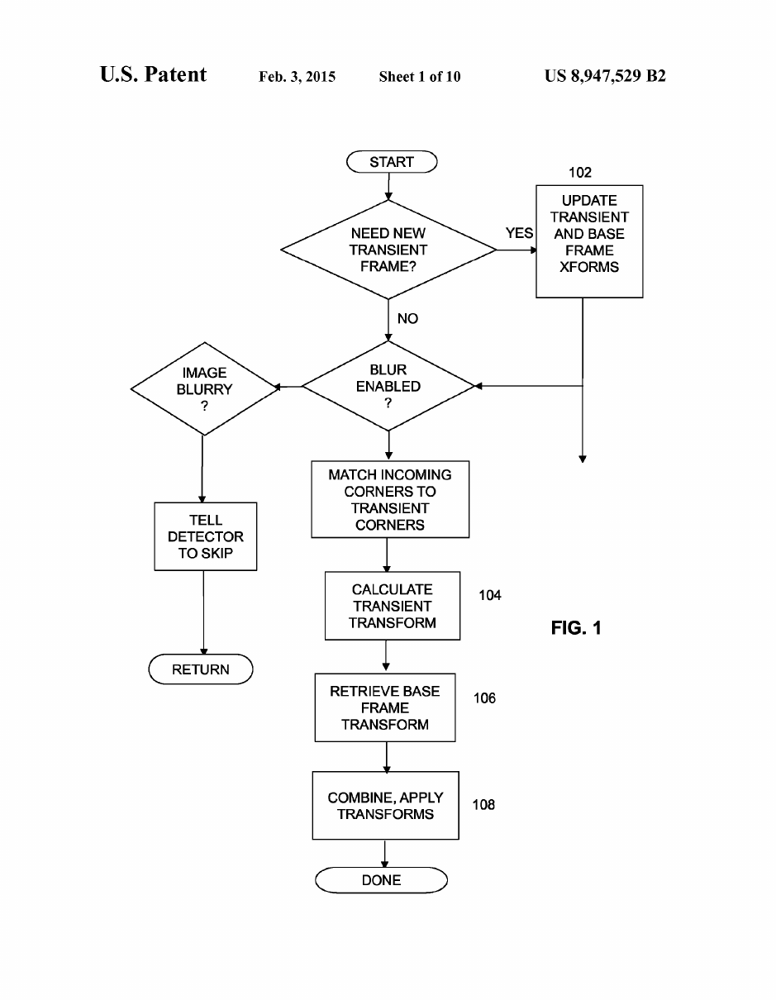
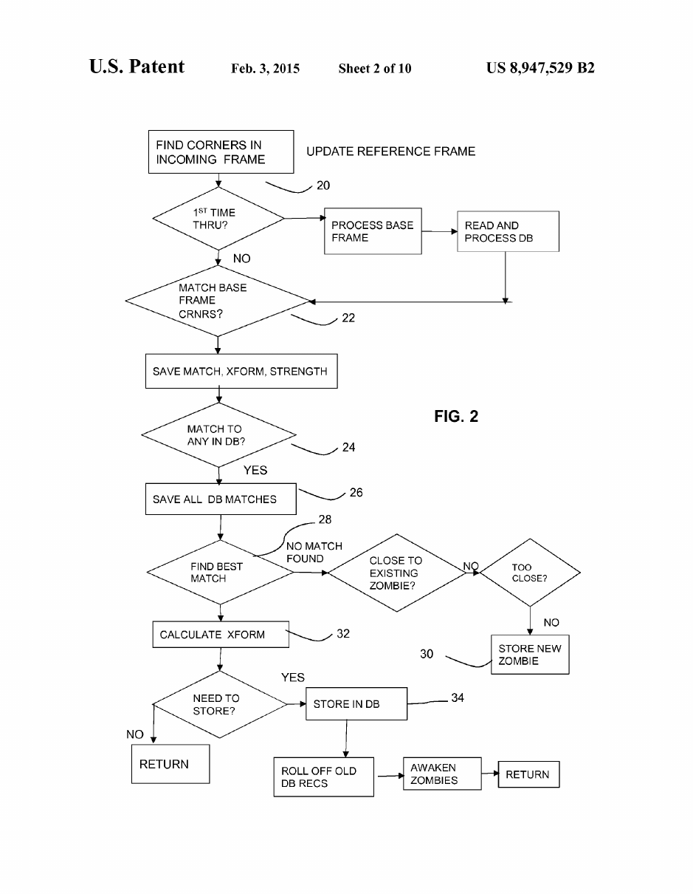
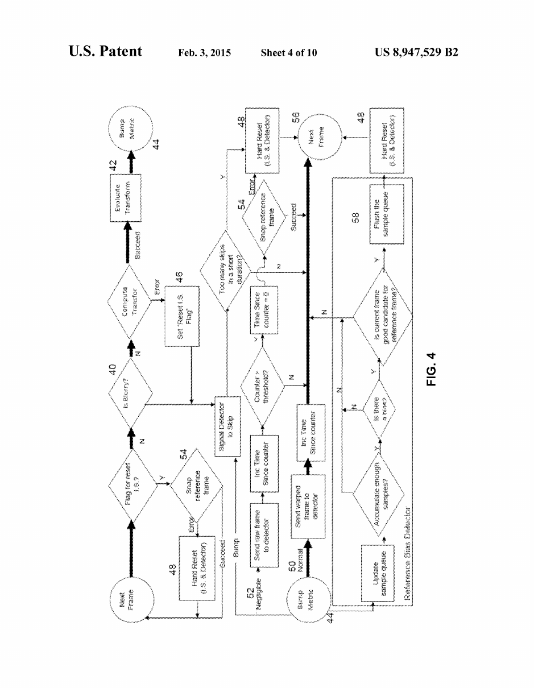

# US 8,947,529 B2 번역: 장기 영상 드리프트가 있을 때 실시간 영상을 안정화하는 방법과 시스템

번역 범위: 전문 (서지, 초록, 상세한 설명, 도면 설명, 청구항 1~20). 인용 문헌 목록은 원문 그대로 둔다.
원문: 같은 폴더의 `US8947529B2.pdf` (Google Patents 공보 PDF, 24쪽).
본문 추출: 1~20쪽은 `pdftotext -layout`, 21~24쪽(17~24단)은 글자 층이 없는 스캔 쪽이라 tesseract OCR(영어, 300dpi)로 읽었다.
번역 메모
- pole drift는 "기둥 드리프트", pole shake는 "기둥 흔들림"으로 옮겼다. 카메라를 단 기둥이 느리게 움직이는 것과 빠르게 떨리는 것을 말한다.
- transient frame은 "임시 기준 프레임", base frame은 "기본 기준 프레임"으로 옮겼다. 원문은 같은 뜻으로 warm(따뜻한) 기준, cold(차가운) 기준이라는 말도 쓴다.
- [역주]는 번역자가 붙인 설명이다. 원문 내용이 아니다.

---

## 서지

- (12) 미국 특허, Strine 외
- (10) 특허 번호: US 8,947,529 B2
- (45) 등록일: 2015년 2월 3일
- (54) 발명의 명칭: METHODS AND SYSTEMS FOR STABILIZING LIVE VIDEO IN THE PRESENCE OF LONG-TERM IMAGE DRIFT (장기 영상 드리프트가 있을 때 실시간 영상을 안정화하는 방법과 시스템)
- (71) 출원인: Siemens Industry, Inc., Alpharetta, GA (US)
- (72) 발명자: Lloyd Strine (Roswell, GA), Jeffrey Bragg (Marietta, GA), Aaron Bobick (Alpharetta, GA)
- (73) 권리자: Siemens Industry, Inc., Alpharetta, GA (US)
- (*) 존속기간 조정: 35 U.S.C. 154(b)에 따라 0일
- (21) 출원 번호: 14/269,600
- (22) 출원일: 2014년 5월 5일
- (65) 공개: US 2014/0240496 A1, 2014년 8월 28일
- (63) 관련 출원: 2011년 9월 30일 출원한 13/249,412의 계속출원. 그 출원은 US 8,760,513으로 등록.
- (51) 국제 분류: H04N 7/18, G06T 15/00, H04N 5/232, G06T 7/20
- (52) CPC: H04N 5/23267, G06T 7/20, H04N 7/183, G06T 2207/30232. USPC 348/143, 345/419
- (58) 검색 분야: CPC G06T 7/20, G06T 2207/30232. USPC 348/143
- 심사관: Hee-Yong Kim
- 청구항 20개, 도면 10장

### (56) 인용 문헌 (원문 그대로)

U.S. PATENT DOCUMENTS
5,524,131 A * 6/1996 Uzawa et al.; 5,629,988 A 5/1997 Burt et al.; 5,822,389 A * 10/1998 Uzawa et al.; 6,985,620 B2 1/2006 Sawhney et al.; 7,006,711 2/2006 Dresevic et al.; 7,236,176 6/2007 Milinusic; 7,313,252 12/2007 Matei et al.; 7,486,318 2/2009 Ohki; 7,526,401 4/2009 Krumm; 7,702,131 4/2010 Chinen et al.; 7,822,228 10/2010; 2001/0010542 8/2001; 2004/0075738 4/2004; 2004/0169617 9/2004; 2004/0207729 10/2004; 2006/0061658 3/2006; 2006/0159308 7/2006; 2006/0232581 10/2006; 2008/0030585 2/2008; 2008/0158361 7/2008; 2008/0267453 10/2008; 2009/0225200 9/2009; 2010/0157070 6/2010; 2010/0171656 7/2010 (이 구간 저자명은 추출 순서가 섞여 원문 2쪽 그대로: Hampapur et al., Takagi et al., Burke et al., Yelton et al., Takagi et al., Faulkner et al., Hampapur et al., Chen, Grigorian et al., Itoh et al., Avrahami, Ohki, Mohanty et al., Zhang); 2010/0296704 A1 11/2010 Hampapur et al.; 2011/0134329 A1 6/2011 Chen et al.; 2013/0202197 A1 8/2013 Reeler et al.

FOREIGN PATENT DOCUMENTS
WO WO-2009/067819 6/2009

OTHER PUBLICATIONS
Marcenaro, Lucio et al., "Image Stabilization Algorithms for Video Surveillance Applications", University of Genoa, Italy, 349-352, 4 pgs.
Morris, Daniel D. et al., "Image-Based Motion Stabilization for Maritime Surveillance", SPIE, vol. 6497 Feb. 27, 2007, 9 pgs.
Vermeulen, Eddy, "Real-time Video Stabilization for Moving Platforms", 21st Bristol UAV Systems Conference Apr. 2007, 14 pgs.
White, Brandyn, "Using FPGAs to Perform Embedded Image Registration", University of Central Florida Mar. 2008, 1-5, 5 pgs.
PCT International Search Report and Written Opinion in PCT/US2012/056021, mailed Dec. 6, 2012, 10 pgs.
Kim, Soo W. et al., "Recovery Video Stabilization Using MRF-MAP Optimization", 2010 International Conference on Pattern Recognition, 2804-2807, 4 pgs.
Ristivojevic, Mirko et al., "Multi-frame motion detection for active/unstable cameras", XXII Brazilian Symposium on Computer Graphics and Image Processing, 284-290, 8 pgs.
Wang, Yuan-Kai, et al, Real-Tome Camera Anomaly Detection for Real-World Video Surveillance, Proceedings of the 2011 International Conference on Machine Learning and Cybernetics, Jul. 2011, 1520-1525, 6 pgs.

---

## (57) 초록

짧은 시간의 흔들림, 즉 "기둥 흔들림(pole shake)"과 긴 시간의 "기둥 드리프트(pole drift)"에 대해 카메라 영상을 안정화하는 방법과 시스템을 제공한다. 카메라는 고정 구조물에 붙어 있다. 기둥 드리프트는 아주 긴 시간에 걸쳐 일어난다. 그래서 기본 기준 프레임과 현재 안정화된 임시 프레임 사이에 영상이 크게 달라질 수 있다. 대응을 이미 구한 프레임 여러 장과 그 관련 정보를 보관한다. 천천히 변하는 카메라 방향("기둥 드리프트")을 빠른 움직임 떨림("기둥 흔들림")과 떼어 내고, 각각에 대해 따로 변환을 계산한다. 입력 프레임 하나에 최대 세 개의 변환을 묶을 수 있다. 따로 구한 변환들을 하나로 합쳐서, 프레임마다 실제 영상 변환 계산은 한 번만 한다. 감시 시스템이 이 안정화 방법을 쓴다.

대표 도면: FIG. 1

---

## 관련 출원

이 출원은 2011년 9월 30일 출원한 미국 특허출원 13/249,412의 계속출원이며 그 이익을 주장한다. 그 출원 전체를 여기에 참조로 포함한다.

## 기술 분야

이 발명은 영상 감시 시스템과 방법에 관한 것이다. 더 구체적으로는 감시 카메라의 위치가 오랜 시간에 걸쳐 바뀌는 것을 영상 안에서 보정하는 것에 관한 것이다.

## 배경

이 발명은 일반적으로 보안 감시 시스템에 관한 것이다. 특히 높은 실외 기둥이나 다른 구조물 위에 카메라를 단 보안 감시 시스템에 관한 것이다. 바람, 열, 그 밖의 영향이 기둥이나 구조물에 작용하면, 카메라의 정확한 위치와 방향이 시간에 따라 바뀔 수 있다. 카메라 자세의 이런 변화는 두 종류의 영향이 합쳐져 생긴다.
- 긴 시간, 낮은 주파수의 영향 (예: 열)
- 짧은 시간, 높은 주파수의 영향 (예: 바람)

여기서 "기둥 드리프트"는 긴 시간의 영향을, "기둥 흔들림"은 짧은 시간의 영향을 뜻한다.

영상 감시 시스템의 영상 안정화는 카메라 움직임을 보정한다. 예를 들어 바람이나 진동이 카메라 기둥에 주는 영향으로 생긴 움직임이다. 보정하는 카메라 움직임은 보통 (상대적으로) 주파수가 높다. 이 움직임은 영상에서 겉보기 화소 움직임이 된다. 그러면 거짓 경보가 나고, "가짜" 물체가 많이 검출된다. 실제로는 세상이 아니라 카메라가 움직이는 경우가 많다. 이 움직임을 걸러 내도록 움직임 검출 민감도를 조정하면, 보통 진짜 움직임도 많이 걸러진다. 대부분의 영상 안정화 알고리즘은 이런 짧은 시간의, 기둥 때문에 생긴 카메라 움직임을 보정하려 한다.

카메라 기둥이나 다른 설치 구조물은 긴 시간, 낮은 주파수의 영향도 받는다. 이 영향은 몇 분에서 몇 시간에 걸쳐 붙어 있는 카메라의 위치와 방향을 흐트러뜨린다. 이 발명의 한 실시예에서 설치 구조물은 땅이나 붙어 있는 건물에 대해 거의 고정되어 있다. 조건이 변하지 않으면 그런 구조물에 달린 카메라는 주변 환경에 대해 안정된 영상을 만든다. 햇빛으로 기둥이 데워지고 식는 열 효과(또는 햇빛이 없는 것)는 기둥 움직임의 분명한 원인이다. 이것은 상대적으로 느린, 긴 시간의 영향일 수 있다. 바람이나 구조물 가까이 지나가는 무거운 차량은 빠르고 짧은 영향의 원인일 수 있다. 계절, 노화, 환경의 느린 움직임에 따른 영향처럼 감시 영상에 오래 작용하는 다른 영향도 다룰 수 있으며, 여기서 제공하는 방법과 시스템으로 다룰 수 있다.

이런 영향은 비교적 천천히 작용한다. 대체로 영상을 보는 사람이 눈치채지 못할 만큼 느리고, 움직임 검출에도 큰 영향을 주지 않는다. 이 영향은 주기적일 수 있다. 영구적일 수도 있다.

이 발명의 여러 측면은 주기적인 영향과 주기적이지 않은 영향을 모두 다룰 수 있다. 예를 들어 주기적이지 않은 영향으로는 새 구조물이 천천히 가라앉아 영구 위치에 자리 잡는 것이 있다. 이것은 며칠이나 몇 주에 걸쳐 가라앉는 포화 효과일 수 있다.

2차원 영상 자료를 3차원 세계 자료로 바꾸는 영상 감시 시스템은 이런 긴 시간의 영향에 크게 영향을 받는다. 긴 시간의 영향은 영상 좌표와 세계 좌표의 대응을 만들 때의 카메라 시야에 비해 실제로 카메라 시야를 옮긴다. 그래서 영상 좌표에서 세계 좌표로의 계산에 큰 영향을 줄 수 있다. 영상 평면에서 물체 위치에 해당하는 화소가 더 이상 3차원 세계의 올바른 위치를 나타내지 않으므로, 시스템은 영상 평면의 물체를 실제 3차원 세계에 정확히 놓는 능력을 잃는다.

따라서 구조물, 문 기둥, 다른 구조물에 달린 감시 카메라 같은 카메라가 감시 환경에 대해 짧은 시간과 긴 시간에 걸쳐 움직이는 것을 보정하는 새롭고 개선된 방법과 시스템이 필요하다.

## 발명의 요약

장기 영상 드리프트가 있을 때 실시간 영상을 안정화하는 시스템과 방법을 제공한다.

이 발명의 한 측면에 따르면, 감시 시스템은 다음을 포함한다.
- 영상 프레임 여러 장을 만드는 카메라 하나 이상
- 그 프레임들을 저장하는 메모리
- 메모리와 통신하며 각 프레임을 처리하는 프로세서. 처리 순서는 다음과 같다.
  1. 프레임 여러 장 중 한 프레임을 받는다.
  2. 그 프레임을 임시 프레임에서 나온 임시 좌표계로 옮기는 임시 변환을 구한다.
  3. 임시 좌표계를 기본 프레임에서 나온 기본 좌표계로 옮기는 기본 변환을 구한다.
  4. 임시 변환과 기본 변환을 합친 결합 변환을 구한다.
  5. 그 결합 변환을 프레임에 적용한다.

감시 시스템은 프레임에서 특징을 뽑는 프로세서도 포함할 수 있다. 이 발명의 다른 측면에 따르면, 임시 변환은 프레임 속 특징을 임시 프레임 속 특징으로 옮긴다.

이 발명의 또 다른 측면에 따르면, 임시 프레임은 감시 시스템이 동작하는 동안 들어온 프레임으로 갱신된다.

이 발명의 다른 측면에 따르면, 편향 검출을 바탕으로 한 프레임을 갱신된 임시 프레임으로 고른다.

이 발명의 또 다른 측면에 따르면, 기본 프레임 변환은 감시 시스템의 설치 단계에서 정한다.

이 발명의 또 다른 측면에 따르면, 임시 변환은 기둥 흔들림 같은 높은 주파수 영향을 보정한다.

이 발명의 또 다른 측면에 따르면, 기본 프레임 변환은 열 변화처럼 더 느리게 작용하는 영향을 보정한다.

이 발명의 다른 측면에 따르면, 갱신된 임시 프레임을 기본 프레임으로 변환할 수 없으면 그 프레임을 나중에 처리하려고 메모리에 저장한다.

이 발명의 또 다른 측면에 따르면, 하나 이상의 카메라 중 적어도 하나는 정적인 구조물에 붙어 있다. 그 구조물은 환경 때문에 움직이지만, 그 움직임은 카메라 시야보다 크지 않다.

이 발명의 또 다른 측면에 따르면, 결합 변환은 다음 세 가지를 합친다.
- 프레임에서 갱신된 임시 프레임으로의 갱신된 임시 변환
- 갱신된 임시 프레임에서 이전 임시 프레임으로의 변환
- 이전 임시 프레임에서 기본 프레임으로의 변환

이 발명의 여러 측면에 따라 대응하는 방법도 제공한다.

## 도면의 설명

- FIG. 1은 이 발명의 한 측면에 따른 단계를 보여 주는 흐름도다.
- FIG. 2는 이 발명의 한 측면에 따른 단계를 보여 주는 흐름도다.
- FIG. 3은 영상에서 검출할 수 있는 특징으로서의 코너를 보여 준다.
- FIG. 4와 5는 이 발명의 한 측면에 따른 단계를 보여 주는 흐름도다.
- FIG. 6~8은 카메라로 찍어 이 발명의 한 측면에 따라 표시한 영상이다.
- FIG. 9와 10은 각각 이 발명의 한 측면에 따른 시스템을 보여 준다.

## 상세한 설명

이 발명의 여러 측면은 영상 감시 시스템의 보통 영상 안정화 방법을 넓힌다. 긴 시간의 영향으로 기둥 위치와 방향이 바뀌는 것을 보정하는 기능을 더한다. 여기서는 이것을 "기둥 드리프트"라고 부른다. 기둥 드리프트는 하루 동안 영상에서 10~30화소의 이동에 이를 수 있으며, 이것이 기둥 드리프트를 알려 주는 한 지표다. 영향은 30화소보다 작을 수도, 20화소보다 클 수도 있다. [역주: 원문 그대로 옮겼다. "10화소보다 작거나 30화소보다 클 수도 있다"는 뜻으로 보이나 원문 표기는 위와 같다.] 기둥 드리프트는 상대적으로 느리고, 기둥 흔들림보다 긴 시간에 걸쳐 일어난다. 기둥 드리프트 보정은 더 높은 주파수 영향의 보정과 함께 할 수 있다. 여기서는 그 높은 주파수 영향을 "기둥 흔들림"이라고 부른다. 기둥 흔들림은 훨씬 빠른 영향으로 주파수가 0.1~10 Hz 범위일 수 있다. 기둥 흔들림의 진폭은 15~20화소에 이를 수 있지만 더 작을 수도 있다. 더 클 수도 있다. 기둥 흔들림 보정은 들어오는 영상의 모든 프레임에 대해 전처리 단계에서 한다. 안정화된 영상은 이후 영상 분석 처리로 "아래로" 보낸다.

이 발명의 한 측면은 "기본 프레임 좌표계"라는 생각이다. 이것은 카메라를 처음 교정하고 3차원 세계에 맞춰 방향을 정할 때 기준이 된 좌표계다. 기본 프레임 좌표계에는 "기본 프레임 영상"이 딸려 있다. 이것은 그 좌표계에 해당하는 카메라 시야다. 대개 카메라 교정과 시스템 설치 때 카메라 영상에서 찍은 한 장의 사진이다. 기본 프레임 좌표계에 맞춰 정렬된 카메라 영상에서는 물체의 지리 위치가 올바르게 계산된다.

이 발명의 여러 측면은 추가 안정화 단계를 둔다. 먼저 1단계 방법이 기둥 흔들림 같은 높은 주파수 영향을 보정한다. 1단계 방법은 들어오는 영상 속 임의의 프레임("임시 영상")을 기준으로 "임시 좌표계"를 세우고, 이후 들어오는 각 프레임을 그 임시 좌표계로 되돌려 높은 주파수 영향을 보정한다. 이 임시 좌표계는 주기적으로 (보통 몇 분마다) 갱신되며, 조명 변화와 다른 짧은 시간 현상으로 생기는 영상 변화를 따라간다. 이 임시 좌표계는 카메라를 처음 교정할 때의 좌표계와 다를 수 있다.

위에서 말한 추가 안정화 단계는, 들어온 프레임을 임시 좌표계로 되돌린 뒤에 일어난다. 이 단계는 임시 좌표계에 정렬된 영상을 다시 기본 프레임 좌표계로 옮긴다. 이 추가 변환이 끝나면 결과 영상의 각 화소는 3차원 세계에 올바르게 놓인다. 따라서 영상 평면에서 검출하고 처리한 물체가 3차원 세계에 정확히 놓인다.

이 발명의 여러 측면 덕분에, 장면 속 고정 물체는 하루 내내 같은 화소 위치에 있을 수 있다. 열이나 다른 영향으로 기둥이나 다른 지지 구조물에 달린 카메라의 위치와 방향이 바뀌어, 그 물체가 하루 동안 겉보기로 여러 화소 움직였을 경우에도 그렇다.

이 발명의 한 실시예에서, 여기서 제공하는 안정화 방법은 카메라 시야 안에 드는 카메라 움직임에 적용한다.


*FIG. 1. 영상 안정화 방법과 기둥 드리프트 보정 확장의 프레임별 흐름도. 단계 102: 새 임시 프레임이 필요하면 임시 변환과 기본 프레임 변환을 갱신. 104: 임시 변환 계산. 106: 기본 프레임 변환 불러오기. 108: 변환을 합쳐서 적용. 흐린 영상이면 검출기에 건너뛰라고 알린다.*

FIG. 1은 이 발명의 한 측면에 따른 영상 안정화 방법과, 기둥 드리프트 보정을 위한 확장의 단계를 보여 주는 흐름도다. 이 방법은 들어오는 영상의 모든 프레임에 대해 수행된다.

들어오는 모든 프레임은 먼저 임시 좌표계로 안정화된다. 임시 좌표계는 들어오는 영상에서 한 프레임을 골라 주기적으로 세운다. 임시 좌표계는 몇 분마다 갱신되며, 꽤 빠른 영상 변화(예: 새벽과 해 질 녘의 조명 변화)를 따라간다. 새 임시 좌표계를 세울 때마다, 방법은 임시 좌표계에서 기본 프레임 좌표계로의 변환을 계산하려고 시도한다.

그 뒤 들어오는 각 프레임에는 논리적으로 두 변환이 적용된다.
- 프레임마다 다른 변환 104. 각 프레임을 이 임시 좌표계로 되돌린다.
- (임시 좌표계가 유지되는 동안) 고정된 변환 106. 결과 프레임을 카메라를 처음 교정한 좌표계로 되돌린다.

논리적으로는 두 단계지만, 실제로는 변환을 행렬로 표현하고, 들어온 영상을 변환하기 전에 행렬을 계산해 하나의 변환 108로 합친다. 그래서 들어온 영상에는 실제 변환을 한 번만 적용하면 된다. 이렇게 처리 부담을 줄인다.

기둥 드리프트 보정량을 정하는 실제 계산은 단계 102에서 새 임시 좌표계를 세울 때만 한다.

선택 기능으로, 영상을 최종 기둥 드리프트 보정 쪽으로 시간을 두고 천천히 "끌어당길" 수 있다. 어떤 이유로 기둥 드리프트 보정량이 크게 바뀌어 계산되었을 때, 영상이 갑자기 "튀는" 일을 줄이기 위해서다.


*FIG. 2. 새 기둥 드리프트 보정 변환을 계산하는 흐름도(기준 프레임 갱신). 단계 20: 들어온 프레임에서 코너를 찾는다(처음이면 기본 프레임과 DB를 읽어 처리). 22: 기본 프레임 코너와 맞는가? 24: DB의 어느 것과 맞는가? 26: DB와 맞은 것을 모두 저장. 28: 가장 잘 맞는 것 찾기(못 찾으면 기존 좀비와 가까운지, 너무 가까운지 확인 후 30: 새 좀비 저장). 32: 변환 계산. 저장이 필요하면 34: DB에 저장, 오래된 DB 기록 밀어내기, 좀비 깨우기.*

FIG. 2는 새 기둥 드리프트 보정 변환을 계산하는 데 필요한 단계를 자세히 보여 주는 흐름도다. 이 계산은 새 임시 좌표계를 세울 때마다 실행된다. 먼저 임시 좌표계에 딸린 새 입력 영상에서 Harris 코너 검출을 한다(단계 20). 이 새 입력 영상이 새 임시 좌표계의 바탕이 된다. 방법은 이후 들어오는 각 프레임에서 이 코너들의 위치를 찾으려 한다. 이것으로 기둥 흔들림과 다른 높은 주파수 움직임의 보정량을 잡는다. 여기서는 Harris 코너 검출을 쓰지만, 여기서 제공하는 방법이 이 특징 검출 방법에 한정되지는 않는다. 다른 특징 검출 방법도 쓸 수 있다.

다음으로 방법은 기둥 드리프트 계산을 한다. 먼저 시작할 때 기본 프레임 좌표계에 딸린 영상("기본 프레임 파일")을 읽는다. 방법은 또 변환과 영상의 짝을 담은 데이터베이스를 유지한다. 이 짝들은 "중간" 영상과 변환으로, 각각 기본 프레임 좌표계로 직접 되돌릴 수 있다. 그래서 들어온 영상이 어떤 중간 영상과 맞으면, 고른 중간 영상과 변환 짝을 거쳐 논리적으로 두 단계로 기본 프레임 좌표계까지 되돌릴 수 있다.

단계 22에서 들어온 프레임의 코너를 기본 프레임의 코너와 맞춰 본다. 기둥 드리프트에 대해서는, 새 임시 영상과 그에 딸린 임시 좌표계마다 두 가지 경우가 있다.
1. 임시 영상을 기본 프레임 좌표계로 직접 대응시킬 수 있으면(즉 두 영상의 코너 사이에 올바른 대응을 세울 수 있으면), 임시 영상에서 기본 프레임 좌표계로의 대응을 바로 세울 수 있다.
2. 임시 영상을 데이터베이스의 중간 영상과 변환 짝에 직접 대응시킬 수 있고, 그 짝이 다시 기본 프레임 좌표계로 직접 대응되면, 두 변환을 합쳐 임시 영상에서 기본 프레임 좌표계로 바로 가는 대응을 만들 수 있다. "직접 대응"이란 두 영상 사이의 수학적 변환을 정의할 만큼 강한 상관이 각 영상의 코너 사이에 있다는 뜻이다.

기존 기본 프레임 영상과 중간 영상 데이터베이스 사이에서, 새로 들어온 임시 영상과 좌표계는 여러 영상과 맞을 수 있다. 단계 24에서 데이터베이스에 이미 저장된 결과와 맞는 것이 있는지 확인한다.

단계 28에서 "가장 좋은" 맞춤(즉 코너 사이 상관이 가장 강한 것)을 고르고, 단계 32에서 새 임시 좌표계에서 기본 프레임 좌표계로의 변환을 계산하는 데 쓴다. 위 두 경우 모두, 상관이 대응을 만들기에는 충분히 강하지만 결과 영상과 변환 짝 자체를 단계 30에서 데이터베이스에 저장할 만큼 약할 수도 있다. 이렇게 저장한 짝은 앞으로 들어올 임시 영상의 맞춤 후보로 쓴다. [역주: 그림에서 DB 저장은 단계 34, 좀비 저장은 단계 30이다. 본문 번호와 그림 번호가 다르지만 원문 그대로 옮겼다.] 단계 28에서 맞는 것을 찾지 못하면, 정의상 들어온 영상을 기본 프레임 좌표계로 되돌릴 수 없다. 따라서 기둥 드리프트 보정을 적용할 수 없다. 하지만 이 맞추지 못한 영상은 "저장"해 둔다. 나중에 이 영상이, 기본 프레임 영상으로 되돌릴 수 있는 새 임시 영상과 맞을 수도 있기 때문이다. 나중에 이 맞추지 못한 영상과, 맞출 수 있는 영상과 변환 짝 사이의 맞춤이 실제로 이루어지면, (a) 변환을 계산하고 (b) 이 영상을 영상과 변환 데이터베이스에 저장한다.

나중에 맞춰지기를 바라며 저장한 맞추지 못한 영상을 "좀비"라고 부른다. 여기서 맞추지 못한 영상이란, 그 영상을 임시 영상이나 기본 영상으로 옮기는 변환을 세울 수 없는 영상을 뜻한다. 좀비는 예를 들어 FIG. 2의 단계 30에서 표에 저장된다. 이 표는 2차원일 수 있으며, 각 열에는 계산한 변환으로 서로 이어진 좀비들이 들어간다. 새로 들어온 영상이 한 열의 머리와 맞으면, 그 열의 모든 좀비에 대해 기본 프레임 좌표계로 가는 변환을 계산할 수 있다. 단계 34에서 새 변환을 데이터베이스에 저장할 때 좀비 목록을 훑는다. 어떤 좀비든 새 변환과 맞출 수 있으면, 좀비 목록에서 빼고 유효한 중간 영상과 변환 짝으로 바꿔 데이터베이스에 저장한다.

### 더 자세한 설명

다음 절은 이 발명의 여러 측면에 따라 제공하는 위 방법을 더 자세히 설명한다. 이 발명의 한 측면인 기둥 드리프트 보정 방법에는 몇 가지 바탕 개념이 있다.

1. 드리프트는 아주 긴 시간에 걸쳐 일어난다. 기본 기준 프레임(기본 프레임이라고도 한다)과, 주기적으로 바뀌는 현재 안정화 기준 프레임("임시 프레임" 또는 "임시 기준 프레임"이라고도 한다) 사이에 영상이 크게 달라질 만큼 길다.
2. 대응을 구한 프레임 여러 장과 관련 정보를 유지한다. 즉 기본 프레임과 이미 맞추고 대응을 구한 프레임들의 모음이다. 새로 세운 임시 기준 프레임은 이 프레임들과 맞춰 볼 수 있다. 이 프레임들은 들어오는 프레임과 기본 프레임 사이의 "다리" 역할을 하므로 "다리 프레임"이라고도 부른다.
3. 천천히 변하는 카메라 방향("기둥 드리프트")을 빠른 움직임 떨림("기둥 흔들림")과 떼어 내고, 각각에 대해 따로 변환을 계산한다.
4. 입력 프레임 하나에 최대 세 변환을 묶을 수 있다. 들어온 프레임에서 임시 프레임으로의 변환, 임시 프레임에서 2번의 여러 대응 프레임 중 하나로의 변환, 그 대응 프레임에서 기본 프레임으로의 변환이다.
5. 이 따로 구한 변환들은 마지막에 행렬 곱으로 합친다. 그래서 프레임마다 실제 영상 변환 계산은 한 번만 한다.
6. 변환은 영상 기반의 매개변수 변환이다. 기울기(tilt), 좌우 회전(pan), 확대(zoom) 같은 실제 카메라 움직임 변수가 아니다.

영상 안정화는 아핀 변환과 그 부분 집합들을 세 좌표계에서 만들고 다룬다.
- (a) 들어온 영상의 좌표계
- (b) "임시 기준" 프레임의 좌표계. 짧은 시간의 흔들림과 기둥 진동을 잴 때 기준으로 쓴다.
- (c) "기본 프레임"의 좌표계. 모든 흔들림과 긴 시간 드리프트 현상을 없앤 뒤의 "참" 기준 프레임이다. 기본 프레임은 예를 들어 .bmp 파일로 표현한다.

아핀 변환은 한 좌표계의 영상을 다른 좌표계의 대응 영상으로 옮긴다.

시스템은 설치 때 다음과 같이 설정한다. 기본 프레임의 각 화소 위치 (u, v)에 대해 (어떤 세계 좌표계의) 세계 좌표 (X, Y, Z)를 계산하고 저장하며, 이것을 맞는 값으로 둔다. 이것은 설치 때 설정 도구로 할 수 있다. 설정 도구는 설치 시점의 화소 좌표와 세계 좌표의 관계 표를 만든다. 이 도구는 현장마다 준비한 "물리 세계 모형"과 함께 동작한다. 좌표가 (X, Y, Z)인 임의의 고정된 세계 점은 위 각 좌표계에서 영상 좌표 (u, v)를 가진다. 조건이 "완벽하면", 즉 기둥 흔들림이나 드리프트가 없고 기본 프레임과 들어온 영상이 완벽히 대응하면, 세 (u, v) 좌표는 원리상 같아야 한다. 그러나 기둥 흔들림과 기둥 드리프트 때문에, 물리 세계의 같은 점이라도 세 좌표계에서 (u, v) 좌표가 달라지는 일이 많다.

이 발명의 한 측면에 따른 보정 방법의 한 목적은, 들어온 영상의 좌표계를 기본 프레임의 좌표계로 옮기는 결합 변환을 만드는 것이다. 제대로 변환되면 들어온 영상 속 물체가 기본 프레임(영상 공간)과 시스템의 세계 표시(세계 공간)에서 올바른 위치에 나타난다.

### 안정화 방법

안정화는 네 단계 또는 과정으로 이루어진다.

1. 방법은 들어오는 영상 흐름에서 임시 기준 프레임을 주기적으로 고른다. 지금 적용 중인 영상 보정의 흐름에 대해 치우치지 않은 기준 프레임을 고르려 한다. 즉 떨림의 "중심" 또는 "평균"에 있는 임시 프레임을 고르려 한다. 임시 기준 프레임을 고르지 못할 수도 있다. 그러면 안정화 방법은 알려진 시작 상태로 돌아가 다음 프레임으로 다시 시도한다. 짧은 시간에 실패가 너무 많으면, 지금 조건이 잘 동작하는 안정화를 하기에 너무 불분명하다고 보고 몇 분 동안 스스로 꺼진다.
2. 새 임시 프레임을 세울 때마다, 이 임시 기준 프레임과 기본 프레임 사이의 대응 또는 변환을 세우려고 시도한다. 이 대응은 직접일 수도 있고, 기본 프레임 좌표계로 돌아가기 위해 "중간 변환"을 쓸 수도 있다. 이 최종 변환은 C라는 3x3 행렬로 나타내며, 3x3 동차 행렬로 구현한다. 중간 변환을 쓰면 두 구성 행렬 변환의 곱일 수 있다. 이 대응을 늘 세울 수 있는 것은 아니다.
3. 들어오는 각 프레임에 대해, 그 영상을 임시 기준 프레임으로 옮기는 프레임별 고유 변환을 구한다. 이 변환은 3x3 동차 행렬 W로 나타낸다.
4. 들어오는 각 프레임에 대해 합성 변환 T(3x3) = C(3x3) x W(3x3)을 계산한다. 이 변환은 들어온 프레임의 좌표계를 기본 프레임의 좌표계로 옮긴다. 들어온 영상에 이것을 적용해 새로 변환된 영상을 만들고, 분석 처리의 나머지 부분으로 보낸다.

"C"와 "W"는 다른 용어에서 왔다. "C"는 "차가운(cold)" 변환, 즉 임시 프레임에서 기본 프레임으로의 변환이다. "W"는 "따뜻한(warm)" 변환, 즉 들어온 영상에서 임시 프레임으로의 변환이다. "W"는 프레임마다 바뀌므로 "따뜻하다". "C"는 훨씬 느리게 바뀌며, 현재("따뜻한") 기둥 상태에서 원래("차가운") 상태까지의 기둥 드리프트를 나타낸다.

#### (1) 임시 기준 프레임 고르기

방법은 임시 기준 프레임 없이 시작한다. 처음 들어오는 프레임들을 기준 프레임 후보로 평가한다. 처음 임시 프레임을 고른 뒤에는, 들어오는 프레임을 주기적으로 평가하고 새 임시 기준 프레임이 될 수 있다.

들어온 기준 프레임은, 예를 들어 Harris 코너 검출법으로 충분히 강한 코너를 충분히 많이 찾을 수 있을 때 임시 기준 프레임이 된다. "충분히 많이"와 "충분히 강한"은 조정 가능한 변수다. "충분히 많이"는 찾은 코너 수로 정한다. "충분히 강한"은 각 코너에서 2차 모멘트 행렬의 최소 고윳값으로 정한다. 이 발명의 한 측면에 따른 방법은 코너가 너무 몰리지 않게 하는 장치도 둔다. 기둥 드리프트 부분의 코너 찾기에는, 고른 코너가 영상의 일부에만 몰리지 않고 영상 전체에 고르게 퍼지게 하는 논리가 더해진다.

#### (2) 임시 기준 프레임과 기본 프레임 사이의 대응

이 부분이 기둥 드리프트 보정의 한 측면이다. 방법은 다음 두 조건이 모두 맞을 때 긴 시간 기둥 드리프트를 보정하려 한다.
- i) 기둥 드리프트 보정이 켜져 있다.
- ii) 이 새 임시 기준 프레임과 기본 프레임 사이에 대응을 세울 수 있다.

이 중 하나라도 맞지 않으면 기둥 드리프트 보정은 꺼진다.

새 임시 기준 프레임을 세울 때마다 변환 행렬 C(3x3)를 계산하려고 시도한다. 아핀 변환에는 의미 있는 수가 모두 여섯 개 있으므로 2x3 행렬로 나타낼 수 있다. 계산을 쉽게 하려고 2x3 행렬을 쓰는 수학 라이브러리를 쓸 수 있지만, 쓰는 식의 "이론" 관점에서 모든 것은 실제로 3x3 행렬이다. 3x3은 원근 변환도 허용한다. 행렬의 맨 아래 행은 "0 0 1"이다. 이 행렬은 임시 프레임의 좌표계를 기본 프레임의 좌표계로 옮긴다. 앞 단계의 행렬 W로 들어온 프레임을 임시 프레임으로 옮길 수 있으므로, C를 계산하면 C와 W를 하나의 변환으로 합칠 수 있다. 그러면 "들어온 영상 좌표계 -> 임시 좌표계 -> 기본 프레임 좌표계"를 합쳐 들어온 영상 좌표계를 기본 프레임 좌표계로 옮기는 변환을 얻는다.

실제 좌표계의 최종 기준인 기본 프레임 하나 외에, 동작 중인 시스템은 지속되는 중간 변환 I1, I2, I3, ... In의 데이터베이스를 유지한다. 여기서 n은 데이터베이스 크기를 나타내는 운용 변수다. 각 다리 영상은 딸린 변환으로 기본 프레임 좌표계로 직접 옮길 수 있다. 주어진 다리 변환은 들어온 임시 기준 프레임과 기본 프레임 사이의 "다리" 역할을 할 수 있다. 이 데이터베이스의 각 기록에는 다음이 들어 있다.
- (a) 이 기록을 만들 때의 장면과 똑같은 영상 (예: .jpg 형식)
- (b) 이 중간 영상의 좌표계를 기본 프레임 좌표계로 옮기는 대응 변환 I(2x3)
- (c) 이 변환을 마지막으로 적용한 시각

실행 중에 기본 프레임과 이 데이터베이스의 각 기록은 각자 코너 목록을 계산해 저장한다. 이 코너 목록은 데이터베이스에 영구 저장하지 않는다.

새 임시 프레임을 세우면, 방법은 기본 프레임과 데이터베이스 프레임들의 코너 목록을 가져와 새 임시 프레임에서 대응 코너를 찾으려 한다. 성공한 맞춤 중 가장 좋은 것을 다음 단계에 쓴다. 성공한 맞춤이 없으면 기둥 드리프트 보정을 하지 않는다.

새 임시 프레임과 기본 프레임 또는 데이터베이스 파일 사이의 맞춤이 성공하려면 두 시험을 통과해야 한다. 첫째, 기본 프레임 또는 데이터베이스 영상의 각 코너 주변 NxN 조각(N은 작은 조정 가능한 홀수)에 대해, 임시 프레임의 더 큰 MxM 이웃 안에서 대응하는 모든 NxN 조각을 찾는다. 이 NxN 조각 각각에 대해 정규화 상관 계수를 계산한다. 정규화 상관 계수가 가장 높은 조각이 기본 프레임 또는 데이터베이스 프레임 코너와 가장 잘 맞는 것이다. 이 정규화 상관 값이 운용 임계값보다 높으면 맞춤이 성공한 것으로 본다. 첫째 시험을 통과하려면, 임계값을 넘겨 맞춘 코너의 비율이 또 다른 운용 임계값을 넘어야 한다. 둘째 시험을 통과하려면, 아래에서 정의하는 "유효한" 아핀 변환 행렬을 찾아야 한다.

아핀 변환은 다음과 같이 구한다. 2차원 아핀 변환 행렬 I를 생각한다.

```
    | a00  a01  a02 |
I = | a10  a11  a12 |
    |  0    0    1  |
```

a00 = a11 = 1이고 a10 = a01 = 0이면 이 변환을 평행이동 변환이라 부른다. a00 = a11이고 a01 = -a10이면 이 행렬은 닮음 변환을 나타낸다. 둘 다 아핀 변환의 부분 집합이다. 각각을 이 발명의 한 측면으로 제공하는 방법으로 계산할 수 있다.

이 행렬을 계산하려고, 다음의 과잉 결정 최소제곱 문제를 QR 분해와 역대입으로 푼다.

```
    | x1i  y1i  1   0    0    0 |        | a00 |        | x1r |
A = |  0    0   0   x1i  y1i  1 |    I = | a01 |    B = | y1r |
    | x2i  y2i  1   0    0    0 |        | a02 |        | x2r |
    |  0    0   0   x2i  y2i  1 |        | a10 |        | y2r |
    |  ...                      |        | a11 |        | ... |
                                         | a12 |
```

A는 임시 프레임 코너들을 위아래로 쌓은 행렬이다. B는 기본 프레임 또는 임시 프레임 코너들을 위아래로 쌓은 벡터다. 이 과잉 결정 선형 연립방정식을 반복 강건 최소제곱 방식으로 푼다. 벡터 I는 구해야 할 변환 계수의 벡터다. [역주: 원문 추출본의 행렬은 OCR이 일부 깨져 있어 표준 아핀 최소제곱 꼴로 정리했다.]

강건 최소제곱은 다음과 같이 동작한다. 각 코너에 대해, 기준 프레임에서 그 코너의 실제 위치를 정확히 예측하는 "가장 좋은" 변환을 찾으려 한다. 코너 n의 실제 위치는 (xnr, ynr)이다. 예측 위치는 (a00*xni + a01*yni + a02, a10*xni + a11*yni + a12)다. 이 두 점 사이의 유클리드 거리가 모형이 그 코너 위치를 얼마나 정확히 예측했는지를 나타낸다. 강건 최소제곱에서는 두 점 사이의 유클리드 거리가 운용 임계값을 넘는 코너 짝을 버리고 모형을 다시 돌린다. 이 과정을 버릴 점이 더 없을 때까지 반복한다.

결과 아핀 변환 행렬은 다음을 모두 만족하면 "유효"하다고 본다.
- i) 행렬이 존재한다.
- ii) 강건 최소제곱 반복이 모두 끝난 뒤 모형에 남은 점의 수가 운용 임계값을 넘는다.
- iii) 강건 최소제곱 반복 횟수가 운용 임계값을 넘지 않는다.
- iv) 결과 변환이 어떤 화소도 운용 임계값 화소 수보다 많이 옮기지 않는다.

성공한 맞춤 중 "가장 좋은" 것은 성공적으로 맞춘 코너 비율이 가장 높은 맞춤으로 정의한다. 이 시점에서 영상과 변환 짝을 데이터베이스에 넣을 수도 있다. 다음 경우가 가능하다.
- (a) 성공한 맞춤 중 가장 좋은 것이 기본 프레임이면, 행렬 I가 곧 행렬 C이며 임시 좌표계에서 기본 프레임 좌표계로의 변환을 나타낸다.
- (b) 성공한 맞춤 중 가장 좋은 것이 데이터베이스에서 꺼낸 영상과 변환 짝이면, 행렬 I를 데이터베이스의 변환 Q와 합쳐 C = Q*I를 계산한다. 고른 데이터베이스 기록의 "마지막 갱신 시각"을 갱신한다.
- (c) 성공한 맞춤이 없으면, 이후의 새 임시 기준 프레임에서 맞춤이 성공할 때까지 기둥 드리프트 보정을 끈다.
- (d) 기본 프레임 좌표계로 돌아가는 변환 또는 변환들의 연쇄를 찾았으면, 중간 변환 데이터베이스를 갱신해야 할 수 있다. 임시 프레임에서 기본 프레임으로의 변환이 정해지면, 방법은 임시 프레임 코너와 기본 프레임 또는 데이터베이스 프레임의 대응 코너 사이 맞춤의 전체 강도를 바탕으로 그 변환을 "강한 맞춤", "보통 맞춤", "약한 맞춤"으로 등급을 매긴다. 프레임들이 강하게 맞지 않으면, 새로 들어온 임시 프레임을 기본 프레임으로 가는 변환(수 여섯 개), 현재 시각과 함께 데이터베이스에 저장한다. 그 생각은 다음과 같다. 나중의 임시 프레임은 (겉모습 면에서) 기본 기준 프레임에서 너무 멀리 "떠내려가" 그 프레임과는 맞출 수 없지만, 이 새로 저장한 프레임과는 맞출 수 있을지 모른다. 이후의 새 임시 기준 프레임과의 맞춤을 쉽게 하려고, 새로 저장한 이 프레임의 코너도 계산한다. 데이터베이스 크기가 운용 임계값을 넘으면, 가장 오래 쓰이지 않은 변환, 영상, 시각 기록을 데이터베이스에서 지운다. 이 과정의 마지막 단계로, 깨울 수 있는 "좀비"(아래에서 정의)가 있는지 확인한다. 깨울 수 있는 좀비가 있으면 데이터베이스에 넣는다.

"좀비"는 어떤 중간 데이터베이스 프레임에도, 기본 프레임 자체에도 맞출 수 없는 들어온 임시 기준 프레임과 그 변환이다. 좀비 행렬이 가득 차지 않았으면(또 다른 조정 변수), 좀비를 2차원 좀비 배열 어딘가에 넣는다. 좀비 행렬의 첫 행에는 행렬 안의 다른 어떤 좀비 영상과도 맞출 수 없는 임시 영상들이 들어간다. 이후의 후보 좀비 임시 프레임이 기존 좀비와 겉보기로 "가깝지만 너무 가깝지는 않으면", 그것을 맞는 좀비의 열에 더한다. 이때 그것을 0행의 좀비(열의 머리) 좌표계로 옮기는 변환을 함께 넣는다. 기존 좀비와 "너무 가까우면" 행렬에 넣지 않는다. 다른 어떤 좀비와도 "멀면", 행렬에 새 열을 만들고 이 좀비를 그 열의 머리로 둔다.

여기서의 생각은 다음과 같다. 기본 프레임이나 중간 데이터베이스 영상과 다른 영상은 (기존 좀비와 너무 닮지 않았다면) 좀비 배열에 저장하고, 그것을 열 머리의 좀비로 되돌리는 변환을 함께 둔다. 0행의 좀비에는 가짜 항등 변환을 붙인다. 아직 기본 프레임이나 중간 변환으로 되돌릴 수 없기 때문이다.

나중에 어떤 좀비 열의 머리를 들어온 임시 프레임과 맞출 수 있고, 좀비 좌표에서 임시 좌표로의 유효한 변환 T를 세우면, 그 변환 T를 들어온 임시 프레임에서 기본 프레임으로 가는 변환 Q와 합쳐 결합 변환 I = Q*T를 만들 수 있다. 마찬가지로 그 열의 각 좀비에는 변환 Z가 딸려 있고, 결합 변환 I = Z*Q*T가 그 좀비를 기본 프레임으로 되돌린다. 이 경우 좀비들을 "깨워" 데이터베이스에 넣고 좀비 행렬에서 지운다.

#### (3) 들어온 영상 -> 임시 기준 프레임

이제 두 번째 아핀 변환 행렬 W를 생각한다.

```
    | a00  a01  a02 |
W = | a10  a11  a12 |
    |  0    1    0  |
```

[역주: 원문 추출본의 마지막 행은 "0 1 0"으로 찍혀 있다. 앞의 I와 같은 동차 행렬이라면 "0 0 1"이어야 하므로 오탈자로 보인다.]

a00 = a11 = 1이고 a10 = a01 = 0이면 이 변환을 평행이동 변환이라 부른다. a00 = a11이고 a01 = -a10이면 이 행렬은 닮음 변환을 나타낸다. 둘 다 아핀 변환의 부분 집합이다. 각각을 이 방법으로 계산할 수 있다.

이 행렬을 계산하려고 다음 과잉 결정 최소제곱 문제를 역대입으로 푼다. (xir, yir)은 따뜻한 기준 프레임의 코너에 대응하는 영상 위치다. A(2n x 6) W(6 x 1) = B(2n x 1)이며, A, W, B의 모양은 앞의 I 계산과 같다.

행렬 A와 B에는 모든 코너가 위아래로 "쌓여" 있고, 이 과잉 결정 선형 연립방정식을 반복 강건 최소제곱 방식으로 푼다. (실제 - 예측) 값이 프로그램으로 정한 임계값 밖에 있는 점을 버리고, (실제 - 예측) 임계값 밖의 점이 더 없을 때까지 모형을 다시 돌린다.

이제 행렬 W를 계산했으며, 이것이 들어온 프레임을 임시 기준 프레임의 좌표계로 옮긴다. 이것으로 높은 주파수 흔들림을 바로잡기에 충분하다. 긴 시간의 기둥 드리프트를 보정하려고 두 번째 단계를 적용한다.

#### (4) 합성 변환

들어온 프레임에서 임시 프레임으로의 변환 W와, 임시 프레임에서 기본 프레임으로의 변환 C가 주어지면, 결합 변환 T = W*C가 들어온 프레임을 기본 프레임으로 옮긴다. [역주: 앞의 안정화 방법 4단계에서는 T = C x W로 적었다. 열벡터 관례라면 C x W가 맞다. 원문 표기를 그대로 옮겼다.] 다음을 기억한다.
- (a) W는 프레임마다 한 번 계산하고, C는 임시 프레임마다 한 번 계산한다.
- (b) C의 계산에는 중간 데이터베이스 기록과 좀비 계산이 얽힌 하위 변환이 여러 개 들어갈 수 있다. 좀비 계산 자체도 두 단계 변환일 수 있다.
- (c) C의 계산 비용은 W의 계산 비용보다 훨씬 크지만, C는 W보다 훨씬 드물게 계산한다.
- (d) 행렬들은 알맞은 곳에서 모두 합쳐지므로, 끝에서는 최종 결합 변환만 영상에 적용한다. 결합 변환을 영상에 실제로 적용하는 것은 비교적 비싸다. 변환을 합쳐 한 번 적용하는 것이, 개별 변환을 따로 적용하는 것보다 계산 면에서 훨씬 효율적이다.

### 기능 상세 설명

이 발명의 여러 측면에 따라 여기서 제공하는 방법을 다음에서 프로세서에서의 예시 구현으로 설명한다. 프로세서는 물론 알려져 있다. 영상 처리의 일반 기능 단계는 예를 들어 Intel(R)의 Integrated Performance Primitives(Intel(R) IPP)로 구현할 수 있다. 이 기능별 프로세서 구현의 자세한 내용은 온라인에서 널리 구할 수 있다. 예를 들어 <URL http://software.intel.com/en-us/articles/intel-integrated-performance-primitives-documentation/>에 있다. 이 발명의 여러 측면에 따라 여기서 제공하는 방법은 새롭다고 본다. 기본 영상 처리 기능 단계를 일부 써서 프로세서에서 실행할 수는 있지만, 방법 자체는 Intel(R) IPP의 일부로 제공되지 않으며 여기서 밝히고 설명한 단계가 필요하다.

다음 설명과 다른 구현도 가능하며 충분히 고려한다.

#### 영상 안정화

안정화 방법은 적어도 두 부분을 포함할 수 있다. 검출 부분(예를 들어 코너 검출 방법과 광류 방법)이다. 광류는 처음 구현한 방법으로, 이상적인 조건에서는 잘 동작하지만 카메라 잡음, 밝기 변화, 그 밖의 영상 교란에 매우 민감하다. 광류는 여전히 방법 안에 구현되어 있고 코너 검출 방법에 문제가 있을 때 비교 기준으로 쓸 수 있다. 하지만 코너 검출 방법을 바람직한 영상 안정화 방법으로 본다.

#### 개요와 수학 준비

코너 방법은 현재 프레임의 코너를 기준 프레임의 대응 코너에 맞춰 현재 프레임을 안정화한다.

"코너"는 서로 수직인 두 방향으로 밝기가 급하게 바뀌는 점(화소 하나)이다. 변화 방향이 FIG. 3처럼 x축, y축과 나란할 필요는 없다.

FIG. 3의 예에서, 원 300으로 표시한 코너의 "강도"는 프레임의 원래 x축, y축에서 (대략) 45도 기운 선, 즉 "주축"을 따라 놓인다.

코너는 먼저 기준 프레임에서 검출한다. 코너는 기준 프레임에서 (x, y) 위치를 가진다. 코너 주변의 작은 영상 조각을 다음 프레임들과의 템플릿 맞춤에 쓸 템플릿으로 저장한다.

다음 프레임들에서는 각 기준 코너에 대해 현재 프레임의 예측 영역에서 "템플릿 맞춤"을 한다. 맞는 것을 찾으면 그 짝을 저장한다.

저장한 (x, y) 좌표 짝, 즉 기준 프레임의 코너에 해당하는 한 묶음과 들어온 프레임의 대응 코너에 해당하는 다른 한 묶음을 써서, 강건 최소제곱으로 변환 변수를 계산한다. 이 변환 변수로 들어온, 안정화되지 않은 프레임을 내보낼 안정화된 프레임으로 변환한다.

이 과정의 작동을 보여 주는 간단한 숫자 예를 든다. 기준 프레임에 코너가 두 개 있다고 하자. 하나는 (10, 10), 하나는 (20, 25)에 있다. 들어온 프레임에서 대응 코너가 (11, 12)와 (21, 27)에서 발견되었다고 하자. 찾는 변환은 들어온 프레임을 기준 프레임으로 되돌리는 "가장 좋은" 변환이다. 이 경우 찾는 변환은 x' = x - 1, y' = y - 2다.

이것은 들어온 프레임의 각 화소 (x, y)의 회색값을 내보내는 프레임의 (x', y') 위치에 표시해야 한다는 뜻이다. 예를 들어 들어온 프레임의 (21, 27), 즉 뚜렷한 코너는 내보내는 안정화 프레임에서 (20, 25)에 표시해야 한다. 마찬가지로 들어온 프레임의 (152, 193)은 내보내는 안정화 프레임에서 (151, 191)에 표시해야 한다.

식의 묶음 (x' = x - 1, y' = y - 2)을 변환이라 부른다. 이 변환을 들어온 영상에 적용하면 내보내는 안정화 영상이 나온다. 수 -1과 -2를 변환 변수라 부른다. 이 프레임에 대해 구하려는 수다. 안정화할 각 프레임에 대해, 안정화 방법은 정해진 종류 중에서 그 프레임에 적용할 수 있는 "가장 좋은" 변환의 변수를 계산한다.

변환 변수는 강건 최소제곱으로 계산한다. 강건 최소제곱은 각 (x, y) 좌표를 각 (x', y') 좌표와 잇는 식의 계수를 구한다. 이 식은 최소제곱 의미에서 "가장 좋다". 즉 예측한 (x', y')와 실제 (x', y') 사이 오차 제곱합을 최소로 한다. 식에는 네 종류가 있고 종류마다 계수 묶음이 다르다. 방법은 원하는 종류의 식의 계수를 계산한다. (아래에서 설명하는 네 종류는 평행이동, 닮음, 아핀, 원근이다. "ModelType" 변수가 어떤 모형을 쓸지 정한다.)

위 변환은 2x3 행렬로 나타낼 수 있다.

```
[1 0 -1]
[0 1 -2]
```

[역주: 원문 추출본에는 "[0 0 -1] [0 0 2]"로 찍혀 있으나, 앞의 식 x' = x - 1, y' = y - 2와 맞추면 위와 같아야 한다.]

행렬 대수로 이 변환을 다음과 같이 나타낼 수 있다.

```
[1 0 -1]   [x]   [x']
[0 1 -2] x [y] = [y']
           [1]
```

이 행렬 곱은 들어온 영상의 각 (x, y) 화소 값을 내보내는 안정화 프레임의 변환된 (x', y') 위치와 잇는다. 위 행렬을 변환 행렬이라 부른다. 각 프레임에 대해 이런 변환 행렬을 구해, 들어온 안정화되지 않은 프레임에 적용해 내보내는 안정화 프레임을 만든다.

이 예는 단순화한 것이며 소수 계산이 들어갈 수 있다. 예를 들어 들어온 위치 (86, 22)의 화소 값을 내보내는 프레임의 (84.3, 20.6)에 놓아야 할 수 있다. 물론 내보내는 프레임에 (84.3, 20.6) 위치는 없다. 정수 화소 위치만 있다. 이 소수 위치들을 각 정수 화소 위치에 맞는 값을 가진 "매끄러운" 내보내는 영상으로 바꾸는 과정을 보간이라 부른다. 보간에는 여러 종류가 있다(레지스트리 설정에서 정할 수 있다). 일반적으로 더 복잡한 보간은 "더 좋은"(더 매끄러운) 결과를 내지만 계산 시간이 늘어난다. 영상 안정화의 기본값은 "선형 보간"("L")이며 대부분의 경우에 충분하다.

위에서 보인 단순 변환의 일반 꼴은 다음과 같다.

```
x' = x + a
y' = y + b
```

여기서 a와 b는 실수다. 이런 변환을 평행이동 변환이라 부르며, 위아래와 좌우(합치면 대각선) 카메라 움직임을 다룬다. 평행이동 변환에서 "a"와 "b"가 변환 변수이며, 방법이 "구하는" 값이다. 미지수가 둘이므로 이 모형은 "자유도 2"라고 한다.

더 복잡한 변환은 다음과 같다.

```
x' = a x + b y + c
y' = -b x + a y + d
```

여기서 a, b, c, d는 실수다. 이런 변환을 닮음 변환이라 부르며, 평행이동에 더해 회전과 크기 변화(영상이 커지거나 작아짐)를 다룬다. 이 모형은 자유도 4이며 a, b, c, d 계수를 방법이 구한다.

더 일반적인 변환은 다음과 같다.

```
x' = a x + b y + c
y' = d x + e y + f
```

여기서 a, b, c, d, e, f는 실수다. 이런 변환을 아핀 변환이라 부르며, 닮음 변환이 다루는 모든 것에 더해 기울임(전단)을 다룬다. 기울임은 대개 실제 흔들림 효과를 모형화하지 않으며, 내보내는 영상에 원치 않는 시각 결함을 만들 수 있다. 이 모형은 자유도 6이다.

더 일반적인 변환으로, 아래에서 다루는 원근 변환이 있다. 이론적으로 영상 속 "거리"를 더 잘 다룬다. 예를 들어 멀리 뻗은 철로가 2차원 영상에서 한 점으로 모이는 것이다. 원근 변환은 자유도 9다.

계산한 변환을 영상에 적용하는 과정을 프레임 와핑이라고도 부른다.

기본 생각은 아주 단순하지만, 실제 상황에서 동작하게 하려면 꽤 정교한 절차와 보조 모듈이 필요하다. 특히 기준 프레임이 "가장 좋도록" 하는 것과, 필요할 때 영상 안정화를 재설정하는 것이 방법의 중요한 부분이다.

#### 안정화 지도

안정화 지도는 시스템 설치 때 지도 작성 도구로 만든다. 하늘, 물, 흔들리는 나무와 풀처럼 단단한 코너를 고르기에 맞지 않는 불안정한 영역을 표시한다. 안정화 지도에서 값이 100 또는 200인 화소는 안정화에서 빠진다. 즉 코너 후보로 보지 않는다.

안정화 지도의 가장자리 화소들도 "꺼진다". 기준 코너가 영상 가장자리에 너무 가까우면 찾기 영역이 좁아져 템플릿 맞춤에 쓸 공간이 모자랄 수 있다.

켜져 있으면, 안정화 지도를 방법 지도와도 합칠 수 있다. 방법 지도에서 움직임 검출에서 빠진 영역이면, 그 영역은 안정화용 코너를 고르기에도 맞지 않을 가능성이 크기 때문이다.

위 세 단계로 매 프레임 쓸 고정 지도를 만든다.

매 프레임 이 고정 지도를, 검출기가 바로 앞 프레임에서 만든 현재 움직임 지도와도 합친다. 연속한 두 프레임 사이 덩어리 움직임을 받아들이도록 움직임 지도를 조금 팽창시킨다.

안정화 지도와 관련한 레지스트리 설정을 둘 수 있다. 켬/끔(0/1) 설정, 안정화 지도 경로, 움직임 지도를 얼마나 "넓히거나" "늘릴지"(값이 클수록 더 많은 화소를 뺀다) 같은 것들이다.

#### 기준 프레임

기준 프레임은 이후 프레임들을 되돌려 맞출 프레임이다. 이후 프레임과 맞출 템플릿 역할을 하는 코너가 수십 개(기본값 50) 들어 있다. 템플릿은 각 코너 주변의 작은 영역으로, 보통 한 변이 5화소다. 이 작은 영역을 들어온 프레임의 코너 위치 근처에서 한 변 5화소인 가능한 모든 영역과 맞춘다. 가장 잘 맞는 것을 그 코너의 짝으로 쓴다.

다음 조건에서 기준 프레임을 갱신한다.
1. 일정 시간(기본값 6000프레임)이 지난 뒤, 새로 들어온 프레임이 "무시할 만한" 변환만 필요하면, 현재 프레임을 새 기준 프레임으로 삼는다. 이것으로 밝기 면에서의 적합성을 유지한다.
2. 기준 프레임에 지속되는 편향이 있고, 새로 들어온 프레임에 대해 계산한 변환이 내는 보정이 그 편향과 아주 잘 맞으면, 현재 프레임이 현재 기준 프레임을 대신한다.
3. 어떤 오류 조건에서는 기준 프레임을 무효로 하거나, 무효로 하고 갱신한다. 예를 들어 안정화기가 기준 프레임에 쓸 코너를 충분히 찾지 못하거나, 기준 프레임과 맞추지 못하거나, 현재 프레임을 기준 프레임으로 되돌리는 변환을 계산하지 못하면, 안정화기는 스스로 재설정한다. 이 과정에서 새 기준 프레임을 얻으려 한다.

#### 코너 찾기

수학적으로 코너는 서로 수직인 두 방향으로 기울기가 큰 화소다. 정의는 Intel(R) IPP 영상 처리 문서 14장에 나온다. 간단히 말하면, 작은 이웃 안의 회색값으로 2x2 기울기 행렬을 만들어 그 화소 주변의 기울기 분포를 나타낸다. 이 기울기 행렬의 두 고윳값이 코너 강도를 나타낸다. 두 고유벡터는 코너 모서리들의 방향을 나타낸다.

행렬의 고윳값이 둘 다 크면 코너다. 하나는 크고 하나는 작으면 모서리 화소다. 둘 다 작으면 매끈한 면 안의 화소다.

작은 고윳값이 레지스트리에서 정할 수 있는 임계값을 넘으면, 그 화소를 코너로 본다. 이 방법을 Harris 코너 검출법이라 부른다.

IPP 코너 함수는 원래 프레임의 각 화소에 대해 원소 6개짜리 배열을 채운다. 고윳값 2개와 고유벡터 2개(원소 4개)다. 그래서 출력 고유 영상은 들어온 프레임과 높이가 같고 너비가 6배다.

좋은 코너는 두 고윳값이 모두 임계값을 넘고, 작은 이웃 안에서 국소 최대여야 한다. 두 번째 조건은 코너가 무더기로 찾아지는 것을 막기 위한 것이다.

일반적으로 실제 코너 주변에는 최소 고윳값이 코너 임계값을 넘는 화소가 무더기로 있다. 템플릿 맞춤에서 잘못 맞추지 않으려면 그 코너를 화소 하나로만 나타내고 싶다. 그래서 작은 이웃 안의 최대가 아닌 화소는 무시한다.

이것은 IPP 최대 필터로 구현한다. 최대 필터는 각 화소에 이웃 안의 최대 코너 강도(최소 고윳값)를 넣는다. 최대 필터를 거친 영상에서 현재 코너 강도 영상을 빼면, 값이 바뀌지 않은 화소가 국소 최대다.

정리하면, 코너가 기준 코너가 되려면 다음 세 시험을 통과해야 한다.
1. 국소 최대다.
2. 코너 강도가 코너 강도 임계값을 넘는다.
3. 안정화 마스크의 "켜진" 영역에 있다. 이 마스크는 영상 가장자리를 빼고, 안정화 지도와 움직임 지도를 합친 것이다.

기준 코너가 너무 많으면 프레임 속도에 영향을 준다. 너무 적으면 좋은 성능을 내기에 모자랄 수 있다. 프레임당 시간은 쓰는 기준 코너 수에 거의 선형으로 비례한다. 프레임 크기가 달라져도 거의 일정하다.

가장 발전된 와핑 모형(원근)의 요구를 맞추는 데는 맞는 코너 짝 4개면 된다. 하지만 실제로 강건한 성능을 내려면 훨씬 더 많이 필요하다. 기본값으로 코너 50개를 쓴다.

같은 코너 강도 임계값이라도 장면이 다르면, 심지어 같은 장면이라도 날씨가 다르면 찾는 코너 수가 크게 달라진다. 그래서 코너 수를 일정하게 유지하는 자동 임계값 조정 장치를 두었다.

코너 강도 임계값과 코너 수 사이의 함수는 분명히 비선형이다. 하지만 단조함은 보장된다. 그래서 여러 코너가 똑같은 코너 강도를 가질 때를 빼면, 단순한 선형 탐색 방식이 정한 코너 수로 늘 수렴한다. 그런 경우는 거의 없다. 하지만 혹시 생기더라도, 찾는 코너 수에 약간의 허용 범위를 두면 쉽게 처리된다.

가운데에 코너가 있는 정사각형 영상 조각(11화소 x 11화소)을 템플릿으로 쓴다. 템플릿은 기준 프레임을 갱신할 때 미리 처리해 두어, 이후 프레임에서 같은 값을 거듭 계산하지 않게 한다.

관련 레지스트리 설정으로는 기준 프레임에서 찾을 코너의 "강도" 조절, 기준 프레임에서 찾은 코너를 더 퍼뜨리기, 코너 계산 방법에 쓰는 코너 크기(3 또는 5) 등이 있다.

#### 템플릿 맞춤

IPP에는 자체 템플릿 맞춤 함수가 있다. (5.1까지는) FFT 기반 방법이다. FFT 기반 방법은 큰 템플릿을 다루는 데는 아주 효율적이지만 작은 템플릿에는 그렇지 않다. 코너 기반 안정화에서 템플릿은 대개 10화소 안팎이다. IPP 함수는 호출할 때마다 템플릿을 처리하므로, 안정화에서는 IPP가 하는 일의 상당 부분이 중복이다. 그래서 "최적화" 판을 만들었다. 이 최적화 판은 정규화 상호상관을 직접 구현한다. 템플릿 맞춤 과정을 단계로 나누므로, 매 프레임 템플릿 처리를 건너뛸 수 있다.

시험 결과, 최적화한 방법은 템플릿 크기가 16화소보다 작을 때 속도가 빠르다. 안정화가 필요한 대부분의 상황이 여기에 해당한다. 그래도 아직 시험하지 않은 경우에 선택지를 주려고, FFT 기반 IPP 판도 코드에 넣었다. 사용자가 정한 템플릿 크기에 따라 바꾼다. 16보다 크면 IPP FFT 기반 함수를 쓰고, 그렇지 않으면 최적화 판을 쓴다.

#### 영상 와핑 (안정화)

맞춘 코너들로 강건 최소제곱 맞춤 루틴을 돌려, 현재 영상을 기준 영상 위로 와핑할 변수를 찾는다. 와핑 행렬은 상수 2x3 행렬이다. 이 와핑 행렬을 정의하는 방법은 네 가지이며, 네 와핑 변환에 해당한다. 네 방법 모두 변환 변수를 계산하는 같은 틀에 깔끔하게 들어간다.

모형 종류는 t, s, a, p 네 가지이며 레지스트리 설정에서 정할 수 있다.

**평행이동 변환("t")**

```
[1 0 tx]
[0 1 ty]
```

tx와 ty는 각각 x와 y 방향의 평행이동을 나타낸다.

Tt는 영상의 흔들림을 x와 y 방향의 평행이동으로만 모형화한다. 이것은 카메라가 좌우 또는 위아래로 흔들리는 것에 해당한다(예를 들어 카메라가 앞 프레임에 대해 왼쪽 위로 움직이는 "대각선" 흔들림도 포함한다).

**닮음 변환("s")**

```
[s cos(a)  -s sin(a)  tx]
[s sin(a)   s cos(a)  ty]
```

s는 크기 비율, a는 회전각, tx와 ty는 각각 x와 y 방향의 평행이동이다.

이 시스템에는 변수가 4개 있다. 그래서 더 복잡한 변환을 모형화할 수 있다. 영상 흔들림을 회전, 평행이동, 크기 변화로 모형화한다. 크기 변화는 확대 배율 변화에 해당한다.

변수를 계산할 때는 s cos(a)와 s sin(a)를 두 중간 변수로 바꾸는 편이 쉽다. 이 중간 변수를 풀면 s와 a는 쉽게 구한다.

이 변환은 카메라 회전, 특히 영상 평면과 나란한 평면 안의 카메라 회전을 잡을 수 있다.

**아핀 변환("a")**

```
[a  b  tx]
[c  d  ty]
```

이것은 2x3 행렬로 나타낼 수 있는 가장 복잡한 변환이다. 변수가 6개다. 평행이동, 회전, 크기 변화 외에 기울임 같은 효과도 나타낼 수 있다. 이렇게 많은 종류의 변화를 모형화할 일은 드물다. 하지만 렌즈 왜곡 같은 비선형 효과가 있으면 더 좋은 결과를 낼 수 있다. 이론적으로는 어떤 종류의 원근 효과(즉 전경 화소가 배경 화소보다 렌즈에 훨씬 가까운 경우)도 모형화할 수 있다.

와핑 변환의 구현은 IPP 함수로 처리한다. 그 밖에 필요한 변수는 보간 방식 하나뿐이다. 이것이 표시할 영상의 마지막 화소별 계산을 정한다.

**원근 변환("p")**

```
x' = (c11 x + c12 y + c13) / (c31 x + c32 y + c33)
y' = (c21 x + c22 y + c23) / (c31 x + c32 y + c33)
```

이것은 원근 변환을 나타낸다. 바늘구멍 카메라 모형에서 한 2차원 평면을 다른 2차원 평면으로 옮기는 완전한 모형이다. 카메라 영상면은 2차원 평면이다. 따라서 장면이 공항 활주로처럼 큰 2차원 평면이면 이 모형을 쓸 수 있다.

[C]는 원소 9개짜리 3x3 행렬이다. 하지만 동차 방정식이므로 원소 하나를 상수로 둘 수 있다(c33 = 1). 그래서 점이 4개 있으면 원근 변환 C를 풀 수 있다. 점이 더 많으면 최소제곱 방식을 써야 한다.

하지만 더 복잡하다고 성능이 가장 좋은 것은 아니다. 실제로는 보통의 흔들리는 영상에서 닮음 변환이 더 좋은 성능을 내는 것으로 보인다.

모형 종류를 고르는 지침은 다음과 같다.
1. "t"는 가장 싸며, "단순한"(위아래, 좌우) 카메라 흔들림 조건에 충분해야 한다.
2. "s"가 기본값이다. 평행이동 효과를 다루고 회전 효과를 더한다.

일반적으로 "a"와 "p" 변환은 쓰지 않는다.


*FIG. 4. 코너 기반 영상 안정화기의 흐름도. 40: 흐린 영상 검출. 42: 변환 평가. 44: 튐(bump) 지표. 46: 변환 계산 오류 뒤 재설정 표시. 48: 강제 재설정(안정화기와 검출기). 50: 정상 경로. 52: 무시할 만한 경로. 54: 기준 프레임 맞춤. 56: 다음 프레임. 58: 기준 편향 검출기(표본 대기열 갱신, 표본이 충분한가, 편향이 있는가, 현재 프레임이 기준 프레임 후보로 좋은가, 표본 대기열 비우기).*

이 발명의 한 측면에 따른 코너 기반 영상 안정화기의 흐름도를 FIG. 4에 보인다. 여기서 단계 40은 흐림 검출, 단계 42는 변환 평가, 단계 44는 튐(bump) 또는 지나친 벗어남을 보고한다. 이 발명의 한 실시예에서, FIG. 4에 보인 영상 안정화기(I.S.)에는 I.S.가 제대로 동작하는지 확인하는 제어 장치가 있다. 여러 단계에서 영상 안정화기는 단계 48로 표시한 강제 재설정을 해야 할 수 있다. 단계 46에서 변환 계산 오류 뒤 재설정 표시를 세운다. 경로 50과 52는 처음 튐이 검출되지 않은 영상 안정화 흐름을 보인다. 단계 54에서 프레임이 기준 프레임에 맞춰졌는지 확인한다. 오류가 보고되지 않으면 시스템은 단계 56에서 다음 프레임으로 간다. 아래에서 더 설명할 기준 편향 검출기는 블록 58로 표시한다.

#### 검출기 되먹임

이 발명의 한 실시예에서, 움직임 검출기는 처리 흐름에서 영상 안정화 뒤에 놓인다. 하지만 검출기는 배경 영상과 움직임 지도를 영상 안정화로 앞으로 넘겨 안정화 성능을 높인다. FIG. 5의 그림이 이것을 보여 준다. 영상 안정화는 60에서 일어난다. 검출기 62는 움직임 지도 64, 배경 영상 66, 표준편차(STD) 지도 68을 밝기 처리부 70에 넘기고, 70은 60으로 출력한다. 움직임 지도는 60에도 직접 넘어간다.

#### 움직임 지도

들어온 프레임에서 기준 영상의 코너를 움직이는 물체 위에 맞추지 않으려면, 움직이는 물체가 있는 영역을 빼야 한다. 움직임 지도는 바로 앞 프레임에서 계산하므로, 현재 프레임에서 움직임 지도가 바뀔 수 있는 것을 감안해 팽창시켜야 한다.

#### 흐린 프레임 검출기

카메라가 아주 빠르게 흔들리면 영상이 흐려질 수 있다. 흐린 영상은 코너 위치의 정확도를 떨어뜨린다. 그러면 변환이 부정확하고 불안정해진다. 겉모습이 크게 바뀌므로 검출기도 흐린 프레임을 움직임 검출에 쓰지 않아야 한다. 그래서 흐린 프레임을 검출해 안정화기와 검출기에 그 프레임을 건너뛰라고 알리는 흐림 검출기를 둔다. 흐림 검출 단계는 FIG. 4 흐름도의 단계 40이다.

흐림 정도는 현재 프레임을 고주파 통과 필터로 거른 결과의 평균으로 정의한다. 같은 장면을 찍을 때 더 선명한 영상이 더 높은 평균값을 낸다.

영상을 흐리게 하는 것은 영상의 각 화소에서 국소 평균을 내는 것과 비슷하다. 수학적으로는 영상에 저주파 통과 필터를 적용하는 것과 같다. 영상의 고주파 정보가 줄거나 없어진다. 그래서 고주파 통과 필터는 흐린 영상에서 보통 영상보다 반응이 작다.

#### 기준 편향 검출기 (FIG. 4의 블록 58)

카메라가 평형 위치에 있을 때의 프레임을 기준 프레임으로 쓰는 것이 바람직하다.
- (a) 지도와 조회표(look-up table)와 맞을 가능성이 가장 크다.
- (b) 평균적으로 현재 프레임을 안정화하는 데 더 작은 크기의 변환만 필요하다.
- (c) 카메라 움직임 때문에 매 프레임 갱신되지 않을 수 있는 가장자리 화소들이 더 고르게 갱신된다.

하지만 안정화기는 대개 처음 본 프레임에 고정된다. 그 프레임은 평형 위치의 프레임일 수도, 아닐 수도 있다.

기준 프레임에는 편향이 4개 있다. 직사각형 영상의 네 모서리(왼쪽 위, 왼쪽 아래, 오른쪽 위, 오른쪽 아래)마다 하나씩이다. 한 모서리의 편향은, biasQdepth로 정한 프레임 수에 걸친 그 모서리의 평균 변위로 정의한다. biasQdepth는 지금 100프레임으로 두며 "BiasQDepth" 레지스트리 설정으로 조절한다.

뚜렷한 편향이 있는 모서리가 2개보다 많으면, 기준 프레임이 편향된 것으로 보고 바꿔야 한다. "뚜렷한 편향"은 "biasQdepth" 프레임 수에 걸친 평균 벗어남이 "ReferenceBiasThreshold" 화소보다 큰 것을 뜻한다.

평면이 3차원 공간에서 움직이도록 둘 때, 평면 위에서 3차원에 "못 박아 둘" 수 있는 점의 최대 수는 2다. 다시 말해 3차원의 직사각형에서 한 모서리만 크게 움직이고 다른 모서리는 고정되는 것은 불가능하다. 다른 모서리가 고정된 채 움직일 수 있는 모서리 수의 최소는 2다. 이 평면을 카메라 영상면이라고 보면, 기준 편향 검출의 임계값으로 모서리 2개를 써야 함이 분명하다.

실용 관점에서, 카메라 흔들림 움직임은 대부분 평면 안의 강체 움직임이다. 모서리 2개에 뚜렷한 편향이 있으면 4개 모두에 있을 가능성이 크다. 편향 검출에 모서리 2개를 쓰든 4개를 쓰든 최종 결과는 거의 같다.

기존 기준 프레임이 평형 위치의 짝에 비해 상당한 편향을 가지면, 기준 편향 검출기가 이것을 검출하고, 대체 프레임이 오면 대체를 권한다.

권하는 대체 프레임은, 네 모서리의 변위가 모두 기존 기준 프레임의 대응 모서리 편향과 아주 비슷한 프레임이다.

편향 검출기는 편향이 임계값 아래로 떨어지는 프레임을 찾을 때까지 들어오는 각 프레임을 살핀다. 그런 프레임을 찾으면 새 기준 프레임으로 쓴다. 이 "관점 이동"은 아마 검출기 재설정을 부를 것이다.

#### 드리프트 보정

영상 안정화는 하루 동안 열로 데워지고 식으면서 기둥 높이와 방향이 바뀌는 것 같은 긴 시간 "기둥 드리프트"를 보정하려 한다. 다음은 드리프트 보정이 어떻게 동작하는지 설명한다.

영상 안정화는 다음과 같이 동작할 수 있다. 들어오는 각 프레임을 받아, 그 프레임과 기준 프레임 사이의 대응을 세운다(각 프레임에서 공통 코너의 위치를 찾고, 둘을 잇는 식을 찾는다). 그다음 그 코너들이 기준 프레임에서 찾은 위치와 같은 곳에 놓이도록 들어온 프레임을 변환한다. 이 기준 프레임은 프로세서의 안정화 스레드(예를 들어 CameraAPipeline이라는 이름)가 시작할 때 세우고, CameraAPipeline이 도는 동안 시간에 따라 주기적으로 갱신한다. 이 기준 프레임은 시간에 따라 바뀌므로 "따뜻한" 기준 프레임이라 부른다. 따뜻한 기준 프레임을 주기적으로 갱신하므로, 영상 안정화가 날씨와 조명 변화를 따라갈 수 있다.

열 효과가 낮 동안 기둥을 움직이면, 이 따뜻한 기준은 시간에 따라 이 변화를 따라간다. 예를 들어 열 효과로 카메라가 시간에 따라 "아래로 이동"한다고 하자. 카메라가 아래로 이동하면, 영상 속 주어진 고정 점은 "위로 이동"한다. 따뜻한 기준 프레임들을 시간 순서로 보면 이 점도 "위로 이동"하는 것처럼 보인다.

마찬가지로 카메라가 "위로" 이동하면, 드리프트 보정은 사실상 영상을 "아래로" 끌어내린다. 이렇게 끌어내린 영상 중, 원래 기본 프레임 파일에 대해 만든 지도와 LUT의 범위에 들지 않는 부분은 흰색으로 표시한다. 예를 들어 어느 시점의 현재 카메라 영상이 FIG. 6과 같다고 하자.

원래 기본 프레임이 FIG. 7과 같다고 하자. 알아보기 어렵겠지만, FIG. 6의 들어온 영상은 FIG. 7의 기본 프레임에 비해 위와 오른쪽으로 이동해 있다. 드리프트 보정은 들어온 영상을 "아래와 왼쪽으로" 끌어당긴다. 들어온 영상의 드러난 부분(오른쪽 위)은 FIG. 8처럼 흰색으로 칠한다. FIG. 8에는 검출한 물체를 표시하는 상자도 보인다.

[도면 FIG. 6~8은 감시 카메라 사진이다(FIG. 6 "Stabilization (Camera 2) Raw (Camera 2)", FIG. 8 "Object Detection (Camera 2)"). 이 번역에는 넣지 않았다. 원문 PDF 8~10쪽에 있다.]

이 전체 과정을 다른 말로 하면, 영상 안정화가 들어온 영상의 좌표계를 따뜻한 기준 프레임의 좌표계에 맞춘다는 것이다.

카메라가 시간에 따라 "아래로 이동"(또는 위로, 또는 회전)하면, 영상 안정화는 (올바르게) 각 들어온 영상의 좌표계를 현재 기준 프레임에 맞게 조정한다. 하지만 따뜻한 기준 프레임의 좌표계는 시간에 따라 바뀐다. 문제는 시스템의 지도와 LUT가 한 특정 기준 프레임, 즉 그것을 만든 기준 프레임에서만 유효하다는 것이다. 그것을 만든 기준 프레임은 지도, LUT와 함께 CameraAPipeline에 내려받은 "기본 프레임 파일"에 해당한다. 기둥 드리프트가 들어온 영상의 좌표계를 차가운 좌표계에서 밀어낼수록, 보고하는 물체 위치는 점점 덜 정확해지고, 분류 동작이 나빠지며(분류 지도가 더 이상 실제 세계를 반영하지 않으므로), 안정화 지도와 알고리즘 지도의 도움을 받는 계산도 영향을 받는다. 이 문제를 풀려면, 들어오는 따뜻한 기준 프레임들과 (지도와 LUT를 만든) 차가운 기준 프레임 사이의 대응을 세워야 한다.

그래서 드리프트 보정은 영상 안정화의 두 번째 층이다. 영상 안정화의 첫째 층은 들어온 프레임을 따뜻한 기준 프레임의 좌표계로 옮긴다. 둘째 층은 따뜻한 기준 프레임의 좌표계를, 지도와 LUT를 만든 기본 프레임 파일의 좌표계로 옮긴다. 뒤의 좌표계는 절대 바뀌지 않으며 "차가운 기준 프레임"이라 부른다.

드리프트 보정 방법은 새 기준 프레임을 세울 때만 돈다. 새 따뜻한 기준 프레임을 세우면, 방법은 따뜻한 기준 프레임의 좌표계를 기본 프레임 영상, 지도, LUT의 차가운 좌표계로 옮기는 변환을 계산한다. 이 변환은 코너를 찾고 맞춰 계산하며, 기존 안정화 알고리즘이 들어온 프레임을 따뜻한 기준 프레임에 맞추는 과정과 비슷하다. 그다음 이 변환을, 들어온 영상에서 따뜻한 기준 프레임으로의 프레임별 변환과 함께 이후 들어오는 모든 프레임에 적용해 최종 영상을 만든다.

들어온 영상 -> 따뜻한 기준 좌표계 -> 차가운 좌표계

따라서 시스템은 들어오는 각 따뜻한 기준 프레임을 차가운 기준 프레임에 맞출 수 있어야 한다. 직접 할 수도 있다. 이 대응을 직접 만들 수 없는 경우, 드리프트 보정은 "중간 변환" 데이터베이스를 만들어 들어온 프레임을 차가운 기준 프레임으로 되돌리는 데 쓴다.

"중간 변환"은 다음과 같이 만든다. CameraAPipeline이 시작해 첫 따뜻한 기준 프레임을 기본 프레임에 맞추고 정상으로 돌기 시작했다고 하자. 해가 지거나 조건이 바뀌면, 들어오는 따뜻한 기준 프레임 영상의 겉모습이 기본 프레임 파일의 겉모습에서 "떠내려갈" 가능성이 아주 크다. 너무 멀리 "떠내려가" 들어오는 따뜻한 기준 프레임과 차가운 기준 프레임 사이에 코너를 맞출 수 없을 수도 있다. 이런 일을 막으려고, 드리프트 보정은 들어오는 따뜻한 기준 프레임의 겉모습이 기본 프레임 파일에서 "떠내려가는" 때를 알아챈다. "떠내려감"은 두 프레임 사이에 맞출 수 있는 코너의 비율이 맞춤을 하기에 충분하지만 겨우 충분할 때로 판단한다. 이 경우 알고리즘은 따뜻한 기준 프레임의 사본과, 그 따뜻한 기준 프레임을 차가운 기준 프레임으로 되돌리는 데 필요한 변환을 저장한다. 이후의 따뜻한 기준 프레임이 이 저장한 변환과 맞으면, 들어온 기준 프레임을 저장한 따뜻한 프레임으로 되돌리고(이것을 "중간 변환"이라 부른다), 거기서 다시 차가운 프레임으로 되돌릴 수 있다.

이 발명의 한 실시예에서, 이 중간 변환들은 저장 매체의 정해진 디렉터리에 저장한 디스크 파일 같은 컴퓨터 파일에 둔다. 저장한 각 중간 변환에 대해, 이 디스크 파일에는 그 영상을 차가운 기준 프레임으로 되돌리는 변환 행렬, 대응 영상을 저장한 .bmp 파일 이름, 이 영상과 들어온 영상 사이의 마지막 맞춤 시각이 들어 있다.

### 기둥 드리프트 보정 시스템

이 발명의 한 실시예에서 여기서 제공하는 방법은 시스템이나 컴퓨터 장치에서 구현한다. FIG. 9에 보인 여기서 제공하는 시스템 1800은 자료를 받고, 처리하고, 만들 수 있다. 시스템에는 메모리 1801에 저장할 수 있는 자료가 제공된다. 자료는 여러 카메라 중 하나일 수 있는 카메라 1811 같은 센서에서 얻거나 자료 출처에서 받을 수 있다. 자료는 입력 1806으로 들어올 수 있다. 이 자료는 영상 자료이거나 감시 시스템에 도움이 되는 다른 자료일 수 있다. 프로세서에는 이 발명의 방법을 실행하는 명령 집합이나 프로그램도 제공되거나 프로그래밍된다. 그 명령은 메모리 1802에 저장되어 프로세서 1803에 제공되고, 프로세서는 1802의 명령을 실행해 1801의 자료나 다른 입력 자료를 처리한다. 영상 자료나 프로세서가 내는 다른 자료 같은 자료는 출력 장치 1804에 출력할 수 있다. 출력 장치는 자료를 보여 주는 표시 장치이거나 자료 저장 장치일 수 있다. 한 실시예에서 출력 장치 1804는 화면 또는 표시 장치로, 프로세서가 검출한 코너, 영상 드리프트, 검출한 물체를 보여 주는 영상(예: 비디오 영상)을 표시한다. 프로세서에는 외부 자료를 통신 장치에서 받고 외부 장치로 자료를 보내는 통신 채널 1807도 있다. 이 발명의 한 실시예에서 시스템에는 입력 장치 1805가 있다. 이것은 예를 들어 사용자가 시스템을 설정할 수 있게 하는 키보드 같은 입력 장치다. 입력 장치는 키보드, 마우스, 포인팅 장치, 카메라 하나 이상, 또는 프로세서 1803에 줄 자료를 만들 수 있는 다른 장치이거나 그것을 포함할 수 있다.

프로세서는 전용 하드웨어일 수 있다. 하지만 1802의 명령을 실행할 수 있는 CPU나 다른 계산 장치일 수도 있다. 따라서 FIG. 9에 보인 시스템은 센서, 카메라, 그 밖의 자료 출처에서 나온 자료를 처리하는 시스템을 제공하며, 이 발명의 한 측면으로서 여기서 제공하는 방법의 단계들을 실행할 수 있다.

FIG. 10은 시스템 1200의 그림이다. 시스템 1200에는 구조물 1204에 붙은 카메라 1201이 있다. 이 구조물은 짧은 시간과 긴 시간의 움직임을 겪으며, 이 움직임이 환경에 대한 카메라의 안정된 기준 프레임에 영향을 준다. 프로세서를 포함한 컴퓨터 시스템 1202는 카메라에서 영상 자료를 받아 이 발명의 하나 이상의 측면에 따라 영상을 처리하도록 프로그래밍되어 있다. 처리한 영상 자료는 출력 1205를 거쳐, 안정화된 감시 영상을 보여 주는 표시 장치 1203에 제공된다. 안정화된 영상은 영상 속 물체나 사람을 검출하고 안정화된 영상 공간에서 그 위치를 정하는 데에도 처리할 수 있다.

바람직한 실시예에 적용한 이 발명의 근본적인 새 특징을 보이고 설명하고 지적했지만, 이 분야의 숙련자가 발명의 정신을 벗어나지 않고 보인 방법과 시스템의 형태, 세부, 동작을 여러 가지로 빼고, 바꾸고, 고칠 수 있음을 이해할 것이다. 따라서 청구항의 범위로만 한정하려는 것이 의도다.

---

## 청구항

청구하는 발명은 다음과 같다.

1. 환경의 지면에 대해 거의 고정된 위치에 있는 구조물에 붙어 프레임 여러 장을 만드는 카메라로 감시하는 방법으로서, 다음을 포함한다.
   - 카메라로 하나 이상의 물체를 담은 장면의 기본 프레임을 얻고, 프로세서가 기준 좌표계를 세우는 단계. 기본 프레임은 검출할 수 있는 특징을 여러 개 포함한다.
   - 프로세서가 기본 프레임의 화소 좌표를 장면의 세계 좌표에 대응시키는 표를 메모리에 저장하는 단계
   - 프로세서가 프레임 여러 장 중에서 임시 프레임을 골라 임시 좌표계를 세우고, 임시 좌표계를 기준 좌표계로 옮기는 변환을 구하는 단계
   - 프로세서가 카메라에서 들어온 프레임을 임시 좌표계를 거쳐 기준 좌표계로 변환하는 단계
   - 프로세서가 들어온 프레임 속 하나 이상의 물체의 세계 좌표를 구하는 단계
2. 청구항 1의 방법으로서, 카메라가 기둥 흔들림과 기둥 드리프트를 겪는다.
3. 청구항 1의 방법으로서, 카메라가 기둥 드리프트를 겪는다.
4. 청구항 1의 방법으로서, 프로세서는 들어온 프레임에서 장면의 이전 프레임들에 비해 움직인 하나 이상의 물체를 나타내는 화소가, 장면에서 움직이지 않은 하나 이상의 물체를 나타낸다고 판단한다.
5. 청구항 2의 방법으로서, 기둥 흔들림은 주파수가 0.1~10 Hz인 카메라 움직임을 포함한다.
6. 청구항 1의 방법으로서, 프로세서가 들어온 프레임을 임시 좌표계를 거쳐 기준 좌표계로 변환하는 것은, 들어온 프레임에서 임시 좌표계로의 변환과 임시 좌표계에서 기준 좌표계로의 변환을 합친 하나의 변환으로 수행한다.
7. 청구항 1의 방법으로서, 프로세서는 들어온 프레임을 새 임시 프레임으로 정해 새 임시 좌표계를 정한다.
8. 청구항 1의 방법으로서, 구조물은 카메라 시야보다 크지 않은 움직임을 겪는다.
9. 청구항 1의 방법으로서, 각 변환은 매개변수화된 영상 기반 변환이며 카메라 움직임 변수가 아니다.
10. 청구항 2의 방법으로서, 임시 프레임은 기둥 흔들림에 대해 치우치지 않는다.
11. 감시 시스템으로서, 다음을 포함한다.
    - 환경의 지면에 대해 거의 고정된 위치에 있는 구조물에 붙어 영상 프레임 여러 장을 만드는 카메라
    - 명령을 포함한 자료를 저장하고 꺼내는 메모리
    - 메모리와 통신하며 명령을 꺼내 다음 단계를 수행하는 프로세서
      - 하나 이상의 물체를 담은 장면의 기본 프레임을 처리해 기준 좌표계를 세운다. 기본 프레임은 검출할 수 있는 특징을 여러 개 포함한다.
      - 기본 프레임의 화소 좌표를 장면의 세계 좌표에 대응시키는 표를 메모리에 저장한다.
      - 프레임 여러 장 중에서 임시 프레임을 골라 임시 좌표계를 세우고, 임시 좌표계를 기준 좌표계로 옮기는 변환을 구한다.
      - 카메라에서 들어온 프레임을 임시 좌표계를 거쳐 기준 좌표계로 변환한다.
      - 들어온 프레임 속 하나 이상의 물체의 세계 좌표를 구한다.
12. 청구항 11의 감시 시스템으로서, 카메라가 기둥 흔들림과 기둥 드리프트를 겪는다.
13. 청구항 11의 감시 시스템으로서, 카메라가 기둥 드리프트를 겪는다.
14. 청구항 11의 감시 시스템으로서, 프로세서는 들어온 프레임에서 장면의 이전 프레임들에 비해 움직인 하나 이상의 물체를 나타내는 화소가, 장면에서 움직이지 않은 하나 이상의 물체를 나타낸다고 판단한다.
15. 청구항 12의 감시 시스템으로서, 기둥 흔들림은 주파수가 0.1~10 Hz인 카메라 움직임을 포함한다.
16. 청구항 11의 감시 시스템으로서, 프로세서가 들어온 프레임을 임시 좌표계를 거쳐 기준 좌표계로 변환하는 것은, 들어온 프레임에서 임시 좌표계로의 변환과 임시 좌표계에서 기준 좌표계로의 변환을 합친 하나의 변환으로 수행한다.
17. 청구항 11의 감시 시스템으로서, 프로세서는 들어온 프레임을 새 임시 프레임으로 정해 새 임시 좌표계를 정한다.
18. 청구항 11의 감시 시스템으로서, 구조물은 카메라 시야보다 크지 않은 움직임을 겪는다.
19. 청구항 11의 감시 시스템으로서, 각 변환은 매개변수화된 영상 기반 변환이며 카메라 움직임 변수가 아니다.
20. 청구항 11의 감시 시스템으로서, 임시 프레임은 기둥 흔들림에 대해 치우치지 않는다.
