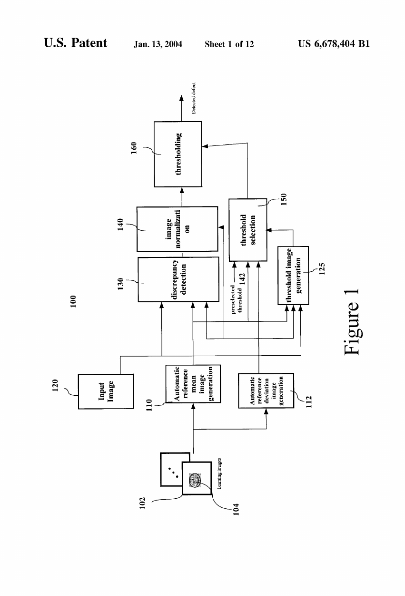
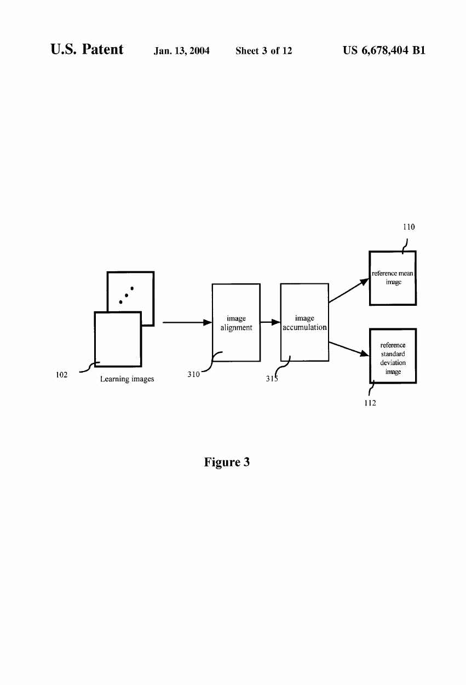
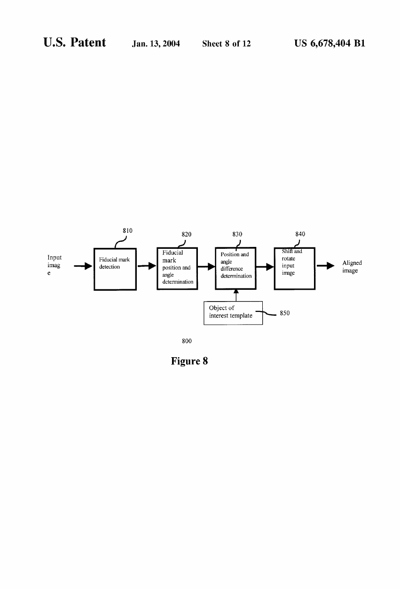

# US 6,678,404 B1 번역: 컴퓨터 비전 응용을 위한 자동 기준 생성

번역 범위: 전문 (초록, 상세한 설명, 청구항 4개, 도면 설명). 참고문헌은 원문 그대로 둔다.
번역 원본: 같은 폴더의 `US6678404B1.pdf`(공보 18쪽, USPTO 이미지 공보)와 Google Patents 본문 텍스트(https://patents.google.com/patent/US6678404B1/en). 두 자료를 대조했다.

## 서지 (공보 표지)

- (12) 미국 특허, (10) 특허 번호 US 6,678,404 B1, (45) 등록일 2004-01-13
- (54) 발명의 명칭: AUTOMATIC REFERENCING FOR COMPUTER VISION APPLICATIONS
- (76) 발명자: Shih-Jong J. Lee (Bellevue, WA, US), Seho Oh (Mukilteo, WA, US)
- 존속기간 연장: 35 U.S.C. 154(b)에 따라 161일
- (21) 출원 번호 09/703,018, (22) 출원일 2000-10-31
- (51) Int. Cl.7 G06K 9/00, (52) U.S. Cl. 382/155, 382/143, 382/145
- 청구항 4개, 도면 12장
- 심사관: Samir Ahmed (주), Vikkram Bali (보조)

## 초록

결함 검출 시스템이나 위치 찾기 시스템에서 기준 영상을 만들고 쓰는 방법이다. 이 시스템은 관심 물체가 담긴 학습 영상 여러 장을 받아, 기준 영상을 하나 이상 만든다. 컴퓨터 비전 시스템은 이 기준 영상을 써서 입력 영상 속 관심 물체와 기준 영상이 예상하는 물체 사이의 차이를 찾는다. 결함 검출 시스템은 차이 영상을 출력한다. 컴퓨터 비전 시스템은 또 입력 영상에 관심 물체가 있는지 판단하고, 찾았으면 그 위치를 알려 준다.

## 상세한 설명

### 미국 특허 참고문헌 (원문 그대로)

1. U.S. Pat. No. 5,315,700 entitled, "Method and Apparatus for Rapidly Processing Data Sequences", by Johnston et. al., May 24, 1994
2. U.S. Pat. No. 6,130,967 entitled, "Method and Apparatus for a Reduced Instruction Set Architecture for Multidimensional Image Processing", by Shih-Jong J. Lee, et. al., Oct. 10, 2000
3. Pending application Ser. No. 08/888,116 entitled, "Method and Apparatus for Semiconductor Wafer and LCD Inspection Using Multidimensional Image Decomposition and Synthesis", by Shih-Jong J. Lee, et. al., filed Jul. 3, 1997
4. U.S. Pat. No. 6,122,397 entitled, "Method and Apparatus for Maskless Semiconductor and Liquid Crystal Display Inspection", by Shih-Jong J. Lee, et. al., Sep. 19, 2000
5. Pending application Ser. No. 08/888,119 entitled, "Method and Apparatus for Incremental Concurrent Learning in Automatic Semiconductor Wafer and Liquid Crystal Display Defect Classification", by Shih-Jong J. Lee et. al., filed Jul. 3, 1997

### 참고문헌 (원문 그대로)

1. C. H. Anderson, C. R. Carlson, R. W. Kolpfenstein, "Spatial-frequency representations of images with scale invariant properties," SPIE vol. 360: 90-95.
2. Peter J. Burt, "Fast Algorithms for Estimating Local Image Properties," Computer Vision, Graphics, and Image Processing, vol. 21: 368-382, 1983
3. E. H. Adelson, C. H. Anderson, J. R. Bergen, P. J. Burt, J. M. Ogden, "Pyramid methods in image processing," RCA Engineer 29-6, November/December 1984.
4. Ballard D H and Brown C M, "Normalized Correlation," Computer Vision, Prentice-Hall Inc., 1982.
5. Burt, P J, "Fast filter transforms for image processing," Comp. Graphics and Image Processing, 16: 20-51, 1981.
6. Burt, P J and Adelson, E, "The Laplacian pyramid as a compact image code," IEEE Trans. on Communication, vol. 31: 532-540, 1983.
7. Lee, J S J, Haralick, R M and Shapiro, L G, "Morphologic Edge Detection," IEEE Journal of Robotics and Automation RA-3 No. 2: 142-156, 1987.
8. Maragos, P, "Pattern Spectrum and Multiscale Shape Representation," IEEE Trans. on Pattern Analysis and Machine Intelligence, vol. 11, 7-12: 701-716, 1989
9. P. J. Burt, "The Pyramid as a Structure for Efficient Computation," New York: Springer-Verlag, 1984.
10. James L. Crowley and Arthur C. Sanderson, "Multiple Resolution Representation and Probabilistic Matching of 2D Gray Scale Shape," IEEE: 95-105, 1984.
11. Sternberg, S R, "Grayscale morphology," Computer vision, Graphics, and Image Processing, vol. 35: 333-355, 1986.

### 이 출원에 참조로 포함하는 계류 중인 미국 특허 출원

1. Co-pending U.S. Patent application entitled, "Image Processing System with Enhanced Memory Management", by Shih-Jong J. Lee et. al. filed Oct. 20, 2000

### 기술 분야

이 발명은 컴퓨터 비전 시스템에서 자동 기준 생성을 써서 물체를 검출하고 위치를 찾는 일에 관한 것이다.

### 발명의 배경

많은 컴퓨터 비전 응용에서는 사용자가 관심 물체 템플릿(기준 영상의 한 종류)을 지정한다. 그리고 이 템플릿을 새 영상과 맞춰 관심 물체를 찾거나 위치를 정한다. 이 단순한 방식은 물체 찾기, 위치 찾기, 정렬, 측정에 쓰는 여러 머신 비전 도구의 바탕이다. 관심 물체를 찾을 때는 상관 방법으로 영상과 물체 템플릿의 밝기 값을 비교한다(참고문헌 4, Computer Vision 66~68쪽). 상관값이 가장 큰 위치를 물체 위치로 본다. 관심 물체가 템플릿과 거의 다르지 않으면 이 방식은 잘 맞는다. 그러나 물체의 방향이나 크기가 템플릿과 다르면 위치를 정확히 찾지 못한다. 조명 변화, 생산 편차, 부분 가림이 있으면 성능이 나빠진다.

이 한계를 피하려고 종래 기술은 정규화 밝기 상관(참고문헌 4) 같은 정규화 방법을 써서, 배경 변화가 큰 경우에도 템플릿 맞춤이 더 강건하게 했다. 그러나 이런 방법은 오경보가 많다. 이를 극복하려고 밝기 상관 대신 기하 정보 방식을 쓴다(참고: Cognex PatMax 제품 웹페이지. 원문에 주소가 적혀 있으나 공보 텍스트의 기호가 깨져 옮기지 않았다). 예를 들어 정사각형은 선분 4개로, 럭비공은 호 2개로 표현하고, 모양, 치수, 각도, 호, 음영 같은 특성을 잰다. 특징과 공간 관계의 기하 정보를 함께 써서 물체의 방향, 크기, 겉모습과 상관없이 관심 물체를 찾는다. 하지만 이 방식은 영상 안의 핵심 기하 특징을 믿을 만하게 찾아 분리할 수 있어야 한다. 기하 특징이 모호하거나 찾기 어려운 물체에서는 실패한다. 또 모호한 물체를 적당한 검출률로 잡으려고 민감도를 올리면 오경보가 많다. 여기서도 어려움은 템플릿과 크게 다른 물체, 예를 들어 방향 차이가 크거나 일부가 가려지거나 크기가 바뀐 물체에 있다. 또 하나의 어려움은 이 방식의 자동화다. 종래 방법은 수작업 시행착오 프로그래밍에 자주 의존한다. 마지막으로, 종래 기술에서는 설계 단계에서 시스템이 실제로 만날 모든 변수를 알기 어렵고, 응용 범위 전체가 반영됐는지 보장하기 어렵다.

### 목적과 이점

이 발명은 상관 방법이나 기하 정보 방법처럼 당업자에게 이미 알려진 물체 맞춤 방식을 개선하려 한다. 사용자가 지정한 템플릿 하나나 몇 개에 기대는 대신, 실제 응용 영상에서 쓸모 있는 정보를 자동으로 뽑는 것이 이 발명의 목적이다. 이 영상들은 관심 물체와, 그 응용 분야에서 예상되는 물체의 변화를 함께 담고 있다. 이렇게 체계적으로 자동화한 방식은 응용을 더 잘 대표하는 자료를 만든다.

템플릿을 표현하는 방법을 바꿔 효율과 효과를 높이는 것도 목적이다. 이 발명은 템플릿을 다중 해상도 영상 자료로 표현해, 검출과 위치 찾기의 효율과 신호 대 잡음비를 높인다. 다중 해상도 영상 표현은 거친 단계에서 고운 단계로 가는 템플릿 맞춤을 쉽게 하고, 영상 변화를 여러 공간 주파수 대역으로 나눠 대역별 가중과 판별 필터링을 할 수 있게 한다. 방향, 이득과 오프셋, 잡음 수준 같은 시스템 변수를 맞춤에 맞게 체계적으로 조정하는 일도 다중 해상도 자료로 더 빠르고 효과적으로 할 수 있다.

### 발명의 요약

한 실시예에서 이 발명은 자동 기준 영상 생성 모듈을 가진 자동 기준 기반 결함 검출 시스템을 포함한다. 이 실시예는 평균 기준 영상과 편차 기준 영상을 만드는 수단을 더 포함한다. 차이 영상을 문턱값 처리하고 정규화하는 수단도 둔다.

한 실시예에서 이 발명은 자동 기준 기반 물체 위치 찾기 시스템을 포함한다.

한 실시예에서 이 발명은 자동 기준 영상 생성 시스템을 포함한다.

한 실시예에서 기준 영상은 평균 영상과 편차 영상을 포함한다. 평균 영상은 지정한 "이상적" 상황에서의 템플릿 영상을 자동으로 구한 표현이다. 편차 영상은 템플릿 영상의 부분마다 예상되는 변화를 자동으로 구한 표현이다. 한 실시예에서 이 발명은 물체 검출 과정에서 변화가 작은 물체 영역의 가중치는 높이고, 변화가 큰 영역의 가중치는 낮춘다. 이 가중으로 평균 기준 영상은 관심 물체의 검출 신호를 키우고, 편차 기준 영상은 잡음의 영향을 줄인다.

한 실시예에서 기준 영상은 다중 해상도 영상 공간에서 표현된다.

### 도면의 간단한 설명

- 도 1: 자동 기준 기반 결함 검출 시스템
- 도 2: 자동 기준 기반 물체 위치 찾기 시스템
- 도 3: 자동 기준 영상 생성의 처리 흐름
- 도 4: 전처리 단계를 포함한 자동 기준 영상 생성의 처리 흐름
- 도 5A, 5B: 두 가지 자동 다중 해상도 기준 영상 생성의 처리 흐름
- 도 6: 학습 영상 획득 과정
- 도 7: 자동 학습 영상 획득 과정
- 도 8: 검출 기반 정렬 과정의 처리 흐름
- 도 9: 상관 기반 정렬 과정의 처리 흐름
- 도 10: 저역 통과 피라미드와 대역 통과 피라미드를 만드는 절차
- 도 11: 피라미드 표현에서 다중 해상도 영상을 복원하는 과정
- 도 12: 다중 해상도 방식을 쓰는 거친 단계에서 고운 단계로 가는 물체 위치 찾기 시스템의 처리 흐름

### 발명의 상세한 설명

#### 자동 기준을 쓰는 물체 검출 시스템

도 1과 도 2는 이 발명의 두 가지 응용 사례의 처리 흐름을 보인다. 도 1은 자동 기준 기반 결함 검출 시스템(100), 도 2는 자동 기준 기반 물체 위치 찾기 시스템(200)이다.



*도 1 (공보 1쪽, 대표 도면): 자동 기준 기반 결함 검출 시스템. 학습 영상(102)에서 자동 기준 평균 영상과 자동 기준 편차 영상(112)을 만들고, 입력 영상(120)과의 차이 검출(130), 차이 영상 정규화(140), 문턱값 처리(150, 160)를 거쳐 결함을 검출한다. 문턱값은 미리 정한 값(142) 또는 문턱 영상 생성(125)으로 정한다.*

자동 기준 기반 결함 검출 시스템(100)에서는, 관심 물체(104)가 담긴 학습 영상(102) 여러 장에서 자동 기준 영상(110)을 하나 이상 만든다. 응용 중에는 입력 영상(120) 속 물체와, 기준 영상(110)이 예상하는 관심 물체 사이의 차이를 검출한다(130). 이 차이는 기준 편차 영상으로 정규화할 수 있다(140). 정규화한 차이 영상에 문턱값을 적용해(160) 결함을 찾는다. 문턱값은 미리 고른 값(142)으로 정할 수도 있고, 기준 영상에서, 또는 기준 영상과 입력 영상을 함께 써서 자동으로 정할 수도 있다. 문턱값 처리(150)는 기준 영상에서, 또는 기준 영상과 입력 영상을 함께 써서 자동으로 정한 문턱 영상(125)으로 할 수도 있다.

도 2의 자동 기준 기반 물체 위치 찾기 시스템(200)에서는, 관심 물체(104)가 담긴 학습 영상(102) 여러 장에서 자동 기준 영상(210)을 하나 이상 만든다. 입력 영상 속 물체를 기준 영상이 예상하는 관심 물체(214)와 비교해, 관심 물체를 검출하고 위치를 정한다(216). 비교는 기준 영상이나 기준 편차 영상으로 정규화한 상관 방법으로 할 수 있다. 크기와 보는 각도의 변화를 다루려면 다중 해상도 방식을 써서 정확하고 효율적인 결과를 얻을 수 있다(도 12).

#### 자동 기준 영상 생성의 처리 흐름

이 발명의 자동 기준 영상 생성 처리 흐름은 도 3에 있다. 학습 영상(102)을 정렬하고(310) 누적한다(315). 정렬은 영상들을 서로 맞추는 일이다. 그래야 각 화소의 통계가 영상 정합의 흔들림에 크게 영향받지 않는다. 누적은 기준 영상의 모든 화소에서 평균값을 얻는 과정의 일부다. 누적한 영상에서 기준 평균 영상(110)과 기준 편차 영상(112)을 구한다.



*도 3: 자동 기준 영상 생성의 처리 흐름. 학습 영상(102) → 영상 정렬(310) → 영상 누적(315) → 기준 평균 영상(110), 기준 표준편차 영상(112).*

학습 영상은 정렬(310)과 누적(315) 전에 전처리(410, 도 4)할 수 있다. 전처리는 관심 특징을 강조하거나 전역 치우침을 정규화해 없앤다. 누적과 기준 도출은 도 5A와 도 5B처럼 다중 해상도 방식으로 할 수 있다. 다중 해상도 방식(500)은 정렬(510, 512)과 누적(515, 517)을 여러 해상도에서 하고, 영상 복원으로 전체 해상도 기준 영상을 만든다. 다른 다중 해상도 방식(550)은 정렬과 누적(560)을 전체 해상도에서 하고, 다중 해상도 영상 생성으로 다중 해상도 기준 영상(570, 580)을 만든다.

#### 학습 영상 획득

학습 영상 획득 과정은 도 6에 있다. 기준 영상은 학습 영상(102) 여러 장에서 만든다. 학습 영상은 응용에서 대표적인 변화 아래 찍은 관심 물체 영상이다. 좋은 학습 결과에 필요한 영상 수는 응용 안의 변화량에 달려 있다. 변화가 큰 응용은 영상이 더 많이 필요하다. 변화가 작은 응용은 몇 장이면 된다.

학습 영상은 사용자가 골라 줄 수도 있고, 실제 응용 영상에서 자동으로 얻을 수도 있다. 한 실시예에서 사용자는 응용을 시작할 때 학습 영상을 준다. 학습 영상은 대표적인 응용 변화(610) 아래 얻은 관심 물체(605)의 사례다. 필요한 학습 영상 수를 줄이려고, 사용자가 조명, 방향 같은 응용 변수를 체계적으로 바꾸고 그 조건마다 영상을 얻을 수 있다. 사용자가 예상되는 응용 변화의 범위를 지정하면, 컴퓨터 모의실험(620)으로 학습 영상을 더 만들 수 있다. 예를 들어 영상 밝기 값의 이득과 오프셋을 바꾸면 조명 조건 변화를 흉내 낼 수 있다. 영상 처리로 영상을 흐리게 하거나 선명하게 하면 초점 변화를 흉내 낼 수 있다.

학습 영상은 도 7처럼 응용 영상에서 자동으로 얻을 수도 있다. 응용 영상을 얻고(710), 응용 영상(710)에서 학습 영상을 자동으로 고른다(715). 학습 영상 자동 선택 과정(715)은 사용자가 준 초기 관심 물체 템플릿(720)으로 응용 영상(710)에서 관심 물체(705)를 찾는다. 한 실시예에서 검출은 상관 방법으로 한다. 상관 뒤에, 찾은 관심 물체가 얼마나 잘 맞는지 평가한다. 학습 영상의 품질을 보장하려고, 초기 관심 물체와 적당히 잘 맞는 것만 학습에 고른다. 이는 상관값의 최소 허용 한계를 두어 한다.

#### 전처리

학습 영상은 정렬과 누적 전에 전처리(410, 도 4)할 수 있다. 전처리 단계는 관심 물체의 특징을 강조하고, 관계없거나 믿을 수 없는 정보를 없앤다. 한 실시예에서는 전처리로 학습 영상에 대비 정규화를 한다. 대비 정규화는 원하는 밝기 히스토그램을 정해 할 수 있다. 입력 영상의 히스토그램을 재서 원하는 히스토그램과 비교한다. 밝기 값을 다시 양자화하고 다시 대응시켜 원하는 히스토그램에 가깝게 한다. 다른 실시예에서는 더 단순한 대비 정규화로, 다음처럼 이득과 오프셋을 조정한다.

```
I_normalized = I_input * Gain + Offset
```

이득은 다음으로 정할 수 있다.

```
Gain = Desired_range / (I_max - I_min)
```

여기서 "Desired_range"는 밝기 히스토그램의 원하는 범위이고, "I_max"와 "I_min"은 입력 영상에서 추정한 최대, 최소 밝기다. 추정은 측정값을 그대로 쓰거나, 이상값 문제를 피하려고 강건 통계 방법을 쓸 수 있다.

오프셋은 다음으로 정할 수 있다.

```
Offset = MIN_value - I_min
```

여기서 "MIN_value"는 원하는 최소 밝기다.

한 실시예의 다른 전처리 단계는 에지 강조다. Lee 등의 형태학적 에지 검출(참고문헌 7: "Lee, J S J, Haralick, R M and Shapiro, L G, "Morphologic Edge Detection", IEEE Trans. Robotics and Automation RA3(2): 142-56, 1987.") 같은 여러 에지 강조 방법을 쓸 수 있다. 고역 통과 필터, 대역 통과 필터, 또는 선 검출이나 모서리 검출 같은 선택적 강조 방법도 전처리에 쓸 수 있다. 예를 들어 선 검출이나 모서리 검출 연산자는 영상의 선이나 모서리 특징을 두드러지게 한다.

반도체 웨이퍼 검사 같은 응용에서는 반복되는 웨이퍼 패턴이 결함 검사에 쓸모 있는 정보를 주지 않을 수 있다. 응용에 맞춘 전처리로 관계없는 정보를 없앨 수 있다. 예를 들어 셀 대 셀, 다이 대 다이, 샷 대 샷 상관 방식으로 반복 패턴을 없앤다. 다른 예로, 이웃한 반복 패턴을 평균해 반복 패턴을 강조한 뒤, 이를 영상에서 빼서 반복 패턴을 없앤다.

#### 정렬

정렬 단계는 입력 영상 속 관심 물체의 상대 위치나 방향을, 관심 물체 템플릿의 기준 좌표에 대해 정한다. 한 실시예에서는 검출 방법으로 입력 영상의 방향과 위치를 정한다. 검출 방법에서는 방향 정렬에 피두셜 마크를 하나 이상 쓴다. 피두셜 마크는 점 두 개처럼 단순할 수도 있고, 십자, 원, 정사각형, 삼각형 같은 더 복잡한 패턴일 수도 있다. 피두셜 마크는 사용자가 지정할 수도 있고 자동으로 정할 수도 있다. CAD/CAM 모델이 있는 기계 부품은 모델에서 피두셜 마크를 자동으로 고를 수 있다. 선택 과정은 정렬 측정의 정밀도를 높이려고, 물체 중심의 서로 다른 쪽에 있고 서로 멀리 떨어진 마크(특징 포함)를 고른다.

검출 기반 정렬 과정의 처리 흐름은 도 8에 있다. 한 실시예(800)에서 정렬 단계는 피두셜 마크를 찾고(810) 그 위치를 정한다. 피두셜 마크 중심들을 잇는 선을 구하고 그 방향을 정한다. 검출한 방향과 관심 물체 템플릿에서 예상한 방향의 차이를 정한다(830). 마찬가지로 입력 영상에서 잰 피두셜 마크 중심들의 평균 위치와 예상 중심 위치를 비교한다. 정렬 단계(840)는 입력 영상을 회전하고 이동해 방향과 위치 차이를 보정하고, 정렬된 영상을 만든다.



*도 8: 검출 기반 정렬 과정. 입력 영상 → 피두셜 마크 검출(810) → 피두셜 마크 위치와 각도 결정(820) → 위치와 각도 차이 결정(830) → 영상 회전과 이동(840) → 정렬된 영상.*

이 발명의 다른 실시예는 상관 방법으로 정렬한다. 상관 기반 정렬 과정의 처리 흐름은 도 9에 있다. 먼저 입력 영상(905)을 이동시키며 상관 연산(910)을 해서, 관심 물체 템플릿(930)과 입력 영상 속 물체가 가장 잘 맞는 곳을 찾는다. 그다음 영상을 회전시키며 상관을 적용해 가장 잘 맞는 회전각을 찾는다(920). 가장 잘 맞는 결과에 해당하는 이동, 회전된 영상이 정렬된 영상(940)이다. 이 방법은 뚜렷하게 찾을 수 있는 피두셜 마크가 없는 관심 물체에 가장 쓸모 있다.

정렬 단계는 다중 해상도 방식으로도 할 수 있다. 한 실시예에서 다중 해상도 영상 표현은 도 10처럼 저역 통과 피라미드와 대역 통과 피라미드를 포함한다. 피라미드 자료 구조는 크기가 다른 영상 특징을 서로 분리한다. 저역 통과 피라미드는 원본 영상의 사본들로 이루어지며, 사본마다 표본 밀도와 해상도가 규칙적이거나 불규칙한 단계로 줄어든다. 반복 알고리즘으로 얻는다. 저역 통과 피라미드의 맨 아래, 즉 0번째 단계 L0는 원본 영상과 같다. 이 영상을 (선형, 형태학적, 또는 웨이블릿 함수로) 저역 통과 필터링하고 다운샘플링해서(보통 가로, 세로 각각 2배) 다음 단계 L1을 얻는다. L1을 같은 방식으로 필터링하고 다운샘플링해 L2를 얻는다. 필터링과 다운샘플링을 더 반복하면 나머지 저역 통과 피라미드 단계가 나온다. 따라서

```
L0 = I
Li = D(F(Li-1)),  i >= 1
```

여기서 I는 입력 영상, F(.)는 저역 통과 필터 연산, D(.)는 다운샘플 연산이다. 저역 통과 필터는 선형 합성곱 필터일 수도 있고, 팽창, 침식, 열림, 닫힘 같은 비선형 형태학 필터[Serra, 1982, Sternberg, 1986, Lee et al., 1987, Acharya and Laurette, 1988]나 웨이블릿 함수일 수도 있다. 저역 통과 피라미드는 원본 영상을 일련의 등가 선형 또는 비선형 이웃 커널로 필터링한 것과 같다. 등가 커널은 단계마다 (다운샘플 비율에 비례해) 커진다. 한 실시예에서 F(.)는 5화소 커널의 선형 가우시안 합성곱이고, 다운샘플 비율은 가로, 세로 각각 2다. 그러면 등가 필터는 단계마다 대역 한계가 한 옥타브씩 줄어드는 저역 통과 필터로 작동한다. 가우시안 커널을 쓰는 선형 저역 통과 분해는 잘 알려진 가우시안 피라미드 자료 구조와 같다[Burt, 1981, Burt and Adelson, 1983, 참고문헌 5, 6].

예로 대역 통과 분해 B0를 보자. 피라미드에서 저역 통과 단계 L0(1010)에서 다음 단계 L1(1020)을 빼면 대역 통과 피라미드 B0(1070)가 나온다. L0(1010)와 L1(1020)은 표본 밀도가 다르므로, L1을 이웃 단계 L0에서 빼기 전에 L1의 표본 사이에 새 표본 값을 보간해야 한다. 보간은 확장(업샘플, 1021) 뒤 선형 저역 통과 필터링(1024)으로 할 수 있다. 비슷한 과정으로 B1(1060)이나 B2(1050)를 만든다. 따라서 대역 통과 피라미드 단계 Bi는 저역 통과 피라미드 단계로 다음처럼 쓸 수 있다.

```
Bi = Li - L(EXP(Li+1))
```

여기서 L(.)은 선형 저역 통과 필터, EXP(.)는 확장(업샘플) 연산이다.

다중 해상도 정렬 과정(도 12)은 입력 영상의 저역 통과 피라미드와 대역 통과 피라미드 표현을 만들고, 피라미드 단계마다 정렬한다. 한 실시예에서 정렬은 거친 해상도에서 고운 해상도로 진행하며, 가장 낮은 해상도의 저역 통과 피라미드와 대역 통과 피라미드를 정렬용 영상으로 쓴다(도 10의 영상이라면 L3(1040), B2(1050), B1(1060), B0(1070)). 이 실시예에서는 거친 해상도의 정렬 결과를 더 고운 해상도 정렬의 시작점으로 쓸 수 있다. 다중 해상도 방식은 도 10처럼 저역 통과 피라미드와 대역 통과 피라미드를 만든다. 가장 낮은 해상도에서 비교를 시작하고, 낮은 해상도의 비교 결과로 높은 해상도 비교를 이끈다. 비교는 저역 통과 피라미드(적분 에너지)나 대역 통과 피라미드(공간 분해)로 할 수 있다. 밝기 동적 범위가 넓은 영상에서는 대역 통과 채널마다 동적 범위가 제한되어 처리 비용이 줄어든다. 회전각 같은 다른 변수도 거친 단계에서 고운 단계로 가는 탐색에 넣을 수 있다. 처리 흐름은 도 12에 있으며, 여기서 관심 물체 템플릿(1250)의 위치를 찾는다. 다중 해상도 입력은 영상을 네 해상도 단계(1200, 1220, 1230, 1240)로 나타내며, 도 12에서 크게 그린 것이 높은 해상도 영상이다. 저해상도 영상(1250)에서 각도(1202, 1204, 1206)를 바꿔 가며 관심 물체를 찾는다. 해상도가 낮아 탐색 각도 간격이 상대적으로 크므로, 이 탐색은 영상의 넓은 영역을 다룬다. 물체를 찾으면 대략 위치를 점점 높은 해상도 영상으로 넘기고, 단계마다 낮은 해상도에서 얻은 초기 위치가 효율적인 시작점이 된다. 이 과정은 매우 효율적이며, 영상(1240)에서 얻을 수 있는 가장 정확한 결과를 낸다.

#### 누적

정렬한 학습 영상을 누적해 기준 영상을 만든다. 한 실시예에서 누적은 합 영상, 제곱합 영상, 영상 수를 차례로 갱신해 한다. 합 영상 I_sum은 처음 정렬한 학습 영상과 같게 두고, 학습 영상이 더해질 때마다 다음 식으로 갱신한다.

```
I_sum(new)[i][j] = I_sum(old)[i][j] + W * I_input(aligned)[i][j]
```

여기서 "I_sum(new)[i][j]"는 합 영상 I_sum의 새(갱신한) 값의 ij번째 화소, "I_sum(old)[i][j]"는 이전 합 영상 값의 ij번째 화소, "I_input(aligned)[i][j]"는 정렬한 입력 영상의 ij번째 화소다. (원문은 이전 값도 "I_sum(new)"로 적었는데 오기로 보인다.) 결과 영상의 정밀도를 보장하려면 I_sum 영상의 화소마다 충분한 동적 범위(비트)를 줘야 한다. W는 가중치이며 보통 1로 둔다. W는 시간에 따라 동적으로 바꿀 수도 있고, 학습한 영상 수의 함수로 둘 수도 있다. 도 7의 715에서 얻는 학습 영상 선택의 적합도로 W를 정할 수도 있다.

제곱합 영상 I_sos는 처음 정렬한 학습 영상을 제곱한 영상과 같게 두고, 학습 영상이 더해질 때마다 다음 식으로 갱신한다.

```
I_sos(new)[i][j] = I_sos(old)[i][j] + W * I_input(aligned)[i][j] * I_input(aligned)[i][j]
```

여기서 "I_sos(new)[i][j]"는 제곱합 영상 I_sos의 새(갱신한) 값의 ij번째 화소, "I_sos(old)[i][j]"는 이전 제곱합 영상 값의 ij번째 화소다. 결과 영상의 정밀도를 보장하려면 I_sos 영상의 화소마다 충분한 동적 범위(비트)를 줘야 한다.

영상 수 N은 누적에 쓴 학습 영상 수의 가중 합이다. 처음에 0으로 두고, 학습 영상마다 가중치 W만큼 늘린다.

누적은 다중 해상도 방식으로 할 수 있다. 한 실시예에서는 가장 낮은 해상도의 저역 통과 피라미드와 대역 통과 피라미드 영상들로 영상 누적을 한다.

정렬 과정 때문에 영상 경계 근처 화소는 유효한 값이 없을 수 있다. 경계 처리는 응용에 따라 다르다. 어떤 응용에서는 예상값을 정해 그 화소에 쓴다. 다른 응용에서는 경계 화소를 누적에서 빼야 한다.

#### 기준 영상 생성

기준 평균 영상은 합 영상 I_sum을 화소마다 나누어 만든다.

```
I_mean = I_sum / N
```

한 실시예에서는 시간을 줄이려고 나눗셈을 조회표로 한다. 조회표 사용은 참조로 포함한 계류 중인 미국 특허 출원 "Image Processing System with Enhanced Memory Management"(Shih-Jong J. Lee 외, 2000-10-20 출원)에 설명되어 있다.

기준 편차 영상 I_dev는 제곱합 영상 I_sos와 I_mean으로 다음 식에서 만든다.

```
I_dev[i][j] = SQRT(I_sos[i][j] / N - I_mean[i][j] * I_mean[i][j])
```

SQRT는 제곱근 함수다. 한 실시예에서는 시간을 줄이려고 나눗셈과 SQRT를 조회표 연산으로 한다. 기준 영상에는 다른 영상 통계의 누적도 넣을 수 있다. 예를 들어 중앙값 영상, 최대, 최소, 최대 빼기 최소 영상, 그리고 왜도, 첨도 같은 고차 통계 영상이다.

위에서 말한 모든 기준 영상은 다중 해상도 방식으로 만들거나 저장하거나 쓸 수 있다. 한 실시예에서는 가장 높은 해상도에서 기준 영상을 만들고, 도 10의 절차로 저역 통과, 대역 통과 피라미드의 기준 영상을 만든다. 다른 실시예에서는 가장 낮은 해상도의 저역 통과 피라미드(이 예에서 L3)와 대역 통과 피라미드 영상(B2, B1, B0)의 기준 영상을 만든다. 저역 통과 피라미드의 다른 단계 기준 영상은 다중 해상도 영상 복원으로 만들 수 있다. 다중 해상도 영상 복원 방법은 도 11에 있다.

도 11처럼 도 10의 피라미드를 만드는 단계를 거꾸로 하면 원본 영상을 복원할 수 있다. I=2에서 Li(1130)를 복원하려면, 저역 통과 피라미드 단계 Li+1(1140)을 보간하고(1142, 1144) Bi(1150)에 더한다. 이 절차를 반복해 Li-1(1120), Li-2(1110), 즉 원본 영상(1110)을 복원한다. 따라서

```
Li = Bi + L(EXP(Li+1)),  i ∈ {1, ..., N-1}
I = L0 = B0 + L(EXP(L1))
```

#### 관심 물체 위치 찾기와 검출을 위한 기준 기반 영상 정규화

기준 영상으로 입력 영상을 정규화해 관심 물체를 찾을 수 있다. 상관 기반 물체 검출에서는 I_mean 안의 관심 물체 템플릿으로 상관을 할 수 있다. 관심 물체 안에서 변화가 커서 덜 믿을 만한 영역의 기여를 줄이려고, 한 실시예에서는 평균 관심 물체 템플릿을 편차 영상으로 다음처럼 정규화한다.

```
I_OOI = I_mean[i][j] / (α + I_dev[i][j])
```

여기서 α는 정규화 정도를 조절하는 퍼지 상수다.

관심 물체의 위치를 찾은 뒤 그 안의 결함을 찾으려면, 결함 검출 알고리즘을 적용하기 전에 입력 영상을 다음 식으로 정규화할 수 있다.

```
I_normalized = (I_input - I_mean) / (β + I_dev[i][j])
```

여기서 β는 정규화 정도를 조절하는 퍼지 상수다.

이 발명은 특허법을 따르고, 당업자에게 새로운 원리를 적용하고 필요한 특수 구성 요소를 만들어 쓰는 데 필요한 정보를 주려고 상당히 자세하게 설명했다. 그러나 이 발명은 구체적으로 다른 장비와 장치로도 실시할 수 있고, 장비 세부와 운용 절차 모두 발명의 범위를 벗어나지 않고 여러 가지로 바꿀 수 있음을 이해해야 한다.

## 청구항

청구하는 것은 다음과 같다.

1. 자동 다중 해상도 기준 영상 생성 방법으로서,
   a. 학습 영상 여러 장을 입력하고,
   b. 학습 영상 여러 장의 다중 해상도 영상 표현을 만들고,
   c. 학습 영상 여러 장의 정렬과 누적을 여러 해상도에서 하되, 누적 단계는 학습 영상 여러 장의 화소들 사이의 왜도(skewness) 통계를 누적하고,
   d. 다중 해상도 영상 복원으로 기준 영상을 만드는 방법.

2. 자동 다중 해상도 기준 영상 생성 방법으로서,
   a. 학습 영상 여러 장을 입력하고,
   b. 학습 영상 여러 장의 다중 해상도 영상 표현을 만들고,
   c. 학습 영상 여러 장의 정렬과 누적을 여러 해상도에서 하되, 누적 단계는 학습 영상 여러 장의 화소들 사이의 첨도(kurtosis) 통계를 누적하고,
   d. 다중 해상도 영상 복원으로 기준 영상을 만드는 방법.

3. 자동 다중 해상도 기반 물체 위치 찾기 방법으로서,
   a. 학습 영상 여러 장을 입력하고,
   b. 학습 영상 여러 장의 정렬과 누적을 해서 기준 영상 출력을 만들되, 누적 단계는 학습 영상 여러 장의 화소들 사이의 왜도 통계를 누적하고,
   c. 기준 영상 출력으로 다중 해상도 영상 생성을 해서 다중 해상도 기준 영상을 만들고,
   d. 입력 영상을 얻고,
   e. 입력 영상과 다중 해상도 기준 영상으로 다중 해상도 기반 물체 위치 찾기를 하는 방법.

4. 자동 다중 해상도 기반 물체 위치 찾기 방법으로서,
   a. 학습 영상 여러 장을 입력하고,
   b. 학습 영상 여러 장의 정렬과 누적을 해서 기준 영상 출력을 만들되, 누적 단계는 학습 영상 여러 장의 화소들 사이의 첨도 통계를 누적하고,
   c. 기준 영상 출력으로 다중 해상도 영상 생성을 해서 다중 해상도 기준 영상을 만들고,
   d. 입력 영상을 얻고,
   e. 입력 영상과 다중 해상도 기준 영상으로 다중 해상도 기반 물체 위치 찾기를 하는 방법.

## 공보 표지의 인용 문헌 (원문 그대로)

U.S. PATENT DOCUMENTS
- 5,046,111 A 9/1991 Cox et al. 382/143
- 5,229,868 A * 7/1993 Kanno et al. 358/447
- 5,842,194 A 11/1998 Arbuckle 706/52
- 5,850,466 A 12/1998 Schott 382/141

OTHER PUBLICATIONS: 위 "참고문헌" 1~11과 같은 목록이 표지에 실려 있다.
\* cited by examiner
