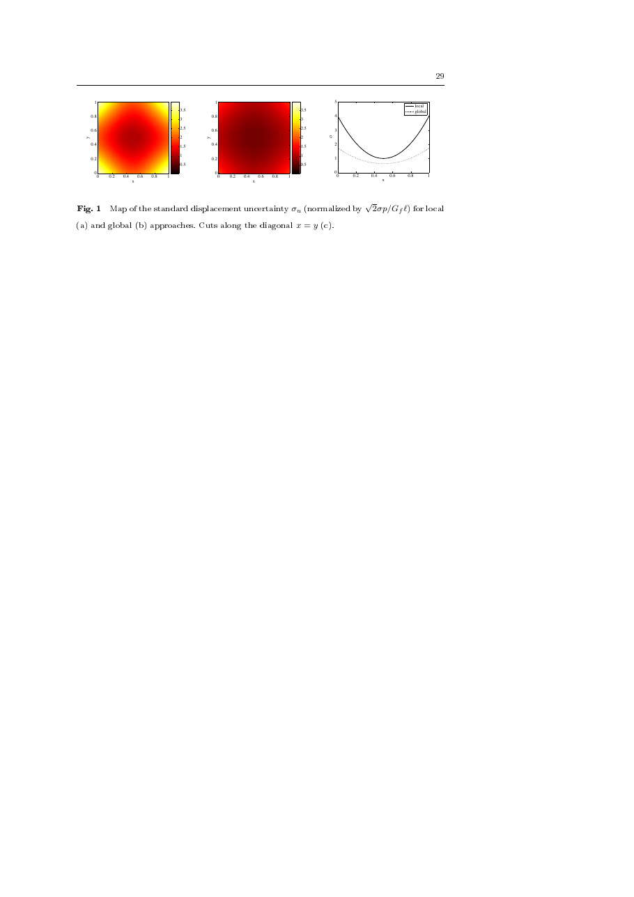
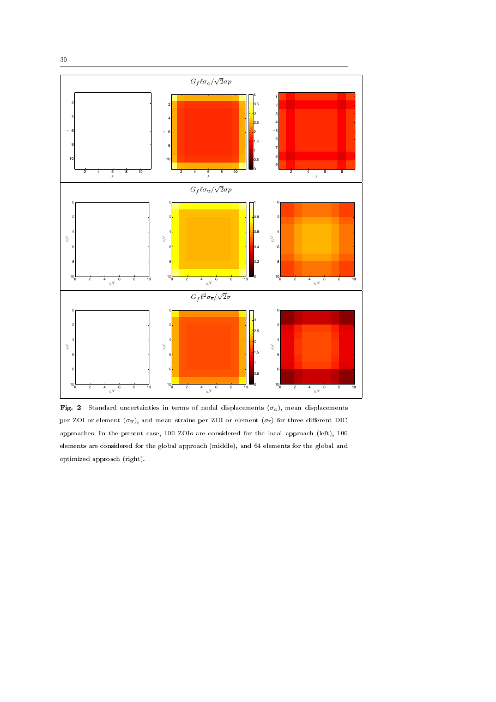
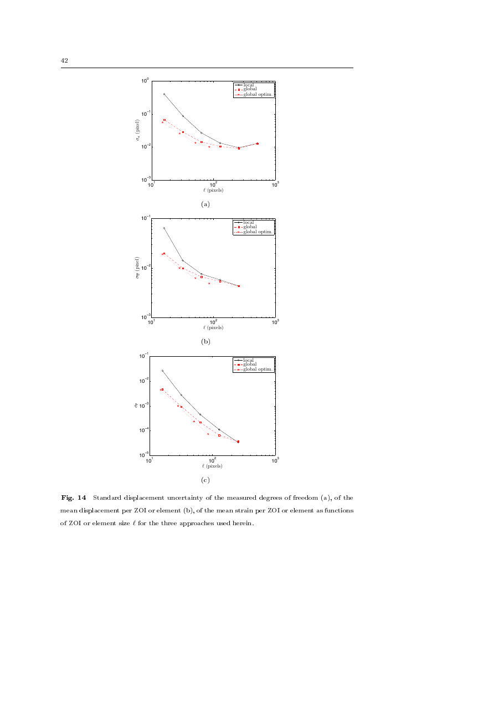

# 번역: 디지털 영상 상관법의 국소 방식과 전역 방식 비교 (Comparison of Local and Global Approaches to Digital Image Correlation)

- 원문 파일: [Hild2012_ExpMech_local_global_DIC.pdf](Hild2012_ExpMech_local_global_DIC.pdf)
- 원문 출처: HAL 공개본 hal-00750756v1 (https://hal.science/hal-00750756/document, 2026-11-04 HTTP 200 application/pdf, 46쪽으로 받음)
- 번역 범위: 전문 (초록, 본문, 수식, 그림 캡션 17개, 감사의 글). 참고문헌은 원문 그대로 둔다.
- 주의
  - 받은 파일은 저자가 HAL에 올린 원고판(Experimental Mechanics manuscript)이다. 1쪽은 HAL 표지, 2쪽부터 원고다. 그림은 원고 뒤쪽(PDF 30~46쪽)에 모여 있다.
  - 학술지 인쇄본(Experimental Mechanics 52(9):1503-1519)과 쪽 번호, 배치가 다르다. 문구가 완전히 같은지는 확인하지 않았다.
  - 아래 쪽 번호 표시는 원고 쪽 번호다. PDF 쪽 = 원고 쪽 + 1.
  - pdftotext로 뽑으면 수식이 깨진다. 수식은 쪽 이미지를 보고 옮겼다.
  - 용어: ZOI(zone of interest)는 "관심 창", ROI(region of interest)는 "관심 영역", Q4는 "4절점 사각 요소", resolution은 "분해능", standard uncertainty는 "표준 불확도"로 옮긴다.

---

## 초록

디지털 영상 상관법(DIC)의 국소 방식과 전역 방식을 비교한다.
두 방식 모두 변위 보간에 쌍일차 형상 함수(곧 4절점 사각 요소)를 쓴다.
두 방식의 변위 분해능과 변형률 분해능을 미리(a priori) 계산한다.
그리고 실제 실험의 영상 묶음으로 나중에(a posteriori) 검증한다.
전역 방식이 대체로 국소 방식보다 낫다는 것을 보인다.

핵심어: 4절점 사각 요소, 변위, 전장(full-field) 측정, 분해능, 표준 불확도, 변형률.

## 1 서론

디지털 영상 상관법(DIC)은 2차원, 3차원 변위장을 재는 데 널리 쓰인다 [1-3].
2차원 판에서 DIC는 두 영상을 정합한다.
가장 잘 맞게 하는 변위장을 재는 것이다.
보통 원근 왜곡을 줄이려고 광축에 수직인 평면을 관찰한다.
그리고 강체가 아닌(non-rigid) 정합을 구한다.
관찰 표면에는 흔히 무작위 무늬를 칠한다.
또는 표면이 고체의 변위를 수동적으로 따라간다는 가정 아래, 표면의 자연 질감과 표시를 이용해 변위장을 잰다.
고체 역학에서 쓰는 DIC는 유체 역학의 입자 영상 유속계(PIV)와 같은 것이다.
DIC [4-7]는 PIV [8-12]보다 몇 년 늦게 시작했다.
구하는 변위와 변형률 분해능이 속도 분해능보다 작았기 때문에 발전이 더 느렸다.
알고리즘 과제가 더 어려웠다.
그래도 이 기법은 표준 분해능과 불확도가 100분의 1 화소(centipixel) 수준에 이르렀다 [13-16].
편향은 1000분의 1 화소(millipixel) 이하다 [17, 14, 2, 16].
이 수준은 고체 역학에서 만나는 다양한 경우에 맞는다 [1-3].

처음 개발에서는 관심 영역 안의 작은 창, 곧 관심 창(ZOI)에서 정합을 했다.
이런 방식을 이 글에서는 **국소(local)** 방식이라 부른다.
초기 개발은 순수 병진만 구했다.
물리 공간에서 구하거나 [4-6], 푸리에 공간에서 구했다 [18-20].
뒤에 운동 가정을 바꾸어 관심 창의 뒤틀림을 고려했다.
1차 보간이 구현되었다 [7, 21].
더 높은 차수 보간도 쓰인다 [15].
그러나 모든 경우에 남기는 정보는 각 관심 창의 평균 변위뿐이다.

컴퓨터 비전에서는 아주 일찍부터 다른 기법이 구현되었다.
이 기법들은 변분 공식에 바탕을 둔다.
고체 역학에서 유한 요소 공식을 쓸 때와 같은 방식이다 [22].
Horn과 Schunck의 연구에서는 변위의 흔들림을 줄이려고 공간 정칙화를 넣었다 [23].
그러나 불연속이 예상되는 경우에는 이 방식이 그 자체로 맞지 않는다 [24].
강건 통계에 바탕을 둔 더 부드러운 벌점이 구현되었다 [25, 26].
정합을 정칙화하는 다른 길은 연속성을 직접 강제하는 것이다.
더 나아가 정칙화 항의 가중을 고를 여지를 아예 남기지 않는 것이다.
여러 변위장이 연구되었다.
선형 [27], 푸리에 전개 [27, 28], B-스플라인 [29, 30], 탄성 해(닫힌 꼴 [31, 32]과 수치 해 [33, 34])이다.
이 모든 경우에 정합을 관심 영역(ROI) 전체에서 하므로, 이를 **전역(global)** 방식이라 부른다.

국소 방식에서 쓰는 보간을 그대로 쓸 수도 있다.
이때는 이산화 방법이 필요하고, 유한 요소법이 가장 잘 맞는다.
컴퓨터 비전에서는 이런 방식이 1990년대에 개발되었다 [35].
고체 역학에서는 유한 요소 기반 전역 방식이 2000년대 중반에 도입되었다.
최소화하는 양으로 상관 곱 [37]이나 차이 제곱합 [36, 14]을 썼다.
비교를 하려면 4절점 쌍일차 요소가 가장 논리적인 선택이다.
이 글에서는 이 요소를 쓴다.
그리고 관심 영역 전체에서 절점 변위의 분해능을 더 좋게 하려고 격자 조정(mesh adaption)도 쓴다.
비정형 격자도 쓸 수 있다는 점을 덧붙인다 [33].
그러나 그런 이산화를 쓰는 국소 방식은 거의 없다.

이 글의 목적은 국소 방식과 전역 방식을 비교하는 것이다.
국소 방식과 전역 방식 모두 여러 정합 알고리즘이 쓰인다 [15, 36, 37, 14].
비교를 객관적으로 하려면 같은 알고리즘을 써야 한다.
곧 명암 보간, 운동 보간, 최소화 절차가 같아야 한다.
아래에서는 그렇게 한다.
글의 구성은 이렇다.
먼저 차이 제곱합을 최소화해 변위를 구할 때의 국소 방식과 전역 방식의 원리를 보인다.
획득 잡음에 대한 민감도를 절점 변위, 평균 변위, 관심 창이나 요소당 평균 변형률의 불확도로 논의한다.
이론 예측을 미리 계산한 분해능 분석과 비교한다.
첫 실제 예는 얇은 막의 2축 시험 중 CCD 카메라로 찍은 영상 묶음이다.
두 번째 예로 주사 전자 현미경(SEM)에서 얻은 영상 한 쌍을 분석한다.

## 2 DIC의 국소 방식과 전역 방식

### 2.1 상관 절차

2차원 영상을 정합하는 방법은 여러 가지다.
국소 방식에서 가장 널리 쓰는 것은 상관 곱이다 [2].
다른 방법은 차이 제곱합이다.
저자들은 유한 요소 이산화를 쓰는 전역 방식을 구현할 때 차이 제곱합을 썼다 [14, 32-34].
아래에서는 두 기법 모두에 차이 제곱합을 쓴다.

기준 상태의 영상을 $f$, 변형 상태의 영상을 $g$라 하자.
두 영상은 고체 표면의 반점(speckle) 무늬를 담는다.
이 무늬는 바탕 고체를 따라 수동적으로 움직인다고 가정한다.
그러면 모든 화소 위치 $\mathbf{x}$에서 명암 보존은 다음과 같다.

$$f(\mathbf{x}) = g(\mathbf{x} + \mathbf{u}(\mathbf{x})) \tag{1}$$

여기서 $\mathbf{u}$는 변위 벡터다.
획득 잡음 때문에 이 보존 법칙은 정확히 맞지 않는다.
또 미지수가 식보다 많다.
그래서 영상 $f$와 $g$만으로는 변위 벡터 $\mathbf{u}$를 정할 수 없다.
따라서 상관 절차는 화소 1개보다 넓은 정해진 영역에서 써야 한다.
예를 들어 상관 절차는 다음 차이 제곱합을 최소화한다.

$$T = \int_{\Omega} \left(f(\mathbf{x}) - g[\mathbf{x} + \mathbf{u}(\mathbf{x})]\right)^2 d\mathbf{x} \tag{2}$$

영역 $\Omega$는 국소 방식에서는 관심 창, 전역 방식에서는 관심 영역이다.
이 영역에서 변위장은 다음처럼 보간한다.

$$\mathbf{u}(\mathbf{x}) = \sum_n u_n \boldsymbol{\psi}_n(\mathbf{x}) \tag{3}$$

여기서 $\boldsymbol{\psi}_n$은 (고른) 벡터 함수이고, $u_n$은 그에 대응하는 자유도다.
측정 문제는 미지수 $u_n$에 대해 $T$를 최소화하는 것이다.
절점 변위를 자유도로 고르면 국소 방식과 전역 방식의 같은 점과 다른 점이 잘 드러난다.
그러나 국소 방식에서 전통적으로 쓰는 매개변수화는 이와 동등하지만 다르다.
중심점 변위가 가장 중요한 양이라 따로 떼어 둔다.
다른 자유도는 중심에 대한 1차 다항식 전개에 해당한다.

최소화 문제의 비선형성을 다루려고 뉴턴 반복 절차를 쓴다.
반복 $i$에서의 변위를 $\mathbf{u}^i$, 모든 미지 자유도를 담은 벡터를 $\{\mathbf{u}\}^i$라 하자.
해의 증분 $d\mathbf{u} = \mathbf{u}^{i+1} - \mathbf{u}^i$가 작다고 가정한다.
테일러 전개로 $g(\mathbf{x} + \mathbf{v}(\mathbf{x})) \approx g(\mathbf{x}) + \mathbf{v}(\mathbf{x}) \cdot \nabla g(\mathbf{x}) \approx g(\mathbf{x}) + \mathbf{v}(\mathbf{x}) \cdot \nabla f(\mathbf{x})$로 선형화한다.
그러면 $\partial T / \partial \{\mathbf{u}\}^i$를 행렬과 벡터의 곱으로 다시 쓸 수 있다.

$$\frac{\partial T}{\partial \{\mathbf{u}\}^i} = [\mathbf{M}]\{d\mathbf{u}\} - \{\mathbf{b}\}^i = \{\mathbf{0}\} \tag{4}$$

여기서

$$M_{mn} = \int_{\Omega} [\nabla f(\mathbf{x}) \cdot \boldsymbol{\psi}_m(\mathbf{x})][\nabla f(\mathbf{x}) \cdot \boldsymbol{\psi}_n(\mathbf{x})] d\mathbf{x} \tag{5}$$

$$b^i_m = \int_{\Omega} [f(\mathbf{x}) - \tilde{g}^i(\mathbf{x})][\nabla f(\mathbf{x}) \cdot \boldsymbol{\psi}_m(\mathbf{x})] d\mathbf{x} \tag{6}$$

그리고

$$\tilde{g}^i(\mathbf{x}) = g(\mathbf{x} + \mathbf{u}^i(\mathbf{x})) \tag{7}$$

행렬 $[\mathbf{M}]$은 한 번만 계산한다.
반복마다 벡터 $\{\mathbf{b}\}$만 갱신한다.
이 선택(다른 선택도 가능하다 [14])은 계산 효율 때문일 뿐이다.
반복은 변위 보정량 $\{d\mathbf{u}\}$가 사용자가 고른 작은 값에 이르면 멈춘다.
많은 경우 초깃값은 $\{\mathbf{u}\}^i = \{\mathbf{0}\}$이다.
그러나 다른 제안도 있다 [30, 38].

개발한 기법의 분해능(각주 1)을 평가해 보자.
잡음 없는 기준을 모르므로, 잡음은 변형 영상에 분산 $2\sigma^2$로 준다.
여기서 $\sigma^2$는 가우스 백색 잡음의 분산이다 [32].
이 가정 아래 공분산 행렬 $[\mathbf{C}]$는 간단히 다음이 된다 [14, 32].

$$[\mathbf{C}] = 2\sigma^2 p^2 [\mathbf{K}] \tag{8}$$

여기서 $[\mathbf{K}] = [\mathbf{M}]^{-1}$이고, $p$는 화소 하나의 물리 크기다.
이 결과는 매우 일반적이다.
비슷하게, 잡음 수준이 작으면 $\mathbf{u}$의 추정이 편향되지 않음을 보일 수 있다.

> 각주 1: 측정 체계의 분해능은 "측정하는 양에서, 대응하는 지시값에 알아챌 만한 변화를 일으키는 가장 작은 변화"다 [39].

### 2.2 국소 방식

이 글의 설정에서 DIC의 국소 방식은 관심 창에서 다음 차이 제곱합을 최소화하는 것이다.

$$T_l = \int_{\text{ZOI}} \left(f(\mathbf{x}) - g[\mathbf{x} + \mathbf{u}(\mathbf{x})]\right)^2 d\mathbf{x} \tag{9}$$

이 일반성 수준에서는 각 관심 창의 변위를 여러 가지로 고를 수 있다.
아래에서는 유한 요소 공식에서 쓰는 형상 함수를 고른다.
이 부분에서는 요소 사이 연결성을 아직 강제하지 않는다.
영상이 화소로 표본화되므로 정사각형이나 직사각형 관심 창을 쓰는 것이 자연스럽다.
여기서는 규칙적인 정사각형 관심 창만 다룬다.
크기는 $\ell$로 쓴다.
관심 창 사이 간격은 고를 수 있다.
$\ell$과 같을 수도 있고(붙은 창), $\ell$보다 작을 수도 있고(겹친 창), $\ell$보다 클 수도 있다(떨어진 창).
유한 요소 계산과 비교하려고 아래에서는 붙은 관심 창을 쓴다.
가장 단순한 보간은 쌍일차다.
곧 함수 $1, x, y, xy$이고, $x$와 $y$는 관심 창 안 점 $M(x, y)$의 국소 좌표다.
변위의 각 성분을 똑같이 다룬다(곧 스칼라 함수 $N_n(\mathbf{x})$만 쓴다).
그래서 각 관심 창 $\Omega_e$의 변위 $\mathbf{u}^e(\mathbf{x})$는 다음과 같다.

$$\mathbf{u}^e(\mathbf{x}) = \sum_{n=1}^{n_e} \sum_{\alpha} a^e_{\alpha n} N_n(\mathbf{x}) \mathbf{e}_\alpha \tag{10}$$

여기서 $n_e$는 절점 수(여기서는 $n_e = 4$), $\mathbf{e}_\alpha$는 방향 $\alpha = 1, 2$의 단위 벡터, $a^e_{\alpha n}$은 미지 절점 변위다.
요소 행렬 $[\mathbf{M}^e]$의 성분은 다음과 같다.

$$M^e_{\alpha m \beta n} = \int_{\Omega_e} \partial_\alpha f(\mathbf{x}) N_m(\mathbf{x}) \partial_\beta f(\mathbf{x}) N_n(\mathbf{x}) d\mathbf{x} \tag{11}$$

요소 벡터 $\{\mathbf{b}^e\}$는 다음과 같다.

$$b^e_{\alpha m} = \int_{\Omega_e} [f(\mathbf{x}) - \tilde{g}(\mathbf{x})] \partial_\alpha f(\mathbf{x}) N_m(\mathbf{x}) d\mathbf{x} \tag{12}$$

여기서 $\partial_\alpha f = \nabla f \cdot \mathbf{e}_\alpha$이고, $\tilde{g}$는 보정한 영상이다.
이것들을 관심 창마다 계산한다.
행렬 $[\mathbf{M}^e]$는 대칭이고 양의 정부호다(역행렬이 있을 때).
고전 유한 요소 절차와 달리 구적 공식을 쓰지 않는다.
영상 질감이 불규칙하기 때문이다.
대신 화소 합을 쓴다 [14].
관심 창마다 8 x 8 선형계를 반복해서 푼다.

$$[\mathbf{M}^e]\{d\mathbf{a}^e\} = \{\mathbf{b}^e\}^i \tag{13}$$

벡터 $\{\mathbf{a}^e\}$는 구하는 자유도 $a^e_{\alpha n}$을 모두 담는다.
2.1절의 분해능 분석을 이 부분에서 고른 운동학에 적용한다.
각 자유도 $a^e_{\alpha m}$의 표준 편차 $\sigma_{a^e_{\alpha m}}$은 다음과 같다.

$$\sigma_{a^e_{\alpha m}} = \sqrt{2}\,\sigma p \sqrt{K^e_{\alpha m \alpha m}} \tag{14}$$

여기서 $[\mathbf{K}^e] = [\mathbf{M}^e]^{-1}$이다.
이 결과는 바탕 질감, 더 정확히는 그 기울기에 따라 상관 기법의 분해능이 관심 영역 전체에서 꼭 고르지는 않음을 보여 준다.

질감의 상관 길이가 몇 화소보다 크고 관심 창 크기 $\ell$보다 작다고 하자.
이때 평균장(mean-field) 가정을 쓴다.
곧 $[\mathbf{M}^e]$의 식(식 (11))에 나오는 영상 기울기 제곱을 적분 밖으로 꺼내 기댓값으로 바꾼다.

$$\langle \partial_\alpha f \, \partial_\beta f \rangle = G_f^2 \delta_{\alpha\beta} \tag{15}$$

여기서 $G_f$는 어느 방향으로 사영한 영상 기울기의 제곱 평균이다.
여기서는 영상 질감이 등방이라고 가정한다.
이 평균장 가정은 관심 창이 클 때 맞을 것으로 보지만, 작을 때는 깨질 수 있다.
이 조건에서 부분 행렬 $M^e_{\alpha\beta}$는 다음과 같다.

$$[\mathbf{M}^e_{\alpha\beta}] \propto \frac{G_f^2 \ell^2}{36} \delta_{\alpha\beta} \begin{bmatrix} 4 & 2 & 2 & 1 \\ 2 & 4 & 1 & 2 \\ 2 & 1 & 4 & 2 \\ 1 & 2 & 2 & 4 \end{bmatrix} \tag{16}$$

따라서 측정한 자유도의 공분산 행렬은 다음과 같다.

$$[\mathbf{C}_{\alpha\beta}] \propto \frac{8\sigma^2 p^2}{G_f^2 \ell^2} \delta_{\alpha\beta} \begin{bmatrix} 4 & -2 & -2 & 1 \\ -2 & 4 & 1 & -2 \\ -2 & 1 & 4 & -2 \\ 1 & -2 & -2 & 4 \end{bmatrix} \tag{17}$$

자유도의 공분산 행렬은 $[\mathbf{M}]$의 역행렬과 바로 이어진다.
그래서 $[\mathbf{M}^e]$와 $[\mathbf{C}]$가 동시에 대각이 되는 기저가 있다.
고유값과 고유 모드의 스펙트럼으로 잡음 민감도를 쉽게 해석할 수 있다.
국소 방식에서 $[\mathbf{M}^e_{\alpha\alpha}]$의 네 고유값은 $G_f^2 \ell^2 (1/4, 1/12, 1/12, 1/36)$이다.
가장 큰 고유값은 균일 병진에 해당한다.
두 번째 고유값은 두 겹으로 겹쳐 있고 첫째의 1/3이다.
이것은 $x$와 $y$ 방향의 균일 기울기에 해당한다.
마지막 넷째 고유값은 절점 값이 $\{1, -1, -1, 1\}$에 비례하는 장이다.
이 모드는 다른 세 고유 모드와 직교하므로, 병진도 평균 변형률도 없는 변형 모드다.
그런데 이 고유값은 가장 큰 것의 1/9이다.
그래서 잡음은 이 마지막 모드에 훨씬 크게 영향을 준다.

각 자유도의 표준 변위 분해능 추정값 $\sigma_a$는 다음과 같다.

$$\sigma_a = \frac{4\sqrt{2}\,\sigma p}{G_f \ell} \tag{18}$$

변위에 대해 선형인 관심량 $\varphi = \sum_i \kappa_i a_i$, 곧 $\varphi = \{\boldsymbol{\kappa}\}^t \{\mathbf{a}\}$의 표준 불확도는 다음과 같다.

$$\sigma_\varphi = \left(\{\boldsymbol{\kappa}\}^t [\mathbf{C}] \{\boldsymbol{\kappa}\}\right)^{1/2} \tag{19}$$

여기서 $\kappa_i$는 벡터 $\{\boldsymbol{\kappa}\}$에 담긴 알려진 계수다.
이 일반 공식으로 평균 변위의 불확도, 변형률의 불확도를 계산할 수 있다.
상호작용 적분에 바탕을 둔 응력 확대 계수 [40, 41] 같은 더 복잡한 선형 형태에도 맞는다.
임의의 모양과 크기의 영역에서 계산한 평균 변형률에도 맞는다.

관심 창 안의 어느 점 $\mathbf{x}$에서든 변위는 형상 함수로 계산할 수 있다(식 (10)).
그래서 식 (19)로 불확도 $\sigma_u(\mathbf{x})$의 지도를 그릴 수 있다.
불확도 함수는 중심에서 가장 작고 절점에서 가장 크다.
지도는 그림 1(a)에 있다.

> **그림 1.** 표준 변위 불확도 $\sigma_u$의 지도($\sqrt{2}\sigma p / G_f \ell$로 정규화). 국소 방식(a)과 전역 방식(b). 대각선 $x = y$를 따라 자른 단면(c).

이 관찰에서 나오는 결론은 이렇다.
국소 분석에서 정보 하나만 남겨야 한다면 중심값이 가장 믿을 만하다.
관심 창 중심의 변위는 다음과 같다.

$$\overline{u} = \frac{1}{4} \sum_{m=1,4} a^e_{\alpha m} \tag{20}$$

대응하는 표준 편차는 다음과 같다.

$$\sigma_{\overline{u}} = \sqrt{2}\,\sigma p \sqrt{\sum_{m=1,4} \sum_{n=1,4} K^e_{\alpha m \alpha n}} = \frac{\sigma_a}{4} \tag{21}$$

변형률장을 계산하려고, 각 관심 창 $\Omega_e$에서 변위 기울기 $\nabla \otimes \mathbf{u}^e$의 성분을 형상 함수의 기울기로 계산한다.

$$(\nabla \otimes \mathbf{u}^e)(\mathbf{x}) = \sum_{n=1}^{n_e} \sum_{\alpha} a^e_{\alpha n} (\nabla N_n(\mathbf{x}) \otimes \mathbf{e}_\alpha) \tag{22}$$

관심 창당 평균 성분은 발산 정리로 계산한다.

$$p^2 \ell^2 \, \overline{\nabla \otimes \mathbf{u}^e} = \int_{\partial \Omega_e} (\mathbf{u}^e \otimes \mathbf{n}) ds \tag{23}$$

여기서 $\mathbf{n}$은 경계 $\partial\Omega_e$ 위 점의 바깥 법선이고, $s$는 경계를 따른 곡선 좌표다.
$u_{\alpha,\alpha}$와 $u_{\alpha,\beta}$를 $u_\alpha$에 딸린 변위 기울기의 두 성분이라 하자.
관심 창 하나에서의 두 평균량은 자유도 $a^e_{\alpha m}$과 다음처럼 이어진다.

$$\overline{u_{\alpha,\alpha}} = \frac{a^e_{\alpha 4} - a^e_{\alpha 3} + a^e_{\alpha 2} - a^e_{\alpha 1}}{2\ell p}, \quad \overline{u_{\alpha,\beta}} = \frac{a^e_{\alpha 4} + a^e_{\alpha 3} - a^e_{\alpha 2} - a^e_{\alpha 1}}{2\ell p} \tag{24}$$

그래서 대응하는 표준 편차는 다음과 같다.

$$\sigma_{\overline{u_{\alpha,\alpha}}} = \frac{\sqrt{2}\,\sigma}{2\ell} \sqrt{\sum_{m=1,4} \sum_{n=1,4} (-1)^{m+n} M^{-1}_{mn}}, \quad \sigma_{\overline{u_{\alpha,\beta}}} = \frac{\sqrt{2}\,\sigma}{2\ell} \sqrt{\sum_{m=1,4} \sum_{n=1,4} (-1)^{m+n} M^{-1}_{nm}} \tag{25}$$

1차 근사로, 평균 기울기 성분의 표준 불확도 $\sigma_\epsilon$은 다음이 된다.

$$\sigma_\epsilon = \frac{2\sqrt{6}\,\sigma}{G_f \ell^2} \tag{26}$$

그래서 $\sigma_u$, $\sigma_a$와 다음 관계가 있다.

$$\sigma_\epsilon = 2\sqrt{3} \frac{\sigma_u}{\ell p} = \frac{\sqrt{3}}{2} \frac{\sigma_a}{\ell p} \tag{27}$$

보통 평균 변위 기울기는 이웃 관심 창들의 평균 변위를 보간해 계산한다.
아래 분석에서는 2 x 2 관심 창 묶음을 생각한다.
평균 변위 기울기는 다음이 된다.

$$\langle u_{\alpha,\alpha} \rangle = \frac{\overline{u}_{\alpha 4} - \overline{u}_{\alpha 3} + \overline{u}_{\alpha 2} - \overline{u}_{\alpha 1}}{2\ell p}, \quad \langle u_{\alpha,\beta} \rangle = \frac{\overline{u}_{\alpha 4} + \overline{u}_{\alpha 3} - \overline{u}_{\alpha 2} - \overline{u}_{\alpha 1}}{2\ell p} \tag{28}$$

대응하는 불확도 $\sigma_{\langle\epsilon\rangle}$은 다음이 된다.

$$\sigma_{\langle\epsilon\rangle} = \frac{\sqrt{2}\,\sigma}{G_f \ell^2} = \frac{\sigma_u}{\ell p} \tag{29}$$

여기서 $\langle \bullet \rangle$는 2 x 2 관심 창에 걸친 평균이다.

이 결과들은 3절에서 실제 영상으로 분석한다.
그림 2는 국소 방식에서 10 x 10 관심 창을 쓸 때의 결과를 정리한다.
국소 방식은 구조상 변위와 변형률 불확도($\sigma_a$, $\sigma_u$, $\sigma_\epsilon$)가 위치에 관계없다.
단, 질감 내용(곧 $(\partial_\alpha f)^2$)이 관심 영역 전체에 고르게 퍼져 있고, 관심 창이 겹치지 않을 때다.

> **그림 2.** 세 가지 DIC 방식의 표준 불확도. 절점 변위($\sigma_a$), 관심 창이나 요소당 평균 변위($\sigma_u$), 관심 창이나 요소당 평균 변형률($\sigma_\epsilon$). 여기서는 국소 방식에 관심 창 100개(왼쪽), 전역 방식에 요소 100개(가운데), 전역 최적화 방식에 요소 64개(오른쪽)를 쓴다.

### 2.3 전역 방식

DIC의 전역 방식에서는 관심 영역 전체에서 정의한 차이 제곱합을 최소화한다.

$$T_g = \int_{\text{ROI}} \left(f(\mathbf{x}) - g[\mathbf{x} + \mathbf{u}(\mathbf{x})]\right)^2 d\mathbf{x} \tag{30}$$

아래에서는 국소 방식에서 고른 것과 같은 형상 함수를 쓴다.
쌍일차 변위 보간을 하는 4절점 요소로 규칙적인 정사각형 격자를 만든다.
앞 방식과의 주된 차이는 요소 사이 변위장의 연속성을 만족한다는 것이다.
변위장의 각 성분은 식 (10)을 만족한다.
행렬 $[\mathbf{M}]$(2.1절)은 요소 행렬 $[\mathbf{M}^e]$를 조립해 만든다.
요소 행렬의 성분은 식 (11)로 정의한다.
벡터 $\{\mathbf{b}\}$는 식 (12)로 계산한 요소 벡터 $\{\mathbf{b}^e\}$를 조립해 만든다.
행렬 $[\mathbf{M}]$은 대칭이고 양의 정부호이며(역행렬이 있을 때), 다른 유한 요소 계산처럼 성기다.
전역 문제 하나를 반복해서 푼다.

$$[\mathbf{M}]\{d\mathbf{u}\} = \{\mathbf{b}\}^i \tag{31}$$

벡터 $\{\mathbf{b}\}^i$는 영상 보정 $\tilde{g}$로 갱신한다.
벡터 $\{\mathbf{u}\}$는 구하는 자유도를 모두 담는다.
요소 사이 연결 때문에, 안쪽 절점에서 $[\mathbf{M}]$의 가장 큰 성분은 국소 방식의 4배가 된다.
또 가장자리 절점과 모서리 절점은 연결 수가 달라 안쪽 절점보다 값이 작다.

위에서 보였듯이 고유값과 고유 모드의 스펙트럼으로 잡음 민감도를 쉽게 해석할 수 있다.
전역 방식에서 가장자리 효과를 피하려고 원환(torus) 위상을 쓰면, 행렬 $[\mathbf{M}]$은 쉽게 대각화된다.
병진 불변성 때문에 이 행렬은 합성곱이 된다.
그래서 푸리에 공간에서 대각이고, 모든 조화 함수 $e^{i\mathbf{k}\cdot\mathbf{x}}$가 고유 모드다.
$\mathbf{k}$는 파수 벡터다.
행렬 $[\mathbf{M}]/(G_f^2 \ell^2)$는 둘째 이웃까지 퍼지며, 안쪽 절점에서 세 값을 가진다.
대각, 첫째 이웃, 둘째 이웃에 대해 각각 16/36, 4/36, 1/36이다.

고유값 $\xi$는 $[\mathbf{M}]$을 이 푸리에 모드에 적용해 구한다.
다음을 따른다.

$$\xi = \frac{G_f^2 \ell^2}{9} \left(4 + 2\cos(k_x) + 2\cos(k_y) + \cos(k_x)\cos(k_y)\right) \tag{32}$$

여기서 $k_x = n_x \pi / L$, $k_y = n_y \pi / L$, $0 \le n_x \le L$, $0 \le n_y \le L$이다.
그림 3은 파수 벡터 $\mathbf{k}$에 따른 고유값 크기를 보인다.
가장 큰 고유값 $\xi_{max} = G_f^2 \ell^2$은 $\mathbf{k} = 0$에 해당한다.
대응하는 고유 모드는 균일 병진이다.
파장이 짧아지면 고유값도 작아진다.
큰 계에서는 $\xi$를 $\mathbf{k}$로 급수 전개하면 다음 식을 얻는다.

$$\xi = G_f^2 \ell^2 \left(1 - (1/6)|\mathbf{k}|^2\right) \tag{33}$$

여기서는 파수의 크기만 중요하다.
스펙트럼의 반대쪽 끝에서, 가장 작은 고유값은 바둑판 무늬 절점장에 해당한다.
이때 $k_x = k_y = \pi$이고, 따라서

$$\xi_{min} = (1/9) G_f^2 \ell^2 \tag{34}$$

평균장 가정이 맞으면 행렬 $[\mathbf{M}]$의 조건수는 9다.
이 분석의 결과로, 잡음이 크면(또는 요소가 작으면) 절점 변위장에 바둑판 꼴 성분이 쉽게 보인다.
다행히 이런 고주파 모드는 변형률이나 평균 변위 추정에 영향이 작다.

> **그림 3.** 푸리에 공간에서 고유값의 지도. (그림은 원문 PDF 32쪽)

2.1절의 분해능 분석을 유한 요소 구현에 적용한다 [32, 14].
안쪽 절점은 요소 4개에 속하므로, 그 절점의 형상 함수는 요소 4개에 걸친다.
그래서 분산이 4로 나뉜다.
표준 변위 분해능 $\sigma_a$는 Q4 요소 하나의 값과 비교해 2로 나뉜다.
그러나 이 결과는 변위장 연속성이라는 추가 조건을 반영하지 않는다.
곧 전역 방식은 관심 영역 수준에서 쓴 행렬-벡터 계를 다룬다.
연속성 조건이 주는 추가 이득을 어림하려고, 예를 들어 10 x 10 Q4 요소 격자(그림 2)에 대해 요소 행렬 $M_{\alpha\alpha}$를 조립해 전역 행렬을 만든다.
안쪽 절점에서는 다음을 얻는다.

$$\sigma_a = \frac{\sqrt{6}\,\sigma p}{G_f \ell} \tag{35}$$

그래서 연속성이 주는 곱셈 인자는 $\sqrt{3}/2$다.
가장자리 절점은 요소 2개가 공유한다.
그래서 Q4 요소 하나의 값과 비교해 표준 변위 분해능 $\sigma_a$가 $\sqrt{2}$로 나뉜다.
이 결과도 변위장의 연속성을 반영하지 않는다.
연속성을 반영하면 다음 결과를 얻는다.

$$\sigma_a = \frac{2\sqrt{3}\,\sigma p}{G_f \ell} \tag{36}$$

연속성의 곱셈 인자는 앞의 경우처럼 $\sqrt{3}/2$다.
마지막으로 모서리 절점은 요소 하나에만 속한다.
그래서 표준 변위 분해능 $\sigma_a$는 Q4 요소 하나의 값과 같다.
위와 같은 절차를 따르면 다음을 얻는다.

$$\sigma_a = \frac{2\sqrt{6}\,\sigma p}{G_f \ell} \tag{37}$$

이 경우에도 곱셈 인자는 $\sqrt{3}/2$다.
이 결과들은 연속성 조건이 절점 변위의 불확도에 추가 이득을 준다는 것을 보인다.
이 효과를 무시하면, 전역 방식은 양 방향으로 두 배 촘촘한 격자에서 국소 방식과 같은 불확도에 이른다.
이것은 방향 $\mathbf{e}_\alpha$당 미지 자유도 수를 비교하면 이해할 수 있다.
국소 방식에서 $N_x \times N_y$ Q4 관심 창을 분석하면 $4N_xN_y$개다.
전역 방식에서 $N_x \times N_y$ Q4 요소를 쓰면 $(N_x+1)(N_y+1)$개다.
분산 수준은 관심 영역의 전체 화소 수 $L_x \times L_y$를 미지수 수로 나눈 비로 어림한다.
따라서 같은 Q4 이산화를 국소 방식과 전역 방식에서 비교하면, 불확도의 이득은 $\sqrt{(N_x+1)(N_y+1)/4N_xN_y} \approx 1/2$이다($N_x, N_y \gg 1$일 때).

격자의 각 절점은 연결 수가 다르므로(1에서 4까지), 표준 불확도 $\sigma_a$가 관심 영역 전체에서 더 이상 고르지 않다.
$\sigma_u$와 $\sigma_\epsilon$도 마찬가지다(그림 2).
안쪽 절점에 대해 위와 같은 방법으로 $\sigma_u$의 근사를 얻는다.

$$\sigma_u = \frac{0.63\sqrt{2}\,\sigma p}{G_f \ell} \tag{38}$$

그리고 $\sigma_\epsilon$은

$$\sigma_\epsilon = \frac{1.67\sqrt{2}\,\sigma}{G_f \ell^2} \tag{39}$$

두 경우 모두 대응하는 $\sigma_a$ 값으로 정규화하면 상한이 된다.

$\sigma_u$의 경우, 국소 방식과 비교한 인자 2가 나오지 않는다는 점에 주목한다.
비의 상한은 0.36이다(안쪽 절점에서 이 값에 이른다).
이 효과는 두 방식의 불확도 지도 $\sigma_u(\mathbf{x})$를 비교하면 이해할 수 있다(그림 1).
불확도 지도의 모양은 비슷하다.
중심에서 가장 작고 절점에서 가장 크다.
그러나 절점값과 중심값에 대해 보고한 값과 맞게, 전역 방식의 함수 전체가 국소 방식의 함수보다 아래에 있다.
또 이득은 절점에서 훨씬 크고 평균값에서는 훨씬 작다.
전역 방식에서도 같은 결과(중심값이 가장 믿을 만하다)가 성립한다.
덜 당연해 보일 수는 있다.
특히 변위장을 다른 장과 이산 점에서만 비교할 때는, 절점값보다 중심값을 고르는 것이 훨씬 유리하다.
점 밀도를 같게 유지하면서 불확도가 2배 넘게 줄어든다.

반대로 $\sigma_\epsilon$에는 0.48의 이득이 있다.
이 경우 연속성이 주는 추가 이득은 4%다.
그러나 국소 방식에서는 평균 변형률을 이렇게 계산하지 않는다는 점에 주목한다.
국소 방식과 비교하려고, 2 x 2 요소의 절점 변위를 보간해 변위 기울기를 계산한다.
평균 변위 기울기는 다음이 된다.

$$\langle u_{\alpha,\alpha} \rangle = \frac{a^e_{\alpha 3} - a^e_{\alpha 1} + a^e_{\alpha 6} - a^e_{\alpha 4} + a^e_{\alpha 9} - a^e_{\alpha 7}}{6\ell p}, \quad \langle u_{\alpha,\beta} \rangle = \frac{a^e_{\alpha 7} - a^e_{\alpha 1} + a^e_{\alpha 8} - a^e_{\alpha 2} + a^e_{\alpha 9} - a^e_{\alpha 3}}{6\ell p} \tag{40}$$

안쪽 절점에 대해 대응하는 불확도 $\sigma_{\langle\epsilon\rangle}$은 다음과 같다.

$$\sigma_{\langle\epsilon\rangle} = \frac{\sqrt{2}\,\sigma}{\sqrt{3}\,G_f \ell^2} = \frac{\sigma_a}{3\ell p} \tag{41}$$

절점 변위를 썼는데도 국소 방식과 전역 방식을 비교하면 곱셈 인자 $1/\sqrt{3}$을 얻는다.
대신 각 요소의 평균 변위를 썼다면 식 (29)의 결과($\sigma_{\langle\epsilon\rangle} = \sigma_u / \ell p$)가 그대로 맞는다.
그래서

$$\sigma_{\langle\epsilon\rangle} = \frac{0.63\sqrt{2}\,\sigma}{G_f \ell^2} = \frac{\sigma_a}{2.75\ell p} \tag{42}$$

이 값은 앞의 경우보다 약 8% 높다.

균일 격자를 쓰면 행렬 $[\mathbf{M}]$이 고르지 않아서, 표준 변위 불확도와 변형률 불확도의 분포가 고르지 않다(그림 2).
분포를 더 고르게 만들 수 있다.
어떤 양을 보느냐에 따라 결과가 달라진다.
아래 분석에서는 절점 변위의 표준 불확도를 고른다.
1차 근사로, 안쪽 절점과 비교해 $\sigma_a$가 모서리 절점에서 2배, 가장자리 절점에서 $\sqrt{2}$배 크다는 것을 보였다.
표준 변위 불확도는 요소 크기에 반비례하므로, 모서리 요소의 크기를 2배로 하면 된다.
그러면 가장자리 요소는 직사각형이 된다.
그림 2는 이렇게 했을 때의 전역 행렬 효과를 보인다.
모서리와 가장자리 절점의 성분이 안쪽 절점과 같은 크기 수준이 된다.

이 가정 아래 $G_f \ell \sigma_a / \sqrt{2}\sigma$ 장은 1.73($\approx \sqrt{3}$)과 1.82 사이에서 흔들린다(그림 2).
$G_f \ell \sigma_{\overline{u}} / \sqrt{2}\sigma$ 장은 0.87과 0.63 사이, $G_f \ell^2 \sigma_{\overline{\epsilon}} / \sqrt{2}\sigma$ 장은 0.7과 1.67 사이에서 흔들린다.
이 흔들림은 규칙 격자에서 본 것보다 작다.

## 3 합성 사례 분석

첫 분석에서는 미리 하는(a priori) 분해능 분석을 한다.
주어진 영상 $f$에 표준 편차가 다른 가우스 백색 잡음을 더해 영상 $g$를 만든다.
이 두 영상을 DIC로 상관시킨다.
먼저 Q4 관심 창을 쓰는 국소 분석을 본다.
목적은 측정한 자유도와 관심 창당 평균 변위의 측정 불확도를 평가하는 것이다.
1차 변위 기울기에 대해서도 같은 분석을 한다.

그림 4(a)는 무작위 반점 무늬의 기준 영상이다.
검정과 흰 페인트를 뿌려서 얻었다.
E-유리 섬유 매트로 보강한 비닐에스터 기지의 2축 시험에서 손상 매개변수를 식별하는 데 썼던 것이다 [42, 43].
여기서는 512 x 512 화소 해상도를 쓴다.
히스토그램(그림 4(b))은 8비트 동적 범위를 다 쓰지 않는다.
질감의 상관 반경은 3화소 정도다.
아래에서는 $\sigma$ 값을 명암 1에서 32까지 본다.
많은 실제 상황에서 CCD나 CMOS 카메라의 $\sigma$는 동적 범위의 1% 정도다.
그러나 다른 영상 장비(예: 주사 전자 현미경, 원자간력 현미경)도 쓸 수 있다.
그런 장비의 잡음 수준은 보통 카메라보다 훨씬 크다(5절 참조).

> **그림 4.** 미리 하는 분해능 분석의 기준 영상(a)과 그 히스토그램(b). 영상 해상도는 256 k화소, 8비트 디지털화다. (그림은 원문 PDF 33쪽)

상관 코드에서 처음 확인할 출력은 잔차장 $\eta(\mathbf{x}) = f(\mathbf{x}) - g[\mathbf{x} + \mathbf{u}(\mathbf{x})]$와 관심 영역 전체에서의 RMS $\overline{\eta}$다.
여기서는 관심 창 간격이 관심 창 크기와 같다.
그래서 이 척도는 관심 영역의 각 화소를 한 번씩만 센다.
그림 5는 동적 범위 $\Delta f = \max_{ROI} f - \min_{ROI} f$로 정규화한 RMS 잔차 $\overline{\eta}$를, 무차원 잡음 수준 $\sqrt{2}\sigma/\Delta f$에 대해 보인다.
기울기 1인 선형 경향이 보인다.
잡음 수준이 아주 높아지면, 관심 창 수가 늘수록 벗어남이 생긴다.
잡음에 더 민감하다는 뜻이며, 예상한 바다.
그 밖에는 두 양이 거의 1대1로 대응한다.
상관 잔차가 잡음 수준과 사실상 같다는 것은 정합이 성공했다는 표시다.
또 아래에서 보이듯, 잡음 수준을 모를 때 이것으로 잡음을 쉽게 어림할 수 있다.
영상 묶음을 얻고, 작은 운동 차이를 반영하도록 상관을 한 뒤, 잔차의 RMS를 구하면 된다.
이 값은 1차 근사로 $\sqrt{2}\sigma$와 같다.

> **그림 5.** 정규화한 RMS 잔차 $\overline{\eta}/\Delta f$를 무차원 잡음 수준 $\sqrt{2}\sigma/\Delta f$의 함수로 나타낸 것($\sigma$ = 명암 1, 2, 4, 8, 16, 32). 직선은 기울기 1인 선형 보간이다. (원문 PDF 34쪽)

다음으로 식 (18)의 결과를 분석한다.
그림 6(a)는 여러 $\sigma$ 값에서 관심 창 크기 $\ell$에 따른 $\sigma_a$의 변화를 보인다.
$\sigma$가 커지고 $\ell$이 작아질수록 불확도가 커진다.
이 경향은 식 (18)이 설명한다.
더 정량적으로, $\sigma_a$를 잡음 수준 $\sigma$로 나누면 $1/\ell$로 변하는 하나의 곡선에 모여야 한다.
그림 6(b)의 결과는 이 의존성이 잡힌다는 것을 보인다.
관심 창이 하나뿐일 때(곧 $\ell$ = 512화소)나 관심 창이 아주 작을 때 벗어남이 보인다.
관심 창이 크면 점이 아주 적어 통계 내용이 빈약하다.
반대로 관심 창이 작으면 크기가 질감의 상관 길이에 가까워져 평균장 근사가 맞기 어렵다.
정량적으로 $\ell \sigma_a \Delta f / \sqrt{2}\sigma p \approx 47$을 얻는다.
이것을 $4\Delta f / G_f = 50$과 비교한다.
이 결과는 $\sigma_a \approx 4\sqrt{2}\sigma p / G_f \ell$이므로 식 (18)을 검증한다.

> **그림 6.** 관심 창 크기 $\ell$에 따른 표준 변위 불확도 $\sigma_a$($\sigma$ = 명암 1, 2, 4, 8, 16, 32)(a). 관심 창 크기가 같으면 $\sigma$가 클수록 $\sigma_a$가 크다. 관심 창 크기 $\ell$에 따른 정규화 표준 변위 불확도 $\sigma_a \Delta f / \sqrt{2}\sigma$(b). 직선은 관심 창 크기의 역수로 한 보간이다. (원문 PDF 35쪽)

관심 창당 평균 변위를 계산하면, 그 불확도 수준 $\sigma_u$는 측정 자유도의 불확도 $\sigma_a$보다 작아질 것으로 예상한다(식 (21)).
그림 7은 비 $\sigma_u / \sigma_a$를 $\sigma_a$의 함수로 그린다.
비의 평균은 0.24다(이론값 1/4과 비교).
여러 자료가 흩어져 있다.
특히 작은 관심 창에서는 평균 영상 기울기가 흔들리고, 척도 분리 가정이 덜 맞기 때문이다.

> **그림 7.** 정규화 표준 변위 불확도 $\sigma_u / \sigma_a$를 $\sigma_a$의 함수로 나타낸 것. 실선은 식 (21)의 결과다. (원문 PDF 36쪽)

이제 식 (26)을 살펴본다.
그림 8(a)는 여러 $\sigma$ 값에서 관심 창 크기 $\ell$에 따른 $\sigma_\epsilon$의 변화를 보인다.
불확도 수준은 식 (26)에서 예상한 대로 $\sigma$에 따라 커지고 $\ell$에 따라 작아진다.
$\sigma_\epsilon$을 잡음 수준 $\sigma$로 정규화하면 $1/\ell^2$로 변하는 하나의 곡선에 모인다(그림 8(b)).
관심 창이 하나뿐일 때도 위와 같은 이유로 벗어남이 있다.
앞 결과를 보간하면 $\ell^2 \sigma_\epsilon \Delta f / \sqrt{2}\sigma \approx 39$를 얻는다.
이것을 $2\sqrt{3}\Delta f / G_f = 43$과 비교한다.
따라서 $2\sqrt{3}$은 실제 비 $\sigma_\epsilon / \sqrt{2}\sigma \ell^2 G_f$의 아주 좋은 어림이다.

> **그림 8.** 관심 창 크기 $\ell$에 따른 표준 변형률 불확도 $\sigma_\epsilon$($\sigma$ = 명암 1, 2, 4, 8, 16, 32)(a). 관심 창 크기가 같으면 $\sigma$가 클수록 $\sigma_\epsilon$이 크다. 관심 창 크기 $\ell$에 따른 정규화 표준 변형률 불확도 $\sigma_\epsilon \Delta f / \sqrt{2}\sigma$(b). 실선은 관심 창 크기 제곱의 역수로 한 보간이다. (원문 PDF 37쪽)

관심 창당 평균 변형률을 계산하면, 그 불확도 $\sigma_\epsilon$은 측정 자유도의 표준 불확도 $\sigma_a$에 선형으로 의존하고 $\ell$에 반비례할 것으로 예상한다(식 (27)).
그림 9는 비 $\sigma_\epsilon / \sigma_a$를 $\sigma_a$의 함수로 그린다.
비의 평균은 0.84로, 이론값($\sqrt{3}/2 \approx 0.87$)에 아주 가깝다.
이 절의 결과는 모두 2.2절에서 유도한 닫힌 꼴 해를 검증한다.

> **그림 9.** 정규화 표준 변형률 불확도 $p\ell\sigma_\epsilon / \sigma_a$를 $\sigma_a$의 함수로 나타낸 것. 실선은 식 (27)의 결과다. (원문 PDF 38쪽)

그림 10은 모든 잡음 수준에서 표준 불확도의 평균값을 놓고 전역 방식과 국소 방식의 성능을 비교한다.
관심 창이나 요소 크기가 작아질수록, 전역 방식의 표준 불확도 $\sigma_a$, $\sigma_u$, $\sigma_\epsilon$은 국소 방식 값과 비교해 이론 한계로 다가간다.
요소가 작으면 안쪽 절점의 비율이 커지기 때문이다.
이 결과는 국소 방식과 전역 방식에 대해, 절점 변위, 관심 창이나 요소당 평균 변위, 평균 변형률로 나타낸 표준 분해능의 미리 한 예측을 검증한다.

> **그림 10.** 측정 자유도의 표준 변위 불확도(a), 관심 창당 평균 변위의 표준 불확도(b), 요소당 평균 변형률의 표준 불확도(c). 전역 방식과 전역 최적화 방식의 값을 국소 방식의 같은 양에 대해 그렸다. (원문 PDF 39쪽)

## 4 2축 시험 영상 묶음 분석

이 절에서 분석하는 영상 묶음은 지지된 얇은 텅스텐(W) 막의 2축 시험을 시작하기 전에 찍었다.
시편은 SOLEIL 싱크로트론의 DiAbs 실험 장치 각도계 중심에 놓였다 [44].
이 새 장치에서는 X선 회절과 디지털 영상 상관으로 변형률을 잴 수 있다(그림 11(a)).
두 기법은 평균 변형률 수준뿐 아니라 표준 변형률 불확도에서도 아주 비슷한 결과를 냈다 [45].
광학 현미경은 CCD 카메라(12비트 동적 범위, 해상도 1392 x 1024화소)에 텔레센트릭 렌즈를 단 것이다.
실험 환경에서 입체 장비를 쓸 수 없었기 때문에, 이 구성으로 면외 효과를 줄였다.
그림 11(b)는 기준 영상이다.
512 x 512화소 해상도의 가공하지 않은 표면이다.
질감이 처음 보기에 나빠 보이지만, 히스토그램(그림 11(c))을 보면 12비트 동적 범위 대부분을 쓰고 약간 포화되어 있다.
그래서 영상 획득은 최적에 가깝다.
질감의 상관 반경은 3화소 정도이고 등방이다.
따라서 이 영상은 DIC에 알맞다고 본다.

> **그림 11.** SOLEIL 싱크로트론 DiAbs 라인의 2축 시험기(a) [44]. 현장 실험에 쓴 자연 질감의 기준 영상(b)과 그 히스토그램(c). 영상 해상도는 256 k화소, 12비트 디지털화다. (원문 PDF 40쪽)

아래에서는 $\sigma/\Delta f$ 값을 1/256에서 1/32까지 본다.
그림 12는 국소 방식의 분해능 분석 결과다.
그림 5와 같은 경향을 얻는다.
미리 한 분해능 분석의 예측을 실제 측정과 비교한다.
기준 영상에 더해 영상 10장을 얻었다.
시험기의 스테핑 모터는 움직이지 않았다.
이것은 측정 체계의 실제 분해능을 실험으로 평가할 때 하는 전형적인 분석이다 [39].
영상 10장을 DIC로 직접 분석하면 측정 불확도와 함께 RMS 잔차 $\overline{\eta}$를 얻는다.
여기서 $\overline{\eta}/\Delta f$는 0.008에서 0.025 사이다(그림 12의 음영 영역).
이 정보에서 $\sigma$가 카메라 동적 범위의 0.5%에서 1.8% 사이이고 평균 1.0%라고 결론 낸다.
그림 13은 관심 창 크기에 따른 표준 변위 불확도와 변형률 불확도의 변화를 보인다.
이 값들을, $\overline{\eta}$의 범위와 그림 12의 결과로 분해능 분석이 예측한 수준과 비교한다.
잘 맞는다.
이로써 미리 한 분해능 분석이 검증된다.

> **그림 12.** 정규화 RMS 잔차 $\overline{\eta}/\Delta f$를 무차원 잡음 수준 $\sqrt{2}\sigma/\Delta f$의 함수로 나타낸 것($\sigma/\Delta f$ = 1/256, 1/128, 1/64, 1/32). 실선은 기울기 1인 선형 보간이다. 음영 영역은 분석한 영상 10장의 상관 잔차 변화 폭이다. (원문 PDF 41쪽)

> **그림 13.** 분석한 영상 10장에서 관심 창 크기 $\ell$에 따른 표준 변위 불확도 $\sigma_a$(a)와 변형률 불확도 $\sigma_\epsilon$(b). 회색 음영 영역은 미리 한 분해능 분석에 바탕을 둔 예측이다. (원문 PDF 42쪽)

이제 국소 방식과 전역 방식의 측정 불확도를 비교한다.
전역 방식에서 불확도가 더 낮을 것으로 예상한다.
그림 14(a)는 두 방식에서 측정 자유도의 표준 변위 불확도 변화를 보인다.
두 경우 모두 예상대로 관심 창이나 요소 크기가 작아지면 불확도가 커진다.
관심 창이나 요소가 하나뿐일 때는 모든 방식이 같은 값으로 모인다.
2 x 2 요소를 고르면 두 전역 방식이 일치한다.
격자 조정을 하지 않았기 때문이다.
요소 수가 늘면 격자 조정의 효과가 보이고, 같은 요소 크기에서 $\sigma_a$ 수준이 좋아진다.
국소 방식 결과와 비교하면 이득이 더 크다.

> **그림 14.** 이 글에서 쓴 세 방식에 대해, 관심 창이나 요소 크기 $\ell$에 따른 측정 자유도의 표준 변위 불확도(a), 관심 창이나 요소당 평균 변위의 표준 불확도(b), 관심 창이나 요소당 평균 변형률의 표준 불확도(c).

그림 14(b)는 관심 창당(국소 방식) 또는 요소당(전역 방식) 평균 변위의 표준 불확도 변화를 보인다.
전역 방식에서는 평균 변위를 보통 내놓지 않는다는 점에 주목한다.
보통 보여 주는 값은 절점 변위다.
그래도 비교하려고 여기서는 이 값들의 수준을 비교한다.
미리 한 분석에서 예상한 대로, 국소 방식과 전역 방식의 이득 차이는 덜 크다.
그래도 관심 창이나 요소 크기가 작아질수록 전역 방식이 여전히 국소 방식보다 낫다.

그림 14(c)는 관심 창당(국소 방식) 또는 요소당(전역 방식) 평균 변형률의 표준 불확도 변화를 보인다.
이 정보는 보통 국소 방식의 출력으로 주지 않는다는 점에 주목한다.
그래도 비교하려고 여기서 보고한다.
관심 창이나 요소 수가 늘면, 전역 방식의 $\sigma_\epsilon$이 국소 방식의 절반이 되는 비가 나온다.
격자 조정을 하면 더 빨리 그렇게 된다.

## 5 SEM 영상 분석

마지막으로 SEM에서 30분 간격으로 찍은 영상 한 쌍을 분석한다.
8비트 디지털화다.
750 x 750화소의 관심 영역을 잘라 낸다.
이 사례를 고른 이유는 SEM 영상에 보통 따르는 높은 획득 잡음 때문이다(아래에서 보인다).
여기서는 Everhart-Thornley 검출기(ETD)로 2차 전자 모드를 고른다.
시편 표면의 질감이 충분하지 않아, 미세 사진 식각으로 격자를 입혔다(그림 15(a)).
이런 질감은 두 봉우리 히스토그램을 만든다(그림 15(b)).
격자(높은 명암)와 가공하지 않은 표면(낮은 명암)에 해당한다.
또 여기서는 검출기의 동적 범위를 다 쓰지 않고 80%만 쓴다.

> **그림 15.** 격자를 입힌 SEM 기준 영상(a)과 그 히스토그램(b). 영상 해상도는 563 k화소, 8비트 디지털화다. (원문 PDF 44쪽)

영상 한 쌍을 분석하면, RMS 잔차 $\overline{\eta}/\Delta f$가 국소 방식과 전역 방식 모두 7% 정도다.
위에서 본 것보다 훨씬 높다.
그림 15(a)의 기준 영상에 대해 $\sigma/\Delta f$를 1/64에서 1/8까지 두고 미리 하는 분석을 돌린다.
그림 16의 결과를 쓰면, SEM 영상의 잡음 수준이 보통 CCD나 CMOS 카메라보다 훨씬 높다고 결론 낸다.
그래서 이 사례는 영상 잡음이 커질 때도 이론 예측이 맞는지 확인하기에 좋다.

> **그림 16.** 정규화 RMS 잔차 $\overline{\eta}/\Delta f$를 무차원 잡음 수준 $\sqrt{2}\sigma/\Delta f$의 함수로 나타낸 것($\sigma/\Delta f$ = 1/64, 1/32, 1/16, 1/8). 실선은 기울기 1인 선형 보간이다. (원문 PDF 45쪽)

그림 17(a)는 세 방식에서 측정 자유도의 표준 불확도 변화를 보인다.
그림 14(b)에서 본 일반 경향이 이 어려운 경우에도 모두 나타난다.
특히 전역 방식은 불확도를 크게 줄일 수 있어 더욱 쓸모가 커진다.

그림 17(b)는 $\ell$에 따른 관심 창당(국소 방식) 또는 요소당(전역 방식) 평균 변위의 표준 불확도 변화를 보인다.
관심 창이 아주 크면 국소 방식이 전역 방식보다 낫다.
이런 일이 생길 수 있는 이유는, 비 $\sigma_\epsilon / \sigma_a$가 국소 방식에서 더 낮기 때문이다(국소 1/4, 전역은 안쪽 절점에서 최대 0.36).
(옮긴이 주: 앞 2.3절의 맥락으로 보면 여기서 말하는 비는 $\sigma_u / \sigma_a$다. 원문 표기를 그대로 옮겼다.)
그러나 $\ell$이 작아지면 경향이 뒤집혀, 전역 방식이 다시 국소 방식보다 낫다.

그림 17(c)는 $\ell$에 따른 관심 창이나 요소당 평균 변형률의 표준 불확도 변화를 보인다.
이 경우 전역 방식의 이득이 뚜렷하다.
아주 일찍부터 전역 방식과 국소 방식 사이에 비 2가 나온다.
잡음 수준이 높아서 전역 방식을 쓰는 이득이 더 있다.

> **그림 17.** 이 글에서 쓴 세 방식에 대해, 관심 창이나 요소 크기 $\ell$에 따른 측정 자유도의 표준 변위 불확도(a), 관심 창이나 요소당 평균 변위의 표준 불확도(b), 관심 창이나 요소당 평균 변형률의 표준 불확도(c). (원문 PDF 46쪽)

## 6 정리

4절점 관심 창(국소 방식)과 4절점 요소(전역 방식)로 DIC의 국소 방식과 전역 방식을 비교했다.
두 방식에 같은 최소화 절차를 썼다.
그래서 알고리즘 문제가 차이의 원인이 아니다.
두 경우 모두 수정 뉴턴 방식으로 차이 제곱합을 최소화했다.
전역 방식이 국소 방식보다 낫다는 것을 보였다.
연속성 조건 덕분이고, 안쪽 절점의 형상 함수가 요소 4개에 걸치기 때문이다.
여기서 Q4 형상 함수로 유도한 결과는, 디지털 체적 상관 [47]에서 삼중선형 형상 함수를 쓰는 8절점 육면체 [46]로 일반화할 수 있다.

변위와 변형률 분해능에 대한 일반 결과를 유도했다.
단순화 가정 아래 닫힌 꼴 식을 얻었다.
이 식들을 인공 사례와 실제 사례로 확인했고, 여기서 분석한 모든 예에서 검증했다.
특히 전역 방식에서 절점이 관심 영역 안쪽, 가장자리, 모서리 어디에 있든 절점 변위 불확도가 고르게 되는 격자 조정 전략을 제안했다.

측정 분해능의 이득 덕분에 더 촘촘한 격자를 쓸 수 있다.
곧 1차 근사로, 요소 크기를 관심 창 크기의 절반으로 해도 여기서 본 변위와 변형률 양의 불확도가 같다.
이 결과는 전역 방식이 국소 방식보다 더 복잡한 변위장을 잡을 수 있음을 보인다.
또 변위장의 연속성 제약이 주는 추가 이득이 있다.
다만 앞의 효과와 비교하면 덜 크다(10% 정도).
아주 잡음이 많은 영상에서는 이 조건 덕분에 전역 방식의 변위 측정이 더 강건했음을 보였다.

유한 요소 기반 전역 방식의 다음 장점은 수치 모의와 바로 이어진다는 것이다.
측정한 변위장은 수치 모의와 비교하는 데 아주 자주 쓰인다.
수치 모의는 예를 들어 구성 법칙과 수치 모델을 식별하거나 검증하는 데 쓰인다.
이런 일을 할 때는 가능하면 같은 운동학 기저를 쓰는 것이 바람직하다.
그렇지 않다면, 측정한 장을 바탕 이산화의 형상 함수로 보간해야 한다.
측정 단계에서 쓰지 않은 바깥 보간을 쓰면 안 된다.

## 감사의 글

저자들은 여기서 분석한 SEM 영상 두 장을 제공해 준 EDF R&D Les Renardières의 미세역학 시험실 구성원들께 감사한다.

## 참고문헌 (원문 그대로)

1. M. A. Sutton, S. R. McNeill, J. D. Helm and Y. J. Chao, Advances in Two-Dimensional and Three-Dimensional Computer Vision, in: Photomechanics, P. K. Rastogi, eds., (Springer, Berlin (Germany), 2000), Topics in Appl. Phys., 77 323-372.
2. M. A. Sutton, J.-J. Orteu and H. Schreier, Image correlation for shape, motion and deformation measurements: Basic Concepts, Theory and Applications, (Springer, New York, NY (USA), 2009).
3. F. Hild and S. Roux, Digital Image Correlation, in: Optical Methods for Solid Mechanics, E. Hack and P. Rastogi, eds., 2012, in press.
4. B. D. Lucas and T. Kanade, An Iterative Image Registration Technique with an Application to Stereo Vision, Proceedings 1981 DARPA Imaging Understanding Workshop, (1981), 121-130.
5. P. J. Burt, C. Yen and X. Xu, Local correlation measures for motion analysis: a comparative study, Proceedings IEEE Conf. on Pattern Recognition and Image Processing, (1982), 269-274.
6. M. A. Sutton, W. J. Wolters, W. H. Peters, W. F. Ranson and S. R. McNeill, Determination of Displacements Using an Improved Digital Correlation Method, Im. Vis. Comp. 1 [3] (1983) 133-139.
7. M. A. Sutton, M. Cheng, W. H. Peters, Y. J. Chao and S. R. McNeill, Application of an optimized digital correlation method to planar deformation analysis, Im. Vis. Comp. 4 [3] (1986) 143-150.
8. D. B. Barker and M. E. Fourney, Measuring fluid velocities with speckle patterns, Optics Lett. 1 (1977) 135-137.
9. T. D. Dudderar and P. G. Simpkins, Laser Speckle Photography in a Fluid Medium, Nature 270 (1977) 45-47.
10. R. Grousson and S. Mallick, Study of flow pattern in a fluid by scattered laser light, Appl. Optics 16 (1977) 2334-2336.
11. R. J. Adrian, Scattering particle characteristics and their effect on pulsed laser measurements of fluid flow: speckle velocimetry vs. particle image velocimetry, Appl. Optics 23 (1984) 1690-1691.
12. C. J. D. Pickering and N. A. Halliwell, Speckle Laser in Fluid Flows: Signal Recovery with Two-Step Processing, Appl. Opt. 23 (1984) 1128-1129.
13. S. Bergonnier, F. Hild and S. Roux, Digital image correlation used for mechanical tests on crimped glass wool samples, J. Strain Analysis 40 [2] (2005) 185-197.
14. G. Besnard, F. Hild and S. Roux, Finite-element displacement fields analysis from digital images: Application to Portevin-Le Chatelier bands, Exp. Mech. 46 (2006) 789-803.
15. M. Bornert, F. Brémand, P. Doumalin, J.-C. Dupré, M. Fazzini, M. Grédiac, F. Hild, S. Mistou, J. Molimard, J.-J. Orteu, L. Robert, Y. Surrel, P. Vacher and B. Wattrisse, Assessment of Digital Image Correlation measurement errors: Methodology and results, Exp. Mech. 49 [3] (2009) 353-370.
16. Y. Q. Wang, M. A. Sutton, H. A. Bruck and H. W. Schreier, Quantitative Error Assessment in Pattern Matching: Effects of Intensity Pattern Noise, Interpolation, Strain and Image Contrast on Motion Measurements, Strain 45 (2009) 160-178.
17. H. W. Schreier, J. R. Braasch and M. A. Sutton, Systematic errors in digital image correlation caused by intensity interpolation, Opt. Eng. 39 [11] (2000) 2915-2921.
18. D. J. Chen, F. P. Chiang, Y. S. Tan and H. S. Don, Digital Speckle-Displacement Measurement Using a Complex Spectrum Method, Appl. Opt. 32 (1993) 1839-1849.
19. Y. Berthaud, J. Scholz and J. Thesing, Méthodes optiques et acoustiques de mesures des caractéristiques mécaniques, Proceedings Colloque national MECAMAT "Mécanismes et mécanique des grandes déformations", 1996), 77-80.
20. F. P. Chiang, Q. Wang and F. Lehman, New Developments in Full-Field Strain Measurements Using Speckles, in: Non-Traditional Methods of Sensing Stress, Strain and Damage in Materials and Structures (ASTM, Philadelphia (USA), 1997), STP 1318 156-169.
21. P. Vacher, S. Dumoulin, F. Morestin and S. Mguil-Touchal, Bidimensional strain measurement using digital images, Proceedings of the Institution of Mechanical Engineers, Part C: Journal of Mechanical Engineering Science 213 [8] (1999) 811-817.
22. O. C. Zienkievicz and R. L. Taylor, The Finite Element Method, (McGraw-Hill, London (UK), 4th edition, 1989).
23. B. K. P. Horn and B. G. Schunck, Determining optical flow, Artificial Intelligence 17 (1981) 185-203.
24. A. Mitiche and P. Bouthemy, Computation and analysis of image motion: A synopsis of current problems and methods, Int. J. Comp. Vision. 19 (1996) 29-55.
25. M. Black, Robust Incremental Optical Flow, (PhD dissertation, Yale University, 1992).
26. J.-M. Odobez and P. Bouthemy, Robust multiresolution estimation of parametric motion models, J. Visual Comm. Image Repres. 6 (1995) 348-365.
27. S. Roux, F. Hild and Y. Berthaud, Correlation Image Velocimetry: A Spectral Approach, Appl. Optics 41 [1] (2002) 108-115.
28. B. Wagne, S. Roux and F. Hild, Spectral Approach to Displacement Evaluation From Image Analysis, Eur. Phys. J. AP 17 (2002) 247-252.
29. P. Cheng, M. A. Sutton, H. W. Schreier and S. R. McNeill, Full-field Speckle Pattern Image Correlation with B-Spline Deformation Function, Exp. Mech. 42 [3] (2002) 344-352.
30. F. Hild, S. Roux, R. Gras, N. Guerrero, M. E. Marante and J. Flórez-López, Displacement Measurement Technique for Beam Kinematics, Opt. Lasers Eng. 47 (2009) 495-503.
31. F. Hild and S. Roux, Digital image correlation: From measurement to identification of elastic properties - A review, Strain 42 (2006) 69-80.
32. S. Roux and F. Hild, Stress intensity factor measurements from digital image correlation: post-processing and integrated approaches, Int. J. Fract. 140 [1-4] (2006) 141-157.
33. H. Leclerc, J.-N. Périé, S. Roux and F. Hild, Integrated digital image correlation for the identification of mechanical properties, in: MIRAGE 2009, A. Gagalowicz and W. Philips, eds., (Springer, Berlin, 2009), LNCS 5496 161-171.
34. J. Réthoré, S. Roux and F. Hild, An extended and integrated digital image correlation technique applied to the analysis fractured samples, Eur. J. Comput. Mech. 18 (2009) 285-306.
35. E. P. Simoncelli, Bayesian Multi-Scale Differential Optical Flow, in: Handbook of Computer Vision and Applications, B. Jähne, H. Haussecker and P. Geissler, eds., (Academic Press, 1999), 2 297-422.
36. G. B. Broggiato, Adaptive image correlation technique for full-field strain measurement, Proceedings 12th Int. Conf. Exp. Mech., 2004.
37. Y. Sun, J. Pang, C. Wong and F. Su, Finite-element formulation for a digital image correlation method, Appl. Optics 44 [34] (2005) 7357-7363.
38. G. Besnard, J.-M. Lagrange, F. Hild, S. Roux and C. Voltz, Characterization of necking phenomena in high speed experiments by using a single camera, EURASIP J. Im. Video. Proc. 2010 [215956] (2010) 15 p.
39. ISO/IEC guide 99-12:2007, International Vocabulary of Metrology - Basic and General Concepts and Associated Terms, VIM, (International Organization for Standardization, Geneva (Switzerland), 2007).
40. J. Réthoré, S. Roux and F. Hild, Noise-robust Stress Intensity Factor Determination from Kinematic Field Measurements, Eng. Fract. Mech. 75 [13] (2008) 3763-3781.
41. J. Réthoré, S. Roux and F. Hild, Optimal and noise-robust extraction of Fracture Mechanics parameters from kinematic measurements, Eng. Fract. Mech. 78 [9] (2011) 1827-1845.
42. D. Claire, F. Hild and S. Roux, A finite element formulation to identify damage fields: The equilibrium gap method, Int. J. Num. Meth. Engng. 61 [2] (2004) 189-208.
43. S. Roux and F. Hild, Digital Image Mechanical Identification (DIMI), Exp. Mech. 48 [4] (2008) 495-508.
44. G. Geandier, D. Thiaudière, R. N. Randriamazaoro, R. Chiron, S. Djaziri, B. Lamongie, Y. Diot, E. Le Bourhis, P. O. Renault, P. Goudeau, A. Bouaffad, O. Castelnau, D. Faurie and F. Hild, Development of a synchrotron biaxial tensile device for in-situ characterization of thin films mechanical response, Rev. Sci. Instrum. 81 [103903] (2010).
45. S. Djaziri, P.-O. Renault, F. Hild, E. Le Bourhis, P. Goudeau, D. Thiaudière and D. Faurie, Combined synchrotron X-ray and image-correlation analyses of biaxially deformed W/Cu nanocomposite thin films on Kapton, J. Appl. Cryst. 44 (2011) 1071-1079.
46. H. Leclerc, J.-N. Périé, F. Hild and S. Roux, Digital Volume Correlation: What are the limits to the spatial resolution?, [submitted for publication] (2012).
47. S. Roux, F. Hild, P. Viot and D. Bernard, Three dimensional image correlation from X-Ray computed tomography of solid foam, Comp. Part A 39 [8] (2008) 1253-1265.
