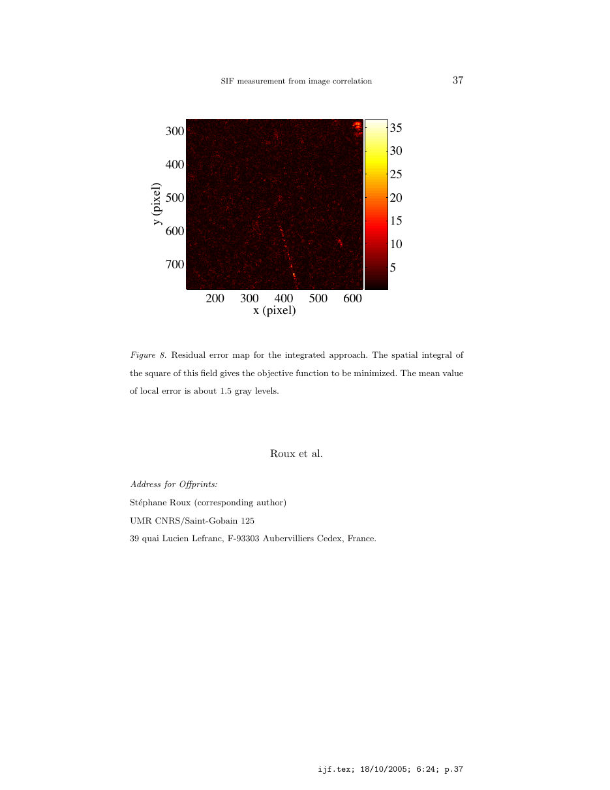
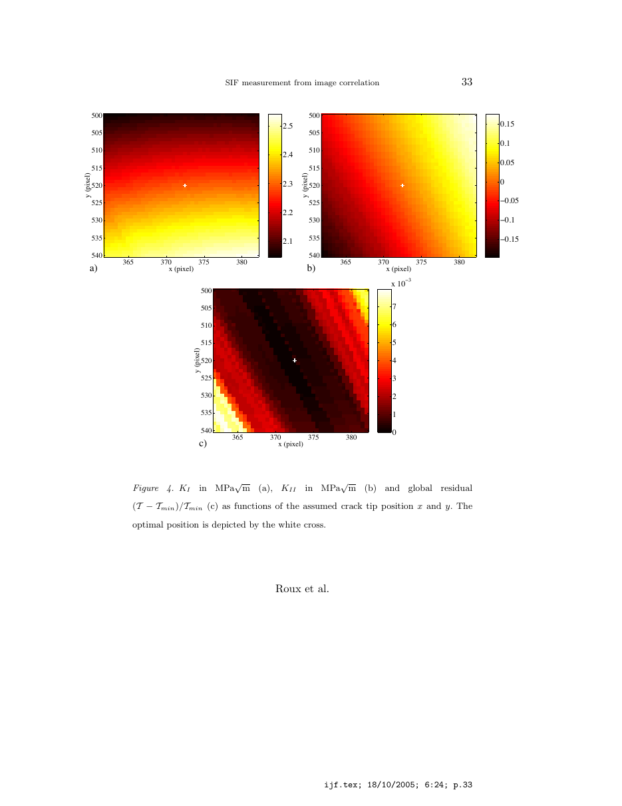
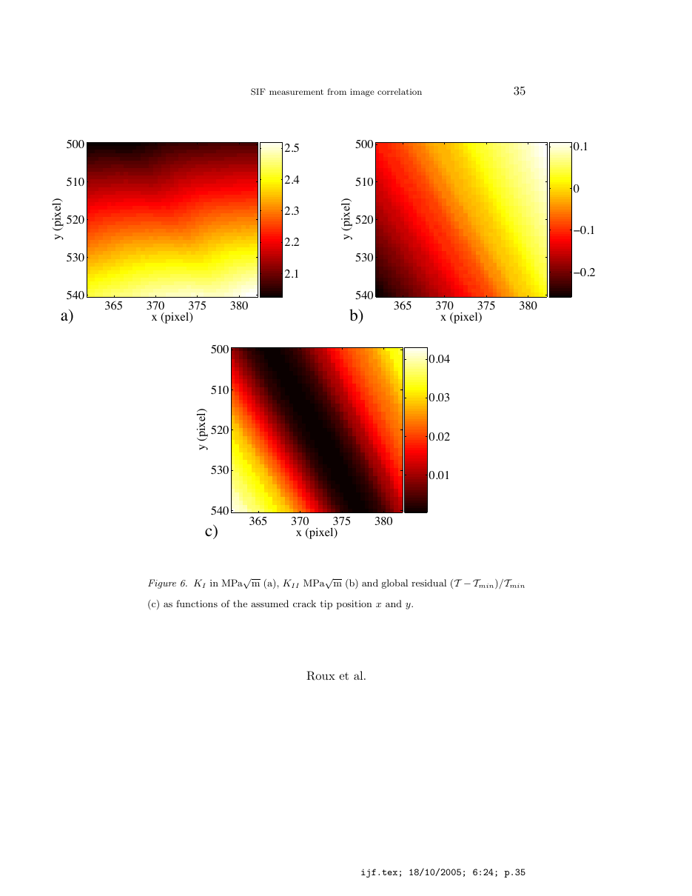

# 디지털 영상 상관으로 잰 응력 확대 계수: 후처리 방식과 통합 방식 (번역)

- 원제: Stress intensity factor measurements from digital image correlation: post-processing and integrated approaches
- 저자: Stéphane Roux, François Hild
- 원문: 같은 폴더의 `Roux2006_IJF_SIF_DIC_integrated.pdf` (HAL hal-00013818v1, 2005-11-14 등록 저자 원고, 표지 1쪽 + 원고 37쪽)
- 서지: International Journal of Fracture 140(1-4):141-157, 2006. doi:10.1007/s10704-006-6631-2
- 번역 범위: 전문 (초록, 본문, 부록, 그림 캡션). 참고문헌은 원문 그대로 옮겼다.
- 번역 메모
  - 이 번역은 HAL에 올라간 저자 원고(2005-10-18 판)를 옮긴 것이다. 저널 최종판과 쪽 번호, 문장이 다를 수 있다.
  - 식은 pdftotext 결과가 깨져서 원문 쪽 이미지를 보고 다시 적었다.
  - [ ] 안은 옮긴이 설명이다.

---

## 초록

디지털 영상 상관(DIC)은 세라믹 같은 취성 재료에서 균열이 자라는 것을 연구하는 데 매력적인 기법이다.
이 논문은 한 사례를 다룬다.
균열의 기하(모양과 위치)와 균열 열림 변위를 영상 상관으로 구한다.
측정과 식별의 길을 두 가지로 따로 밟아 본다.
광학 사진을 다루는데도 변위 불확도가 나노미터 범위까지 내려갈 수 있다.
응력 확대 계수는 복잡한 하중 장치에서도 실험을 수치 모델로 흉내 내지 않고 7% 불확도로 추정된다.

핵심어: 취성 파괴, 세라믹, 광역학(Photomechanics)

약어
- COD: 균열 열림 변위(Crack opening displacement)
- SiC: 탄화규소
- SIF: 응력 확대 계수(Stress Intensity Factor)
- SB: 끼움 보(Sandwiched-beam)

© 2005 Kluwer Academic Publishers. Printed in the Netherlands.

## 1. 서론

파괴 인성은 파괴에 안전한 구조물을 설계할 때 핵심 성질이다. 특히 취성 재료가 들어갈 때 그렇다 [1].
전 영역(full-field) 측정 기법이 발전하면서, 인성 평가는 유한요소 해석 같은 수치 모델 절차와 비슷해질 수 있다 [2-4].
디지털 영상 상관은 이미 균질 재료와 불균질 재료의 균열 분석에 쓰였다 [5, 6].
예를 들어 응력 확대 계수 [7, 8], 균열 끝 열림 각 [9], 균열 끝 열림 변위 [10], 인성 [11]을 디지털 영상 상관으로 매우 정확하게 잴 수 있다.
여기서 다루는 응용은 끼움 보 실험 [12-14, 11]에 바탕을 둔다.
이 실험 장치를 쓰면 시편 전체를 가로지르지 않는 균열을 시작시킬 수 있다.
그러나 균열이 멈추는 조건은 보 사이 마찰, 보의 굽힘 강성, 노치 모양, 노치 주변 재료 성질의 변동에 크게 좌우된다.
그래서 유한요소 모의에 바탕을 둔 인성 식별은 믿기 어렵다는 것이 밝혀졌다 [11].

이 논문은 디지털 영상 상관으로 구한 변위에서 SIF를 식별하는 두 가지 길을 논의한다.

- 변위를 나중에(a posteriori) 맞추는 길
- SIF가 측정 단계에서 바로 나오는 통합(integrated) 방식

두 경우 모두 응력 확대 계수와 인성을 구하는 데 유한요소 모의가 필요 없다는 점을 짚어 둔다.
그래서 이 분석은 매우 다양한 경우에 쓸 수 있다.

2절은 이 연구에서 쓰는 일반적인 상관 개념을 소개한다.
취성 재료의 인성을 재는 실험 절차는 끼움 보 기법(노치 낸 보에 미리 균열을 내는 방법)에 바탕을 두며, 3절에서 다룬다.
보통 이 다음에는 미리 균열을 낸 시편으로 3점 굽힘 시험을 해서 시편의 인성을 구한다 [14, 11].
이 논문에서는 탄화규소 세라믹에서 균열이 멈추는 것을 분석해 인성을 평가한다.
측정한 변위장을 후처리 기법(4절)으로, 또는 통합 절차(5절)로 분석한다.
부록은 이 연구에서 소개한 모든 절차에 대해, 영상 잡음이 변위 평가의 불확도에 주는 영향을 평가한다.

## 2. 영상 상관의 원리

영상 상관 기법의 원리는 다음과 같다.
기준 상태 f(x)와 변형 상태 g(x)에 해당하는 두 디지털(회색조) 영상은, 국소 무늬가 변위장 u를 따라 "수동적으로" 실려 가는 관계로 이어진다고 본다. 즉 다음을 가정한다.

    g(x) = f(x + u(x))                                   (1)

f와 g를 알 때 u를 가능한 한 정확하게 추정하는 것이 문제다.
보통은 광류(optical flow) 보존 방정식을 정칙화해서 푼다 [15-19].

### 2.1. 일반적 접근

u가 단순한 강체 평행 이동이면, f와 g의 상관이 가장 큰 곳을 찾는 것이 강력한 기법이다.
상관 최대는 변위 u에서 정확하게 나타나고, 알맞은 보간 기법을 쓰면 화소보다 작은 불확도에 이를 수 있다(알맞은 경우 10^-2 화소 이하 [20]).
이 관찰에서 자연스러운 방식이 나온다.
원래 영상을 작은 관심 영역으로 나눈다. 각 영역 안에서는 국소 강체 이동이나 균일 변형률 근사가 성립할 수 있다.
모든 국소 이동을 모으면 전체 변위장의 추정이 된다.
각 기본 계산은 물리 공간에서 [21, 22, 20] 하거나 푸리에 공간에서 [23-25] 할 수 있다.
다만 어려운 점이 하나 있다. 관심 영역끼리 정확하게 짝지어야 하는데, 그러려면 세밀하게 다듬기 전에 변위를 미리 잘 짐작해야 한다.
그래서 거친 표현에서 세밀한 표현으로 반복해 나아가는 다중 척도 알고리즘이 개발되었다 [26].

### 2.2. 임의의 함수 기저로 넓히기

최근 조금 다른 접근이 제안되었다 [27, 28].
같은 광류 보존 원리에 바탕을 두고, 시험 변위 v(x)에 대해 g(x) - f(x + v(x))를 최소화한다.
1차 테일러 전개를 하면 다음을 최소화하는 문제가 된다.

    T[v] = ∫∫ [g(x) - f(x) - v(x)⋅∇f]^2 dx              (2)

변위를 고른 함수들의 기저로 더 펼치면, 즉 v(x) = Σ_n a_n Ψ_n(x)로 두면, 진폭 a_n은 다음 선형계의 해로 쓸 수 있다.

    M_nm a_m = b_n                                       (3)

여기서

    M_nm = ∫∫ (∇f ⊗ ∇f) : (Ψ_m ⊗ Ψ_n) dx                (4)
    b_n  = ∫∫ (f - g)(∇f⋅Ψ_n) dx                        (5)

이 접근의 한계는 테일러 전개 (2)가 성립하는 범위에서 온다.
그래서 구할 수 있는 변위의 최대 크기는 보통 1화소보다 작다.
그러나 앞에서 말한 것과 비슷한 계층적 접근, 즉 점점 거칠게 만들거나 걸러 가며 푸는 방식을 쓰면 된다.
구한 변위 추정값으로 변형 영상을 차츰 보정하면서 필요한 해에 점점 다가간다.

목적 함수는 결정의 품질을 재는 척도도 된다는 점을 짚어 둔다.
게다가 피적분 함수는 각 화소가 전체 오차에 얼마나 기여하는지를 국소적으로 보여 준다.
그래서 남은 오차가 무작위인지 계통적인지 판단하는 데 매우 효과적인 도구가 된다.

## 3. 파괴 시험에 적용

### 3.1. 끼움 보 실험

취성 재료(예: 탄화규소 세라믹)의 파괴 인성을 평가하려고 끼움 보 예비 균열 기법을 쓸 수 있다 [12-14, 11].
SB 시험의 원리는 노치 낸 막대를 두 강철 막대 사이에 끼우는 것이다(그림 1).
그다음 SB 조립체에 3점 굽힘 하중을 준다.
이 실험 장치를 쓰면 시편 전체를 가로지르지 않는 균열을 시작시킬 수 있다.
그래서 이 기법에서 인성 평가는 균열 정지 조건과 관련된다.
그러나 정지 조건은 보 사이 마찰, 보의 굽힘 강성, 노치 모양, 노치 주변 재료 성질의 변동에 크게 좌우된다.
더구나 하중 변위 곡선에는 균열 진전 시작을 알려 주는 뚜렷한 특징이 없다.
디지털 영상 상관으로 이 실험을 분석할 수 있다는 것이 밝혀졌다 [11].

여기서 다루는 재료는 SiC-100이라 부르며, Céramiques & Composites(프랑스)가 만든 상압 소결 재료다.
분말을 눌러 2000 °C로 가열한다.
소결을 돕기 위해 공정 중 탄화붕소(B4C)를 조금 넣는다.
평균 결정립 크기는 5 µm다.
그래서 인공 균열이 적어도 밀리미터 크기이면, 응력 확대 계수와 인성을 거시적으로 평가할 수 있다.
여기서 한 측정은 SIF와 인성의 거시적 평가에 해당한다.
시편은 다이아몬드 톱으로 노치를 낸다.

좋은 공간 분해능을 얻으려고 원거리(장거리) 현미경을 써서 노치에서 균열이 시작하고 멈추는 것을 관찰한다.
화소 1개의 물리 크기 p는 1.85 µm다. 그래서 1/100 화소 불확도는 약 20 nm에 해당한다.
명시야 조명을 쓰며 시편을 따로 준비할 필요가 없다.
이 배율에서는 표면 거칠기가 충분한 변화를 만들어 "스펙클" 무늬가 나타난다.
그림 2b는 하중이 떨어진 순간 찍은 사진이다.
가장 높은 배율에서도 균열이 보이지 않는다.

그림 1. SB 굽힘 시험의 개략도. SiC 시편의 관찰 면을 회색으로 나타냈다.

그림 2. 하중 전(a)과 하중 후(b)의 탄화규소 시편 표면 8비트 사진. 시편 아래 가장자리의 노치가 뚜렷이 보인다(1화소 ↔ 1.85 µm).

### 3.2. 유한요소 Q1 함수 기저

Forquin 외 [11]는 2.1절에서 말한 접근을 따르는 표준 상관 기법으로 균열 형태와 역학 특성을 연구했다.
방법론과 결과의 자세한 논의는 그 문헌으로 넘긴다.

같은 영상 묶음을 2.2절의 일반화된 접근으로 분석했다.
함수 기저로는 정사각형 요소 위에서 변위의 각 성분에 대한 쌍선형 함수(유한요소법 용어로 Q1 형상 함수 [29])를 썼다.
요소가 클수록 변위 불확도는 가장 낮지만, 변위가 균일하지 않아 작은 요소를 쓰게 된다.
6 × 6 화소까지 작은 요소로도 변위를 뚜렷하게 구할 수 있었다.
그러나 불확도 수준을 낮추려고(다음 소절 참고) 이 절에서는 8 × 8 화소 요소를 썼다.

그림 3은 변위장 두 성분의 지도다.
변위 불연속이 뚜렷하게 보이며 주로 모드 I이다.
실험 조건이 완벽했다면 균열이 수직 방향으로 진전했겠지만 그렇지 않다.
그래서 보통 유한요소 모의에서 가정하는 "완벽한" 경계 조건에 바탕을 둔 식별은 할 수 없다.

그림 3. Q1 요소(8 × 8 화소)로 구한 변위장의 가로 성분(a)과 세로 성분(b). 단위는 화소(1화소 ↔ 1.85 µm).

### 3.3. 성능

표준 변위 불확도로 본 이 방법의 성능은 영상의 무늬(예: 회색조 동적 범위, 상관 길이)에 따라 달라진다.
상관 알고리즘의 불확도를 추정하려고, 실제 기준 영상(그림 2a)을 0~1화소 범위의 화소 이하 평행 이동으로 옮겨 인공 영상을 만든다(푸리에 공간에서 하면 편하다).
그다음 이 영상 쌍에 상관 알고리즘을 적용해 불확도를 평가한다.
불확도 σ_u는 요소 크기 ℓ(화소)에 따라 매우 빠르게 줄어든다.
σ_u ≈ p A^(1+α) ℓ^(-α)이고 α ≈ 1.5, A ≈ 0.6 화소다(ℓ은 순수한 수이고 물리 길이 척도가 아니다).
그래서 아래에서 쓰는 요소 크기 ℓ = 8 화소이면 σ_u ≈ 40 nm이고, ℓ = 128 화소이면 σ_u는 1 nm보다 작다.

변형률 불확도도 같은 방식으로, 균일 변형률을 넣은 인공 영상을 분석해 구할 수 있다.
2.5×10^-4에서 8×10^-3까지의 1축 변형률로 시험했다.
가장 중요한 요인은 (훨씬 작은) 계통 오차가 아니라 불확도(넣은 균일 변형률에 대해 추정 변형률이 흩어지는 표준편차)다.
작은 관심 영역 ℓ = 8 화소에서는 변형률 불확도가 넣은 값의 약 8배다(전 범위에서).
변형률 불확도를 넣은 값과 같게 하려면 ℓ ≈ 20 화소가 필요하다(변형률 크기와 거의 무관하게).
더 큰 관심 영역 ℓ = 128 화소에서는 상대 불확도가 전 범위에서 약 12%로 줄어든다.
이런 불확도는 고전적인 디지털 영상 상관 기법으로 얻는 값보다 상당히 작다는 점을 말해 둔다 [11, 30].

또 CCD 카메라 잡음이 변위 불확도에 주는 영향은 부록에서 자세히 다룬다.
상관 없는 잡음(그림 g에 더해진 표준편차 σ로 나타냄)이 주어지면, 분석에 따른 표준 변위 불확도 τ_u(화소 크기가 아니라 물리 길이 단위)는 다음과 같음을 보인다.

    τ_u = 12√2 p σ / (7 √⟨|∇f|^2⟩ ℓ)                   (6)

그래서 τ_u는 분석하는 무늬의 성질에 달려 있다.
이 응용(그림 2a)에서는 √⟨|∇f|^2⟩ ≈ 17.2 회색조/화소, ℓ = 8 화소로 계산되어 τ_u ≈ 0.018 σ이다.
영상 획득(즉 CCD 카메라)에 따른 시간 잡음 수준 σ는 추정하기 어렵다.
카메라 기술 사양에 따르면 잡음은 사용한 256 회색조의 3% 미만, 즉 약 8 회색조여야 한다.
그러나 식별 뒤에 계산할 수 있는 잔차 오차 지도는 잡음의 참된 상한을 준다.
잡음뿐 아니라 보간에 따른 모든 근사, 이상적인 탄성장 해에서 벗어난 것까지 모든 불일치 원인을 다 담기 때문이다.
아래에서 보이듯(그림 8), 이 잔차(양의) 오차장의 평균은 1.5 회색조다.
그래서 카메라 기술 사양과 달리, 여기와 이후에서 σ = 2 회색조를 쓴다.
전체 변위 불확도 τ_u는 75 nm보다 작다.
이 불확도의 약 50%는 사전 성능 추정에서 보였듯 상관 기법 자체에서 온다는 점을 짚어 둔다.

그림 8. 통합 방식의 잔차 오차 지도. 이 장의 제곱을 공간에 대해 적분한 것이 최소화할 목적 함수다. 국소 오차의 평균은 약 1.5 회색조다.

## 4. 인성 식별을 위한 후처리 분석

### 4.1. 방법

변위의 자세한 지도에서 역학적으로 의미 있는 정보를 뽑는 일은, 관련된 기준 변위장들의 진폭을 식별하는 것으로 할 수 있다.
이 경우 의미 있는 기여를 쉽게 나열할 수 있다.

- 먼저 강체 운동을 고려해야 한다. 이것이 처음 세 장이다. 면내 평행 이동 두 개 Ψ1, Ψ2와 관찰 면에 수직인 축에 대한 회전 하나 Ψ3이다.
- 균열 면에 응력이 없도록 하는 균일 변형률장 하나 Ψ4를 허용한다. 이른바 "T 응력"(균열 방향을 따른 1축 인장)이다.
- 균열이 있으면 모드 I(Ψ5)과 모드 II(Ψ6)에 해당하는 독립적인 특이 변위장 두 개가 생긴다. 이 둘의 스칼라 진폭이 응력 확대 계수를 알려 준다.
- 마지막으로 기저를 넓히려고 다음 차수의 준특이 모드 I, II 장을 더 고려할 수 있다. 각각 Ψ7, Ψ8로 쓴다.

이 벡터들은 국소 균열 좌표계(균열 끝이 원점, 균열 연장이 음의 실수축 방향)에서 복소수 값 장으로 쓰는 것이 매우 편하다.
현재 점 M은 복소수 z = x + iy 또는 극좌표 z = r e^(iθ)로 나타내고, 변위도 마찬가지로 U = U_x + iU_y로 나타낸다.
여덟 기저 함수의 식은 다음과 같다.

    Ψ1(z) = 1
    Ψ2(z) = i
    Ψ3(z) = i z
    Ψ4(z) = (κ - 1) z + 2 z̄
    Ψ5(z) = √r [2κ e^(iθ/2) - e^(3iθ/2) - e^(-iθ/2)]                 (7)
    Ψ6(z) = i √r [2κ e^(iθ/2) + e^(3iθ/2) - 3 e^(-iθ/2)]
    Ψ7(z) = √(r^3) [2κ e^(3iθ/2) - 3 e^(iθ/2) + e^(-3iθ/2)]
    Ψ8(z) = i √(r^3) [2κ e^(3iθ/2) + 3 e^(iθ/2) - 5 e^(-3iθ/2)]

여기서

    κ = (3 - ν) / (1 + ν)                                 (8)

이며 자유 관찰 면에서 기대되는 평면 응력 조건이다. ν는 푸아송 비다.
다만 이 함수들의 진폭은 실수라는 점을 짚어 둔다.

그래서 전략은 단순하다. (영상 상관으로) 추정한 변위장을 Ψ_k 시험 함수 기저 위로 분해한다.
이를 위해 다음 목적 함수를 최소화한다.

    T(a) = Σ_{i=1}^{N_mes} | U_i - Σ_k a_k Ψ_k |^2        (9)

여기서 N_mes는 측정한 변위 점의 개수다.

이 정식화의 장점 하나는 목적 함수가 도달한 값이 전체 품질 지표가 된다는 것이다.
식별 절차는 균열 기하를 안다고 가정하므로, 미리 짐작한 균열 끝 위치에 대해 이 전체 잔차를 최소화하면 균열 기하도 자연스럽게 최적화된다.
아래에서는 이 추정량을 무차원으로 만들려고 (T - T_min)/T_min을 "전체 잔차"라 부른다.

균열 열림 변위 단면을 계산하는 방법 [11]이나 상호작용 적분을 쓰는 방법 [8] 같은 다른 기법으로도 응력 확대 계수를 뽑을 수 있다는 점을 덧붙인다.

### 4.2. 결과

아래 결과는 앞에서 메시 크기 8화소로 구한 변위장 추정값에서 얻었다.
관심 영역은 균열 끝 위치의 대략적인 추정값을 중심으로 한 512 × 512 화소다.
그림 4에 모드 I, II 응력 확대 계수의 추정값을 짐작한 균열 끝 위치의 함수로 지도에 그렸다.
가장 알맞은 위치를 고르려고, 같은 그림에 전체 잔차 지도도 보였다.
균열 끝은 평균 방향에 수직인 쪽으로는 정확하게 자리 잡을 수 있지만, 균열 연장 방향으로는 잔차가 천천히 변한다.
그래도 절대 최소 위치에서 가장 좋은 맞춤 품질을 주는 균열 끝 위치를 꽤 정확하게 찾을 수 있다.
불확도는 균열 방향에 평행하게 약 ±10 화소, 수직하게 약 ±2 화소(즉 약 20 µm, 4 µm)다.
이 불확도는 받아들일 수 없다고 볼 만한 극단 균열 끝 위치를 주관적으로 판단해 정한 것이다.

그림 4. 짐작한 균열 끝 위치 x, y의 함수로 본 K_I(MPa√m) (a), K_II(MPa√m) (b), 전체 잔차 (T - T_min)/T_min (c). 최적 위치는 흰 십자로 나타냈다.

더 중요한 것은, 같은 분석이 모드 I, II 모두의 응력 확대 계수를 정량적으로 추정해 준다는 것이다.
Ψ5와 Ψ6의 진폭으로 바로 재는 특이장은, 탄성 상수를 알 때(SiC는 E = 410 GPa, ν = 0.15) SIF를 준다.
K_I = 2.3 ± 0.2 MPa√m, K_II = 0.0 ± 0.05 MPa√m을 얻는다.
오차 막대는 위에서 말한 균열 끝 위치의 극단 위치에서 나온 K 값으로 추정했다.

부록에 보인 유도는 CCD 카메라 잡음 σ에 따른 식별 불확도를 다음과 같이 준다.

    τ(평행 이동) ≈ 0.42 σ (nm)
    τ(회전)     ≈ 1.7 × 10^-6 σ (rad)                    (10)
    τ(SIF)      ≈ 0.01 σ (MPa√m)

σ는 회색조 단위다.
앞에서 추정한 σ(즉 2 회색조 미만)를 쓰면 응력 확대 계수의 식별 불확도는 0.02 MPa√m이다.

이 추정은 매질의 기하(균열 끝 위치 포함)를 안다는 전제에서 계산한 것이다.
그러나 불확도의 지배적 원인은 이 모르는 기하에서 온다.
다소 주관적인 평가로, K의 오차 막대는 위 값보다 모드 I에서 10배, 모드 II에서 2.5배 크다고 추정했다.

균열이 기대한 수직 방향과 각을 이루며 시작했는데도, 특이 균열 변위는 본질적으로 모드 I 조건이며 접선 방향 변위 불연속은 아주 작다.
정량적으로는 관심 영역에서 모드 I 열림이 약 0.3 화소(약 500 nm)이고, 모드 II의 접선 불연속은 관심 영역 가장자리에서 많아야 0.006 화소, 약 10 nm 정도다.

그림 5. 측정한 변위를 알맞은 함수 기저 위로 투영하는 후처리로 얻은 변위장의 가로 성분(a)과 세로 성분(b). 단위는 화소(1화소 ↔ 1.85 µm).

## 5. 통합 방식

### 5.1. 방법론

지금까지 식별 절차는 서로 독립인 두 단계로 이루어졌다.

- 첫째, 변위장을 식별한다(2절). 특히 이 목적으로 임의의 함수 기저를 쓴다.
- 둘째, 측정한 변위장을 역학적으로 의미 있는 몇 개의 장 위로 투영한다(4절).

이렇게 두 단계로 나눌 필요는 없다는 점을 알 수 있다.
특히 Q1 요소를 들인 것은 인위적이며, 중간 단계에서만 쓰인다.
이 사전 분할은, 이제 소개할 이른바 "통합 방식"에 비해 방법의 성능을 떨어뜨린다.
2.2절의 길을 그대로 따르되, 관련 변위장 Ψ_i를 측정 단계에서 미리 넣는다.
그러면 특이 균열장의 진폭을 바로 계산해 곧장 SIF 추정값을 얻는다.
상관 접근의 일반성을 그대로 살리며, 앞에서 쓴 여덟 함수(식 (7))를 다룬다고 해서 특별한 제약이 생기지 않는다.
같은 다중 척도 전략도 그대로 쓸 수 있다. 영상을 거칠게 만들거나 거르는 것만 포함하며 변위장에 특별한 제약을 주지 않기 때문이다.
화소 이하 보정을 반복해 넣어 최적 결정에 이를 수도 있다.
다만 이 연구에서는 평균 변위(하중 방향으로 크기 약 11화소)에만 보정을 썼다.

### 5.2. 결과

같은 실험, 같은 사진 쌍에 통합 방식을 적용했다.
균열 끝(추정값)을 대략 중심으로 한 512 × 512 화소 관심 영역을 분석에 썼다.
여기서도 균열 끝은 목적 함수의 최솟값으로 추정한다.

그림 6은 가정한 균열 끝 위치의 함수로 본 모드 I, II의 최적 응력 확대 계수와, (최솟값에 대한 상대) 전체 잔차를 보인다.
이 결과는 추정 변위에 후처리 단계를 써서 얻은 결과와 매우 비슷하다.
그림 7에 보인 변위장의 가장 좋은 결정도 마찬가지다.
더 정량적으로, 임계 응력 확대 계수는 다음과 같이 추정된다.

    K_I  = 2.3 ± 0.15 MPa√m
    K_II = 0.05 ± 0.05 MPa√m                              (11)

그림 6. 가정한 균열 끝 위치 x, y의 함수로 본 K_I(MPa√m) (a), K_II(MPa√m) (b), 전체 잔차 (T - T_min)/T_min (c).

그림 7. 통합 방식으로 식별한 변위장의 가로 성분(a)과 세로 성분(b). 단위는 화소(1화소 ↔ 1.85 µm).

여기서도 오차 막대는 받아들일 수 있는 균열 끝의 극단 위치를 뽑고, 그에 따른 K의 변화를 재서 주관적으로 추정했다.

앞에서 말했듯 목적 함수 T는 잔차 오차에 대한 국소 기여의 지도를 자연스럽게 준다.
통합 방식 뒤의 오차장을 그림 8에 보였다. 단위는 회색조다.
오차 수준이 국소적으로 30 회색조까지 클 수 있지만(처음 영상은 8비트, 즉 256 회색조), 잔차 오차의 평균은 약 1.5 회색조다.
이 값으로 잡음 수준의 상한 σ = 2 회색조를 얻었다.
예상할 수 있듯 오차는 균열 경로를 따라 크게 몰려 있다.
또 높은 오차가 모여 있는 영역(예: 그림 오른쪽 위 구석)도 보인다. 이는 균열 변위장에서 벗어난 것으로, 아마 표면 바로 아래 기공 때문일 것이다.

이 SIF 추정값은 Q1 기반 변위장 추정에 후처리를 한 앞의 결정과 아주 잘 일치한다는 점을 짚어 둔다.
가정한 균열 끝 위치의 함수로 본 품질 지표와 SIF 값이 매우 비슷하다는 것(그림 4와 6)은 놀랍다.
그래서 후처리(그림 5)와 통합 방식(그림 7)으로 추정한 변위장은 평균값 면에서 아주 가깝다.

통합 방식의 불확도는 후처리 분석에서 본 것과 꽤 비슷하다.
그러나 이것이 일반적인 말은 아닐 수 있다.
Q1 유한요소 기저 위로 투영하는 것은 불필요한 단계이므로, 통합 방식은 언제나 후처리 경로와 같거나 더 나은 성능을 낸다.
이 경우에는 잡음 수준이 낮고 분석한 영역이 넓어서, 그 투영이 정보를 크게 잃지 않는다.
CCD 카메라에 따른 불확도는 다시 부록의 유도를 따라 평가할 수 있다.
식별 불확도는 다음과 같다.

    τ(평행 이동) ≈ 0.4 σ (nm)
    τ(회전)     ≈ 1.5 × 10^-6 σ (rad)                    (12)
    τ(K)        ≈ 0.009 σ (MPa√m)

σ는 회색조 단위다.
이 값은 후처리 방식(4절)으로 얻은 값과 매우 가깝다.
변위 불확도는 1 nm 정도이고, SIF는 τ(K) ≈ 2 × 10^-2 MPa√m이다.
다시 한 번, 안타깝게도 지배적인 오차는 모르는 균열 기하에서 온다. 그래서 훨씬 보수적인 오차 막대(식 (11) 참고)를 쓴다.

## 6. 결론

사진에서 의미 있는 역학 정보를 뽑을 수 있게 하는 이론적, 실용적 상관 도구를 소개했다.
화소 크기보다, 심지어 빛의 파장보다 훨씬 작은 균열 열림을 분해할 수 있다.
그래서 균열 끝을 작은 불확도로 정하고, 응력 확대 계수를 식별하거나 잴 수도 있다.
또 부록은 영상 잡음이 변위와 응력 확대 계수 결정의 불확도에 주는 영향을 추정하는 일반적인 방법론을 준다.

이 결과는 변위장을 Q1 형상 함수 위로 투영하는 데 바탕을 두어, 디지털 영상 상관의 표준 성능을 크게 개선해서 얻었다.
후처리 단계는 변위 추정값의 요동을 걸러 내고, 이 예에서 응력 확대 계수 측정값을 얻게 해 준다.
Kolossov와 Muskhelishvili 퍼텐셜에 바탕을 둔 이 방식은 훨씬 일반적이며, 넓은 범위의 상황에 쉽게 쓸 수 있고, 역학적으로 허용되는 변위장을 자연스럽게 만든다는 점을 강조한다.

Q1 기저 위로 투영하는 인위적 단계를 피하는 통합 방식을 제안했다.
이 방법이 처음의 두 단계 절차보다 더 정확할 것으로 기대되지만, 얻은 추정값은 꽤 가깝다. 그래서 두 접근이 서로를 교차 검증한다.
이 통합 기법은 복잡한 하중을 받는 넓은 범위의 균질 탄성 고체로 넓힐 수 있다.

## 감사의 말

여기 보고한 실험은 P. Forquin 박사와 Y. Charles 박사가 수행했다.
이 연구는 연구 네트워크 "GDR 2519: Mesure de champs et identification en mécanique des solides"(고체 역학에서의 장 측정과 식별) 안에서 수행되었다.

## 부록: 영상 잡음에 대한 민감도

영상 획득에 따른 잡음(예: 디지털화, 읽기 잡음, 암전류 잡음, 광자 잡음 [31])에 대한 결과의 민감도를 살펴본다.
변형 영상이 평균 0, 분산 σ^2인 무작위 백색 잡음 η로 오염되었다고 가정한다.
(실제로는 기준 영상과 변형 영상이 모두 같은 잡음을 받지만, 이는 차이 (f - g)에 분산 2σ^2인 잡음이 있다고 보는 것과 같다.)
2절의 표기를 쓴다.
행렬 M은 이 잡음의 영향을 받지 않고, 벡터 b만 다음만큼 바뀐다.

    δb_n = ∫∫ η(x) (∇f⋅Ψ_n) dx                           (13)

평균하면 ⟨δb⟩ = 0이고

    ⟨δb_m δb_n⟩ = σ^2 M_mn                                (14)

이 잡음이 a의 결정에 주는 영향, 즉 요동 부분 δa를 구한다.
선형성에 따라 ⟨δa⟩ = 0이다. 분산은 다음과 같다.

    ⟨δa_m δa_n⟩ = σ^2 M^-1_mp M^-1_nq M_pq = σ^2 M^-1_mn     (15)

위 분석은 모든 절차에 적용할 수 있다.
Q1 변위장 추정, 그 장을 8차원 함수 위로 투영하는 것(표기는 다시 정해야 하지만 대수는 같다), 통합 방식 모두에 쓸 수 있다.

먼저 Q1 변위장 추정부터 보자.
변위장 분산의 정확한 위 추정을 계산하는 대신(M^-1 행렬이 꽤 크다), 계산을 더 단순하게 해서 공분산 행렬 ⟨δa_m δa_n⟩의 공간 평균만 고려할 수 있다.
이 가정은 영역 안보다 분산이 큰 가장자리 효과를 무시한다.
또 영상 기울기가 Q1 요소 크기에 비해 짧은 거리의 상관만 가진다는 가정을 쓴다.
이제 평균 기호 ⟨...⟩는 잡음에 대한 앙상블 평균과 공간 평균을 함께 뜻한다.
그 결과 행렬 M을 평균해야 하며 다음과 같다.

    ⟨M_mn⟩ = (1/2) ⟨|∇f|^2⟩ ∫∫ Ψ_m⋅Ψ_n dx                 (16)

이 식의 흥미로운 점은 적분에 형상 함수만 들어간다는 것이다.
그래서 변위의 x와 y 좌표가 자연스럽게 분리되고, 고전적 유한요소 정식화에서 물려받은 준 띠 대각 구조가 생긴다.
예를 들어 대각 원소는, 이 절점에 붙은 4개 요소에 대해 합하면 다음과 같다.

    ⟨M_nn⟩ = (2/9) ⟨|∇f|^2⟩ ℓ^2                          (17)

이웃한 두 절점은 ⟨M_mn⟩ = (1/9)⟨|∇f|^2⟩ℓ^2이고, 대각으로 마주 본 두 절점은 (1/36)⟨|∇f|^2⟩ℓ^2이다.
이 행렬은 쉽게 역행렬을 구할 수 있다. 역행렬은 M과 같은 지지 구조를 가진다. 대각 원소는

    ⟨M⟩^-1_nn = 288 / (49 ⟨|∇f|^2⟩ ℓ^2)                   (18)

이웃 절점 원소는 그 값의 -(1/4)이고, 대각으로 마주 본 절점은 1/16이다.
마지막으로 공간 평균의 역행렬을 역행렬의 공간 평균과 같다고 보는 가정(균질한 영상 무늬에서 성립)을 더하면, Q1 변위 진폭의 표준편차 τ_a는 다음과 같다.

    τ_a = √⟨δa_n^2⟩ = 12√2 p σ / (7 √⟨|∇f|^2⟩ ℓ)           (19)

여기서 τ_a를 화소 크기가 아니라 길이 단위로 나타내려고 화소의 물리 크기 p = 1.85 µm를 넣었다.
이 응용에서는 √⟨|∇f|^2⟩ ≈ 17.2 회색조/화소, ℓ = 8 화소로 계산되어 τ_a ≈ 0.018 pσ다.
a 장의 요동 부분은 반상관(anti-correlated)되어 있다는 점에 주의한다.
그래서 한 절점의 요동 일부가 이웃 절점의 요동으로 상쇄될 수 있다.
거리 ℓ에 비해 천천히 변하는 장 위로 투영하려면 M^-1의 "대각합"(모든 절점에 대한 합)을 고려해야 한다.
이 대각합은 a의 표준편차를 위 추정의 절반, 즉 0.009 σ로 만든다.
위에서 한 여러 근사를 검증하려고 앞의 항들을 표본 추출로 평가했다(무작위 장 1000개 사용).
결과는 τ_a ≈ 0.014 pσ, 대각합은 0.009 pσ로 사전 추정과 잘 맞는다.

이제 이 분석을 Q1 분석의 후처리에 적용해 보자.
이 경우 4절로 돌아가, Q1 변위 결과에서 변위장 8개의 진폭을 계산한다.
여기서 소개한 잡음 η와 행렬 M은 이제 각각 앞 논의의 요동 δa, 그리고 영역에 대한 Ψ_m(x_i)Ψ_n(x_i)의 합이 된다.
단순한 8×8 행렬이므로 직접 역행렬을 쉽게 구할 수 있고, 서로 다른 진폭들의 완전한 공분산 행렬을 얻는다.
대칭성 때문에 비대각 항 가운데 0과 의미 있게 다른 것은 없다.
M^-1의 대각 항만 고려하고 앞의 직접 추정 τ_a ≈ 0.014 pσ를 쓰면, 다음 표준편차를 얻는다. 물리 차원으로 나타냈고(p = 1.85 µm 사용) σ는 회색조 단위다.

    τ(평행 이동) ≈ 0.42 σ (nm)
    τ(회전)     ≈ 1.7 × 10^-6 σ (rad)                    (20)
    τ(SIF)      ≈ 0.01 σ (MPa√m)

마지막으로 위 분석을 통합 방식(5절)에 적용하자.
여기서도 최종 선형계 행렬은 8 × 8이므로, M^-1을 직접 계산해 다음을 얻는다.

    τ(평행 이동) ≈ 0.4 σ (nm)
    τ(회전)     ≈ 1.5 × 10^-6 σ (rad)                    (21)
    τ(SIF)      ≈ 0.009 σ (MPa√m)

응력 확대 계수를 구하는 두 절차의 불확도 추정이 매우 가깝다는 점이 흥미롭다.
다만 이 불확도는 이상적인 잡음에 바탕을 두며, 예를 들어 이상적인 균열 변위장을 Q1 기저 위로 투영하는 데서 오는 계통 편향은 고려하지 않는다는 점을 강조한다.

주어진 CCD 카메라의 시간 잡음 수준은 여러 외부 변수에 달려 있다.
카메라 기술 사양은 이 경우 영상에 쓴 256 회색조의 3% 미만, 즉 약 8 회색조여야 한다고 한다.
분석 뒤 얻은 잔차 오차(그림 8 참고)를 보면 평균이 약 1.5 회색조다.
이 값은 가능한 모든 불일치 원인(시간 잡음은 그 일부일 뿐)을 담은 상한이므로, 잡음의 상한 추정으로 더 믿을 만하다고 보고 σ = 2 회색조를 고른다.
이에 따르면 잡음에 따른 표준 불확도는 평균 평행 이동에 대해 약 1 nm, 연구한 재료의 SIF에 대해 0.02 MPa√m이다.

## 그림 목록 (원문 캡션)

1. SB 굽힘 시험의 개략도. SiC 시편의 관찰 면을 회색으로 나타냈다.
2. 하중 전(a)과 하중 후(b)의 탄화규소 시편 표면 8비트 사진. 시편 아래 가장자리의 노치가 뚜렷이 보인다(1화소 ↔ 1.85 µm).
3. Q1 요소(8×8 화소)로 구한 변위장의 가로 성분(a)과 세로 성분(b). 단위는 화소(1화소 ↔ 1.85 µm).
4. 가정한 균열 끝 위치 x, y의 함수로 본 K_I(MPa√m) (a), K_II(MPa√m) (b), 전체 잔차 (T - T_min)/T_min (c). 최적 위치는 흰 십자로 나타냈다.
5. 측정 변위를 알맞은 함수 기저 위로 투영하는 후처리로 얻은 변위장의 가로 성분(a)과 세로 성분(b). 단위는 화소(1화소 ↔ 1.85 µm).
6. 가정한 균열 끝 위치 x, y의 함수로 본 K_I(MPa√m) (a), K_II(MPa√m) (b), 전체 잔차 (T - T_min)/T_min (c).
7. 통합 방식으로 식별한 변위장의 가로 성분(a)과 세로 성분(b). 단위는 화소(1화소 ↔ 1.85 µm).
8. 통합 방식의 잔차 오차 지도. 이 장의 제곱을 공간에 대해 적분한 것이 최소화할 목적 함수다. 국소 오차의 평균은 약 1.5 회색조다.

## 참고문헌 (원문 그대로)

1. B. R. Lawn, Fracture of Brittle Solids, (Cambridge University Press, Cambridge (UK), 1993).
2. Barsoum, R.S.: 1976, 'On the Use of Isoparametric Finite Elements in Linear Fracture Mechanics,' Int. J. Num. Meth. Eng. Vol. 10, pp. 25-37.
3. Barsoum, R.S.: 1977, 'Triangular Quarter-Point Elements as Elastic and Perfectly-Plastic Crack Tip Elements,' Int. J. Num. Meth. Eng. Vol. 11, pp. 85-98.
4. Lim, I.L., and I.W. Johnston: 1992, 'Comparison Between Various Displacement-Based Stress Intensity Factor Computation Techniques,' Int. J. Fract. Vol. 58, pp. 193-210.
5. Rastogi, P.K.: Photomechanics, Springer, Berlin (Germany), 2000.
6. Anbanto-Bueno, J., and J. Lambros: 2002, 'Investigation of crack growth in functionally graded materials using digital image correlation,' Eng. Fract. Mech. Vol. 69, pp. 1695-1711.
7. McNeill, S.R., W.H. Peters, and M.A. Sutton: 1987, 'Estimation of stress intensity factor by digital image correlation,' Eng. Fract. Mech. Vol. 28 no. 1, pp. 101-112.
8. Réthoré, J., A. Gravouil, F. Morestin, and A. Combescure: 2005, 'Estimation of mixed-mode stress intensity factors using digital image correlation and an interaction integral,' Int. J. Fract. Vol. 132, pp. 65-79.
9. Dawicke, D.S., and M.S. Sutton: 1994, 'CTOA and Crack-Tunneling Measurements in Thin Sheet 2024-T3 Aluminum Alloy,' Exp. Mech. Vol. 34, pp. 357-368.
10. Sutton, M.A., S.R. McNeill, J.D. Helm, and Y.J. Chao, Advances in Two-Dimensional and Three-Dimensional Computer Vision, in: P.K. Rastogi, eds., Photomechanics, Springer, Berlin (Germany), 2000, pp. 323-372.
11. Forquin, P., L. Rota, Y. Charles, and F. Hild: 2004, 'A Method to Determine the Toughness Scatter of Brittle Materials,' Int. J. Fract. Vol. 125 no. 1, pp. 171-187.
12. Nose, T., and T. Fujii: 1988, 'Evaluation of Fracture Toughness for Ceramic Materials by a Single-Edge-Precracked-Beam Method,' J. Am. Ceram. Soc. Vol. 71 no. 5, pp. 328-333.
13. Marshall, D.B., J.J. Ratto, and F.F. Lange: 1991, 'Enhanced Fracture Toughness in Layered Microcomposites of Ce-ZrO2 and Al2O3,' J. Am. Ceram. Soc. Vol. 74 no. 12, pp. 2979-2987.
14. Pancheri, P., P. Bosetti, R. Dal Maschio, and V.M. Sglavo: 1998, 'Production of Sharp Cracks in Ceramic Materials by Three-Point Bending of Sandwiched Specimens,' Eng. Fract. Mech. Vol. 59 no. 4, pp. 447-456.
15. Horn, B.K.P., and B.G. Schunck: 1981, 'Determining optical flow,' Artificial Intelligence Vol. 17, pp. 185-203.
16. Mitiche, A., and P. Bouthemy: 1996, 'Computation and analysis of image motion: A synopsis of current problems and methods,' Int. J. Comp. Vision. Vol. 19, pp. 29-55.
17. Black, M.: Robust Incremental Optical Flow, PhD dissertation, Yale University, 1992.
18. Odobez, J.-M., and P. Bouthemy: 1995, 'Robust multiresolution estimation of parametric motion models,' J. Visual Comm. Image Repres. Vol. 6, pp. 348-365.
19. Bogen, D., and D. Rahdert: 1996, 'A strain energy approach to regularization in displacement field fits of elastically deforming bodies,' IEEE Trans. Pattern Analysis and Machine Intelligence Vol. 18, pp. 629-635.
20. Sutton, M.A., S.R. McNeill, J. Jang, and M. Babai: 1988, 'Effects of subpixel image restoration on digital correlation error estimates,' Opt. Eng. Vol. 27 no. 10, pp. 870-877.
21. Sutton, M.A., W.J. Wolters, W.H. Peters, W.F. Ranson, and S.R. McNeill: 1983, 'Determination of Displacements Using an Improved Digital Correlation Method,' Im. Vis. Comp. Vol. 1 no. 3, pp. 133-139.
22. Chu, T.C., W.F. Ranson, M.A. Sutton, and W.H. Petters: 1985, 'Applications of Digital-Image-Correlation Techniques to Experimental Mechanics,' Exp. Mech. Vol. 3 no. 25, pp. 232-244.
23. Chen, D.J., F.P. Chiang, Y.S. Tan, and H.S. Don: 1993, 'Digital Speckle-Displacement Measurement Using a Complex Spectrum Method,' Appl. Opt. Vol. 32, pp. 1839-1849.
24. Berthaud, Y., J. Scholz, and J. Thesing, Méthodes optiques et acoustiques de mesures des caractéristiques mécaniques, Proc. Colloque national MECAMAT "Mécanismes et mécanique des grandes déformations," 1996, pp. 77-80.
25. Chiang, F.P., Q. Wang, and F. Lehman, New Developments in Full-Field Strain Measurements Using Speckles, in: Non-Traditional Methods of Sensing Stress, Strain and Damage in Materials and Structures, ASTM, Philadelphia (USA), 1997, pp. 156-169.
26. Hild, F., B. Raka, M. Baudequin, S. Roux, and F. Cantelaube: 2002, 'Multi-Scale Displacement Field Measurements of Compressed Mineral Wool Samples by Digital Image Correlation,' Appl. Optics Vol. IP 41 no. 32, pp. 6815-6828.
27. Roux, S., F. Hild, and Y. Berthaud: 2002, 'Correlation Image Velocimetry: A Spectral Approach,' Appl. Optics Vol. 41 no. 1, pp. 108-115.
28. Wagne, B., S. Roux, and F. Hild: 2002, 'Spectral Approach to Displacement Evaluation From Image Analysis,' Eur. Phys. J. AP Vol. 17, pp. 247-252.
29. Zienkievicz, O.C., and R.L. Taylor, The Finite Element Method, McGraw-Hill, London (UK), 4th edition, 1989.
30. Bergonnier, S., F. Hild, and S. Roux: 2005, 'Strain heterogeneities in tension and compression tests on mineral wool samples,' J. Strain Analysis Vol. 40, pp. 185-197.
31. Holst, G., CCD Arrays, Cameras and Displays, SPIE Engineering Press, Washington DC (USA), 1998.
