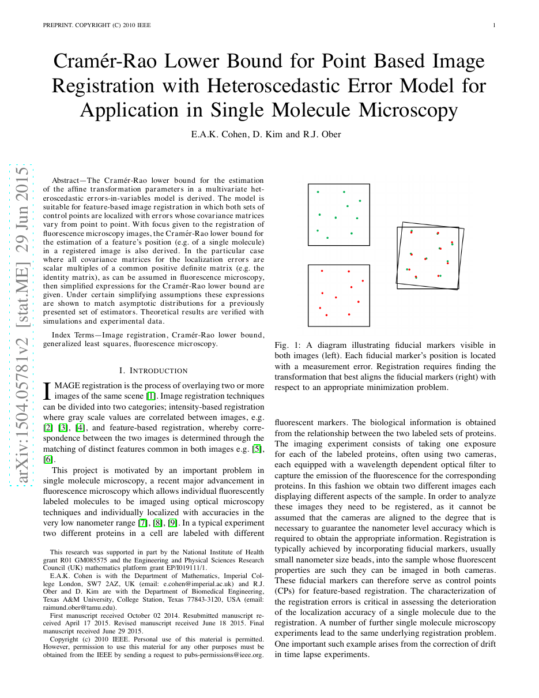
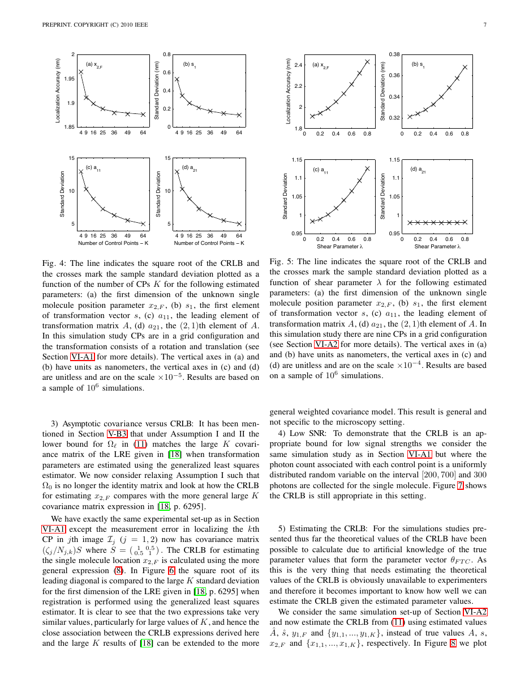
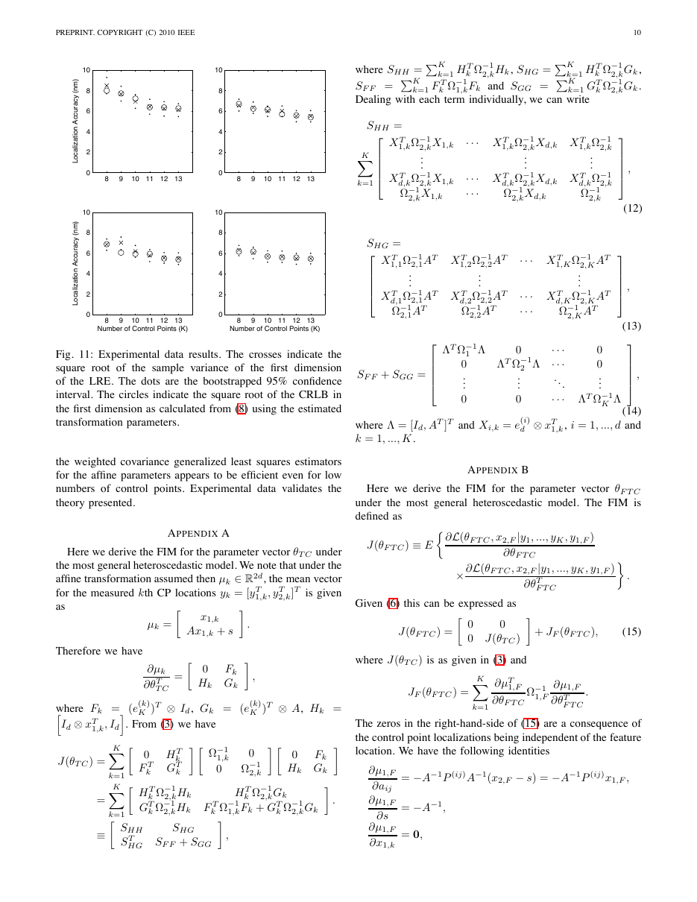

# 번역: 단일 분자 현미경 응용을 위한, 이분산 오차 모형 아래 점 기반 영상 정합의 Cramér-Rao 하한

- 원제: Cramér-Rao Lower Bound for Point Based Image Registration With Heteroscedastic Error Model for Application in Single Molecule Microscopy
- 저자: E.A.K. Cohen, D. Kim, R.J. Ober
- 원문 파일: [Cohen2015_TMI_point_registration_CRLB.pdf](Cohen2015_TMI_point_registration_CRLB.pdf) (arXiv:1504.05781v2, 2015-06-29. 최종 원고 접수일과 같은 날의 사전 인쇄본)
- 저널판: IEEE Transactions on Medical Imaging 34(12):2632-2644, 2015. doi:10.1109/TMI.2015.2451513 (Crossref로 권, 호, 쪽 확인)
- 번역 범위: 전문(초록, 본문, 그림 캡션, 부록). 참고문헌은 원문 그대로 둔다.
- 번역 메모
  - 수식은 원문 기호를 그대로 쓴다. pdftotext에서 깨진 수식은 원문 PDF 쪽을 보고 옮겼다. 긴 부록 유도식은 식의 꼴과 결론을 옮기고, 중간 대수 전개는 원문 쪽 번호로 안내한다.
  - 용어: control point(CP)는 "기준점", fiducial marker는 "기준 표지", errors-in-variables(EIV)는 "변수 오차 모형", heteroscedastic은 "이분산", homoscedastic은 "등분산", target registration error(TRE)는 "목표 정합 오차", localization registration error(LRE)는 "위치 정합 오차", Fisher information matrix(FIM)는 "Fisher 정보 행렬"로 옮긴다.

---

## 초록

다변량 이분산 변수 오차 모형에서 아핀 변환 파라미터를 추정할 때의 Cramér-Rao 하한(CRLB)을 유도한다. 이 모형은 특징 기반 영상 정합에 알맞다. 특징 기반 정합에서는 두 기준점 집합이 모두 오차를 가지고 위치가 측정되며, 그 오차의 공분산 행렬은 점마다 다르다. 형광 현미경 영상의 정합에 초점을 두어, 정합된 영상에서 어떤 특징(예: 단일 분자)의 위치를 추정할 때의 CRLB도 유도한다. 위치 측정 오차의 공분산 행렬이 모두 하나의 공통 양의 정부호 행렬(예: 단위 행렬)의 스칼라 배인 특수한 경우는 형광 현미경에서 가정할 수 있다. 이 경우 CRLB의 간단한 식을 준다. 몇 가지 단순화 가정 아래에서 이 식들은 앞서 발표한 추정량들의 점근 분포와 일치함을 보인다. 이론 결과를 모의실험과 실험 자료로 확인한다.

색인어: 영상 정합, Cramér-Rao 하한, 일반화 최소제곱, 형광 현미경.

---

## I. 서론

그림 1: 두 영상 모두에 보이는 기준 표지를 그린 그림(왼쪽). 각 기준 표지의 위치는 측정 오차를 가지고 찾아진다. 정합은 알맞은 최소화 문제에 따라 기준 표지들을 가장 잘 맞추는 변환을 찾는 일이다(오른쪽).

영상 정합은 같은 장면의 영상 둘 이상을 겹치는 과정이다[1]. 영상 정합 기법은 두 갈래로 나눌 수 있다. 하나는 영상 사이에서 밝기 값이 서로 상관되는 밝기 기반 정합이다(예: [2], [3], [4]). 다른 하나는 두 영상에 공통으로 있는 뚜렷한 특징을 맞추어 대응을 정하는 특징 기반 정합이다(예: [5], [6]).

이 연구는 단일 분자 현미경의 중요한 문제에서 출발했다. 단일 분자 현미경은 형광 현미경의 최근 큰 발전으로, 형광 표지된 분자 하나하나를 광학 현미경 기법으로 찍고, 아주 낮은 나노미터 범위의 정확도로 각각의 위치를 찾을 수 있게 한다[7], [8], [9]. 전형적인 실험에서는 세포 안의 서로 다른 두 단백질에 서로 다른 형광 표지를 붙인다. 생물학 정보는 표지된 두 단백질 집합 사이의 관계에서 얻는다.

촬영 실험은 표지된 단백질마다 한 번씩 노출을 찍는 것으로 이루어진다. 흔히 카메라 두 대를 쓰고, 각 카메라에는 해당 단백질의 형광 방출을 잡도록 파장에 맞는 광학 필터를 단다. 이렇게 하면 시료의 서로 다른 면을 보여 주는 영상 두 장을 얻는다. 이 영상들을 분석하려면 정합해야 한다. 적절한 정보를 얻는 데 필요한 나노미터 수준 정확도를 보장할 만큼 카메라가 맞춰져 있다고 가정할 수 없기 때문이다. 정합은 보통 기준 표지를 시료에 넣어서 한다. 기준 표지는 대개 나노미터 크기의 작은 구슬로, 두 카메라 모두에서 찍히는 형광 성질을 가진다.

따라서 이 기준 표지들은 특징 기반 정합의 기준점(CP)이 될 수 있다. 정합으로 인해 단일 분자의 위치 정확도가 얼마나 나빠지는지 평가하려면 정합 오차의 특성을 아는 것이 결정적이다. 단일 분자 현미경의 다른 여러 실험도 같은 정합 문제로 이어진다. 그런 중요한 예 하나는 시간 경과 실험에서 드리프트를 보정하는 일이다.

기준점 정합에 대한 이전의 통계 연구들[10], [11], [12], [13], [14], [15], [16], [17]은 기준점 위치의 한 집합을 참값으로 두고 두 번째 집합에만 오차가 있다고 가정한다. 이런 예에서는 자료 모형으로 다변량 선형 회귀를 쓰고, 위치 측정 오차 집합을 기준 위치 오차(FLE)라고 부르기도 한다[17], [16]. 이와 달리 최근 연구[18]는 현미경 응용에 중요한, 기준점 영상 정합 문제의 다변량 변수 오차(EIV) 정식화를 제시했다. 기준점 위치의 참값이 없고, 정합할 두 영상 모두에서 기준점 위치를 잴 때 오차가 있는 상황을 모형화하려면 변수 오차 정식화가 필요하다.

중요하게도, 현미경 응용에서는 측정 오차가 기준점마다 다른 공분산 행렬을 가진다고 가정해야 하므로 이분산 모형을 써야 한다. 정합 문제의 중심은 정합 변환을 추정하는 일이다. [19], [20]에서는 변환을 강체(회전과 병진만)로 가정하고, 이분산 EIV(HEIV) 알고리즘으로 이분산 오차 아래 정합 파라미터를 추정하려 했다. HEIV는 HEIV 모형의 최적해를 찾는 반복 절차다. 그러나 추정량의 분포는 부트스트랩으로만 구했다. 현미경에서는 현대 대물렌즈의 높은 기하 정밀도 덕분에, 정합 변환을 아핀이라고 하는 더 일반적인 가정을 쓸 수 있다. [18]에서 우리는 이 자료 모형에서 일반화 최대우도 추정량이 일반화 최소제곱 추정량과 같음을 보였다. 이전 결과를 써서 변환 파라미터 추정량 분포에 대한 점근 결과를 얻었다. 공분산 행렬이 알려진 양의 정부호 행렬의 스칼라 배인 특정 이분산 잡음 모형에서는 아핀 변환 파라미터 추정량의 닫힌 꼴 식을 유도했다. 이 모형은 형광 현미경 환경에 맞는다. 기준 표지(예: 형광 구슬)가 기준점 역할을 하지만 각각 다른 정확도로 위치가 찾아지기 때문이다.

정합 성능은 보통 기준 정합 오차(FRE)로 잰다. FRE는 정합 뒤 기준 표지 사이 거리의 제곱평균제곱근이다. 가장 중요한 것은 목표 정합 오차(TRE)다. TRE는 정합 뒤 기준 표지가 아닌 대응점 사이의 차이다. TRE의 분포는 많은 관심을 받았다. 다변량 선형 회귀 모형(앞서 말했듯 형광 현미경에는 맞지 않음) 아래에서, [10], [11]은 TRE 절댓값의 제곱평균제곱근에 대한 근사식을 유도했고, [12]는 정합 변환을 강체(회전과 병진만)로 가정하고 FLE가 독립이며 같은 분포(iid)를 따르는 평균 0 정규 분포일 때의 근사 분포를 주었다. 편향된 FLE의 영향에 관심 있는 독자는 [21]을 보라. 비등방 iid FLE는 [15]에서 처음 다루었고, [16]은 이 모형에서 강체 변환 파라미터의 최대우도 추정량과 그 분산의 Cramér-Rao 하한을 유도했다. 이분산 FLE는 [17]에서 다루었고, 공간 강성 모형을 써서 TRE의 제곱평균제곱근 식을 유도했다. 이 방법들의 개관과 TRE를 최소화하도록 기준 표지를 최적으로 고르는 절차는 [22]에 있다.

[18]에서는 형광 현미경에 필요한 다변량 변수 오차 자료 모형과 아핀 변환 가정 아래 TRE의 점근 분포를 찾았다. 더 나아가 [18]에서는 위치 정합 오차(LRE)의 점근 분포도 찾았다. LRE는 새로 정의한 정합 오차 척도로, 정합에 쓰이지 않은 특징(예: 단일 분자)의 위치 측정 오차와 TRE를 합친 것이다.

단일 분자 실험의 품질은 그 실험에서 단일 분자의 위치를 찾는 정확도로 평가한다[23]. 여기서 위치 정확도는 편향 없는 위치 추정량의 표준편차로 해석한다[24]. [24]와 [25]에서는 위치 추정 문제의 Cramér-Rao 하한(CRLB)으로 위치 정확도의 근본 한계를 도입했다. 이는 화소화 왜곡이 없는 무한 크기의 광자 검출기, 다른 외부 잡음원이 없는 조건 같은 이상적인 실험 조건에서의 한계다. 이 척도는 특정 단일 분자 실험에서 얻을 수 있는 최선의 정확도를 믿을 만하게 예측함이 입증되었다[26], [27].

단일 분자 실험에서 정합이 중요하므로, 정합 과정에서 생긴 불확도가 정합된 단일 분자의 위치 정확도에 어떤 영향을 주는가 하는 질문이 생긴다. 이를 위해 이 논문의 큰 부분은 여기서 관련 있는 여러 자료 모형에 대해 정합 문제의 CRLB를 유도하는 데 있다.

정합 문제의 CRLB는 전에도 유도되었다. [28]과 [29]는 두 영상 사이의 더 일반적인 아핀 변환, 그리고 다항식 기반 비선형 변환 등 여러 경우에 대해, 특징 기반과 밝기 기반 정합 성능의 CRLB를 다룬다. 그러나 이들은 등분산 경우, 곧 모든 기준점 측정 오차가 같은 공분산 행렬을 가지는 경우로 제한하고, 변환 파라미터 자체의 CRLB만 고려한다.

이 논문은 일반 아핀 변환을 가정하고, 기준점 측정 오차가 평균 0 정규 분포인 이분산 경우의 정합 성능 CRLB를 준다. 특히 형광 현미경 환경에 초점을 두어, 변환 파라미터 추정의 CRLB뿐 아니라 LRE 공분산 행렬의 하한을 찾는 데 무게를 둔다. LRE는 정합 성능을 간결하고 유익하게 보여 주는 척도다. 이 공분산 행렬 대각 원소의 제곱근(각 차원의 LRE 표준편차)은 정합 뒤 각 차원에서 단일 분자 위치를 찾는 정확도다.

II절에서는 정합 문제를 정식화하고 [18]에서 도입한 LRE를 정의한다. III절에서는 가장 일반적인 이분산 환경에서 아핀 변환 파라미터의 CRLB를 유도한다. IV절에서는 정합된 영상에서 특징의 모르는 위치를 추정할 때의 CRLB를 유도하고, 이로써 LRE 분산의 하한을 준다. V절에서는 측정 오차의 공분산 행렬이 공통 행렬의 스칼라 배인 특정 경우를 다룬다. 형광 현미경 환경이 이 경우다. 형광 현미경에서는 공분산 행렬을 단위 행렬의 배로 근사하는 것이 합리적이다. 또 아핀 변환 행렬이 유니타리 행렬의 스칼라 배(배율, 회전, 반사의 결합)인 경우가 흔하다. 이런 상황에서 LRE 공분산 행렬 하한의 명시적인 식을 유도하는데, 이 식은 복잡한 식들을 더 직관적으로 보여 준다. 중요하게도, 이 식은 [18]에서 같은 가정 아래, 대응하는 일반화 최소제곱 추정량(또는 그와 같은 최대우도 추정량)으로 정합 파라미터를 추정할 때 유도한 LRE 점근 공분산과 똑같다. VI절에서는 모의실험으로 이론을 확인하고, [18]의 일반화 최소제곱 추정량이 이 하한에 도달함을 보인다. 끝으로 실제 현미경 영상 자료를 보고, 이 논문이 제시한 CRLB 결과가 실험 환경에서도 알맞음을 보인다.

## II. 정식화

[18]에서 정식화한 정합 실험을 생각한다. 영상 1(I₁ ⊆ ℝᵈ)과 영상 2(I₂ ⊆ ℝᵈ, d = 2 또는 3) 모두에 K개의 기준점이 있다. 이 기준점들의 참 위치는 각각 {x₁,ₖ ∈ I₁, k = 1, ..., K}와 {x₂,ₖ ∈ I₂, k = 1, ..., K}이고, 기준점 좌표는 아핀 변환 T: ℝᵈ → ℝᵈ로 이어진다. 곧 x₂,ₖ = T(x₁,ₖ) = A x₁,ₖ + s (k = 1, ..., K)이며, A ∈ ℝᵈˣᵈ는 가역이고 s ∈ ℝᵈ다. 기준점의 참 위치는 어느 영상에서도 알 수 없고, 오차를 가지고 재야 한다. 그래서 기준점 위치를 {y₁,ₖ ∈ I₁}과 {y₂,ₖ ∈ I₂}로 관측하며, yⱼ,ₖ = xⱼ,ₖ + εⱼ,ₖ (k = 1, ..., K, j = 1, 2)다. εⱼ,ₖ ∈ ℝᵈ는 무작위 측정 오차로, 기준 위치 오차(FLE)라고도 한다. 각각 평균이 0이고 개별 공분산 행렬 Ωⱼ,ₖ > 0을 가진다고 가정한다(행렬 M이 양의 정부호이면 M > 0, 음이 아닌 정부호이면 M ≥ 0으로 쓴다). 모든 측정 오차는 기준점 사이에서 짝마다 독립이라고 가정한다.

ℝᵈˣᴷ 행렬 Xⱼ ≡ [xⱼ,₁, ..., xⱼ,ₖ], Yⱼ ≡ [yⱼ,₁, ..., yⱼ,ₖ], Eⱼ ≡ [εⱼ,₁, ..., εⱼ,ₖ] (j = 1, 2)를 정의하자. 측정된 기준점 위치는 Y₁ = X₁ + E₁, Y₂ = X₂ + E₂로 편하게 쓸 수 있다. 뒤의 식은 Y₂ = A X₁ + s 1ₖᵀ + E₂로도 쓸 수 있다. 여기서 ᵀ는 전치이고 1ₖ는 모든 원소가 1인 길이 K의 열벡터다. 쌓은 ℝ²ᵈˣᴷ 행렬 X ≡ [X₁ᵀ, X₂ᵀ]ᵀ, Y ≡ [Y₁ᵀ, Y₂ᵀ]ᵀ, E ≡ [E₁ᵀ, E₂ᵀ]ᵀ를 더 정의하면, 연립식은 하나의 행렬식으로 줄어든다.

  Y = Λ X₁ + α 1ₖᵀ + E,  (1)

여기서 α = [0ᵀ, sᵀ]ᵀ, Λ = [I_d, Aᵀ]ᵀ이고, I_d는 d차원 단위 행렬이다. E의 열들은 서로 독립이고, k번째 열 εₖ ≡ [ε₁,ₖᵀ, ε₂,ₖᵀ]ᵀ는 평균이 0이며 알려진 양의 정부호 공분산 행렬

  Ωₖ ≡ cov{εₖ} = [[Ω₁,ₖ, 0], [0, Ω₂,ₖ]]  (2)

를 가진다. cov{v}는 무작위 벡터 v의 공분산 행렬이다.

(1) 꼴의 모형을 변수 오차 모형이라 한다. 공분산 행렬 {Ωₖ, k = 1, ..., K}가 모두 같은 행렬 Ω₀ > 0이면 등분산 변수 오차 모형이다. 등분산 가정 아래에서 (1)은 [28], [29]의 CRLB 연구의 정합 정식화와 같다. K개의 공분산 행렬 {Ωₖ}가 일반적으로 같지 않으면 이분산 변수 오차 모형이다. 이 연구가 초점을 두는 것은 이분산 가정이다.

영상 정합에는 변환 파라미터 A와 s를 추정해야 한다. 이 원소들은 변환 파라미터 벡터 θ_Tᵀ = [vec(A)ᵀ, sᵀ]ᵀ로 나타낼 수 있다. 엄밀한 등분산 경우에 [30]은 A와 s의 일반화 최소제곱(GLS) 추정량을 정의하고, 기준점 측정 오차가 정규 분포라는 가정 아래 이것이 최대우도(ML) 추정량과 같음을 보인다. 또 A와 s 추정량의 닫힌 꼴 식과 그 결합, 주변 점근 분포를 준다. [31]은 가장 일반적인 이분산 모형을 다루어, 정규 측정 오차 가정 아래 A와 s의 최대우도 추정량, 그 반복 계산법, 결합과 주변 점근 분포를 제시한다. 최근 [18]에서는 [30]의 등분산 정식화를 확장해 이분산 일반화 최소제곱 추정량을 정의했고, 이것이 [31]의 최대우도 추정량과 같음을 보였다. 측정 오차의 공분산 행렬이 Ωₖ = ηₖ Ω₀ (ηₖ ∈ ℝ⁺, Ω₀ > 0) 꼴인 특수한 경우(가중 공분산 모형이라 부른다)에, [18]은 A와 s 추정량의 닫힌 꼴 식을 주고 그 결합, 주변 점근 분포를 정한다. 이는 다시 TRE와 LRE의 1차, 2차 적률에 대한 간결한 식을 주는 데 쓰인다. TRE와 LRE는 이제 정식으로 정의하는 정합 오차 척도다.

### A. 정합 오차

I절에서 말했듯 TRE는 정합 성능을 재는 흔한 척도다. 정합 변환 T를 파라미터 A(행렬)와 s(벡터)를 가진 아핀으로 가정할 때의 정의를 준다(그림 2 참조).

정의 II.1. A와 s를 정합 변환 파라미터, Â와 ŝ를 각각의 추정량이라 하자. I₂에서 대응 위치가 x₂ = A x₁ + s인 임의의 점 x₁ ∈ I₁에 대해, 목표 정합 오차(TRE) τ: I₁ → ℝᵈ는 τ(x₁) ≡ x₂ − (Â x₁ + ŝ) = A x₁ + s − (Â x₁ + ŝ)로 정의한다.

그림 2: I₂에서 임의의 점의 참 위치(검은색, 위쪽 십자)와 추정한 정합 파라미터로 정합한 위치(초록색, 아래쪽 십자)의 차이로서의 목표 정합 오차를 보여 주는 그림.

그림 3: 특징의 I₂에서의 참 위치(검은색, 위쪽 십자)와, I₁에서 추정한 위치와 추정한 정합 파라미터로 정합한 위치(초록색, 아래쪽 십자)의 차이로서의 위치 정합 오차를 보여 주는 그림.

LRE는 [18]에서 정의했으며, 형광 현미경 정합 실험에 특히 쓸모가 있다. 영상 1에는 보이지만 영상 2에는 보이지 않는(그래서 정합 과정에 쓰이지 않는) 특징(예: 단일 분자)이 있다고 하자. LRE는 정합 뒤 영상 2에서 그 특징의 위치를 찾을 때의 오차다(그림 3 참조).

정의 II.2. A와 s를 정합 변환 파라미터, Â와 ŝ를 각각의 추정량이라 하자. I₁에서 참 위치가 x₁,F, 측정 위치가 y₁,F = x₁,F + ε₁,F인 특징(예: 단일 분자)에 대해, 위치 정합 오차(LRE) ℓ_F는 I₂에서의 참 위치 x₂,F = A x₁,F + s와 정합된 위치 x̂₂,F = Â y₁,F + ŝ의 차이, 곧 ℓ_F ≡ x₂,F − x̂₂,F로 정의한다.

ℓ_F 한 원소의 표준편차는 정합 뒤 그 차원에서 특징(단일 분자)의 위치를 찾을 수 있는 정확도다. ℓ_F의 공분산 행렬 Ω_ℓ은 추정량 x̂₂,F의 공분산 행렬과 같다. 따라서 x₂,F를 추정하는 CRLB는 Ω_ℓ의 하한이다. 곧 x₂,F 추정의 CRLB 행렬을 C_FF라 하면 Ω_ℓ ≥ C_FF다(Ω_ℓ ≥ C_FF는 Ω_ℓ − C_FF ≥ 0, 곧 Ω_ℓ − C_FF가 음이 아닌 정부호라는 뜻이다). TRE와 LRE의 관계에 대한 더 많은 논의는 [18]에 있다.

## III. 아핀 변환 파라미터의 CRLB

모르는 파라미터 벡터는 θ_TC ≡ [θ_Tᵀ, θ_Cᵀ]ᵀ다. 여기서 θ_T ≡ [vec(A)ᵀ, sᵀ]ᵀ는 ℝ^(d²+d)의 아핀 변환 파라미터 벡터이고, θ_C ≡ [x₁,₁ᵀ, x₁,₂ᵀ, ..., x₁,ₖᵀ]ᵀ는 기준점 위치 파라미터의 ℝᵈᴷ 벡터다. 측정 오차가 독립이고, 평균이 0이며([26]에서 확인), 정규 분포를 따르고(VI절에서 확인), 공분산 행렬 Ωₖ가 (2)의 꼴이라고 가정한다. 곧 εₖ ~ N₂ᵈ(0, Ωₖ)다. 따라서 우도 함수는 다음과 같다[18], [31].

  L(θ_TC | y₁, ..., yₖ) = (2π)^(−Kd/2) (∏ₖ |Ωₖ|^(−1/2)) × exp(−½ Σₖ (yₖ − μₖ)ᵀ Ωₖ⁻¹ (yₖ − μₖ)),

여기서 μₖ = [x₁,ₖᵀ, x₂,ₖᵀ]ᵀ이고, |Ωₖ|는 Ωₖ의 행렬식, y₁, ..., yₖ는 측정한 기준점 위치를 쌓은 벡터다. 대응하는 로그우도는

  ℒ(θ_TC | y₁, ..., yₖ) = −(Kd/2) ln(2π) − ½ Σₖ ln|Ωₖ| − ½ Σₖ (yₖ − μₖ)ᵀ Ωₖ⁻¹ (yₖ − μₖ)

이다. 공분산이 파라미터에 의존하지 않는 다변량 정규 분포에서 파라미터 벡터 θ_TC의 Fisher 정보 행렬(FIM) J(θ_TC)는 다음과 같음이 잘 알려져 있다[32, p. 47].

  J(θ_TC) = Σₖ (∂μₖᵀ/∂θ_TC) Ωₖ⁻¹ (∂μₖ/∂θ_TCᵀ),  (3)

CRLB 행렬은 C(θ_TC) ≡ J⁻¹(θ_TC)다. CRLB 행렬을

  C(θ_TC) = [[C_TT, C_TC], [C_CT, C_CC]]  (4)

로 나타내면, C_TT의 대각 원소는 변환 파라미터 추정의 CRLB이고, C_CC의 대각 원소는 기준점 위치 추정의 CRLB다. 따라서 우리의 주 관심은 C_TT의 대각이다. 부록 A에서

  J(θ_TC) = Σₖ [[Hₖᵀ Ω₂,ₖ⁻¹ Hₖ, Hₖᵀ Ω₂,ₖ⁻¹ Gₖ], [Gₖᵀ Ω₂,ₖ⁻¹ Hₖ, Fₖᵀ Ω₁,ₖ⁻¹ Fₖ + Gₖᵀ Ω₂,ₖ⁻¹ Gₖ]]

임을 보인다. 여기서 Fₖ = (e_K⁽ᵏ⁾)ᵀ ⊗ I_d, Gₖ = (e_K⁽ᵏ⁾)ᵀ ⊗ A, Hₖ = [I_d ⊗ x₁,ₖᵀ, I_d]다. e_p⁽ʲ⁾는 ℝᵖ의 j번째 표준 기저 벡터(길이 p, j번째 원소만 1이고 나머지는 0)이고, ⊗는 크로네커 곱이다. J(θ_TC)의 블록 행렬 역에서 다음이 나온다.

  C_TT = (S_HH − S_HG (S_FF + S_GG)⁻¹ S_HGᵀ)⁻¹,  (5)

여기서 S_HH = Σₖ Hₖᵀ Ω₂,ₖ⁻¹ Hₖ, S_HG = Σₖ Hₖᵀ Ω₂,ₖ⁻¹ Gₖ, S_FF = Σₖ Fₖᵀ Ω₁,ₖ⁻¹ Fₖ, S_GG = Σₖ Gₖᵀ Ω₂,ₖ⁻¹ Gₖ다. 이것이 [31]에서 다룬 가장 일반적인 이분산 변수 오차 모형에서 변환 파라미터의 CRLB다. 부록 A의 식 (12), (13), (14)가 각각 S_HH, S_HG, S_FF + S_GG의 식을 준다.

## IV. 특징 위치 찾기

이제 특징(예: 단일 분자)의 위치 찾기를 식에 넣어 보자. 이를 위해 I₁에서 관측한 특징 위치 y₁,F와, 추정하려는 모르는 파라미터인 I₂에서의 특징 참 위치 x₂,F를 넣는다. 이에 관련된 위치 측정 오차의 공분산 행렬은 Ω₁,F다. II-A절에서 말했듯 LRE ℓ_F ∈ ℝᵈ는 추정량 x̂₂,F = Â y₁,F + ŝ와 참값 x₂,F의 차이이므로, x₂,F 추정의 CRLB는 ℓ_F의 공분산 행렬 Ω_ℓ의 하한이 된다.

관측 자료가 주어졌을 때 모든 파라미터 θ_FTC ≡ [θ_Fᵀ, θ_Tᵀ, θ_Cᵀ]ᵀ(θ_F ≡ x₂,F)의 결합 로그우도 함수는

  ℒ(θ_FTC | y₁, ..., yₖ, y₁,F) = −(d/2) ln(2π) − ½ ln|Ω₁,F| − ½ (y₁,F − μ₁,F)ᵀ Ω₁,F⁻¹ (y₁,F − μ₁,F) − (Kd/2) ln(2π) − ½ Σₖ ln|Ωₖ| − ½ Σₖ (yₖ − μₖ)ᵀ Ωₖ⁻¹ (yₖ − μₖ)  (6)

이다. 모르는 파라미터 θ_F ≡ x₂,F로 μ₁,F = A⁻¹(x₂,F − s)로 쓸 수 있다. 전체 파라미터 벡터 θ_FTC의 FIM은 부록 B에서

  J(θ_FTC) = [[A⁻ᵀ Ω₁,F⁻¹ A⁻¹, D_FT, 0], [D_FTᵀ, D_TT + S_HH, S_HG], [0, S_HGᵀ, S_FF + S_GG]]  (7)

임을 보인다. 여기서 D_TT ≡ D_Tᵀ Ω₁,F⁻¹ D_T, D_FT ≡ D_Fᵀ Ω₁,F⁻¹ D_T이고,

  D_F ≡ ∂μ₁,F/∂θ_Fᵀ = −A⁻¹,
  D_T ≡ ∂μ₁,F/∂θ_Tᵀ = −A⁻¹ [x₁,Fᵀ ⊗ I_d, I_d]

다. θ_FTC의 역 FIM을

  C(θ_FTC) ≡ J⁻¹(θ_FTC) = [[C_FF, C_FT, C_FC], [C_TF, C_TT, C_TC], [C_CF, C_CT, C_CC]]

로 나타내면, 부록 C에서 부분 블록 [[C_TT, C_TC], [C_CT, C_CC]]가 (4)의 C(θ_TC)와 같음을 보인다(특징/단일 분자가 정합 과정에 쓰이지 않으므로 예상할 수 있는 결과다). 그리고 정합된 영상에서 특징/단일 분자의 위치 x₂,F를 추정하는 CRLB 행렬은

  C_FF = (A⁻ᵀ Ω₁,F⁻¹ A⁻¹ − D_FT (D_TT + C_TT⁻¹)⁻¹ D_FTᵀ)⁻¹  (8)

이다. 여기서 C_TT는 (5)에서 준 변환 파라미터 추정의 CRLB 행렬이다. C_FF의 d개 대각 원소는 x₂,F 각 원소 추정의 CRLB이고, Ω_ℓ ≥ C_FF이므로 LRE ℓ_F 각 원소의 분산 하한이 된다.

## V. 가중 공분산 모형의 CRLB 식

IV절은 가장 일반적인 이분산 정합 모형에서 특징/단일 분자 위치 찾기의 CRLB를 준다. 이 결과는 우리 문제에 매우 일반적인 해를 주지만, 이제 응용에서의 쓸모 때문에 그 자체로 관심 있는 특수한 경우들을 살펴본다. 또 이 특수한 경우에는 위 식들을 크게 단순화할 수 있어, 실험 설계에 쓸 만한 통찰을 준다. 이 절에서는 [18]에서 정식화한 가중 공분산 모형을 본다. 이 모형에서는 측정 오차의 공분산 행렬이 모든 k = 1, ..., K에 대해 Ωₖ = ηₖ Ω₀ (ηₖ ∈ ℝ⁺, Ω₀ > 0) 꼴이라고 가정한다. 여기서 다음 가정을 더한다.

가정 I. 공분산 행렬은 Ω₁,₀ = σ₁,₀² I₂, Ω₂,₀ = σ₂,₀² I₂, Ω₁,F = σ₁,F² I₂ 꼴이고, 변환 행렬은 A = ςR이다. R은 유니타리 행렬(회전/반사)이고 ς ∈ ℝ⁺는 배율 인자다.

변환 벡터 s는 임의다. 공분산 행렬이 단위 행렬의 스칼라 배라는 가정은 형광 현미경에서 합리적이며, 화소화되지 않은 검출기의 경우에는 정확하다[24]. 변환 행렬에 대한 가정은 정합에서 흔히 만나는 변환 꼴이다.

### A. 변환 파라미터 추정의 CRLB

다음 양들을 정의한다. γ ≡ (1/K) Σₖ ηₖ⁻¹, χₖ ≡ x₁,ₖ x₁,ₖᵀ (k = 1, ..., K), Ξ ≡ (1/K) Σₖ ηₖ⁻¹ χₖ, X_i,ₖ ≡ e₂⁽ⁱ⁾ ⊗ x₁,ₖᵀ (i = 1, 2, k = 1, ..., K), x̄₁ ≡ (1/K) Σₖ ηₖ⁻¹ x₁,ₖ, X̄ᵢ ≡ e₂⁽ⁱ⁾ ⊗ x̄₁ᵀ (i = 1, 2), Ψ ≡ Ξ − γ⁻¹ x̄₁ x̄₁ᵀ, Γᵢ ≡ γ⁻¹ X̄ᵢ Ψ (i = 1, 2).

가정 I 아래에서 부록 D는 (5)의 C_TT가 다음으로 단순화됨을 보인다.

  C_TT = (1/K)(ς² σ₁,₀² + σ₂,₀²) × [[Ψ⁻¹, 0, −Γ₁ᵀ], [0, Ψ⁻¹, −Γ₂ᵀ], [−Γ₁, −Γ₂, γ⁻¹ I₂ + γ⁻¹(Γ₁ X̄₁ᵀ + Γ₂ X̄₂ᵀ)]].  (9)

### B. 정합된 영상에서 특징/단일 분자 위치 추정의 CRLB

1) 일반 모형: 가정 I 아래에서 부록 E는 특징/단일 분자 위치 x₂,F 추정의 CRLB 행렬이 다음과 같음을 보인다.

  C_FF = ( (1/(ς² σ₁,F²)) I₂ − (1/(ς⁴ σ₁,F⁴)) ([x₁,Fᵀ, 1] ⊗ I₂) × ( (1/(ς² σ₁,F²)) [[x₁,F x₁,Fᵀ, x₁,F], [x₁,Fᵀ, 1]] ⊗ I₂ + (ς² σ₁,₀² + σ₂,₀²)⁻¹ Σₖ ηₖ⁻¹ [[χₖ, 0, X₁,ₖᵀ], [0, χₖ, X₂,ₖᵀ], [X₁,ₖ, X₂,ₖ, I₂]] )⁻¹ ([x₁,Fᵀ, 1] ⊗ I₂)ᵀ )⁻¹.  (10)

2) 단순화 모형: ηₖ가 기준점 위치와 무관하고, 기준점들이 영상 공간에서 중심 대칭으로 분포하는 경우를 생각하자. 이 모형은 K가 클 때 알맞고 점근적으로 정확한 다음 가정들로 이어진다. 이런 가정은 예를 들어 특정 현미경 실험에서 형광 구슬의 배치를 생각할 때 자연스럽게 나온다. 구슬은 원형 정규 공간 분포를 가진다고 가정할 수 있다[18].

가정 II. (1/K) Σₖ ηₖ⁻¹ χₖ = ν² I₂, (1/K) Σₖ ηₖ⁻¹ Xⱼ,ₖ = 0으로 근사한다.

가정 I과 II 아래에서 부록 F는 특징/단일 분자 위치 x₂,F 추정의 CRLB 행렬이 다음과 같음을 보인다.

  C_FF = ς² σ₁,F² I₂ + (1/(Kγ)) (ς² σ₁,₀² + σ₂,₀²) (1 + γ r²/ν²) I₂.

(번역자 주: 원문 본문은 r을 따로 정의하지 않는다. 부록 F의 전개로 보아 r² = x₁,Fᵀ x₁,F, 곧 특징이 기준점 분포 중심에서 떨어진 거리의 제곱이다.)

3) 현미경 환경에 적용: 가정 I과 II를 만족하는 형광 현미경 예를 생각하자. 곧 가중 공분산 모형에서 ηₖ = N₁,ₖ⁻¹이다. N₁,ₖ는 I₁에서 기준점 k에 관련된 광자 수다(k = 1, ..., K). 또 Ωⱼ,₀ = σⱼ,₀² I₂이고 σ₁,₀² = ζ₁, σ₂,₀² = ζ₂/c다[33]. 상수 ζⱼ (j = 1, 2)는 Iⱼ에 관련된 알려진 위치 정확도 파라미터로, 개구수, 광자 파장, 점 확산 함수의 함수다([18, p. 6296] 참조). 상수 c는 [18]에서 가정한 비례 상수로, N₂,ₖ = c N₁,ₖ가 되게 한다. N₂,ₖ는 I₂에서 기준점 k의 광자 수다. 이로부터

  Ωₖ = (1/N₁,ₖ) [[ζ₁ I₂, 0], [0, c⁻¹ ζ₂ I₂]]

를 얻는다. 이 상황에서 γ = N̄₁이다. N̄₁은 I₁의 기준점 평균 광자 수다. 따라서 I₂에서 단일 분자 위치 x₂,F 추정의 CRLB 행렬은

  C_FF = ς² σ₁,F² I₂ + (1/K) (ς² ζ₁/N̄₁ + ζ₂/N̄₂) (1 + N̄₁ r²/ν²) I₂

로 주어진다. 광자 수는 기준점 위치와 무관하므로, (1/K) Σₖ χₖ = κ² I₂(기준점의 퍼짐을 재는 양)일 때 ν² = N̄₁ κ²라는 (점근적으로 정확한[18]) 가정 아래

  Ω_ℓ ≥ C_FF = ς² σ₁,F² I₂ + (1/K) (ς² ζ₁/N̄₁ + ζ₂/N̄₂) (1 + r²/κ²) I₂  (11)

이다. x₂,F 추정의 CRLB, 따라서 Ω_ℓ의 하한에 대한 이 식은 가중 공분산 모형의 일반화 최소제곱 추정량을 쓸 때 [18, p. 6297]에서 찾은 Ω_ℓ의 큰 K 식과 정확히 일치한다. 따라서 정합된 영상 한 쌍에서 단일 분자 위치 정확도의 근본 한계(곧 이론 하한)는, K(정합 과정에 쓴 기준점 수)와 그 광자 수, 그리고 영상 안 기준점 퍼짐을 재는 κ²에 의존하는 항으로 정해진다. 병진 파라미터 s에는 의존하지 않음을 덧붙인다.

## VI. 모의실험과 실험 검증

이 절에서는 이 논문이 준 CRLB 결과를 계산 모의실험과 실제 자료 실험으로 확인한다.

### A. 모의실험

이 계산 모의실험에서는, 같은 개구수와 점 확산 함수를 가진 광학계로 각각 찍은 서로 다른 색의 단색 영상 한 쌍을 정합하는 현미경 실험을 생각한다. j번째 영상 Iⱼ (j = 1, 2)에서 k번째 기준점의 위치를 찾을 때의 측정 오차는 평균 0, 공분산 행렬 (ζⱼ/Nⱼ,ₖ) I₂를 가지며 ζⱼ = λⱼ,em²/(4π² n_F²)다[24]. 각 영상에 관련된 광자 파장 λⱼ,em은 각각 540nm와 650nm이고, n_F는 개구수로 전형적인 값 1.4를 준다. Nⱼ,ₖ는 j번째 영상의 k번째 기준점 광자 수다.

1) 회전: 기준점을 물체 공간에서 한 변 81µm인 정사각 격자에 놓고, 격자 안 점 수를 바꾼다. 그래서 K는 4부터 64까지의 제곱수로 제한된다. 각 기준점의 광자 수는 구간 [5000, 10000]의 균등 분포 정수 난수의 관측값이다. I₁에는 중심에서 (16µm, 20µm) 위치에 단일 분자 하나가 있고, 광자 수는 1000이다. 아핀 변환 행렬 A는 30도 회전 행렬이고, 아핀 변환 벡터 s는 [4.8µm, 4.8µm]ᵀ다.

(9)에서 준 변환 파라미터 추정의 CRLB와, (11)의 정합된 영상에서 단일 분자 위치 추정의 CRLB(곧 Ω_ℓ의 하한)를 확인하려 한다. 이를 위해 [18]에서 개발한 가중 공분산 모형용 일반화 최소제곱 추정량으로 변환 파라미터를 추정한다. 관심 있는 표본 표준편차를 10⁶번의 모의실험으로 계산했고 그림 4에 보인다.

2) 전단: 기준점을 물체 공간에서 한 변 81µm인 정사각 격자에 K = 9로 놓는다. 각 기준점의 광자 수는 구간 [5000, 10000]의 균등 분포 정수 난수의 관측값이고, 측정 오차의 공분산 행렬은 VI-A1절과 같은 꼴이다. I₁에는 중심에서 (16µm, 20µm) 위치에 단일 분자 하나가 있고, 광자 수는 1000이다. 아핀 변환 행렬 A는 A = [[1, λ], [0, 1]] 꼴의 전단 행렬이고, 전단 파라미터 λ는 0.1에서 0.9 사이에서 바꾼다. 변환 벡터 s는 [4.8µm, 4.8µm]ᵀ다.

(9)에서 준 변환 파라미터 추정의 CRLB와, (11)의 단일 분자 위치 추정의 CRLB를 확인하려 한다. 이를 위해 [18]의 가중 공분산 모형용 일반화 최소제곱 추정량으로 변환 파라미터를 추정한다. 관심 있는 표본 표준편차를 10⁶번의 모의실험으로 계산했고 그림 5에 보인다.

그림 4: 선은 CRLB의 제곱근이고, 십자는 표본 표준편차다. 기준점 수 K의 함수로 다음 추정 파라미터에 대해 그렸다. (a) 모르는 단일 분자 위치 파라미터 x₂,F의 첫째 차원, (b) 변환 벡터 s의 첫째 원소 s₁, (c) 변환 행렬 A의 첫 원소 a₁₁, (d) A의 (2, 1) 원소 a₂₁. 이 모의실험에서 기준점은 격자 배치이고, 변환은 회전과 병진으로 이루어진다(자세한 것은 VI-A1절). (a)와 (b)의 세로축 단위는 나노미터이고, (c)와 (d)의 세로축은 단위가 없으며 ×10⁻⁵ 눈금이다. 결과는 10⁶번 모의실험 표본에 근거한다.

그림 5: 선은 CRLB의 제곱근이고, 십자는 표본 표준편차다. 전단 파라미터 λ의 함수로 다음 추정 파라미터에 대해 그렸다. (a) 모르는 단일 분자 위치 파라미터 x₂,F의 첫째 차원, (b) 변환 벡터 s의 첫째 원소 s₁, (c) 변환 행렬 A의 첫 원소 a₁₁, (d) A의 (2, 1) 원소 a₂₁. 이 모의실험에서 기준점 9개가 격자 배치다(자세한 것은 VI-A2절). (a)와 (b)의 세로축 단위는 나노미터이고, (c)와 (d)의 세로축은 단위가 없으며 ×10⁻⁴ 눈금이다. 결과는 10⁶번 모의실험 표본에 근거한다.

3) 점근 공분산과 CRLB 비교: V-B3절에서, 가정 I과 II 아래에서 (11)의 Ω_ℓ 하한은 변환 파라미터를 일반화 최소제곱 추정량으로 추정할 때 [18]에서 준 LRE의 큰 K 공분산 행렬과 일치한다고 말했다. 이제 가정 I을 완화해 Ω₀가 더는 단위 행렬이 아니게 하고, x₂,F 추정의 CRLB가 [18, p. 6295]의 더 일반적인 큰 K 공분산 행렬 식과 어떻게 비교되는지 본다.

j번째 영상 Iⱼ (j = 1, 2)에서 k번째 기준점 위치 측정 오차의 공분산 행렬이 이제 (ζⱼ/Nⱼ,ₖ) S (S = [[1, 0.5], [0.5, 1]])라는 점만 빼고 VI-A1절과 실험 구성이 똑같다. 단일 분자 위치 x₂,F 추정의 CRLB는 더 일반적인 식 (8)로 계산한다. 그림 6에서 그 첫 대각 원소의 제곱근을, 일반화 최소제곱 추정량으로 정합할 때 [18, p. 6295]에서 준 LRE 첫째 차원의 큰 K 표준편차와 비교한다. 두 식이 매우 비슷한 값을 가지며, 특히 K가 클 때 그렇다는 것이 분명하다. 따라서 여기서 유도한 CRLB 식과 [18]의 큰 K 결과 사이의 밀접한 관계는 더 일반적인 가중 공분산 모형으로 넓힐 수 있다. 이 결과는 일반적이며 현미경 환경에만 해당하지 않는다.

4) 낮은 신호 대 잡음비: 신호가 약할 때도 CRLB가 알맞은 하한임을 보이려고, VI-A1절과 같은 모의실험을 하되 각 기준점 광자 수를 구간 [200, 700]의 균등 분포 확률 변수로 하고 단일 분자에서 광자 300개를 모은다. 그림 7은 이 환경에서도 CRLB가 여전히 알맞음을 보인다.

5) CRLB 추정: 지금까지 모의실험에서는 파라미터 벡터 θ_FTC를 이루는 참 파라미터 값을 인위적으로 알았기 때문에 CRLB의 이론값을 계산할 수 있었다. 그런데 바로 그것이 추정해야 하는 것이므로, 실험자는 당연히 CRLB의 이론값을 쓸 수 없다. 그래서 추정한 파라미터 값으로 CRLB를 얼마나 잘 추정할 수 있는지 아는 것이 중요해진다.

VI-A2절과 같은 모의실험 구성을 쓰되, 이제 참값 A, s, x₂,F, {x₁,₁, ..., x₁,ₖ} 대신 추정값 Â, ŝ, y₁,F, {y₁,₁, ..., y₁,ₖ}로 (11)의 CRLB를 추정한다. 그림 8에서 x₂,F 추정의 CRLB 이론값과, 10⁶번 모의실험에 걸친 추정 CRLB의 최댓값과 최솟값을 함께 그렸다. 실험자가 추정한 파라미터 값으로 CRLB를 아주 잘 추정할 수 있음을 분명히 보여 준다.

그림 6: 선은 모르는 단일 분자 위치 파라미터 x₂,F 첫째 차원의 CRLB 제곱근(따라서 LRE 표준편차의 하한)을 물체 공간 단위로, 기준점 수의 함수로 그린 것이다. 기준점은 격자 배치다(자세한 것은 VI절). 십자는 [18]에서 준 큰 K 분포를 가정했을 때 LRE의 이론 표준편차다.

그림 7: 낮은 신호 대 잡음비 예(자세한 것은 VI-A4절). 선은 CRLB의 제곱근이고, 십자는 표본 표준편차다. 기준점 수 K의 함수로 다음 추정 파라미터에 대해 그렸다. (a) 모르는 단일 분자 위치 파라미터 x₂,F의 첫째 차원, (b) 변환 행렬 A의 첫 원소 a₁₁. 이 모의실험에서 기준점은 격자 배치이고, 변환은 회전과 병진으로 이루어진다. (a)의 세로축 단위는 나노미터이고, (b)의 세로축은 단위가 없으며 ×10⁻⁴ 눈금이다. 결과는 10⁶번 모의실험 표본에 근거한다.

그림 8: 왼쪽, 선은 모르는 단일 분자 위치 파라미터 x₂,F 첫째 차원의 참 CRLB 제곱근((11)의 첫 대각 원소)을 물체 공간 단위로, 전단 파라미터 λ의 함수로 그린 것이다. '×'는 10⁶번 모의실험에 걸친 추정 CRLB의 최솟값, '+'는 최댓값이다. 오른쪽, 전단 파라미터 한 값에 대해 왼쪽 그림을 확대한 것이다.

### B. 실험 검증

이 논문의 이론 결과를 확인하는 데 쓴 실험 구성을 설명한다. 100nm Tetraspeck 미세구(Thermo Fisher, Waltham, MA, USA)의 묽은 용액을 Poly-L-Lysine(Sigma-Aldrich, St. Louis, MO, USA)으로 코팅한 유리 덮개(Zeiss, Thornwood, NY, USA)에 흡착시켜 구슬 시료를 만들었다. 표준 도립 현미경(Zeiss Axiovert 200)에 63배, 개구수 1.46의 Zeiss Plan Apochromat 대물렌즈를 달았다. 구슬은 488nm 다이오드 레이저(Toptica, Victor, NY, USA)와 635nm 다이오드 레이저(OptoEngine, Midvale, UT, USA)로 들뜨게 했다. 구슬의 방출광은 이색 필터 세트(FF560-Di01-25x36; FF01-520/35-25; FF01-676/37-25; Semrock, Rochester, NY, USA)로 502.5nm~537.5nm와 657.5nm~694.5nm 두 파장 범위로 나누고, 똑같은 전하 결합 소자(CCD) 카메라 두 대(iXon DU897-BV; Andor, South Windsor, CT, USA)로 찍었다.

촬영 실험은 두 레이저로 100ms 펄스 폭의 조명을 주면서 599번 반복 획득했다. 각 카메라에서 얻은 구슬 좌표를 추정하려고, 먼저 구슬이 든 관심 영역(ROI)을 고르고 최대우도 추정으로 가우스 모형을 맞추었다. 모든 계산은 MATLAB(MathWorks, Natick, MA, USA)으로 직접 짠 소프트웨어로 했다.

획득 300~599번(모두 300번)을 분석에 썼다. 이 구간이 획득 사이 광자 수가 가장 안정적이어서 위치 오차를 대략 iid로 볼 수 있기 때문이다. 각 카메라에서 정합해야 할 영상 한 쌍의 예를 그림 9에 보인다.

그림 9: 앞서 VI-B절에서 설명한 두 카메라로 찍은, 정합할 구슬 시료 영상 한 쌍의 예(획득 599번).

1) 정규 분포 측정 오차의 확인: 이 논문 내내 위치 오차는 정규 분포라고 가정하고, 그로부터 CRLB를 유도하는 우도 함수를 만들었다. 여기서는 구슬의 경험 위치 추정값을 분석해 이 가정을 확인한다. 그림 10은 위치 추정값 분포의 분위수 대 분위수(QQ) 그림이다. 이 곡선은 x 또는 y 위치 좌표의 독립 추정값 300개를 크기 순으로 늘어놓아 만든다. j번째로 늘어놓은 추정값(표본 분위수)보다 작은 값의 확률은 대략 pⱼ = j/301이다. 표준 정규 분포의 대응 이론 분위수는 pⱼ = F(tⱼ)인 값 tⱼ이며, F(·)는 표준 정규 분포의 누적 분포 함수다. 값 t₁, ..., t₃₀₀을 가로축에, 늘어놓은 추정값을 세로축에 그린다. 이를 두 카메라의 x, y 좌표에 대해, 서로 다른 구슬 두 개(구슬마다 QQ 그림 한 줄)에 대해 했다. 직선은 정규 표본의 이상적인 맞춤을 나타낸다. 분포 꼬리에서 약간 벗어나는 것을 빼면, 위치 추정값이 가깝게 정규 분포를 따름이 분명하다.

그림 10: 두 카메라에서 위치 추정값의 x, y 좌표에 대한 QQ 그림(자세한 것은 IV-B1절[원문 표기 그대로. 내용상 VI-B1절]). 그림의 각 줄은 분석한 구슬 두 개 가운데 하나에 대응한다.

2) 정합 성능: 모든 획득에서 시야 안에 있었고 짝을 지을 수 있었던 형광 구슬 14개를 영상 정합에 썼다. 구슬 하나를 특징으로 떼어 두고, 나머지 구슬 가운데 8, 9, 10, 11, 12, 13개로 [18]의 가중 공분산 일반화 최소제곱 추정량을 써서 A와 s를 추정해 정합했다. 300번 획득에 걸쳐 x 방향 LRE의 표본 분산을 계산하고, 이를 변환 파라미터 추정값으로 추정한 (8)의 CRLB와 비교한다(추정값의 예는 Â = [[0.997, 0.054], [0.055, 0.996]], ŝ = [1.000, 1.000]ᵀ, 각각 소수 셋째 자리까지). 그림 11이 결과를 보인다. 네 그림은 정합에 쓴 구슬의 무작위 순열 네 가지에 대응한다. 이 실험에서 CRLB에 가깝게 도달함이 분명하다.

그림 11: 실험 자료 결과. 십자는 LRE 첫째 차원 표본 분산의 제곱근이다. 점은 부트스트랩 95% 신뢰 구간이다. 원은 추정한 변환 파라미터로 (8)에서 계산한 첫째 차원 CRLB의 제곱근이다.

## VII. 맺음말

이분산 다변량 변수 오차 모형 아래에서 영상 정합 성능의 CRLB를 유도했다. 기준점 위치 오차의 공분산 행렬이 모두 하나의 공통 양의 정부호 행렬의 스칼라 배인 경우에 특히 초점을 두었는데, 이는 형광 현미경에 알맞은 모형이다. 이 모형에서 특징/단일 분자 위치 추정의 CRLB를 찾았고, 이는 정합된 영상에서 특징/단일 분자 위치를 찾는 오차인 LRE 공분산 행렬의 하한과 같다. 공통 행렬이 단위 행렬이고 영상 쌍 사이 아핀 변환이 유니타리 행렬의 배율판인 단순한 경우, LRE 공분산 행렬의 하한이 가중 공분산 일반화 최소제곱 추정량으로 변환 파라미터를 추정할 때 앞서 발표한 큰 K 식과 정확히 일치함을 보였다. 따라서 이제 (11)을 정합된 영상에서 단일 분자 위치를 찾을 수 있는 정확도의 하한으로 볼 수 있다. 더 나아가 이 식은 앞으로 추정 오차를 줄이도록 기준점 배치 전략을 세우는 데에도 쓸 수 있다.

변환 파라미터와 LRE 한 원소의 표본 표준편차를 각각의 이론 하한과 비교한 모의실험은, 아핀 파라미터의 가중 공분산 일반화 최소제곱 추정량이 기준점 수가 적을 때에도 효율적(하한에 도달)으로 보임을 확인한다. 실험 자료가 제시한 이론을 뒷받침한다.

## 부록 A

가장 일반적인 이분산 모형에서 파라미터 벡터 θ_TC의 FIM을 유도한다. 가정한 아핀 변환 아래에서 μₖ ∈ ℝ²ᵈ, 곧 측정한 k번째 기준점 위치 yₖ = [y₁,ₖᵀ, y₂,ₖᵀ]ᵀ의 평균 벡터는

  μₖ = [x₁,ₖ; A x₁,ₖ + s]

이다. 따라서

  ∂μₖ/∂θ_TCᵀ = [[0, Fₖ], [Hₖ, Gₖ]]

이고, Fₖ = (e_K⁽ᵏ⁾)ᵀ ⊗ I_d, Gₖ = (e_K⁽ᵏ⁾)ᵀ ⊗ A, Hₖ = [I_d ⊗ x₁,ₖᵀ, I_d]다. (3)에서

  J(θ_TC) = Σₖ [[0, Hₖᵀ], [Fₖᵀ, Gₖᵀ]] [[Ω₁,ₖ⁻¹, 0], [0, Ω₂,ₖ⁻¹]] [[0, Fₖ], [Hₖ, Gₖ]]
     = Σₖ [[Hₖᵀ Ω₂,ₖ⁻¹ Hₖ, Hₖᵀ Ω₂,ₖ⁻¹ Gₖ], [Gₖᵀ Ω₂,ₖ⁻¹ Hₖ, Fₖᵀ Ω₁,ₖ⁻¹ Fₖ + Gₖᵀ Ω₂,ₖ⁻¹ Gₖ]]
     ≡ [[S_HH, S_HG], [S_HGᵀ, S_FF + S_GG]]

이다. 여기서 S_HH, S_HG, S_FF, S_GG는 III절의 정의와 같다. 각 항을 따로 다루면 다음과 같이 쓸 수 있다.

  S_HH = Σₖ [[X₁,ₖᵀ Ω₂,ₖ⁻¹ X₁,ₖ, ..., X₁,ₖᵀ Ω₂,ₖ⁻¹ X_d,ₖ, X₁,ₖᵀ Ω₂,ₖ⁻¹], ..., [X_d,ₖᵀ Ω₂,ₖ⁻¹ X₁,ₖ, ..., X_d,ₖᵀ Ω₂,ₖ⁻¹ X_d,ₖ, X_d,ₖᵀ Ω₂,ₖ⁻¹], [Ω₂,ₖ⁻¹ X₁,ₖ, ..., Ω₂,ₖ⁻¹ X_d,ₖ, Ω₂,ₖ⁻¹]],  (12)

  S_HG = [[X₁,₁ᵀ Ω₂,₁⁻¹ Aᵀ, X₁,₂ᵀ Ω₂,₂⁻¹ Aᵀ, ..., X₁,ₖᵀ Ω₂,ₖ⁻¹ Aᵀ], ..., [X_d,₁ᵀ Ω₂,₁⁻¹ Aᵀ, ..., X_d,ₖᵀ Ω₂,ₖ⁻¹ Aᵀ], [Ω₂,₁⁻¹ Aᵀ, Ω₂,₂⁻¹ Aᵀ, ..., Ω₂,ₖ⁻¹ Aᵀ]],  (13)

  S_FF + S_GG = diag(Λᵀ Ω₁⁻¹ Λ, Λᵀ Ω₂⁻¹ Λ, ..., Λᵀ Ωₖ⁻¹ Λ),  (14)

여기서 Λ = [I_d, Aᵀ]ᵀ이고 X_i,ₖ = e_d⁽ⁱ⁾ ⊗ x₁,ₖᵀ (i = 1, ..., d, k = 1, ..., K)다.

## 부록 B

가장 일반적인 이분산 모형에서 파라미터 벡터 θ_FTC의 FIM을 유도한다. FIM은

  J(θ_FTC) ≡ E[ (∂ℒ(θ_FTC, x₂,F | y₁, ..., yₖ, y₁,F)/∂θ_FTC) × (∂ℒ(θ_FTC, x₂,F | y₁, ..., yₖ, y₁,F)/∂θ_FTCᵀ) ]

로 정의한다. (6)에서 이는

  J(θ_FTC) = [[0, 0], [0, J(θ_TC)]] + J_F(θ_FTC),  (15)

로 나타낼 수 있다. J(θ_TC)는 (3)에서 준 것이고,

  J_F(θ_FTC) = (∂μ₁,Fᵀ/∂θ_FTC) Ω₁,F⁻¹ (∂μ₁,F/∂θ_FTCᵀ)

다. (15) 오른쪽의 0들은 기준점 위치 찾기가 특징 위치와 독립이라는 데서 나온다. 다음 항등식이 있다.

  ∂μ₁,F/∂aᵢⱼ = −A⁻¹ P⁽ⁱʲ⁾ A⁻¹ (x₂,F − s) = −A⁻¹ P⁽ⁱʲ⁾ x₁,F,
  ∂μ₁,F/∂s = −A⁻¹,
  ∂μ₁,F/∂x₁,ₖ = 0,

여기서 P⁽ⁱʲ⁾는 (i, j) 원소에만 1이 있고 나머지는 0인 d × d 행렬이다. 이 항등식들에서

  D_F ≡ ∂μ₁,F/∂θ_Fᵀ = −A⁻¹,
  D_T ≡ ∂μ₁,F/∂θ_Tᵀ = −A⁻¹ [x₁,Fᵀ ⊗ I_d, I_d]

가 나온다. D_TT ≡ D_Tᵀ Ω₁,F⁻¹ D_T, D_FT ≡ D_Fᵀ Ω₁,F⁻¹ D_T, D_TF ≡ D_Tᵀ Ω₁,F⁻¹ D_F = D_FTᵀ로 정의한다. 그러면

  J_F(θ_FTC) = (∂μ₁,Fᵀ/∂θ_FTC) Ω₁,F⁻¹ (∂μ₁,F/∂θ_FTCᵀ) = [[A⁻ᵀ Ω₁,F⁻¹ A⁻¹, D_FT, 0], [D_FTᵀ, D_TT, 0], [0, 0, 0]]

이다. 마지막 행과 열의 0은, I₁에서 특징 위치 추정이 정합보다 먼저 일어나므로 기준점 위치에 의존하지 않는다는 데서 나온다고 해석할 수 있다. (7)의 식은 (15)에서 나온다.

## 부록 C

CRLB 블록 행렬

  C(θ_FTC) ≡ J⁻¹(θ_FTC) = [[C_FF, C_FT, C_FC], [C_TF, B_TT, B_TC], [C_CF, B_CT, B_CC]]

를 생각한다. 처음에는 (4), (5)에서 다룬 C_TT, C_TC, C_CT, C_CC와 구별하려고 B_TT, B_TC, B_CT, B_CC 기호를 쓴다.

  [[B_TT, B_TC], [B_CT, B_CC]]⁻¹ = [[D_TT + S_HH, S_HG], [S_HGᵀ, S_FF + S_GG]] − [D_FTᵀ; 0] (A Ω₁,F Aᵀ) [D_FT, 0]
     = [[D_TT + S_HH, S_HG], [S_HGᵀ, S_FF + S_GG]] − [[D_FTᵀ A Ω₁,F Aᵀ D_FT, 0], [0, 0]]

임을 안다. D_FTᵀ A Ω₁,F Aᵀ D_FT = D_TT임은 쉽게 보일 수 있으므로

  [[B_TT, B_TC], [B_CT, B_CC]] = [[S_HH, S_HG], [S_HGᵀ, S_FF + S_GG]]⁻¹ = [[C_TT, C_TC], [C_CT, C_CC]]

가 되어, 변환 파라미터와 기준점 위치만 고려한 III절의 역 FIM이 다시 나온다. 이는 특징이 파라미터와 기준점 위치 추정에 전혀 관여하지 않는다는 사실에서 나오는 예상된 결과다.

우리 관심은 대각 원소가 영상 I₂에서 특징/분자 위치 찾기의 CRLB인 항 C_FF다. 다음이 따른다.

  C_FF = ( A⁻ᵀ Ω₁,F⁻¹ A⁻¹ − [D_FT, 0] [[D_TT + S_HH, S_HG], [S_HGᵀ, S_FF + S_GG]]⁻¹ [D_FT, 0]ᵀ )⁻¹
     = ( A⁻ᵀ Ω₁,F⁻¹ A⁻¹ − D_FT M₁₁ D_FTᵀ )⁻¹,

여기서

  [[M₁₁, M₁₂], [M₂₁, M₂₂]] = [[D_TT + S_HH, S_HG], [S_HGᵀ, S_FF + S_GG]]⁻¹

이다. 따라서 C_FF를 (8)처럼 쓸 수 있음을 안다.

## 부록 D

가정 I 아래에서 변환 파라미터 추정의 CRLB 행렬 C_TT를 유도한다. (5)의 각 항을 Ω₁,₀ = σ₁,₀² I₂, Ω₂,₀ = σ₂,₀² I₂, A = ςR(R은 유니타리 행렬(회전/반사), ς ∈ ℝ⁺는 배율 인자)로 놓고 본다. (12), (13), (14)에서

  S_HH = Σₖ (1/σ₂,ₖ²) [[χₖ, 0, X₁,ₖᵀ], [0, χₖ, X₂,ₖᵀ], [X₁,ₖ, X₂,ₖ, I₂]],  χₖ = x₁,ₖ x₁,ₖᵀ,

  S_HG = [[σ₂,₁⁻² X₁,₁ᵀ Aᵀ, σ₂,₂⁻² X₁,₂ᵀ Aᵀ, ..., σ₂,ₖ⁻² X₁,ₖᵀ Aᵀ], [σ₂,₁⁻² X₂,₁ᵀ Aᵀ, ..., σ₂,ₖ⁻² X₂,ₖᵀ Aᵀ], [σ₂,₁⁻² Aᵀ, σ₂,₂⁻² Aᵀ, ..., σ₂,ₖ⁻² Aᵀ]],

  S_FF + S_GG = diag((σ₁,₁⁻² + ς² σ₂,₁⁻²), ..., (σ₁,ₖ⁻² + ς² σ₂,ₖ⁻²)) ⊗ I₂

를 얻는다. 이로부터

  S_HG (S_FF + S_GG)⁻¹ S_HGᵀ = Σₖ (ς² / (σ₂,ₖ⁴ (σ₁,ₖ⁻² + ς² σ₂,ₖ⁻²))) [[χₖ, 0, X₁,ₖᵀ], [0, χₖ, X₂,ₖᵀ], [X₁,ₖ, X₂,ₖ, I₂]]

이고, 따라서 S_HH − S_HG (S_FF + S_GG)⁻¹ S_HGᵀ는

  Σₖ (σ₂,ₖ⁻² − ς²/(σ₂,ₖ⁴ (σ₁,ₖ⁻² + ς² σ₂,ₖ⁻²))) [[χₖ, 0, X₁,ₖᵀ], [0, χₖ, X₂,ₖᵀ], [X₁,ₖ, X₂,ₖ, I₂]]
   = (ς² σ₁,₀² + σ₂,₀²)⁻¹ Σₖ ηₖ⁻¹ [[χₖ, 0, X₁,ₖᵀ], [0, χₖ, X₂,ₖᵀ], [X₁,ₖ, X₂,ₖ, I₂]]

와 같다. 그리고

  C_TT = (S_HH − S_HG (S_FF + S_GG)⁻¹ S_HGᵀ)⁻¹

은

  C_TT = (ς² σ₁,₀² + σ₂,₀²) × [[Ψ⁻¹, 0, −Γ₁ᵀ], [0, Ψ⁻¹, −Γ₂ᵀ], [−Γ₁, −Γ₂, γ⁻¹ I₂ + γ⁻¹(Γ₁ X̄₁ᵀ + Γ₂ X̄₂ᵀ)]]

이 된다(원문 표기 그대로. 본문 (9)에는 앞에 1/K 인자가 붙는다). 여기서 γ ≡ (1/K) Σₖ ηₖ⁻¹, Ψ ≡ Ξ − γ⁻¹ x̄₁ x̄₁ᵀ, Ξ ≡ (1/K) Σₖ ηₖ⁻¹ x₁,ₖ x₁,ₖᵀ, x̄₁ ≡ (1/K) Σₖ ηₖ⁻¹ x₁,ₖ, Γᵢ ≡ γ⁻¹ X̄ᵢ Ψ, X̄ᵢ ≡ Σₖ ηₖ⁻¹ X_i,ₖ = e₂⁽ⁱ⁾ ⊗ x̄₁ᵀ (i = 1, 2)다.

## 부록 E

가정 I 아래에서 정합된 영상의 특징/단일 분자 위치 추정의 CRLB C_FF를 생각한다. 부록 D는 가중 공분산 모형에서

  C_TT⁻¹ = (ς² σ₁,₀² + σ₂,₀²)⁻¹ Σₖ ηₖ⁻¹ [[χₖ, 0, X₁,ₖᵀ], [0, χₖ, X₂,ₖᵀ], [X₁,ₖ, X₂,ₖ, I₂]]

임을 보인다. Ω₁,₀ = σ₁,₀² I₂, Ω₂,₀ = σ₂,₀² I₂, Ω₁,F = σ₁,F² I₂, A = ςR(R은 유니타리 행렬(회전/반사), ς ∈ ℝ⁺는 배율 인자)이면

  D_TT = (1/(ς² σ₁,F²)) [[x₁,F x₁,Fᵀ, x₁,F], [x₁,Fᵀ, 1]] ⊗ I₂,
  D_FT = (1/(ς² σ₁,F²)) [x₁,Fᵀ, 1] ⊗ I₂

가 따른다. 따라서 (8)에서 결과가 나온다.

## 부록 F

가정 I과 II 아래에서 C_FF를 유도한다. (1/K) Σₖ ηₖ⁻¹ χₖ = ν² I₂, (1/K) Σₖ ηₖ⁻¹ Xⱼ,ₖ = 0이면 (10)은

  C_FF = ( α⁻¹ I₂ − α⁻² ([x₁,Fᵀ, 1] ⊗ I₂) ( α⁻¹ [[x₁,F x₁,Fᵀ, x₁,F], [x₁,Fᵀ, 1]] ⊗ I₂ + β⁻¹ [[Kν² I₂, 0], [0, Kγ]] ⊗ I₂ )⁻¹ ([x₁,Fᵀ, 1] ⊗ I₂)ᵀ )⁻¹
   = ( α⁻¹ I₂ − α⁻² ([x₁,Fᵀ, 1] L⁻¹ [x₁,Fᵀ, 1]ᵀ) ⊗ I₂ )⁻¹

가 된다. 여기서

  L = [[α⁻¹ x₁,F x₁,Fᵀ + β⁻¹ Kν² I₂, α⁻¹ x₁,F], [α⁻¹ x₁,Fᵀ, α⁻¹ + Kγβ⁻¹]]

이고, α = ς² σ₁,F², β = ς² σ₁,₀² + σ₂,₀²다.

𝒜 = α⁻¹ x₁,F x₁,Fᵀ + β⁻¹ Kν² I₂, ℬ = α⁻¹ x₁,F, 𝒞 = α⁻¹ x₁,Fᵀ, 𝒟 = α⁻¹ + Kγβ⁻¹로 두면, 𝒜 − ℬ𝒟⁻¹𝒞 = α⁻¹Θ + β⁻¹Kν² I₂ − α⁻²(α⁻¹ + Kγβ⁻¹)⁻¹Θ = (α + (Kγ)⁻¹β)⁻¹Θ + β⁻¹Kν² I₂이고, Θ = x₁,F x₁,Fᵀ다. a = (α + (Kγ)⁻¹β)⁻¹, b = β⁻¹Kν²로 두면 (𝒜 − ℬ𝒟⁻¹𝒞)⁻¹ = (aΘ + bI₂)⁻¹ = b⁻¹(b + ar²)⁻¹(aΘ* + bI₂)이고, Θ* = RΘRᵀ, R은 π/2 회전 행렬이다. 이로부터 (𝒜 − ℬ𝒟⁻¹𝒞)⁻¹ = (원문 p. 12의 식) Θ* + c I₂이며, c = (β⁻¹Kν² + (α + (Kγ)⁻¹β)⁻¹ r²)⁻¹다. 기호를 더 줄이려고 β̄ ≡ (1/K) γ⁻¹ β로 정의한다. Θ* x₁,F = 0을 쓰면, 원문 p. 12의 여러 줄 대수 전개를 거쳐

  C_FF = α (1 − c r² α/(α + β̄)² − β̄/(α + β̄))⁻¹ I₂

가 되고,

  c r² α/(α + β̄)² = ( (ν²/(γ r²)) (α⁻¹ + β̄⁻¹) + α⁻¹ )⁻¹ (α + β̄)⁻¹

이므로, 이어지는 정리 끝에

  C_FF = (α + β̄)(1 + γ r²/ν²) I₂ 의 꼴을 거쳐 최종적으로
  C_FF = α + (1/(Kγ)) β (1 + γ r²/ν²) I₂

를 얻는다(원문 표기 그대로. 앞의 α에도 I₂가 곱해지는 뜻이다). 중간 줄의 정확한 꼴은 원문 PDF 12쪽을 본다.

---

## 참고문헌 (원문 그대로)

[1] B. Zitová and J. Flusser. Image registration methods: a survey. Image Vision Comput, 21:977 — 1000, 2003.
[2] J. Ashburner, P. Neelin, D. L. Collins, A. Evans, and K. Friston. Incorporating prior knowledge into image registration. Neuroimage, 6:344 — 352, 1997.
[3] N. Chumchob and K. Chen. A robust affine image registration method. Int J Numer Anal Mod, 6:311 — 334, 2009.
[4] A. Myronenko and X. Song. Intensity-based image registration by minimizing residual complexity. IEEE T Med Imaging, 29:1882 — 1891, 2010.
[5] S. Liao and A. C. S. Chung. Feature based nonrigid brain MR image registration with symmetric alpha stable filters. IEEE T Med Imaging, 29:106 — 119, 2010.
[6] M. S. Yasein and P. Agathoklis. A feature-based image registration technique for images of different scales. IEEE Pacif, pages 792 — 797, 2009.
[7] Z. Shen and S. B. Andersson. Bias and precision of the fluoroBrancroft algorithm for single particle localization in fluorescence microscopy. IEEE T Signal Proces, 59:4041 — 4046, 2011.
[8] Z. Shen and S. B. Andersson. Tracking nanometer-scale fluorescent particles in two dimensions with a confocal microscope. IEEE T Contr Syst T, 19:1269 — 1278, 2011.
[9] Y. Wong, Z. Lin, and R. J. Ober. Limit of the accuracy of parameter estimation for moving single molecules imaged by fluorescence microscopy. IEEE T Signal Proces, 59:895 — 911, 2011.
[10] J. M. Fitzpatrick, J. B. West, and C. R. Maurer. Predicting error in rigid-body point-based registration. IEEE T Med Imaging, 17:694 — 702, 1998.
[11] J. M. Fitzpatrick, J. B. West, and C. R. Maurer. Derivation of expected registration error for point-based rigid-body registration. Proc SPIE Med Imag: Imag Process, 3338:16 — 27, 1998.
[12] J. M. Fitzpatrick and J. B. West. The distribution of target registration error in rigid-body point-based registration. IEEE T Med Imaging, 20:917 — 927, 2001.
[13] M. H. Moghari and P. Abolmaesumi. A high-order solution for the distribution of target registration error in rigid-body point-based registration. Med Image Comput Comput Assist Interv - Lecture Notes in Computer Science, 4191:603 — 611, 2006.
[14] B. Ma, M. H. Moghari, R. E. Ellis, and P. Abolmaesumi. On fiducial target registration error in the presence of anisotropic noise. Med Image Comput Comput Assist Interv, 10:628 — 635, 2007.
[15] A. D. Wiles, A. Likholyot, D. D. Frantz, and T. M. Peters. A statistical model for point-based target registration error with anisotropic fiducial localizer error. IEEE T Med Imaging, 27:378 — 390, 2008.
[16] M. H. Moghari and P. Abolmaesumi. Distribution of target registration error for anisotropic and inhomogeneous fiducial localization error. IEEE T Med Imaging, 28:799 — 813, 2009.
[17] B. Ma, M. H. Moghari, R. E. Ellis, and P. Abolmaesumi. Estimation of optimal fiducial target registration error in the presence of heteroscedastic noise. IEEE T Med Imaging, 29:708 — 723, 2010.
[18] E. A. K. Cohen and R. J. Ober. Analysis of point based image registration errors with applications in fluorescence microscopy. IEEE T Signal Proces, 61:6291 — 6306, 2013.
[19] B. Matei and P. Meer. Optimal rigid motion estimation and performance evaluation with bootstrap. Proc CVPR IEEE, 1:1339 — 1342, 1999.
[20] B. Matei and P. Meer. A general method for errors-in-variables problems in computer vision. Proc CVPR IEEE, 2:2018 — 2021, 2000.
[21] M. H. Moghari and P. Abolmaesumi. Understanding the effect of bias in fiducial localization error on point-based rigid-body registration. IEEE T Med Imaging, 29:1730 — 1738, 2010.
[22] R. R. Shamir, L. Joskowicz, and Y. Shoshan. Fiducial optimization for minimal target registration error in image-guided neurosurgery. IEEE T Med Imaging, 31:725 — 737, 2012.
[23] E. Betzig, G. H. Patterson, R. Sougrat, O. W. Lindwasser, S. Olenych, J. S. Bonifacino, M. W. Davidson, J. Lippincott-Schwartz, and H. F. Hess. Imaging intracellular fluorescent proteins at nanometer resolution. Science, 313:1642 — 1645, 2006.
[24] R. J. Ober, S. Ram, and E. S. Ward. Localization accuracy in single-molecule microscopy. Biophys J, 86:1185 — 1200, 2004.
[25] S. Ram, E. S. Ward, and R. J. Ober. A stochastic analysis of distance estimation approaches in single molecule microscopy: quantifying the resolution limits of photon-limited imaging systems. Multidim Syst Sign P, 3:503 — 542, 2012.
[26] A. V. Abraham, S. Ram, J. Chao, E. S. Ward, and R. J. Ober. Quantitative study of single molecule location estimation techniques. Opt Express, 17:23352 — 23373, 2009.
[27] C. S. Smith, N. Joseph, B. Rieger, and K. A. Lidke. Fast, single molecule localization that acheives theoretical minimum uncertainty. Nat Methods, 7:373 — 375, 2010.
[28] I. S. Yetik and A. Nehorai. Performance bounds on image registration. IEEE T Signal Proces, 54:1737 — 1749, 2006.
[29] J. Li and P. Huang. A comment on "performance bounds on image registration". IEEE T Signal Proces, 57:2432 — 2433, 2009.
[30] L. J. Gleser. Estimation in a multivariate "errors in variable" regression model: large sample results. Ann Stat, 9:24 — 44, 1981.
[31] N. N. Chan and T. K. Mak. Heteroscedastic errors in a linear-functional relationship. Biometrika, 71:212 — 215, 1984.
[32] S. M. Kay. Fundamentals of Statistical Signal Processing: Estimation Theory. Prentice Hall, 1993.
[33] E. A. K. Cohen and R. J. Ober. Measurement errors in fluorescence microscopy experiments. Conf Rec Asilomar C, pages 1602 — 1606, 2012.
