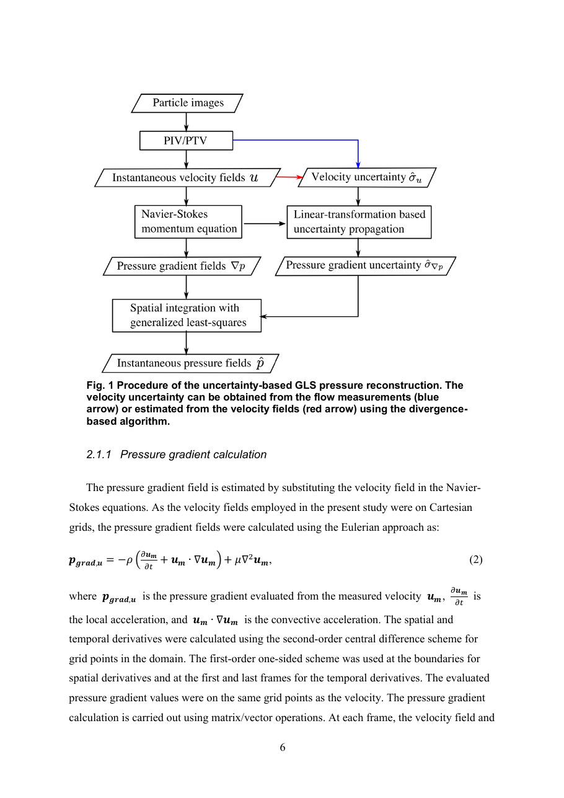
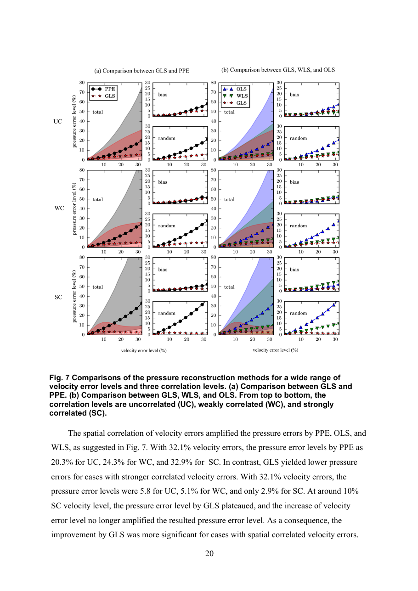
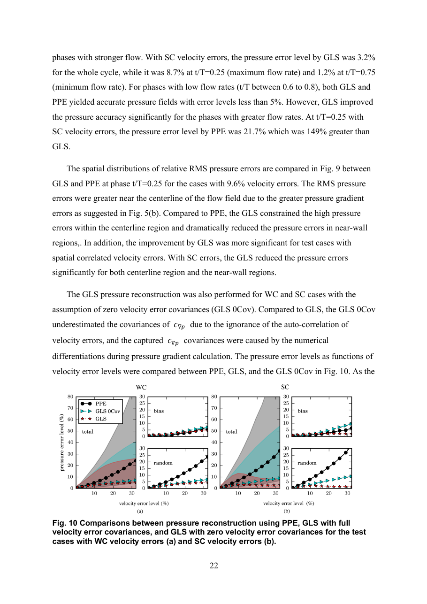

# 일반화 최소제곱을 쓴, PIV/PTV 유동 측정의 불확도 기반 압력장 재구성 (번역)

- 원문: 같은 폴더의 `Zhang2020_ExpFluids_GLS_pressure_uncertainty.pdf` (arXiv:1912.00130v1, 2019-11-30 게시, 33쪽)
- 번역 범위: 전문(초록, 기호표, 본문, 그림 캡션). 참고문헌은 원문 그대로 둔다.
- 판본 메모: 이 번역은 arXiv 원고(PDF 메타데이터의 원고 파일명 `GLS_pressure_manuscript_v6`)를 옮긴 것이다. 저널판(Experiments in Fluids 61(6):131, 2020, 제목 "Using uncertainty to improve pressure field reconstruction from PIV/PTV flow measurements")과 저자 3인이 같고, 주제와 방법이 같다. 저널판 본문은 받지 못해 문장과 수치가 같은지는 확인하지 못했다. 심사 과정에서 수치나 그림이 바뀌었을 수 있다.
- 수식은 pdftotext로 기호가 깨져 원문 PDF를 보고 다시 적었다.

---

Jiacheng Zhang(1), Sayantan Bhattacharya(1), Pavlos P. Vlachos(1,2)

1. 퍼듀 대학교 기계공학부, 미국 인디애나주 웨스트라피엣 47907
2. 퍼듀 대학교 웰던 의공학부, 미국 인디애나주 웨스트라피엣 47907

연락: pvlachos@purdue.edu

## 초록

입자 영상 유속계(PIV)나 입자 추적 유속계(PTV)로 잰 속도장에서 순간 압력장을 구하는 새로운 불확도 기반 압력 재구성 방법을 제안한다.
먼저 속도장으로 압력 구배장을 계산한다. 이와 함께 선형 변환에 기반한 알고리즘으로, 속도 불확도에서 국소적이고 순간적인 압력 구배 불확도를 추정한다.
그다음 압력 구배와 경계 조건으로 이루어진 과결정 선형계를 풀어 압력장을 재구성한다.
이 선형계는 일반화 최소제곱(GLS)으로 푼다. GLS는 앞에서 추정한 압력 구배 오차의 분산과 공분산을 역가중으로 넣어 재구성 압력장을 최적화한다.
2차원 맥동 유동의 합성 속도장으로 검증했다. 기존 기준 방법인 압력 푸아송 방정식(PPE) 풀이에 비해 압력 정확도가 크게 좋아졌고, 오차 감소는 최대 250%였다.
GLS는 속도 오차에 더 강건했고, 속도 오차가 공간적으로 상관되어 있을 때 개선이 더 컸다.
실험 검증으로, 3차원 PTV로 잰 층류 관 유동 속도장에서 부피 압력장을 구했다. GLS는 압력 절대오차의 중앙값을 최대 96% 줄였다.

핵심어: 일반화 최소제곱, 순간 압력 재구성, 불확도 추정

## 기호

| 기호 | 뜻 | 기호 | 뜻 |
|---|---|---|---|
| x, y, z | 공간 좌표 | $p_{ref}$ | 기준 압력 |
| Δx, Δy | 격자 크기 | $\epsilon_{pref}$ | 기준 압력의 오차 |
| Δt | 연속 프레임 사이 시간 간격 | $\mathbf{p}_{grad,u}$ | 측정 속도로 계산한 압력 구배 |
| u, v, w | 속도 성분 | $\mathbf{p}_{grad,t}$ | 참 압력 구배 |
| $\mathbf{u}$ | 속도 벡터 | $\boldsymbol\epsilon_{\nabla p}$ | 계산한 압력 구배의 오차 |
| $\mathbf{u}_m$ | 측정 속도 | $\boldsymbol\sigma_{\nabla p}$ | 압력 구배 오차의 표준편차 |
| $\mathbf{u}_t$ | 참 속도 | $\Sigma_{\nabla p}$ | 압력 구배 오차의 공분산 행렬 |
| $\boldsymbol\epsilon_u$ | 측정 속도의 오차 | $\epsilon_{pgradx}$ | 흐름 방향 압력 구배 오차 |
| $\Sigma_u$ | 속도 오차의 공분산 행렬 | $\sigma_{pgradx}$ | 흐름 방향 압력 구배 오차의 표준편차 |
| $\boldsymbol\sigma_u$ | 속도 오차의 표준편차 | $\rho_{pgradx}$ | 흐름 방향 압력 구배 오차 사이의 자기상관계수 |
| $\rho_{u1,u2}$ | 속도 오차 사이의 자기상관계수 | ρ | 유체 밀도 |
| $Cov_{u1,u2}$ | 속도 오차 사이의 공분산 | μ | 유체 점성계수 |
| p | 압력 | STD | 표준편차 |
| $\epsilon_p$ | 재구성 압력의 오차 | RMS | 제곱평균제곱근 |

## 1 서론

유체 흐름의 압력 측정은 공학 응용에서도, 흐름 물리 연구에서도 중요하다. 벽 압력 구멍, 정압관, 압력 감응 도료(PSP) 같은 압력 측정 장치는 흐름을 방해하거나, 점 측정이나 표면 분포만 준다(McKeon and Engler, 2007). 또 대부분의 압력 측정 기법은 측정 범위와 분해 가능한 주파수 대역에 한계가 있다.
입자 영상 유속계(PIV)와 입자 추적 유속계(PTV) 같은 유동 측정 기법이 발전하면서, 속도장을 얻어 순간 압력을 구하는 데 쓸 수 있게 되었다(Fujisawa et al. 2005; Liu and Katz 2006; Charonko et al. 2010; Neeteson and Rival 2015; Huhn et al. 2016).
대부분의 압력 재구성 방법은 두 단계를 거친다. 먼저 나비에-스토크스 운동량 방정식으로 속도장에서 압력 구배장을 구한다. 그다음 이를 공간 적분해 압력장을 재구성한다. 비압축성 흐름에서 운동량 방정식은 다음과 같다.

$$\nabla p = -\rho \frac{D\mathbf{u}}{Dt} + \mu \nabla^2 \mathbf{u} \tag{1}$$

여기서 p는 압력, $\mathbf{u}$는 속도, ρ와 μ는 유체의 밀도와 점성계수다. ∇는 발산 연산자, ∇²는 라플라스 연산자를 나타낸다. $D\mathbf{u}/Dt$는 물질 가속도로, 격자 속도 자료에서 오일러 방식으로 구하거나(Fujisawa et al. 2005; de Kat et al. 2009; Charonko et al. 2010; Tronchin et al. 2015), 입자 궤적에서 라그랑주 방식으로 구한다(Neeteson and Rival 2015; Gesemann et al. 2016; Huhn et al. 2016).
압력 적분의 흔한 방법 하나는 경로 적분(공간 전진이라고도 한다)이다. 흐름 영역을 가로지르는 경로를 따라 압력 구배를 적분한다(Liu and Katz 2006; Dabiri et al. 2014; Tronchin et al. 2015). 대부분의 경로 적분 방식은 잘못된 압력 구배 값의 영향을 줄이려고 경로를 여러 개 겹쳐 쓴다. 계산 비용이 커서 3차원 유동 자료에는 거의 쓰지 않는다.
가장 널리 쓰는 압력 적분 방법은 압력 푸아송 방정식(PPE)을 푸는 것이다(Fujisawa et al. 2005; de Kat et al. 2009; Violato et al. 2011; Neeteson and Rival 2015; Schneiders and Scarano 2016). PIV 기반 압력 계산 방법의 성능은 Charonko et al.(2010)이 살폈고, PIV와 PTV로 압력장을 재구성하는 방법은 van Gent et al.(2017)이 모사 실험으로 비교 평가했다.

그러나 유동 측정으로 압력을 재구성하는 데는 본질적인 한계가 있다.
첫째, 순간 압력장을 정확히 재구성하려면 보통 시공간 분해능이 충분한 속도 측정이 필요하다. Schneiders et al.(2014)은 3차원 PIV 측정의 시간 초표본화를 위해 와류 격자 기반 알고리즘을 제안했다. Schneiders and Scarano(2016)는 토모그래피 PTV용 조밀 속도 재구성 방법을 개발했다. Gesemann et al.(2016)은 STB 방법의 입자 궤적에서 고해상도 압력장을 얻으려고 B-스플라인 기반 전역 최소화 방법을 썼다.
또 재구성 압력장의 정확도는 속도장의 측정 오차에 크게 좌우된다(Charonko et al. 2010; Azijli et al. 2016; Pan et al. 2016). 속도 오차는 압력 구배 계산과 압력 적분을 거쳐 재구성 압력장으로 퍼지며, 흐름의 종류, 지배 방정식, 주어진 경계 조건에 따라 최대 100배까지 증폭된다(Charonko et al. 2010).
압력 구배를 구할 때의 오차를 줄이려고 평활화와 필터링을 쓸 수 있다(Charonko et al. 2010; Wang et al. 2016; Schiavazzi et al. 2017).
압력 적분 중 오차 전파를 줄이려고 Tronchin et al.(2015)과 Jeon et al.(2018)은 흐름장을 국소 속도 신뢰도에 따라 부분 영역으로 나누고, 신뢰도가 높은 영역부터 차례로 압력을 적분했다. 그 결과 더 믿을 만한 부분 영역의 압력은 덜 믿을 만한 영역의 잘못된 속도 측정에 영향을 받지 않았다. 이런 방식은 측정 정확도가 다른 영역들로 나눌 수 있는 흐름장에 특히 효과적이다. 한 예로 날개 주변 흐름장은 바깥 영역, 후류 영역, 몸체 근처 영역, 모서리 근처 영역으로 나뉘며 정확도가 이 순서로 낮아진다(Jeon et al. 2018). 이 연구들에서 각 부분 영역의 신뢰도는 속도 구배 텐서나 압력 구배 텐서의 프로베니우스 노름으로 정의했다.

압력 재구성은 추정한 속도장의 오차에 크게 좌우되므로, 각 속도 측정의 불확도 범위도 신뢰도의 척도로 써서 압력장 추정의 오차 전파를 최적화할 수 있다. 표준 불확도는 오차 분포의 표준편차로 추정하며, 일정한 신뢰 수준으로 오차 분포의 범위를 준다.
PIV 유동 측정에서는 최근 발전으로 흐름장의 속도 벡터마다 불확도를 추정할 수 있게 되었다(Charonko et al. 2010; Xue et al. 2014, 2015; Bhattacharya et al. 2017; Schneiders and Sciacchitano 2017; Bhattacharya et al. 2018). 국소적이고 순간적인 속도 불확도는 공간 평균 방식으로 속도장의 잡음을 줄이는 데 쓰였고(Wieneke 2017), 계산한 압력 구배장과 재구성 압력장의 불확도를 추정하는 데도 전파될 수 있다(Azijli et al. 2016). 그러나 저자들이 아는 한, 불확도 정보를 압력 적분을 개선하는 데 쓴 적은 없다.

이 연구에서는 속도 불확도를 써서 재구성 압력장의 정확도를 높이는 강건한 압력 재구성 방법을 제안한다.
압력 구배 불확도를 분산과 공분산으로 얻는 선형 변환 기반 불확도 전파 알고리즘을 개발한다.
이산화된 영역에서의 압력 적분을 압력 구배와 압력 경계 조건으로 이루어진 과결정 선형계로 정식화한다.
최량 선형 불편 추정량(BLUE)인 일반화 최소제곱(GLS)(Aitken 1935)을 써서, 추정한 압력 구배 불확도와 함께 압력장을 재구성한다.
GLS 압력 재구성 방법의 성능을 합성 속도장으로 시험하고, PTV로 잰 부피 유동 자료에 적용한다.

## 2 방법

### 2.1 일반화 최소제곱을 쓴 불확도 기반 압력 재구성

GLS를 쓴 불확도 기반 압력 재구성 절차를 그림 1에 보였다. 압력 구배 계산은 2.1.1절에서 설명한다. 선형 변환 기반 불확도 전파 알고리즘은 2.1.2절에서 소개한다. 압력 적분 방법과 수치 기법은 각각 2.1.3절과 2.1.4절에서 소개한다. 2.1.5절에서는 GLS 재구성에 속도 불확도를 대신 공급하는 속도 발산 기반 불확도 추정 알고리즘을 소개한다.

그림 1. 불확도 기반 GLS 압력 재구성 절차. 속도 불확도는 유동 측정에서 얻거나(파란 화살표), 발산 기반 알고리즘으로 속도장에서 추정할 수 있다(빨간 화살표).

#### 2.1.1 압력 구배 계산

속도장을 나비에-스토크스 방정식에 넣어 압력 구배장을 추정한다. 이 연구의 속도장은 직교 격자 위에 있으므로 오일러 방식으로 압력 구배장을 계산했다.

$$\mathbf{p}_{grad,u} = -\rho\left(\frac{\partial \mathbf{u}_m}{\partial t} + \mathbf{u}_m\cdot\nabla\mathbf{u}_m\right) + \mu\nabla^2\mathbf{u}_m \tag{2}$$

여기서 $\mathbf{p}_{grad,u}$는 측정 속도 $\mathbf{u}_m$으로 구한 압력 구배, $\partial\mathbf{u}_m/\partial t$는 국소 가속도, $\mathbf{u}_m\cdot\nabla\mathbf{u}_m$은 대류 가속도다.
영역 안 격자점의 공간 미분과 시간 미분은 2차 중심 차분으로 계산했다. 경계의 공간 미분과 첫 프레임, 마지막 프레임의 시간 미분에는 1차 한쪽 차분을 썼다. 구한 압력 구배 값은 속도와 같은 격자점에 놓인다.
압력 구배 계산은 행렬과 벡터 연산으로 한다. 각 프레임에서 속도장과 계산한 압력 구배장을 모든 격자점의 모든 성분을 담은 열벡터로 정리한다. 부피 자료라면 $\mathbf{u}_m = [u\ v\ w]^T$, $\mathbf{p}_{grad,u} = [\partial p/\partial x\ \ \partial p/\partial y\ \ \partial p/\partial z]^T$다. 이산 구배 연산자와 라플라스 연산자는 고른 차분 기법에 맞춘 2차원 행렬이다. i번째 프레임의 압력 구배 계산은 다음과 같다.

$$\mathbf{p}^i_{grad,u} = -\rho\left[\frac{\mathbf{u}^{i+1}_m - \mathbf{u}^{i-1}_m}{2\Delta t} + \mathbf{u}^i_m \odot (\nabla \mathbf{u}^i_m)\right] + \mu\nabla^2\mathbf{u}^i_m \tag{3}$$

위첨자는 프레임 번호, Δt는 연속 프레임 사이 시간 간격, ⊙는 아다마르 곱(성분별 곱)이다.

#### 2.1.2 선형 변환을 쓴 압력 구배 불확도 추정

제안한 압력 재구성 방법은 압력 적분에 압력 구배와 압력 구배 불확도를 모두 필요로 한다. $\mathbf{p}_{grad,u}$의 불확도를 추정하려고 선형 변환 기반 불확도 전파 알고리즘을 구현했다.

측정 오차를 생각하면 $\mathbf{u}_m$과 $\mathbf{p}_{grad,u}$는 참 성분과 오차 성분으로 나눌 수 있다.

$$\mathbf{u}_m = \mathbf{u}_t + \boldsymbol\epsilon_u \tag{4}$$

$$\mathbf{p}_{grad,u} = \mathbf{p}_{grad,t} + \boldsymbol\epsilon_{\nabla p} \tag{5}$$

아래첨자 t는 참 성분을 뜻하고, $\boldsymbol\epsilon_u$와 $\boldsymbol\epsilon_{\nabla p}$는 속도와 압력 구배의 오차 성분이다. 속도장이 충분한 시공간 분해능으로 얻어져 수치 절단 오차를 무시할 수 있다고 가정하면, 참 압력 구배는 다음과 같다.

$$\mathbf{p}_{grad,t} = -\rho\left(\frac{\partial \mathbf{u}_t}{\partial t} + \mathbf{u}_t\cdot\nabla\mathbf{u}_t\right) + \mu\nabla^2\mathbf{u}_t \tag{6}$$

식 2, 4, 6을 합치면 압력 구배 오차를 측정 속도 $\mathbf{u}_m$과 속도 오차 $\boldsymbol\epsilon_u$로 나타낼 수 있다.

$$\boldsymbol\epsilon_{\nabla p} = -\rho\left(\frac{\partial \boldsymbol\epsilon_u}{\partial t} + \mathbf{u}_m\cdot\nabla\boldsymbol\epsilon_u + \boldsymbol\epsilon_u\cdot\nabla\mathbf{u}_m - \boldsymbol\epsilon_u\cdot\nabla\boldsymbol\epsilon_u\right) + \mu\nabla^2\boldsymbol\epsilon_u \tag{7}$$

$\boldsymbol\epsilon_u$가 속도 $\mathbf{u}_m$보다 충분히 작다고 가정하면 $\boldsymbol\epsilon_u\cdot\nabla\boldsymbol\epsilon_u$ 항은 무시할 수 있다(Pan et al. 2016). 그러면 식 7을 줄여 행렬과 벡터 연산으로 쓸 수 있다.

$$\boldsymbol\epsilon_{\nabla p} = M_+\boldsymbol\epsilon^{i+1}_u + M_-\boldsymbol\epsilon^{i-1}_u + M\boldsymbol\epsilon^i_u,$$
$$M_+ = -\frac{\rho}{2\Delta t}I,\quad M_- = \frac{\rho}{2\Delta t}I,\quad M = -\rho\left[diag(\mathbf{u}^i_m)\cdot\nabla + diag(\nabla\mathbf{u}^i_m)\right] + \mu\nabla^2 \tag{8}$$

$\boldsymbol\epsilon^i_u$는 i번째 프레임의 속도 오차를 담은 열벡터, I는 $\boldsymbol\epsilon^i_u$와 길이가 같은 단위 행렬, diag()는 주어진 열벡터를 대각 원소로 갖는 대각 행렬을 만든다.
식 8은 i번째 프레임의 압력 구배 오차를 i, i−1, i+1 프레임 속도 오차의 선형 변환으로 추정한다. $M_+$, $M_-$, M의 변환 계수는 측정 속도장과 고른 이산화 기법으로 정해진다. 서로 다른 프레임의 속도 오차가 독립이라고 가정하면 압력 구배의 불확도는 다음과 같다.

$$\Sigma^i_{\nabla p} = M_+\Sigma^{i+1}_u M_+^T + M_-\Sigma^{i-1}_u M_-^T + M\Sigma^i_u M^T \tag{9}$$

$\Sigma^i_u$와 $\Sigma^i_{\nabla p}$는 i번째 프레임의 속도 오차와 압력 구배 오차의 공분산 행렬이다. 속도 오차가 공간적으로 상관되지 않았다고 가정하면 $\Sigma_u$는 속도 불확도 $\sigma_u$로 $\Sigma_u = diag(\sigma_u^2)$처럼 만들 수 있다. 상관된 속도 오차라면 공분산을 $\Sigma_u$의 비대각 원소에 넣는다.

#### 2.1.3 압력 적분

압력장은 압력 구배장과 본래 다음 관계를 갖는다.

$$G\mathbf{p} = M_I\,\mathbf{p}_{grad,u} \tag{10}$$

$\mathbf{p}$는 추정 압력장의 열벡터, G는 Jeon et al.(2018)과 비슷한 엇갈림 격자 배치로 만든 이산 구배 연산자, $M_I$는 $\mathbf{p}_{grad,u}$를 격자점에서 엇갈림 절점으로 선형 보간하는 변환 행렬이다.
그림 2에서 격자점은 원으로, 보간된 압력 구배가 놓이는 엇갈림 절점은 화살표 머리로, 압력 구배의 성분 방향은 화살표 방향으로 나타냈다. 예를 들어 점 (x + Δx/2, y)와 (x, y + Δy/2)에서 x, y 방향 엇갈림 보간은 각각

$$\left.\frac{\partial p}{\partial x}\right|_{x+\Delta x/2,\,y} = \frac{1}{2}\left(\left.\frac{\partial p}{\partial x}\right|_{x,y} + \left.\frac{\partial p}{\partial x}\right|_{x+\Delta x,\,y}\right),\quad \left.\frac{\partial p}{\partial y}\right|_{x,\,y+\Delta y/2} = \frac{1}{2}\left(\left.\frac{\partial p}{\partial y}\right|_{x,y} + \left.\frac{\partial p}{\partial y}\right|_{x,\,y+\Delta y}\right)$$

로 쓸 수 있다. 채운 원(이 연구에서 기준점이라 부른다)은 압력 값이 정해진 격자점이다. 다음 식은 기준점을 재구성 압력장과 잇는다.

$$L\mathbf{p} = \mathbf{p}_{ref} \tag{11}$$

L은 0과 1로 이루어진 표시 행렬, $\mathbf{p}_{ref}$는 기준 압력 값을 담은 열벡터다. 압력 구배장과 기준 압력 값의 오차를 함께 두고 식 10과 11을 합치면 선형계를 만들 수 있다.

$$\begin{bmatrix} M_I\mathbf{p}_{grad,u} \\ \mathbf{p}_{ref}\end{bmatrix} = \begin{bmatrix} G \\ L \end{bmatrix}\mathbf{p} + \begin{bmatrix} M_I\boldsymbol\epsilon_{\nabla p} \\ \boldsymbol\epsilon_{pref}\end{bmatrix} \tag{12}$$

$\boldsymbol\epsilon_{pref}$는 직접 압력 측정으로 얻을 수 있는 기준 압력 값의 오차 열벡터다. 간단히 $[M_I\mathbf{p}_{grad,u}\ \ \mathbf{p}_{ref}]^T$를 b, $[G\ \ L]^T$를 A, $[M_I\boldsymbol\epsilon_{\nabla p}\ \ \boldsymbol\epsilon_{pref}]^T$를 $\boldsymbol\epsilon_b$로 쓴다. $\boldsymbol\epsilon_{\nabla p}$와 $\boldsymbol\epsilon_{pref}$는 서로 상관되지 않으므로 오차 항 $\boldsymbol\epsilon_b$의 공분산 행렬 $\Sigma_b$는 다음과 같다.

$$\Sigma_b = \begin{bmatrix} M_I\Sigma_{\nabla p}M_I^T & 0 \\ 0 & \Sigma_{pref}\end{bmatrix} \tag{13}$$

$\Sigma_{pref}$는 $\boldsymbol\epsilon_{pref}$의 공분산 행렬이다. 압력장 $\hat{\mathbf{p}}$는 식 12에서 다음 식을 최소화하는 GLS로 추정할 수 있다.

$$\hat{\mathbf{p}} = \arg\min_{\mathbf{p}} (\mathbf{b} - A\mathbf{p})^T\Sigma_b^{-1}(\mathbf{b} - A\mathbf{p}) \tag{14}$$

$\hat{\mathbf{p}}$는 다음 식의 해로 얻는다.

$$(A^T\Sigma_b^{-1}A)\,\hat{\mathbf{p}} = A^T\Sigma_b^{-1}\mathbf{b} \tag{15}$$

특이성을 피하려면 압력 기준점이 적어도 하나 있어야 한다. 또 $\Sigma_b$의 대각 원소인 분산 항은 0보다 커야 한다. 불확도가 무시할 만한 $\mathbf{p}_{ref}$에 대해서는 $\boldsymbol\epsilon_{pref}$의 분산을 압력 척도의 작은 비율, 예를 들어 $10^{-3}p_0$로 둘 수 있다. $p_0$는 흐름의 특성 압력이다.

최소제곱 재구성의 다른 두 변형, 즉 보통 최소제곱(OLS)과 가중 최소제곱(WLS)도 구현했다. OLS와 WLS는 모두 식 15로 압력장을 계산하되 GLS보다 가정이 더 있다. OLS는 $\boldsymbol\epsilon_b$의 오차가 독립이고 등분산이라고 가정해 $\Sigma_b$를 무시하거나 단위 행렬로 둔다. WLS는 $\boldsymbol\epsilon_b$의 오차가 독립이라고 가정해 $\Sigma_b$의 비대각 원소(공분산)를 0으로 둔다. Jeon et al.(2018)이 제안한 최소제곱 방법은 OLS 방식으로 볼 수 있다.

압력 푸아송 방정식(PPE) 풀이에 의한 압력 재구성을 기준 방법으로 썼다. 압력 구배의 발산을 원천 항으로 하는 다음 꼴의 PPE를 골랐다.

$$\nabla^2\mathbf{p} = \nabla\cdot\mathbf{p}_{grad,u} \tag{16}$$

라플라스 연산자 ∇²는 2차 중심 차분으로 이산화했다. 평면 자료에는 5점 스텐실, 부피 자료에는 7점 스텐실을 썼다. PPE를 풀기 위한 경계 조건은 기준 압력 값(디리클레 조건)이나 압력 구배(노이만 조건)로 주었다. 노이만 조건에서는 경계점에서 계산한 $\mathbf{p}_{grad,u}$를 압력 구배로 주었다.

(그림 2는 원문 10쪽에 있다. 이 폴더에는 그림 1, 7, 10만 이미지로 넣었다.)

그림 2. 일반화 최소제곱 압력 적분을 위한 격자 배치. dp/dx와 dp/dy는 각각 x, y 방향 압력 구배를 나타낸다. Δx와 Δy는 격자 크기다. $p_{ref}$는 기준 압력 값을 나타낸다.

#### 2.1.4 선형계를 푸는 수치 기법

GLS 압력 적분에서 식 15의 선형계를 바로 푸는 것은 $\Sigma_b^{-1}$이 들어간 행렬 연산이 필요해 사실상 불가능하다. 압력 구배 오차는 작은 이웃 안에서만 상관되므로 공분산 행렬 $\Sigma_b$는 희소하지만, 역행렬 $\Sigma_b^{-1}$은 보통 조밀하다. 크기는 평면 자료에서 약 2Npts×2Npts, 부피 자료에서 약 3Npts×3Npts이며, Npts는 흐름장의 전체 격자점 수다.
벡터 $\boldsymbol\lambda = \Sigma_b^{-1}(\mathbf{b} - A\mathbf{p})$를 도입하면, 다음 식을 풀어 $\mathbf{p}$를 얻을 수 있다(Rao 1973).

$$\begin{bmatrix}\Sigma_b & A \\ A^T & 0\end{bmatrix}\begin{bmatrix}\boldsymbol\lambda \\ \mathbf{p}\end{bmatrix} = \begin{bmatrix}\mathbf{b} \\ 0\end{bmatrix} \tag{17}$$

이렇게 하면 큰 조밀 행렬 $\Sigma_b^{-1}$이 들어간 연산을 피할 수 있다. 그래서 희소 선형계를 푸는 더 효율적인 알고리즘을 쓸 수 있다. OLS와 WLS는 $\Sigma_b$를 무시하거나 대각 행렬로 두므로 $\Sigma_b^{-1}$도 대각 행렬이 되어 식 15로 바로 풀 수 있다.

식 15~17의 선형계를 풀 때는 유동 자료 크기에 따라 다른 수치 기법을 골랐다. 평면 자료와 작은 부피 자료에는 크고 희소한 비대칭 선형 방정식을 직접 푸는 범용 라이브러리 SuperLU(Li 2005)를 썼다. 큰 부피 유동 자료에는 켤레 기울기 반복법(Björck 1996)을 썼다.

#### 2.1.5 발산 기반 속도 불확도 추정

부피 PIV나 PTV 같은 일부 유동 측정 기법에서는 국소적이고 순간적인 속도 불확도 추정이 아직 확립되지 않았거나 제한적이다. 불확도 기반 GLS 압력 재구성에 정보를 주려고, 속도장에서 바로 속도 불확도를 추정하는 발산 기반 방법을 쓸 수 있다. 비압축성 흐름에서 속도 오차는 0이 아닌 속도 발산을 만든다.

$$\nabla\cdot\boldsymbol\epsilon_u = \nabla\cdot\mathbf{u}_m \tag{18}$$

이를 최소제곱 의미로 풀어 속도 오차 $\hat{\boldsymbol\epsilon}_u$를 추정할 수 있다.

$$\hat{\boldsymbol\epsilon}_u = (\nabla\cdot)^T(\nabla^2)^{-1}(\nabla\cdot\mathbf{u}_m) \tag{19}$$

이 방법은 (Zhang et al. 2019)가 속도 오차를 추정하는 데 썼고, 그 오차를 $\boldsymbol\epsilon_{pgrad}$로 전파해 가중 최소제곱 압력 재구성에 정보를 주었다. 이 연구에서는 각 프레임 각 격자점의 속도 불확도를, 시공간 이웃 점들의 $\hat{\boldsymbol\epsilon}_u$의 가중 표준편차(WSTD)로 추정한다.

$$\hat{\boldsymbol\sigma}_u = \sqrt{\frac{\sum w(\hat{\boldsymbol\epsilon}_u)^2}{\sum w}},\quad w = \exp\left[-\frac{1}{2}\left(\frac{\Delta s_r}{\Delta x}\right)^2 - \frac{1}{2}\left(\frac{\Delta s_t}{\Delta t}\right)^2\right] \tag{20}$$

$\Delta s_r$과 $\Delta s_t$는 이웃 점에서 관심 점까지의 공간 거리와 시간 거리다. $\hat{\boldsymbol\sigma}_u$가 국소적이고 순간적인 값이 되도록 $\Delta s_r \le \Delta x$이고 $\Delta s_t \le \Delta t$인 이웃 점만 계산에 쓴다.

### 2.2 합성 유동장

두 개의 무한 평행판 사이 2차원 맥동 유동의 합성 속도장으로 불확도 추정 알고리즘을 시험하고 압력 재구성 방법들의 성능을 평가했다. 맥동 유동은 진동하는 흐름 방향 압력 구배로 구동된다.

$$\frac{\partial p}{\partial x} = \rho K + \gamma\rho K\cos\omega t \tag{21}$$

흐름 방향 속도 분포는 다음과 같다.

$$u = u_{max}\left(1 - \frac{y^2}{h^2}\right) + \frac{\gamma K}{i\omega}\left(1 - \frac{\cosh(y/h\,\sqrt{i}\,\lambda)}{\cosh(\sqrt{i}\,\lambda)}\right)\exp(i\omega t) \tag{22}$$

여기서 $\lambda = h\sqrt{\rho/(\mu\omega)}$이다(원문 12쪽 표기 그대로 옮겼다).
γ는 정상 압력 구배 성분의 크기와 진동 압력 구배 성분 진폭의 비, K는 압력 구배 전체 세기를 정하는 상수, ω는 진동 성분의 각속도, h는 채널 반폭, $u_{max}$는 정상 흐름 성분의 중심선 속도다. Charonko et al.(2010)과 같은 매개변수를 골랐다. ω = 2π rad/s(주기 T = 1 s), $u_{max}$ = 1 m/s, γ = 25.13이다.
그림 3(a)처럼 h = 4 mm, 길이 20 mm인 흐름 영역을 썼다. 유입 경계의 압력은 0 Pa로 두었고, PPE 풀이의 디리클레 조건과 최소제곱 방법들의 기준점으로 썼다. 유체 물성은 ρ = 1000 kg/m³, μ = 1×10⁻³ Pa s로 주었다.
속도장은 격자 크기 0.1 mm의 균일 직교 격자 위에 만들었고 격자점은 101×41개다. 시험 경우마다 20 Hz 표본화로 50주기에 걸친 속도장 1000개를 만들었다. 한 주기 동안 흐름 방향 중심선 속도와 압력 구배 파형을 그림 3(b)에 보였다. 4개 위상의 흐름 방향 속도 분포를 그림 3(c)에 보였다. 특성 속도와 특성 압력은 $u_0 = u_{max}$, $p_0 = \frac{1}{2}\rho u_0^2$로 정의한다.

압력 재구성 방법의 강건성을 시험하려고, 공간 자기상관 수준이 다른 가우스 잡음을 참 속도장에 더했다. PIV 장에서는 공간적으로 상관된 오차가 보고되었고(Sciacchitano and Wieneke 2016), PTV 측정에서 보간한 격자 속도장에서도 예상된다. 한 입자 궤적의 오차가 여러 격자점의 속도 값에 영향을 줄 수 있기 때문이다. 세 가지 공간 상관 수준을 고려했다. 비상관(UC), 약상관(WC), 강상관(SC)이다. 공간 자기상관계수는 다음과 같이 정했다.

$$\rho_{u1,u2} = \exp\left[-s\left(\frac{r_{1,2}}{\Delta x}\right)^2\right] \tag{23}$$

(그림 3은 원문 13쪽에 있다. 이미지로 넣지 않았다.)

그림 3. (a) 2차원 맥동 유동의 영역 배치. (b) 한 주기 안의 흐름 방향 중심선 속도와 압력 구배 파형. (c) 4개 시간 위상의 흐름 방향 속도 분포.

$\rho_{u1,u2}$는 점 1과 점 2의 속도 오차 사이 자기상관계수, $r_{1,2}$는 두 점 사이 공간 거리, Δx는 격자 크기, s는 상관 세기를 정하는 양의 상수다. UC 오차에서 s는 0이고, WC와 SC 오차에서는 각각 0.22와 0.88로 두었다. SC의 $\rho_{u1,u2}$는 32×32 화소 조사 창, 75% 겹침의 PIV 측정 결과(Sciacchitano and Wieneke 2016)와 비슷하다. 그다음 자기상관계수로 공분산을 계산했다.

$$Cov_{u1,u2} = \rho_{u1,u2}\,\sigma_1\sigma_2 \tag{24}$$

$Cov_{u1,u2}$는 분산이 $\sigma_1$, $\sigma_2$인 점 1과 2의 속도 오차 사이 공분산이다. 속도 오차 분산은 각 점의 참 속도 크기에 대한 비율로 정했다.

$$\sigma = \alpha|\mathbf{u}_t| \tag{25}$$

α는 넣는 오차의 수준을 정한다. 한 속도 성분의 오차는 다른 성분과 상관되지 않고, 서로 다른 프레임의 오차도 상관되지 않는다고 가정해, 지정한 분산과 공분산으로 공분산 행렬 $\Sigma_u$를 만들었다. 그다음 $\Sigma_u$의 촐레스키 분해를 상관 없고 편향 없는 단위 표준편차 가우스 난수 벡터에 곱해 공간 상관된 속도 오차를 만들었다(Azijli and Dwight 2015). 넓은 오차 수준에서 압력 재구성 방법을 시험하려고, 상관 수준마다 α를 1%에서 50%까지 바꾼 시험 경우 11개를 만들어 모두 33개 시험 경우를 만들었다.

### 2.3 층류 관 유동 측정

원형 관 속 층류를 부피 PTV 실험으로 쟀고, GLS 압력 재구성 방법의 검증에 썼다. 실험 장치 개략도를 그림 4에 보였고, 실험의 자세한 내용은 Bhattacharya and Vlachos(2019)에 있다.
흐름은 기어 펌프로 0.17 L/min의 일정 유량 Q로 구동했다. 관 상류와 하류의 유량을 초음파 유량계로 쟀고, 평균 유량으로 참 속도 분포를 정했다. 지름($R_{pipe}$) 0.25인치의 투명 FEP 관을 썼다. 작동 유체는 증류수와 요소 용액(90:10)으로 밀도 1015 kg/m³, 점성계수 0.915 mPa s다. 관 유동의 레이놀즈 수는 630으로 층류 영역이었다. 굴절률을 맞추려고 관을 물과 글리세린 용액에 담갔다.
측정 부피는 9×6.5×6.5 mm³이며, 적절한 광학 배치의 Continuum Terra-PIV 레이저로 비췄다. 시간 분해 측정은 카메라 4대로 6 kHz에서 했고, 영상 크기는 640×624 화소였다. 24마이크로미터 형광 입자를 썼다.

(그림 4는 원문 15쪽에 있다. 이미지로 넣지 않았다.)

그림 4. 흐름 회로와 카메라 배치를 보여 주는 층류 관 유동 장치 개략도.

입자의 스토크스 수는 0.0005였다. 입자 영상은 자체 개발한 카메라 보정, 입자 재구성, 추적 코드로 처리했다. 다항식 사상 함수(Soloff et al. 1997)로 영상 좌표와 물리 좌표 사이 관계를 정했다. 측정 부피와 보정 표적 위치나 정렬 사이의 어긋남을 없애려고 부피 자기 보정(Wieneke 2008)을 세 번 반복했다. 3차원 삼각 측량(Maas et al. 1993)으로 물리 좌표계의 입자 위치를 재구성했고, 이어서 "최근접 이웃" 쌍 추적 알고리즘으로 3차원 입자 위치를 추적했다. 입자 영상 500장에서 속도 프레임 499개를 얻었다. 입자 위치의 속도 값은 "FlowFit"(Gesemann et al. 2016)으로 균일 직교 격자에 보간했다. 격자 해상도는 0.385 mm였고, 추적한 입자 수와 흐름 영역 격자점 수의 비는 0.2였다. 입자가 부족해 오차가 큰 관 벽의 일부 측정은 잘라 냈다.

제안한 GLS 방법과 PPE 방법을 격자 속도장에 적용했다. 유입 평면의 중심점에 기준 압력 0을 주었고, 나머지 경계에는 속도 자료로 계산한 압력 구배로 노이만 조건을 주었다. 499개 프레임 전체의 속도 표준편차(STD)를 공간 점마다 계산해 GLS 재구성용 공분산 행렬 $\Sigma_{u,STD}$를 만들었다. 또 2.1.5절의 속도 발산 기반 알고리즘으로 추정한 $\hat{\boldsymbol\sigma}_u$로 다른 공분산 행렬 $\Sigma_{u,UNC}$를 만들었다. $\Sigma_{u,STD}$와 $\Sigma_{u,UNC}$ 모두 공분산은 0으로 가정했다. $\Sigma_{u,STD}$와 $\Sigma_{u,UNC}$를 쓴 GLS 재구성을 각각 GLS STD, GLS UNC로 부른다.

층류 관 유동의 해석해는 다음과 같다.

$$U = -\frac{1}{4\mu}\frac{dP}{dx}\left(R_{pipe}^2 - R^2\right),\quad \frac{dP}{dx} = -\frac{8\mu Q}{\pi R_{pipe}^4} \tag{26}$$

x는 흐름 방향, R은 반지름 방향 거리, U는 흐름 방향 속도다. 중심선 속도 크기 $U_{centerline}$을 특성 속도로 썼고, 특성 압력 $p_0$는 $\frac{1}{2}\rho U_{centerline}^2$였다.

## 3 결과

### 3.1 합성 유동장

#### 3.1.1 압력 구배 불확도 추정

2차원 맥동 유동장에서 상대 속도 오차 크기 $|\epsilon_u|$를 $\sqrt{\epsilon_u^2 + \epsilon_v^2}/u_0$로 계산했다. 각 시험 경우의 전체 속도 오차 수준은 시공간 모든 점의 $|\epsilon_u|$ 중앙값으로 나타냈다. 압력 구배장은 2.1.1절대로 계산했고, 상대 압력 구배 오차 $\boldsymbol\epsilon_{\nabla p}$는 해석해와의 차이를 $p_0/\Delta x$로 나눠 구했다.
선형 변환 기반 불확도 전파 알고리즘이 순간 예측과 국소 예측 모두에서 맞는지 확인하려고, 추정 불확도 분포의 RMS 값을 참 오차 분포의 RMS와 시간과 공간에서 비교했다. 예측이 맞다면 RMS 오차와 RMS 불확도가 같아야 하기 때문이다(Sciacchitano et al. 2015).
그림 5(a)는 9.6% SC 속도 오차(α = 15%) 시험 경우에서, 두 공간 위치(중심선과 R = 3 mm)의 추정 상대 흐름 방향 압력 구배 불확도($\hat\sigma_{pgradx}$)와 상대 흐름 방향 압력 구배 오차($|\epsilon_{pgradx}|$)의 RMS 값 시간 변화를 비교한다. 두 위치 모두 모든 시점에서 $\hat\sigma_{pgradx}$의 RMS 값이 $|\epsilon_{pgradx}|$의 RMS 값과 맞았다.
그림 5(b)는 두 위상(t/T = 0.25와 0.75)에서 $|\epsilon_{pgradx}|$와 $\hat\sigma_{pgradx}$ RMS 값의 폭 방향 분포를 비교한다. 두 위상 모두 흐름장 중심선 근처에서 $|\epsilon_{pgradx}|$와 $\hat\sigma_{pgradx}$가 더 컸고, $\hat\sigma_{pgradx}$의 RMS 값은 $|\epsilon_{pgradx}|$의 RMS 값과 맞았다. 종합하면, 제안한 알고리즘은 계산한 압력 구배의 순간적이고 국소적인 불확도를 예측할 수 있었다.

(그림 5는 원문 17쪽에 있다. 이미지로 넣지 않았다.)

그림 5. 9.6% SC 속도 오차 경우. (a) 중심선(R = 0 mm)과 R = 3 mm 격자점에서 모든 시간 위상의 흐름 방향 상대 압력 구배 오차 $\epsilon_{pgradx}$와 불확도 $\hat\sigma_{pgradx}$의 RMS. (b) t/T = 0.25와 t/T = 0.75에서 RMS 오차와 불확도의 폭 방향 분포.

추정한 자기상관계수 $\hat\rho_{pgradx}$는 참 오차로 통계적으로 구한 계수 $\rho_{pgradx}$와 비교해 검증했다. 각 시험 경우와 각 시간 위상에서, 모든 프레임에 걸친 오차로 모든 공간 점 쌍 사이 $\rho_{pgradx}$를 다음과 같이 구했다.

$$\rho_{pgradx} = \frac{Cov(\epsilon_{pgradx,1}, \epsilon_{pgradx,2})}{\sigma_{pgradx,1}\,\sigma_{pgradx,2}} \tag{27}$$

$Cov(\epsilon_{pgradx,1}, \epsilon_{pgradx,2})$는 점 1과 2의 압력 구배 오차 사이 공분산이고, $\sigma_{pgradx,1}$, $\sigma_{pgradx,2}$는 두 점 압력 구배 오차의 표준편차다. 각 공간 거리 r에서 자기상관 세기를 보이려고 $\rho_{pgradx}$ 절댓값의 중앙값을 구했다.
예로 9.6% 속도 오차 시험 경우들에서 $\rho_{pgradx}$ 절댓값 중앙값을 r/Δx의 함수로 그림 6(a)에 보였다. 오른쪽 사분면의 추정 계수는 왼쪽 사분면의 통계로 구한 계수와 맞았다. 대체로 $\epsilon_{pgradx}$의 자기상관은 r이 작을수록, 그리고 $\boldsymbol\epsilon_u$의 상관이 강한 시험 경우일수록 더 강했다.
r = Δx에서 $\rho_{pgradx}$ 절댓값 중앙값은 UC 경우 0.07, WC와 SC 경우 각각 0.32와 0.71이었다. 대응하는 $\hat\rho_{pgradx}$는 UC 0.03, WC 0.36, SC 0.72였다.
자기상관계수의 국소적이고 순간적인 예측을 검증하려고, 9.6% SC 속도 오차 시험 경우의 t/T = 0.25에서 중심점(x = 10 mm, y = 0 mm)과 그 이웃 점들 사이 $\rho_{pgradx}$와 $\hat\rho_{pgradx}$ 값을 그림 6(b)와 (c)에 보였다. 추정값은 통계로 구한 값과 잘 맞았다. $\rho_{pgradx}$는 중심점에서 폭 방향과 흐름 방향 모두 단조 감소했고, 감소율은 흐름 방향이 폭 방향보다 컸으며 가장자리 근처에서는 계수가 음수였다.
다른 영역과 다른 위상의 $\rho_{pgradx}$ 분포도 살폈고, 국소적이고 순간적인 흐름 조건에 따라 달라졌다. 제안한 불확도 추정 알고리즘은 살핀 모든 위치와 위상에서 $\rho_{pgradx}$를 정확히 추정했다.

(그림 6은 원문 18쪽에 있다. 이미지로 넣지 않았다.)

그림 6. (a) 정규화 공간 거리 r/Δx의 함수로 본 $\rho_{pgradx}$ 절댓값 중앙값. $\epsilon_{pgradx}$로 통계적으로 구한 $\rho_{pgradx}$(왼쪽 사분면)를 제안한 선형 변환 기반 알고리즘으로 추정한 $\hat\rho_{pgradx}$(오른쪽 사분면)와 비교한다. t/T = 0.25에서 중심점 주변의 $\hat\rho_{pgradx}$ 분포 (b)와 $\rho_{pgradx}$ 분포 (c).

#### 3.1.2 압력 재구성

2.1절에서 소개한 방법들로 순간 압력장을 재구성했다. 각 시험 경우에서 시공간 모든 점의 해석해와의 차이로 압력 오차를 계산하고 $p_0$로 정규화했다.
방법들의 성능을 평가하려고 압력 오차 지표 세 개를 썼다. 압력 절대오차의 중앙값은 전체 압력 오차 수준을 나타내고, 15.75번째와 84.25번째 백분위수를 각각 하한(LB)과 상한(UB)으로 정의했다.
속도 오차 수준에 따른 압력 오차 지표를 그림 7(a)에서 PPE와 GLS 사이에, 그림 7(b)에서 최소제곱 기반 방법들 사이에 비교했다.
또 압력 오차 수준을 편향 오차와 무작위 오차로 나눠서도 구했다. 시간 위상 φ, 공간 위치 $\mathbf{r}$의 편향 오차는 $\epsilon^{\phi,\mathbf{r}}_{bias} = \frac{1}{N_{cycle}}\sum_{k=1}^{N_{cycle}}\epsilon^{k,\phi,\mathbf{r}}_p$로 구했다. $N_{cycle}$ = 50은 전체 주기 수, $\epsilon^{k,\phi,\mathbf{r}}_p$는 주기 k, 시간 위상 φ, 공간 위치 $\mathbf{r}$의 압력 오차다. 무작위 오차는 전체 오차에서 편향 오차를 빼서 $\epsilon^{k,\phi,\mathbf{r}}_{random} = \epsilon^{k,\phi,\mathbf{r}}_p - \epsilon^{\phi,\mathbf{r}}_{bias}$로 구했다.
그림 7처럼 α를 1%에서 50%까지 바꾸면 속도 오차 수준은 0.64%에서 32.1%로 늘었다. GLS 방법은 다른 방법들보다 속도 오차에 더 강건했다. 32.1% UC 속도 오차 경우, 그림 7(a)처럼 전체 압력 오차는 PPE로 20.3%, GLS로 겨우 5.8%였다. 같은 경우 그림 7(b)처럼 WLS와 OLS는 각각 6.9%와 20.4%의 압력 오차를 냈다. GLS의 오차 범위도 PPE, OLS, WLS보다 낮았다. GLS에 의한 개선은 속도 오차가 클수록 더 뚜렷했다. PPE에 비해 GLS는 9.6% UC 속도 오차에서 전체 압력 오차 수준을 50%(2.4% 대 3.6%), 32.1% UC 속도 오차에서 250%(5.8% 대 20.3%) 줄였다.

그림 7. 넓은 범위의 속도 오차 수준과 세 상관 수준에서 압력 재구성 방법 비교. (a) GLS와 PPE 비교. (b) GLS, WLS, OLS 비교. 위에서 아래로 상관 수준은 비상관(UC), 약상관(WC), 강상관(SC)이다.

그림 7처럼 속도 오차의 공간 상관은 PPE, OLS, WLS의 압력 오차를 키웠다. 32.1% 속도 오차에서 PPE의 압력 오차 수준은 UC 20.3%, WC 24.3%, SC 32.9%였다. 반대로 GLS는 속도 오차의 상관이 강할수록 압력 오차가 더 낮았다. 32.1% 속도 오차에서 압력 오차 수준은 UC 5.8, WC 5.1%, SC 겨우 2.9%였다. SC 속도 오차 약 10% 부근에서 GLS의 압력 오차 수준은 더 오르지 않았고, 속도 오차 수준이 늘어도 압력 오차 수준이 더 커지지 않았다. 그 결과 GLS의 개선은 공간 상관된 속도 오차 경우에 더 뚜렷했다. WLS는 UC 속도 오차 경우에는 GLS와 성능이 비슷했지만, 그림 7(b)처럼 WC나 SC 경우에는 그렇지 않았다.

그러나 속도 오차가 아주 작은 경우에는 GLS가 PPE나 OLS보다 압력 오차가 컸다. 그림 7처럼 0.64% UC 속도 오차에서 GLS의 전체 압력 오차 수준은 0.96%였고, PPE와 OLS는 각각 0.24%와 0.27%였다. 속도 오차가 작은 경우 GLS는 OLS나 PPE보다 편향 오차를 더 만들었지만, 무작위 오차는 모든 경우에서 일관되게 줄였다. 대부분의 경우 무작위 오차가 편향 오차보다 커서 GLS가 전체 압력 오차 수준을 줄였다. 속도 오차 수준이 높은 경우(20% 초과)에는 GLS가 편향 오차와 무작위 오차를 모두 줄여 압력 정확도를 크게 높였다.

(그림 8은 원문 21쪽에 있다. 이미지로 넣지 않았다.)

그림 8. 9.6% 속도 오차 수준 경우들의 모든 시간 위상에서 GLS와 PPE 비교.

맥동 유동의 시간 위상별로 GLS 성능을 살폈다. 그림 8은 9.6% 속도 오차 시험 경우들에서 위상마다 GLS와 PPE의 압력 오차 수준과 오차 범위를 비교한다. 흐름이 강한 위상에서 압력 오차가 더 컸다. SC 속도 오차에서 GLS의 압력 오차 수준은 한 주기 전체로 3.2%였고, t/T = 0.25(최대 유량)에서 8.7%, t/T = 0.75(최소 유량)에서 1.2%였다. 유량이 낮은 위상(t/T 0.6~0.8)에서는 GLS와 PPE 모두 오차 수준 5% 미만의 정확한 압력장을 냈다. 그러나 유량이 큰 위상에서는 GLS가 압력 정확도를 크게 높였다. SC 속도 오차의 t/T = 0.25에서 PPE의 압력 오차 수준은 21.7%로 GLS보다 149% 컸다.

(그림 9는 원문 21쪽에 있다. 이미지로 넣지 않았다.)

그림 9. 9.6% 속도 오차 수준 시험 경우들에서 GLS(위 줄)와 PPE(아래 줄)의 압력 RMS 오차 공간 분포.

9.6% 속도 오차 경우들의 위상 t/T = 0.25에서 상대 RMS 압력 오차의 공간 분포를 그림 9에서 GLS와 PPE 사이에 비교했다. RMS 압력 오차는 흐름장 중심선 근처에서 더 컸는데, 그림 5(b)처럼 압력 구배 오차가 더 컸기 때문이다. PPE에 비해 GLS는 큰 압력 오차를 중심선 영역 안에 가두었고 벽 근처 영역의 압력 오차를 크게 줄였다. 또 GLS의 개선은 공간 상관된 속도 오차 시험 경우에 더 뚜렷했다. SC 오차에서 GLS는 중심선 영역과 벽 근처 영역 모두에서 압력 오차를 크게 줄였다.

속도 오차 공분산을 0으로 가정한 GLS 압력 재구성(GLS 0Cov)도 WC와 SC 경우에 해 보았다. GLS에 비해 GLS 0Cov는 속도 오차의 자기상관을 무시하므로 $\epsilon_{\nabla p}$의 공분산을 과소평가했고, 잡힌 $\epsilon_{\nabla p}$ 공분산은 압력 구배 계산 중 수치 미분에서 생긴 것뿐이었다. 속도 오차 수준에 따른 압력 오차 수준을 그림 10에서 PPE, GLS, GLS 0Cov 사이에 비교했다.

그림 10. WC 속도 오차 (a)와 SC 속도 오차 (b) 시험 경우에서 PPE, 전체 속도 오차 공분산을 쓴 GLS, 속도 오차 공분산을 0으로 둔 GLS의 압력 재구성 비교.

속도 오차 수준이 0.64%에서 32.1%로 늘 때, GLS 0Cov의 압력 오차 수준은 WC 경우 1.0%에서 7.1%로, SC 경우 1.0%에서 8.8%로 바뀌었다. 속도 오차 공분산을 무시한 GLS 0Cov는 WC 경우 GLS보다 조금 나빴고, SC 경우에는 속도 오차 자기상관이 커서 성능 차이가 더 뚜렷했다. 16.1% 속도 오차에서 GLS 0Cov의 압력 오차 수준은 WC 경우 GLS보다 8%, SC 경우 70% 컸다. 기준 방법 PPE에 비하면 GLS 0Cov도 대부분 경우에서 압력 오차를 크게 줄였다. 16.1% 속도 오차에서 GLS 0Cov의 압력 오차 감소는 WC 경우 110%, SC 경우 138%였다.

### 3.2 층류 관 유동

실험 검증 사례인 층류 관 유동에서, 모든 프레임과 Y-Z 단면에 걸쳐 평균한 흐름 방향(X 방향) 포물선 속도 분포를 Y와 Z의 함수로 그림 11(a)에 보였다. 속도 오차는 격자 속도 자료와 식 26의 해석해의 차이로 계산하고 특성 속도 $U_{centerline}$으로 정규화했다.
측정 정확도를 평가하려고, 상대 속도 오차 크기($|\boldsymbol\epsilon_u|$), 속도 표준편차 크기($|\boldsymbol\sigma_u|$), 2.1.5절의 발산 기반 알고리즘으로 추정한 속도 불확도 크기($|\hat{\boldsymbol\sigma}_u|$)의 히스토그램을 그림 11(b)에 보였다. 세로선이 보이듯 RMS 값은 $|\boldsymbol\epsilon_u|$ 12.0%, $|\boldsymbol\sigma_u|$ 10.9%, $|\hat{\boldsymbol\sigma}_u|$ 5.9%였다.
반지름 위치 $R = \sqrt{Y^2+Z^2}$와 흐름 방향 위치 X의 함수로 본 $|\boldsymbol\sigma_u|$와 $|\hat{\boldsymbol\sigma}_u|$의 공간 분포를 그림 11(c)에 보였고, 관 벽 근처에서 $|\boldsymbol\sigma_u|$가 더 컸다. 대체로 $|\hat{\boldsymbol\sigma}_u|$는 50% 과소 예측했고 공간 변화도 작았다.
계산한 압력 구배의 상대 오차 $\boldsymbol\epsilon_{\nabla p}$는 해석해와의 차이를 $p_0/\Delta x$로 나눠 구했다. 제안한 선형 변환 기반 알고리즘으로 $\boldsymbol\sigma_u$와 $\hat{\boldsymbol\sigma}_u$에서 각각 압력 구배 불확도 두 벌을 추정했고, 이를 $\hat{\boldsymbol\sigma}_{\nabla p}(\boldsymbol\sigma_u)$와 $\hat{\boldsymbol\sigma}_{\nabla p}(\hat{\boldsymbol\sigma}_u)$로 쓴다. 상대 오차와 불확도의 히스토그램을 그림 11(d)에 보였다. 세로선이 보이듯 RMS 값은 $|\boldsymbol\epsilon_{\nabla p}|$ 198%, $|\hat{\boldsymbol\sigma}_{\nabla p}(\boldsymbol\sigma_u)|$ 200%, $|\hat{\boldsymbol\sigma}_{\nabla p}(\hat{\boldsymbol\sigma}_u)|$ 109%였다.
압력 구배의 표준편차($\boldsymbol\sigma_{\nabla p}$)와 불확도의 공간 분포를 R과 X의 함수로 그림 11(e)에 보였다. $\hat{\boldsymbol\sigma}_{\nabla p}(\boldsymbol\sigma_u)$는 히스토그램과 공간 분포 모두에서 $\boldsymbol\sigma_{\nabla p}$와 맞았다. 반면 $\hat{\boldsymbol\sigma}_{\nabla p}(\hat{\boldsymbol\sigma}_u)$는 $\hat{\boldsymbol\sigma}_u$에 기반하므로 과소 예측했고 공간 변화도 작았다.

(그림 11은 원문 24쪽에 있다. 이미지로 넣지 않았다.)

그림 11. (a) Y와 Z의 함수로 본 평균 흐름 방향 속도 분포. (b) 속도 오차 크기($|\boldsymbol\epsilon_u|$), 표준편차($\boldsymbol\sigma_u$), 추정 불확도($\hat{\boldsymbol\sigma}_u$)의 히스토그램. 세로선은 분포의 RMS 값이다. (c) $\boldsymbol\sigma_u$와 $\hat{\boldsymbol\sigma}_u$의 공간 분포. (d) 압력 구배 오차 크기($|\boldsymbol\epsilon_{\nabla p}|$), $\boldsymbol\sigma_u$로 추정한 불확도($\hat{\boldsymbol\sigma}_{\nabla p}(\boldsymbol\sigma_u)$), $\hat{\boldsymbol\sigma}_u$로 추정한 불확도($\hat{\boldsymbol\sigma}_{\nabla p}(\hat{\boldsymbol\sigma}_u)$)의 히스토그램. 세로선은 분포의 RMS 값이다. (e) 압력 구배 표준편차 크기($\boldsymbol\sigma_{\nabla p}$)와 추정 불확도 $\hat{\boldsymbol\sigma}_{\nabla p}(\boldsymbol\sigma_u)$, $\hat{\boldsymbol\sigma}_{\nabla p}(\hat{\boldsymbol\sigma}_u)$의 공간 분포.

재구성 압력장의 오차는 해석해와의 차이로 구하고 특성 압력 $p_0$로 정규화했다. 압력 결과의 정밀도를 평가하려고 499개 속도 프레임에 걸친 압력 표준편차도 계산했다. 압력 절대오차($|\epsilon_p|$)와 압력 표준편차($\sigma_p$)의 히스토그램을 각각 그림 12 (a)와 (b)에서 비교했다.
그림 12(a)의 세로 점선이 보이듯 $|\epsilon_p|$의 중앙값은 PPE 219%, GLS STD 112%, GLS UNC 135%였다. PPE에 비해 $|\epsilon_p|$ 중앙값 기준 오차 감소는 GLS STD 96%, GLS UNC 62%였다. $\sigma_p$의 중앙값은 PPE 308%, GLS STD 165%, GLS UNC 200%로, 정밀도 개선이 GLS STD 87%, GLS UNC 54%임을 보였다.
R과 X의 함수로 본 RMS $\epsilon_p$의 공간 분포를 그림 12(c)에서 PPE와 GLS 재구성 사이에 비교했다. 기준 압력을 준 유입 평면 중심 근처에서 압력 오차가 작았고, 유출 평면과 관 벽 쪽으로 갈수록 커졌다. GLS 방법은 장 전체로 퍼지는 오차 전파를 줄여 압력 정확도를 효과적으로 높였다.

(그림 12는 원문 25쪽에 있다. 이미지로 넣지 않았다.)

그림 12. PPE와, 속도 불확도 출처가 다른 GLS 재구성($\boldsymbol\sigma_u$를 쓴 GLS STD와 $\hat{\boldsymbol\sigma}_u$를 쓴 GLS UNC)의 압력 절대오차 $|\epsilon_p|$ (a)와 압력 표준편차 $\sigma_p$ (b) 히스토그램. 세로 점선은 중앙값, 세로 짧은 점선은 분포의 LB와 UB를 나타낸다. (c) R과 X의 함수로 본 압력 RMS 오차의 공간 분포.

## 4 논의

이 연구에서 불확도 기반 일반화 최소제곱을 쓰는 새로운 압력 재구성 방법을 소개했다. 제안한 선형 변환 기반 알고리즘으로 속도 불확도를 전파해, 이분산이고 상관된 압력 구배 오차의 공분산 행렬 형태로 압력 구배 불확도를 추정한다. 압력 적분은 압력 구배장과 경계 조건으로 이루어진 과결정 선형계를 푸는 문제로 정식화했다.
GLS 추정량은 최량 선형 불편 추정량으로, 지배 방정식 10의 불편 추정을 가장 작은 분산으로 준다. GLS에 의한 오차 감소는 압력 구배 불확도를 압력 적분에 넣은 결과다.
GLS와 같은 선형계(식 15)를 불확도 없이 푸는 OLS 방법은 모든 합성 유동 경우에서 PPE와 비슷한 성능을 냈다. 이는 정식화만 바꾸는 것(PPE 대신 과결정 선형계)으로는 압력 재구성의 강건성이 달라지지 않음을 뜻하며, PPE와 OLS가 같은 이론적 기초를 공유한다는 Wang et al.(2017)의 진술과도 맞는다.
그림 7(b)의 OLS, WLS, GLS 비교는 압력 구배 오차의 분산과 공분산이 모두 압력 정확도 개선에 기여했음을 보인다. 분산만 쓰는 WLS 방법은 OLS보다 성능이 좋았다. 분산과 공분산을 모두 고려한 GLS 방법은 WLS보다 압력 정확도를 더 높였다. 그림 6(a)처럼 속도 오차의 상관이 강할수록 압력 구배 오차의 공분산이 더 중요해지므로, 그림 7처럼 공분산을 압력 재구성에 쓰는 GLS가 더 효과적이었다.

제안한 선형 변환 기반 알고리즘은 그림 5와 6처럼 압력 구배 오차의 분산과 공분산을 국소적이고 순간적으로 예측할 수 있었다. 가우스 분포 속도 오차를 가정한 정확한 불확도 전파나 몬테카를로 모의를 한 Azijli et al.(2016)의 방식에 비해, 제안한 알고리즘은 속도 오차 분포의 특정 꼴을 가정하지 않으며, 오차 전파를 선형화했기 때문에 계산이 더 효율적이다.
식 7의 정식화와 3.1.1절의 분석은 또한 압력 구배 불확도가 속도 불확도, 이산화 기법, 시공간 분해능, 국소 속도 분포 등 많은 요인에 달려 있음을 시사한다. 그래서 압력 구배 오차의 분산과 공분산은 보통 속도 오차의 그것과 다르다. 한 예가 그림 6 (b-c)의 중심점 주변 자기상관계수 $\rho_{pgradx}$다. $\rho_{u1,u2}$(식 23으로 정의)는 음이 아닌 값으로 등방적으로 변했지만, $\rho_{pgradx}$의 변화는 비등방적이고 양과 음의 상관을 모두 가졌다.
또 계산한 압력 구배의 오차 크기는 측정 속도의 오차 크기와 크게 다를 수 있다. 층류 관 유동에서 속도에서 압력 구배로의 RMS 오차 증폭은 그림 11(b)와 (d)처럼 16.5배였다. 이 큰 오차 증폭은 유동 측정의 작은 시간 간격 Δt(1/6000 s) 때문이었다. van Oudheusden(2013)이 논의했듯, Δt를 줄이면 유한 차분의 절단 오차는 줄지만 오일러 방식 압력 구배 계산에서 속도 오차의 영향은 커진다. 정상 흐름에서는 큰 Δt를 쓰거나 $\partial\mathbf{u}/\partial t = 0$으로 가정하면 오차 증폭을 효과적으로 줄일 수 있다. 그러나 이 연구에서는 실제 응용에서 더 흔한 비정상 흐름에도 분석과 결론이 적용되도록, 가장 높은 분해 시간 주파수로 압력 재구성을 했다.

GLS 압력 재구성의 성능은 주어진 속도 불확도의 신뢰도에 영향을 받았다. 부피 PTV의 속도 불확도를 사후 추정하는 방법은 확립되지 않았으므로, 이 연구에서는 층류 관 유동 자료의 불확도를 속도장에서 두 방법으로 얻었다. 첫째 방법은 모든 속도 프레임의 표준편차($\boldsymbol\sigma_u$)를 취한 것으로, 정상 흐름에서는 믿을 만한 추정이었다. 둘째 방법은 비압축성 흐름의 가짜 속도 발산에서 $\hat{\boldsymbol\epsilon}_u$를 추정한 뒤, $\hat{\boldsymbol\epsilon}_u$의 WSTD로 $\hat{\boldsymbol\sigma}_u$를 추정한 것이다. $\hat{\boldsymbol\epsilon}_u$를 식 19로 최소제곱 의미에서 계산했으므로, 그림 11(b)처럼 $\hat{\boldsymbol\sigma}_u$가 과소 추정되었다. 덜 믿을 만한 $\hat{\boldsymbol\sigma}_u$ 때문에 GLS UNC는 GLS STD보다 조금 나빴지만, GLS UNC와 GLS STD 모두 PPE에 비해 압력 정확도를 효과적으로 높였다.

GLS의 성능은 주어진 속도 불확도가 얼마나 완전한지에도 영향을 받았다. 압력 구배 불확도를 정확히 예측하려면 속도 오차의 분산과 공분산이 모두 필요하다. 그러나 PIV/PTV에서 속도 오차의 공분산을 추정하는 확립된 방법은 아직 없다. 그래서 더 현실적인 조건으로, 상관된 속도 오차(0이 아닌 공분산)가 있는 합성 유동장에 속도 공분산을 0으로 둔 GLS(GLS 0Cov)를 해 보았다. 그림 10처럼 GLS 0Cov는 GLS보다 조금 나빴지만 PPE에 비해 압력 정확도를 여전히 효과적으로 높였다. 실험 층류 관 유동에서도 속도 오차 공분산을 구할 수 없어 0으로 가정했으며, 그림 12처럼 GLS 압력 재구성은 PPE보다 더 정확한 압력을 냈다. 이 분석들은 속도 오차 공분산이 없어도 GLS를 압력 재구성에 쓰는 실용적 이점을 보여 준다.

불확도 기반 GLS 압력 재구성 방법에는 몇 가지 한계가 있다.
첫째, GLS 방법은 속도 불확도를 순간적이고 국소적으로 추정해야 한다. 평면이나 스테레오 PIV 측정에는 속도 불확도를 추정하는 방법이 여럿 있다(Timmins et al. 2012; Charonko and Vlachos 2013; Xue et al. 2015; Bhattacharya et al. 2017, 2018). 그러나 이 방법들은 부피 PIV에서는 시험되지 않았고, 부피 PTV의 사후 불확도 정량화를 다룬 최근 성과는 하나뿐이다(Bhattacharya and Vlachos 2019). 게다가 이 방법들 중 어느 것도 속도 오차의 공분산을 주지 못한다. 기존 불확도 정량화 방법으로 추정한 속도 불확도를 쓴 GLS의 성능은 후속 연구에서 살필 수 있다.
둘째, GLS 방법은 이 연구에서 쓴 다른 방법들보다 계산 비용이 크다. 2.1.4절처럼 GLS 재구성은 조밀 행렬 $\Sigma_b^{-1}$ 연산을 피하려고 확장 선형계를 풀어야 한다. 확장 선형계는 PPE 선형계보다 평면 자료에서 약 3배, 부피 자료에서 약 4배 크다. 계산 복잡도가 $\mathcal{O}(n_{LS}^2)$인 희소 풀이기나 반복법을 쓰면($n_{LS}$는 선형계 크기), GLS의 계산 비용은 PPE 풀이의 약 9배(평면 자료), 16배(부피 자료)다. 그래서 GLS 방법은 평면 장이나 (프레임당 격자점 수 기준) 작은 부피 장, 예를 들어 흐름장 안에 격자점 3772개가 있는 층류 관 유동 자료에 더 알맞다. 더 큰 부피 유동장에는 PPE와 계산 비용이 비슷한 WLS 방법이 낫다. WLS 재구성은 합성 유동장으로 시연했고 그림 7(b)처럼 PPE보다 크게 개선되었다. WLS는 환자 맞춤 동맥류 모형에서 PTV로 잰 속도장으로 순간 압력장을 구하는 데도 쓰였다(Zhang et al. 2019).
또 제안한 GLS 압력 재구성은 비압축성 흐름장에만 적용할 수 있다. 압력 구배 계산과 불확도 전파의 정식화가 비압축성 흐름에서만 성립하기 때문이다. 현재 GLS 틀은 격자 속도 자료와 오일러 방식 압력 구배 계산에만 쓸 수 있다. 수치 미분의 정확도를 보장하려면 GLS 방법은 시공간 분해된 속도 측정이 필요하다.

## 5 결론

이 연구는 일반화 최소제곱을 쓰는 불확도 기반 순간 압력 재구성 방법을 제시했다. PIV/PTV로 잰 속도장에서 압력 구배장을 계산했고, 속도 불확도에 기반해 국소적이고 순간적인 압력 구배 불확도를 추정하는 선형 변환 기반 알고리즘을 도입했다. 압력장은 압력 구배와 그 불확도를 함께 쓰는 GLS로 재구성한다.
GLS의 성능은 넓은 범위의 속도 오차 수준과, 상관된 속도 오차와 상관되지 않은 속도 오차를 모두 가진 합성 유동장으로 시험했다. GLS 방법은 기준 방법인 PPE 풀이에 비해 압력장의 무작위 오차를 효과적으로 줄였다. GLS에 의한 오차 감소는 압력 구배 오차의 분산과 공분산을 모두 쓴 덕분이다. GLS의 개선은 속도 오차가 클수록 더 뚜렷했고, 전체 오차 감소는 최대 250%였다. 공간 상관된 속도 오차에서는 재구성 중 압력 구배 오차의 더 강한 상관을 활용하므로 GLS가 더 효과적이었다.
부피 PTV로 잰 층류 관 유동으로 GLS 압력 재구성을 시연했고, PPE에 비해 96%의 오차 감소를 얻었다.
종합하면, 이 연구는 2차원이나 3차원 속도장에서 불확도 정보를 써서 압력 재구성을 개선하는 틀을 성공적으로 보여 준다. 후속 개발로는 유동 측정에서 추정한 속도 불확도를 GLS 압력 재구성에 쓰는 것을 들 수 있다.

## 참고문헌 (원문 그대로)

Aitken AC (1935) IV.—On Least Squares and Linear Combination of Observations. Proc R Soc Edinburgh 55:42–48

Azijli I, Dwight RP (2015) Solenoidal filtering of volumetric velocity measurements using Gaussian process regression. Exp Fluids 56:1–18. https://doi.org/10.1007/s00348-015-2067-7

Azijli I, Sciacchitano A, Ragni D, et al (2016) A posteriori uncertainty quantification of PIV-based pressure data. Exp Fluids 57:1–15. https://doi.org/10.1007/s00348-016-2159-z

Bhattacharya S, Charonko JJ, Vlachos PP (2017) Stereo-particle image velocimetry uncertainty quantification. Meas Sci Technol 28:015301. https://doi.org/10.1088/1361-6501/28/1/015301

Bhattacharya S, Charonko JJ, Vlachos PP (2018) Particle image velocimetry ( PIV ) uncertainty quantification using moment of correlation ( MC ) plane. Meas Sci Technol 29:1–14

Bhattacharya S, Vlachos PP (2019) Volumetric Particle Tracking Velocimetry ( PTV ) Uncertainty Quantification

Björck A (1996) Numerical Methods Least Squares Squares. Society for Industrial and Applied Mathematics, Philadelphia

Charonko JJ, King C V, Smith BL, Vlachos PP (2010) Assessment of pressure field calculations from particle image velocimetry measurements. Meas Sci Technol 21:105401. https://doi.org/10.1088/0957-0233/21/10/105401

Charonko JJ, Vlachos PP (2013) Estimation of uncertainty bounds for individual particle image velocimetry measurements from cross-correlation peak ratio. Meas Sci Technol 24:065301. https://doi.org/10.1088/0957-0233/24/6/065301

Dabiri JO, Bose S, Gemmell BJ, et al (2014) An algorithm to estimate unsteady and quasi-steady pressure fields from velocity field measurements. J Exp Biol 217:331–336. https://doi.org/10.1242/jeb.092767

de Kat R, van Oudheusden BW, Scarano F (2009) Instantaneous Pressure Field Determination Around a Square-Section Cylinder Using Time-Resolved Stereo-PIV. In: 39th AIAA Fluid Dynamics Conference. pp 1–10

Fujisawa N, Tanahashi S, Srinivas K (2005) Evaluation of pressure field and fluid forces on a circular cylinder with and without rotational oscillation using velocity data from PIV measurement. Meas Sci Technol 16:989–996. https://doi.org/10.1088/0957-0233/16/4/011

Gesemann S, Huhn F, Schanz D, Schröder A (2016) From Noisy Particle Tracks to Velocity , Acceleration and Pressure Fields using B-splines and Penalties. In: 18th International Symposium on the Application of Laser and Imaging Techniques to Fluid Mechanics

Huhn F, Schanz D, Gesemann S, Schröder A (2016) FFT integration of instantaneous 3D pressure gradient fields measured by Lagrangian particle tracking in turbulent flows. Exp Fluids 57:1–11. https://doi.org/10.1007/s00348-016-2236-3

Jeon YJ, Gomit G, Earl T, et al (2018) Sequential least-square reconstruction of instantaneous pressure field around a body from TR-PIV. Exp Fluids 59:27. https://doi.org/10.1007/s00348-018-2489-0

Li XS (2005) An Overview of SuperLU : Algorithms , Implementation , and User Interface. ACM Trans Math Softw 31:302–325

Liu X, Katz J (2006) Instantaneous pressure and material acceleration measurements using a four-exposure PIV system. Exp Fluids 41:227–240. https://doi.org/10.1007/s00348-006-0152-7

Maas HG, Gruen A, Papantoniou D (1993) Particle tracking velocimetry in three-dimensional flows - Part 1. Photogrammetric determination of particle coordinates. Exp Fluids 15:133–146. https://doi.org/10.1007/BF00190953

Neeteson NJ, Rival DE (2015) Pressure-field extraction on unstructured flow data using a Voronoi tessellation-based networking algorithm: a proof-of-principle study. Exp Fluids 56:44. https://doi.org/10.1007/s00348-015-1911-0

Pan Z, Whitehead J, Thomson S, Truscott T (2016) Error propagation dynamics of PIV-based pressure field calculations: How well does the pressure Poisson solver perform inherently? Meas Sci Technol 27:084012. https://doi.org/10.1088/0957-0233/27/8/084012

Schiavazzi DE, Nemes A, Schmitter S, Coletti F (2017) The effect of velocity filtering in pressure estimation. Exp Fluids 58:1–21. https://doi.org/10.1007/s00348-017-2314-1

Schneiders JFG, Dwight RP, Scarano F (2014) Time-supersampling of 3D-PIV measurements with vortex-in-cell simulation. Exp Fluids 55:1692. https://doi.org/10.1007/s00348-014-1692-x

Schneiders JFG, Scarano F (2016) Dense velocity reconstruction from tomographic PTV with material derivatives. Exp Fluids 57:1–22. https://doi.org/10.1007/s00348-016-2225-6

Schneiders JFG, Sciacchitano A (2017) Track benchmarking method for uncertainty quantification of particle tracking velocimetry interpolations. Meas Sci Technol 28:. https://doi.org/10.1088/1361-6501/aa6a03

Sciacchitano A, Neal DR, Smith BL, et al (2015) Collaborative framework for PIV uncertainty quantification: comparative assessment of methods. Meas Sci Technol 26:074004. https://doi.org/10.1088/0957-0233/26/7/074004

Sciacchitano A, Wieneke B (2016) PIV uncertainty propagation. Meas Sci Technol 27:084006. https://doi.org/10.1088/0957-0233/27/8/084006

Soloff SM, Adrian RJ, Liu ZC (1997) Distortion compensation for generalized stereoscopic particle image velocimetry. Meas Sci Technol 8:1441–1454. https://doi.org/10.1088/0957-0233/8/12/008

Timmins BH, Wilson BW, Smith BL, Vlachos PP (2012) A method for automatic estimation of instantaneous local uncertainty in particle image velocimetry measurements. Exp Fluids 53:1133–1147. https://doi.org/10.1007/s00348-012-1341-1

Tronchin T, David L, Farcy A (2015) Loads and pressure evaluation of the flow around a flapping wing from instantaneous 3D velocity measurements. Exp Fluids 56:7. https://doi.org/10.1007/s00348-014-1870-x

van Gent P, Michaelis D, van Oudheusden BW, et al (2017) Comparative assessment of pressure field reconstructions from particle image velocimetry measurements and Lagrangian particle tracking. Exp Fluids 58:33. https://doi.org/10.1007/s00348-017-2324-z

van Oudheusden BW (2013) PIV-based pressure measurement. Meas Sci Technol 24:032001. https://doi.org/10.1088/0957-0233/24/3/032001

Violato D, Moore P, Scarano F (2011) Lagrangian and Eulerian pressure field evaluation of rod-airfoil flow from time-resolved tomographic PIV. Exp Fluids 50:1057–1070. https://doi.org/10.1007/s00348-010-1011-0

Wang CY, Gao Q, Wei RJ, et al (2017) Spectral decomposition-based fast pressure integration algorithm. Exp Fluids 58:84. https://doi.org/10.1007/s00348-017-2368-0

Wang Z, Gao Q, Wang C, et al (2016) An irrotation correction on pressure gradient and orthogonal-path integration for PIV-based pressure reconstruction. Exp Fluids 57:. https://doi.org/10.1007/s00348-016-2189-6

Wieneke B (2008) Volume self-calibration for 3D particle image velocimetry. Exp Fluids 45:549–556. https://doi.org/10.1007/s00348-008-0521-5

Wieneke B (2017) PIV anisotropic denoising using uncertainty quantification. Exp Fluids 58:94. https://doi.org/10.1007/s00348-017-2376-0

Xue Z, Charonko JJ, Vlachos PP (2014) Particle image velocimetry correlation signal-to-noise ratio metrics and measurement uncertainty quantification. Meas Sci Technol 25:115301. https://doi.org/10.1088/0957-0233/25/11/115301

Xue Z, Charonko JJ, Vlachos PP (2015) Particle image pattern mutual information and uncertainty estimation for particle image velocimetry. Meas Sci Technol 26:074001. https://doi.org/10.1088/0957-0233/26/7/074001

Zhang J, Brindise MC, Rothenberger S, et al (2019) 4D-Flow MRI Pressure Estimation Using Velocity Measurement-Error based Weighted Least-Squares. arXiv:190413201 1–10
