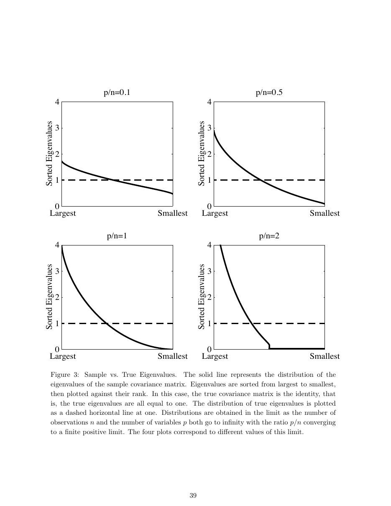
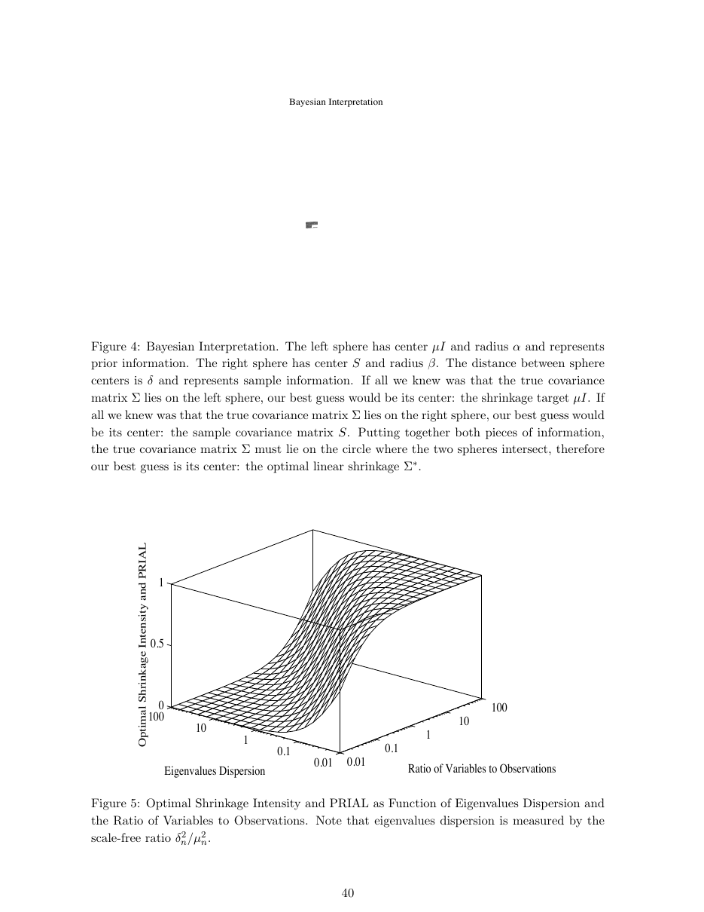
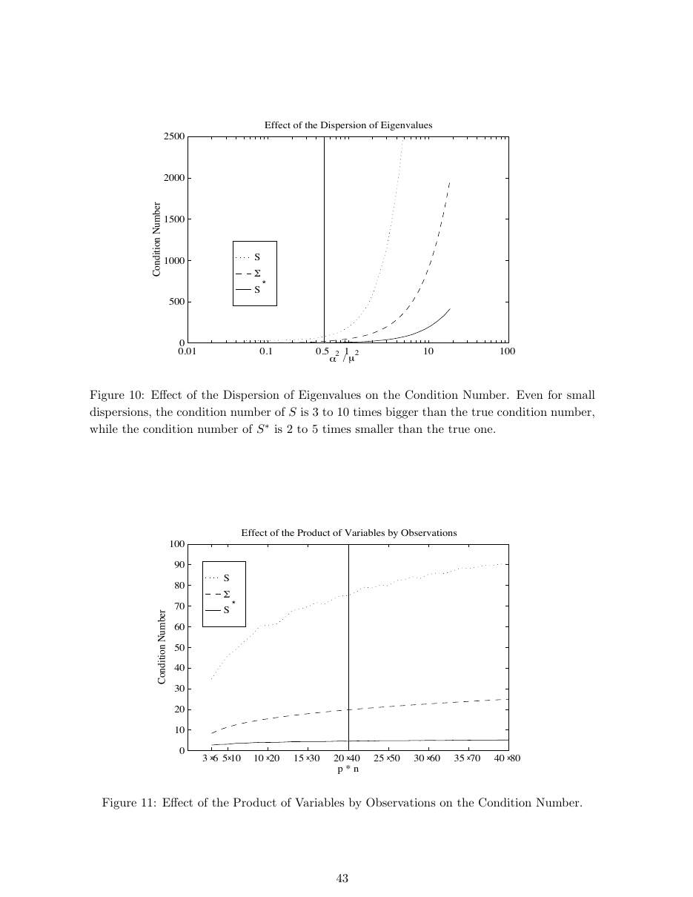

# 큰 차원 공분산 행렬을 위한 잘 조건화된 추정량 (번역)

- 원제: A Well-Conditioned Estimator For Large-Dimensional Covariance Matrices
- 저자: Olivier Ledoit (UCLA Anderson 경영대학원), Michael Wolf (마드리드 카를로스 3세 대학교 통계계량경제학과)
- 번역 대상: 같은 폴더의 `Ledoit2004_JMVA_wellconditioned_covariance.pdf`. 저자 사이트(ledoit.net/ole1a.pdf)의 2001년 2월 원고, 43쪽.
- 저널판: Journal of Multivariate Analysis 88(2):365-411, 2004. doi:10.1016/S0047-259X(03)00096-4 (Crossref로 서지 확인). 원고와 저널판의 차이는 확인하지 못했다.
- 번역 범위: 초록, 본문 1~5절, 부록 A(증명), 부록 B(표와 그림 캡션). 참고문헌은 원문 그대로 둔다.
- 부록 A의 긴 부등식 사슬은 pdftotext 추출에서 첨자와 합 기호가 깨졌다. 그래서 각 증명의 논리 흐름과 핵심 식만 옮겼다. 정확한 중간 식은 원문 PDF 18~35쪽을 본다.
- PDF 자체 손상: 원문 PDF의 그림 1 자리에는 그림 6과 같은 그래프가 들어가 있고, 그림 4는 그림이 거의 비어 있다(38, 40쪽). 원고 파일의 문제로 보인다.

---

## 초록

많은 응용 문제는 역행렬이 존재할 뿐 아니라 잘 조건화된(역행렬을 구해도 추정 오차가 커지지 않는) 공분산 행렬 추정량을 필요로 한다. 차원이 큰 공분산 행렬에서는 보통 쓰는 추정량인 표본 공분산 행렬이 대개 잘 조건화되지 않고, 역행렬이 아예 없을 수도 있다. 이 논문은 잘 조건화되어 있으면서 점근적으로 표본 공분산 행렬보다 더 정확한 추정량을 제안한다. 이 추정량은 분포를 가정하지 않고, 계산과 해석이 쉬운 간단한 명시적 식을 가진다. 이 추정량은 표본 공분산 행렬과 단위 행렬의 점근적으로 최적인 볼록 선형 결합이다. 최적성은 2차 손실 함수에 대한 것이고, 관측 수와 변수 수가 함께 무한대로 갈 때의 점근 의미다. 광범위한 몬테카를로 실험으로 점근 결과가 유한 표본에서도 잘 맞는 경향이 있음을 확인했다.

핵심어: 조건수, 공분산 행렬 추정, 경험적 베이즈, 일반 점근(general asymptotics), 축소(shrinkage).

약식 제목: 큰 차원 공분산 행렬의 추정.

(각주) 두 번째 저자 연락처와 감사의 글, 스페인 DGES 연구비(PB98-0025) 지원 문구가 있다.

---

## 1 서론

많은 응용 문제는 공분산 행렬이나 그 역행렬의 추정값을 필요로 한다. 그런데 행렬 차원이 표본 크기에 비해 큰 경우가 많다. 예를 들면 다음과 같다.

- 많은 주식 가운데서 평균-분산 효율 포트폴리오를 고르는 일(Markowitz, 1952)
- 큰 횡단면에서 일반화 최소제곱(GLS) 회귀를 돌리는 일(예: Kandel and Stambaugh, 1995)
- 모멘트 제약 수가 많을 때 일반화 적률법(GMM, Hansen 1982)의 최적 가중 행렬을 고르는 일

이런 상황에서 보통 쓰는 추정량인 표본 공분산 행렬은 성능이 나쁘다고 알려져 있다. 행렬 차원 $p$가 관측 수 $n$보다 크면 표본 공분산 행렬은 역행렬조차 없다. $p/n$이 1보다 작지만 무시할 수 없을 만큼 크면, 역행렬은 있지만 수치적으로 나쁘게 조건화된다. 즉 역행렬을 구하면 추정 오차가 크게 부풀려진다. $p$가 크면 $p/n$을 무시할 만큼 작게 할 관측을 모으기 어렵다. 그래서 큰 차원 공분산 행렬을 위한 잘 조건화된 추정량을 만드는 일이 중요하다.

어떤 대가를 치르더라도 잘 조건화된 추정량만 원한다면, 대각 행렬이나 요인 모형처럼 임의의 구조를 공분산 행렬에 강제할 수 있다. 하지만 참 구조에 대한 사전 정보가 없으면 이런 임의 구조는 대개 잘못 지정된다. 그렇게 얻은 추정량은 편향이 너무 커서 참 공분산 행렬과 거의 닮지 않을 수 있다. 저자들이 아는 한, 잘 조건화되어 있으면서 표본 공분산 행렬보다 더 정확한 기존 추정량은 없다. 이 논문의 기여는 이 두 성질을 점근적으로 모두 가진 추정량을 제안하는 것이다.

잘 조건화된 구조 추정량을 얻는 한 가지 방법은 모든 분산이 같고 모든 공분산이 0이라고 강제하는 것이다. 저자들이 권하는 추정량은 이 구조 추정량과 표본 공분산 행렬의 가중 평균이다. 이 평균은 구조 추정량의 좋은 조건화를 물려받는다. 2차 손실 함수에 따라 가중치를 최적으로 고르면, 이 가중 평균이 둘 중 어느 것보다도 더 정확하게 만들 수 있다. 유일한 어려움은 참 최적 가중치가 관측할 수 없는 참 공분산 행렬에 달려 있다는 점이다. 저자들은 최적 가중치의 일치 추정량을 찾아 이 어려움을 푼다. 또한 참 최적 가중치를 일치 추정량으로 바꿔도 점근적으로 차이가 없음을 보인다.

표준 점근 이론은 변수 수 $p$는 고정이고 관측 수 $n$만 무한대로 간다고 둔다. 표준 점근에서는 표본 공분산 행렬이 (극한에서) 잘 조건화되어 있고, 정규 분포 자료에서 최대우도라는 좋은 최적 성질도 가진다. 하지만 이것은 변수 수 $p$가 관측 수 $n$과 같은 크기이거나 더 큰 많은 실제 상황을 잘 근사하지 못한다. 저자들은 일반 점근(general asymptotics)이라는 다른 틀을 쓴다. 여기서는 변수 수 $p$도 무한대로 갈 수 있다. 유일한 제약은 비율 $p/n$이 유계여야 한다는 것이다. 표준 점근은 (점근적으로) 모든 가중을 표본 공분산 행렬에 두고 구조 추정량에는 두지 않는 것이 최적인 특수한 경우로 본다. 일반적인 경우에는 제안한 추정량이 점근적으로도 표본 공분산 행렬과 다르고, 훨씬 정확하며, 물론 잘 조건화되어 있다.

광범위한 몬테카를로 실험의 결과는 다음과 같다.

1. 새 추정량은 관측 수와 변수 수가 매우 작을 때조차 표본 공분산 행렬보다 정확하고, 대개 큰 차이로 정확하다.
2. 변수와 관측이 10개 이상만 되면, 유한 표본 결정 이론에서 제안된 몇몇 추정량과 정확도가 거의 같거나 훨씬 낫다.
3. 참 공분산 행렬보다도 조건화가 더 좋다.
4. 관측과 변수가 20개 이상이면 일반 점근이 유한 표본 행동을 잘 근사한다.

다음 절(2절)은 단위 행렬과 표본 공분산 행렬의 선형 결합 가운데 2차 위험이 최소인 것을 유한 표본에서 특징짓는다. 3절은 관측 수와 변수 수가 함께 무한대로 갈 때 그 부류 안에서 점근적으로 2차 위험이 균등하게 최소인 선형 축소 추정량을 만든다. 4절의 몬테카를로 실험은 이 추정량이 유한 표본에서 잘 동작함을 보인다. 5절은 결론이다. 부록 A는 3절 기술 결과의 증명을, 부록 B는 모든 표와 그림을 담는다.

---

## 2 유한 표본 분석

무엇을 하는지 설명하는 가장 쉬운 길은 먼저 유한 표본의 경우를 자세히 분석하는 것이다. $X$를 평균 0, 공분산 행렬 $\Sigma$인 $p$개 확률 변수 계에 대한 $n$개의 독립 동일 분포(iid) 관측으로 이루어진 $p \times n$ 행렬이라 하자. Muirhead and Leung (1987)을 따라 프로베니우스 노름 $\|A\| = \sqrt{\mathrm{tr}(AA^t)/p}$를 쓴다. (차원 $p$로 나누는 것은 표준이 아니지만, 이 절에서는 $p$가 유한하므로 상관없다. 이 약속의 장점은 단위 행렬의 노름이 1이 되고, 아래 정의 2와도 일치한다는 점이다.)

목표는 단위 행렬 $I$와 표본 공분산 행렬 $S = XX^t/n$의 선형 결합 $\Sigma^* = \rho_1 I + \rho_2 S$ 가운데 기대 2차 손실 $E[\|\Sigma^* - \Sigma\|^2]$이 최소인 것을 찾는 것이다. Haff (1980)가 이 선형 축소 추정량 부류를 연구했지만 최적성 결과는 얻지 못했다. 유한 표본에서 얻는 최적성 결과에는 대가가 따른다. $\Sigma^*$는 참(관측 불가) 공분산 행렬 $\Sigma$의 스칼라 함수 네 개를 미리 알아야 하므로 진짜(bona fide) 추정량이 아니다. 큰 대가처럼 보이지만 사실은 그렇지 않다. 다음 절에서 관측 수와 변수 수가 함께 무한대로 갈 때 $\Sigma^*$와 같은 성질을 가진 진짜 추정량 $S^*$를 만든다. 또한 몬테카를로 실험은 관측과 변수가 20개면 점근 근사가 유한 표본에서 대개 잘 맞음을 보인다. $\Sigma^*$와 $S^*$의 식도 모양이 같고 해석도 같다. 그래서 유한 표본에서 $\Sigma^*$를 진짜 추정량"인 것처럼" 연구한다.

### 2.1 최적 선형 축소

제곱 프로베니우스 노름 $\|\cdot\|^2$은 내적 $A_1 \circ A_2 = \mathrm{tr}(A_1 A_2^t)/p$에 대응하는 2차 형식이다. 분석의 중심에는 네 스칼라가 있다.

$$\mu = \Sigma \circ I,\quad \alpha^2 = \|\Sigma - \mu I\|^2,\quad \beta^2 = E[\|S - \Sigma\|^2],\quad \delta^2 = E[\|S - \mu I\|^2]$$

$X$의 확률 변수가 특정 분포를 따른다고 가정할 필요는 없다. 다만 $\beta^2$, $\delta^2$가 유한하도록 4차 적률이 유한하다고 가정한다. 다음 관계가 성립한다.

**보조정리 2.1** $\alpha^2 + \beta^2 = \delta^2$.

**보조정리 2.1의 증명**

$$E[\|S-\mu I\|^2] = E[\|S-\Sigma+\Sigma-\mu I\|^2] \quad (1)$$
$$= E[\|S-\Sigma\|^2] + E[\|\Sigma-\mu I\|^2] + 2E[(S-\Sigma)\circ(\Sigma-\mu I)] \quad (2)$$
$$= E[\|S-\Sigma\|^2] + \|\Sigma-\mu I\|^2 + 2E[S-\Sigma]\circ(\Sigma-\mu I) \quad (3)$$

$E[S] = \Sigma$이므로 식 (3) 오른쪽 셋째 항은 0이다. □

단위 행렬 $I$와 표본 공분산 행렬 $S$의 최적 선형 결합 $\Sigma^* = \rho_1 I + \rho_2 S$는 선형 등식 제약이 있는 간단한 2차 계획 문제의 표준 해다.

**정리 2.1** 다음 최적화 문제를 생각하자.

$$\min_{\rho_1,\rho_2} E[\|\Sigma^*-\Sigma\|^2] \quad \text{s.t.}\quad \Sigma^* = \rho_1 I + \rho_2 S \quad (4)$$

계수 $\rho_1$, $\rho_2$는 확률 변수가 아니다. 그 해는 다음을 만족한다.

$$\Sigma^* = \frac{\beta^2}{\delta^2}\mu I + \frac{\alpha^2}{\delta^2} S \quad (5)$$
$$E[\|\Sigma^*-\Sigma\|^2] = \frac{\alpha^2\beta^2}{\delta^2} \quad (6)$$

**정리 2.1의 증명** 변수를 바꾸면 문제 (4)는 다음처럼 다시 쓸 수 있다.

$$\min_{\rho,\nu} E[\|\Sigma^*-\Sigma\|^2] \quad \text{s.t.}\quad \Sigma^* = \rho\nu I + (1-\rho)S \quad (7)$$

조금의 대수 계산과, 보조정리 2.1의 증명처럼 $E[S]=\Sigma$를 쓰면 목적 함수를 다음처럼 쓸 수 있다.

$$E[\|\Sigma^*-\Sigma\|^2] = \rho^2\|\Sigma-\nu I\|^2 + (1-\rho)^2 E[\|S-\Sigma\|^2] \quad (8)$$

그러므로 $\nu$의 최적값은 $\rho$와 무관한 축소 문제 $\min_\nu \|\Sigma-\nu I\|^2$의 해로 얻는다. 약속에 따라 단위 행렬의 노름은 1이므로, 이 문제의 목적 함수는 $\|\Sigma-\nu I\|^2 = \|\Sigma\|^2 - 2\nu\,\Sigma\circ I + \nu^2$이다. 1계 조건은 $-2\Sigma\circ I + 2\nu = 0$이고, 해는 $\nu = \Sigma\circ I = \mu$이다.

식 (8)에서 $\nu$를 최적값 $\mu$로 바꾸면 원래 문제의 목적 함수는 $E[\|\Sigma^*-\Sigma\|^2] = \rho^2\alpha^2 + (1-\rho)^2\beta^2$이다. 1계 조건은 $2\rho\alpha^2 - 2(1-\rho)\beta^2 = 0$이고, 해는 $\rho = \beta^2/(\alpha^2+\beta^2) = \beta^2/\delta^2$이다. $1-\rho = \alpha^2/\delta^2$임에 주의한다. 최적점에서 목적 함수 값은 $(\beta^2/\delta^2)^2\alpha^2 + (\alpha^2/\delta^2)^2\beta^2 = \alpha^2\beta^2/\delta^2$이다. □

$\mu I$는 축소 목표(shrinkage target)로, $\mu I$에 두는 가중 $\beta^2/\delta^2$는 축소 강도(shrinkage intensity)로 해석할 수 있다. 표본 공분산 행렬 대비 평균 손실의 백분율 상대 개선(PRIAL)은 다음과 같다.

$$\frac{E[\|S-\Sigma\|^2] - E[\|\Sigma^*-\Sigma\|^2]}{E[\|S-\Sigma\|^2]} = \frac{\beta^2}{\delta^2} \quad (9)$$

이것은 축소 강도와 같다. 그러므로 모든 것은 비율 $\beta^2/\delta^2$가 결정한다. 이 비율은 표본 공분산 행렬 $S$의 오차를 제대로 정규화한 척도다. 직관적으로, $S$가 비교적 정확하면 많이 축소하면 안 되고 축소해도 얻는 것이 적다. $S$가 비교적 부정확하면 많이 축소해야 하고 축소로 얻는 것도 많다.

### 2.2 해석

정리 2.1의 수학은 풍부해서 서로 보완하는 네 가지 해석을 줄 수 있다. 하나는 기하학적이고, 나머지는 유한 표본 다변량 통계의 가장 중요한 생각들과 맞닿아 있다.

첫째, 정리 2.1은 힐베르트 공간의 사영 정리로 볼 수 있다. 알맞은 힐베르트 공간은 $E[\|A\|^2] < \infty$인 $p$차원 대칭 확률 행렬 $A$의 공간이다. 노름은 $\sqrt{E[\|\cdot\|^2]}$이고, 두 확률 행렬 $A_1$, $A_2$의 내적은 $E[A_1\circ A_2]$이다. 이 구조에서 보조정리 2.1은 피타고라스 정리를 다시 쓴 것이다. 또한 식 (5)는 다음처럼 정당화된다. 참 공분산 행렬 $\Sigma$를 단위 행렬 $I$와 표본 공분산 행렬 $S$가 펼치는 공간에 사영하려면, 먼저 단위 행렬이 펼치는 직선에 사영해 축소 목표 $\mu I$를 얻는다. 다음으로 $\Sigma$를 축소 목표 $\mu I$와 표본 공분산 행렬 $S$를 잇는 직선에 사영한다. 사영 $\Sigma^*$가 그 직선의 어느 끝($\mu I$ 또는 $S$)에 더 가까운지는 $\Sigma$가 둘 중 어느 쪽에 더 가까웠는지에 달려 있다. 그림 1이 기하학적 그림을 보여 준다.

둘째, 정리 2.1은 편향과 분산 사이의 절충으로 해석할 수 있다. 평균제곱오차를 최소화하는데, 이것은 분산과 편향 제곱으로 나뉜다.

$$E[\|\Sigma^*-\Sigma\|^2] = E[\|\Sigma^*-E[\Sigma^*]\|^2] + \|E[\Sigma^*]-\Sigma\|^2 \quad (10)$$

축소 목표 $\mu I$의 평균제곱오차는 전부 편향이고 분산이 없다. 표본 공분산 행렬 $S$는 정반대로 전부 분산이고 편향이 없다. $\Sigma^*$는 편향에 의한 오차와 분산에 의한 오차 사이의 최적 절충이다. 그림 2를 본다. 편향과 분산의 절충이라는 생각은 James-Stein (1961)의 원래 축소 기법에서 이미 핵심이었다.

셋째 해석은 베이즈적이다. $\Sigma^*$는 사전 정보와 표본 정보라는 두 신호의 결합으로 볼 수 있다. 사전 정보는 참 공분산 행렬 $\Sigma$가 축소 목표 $\mu I$를 중심으로 하고 반지름이 $\alpha$인 구 위에 있다고 말한다. 표본 정보는 $\Sigma$가 표본 공분산 행렬 $S$를 중심으로 하고 반지름이 $\beta$인 다른 구 위에 있다고 말한다. 두 정보를 합치면 $\Sigma$는 두 구의 교집합, 즉 원 위에 있어야 한다. 그 원의 중심에 $\Sigma^*$가 있다. $\Sigma^*$를 정할 때 사전 정보와 표본 정보에 주는 상대 비중은 어느 쪽이 더 정확한지에 달려 있다. 엄밀히 말하면 완전한 베이즈 접근은 $\Sigma$ 분포의 받침(support)뿐 아니라 분포 자체도 지정해야 한다. $\Sigma$가 구 위에 균등 분포한다고 가정할 수도 있지만 정당화하기 어려울 수 있다. 그래서 $\Sigma^*$는 관례처럼 사후 분포의 기댓값이 아니라 그 받침의 질량 중심으로 생각해야 한다. 그림 4를 본다. 공분산 행렬의 개선된 추정량을 얻으려고 베이즈 관점에서 영감을 얻는 생각은 Haff (1980)가 썼다.

넷째이자 마지막 해석은 공분산 행렬 고유값의 횡단면 퍼짐에 관한 것이다. $\lambda_1,\ldots,\lambda_p$를 참 공분산 행렬 $\Sigma$의 고유값, $l_1,\ldots,l_p$를 표본 공분산 행렬 $S$의 고유값이라 하자. 프로베니우스 노름과 고유값의 깔끔한 관계를 쓸 수 있다.

$$\mu = \frac{1}{p}\sum_{i=1}^p \lambda_i = E\left[\frac{1}{p}\sum_{i=1}^p l_i\right] \quad (11)$$

이것은 참 고유값과 표본 고유값 모두의 전체 평균이다. 그러면 보조정리 2.1은 다음처럼 다시 쓸 수 있다.

$$E\left[\frac{1}{p}\sum_{i=1}^p (l_i-\mu)^2\right] = \frac{1}{p}\sum_{i=1}^p(\lambda_i-\mu)^2 + E[\|S-\Sigma\|^2] \quad (12)$$

말로 하면, 표본 고유값은 전체 평균 둘레로 참 고유값보다 더 퍼져 있고, 그 초과 퍼짐은 표본 공분산 행렬의 오차와 같다. 초과 퍼짐은 가장 큰 표본 고유값이 위로, 가장 작은 표본 고유값이 아래로 편향되어 있다는 뜻이다. 그러므로 표본 고유값을 전체 평균 쪽으로 축소하면 표본 공분산 행렬을 개선할 수 있다.

$$\forall i = 1,\ldots,p \quad \lambda_i^* = \frac{\beta^2}{\delta^2}\mu + \frac{\alpha^2}{\delta^2} l_i \quad (13)$$

식 (13)으로 정의한 $\lambda_1^*,\ldots,\lambda_p^*$는 바로 $\Sigma^*$의 고유값이다. 놀랍게도 그 퍼짐 $E[\sum_{i=1}^p(\lambda_i^*-\mu)^2]/p = \alpha^2/\delta$는 참 고유값의 퍼짐보다도 작다. 관심 있는 독자를 위해 다음 소절이 그 이유를 설명한다. 표본 고유값을 전체 평균 쪽으로 축소하면 공분산 행렬의 개선된 추정량을 얻는다는 생각은 Muirhead (1987)의 리뷰 논문에서 강조되었다.

(역주: 원문은 $\alpha^2/\delta$로 적혀 있으나, 식 (13)에서 계산하면 $\alpha^4/\delta^2$이 맞다. 원고의 오식으로 보인다. 저널판에서 고쳐졌는지는 확인하지 못했다.)

### 2.3 표본 고유값에 대한 추가 결과

다음 문단들은 표본 공분산 행렬 고유값에 대한 추가 통찰을 담는다. 원하면 건너뛰고 바로 3절로 가도 된다. 다음을 다룬다.

1. 표본 공분산 행렬의 고유값이 참 공분산 행렬의 고유값보다 왜 더 퍼져 있는가(식 (12))
2. 이 효과가 실제로 얼마나 중요한가
3. 왜 그 대신 참 공분산 행렬의 고유값보다 덜 퍼진 고유값을 갖는 추정량을 써야 하는가(식 (13))

설명은 행렬 대수의 한 결과에 기댄다.

**정리 2.2** 고유값은 회전으로 얻을 수 있는 대각 원소 가운데 가장 많이 퍼진 대각 원소다.

**정리 2.2의 증명** $R$을 $p$차원 대칭 행렬, $V$를 $p$차원 회전 행렬($VV' = V'V = I$)이라 하자. 먼저 $(1/p)\mathrm{tr}(V'RV) = (1/p)\mathrm{tr}(R)$이다. 대각 원소의 평균은 회전에 대해 불변이다. 이를 $r$이라 하자. $v_i$를 $V$의 $i$번째 열이라 하자. $V'RV$의 대각 원소의 퍼짐은 $(1/p)\sum_{i=1}^p(v_i'Rv_i - r)^2$이다. $\sum_{i=1}^p(v_i'Rv_i-r)^2 + \sum_{i=1}^p\sum_{j\ne i}(v_i'Rv_j)^2 = \mathrm{tr}[(V'RV-rI)^2] = \mathrm{tr}[(R-rI)^2]$은 회전에 대해 불변이다. 그러므로 회전 $V$가 $V'RV$ 대각 원소의 퍼짐을 최대화하는 것은 $\sum_i\sum_{j\ne i}(v_i'Rv_j)^2$을 최소화하는 것과 같다. 이것은 모든 $i\ne j$에 대해 $v_i'Rv_j = 0$으로 두면 이루어진다. 이 경우 $V'RV$는 대각 행렬이고, 이를 $D$라 하자. $V'RV = D$는 $R = VDV'$과 같다. $V$가 회전이고 $D$가 대각이므로 $V$의 열은 $R$의 고유벡터이고 $D$의 대각은 고유값이어야 한다. 그러므로 $V'RV$ 대각 원소의 퍼짐은 대각 원소가 $R$의 고유값일 때 최대다. □

참 공분산 행렬을 고유값과 고유벡터로 분해하자: $\Sigma = \Gamma'\Lambda\Gamma$. $\Lambda$는 대각 행렬, $\Gamma$는 회전 행렬이다. $\Lambda$의 대각 원소는 고유값 $\lambda_1,\ldots,\lambda_p$이고, $\Gamma$의 열은 고유벡터 $\gamma_1,\ldots,\gamma_p$이다. 마찬가지로 표본 공분산 행렬을 $S = G'LG$로 분해한다. $L$은 대각 행렬, $G$는 회전 행렬이다. $L$의 대각 원소는 $l_1,\ldots,l_p$이고, $G$의 열은 $g_1,\ldots,g_p$이다.

$S$가 불편이고 $\Gamma$가 확률적이지 않으므로 $\Gamma'S\Gamma$는 $\Lambda = \Gamma'\Sigma\Gamma$의 불편 추정량이다. $\Gamma'S\Gamma$의 대각 원소는 $\Gamma'\Sigma\Gamma$의 대각 원소와 거의 같은 정도로 퍼져 있다. 편의상 정확히 같은 정도로 퍼져 있다고 하자. 반면 $L = G'SG$는 $\Gamma'\Sigma\Gamma$의 불편 추정량이 전혀 아니다. $G$와 $S$의 오차가 서로 얽히기 때문이다. 정리 2.2는 이 얽힘의 효과를 보여 준다. $G'SG$의 대각 원소는 $\Gamma'S\Gamma$의 대각 원소보다(따라서 $\Gamma'\Sigma\Gamma$의 대각 원소보다) 더 퍼져 있다. 이것이 표본 고유값이 참 고유값보다 더 퍼져 있는 이유다. 요약은 표 1에 있다.

이 효과가 얼마나 중요한지 특수한 경우, 참 공분산 행렬이 단위 행렬인 경우로 보이자. 표본 공분산 행렬의 고유값을 큰 것부터 작은 것 순으로 정렬해 순위에 대해 그린다. 그림 모양은 비율 $p/n$에 달려 있지만, 적어도 $p$와 $n$이 매우 클 때는 표본 공분산 행렬의 특정 실현값에는 근사적으로 달려 있지 않다. 그림 3은 여러 $p/n$ 값에서 표본 고유값의 분포를 보여 준다. 이 그림은 Marčenko and Pastur (1967)가 증명한 점근 공식에 바탕을 둔다. 가장 큰 표본 고유값은 위로, 가장 작은 표본 고유값은 아래로 심하게 편향되어 있다. 편향은 $p/n$이 클수록 커진다. 이 현상은 매우 일반적이고 단위 행렬의 경우에 한정되지 않는다. Brown (1989)이 몬테카를로 실험에서 관찰한 효과와 비슷하다.

*그림 3: 표본 고유값 대 참 고유값. 실선은 표본 공분산 행렬 고유값의 분포다. 고유값을 큰 것부터 작은 것 순으로 정렬한 뒤 순위에 대해 그렸다. 이 경우 참 공분산 행렬은 단위 행렬이다. 즉 참 고유값은 모두 1이다. 참 고유값의 분포는 1에서의 수평 점선으로 그렸다. 분포는 관측 수 $n$과 변수 수 $p$가 모두 무한대로 가고 비율 $p/n$이 유한한 양의 극한으로 수렴할 때의 극한에서 얻었다. 네 그림은 이 극한의 서로 다른 값($p/n$ = 0.1, 0.5, 1, 2)에 해당한다.*

마지막으로, 표본 고유값 $l_i = g_i'Sg_i$는 참 고유값 $\lambda_i = \gamma_i'\Sigma\gamma_i$가 아니라 $g_i'\Sigma g_i$와 비교해야 한다는 점을 짚는다. 벡터 $g_i$에 대응하는 추정 분산과 참 분산을 비교해야 한다. 정리 2.2에 따라 $G'\Sigma G$의 대각 원소는 $\Gamma'\Sigma\Gamma$의 대각 원소보다도 덜 퍼져 있다. 표본 고유값은 참 고유값보다 더 퍼져 있을 뿐 아니라, 오히려 덜 퍼져 있어야 한다. 이 효과는 표본 고유벡터의 오차 때문이다. 직관적으로, 통계학자는 아주 작은 고유값과 아주 큰 고유값에 대해 강한 입장을 취하지 말아야 한다. 고유벡터가 틀렸다는 것을 알기 때문이다. 표본 공분산 행렬은 근거 없이 강한 입장을 취하는 잘못을 저지른다. 최적 선형 축소 $\Sigma^*$가 이를 바로잡는다.

---

## 3 일반 점근 아래의 분석

앞 절에서 $\Sigma^*$가 매력적인 최적 성질을 가지며 기존 문헌과 잘 맞음을 보였다. 단점은 하나뿐이다. 참(관측 불가) 공분산 행렬 $\Sigma$의 스칼라 함수 네 개 $\mu$, $\alpha^2$, $\beta^2$, $\delta^2$를 미리 알아야 하므로 진짜 추정량이 아니다. 이제 이 문제를 다룬다. 생각은 이렇다. 점근적으로 $\mu$, $\alpha^2$, $\beta^2$, $\delta^2$의 일치 추정량이 있고, 따라서 $\Sigma^*$의 일치 추정량도 있다. 여기서 알맞은 점근 틀을 골라야 한다. 표준 점근은 $p$를 고정하고 $n$을 무한대로 보내며, 그러면 최적 축소 강도가 극한에서 사라진다. $p$가 $n$에 비해 아주 작은 상황에는 합리적이다. 하지만 저자들이 관심 있는 문제에서는 $p$가 $n$과 같은 크기이고 더 클 수도 있다. 그래서 이 조건을 반영하는 틀이 더 알맞다고 본다.

이것은 변수 수 $p$가 관측 수 $n$과 같은 속도로 무한대로 가도록 허용해 이룬다. 이를 일반 점근이라 부른다. 저자들이 아는 한 일반 점근 틀은 표본 공분산 행렬을 개선하는 데 쓰인 적이 없고, Silverstein (1994)처럼 그 고유값 분포를 특징짓는 데만 쓰였다. 이 틀에서 최적 축소 강도는 대개 점근적으로 사라지지 않고, 일치 추정할 수 있는 극한 상수로 간다. 그 추정한 축소 강도를 써서 진짜 추정량에 이르는 것이 생각의 줄기다.

### 3.1 일반 점근

$n = 1, 2, \ldots$이 통계 모형의 열을 가리킨다고 하자. 각 $n$에서 $X_n$은 평균 0, 공분산 행렬 $\Sigma_n$인 $p_n$개 확률 변수 계에 대한 $n$개 iid 관측의 $p_n\times n$ 행렬이다. 변수 수 $p_n$은 관측 수 $n$과 함께 변하고 무한대로 갈 수도 있지만, 너무 빠르면 안 된다.

**가정 1** $n$과 무관한 상수 $K_1$이 있어 $p_n/n \le K_1$이다.

가정 1은 매우 약하다. $p_n$이 변하거나 무한대로 갈 것을 요구하지 않으므로 표준 점근도 특수한 경우로 포함한다. 비율 $p_n/n$이 어떤 극한으로 수렴할 필요조차 없다.

공분산 행렬을 고유값과 고유벡터로 분해한다: $\Sigma_n = \Gamma_n\Lambda_n\Gamma_n^t$. $\Lambda_n$은 대각 행렬, $\Gamma_n$은 회전 행렬이다. $\Lambda_n$의 대각 원소는 고유값 $\lambda_1^n,\ldots,\lambda_{p_n}^n$이고, $\Gamma_n$의 열은 고유벡터 $\gamma_1^n,\ldots,\gamma_{p_n}^n$이다. $Y_n = \Gamma_n^t X_n$은 원래 계와 같은 공간을 펼치는 $p_n$개 무상관 확률 변수 계에 대한 $n$개 iid 관측의 $p_n\times n$ 행렬이다. $Y_n$의 고차 적률에 제약을 둔다. $(y_{11}^n,\ldots,y_{p_n1}^n)^t$를 행렬 $Y_n$의 첫 열이라 하자.

**가정 2** $n$과 무관한 상수 $K_2$가 있어 $\frac{1}{p_n}\sum_{i=1}^{p_n}E[(y_{i1}^n)^8] \le K_2$이다.

**가정 3**
$$\lim_{n\to\infty}\frac{p_n^2}{n^2}\times\frac{\sum_{(i,j,k,l)\in Q_n}(\mathrm{Cov}[y_{i1}^n y_{j1}^n,\ y_{k1}^n y_{l1}^n])^2}{|Q_n|} = 0$$
여기서 $Q_n$은 1과 $p_n$ 사이의 서로 다른 정수 네 개로 이루어진 모든 4중쌍의 집합이다.

가정 2는 8차 적률이 (평균적으로) 유계라는 뜻이다. 가정 3은 무상관 확률 변수들의 곱도 (극한에서, 평균적으로) 무상관이라는 뜻이다. 일반 점근이 표준 점근으로 퇴화하는 경우($p_n/n\to 0$)에는 가정 3이 가정 2의 결과로 자명하게 성립한다. 가정 3은 확률 변수가 정규 분포이거나 타원 분포일 때도 성립하지만, 그보다 훨씬 약하다. 가정 1~3은 논문 전체에 암묵적으로 깔려 있다.

행렬 노름은 프로베니우스 노름에 바탕을 둔다.

**정의 1** $p_n$차원 행렬 $A$의 노름은 $\|A\|_n^2 = f(p_n)\,\mathrm{tr}(AA^t)$이다. 여기서 $f(p_n)$은 차원의 스칼라 함수다.

이것은 $p_n$차원 대칭 행렬의 선형 공간 위의 2차 형식을 정의하고, 대응 내적은 $A_1\circ_n A_2 = f(p_n)\,\mathrm{tr}(A_1A_2^t)$이다.

차원에 따른 $\|\cdot\|_n$의 행동은 함수 $f(\cdot)$가 정한다. 노름 $\|\cdot\|_n$은 주로 일치성 개념을 정의하는 데 쓴다. 어떤 추정량은 참 공분산 행렬과의 차이의 노름이 $n$이 무한대로 갈 때 (2차 평균으로) 0으로 가면 일치한다고 부른다. $p_n$이 유계로 남으면 모든 양의 함수 $f(\cdot)$가 동등한 일치성 개념을 만든다. 하지만 표준 점근과 비슷한 이 특수한 경우는 대표적이지 않다. $p_n$(또는 그 부분열)이 무한대로 가면 $f(\cdot)$의 선택이 훨씬 중요해진다. $p_n$이 무한대로 갈 때 $f(p_n)$이 너무 크면(작으면) 너무 강한(약한) 일치성 개념이 된다. $f(\cdot)$는 일반 점근에서 "딱 맞는" 일치성 개념을 정의해야 한다.

해법은 상대 노름을 정의하는 것이다. $p_n$차원 행렬의 노름을 같은 차원 $p_n$의 기준 행렬의 노름으로 나눈다. 기준은 신중히 골라야 한다. 다른 매력적인 후보가 없으므로 단위 행렬을 기준으로 삼는다. 그래서 약속에 따라 단위 행렬은 모든 차원에서 노름이 1이다. 이것이 $f(\cdot)$를 다음처럼 유일하게 정한다.

**정의 2** 정의 1에서 정하지 않은 스칼라 계수는 $f(p_n) = 1/p_n$이다.

직관적으로 단위 행렬의 노름은 차원이 무한대로 갈 때 0과 무한대에서 떨어져 있어야 할 것 같다. 이 성질을 만족하는 모든 $f(\cdot)$는 동등한 일치성 개념을 정의할 것이다. 그러므로 이 노름은 일반 점근에서 의미 있는 어떤 노름과도 동등하다.

정의 1~2에 익숙해지도록 예를 든다. $A_n$을 왼쪽 위 원소가 1이고 나머지는 모두 0인 $p_n\times p_n$ 행렬, $Z_n$을 모든 원소가 0인 $p_n\times p_n$ 행렬(영행렬)이라 하자. $A_n$과 $Z_n$은 $p_n$과 무관한 방식으로 다르다. 왼쪽 위 원소가 다르다. 그런데 둘의 제곱 거리 $\|A_n - Z_n\|^2 = 1/p_n$은 $p_n$에 달려 있다. 이 겉보기 역설에는 직관적인 해답이 있다. $A_n$과 $Z_n$은 첫 차원에서 다르지만 나머지 $p_n-1$개 차원에서는 같다. 불일치의 중요성은 일치의 범위에 상대적이다. $p_n=1$이면 둘은 공통점이 없고 거리는 1이다. $p_n\to\infty$이면 둘은 거의 모든 것이 같고 거리는 0으로 간다. 즉 원소 하나의 불일치는 그 원소가 유일하면 중요하고, 많은 원소 가운데 하나면 무시할 만하다.

### 3.2 표본 공분산 행렬의 행동

표본 공분산 행렬을 $S_n = X_nX_n^t/n$으로 정의한다. 2절의 표기를 따르되, 모든 결과가 점근적으로 성립함을 알리려고 첨자 $n$을 붙인다. 즉 $\mu_n = \Sigma_n\circ_n I_n$, $\alpha_n^2 = \|\Sigma_n-\mu_nI_n\|_n^2$, $\beta_n^2 = E[\|S_n-\Sigma_n\|_n^2]$, $\delta_n^2 = E[\|S_n-\mu_nI_n\|_n^2]$이다. 이 네 스칼라는 점근적으로 잘 행동한다.

**보조정리 3.1** $\mu_n$, $\alpha_n^2$, $\beta_n^2$, $\delta_n^2$는 $n\to\infty$일 때 유계로 남는다.

특수한 경우에는 0으로 갈 수 있지만, 노름 정의에서 $p_n$으로 나누었는데도 일반적으로는 그렇지 않다. 3절 기술 결과의 증명은 모두 부록 A에 있다.

가장 기본적인 질문은 일반 점근 아래에서 표본 공분산 행렬이 일치하는가이다. 구체적으로 $S_n$이 참 공분산 행렬로 2차 평균 수렴하는가, 즉 $\beta_n^2$이 사라지는가를 묻는다. 아래에서 보듯 일반적으로 답은 아니다. 정리 3.1과 보조정리 3.2, 3.3의 결과는 Yin (1986)이 증명한 일반 결과의 특수한 경우와 관련된다. 하지만 저자들은 그보다 약한 가정에서 작업한다. 또한 Yin의 목표는 표본 공분산 행렬 고유값의 분포를 찾는 것이었고, 저자들의 목표는 공분산 행렬의 개선된 추정량을 찾는 것이다.

**정리 3.1** $\theta_n^2 = \mathrm{Var}\left[\frac{1}{p_n}\sum_{i=1}^{p_n}(y_{i1}^n)^2\right]$로 정의한다. $\theta_n^2$는 $n\to\infty$일 때 유계이고, 다음이 성립한다.
$$\lim_{n\to\infty} E[\|S_n-\Sigma_n\|_n^2] - \frac{p_n}{n}(\mu_n^2+\theta_n^2) = 0$$

정리 3.1은 표본 공분산 행렬의 기대 손실 $E[\|S_n-\Sigma_n\|_n^2]$이 유계이지만 적어도 $\frac{p_n}{n}\mu_n^2$ 크기이고, 이것이 보통 사라지지 않음을 보인다. 그러므로 표본 공분산 행렬은 특수한 경우를 빼면 일반 점근에서 일치하지 않는다.

첫째 특수한 경우는 $p_n/n\to 0$일 때다. 예를 들어 표준 점근에서는 $p_n$이 고정이고, 표본 공분산 행렬이 일치한다는 것은 잘 알려져 있다. 정리 3.1은 $p_n$이 고정되지 않고 유계일 필요조차 없어도, $o(n)$ 크기이기만 하면 일치성이 이어짐을 보인다. 둘째 특수한 경우는 $\mu_n^2\to 0$이고 $\theta_n^2\to 0$일 때다. $\mu_n^2\to 0$은 $p_n$개 확률 변수 대부분의 분산이 사라진다는 뜻, 즉 점근적으로 퇴화한다는 뜻이다. 퇴화를 벗어나는 확률 변수의 수는 $n$에 비해 무시할 만해야 한다. 이것은 앞의 경우와 비슷하지만, 이번에는 $o(n)$개 비퇴화 변수에 $O(n)$개 퇴화 변수를 덧붙일 수 있다는 점이 다르다. 전체적으로, 일반 점근에서 표본 공분산 행렬이 일치하기 위한 느슨한 조건은 비퇴화 확률 변수의 수가 관측 수에 비해 무시할 만한 것이다.

일반 점근에서 표본 공분산 행렬이 일치하지 않는다면, 그것은 비대각 원소 때문이다. 물론 각 비대각 원소의 오차는 사라지지만, 그 수가 너무 빨리 늘어난다. 대각 밖의 많은 작은 오차가 쌓여 표본 공분산 행렬이 일치하지 못한다. 반면 대각 위 오차의 기여는 무시할 만하다. 이것은 정리 3.1의 증명에서 드러난다. 결국 두 수가 같은 크기라면 $n p_n$개 확률 실현값의 자료로 $p_n(p_n+1)/2$개 모수를 일치 추정하는 것은 일반적으로 불가능해야 한다. 이런 이유로 저자들은 일반 점근에서 공분산 행렬의 일치 추정량은 존재하지 않는다고 믿는다.

정리 3.1은 $S_n$의 오차를 정하는 요인도 보여 준다. 첫째 요인은 비율 $p_n/n$이다. 이것은 표준 점근에서 벗어난 정도를 잰다. 사람들은 흔히 관측이 충분한지 확인해 점근을 쓸 수 있는지 판단하지만, 이 경우엔 현명하지 않다. 커야 하는 것은 관측 대 변수의 비율이다. 관측 200개는 많아 보이지만 변수가 100개라면 전혀 충분하지 않다. 확률 변수 1개의 분산을 관측 2개로 추정하는 것만큼 나쁠 것이다! 둘째 요인 $\mu_n^2$은 문제의 규모를 줄 뿐이다. 셋째 요인 $\theta_n^2$은 변수들 사이의 공분산이 함의하는 것을 넘어서는, 변수 제곱들 사이의 공분산을 잰다. 예를 들어 $\theta_n^2$는 정규 분포에서는 0이지만 타원 분포에서는 대개 양수다. 직관적으로, $y_{i1}$들이 서로 충분히 무상관이라면 "횡단면" 큰 수의 법칙이 $p_n\to\infty$일 때 $p_n^{-1}\sum_{i=1}^{p_n}y_{i1}^2$의 분산을 점근적으로 사라지게 할 수 있다. 하지만 가정 3은 이를 보장하기에 너무 약하므로, 일반적으로 $\theta_n^2$는 무시할 수 없고, 이쪽이 때로는 더 현실적일 수 있다.

이 분석으로 또 하나의 기본 질문에 답할 수 있다. 축소는 언제 중요한가? $\beta_n^2 = E[\|S_n-\Sigma_n\|_n^2]$은 표본 공분산 행렬의 오차이고, $\delta_n^2 = E[\sum_{i=1}^{p_n}(l_i^n-\mu_n)^2/p_n]$은 표본 고유값 $l_1^n,\ldots,l_{p_n}^n$이 그 전체 평균의 기댓값 $\mu_n = E[\sum_{i=1}^{p_n}l_i^n/p_n]$ 둘레로 얼마나 퍼져 있는지를 나타냄을 기억하자. 정리 2.1은 비율 $\beta_n^2/\delta_n^2$가 무시할 만하지 않으면 축소가 중요하다고 말하지만, 이 답은 다소 추상적이다. 정리 3.1로 이를 더 직관적인 말로 바꿀 수 있다. $\theta_n^2$를 무시하면 표본 공분산 행렬의 오차 $\beta_n^2$은 점근적으로 $\frac{p_n}{n}\mu_n^2$에 가깝다. 그러므로 변수 대 관측의 비율 $p_n/n$이 표본 고유값 횡단면 퍼짐의 척도 없는(scale-free) 측도 $\delta_n^2/\mu_n^2$에 비해 무시할 만하지 않으면 축소가 중요하다. 그림 5가 그래프로 보여 준다.

이것은 축소 방법이 표본 공분산 행렬을 크게 개선할 수 있는지 드러내는 쉬운 진단 검사가 된다. 저자들의 견해로는 이 기준에 따라 축소가 중요한 실제 상황이 많다. 또한 축소로 얻는 이득이 $p_n/n$만큼 큰 것은 꽤 예외적이다. 대부분의 경우(예를 들어 평균 추정)에는 이득이 훨씬 작은 $1/n$ 크기이기 때문이다.

*그림 4: 베이즈 해석. 왼쪽 구는 중심이 $\mu I$이고 반지름이 $\alpha$이며 사전 정보를 나타낸다. 오른쪽 구는 중심이 $S$이고 반지름이 $\beta$이다. 두 구 중심 사이의 거리는 $\delta$이고 표본 정보를 나타낸다. 참 공분산 행렬 $\Sigma$가 왼쪽 구 위에 있다는 것만 안다면, 최선의 추측은 그 중심, 즉 축소 목표 $\mu I$다. $\Sigma$가 오른쪽 구 위에 있다는 것만 안다면, 최선의 추측은 그 중심, 즉 표본 공분산 행렬 $S$다. 두 정보를 합치면 $\Sigma$는 두 구가 만나는 원 위에 있어야 하므로, 최선의 추측은 그 원의 중심, 즉 최적 선형 축소 $\Sigma^*$다. (원문 PDF에서 이 그림의 도형은 거의 비어 있다.)*

*그림 5: 고유값 퍼짐과 변수 대 관측 비율의 함수로 본 최적 축소 강도와 PRIAL. 고유값 퍼짐은 척도 없는 비율 $\delta_n^2/\mu_n^2$로 잰다.*

### 3.3 $\Sigma_n^*$의 일치 추정량

$\Sigma_n^*$는 관측할 수 없는 참 공분산 행렬 $\Sigma_n$에 달려 있으므로 진짜 추정량이 아니다. 다행히 $\Sigma_n^*$를 계산하는 데 $\Sigma_n$ 전체가 필요하지는 않고, $\Sigma_n$의 스칼라 함수 네 개 $\mu_n$, $\alpha_n^2$, $\beta_n^2$, $\delta_n^2$만 있으면 된다. 자료 크기($p_n\times n$)로 $\Sigma_n$ 전체를 일치 추정할 수는 없지만, 최적 축소 목표, 최적 축소 강도, 나아가 $\Sigma_n^*$ 자체는 일치 추정할 수 있다.

$\mu_n$의 일치 추정량은 그 표본 대응값이다.

**보조정리 3.2** $m_n = S_n\circ_n I_n$로 정의한다. 그러면 모든 $n$에서 $E[m_n] = \mu_n$이고, $n$이 무한대로 갈 때 $m_n-\mu_n$은 4차 평균(4차 적률)으로 0에 수렴한다.

이로부터 $m_n^2-\mu_n^2 \xrightarrow{q.m.} 0$이고 $m_n-\mu_n\xrightarrow{q.m.} 0$이다. 여기서 $\xrightarrow{q.m.}$은 $n\to\infty$일 때 2차 평균 수렴을 뜻한다. $\delta_n^2 = E[\|S_n-\mu_nI_n\|_n^2]$의 일치 추정량도 그 표본 대응값이다.

**보조정리 3.3** $d_n^2 = \|S_n-m_nI_n\|_n^2$로 정의한다. 그러면 $d_n^2-\delta_n^2\xrightarrow{q.m.}0$이다.

이제 $p_n\times 1$ 벡터 $x_{\cdot k}^n$을 관측 행렬 $X_n$의 $k$번째 열이라 하자($k=1,\ldots,n$). $S_n = n^{-1}X_nX_n^t$는 $S_n = n^{-1}\sum_{k=1}^n x_{\cdot k}^n(x_{\cdot k}^n)^t$로 쓸 수 있다. $S_n$은 행렬 $x_{\cdot k}^n(x_{\cdot k}^n)^t$들의 평균이다. 이 행렬들은 $k$에 대해 iid이므로, 그 평균의 오차 $\beta_n^2 = E[\|S_n-\Sigma_n\|_n^2]$은 각각이 평균에서 얼마나 벗어나는지를 보고 추정할 수 있다.

**보조정리 3.4** $\bar b_n^2 = \frac{1}{n^2}\sum_{k=1}^n\|x_{\cdot k}^n(x_{\cdot k}^n)^t - S_n\|_n^2$, $b_n^2 = \min(\bar b_n^2, d_n^2)$로 정의한다. 그러면 $\bar b_n^2-\beta_n^2\xrightarrow{q.m.}0$이고 $b_n^2-\beta_n^2\xrightarrow{q.m.}0$이다.

보조정리 2.1에 따라 $\beta_n^2\le\delta_n^2$이므로 제약된 추정량 $b_n^2$을 도입한다. 일반적으로 이 제약이 걸리는 일은 드물다. 하지만 이 제약 덕분에 다음 $\alpha_n^2$ 추정량이 음수가 되지 않는다.

**보조정리 3.5** $a_n^2 = d_n^2-b_n^2$로 정의한다. 그러면 $a_n^2-\alpha_n^2\xrightarrow{q.m.}0$이다.

전략의 다음 단계는 $\Sigma_n^*$를 정의하는 식의 관측 불가 스칼라를 일치 추정량으로 바꾸고, 점근 성질이 변하지 않음을 보이는 것이다. 이로써 공분산 행렬의 진짜 추정량을 얻는다.

$$S_n^* = \frac{b_n^2}{d_n^2}m_nI_n + \frac{a_n^2}{d_n^2}S_n \quad (14)$$

다음 정리는 $S_n^*$가 $\Sigma_n^*$와 같은 점근 성질을 가짐을 보인다. 그러므로 관측 불가 모수 $\mu_n$, $\alpha_n^2$, $\beta_n^2$, $\delta_n^2$를 추정량으로 바꿀 때 생기는 오차는 무시할 수 있다.

**정리 3.2** $S_n^*$는 $\Sigma_n^*$의 일치 추정량이다. 즉 $\|S_n^*-\Sigma_n^*\|_n\xrightarrow{q.m.}0$이다. 그 결과 $S_n^*$는 $\Sigma_n^*$와 같은 점근 기대 손실(위험)을 가진다. 즉 $E[\|S_n^*-\Sigma_n\|_n^2]-E[\|\Sigma_n^*-\Sigma_n\|_n^2]\to 0$이다.

이것이 2절에서 $\Sigma_n^*$를 진짜 추정량"인 것처럼" 연구한 것을 정당화한다.

$\Sigma_n^*$의 베이즈 해석(2.2절)을 떠올리면 흥미롭다. 이 관점에서 $S_n^*$는 경험적 베이즈 추정량이다. 경험적 베이즈 학자들은 사전 분포가 자료에서 나오므로 추정 오차를 담는다는 사실을 흔히 무시한다. 대개 엄밀한 정당화 없이 그렇게 하며, 추정 오차가 "너무" 해롭지 않은 경험적 베이즈 사전 분포를 고르려면 정교한 "판단"이 필요하다. 여기서는 이 문제를 엄밀하게 다룬다. 경험적 베이즈 사전 분포의 추정 오차를 무시해도 되는 조건의 집합(가정 1~3)을 준다.

끝으로 $\Sigma_n^*$와 $S_n^*$의 기대 2차 손실을 일치 추정할 수 있다.

**보조정리 3.6** $E\left[\left|\frac{a_n^2b_n^2}{d_n^2}-\frac{\alpha_n^2\beta_n^2}{\delta_n^2}\right|\right]\to 0$.

### 3.4 추정량 $S_n^*$의 최적 성질

전략의 마지막 단계는 $\Sigma_n^*$의 일치 추정량으로 얻은 $S_n^*$가 중요한 최적 성질을 가짐을 보이는 것이다. $\Sigma_n^*$(따라서 극한에서 $S_n^*$)가 확률적이지 않은 계수를 가진 단위 행렬과 표본 공분산 행렬의 선형 결합 가운데 최적임은 이미 안다(정리 2.1). 흥미롭지만 아주 그렇지는 않다. 확률적 계수를 가진 다른 선형 축소 추정량을 제외하기 때문이다. 이 절에서는 $S_n^*$가 더 큰 부류, 즉 확률적 계수를 가진 $I_n$과 $S_n$의 선형 결합 가운데서도 여전히 최적임을 보인다. 이 부류에는 진짜 추정량을 나타내는 선형 결합과, 참(관측 불가) 공분산 행렬 $\Sigma_n$을 미리 알아야 하는 계수를 가진 선형 결합이 모두 들어 있다.

$\Sigma_n^{**}$를 2차 손실이 최소인 $I_n$과 $S_n$의 선형 결합이라 하자. 이것은 다음을 푼다.

$$\min_{\rho_1,\rho_2}\|\Sigma_n^{**}-\Sigma_n\|_n^2\quad\text{s.t.}\quad\Sigma_n^{**} = \rho_1I_n+\rho_2S_n \quad (15)$$

해가 $\Sigma_n^*$인 정리 2.1의 최적화 문제와 달리, 여기서는 기대 손실이 아니라 손실 자체를 최소화하고, 계수 $\rho_1$, $\rho_2$가 확률적이어도 된다. $\Sigma_n^{**}$의 식은 $\Sigma_n$의 함수이므로 $\Sigma_n^{**}$는 진짜 추정량이 아니다. 구성상 $\Sigma_n^{**}$는 거의 확실하게(a.s.) $\Sigma_n^*$와 $S_n^*$보다 손실이 작지만, 점근적으로는 차이가 없다.

**정리 3.3** $S_n^*$는 $\Sigma_n^{**}$의 일치 추정량이다. 즉 $\|S_n^*-\Sigma_n^{**}\|_n\xrightarrow{q.m.}0$이다. 그 결과 $S_n^*$는 $\Sigma_n^{**}$와 같은 점근 기대 손실(위험)을 가진다. 즉 $E[\|S_n^*-\Sigma_n\|_n^2]-E[\|\Sigma_n^{**}-\Sigma_n\|_n^2]\to 0$이다.

$\Sigma_n^*$와 $\Sigma_n^{**}$ 모두 $S_n^*$와 같은 점근 성질을 가지므로, 서로도 같은 점근 성질을 가진다. 이 논문의 가장 중요한 결과는 다음이다. 진짜 추정량 $S_n^*$는 단위 행렬과 표본 공분산 행렬의 모든 선형 결합 가운데 점근적으로 균등하게 최소인 2차 위험을 가진다. 여기에는 진짜 추정량인 것들은 물론, 참 공분산 행렬을 미리 아는 것을 쓰는 것들까지 포함된다.

**정리 3.4** 단위 행렬과 표본 공분산 행렬의 임의의 선형 결합 열 $\hat\Sigma_n$에 대해, 식 (14)로 정의한 추정량 $S_n^*$는 다음을 만족한다.

$$\lim_{N\to\infty}\inf_{n\ge N}\left(E[\|\hat\Sigma_n-\Sigma_n\|_n^2]-E[\|S_n^*-\Sigma_n\|_n^2]\right)\ge 0 \quad (16)$$

또한 $S_n^*$만큼 잘 하는 모든 $\hat\Sigma_n$은 극한에서 $S_n^*$와 같다.

$$\lim_{n\to\infty}\left(E[\|\hat\Sigma_n-\Sigma_n\|_n^2]-E[\|S_n^*-\Sigma_n\|_n^2]\right) = 0 \iff \|\hat\Sigma_n-S_n^*\|_n\xrightarrow{q.m.}0 \quad (17)$$

그러므로 $S_n^*$는 일반 점근 아래 2차 손실에 대해 점근적으로 최적인 공분산 행렬의 선형 축소 추정량이라고 말해도 정당하다. 보통은 최대우도 추정량만 이런 포괄적인 최적 성질을 가지므로, 저자들은 이 결과가 축소 이론에서 유일하다고 믿는다.

$S_n^*$의 또 다른 특징은, 저자들이 아는 한 변수 수 $p_n$이 관측 수 $n$을 넘을 때도 엄밀한 정당화가 유지되는 유일한 공분산 행렬 추정량이라는 점이다. 그뿐 아니라 $S_n^*$는 계수 부족으로 표본 공분산 행렬이 특이해지는 $p_n>n$의 경우에도 항상 역행렬이 있음이 보장된다. 변수가 관측보다 많을 때 역공분산 행렬을 추정하는 일은 때로 불가능하다고 여겨지지만, $(S_n^*)^{-1}$의 존재는 분명히 그렇지 않음을 증명한다. 다음 정리는 $S_n^*$가 대개 잘 조건화되어 있음을 보인다.

**정리 3.5** 참 공분산 행렬 $\Sigma_n$의 조건수가 유계이고, 정규화된 변수 $y_{i1}/\sqrt{\lambda_i}$가 $i=1,\ldots,n$에 걸쳐 iid라고 가정한다. 그러면 추정량 $S_n^*$의 조건수는 확률적으로 유계다.

이 결과는 최근 확률론 학자들이 증명한 강력한 결과(Bai and Yin, 1993)에서 나온다. 횡단면 iid 가정이 깨진다고 조건수가 무한대로 간다는 뜻은 아니다. 다만 그에 대해 무언가를 알아내기가 기술적으로 너무 어렵다는 뜻이다.

흥미롭게도 추정량 $S_n^*$가 참 공분산 행렬 $\Sigma_n$보다도 조건화가 더 좋은 경우가 하나 있다. $\Sigma_n$의 나쁜 조건화가 0에 가까운 고유값(변수의 다중공선성)에서 오고, 변수 대 관측 비율 $p_n/n$이 무시할 만하지 않은 경우다. 이 경우 $S_n^*$가 잘 조건화되는 것은, 표본 관측이 다중공선성이 없다는 사전 믿음을 갱신할 만큼 충분한 정보를 주지 않기 때문이다.

**참고 3.1** 역행렬이 있는 공분산 행렬 추정량에 이르는 다른 기법은 최대 엔트로피(ME) 접근에 바탕을 둔다. 예: Theil and Laitinen (1980), Vinod (1982). 동기는 "반올림"이나 다른 측정 오차를 받는 변수를 생각하는 데서 온다. 변수 $i$에 대응하는 측정 오차는 양수 $d_i$($i=1,\ldots,p$)로 정량화한다. 그러면 예를 들어 Vinod (1982)의 공분산 행렬 추정량은 $S_n+D_n$으로 주어진다. 여기서 $D_n$은 $i$번째 원소가 $d_i^2/3$인 대각 행렬이다. 이 추정량은 분명히 역행렬이 있지만, 참 공분산 행렬 추정에 대한 최적성을 염두에 두고 유도된 것은 아니다. 예를 들어 측정 오차, 따라서 $d_i$가 작으면 $S_n+D_n$은 $S_n$에 가까워 그 나쁜 조건화를 물려받는다. 그러므로 최대 엔트로피 추정량은 저자들의 목적에 그다지 흥미롭지 않아 보인다.

---

## 4 몬테카를로 실험

목표는 넓은 범위의 상황에서 여러 추정량의 기대 손실(위험)을 비교하는 것이다. 기준은 표본 공분산 행렬의 기대 손실이다. $S^*$의 평균 손실 백분율 상대 개선을 $\mathrm{PRIAL}(S^*) = (E[\|S-\Sigma\|^2]-E[\|S^*-\Sigma\|^2])/E[\|S-\Sigma\|^2]\times 100$으로 정의해 보고한다. 혼동의 여지가 없으므로 간결하게 첨자 $n$은 뺀다. PRIAL이 양수(음수)이면 $S^*$가 $S$보다 낫다(나쁘다). 표본 공분산 행렬 $S$의 PRIAL은 정의상 0이다. PRIAL은 100%를 넘을 수 없다. $S^*$의 PRIAL을 유한 표본 결정 이론의 다른 추정량들의 PRIAL과 비교한다. 연구할 가치가 있는 추정량은 많으며, 흥미로운 것을 모두 다룰 수는 없다.

### 4.1 다른 추정량

Haff (1980)는 경험적 베이즈에서 영감을 얻은 추정량을 내놓았다. $S^*$처럼 표본 공분산 행렬과 단위 행렬의 선형 결합이다. 차이는 결합의 계수에 있다. Haff의 계수는 관측 $X$에 의존하지 않고 $p$와 $n$에만 의존한다. 기준이 평균제곱오차이면 Haff의 접근은 다음을 제안한다.

$$\hat S_{EB} = \frac{pn-2n-2}{pn^2}m_{EB}I + \frac{n}{n+1}S \quad (18)$$

여기서 $m_{EB} = [\det(S)]^{1/p}$이다. $p>n$이면 원래 식은 0을 주므로 $m_{EB}=m$으로 둔다. EB는 경험적 베이즈(empirical Bayesian)의 머리글자다.

Stein (1975)은 표본 공분산 행렬의 고유벡터는 유지하고, 고유값 $l_1,\ldots,l_p$를 다음으로 바꾸는 추정량을 제안한다.

$$nl_i\Big/\left(n-p+1+2l_i\sum_{j\ne i}\frac{1}{l_i-l_j}\right),\quad i=1,\ldots,p \quad (19)$$

이렇게 고친 고유값은 양수일 필요도, 표본 고유값과 같은 순서일 필요도 없다. 이를 막으려고 고친 고유값을 표본 고유벡터와 다시 결합하기 전에 등위 회귀(isotonic regression)라는 임시 절차를 적용한다. (직관적으로 등위 회귀는 순서를 어기는 고친 고유값의 부분열에 같은 값을 주어 순서를 되돌린다. Lin and Perlman (1985)이 자세히 설명한다.) Haff (1982)도 독립적으로 매우 비슷한 추정량을 얻는다. 각 실험에서 둘 중 더 나은 추정량을 $\hat S_{SH}$라 부르고, 다른 하나는 보고하지 않는다. SH는 Stein과 Haff의 머리글자다. $p>n$이면 식 (19)의 일부 항 $\tilde\lambda_i-\tilde\lambda_j$가 0으로 나누기를 일으킨다. 그런 항은 그냥 무시한다. 그래도 $p$가 $n$에 비해 너무 크면 등위 회귀가 수렴하지 않는다. 이 경우 $\hat S_{SH}$는 존재하지 않는다.

Stein (1982)과 Dey and Srinivasan (1985)은 같은 추정량을 유도한다. 어떤 손실 함수 아래에서 이 추정량은 최소최대(minimax)다. 즉 최악의 경우 오차가 이보다 작은 추정량이 없다. 최소최대 기준은 최악의 경우만 보므로 지나치게 비관적이라는 비판을 받기도 한다. 이 추정량은 표본 고유벡터를 유지하고 표본 고유값을 다음으로 바꾼다.

$$\frac{n}{n+p+1-2i}\tilde\lambda_i \quad (20)$$

여기서 표본 고유값 $l_1,\ldots,l_p$는 내림차순으로 정렬한다. 이 추정량을 $\hat S_{MX}$라 부른다. MX는 최소최대(minimax)의 머리글자다.

변수 수 $p$가 매우 크면 $S^*$와 $S$는 $\hat S_{EB}$, $\hat S_{SH}$, $\hat S_{MX}$보다 계산 시간이 훨씬 짧다. 고유값과 행렬식이 필요 없기 때문이다. 실제로 $S^*$를 계산하는 데 필요한 연산의 수와 성격은 $S$와 같은 크기다. 실제로는 엄청난 장점일 수 있다. 느려 보이는 유일한 단계는 $\beta^2$의 추정인데, 다음처럼 써서 빠르게 할 수 있다.

$$\bar b^2 = \frac{1}{pn}\sum_{i=1}^p\sum_{j=1}^p\left[\frac{1}{n}X^{\wedge 2}(X^{\wedge 2})^t\right]_{ij} - \frac{1}{pn}\sum_{i=1}^p\sum_{j=1}^p\left[\left(\frac{1}{n}XX^t\right)^{\wedge 2}\right]_{ij} \quad (21)$$

여기서 $[\cdot]_{ij}$는 행렬의 $(i,j)$ 원소이고, 기호 $\wedge$는 원소별 거듭제곱이다. 즉 임의의 행렬 $A$에 대해 $[A^{\wedge 2}]_{ij} = ([A]_{ij})^2$이다.

### 4.2 결과

실험에 쓴 확률 변수는 정규 분포를 따른다. 일반성을 잃지 않고 참 공분산 행렬 $\Sigma$는 대각 행렬이다. 그 고유값은 로그정규 분포에서 뽑는다. 고유값의 전체 평균 $\mu$는 일반성을 잃지 않고 1로 둔다. 횡단면 퍼짐 $\alpha^2$는 중심값 1/2 둘레에서 바꾼다. 비율 $p/n$은 중심값 1/2 둘레에서 바꾼다. 끝으로 곱 $pn$은 중심값 800 둘레에서 바꾼다. $\alpha^2$, $p/n$, $pn$의 영향을 따로 본다. 한 모수가 움직일 때 다른 둘은 중심값에 고정한다.

정리 2.1, 3.1, 3.2가 함의하는 $S^*$의 점근 PRIAL은 $\frac{p/n}{p/n+\alpha^2}\times 100$이다. 이것은 참 모수 $\mu$, $\alpha^2$, $\beta^2$, $\delta^2$를 추정하지 않고 안다면 얻을 "빛의 속도"(도달 가능한 상한)다. 세 모수를 모두 중심값에 고정하면 표 2의 결과를 얻는다.

"위험"은 1,000번 실험의 평균 손실이다. 모수의 중심값에서 $S^*$의 점근 PRIAL은 50%이고, 실험 PRIAL은 49.3%다. 그러므로 이 경우 $p=20$, $n=40$에서 점근 행동에 거의 도달한다. $S^*$는 $S$와 $\hat S_{EB}$보다 크게 낫고, $\hat S_{SH}$와 $\hat S_{MX}$보다 적당히 낫다.

$p/n$을 0에서 무한대로 키우면 $S^*$의 점근 PRIAL은 "S" 모양으로 0%에서 100%로 커진다. 그림 6이 이를 확인한다. $S^*$는 항상 $S$와 $\hat S_{EB}$보다 위험이 낮다. 대개 $\hat S_{SH}$와 $\hat S_{MX}$보다 약간 낮다. $\hat S_{SH}$는 $p/n$이 큰 값에서 정의되지 않는다. $p/n$이 가장 큰 값에서는 $\hat S_{MX}$가 $S^*$보다 약간 낫다. 이것은 $n$이 10보다 작은 값에서 $S^*$가 점근 성능에 가깝지 않기 때문일 수 있다.

$\alpha^2$를 0에서 무한대로 키우면 $S^*$의 점근 PRIAL은 거꾸로 된 "S" 모양으로 100%에서 0%로 줄어든다. 그림 7이 이를 확인한다. $S^*$는 항상 $S$보다, 거의 항상 $\hat S_{EB}$보다 평균제곱오차가 낮다. $S^*$는 항상 $\hat S_{SH}$와 $\hat S_{MX}$보다 평균제곱오차가 낮다. $\alpha^2$가 너무 커지면 $\hat S_{SH}$와 $\hat S_{MX}$는 표본 공분산 행렬보다 나빠진다. 참 고유값이 매우 퍼져 있는데 이들이 표본 고유값을 너무 많이 모으기 때문이다. 이것은 $\hat S_{SH}$와 $\hat S_{MX}$가 원래 프로베니우스 노름이 아닌 다른 손실 함수 아래에서 유도되었기 때문일 수 있다. 일부 경쟁자가 $S$보다 훨씬 나쁜 경우에도 $S^*$가 적어도 $S$만큼은 한다는 것은 매우 안심되는 일이다.

$pn$을 0에서 무한대로 키우면 $S^*$의 PRIAL이 점근값 50%로 수렴하는 것을 보아야 한다. 그림 8이 이를 확인한다. $S^*$는 항상 $S$와 $\hat S_{EB}$보다 위험이 낮다. $n$이 20보다 작을 때를 빼면 $\hat S_{SH}$와 $\hat S_{MX}$보다 적당히 낮다. $n$이 20보다 작으면 $S^*$는 $\hat S_{SH}$보다 약간, $\hat S_{MX}$보다 적당히 나쁘지만, 여전히 $S$와 $\hat S_{EB}$보다는 크게 낫다.

여기 보고하지 않은 실험은 정규성에서 벗어난 경우를 다룬다. 이런 벗어남은 위 결과에 거의 영향이 없다. 상대적으로 $S$와 $\hat S_{EB}$가 가장 많이 나빠지고, 다음이 $\hat S_{SH}$와 $\hat S_{MX}$이며, $S^*$가 가장 적게 나빠지는 것으로 보인다.

이 실험들에서 다음 결론을 끌어낸다. 3절에서 전개한 점근 이론은 $n$과 $p$가 20 정도만 되어도 유한 표본 행동을 잘 근사한다. $S^*$는 실험한 모든 상황에서 표본 공분산 행렬보다 낫고, 대개 큰 차이로 낫다. 또한 거의 모든 상황에서 $\hat S_{EB}$보다 낫고, 대개 역시 큰 차이로 낫다. $S^*$는 $\hat S_{SH}$와 $\hat S_{MX}$보다 크게 나쁜 경우가 없고, 흔히 거의 같거나 약간 낫고, 어떤 경우에는 크게 낫다. $\hat S_{SH}$나 $\hat S_{MX}$가 더 나은 경우는 작은 표본 크기(10 미만) 탓이다. $\hat S_{SH}$와 $\hat S_{MX}$가 프로베니우스 노름이 아닌 다른 기준을 염두에 두고 설계되었음을 인정한다. 이 결론은 다른 기준 아래의 성능에 대해서는 아무것도 말하지 않는다. 그럼에도 프로베니우스 노름은 유용하고 중요한 기준이다.

### 4.3 조건수

이 절은 유한 표본에서 추정량 $S^*$의 조건수를 연구한다. 몬테카를로 실험 절차는 4.2절과 같고, 다른 추정량 $\hat S_{EB}$, $\hat S_{SH}$, $\hat S_{MX}$는 계산하지 않는다. 그림 9, 10, 11은 각각 $p/n$, $\alpha^2/\mu^2$, $pn$이 변할 때 조건수의 행동을 그린다. 그래프는 표본 공분산 행렬 $S$와 개선된 추정량 $S^*$의 1,000번 반복 평균 조건수를 보여 준다. 비교를 위해 참 공분산 행렬의 조건수도 보여 준다. 표본 공분산 행렬은 항상 참 공분산 행렬보다 조건화가 나쁘고, 제안한 추정량은 항상 더 좋다. 이것은 정리 3.5에서 증명한 점근 결과가 유한 표본에서도 잘 성립함을 시사한다.

*그림 10: 고유값 퍼짐이 조건수에 미치는 영향. 퍼짐이 작을 때도 $S$의 조건수는 참 조건수보다 3~10배 크고, $S^*$의 조건수는 참 조건수보다 2~5배 작다.*

*그림 11: 변수 수와 관측 수의 곱이 조건수에 미치는 영향.*

(역주: 그림 11의 세로선은 $p\times n = 20\times 40$이다. 그 자리에서 그래프로 읽으면 $S$는 약 75, $\Sigma$는 약 20, $S^*$는 약 5다. 그래프 판독값이므로 근사다.)

---

## 5 결론

이 논문에서 변수(iid) 수가 표본 크기에 비해 작지 않은 큰 차원 공분산 행렬의 추정을 다루었다. 이런 상황에서 보통 쓰는 추정량인 표본 공분산 행렬은 나쁘게 조건화되고 역행렬이 없을 수도 있다는 것은 잘 알려져 있다. 제안한 접근은 표본 공분산 행렬을 단위 행렬 쪽으로 축소하는 것, 즉 두 행렬의 볼록 선형 결합을 생각하는 것이다.

실제 문제는 축소 강도, 즉 표본 공분산 행렬을 단위 행렬 쪽으로 얼마나 축소할지를 정하는 것이다. 이 문제를 풀려고 변수 수가 표본 크기와 함께 무한대로 갈 수 있는 일반 점근 틀을 생각했다. 가벼운 조건 아래에서 최적 축소 강도는 극한 상수로 간다. 여기서 최적성은 프로베니우스 노름에 바탕을 둔 2차 손실 함수에 대한 것이다. 점근적으로 최적인 축소 강도를 일치 추정할 수 있음을 보였고, 이것이 실현 가능한 추정량으로 이어진다.

이 논문의 점근 결과와 광범위한 몬테카를로 실험 모두, 제안한 축소 추정량이 표본 공분산 행렬의 범용 대안이 될 수 있음을 보여 준다. 위험이 더 작고 조건화가 더 좋다. 공분산 행렬의 차원이 표본 크기에 비해 클 때 특히 그렇다.

---

## 부록

## A 3절 기술 결과의 증명

간결하게 첨자 $n$은 빼지만, 모든 것이 $n$에 달려 있음을 이해한다.

표기는 다음과 같다. 참 공분산 행렬 $\Sigma$의 원소를 $\sigma_{ij}$라 한다. $\Sigma$는 $\Sigma = \Gamma\Lambda\Gamma'$로 분해된다. $\Lambda$는 대각 행렬, $\Gamma$는 회전 행렬이다. $\Lambda$의 원소를 $\lambda_{ij}$로 쓴다. 따라서 $i\ne j$이면 $\lambda_{ij}=0$이고, $\Sigma$의 고유값은 $\lambda_{ii}$다. 본문에서 고유값을 $\lambda_i$로 부른 것과 다르지만 혼동은 없을 것이다. 자료를 회전하는 데 행렬 $U$를 쓴다. $Y = U^tX$는 평균 0, 공분산 행렬 $\Lambda$인 $p$개 확률 변수 계에 대한 $n$개 iid 관측의 $p\times n$ 행렬이다.

### A.1 보조정리 3.1의 증명

프로베니우스 노름은 회전에 대해 불변이므로
$$\|\Sigma\|^2 = \|\Lambda\|^2 = \frac{1}{p}\sum_{i=1}^pE[y_{i1}^2]^2 \le \frac{1}{p}\sum_{i=1}^pE[y_{i1}^4] \le \sqrt{\frac{1}{p}\sum_{i=1}^pE[y_{i1}^8]} \le \sqrt{K_2}$$
이다. 상수 $K_2$는 가정 2에서 정의했다. 그러므로 참 공분산 행렬의 노름은 $n$이 무한대로 갈 때 유계로 남는다. 이로부터 $\mu = \Sigma\circ I\le\|\Sigma\|$도 유계다(정의 2가 단위 행렬에 노름 1을 준다는 것을 기억하자). 또한 $\alpha^2 = \|\Sigma-\mu I\|^2 = \|\Sigma\|^2-\mu^2$도 유계로 남는다. 더 나아가
$$E[\|S-\Sigma\|^2] = \frac{1}{p}\sum_{i,j}E\left[\left(\frac{1}{n}\sum_k y_{ik}y_{jk}-\lambda_{ij}\right)^2\right] = \frac{1}{pn}\sum_{i,j}\mathrm{Var}[y_{i1}y_{j1}] \le \frac{1}{pn}\sum_{i,j}E[y_{i1}^2y_{j1}^2]$$
이고, 코시-슈바르츠 부등식을 거듭 쓰면 이것은 $\frac{p}{n}\sqrt{\frac{1}{p}\sum_iE[y_{i1}^8]}\le K_1\sqrt{K_2}$ 이하다. 상수 $K_1$, $K_2$는 각각 가정 1, 2에서 정의했다. 이것은 $\beta^2$이 유계로 남음을 보인다. 끝으로 보조정리 2.1에 따라 $\delta^2 = \alpha^2+\beta^2$도 유계로 남는다. □

### A.2 정리 3.1의 증명

$$\mu^2+\theta^2 = \left(E\left[\frac{1}{p}\sum_iy_{i1}^2\right]\right)^2+\mathrm{Var}\left[\frac{1}{p}\sum_iy_{i1}^2\right] = E\left[\left(\frac{1}{p}\sum_iy_{i1}^2\right)^2\right] = \frac{1}{p^2}\sum_{i,j}E[y_{i1}^2y_{j1}^2]$$
이고, 이것은 A.1과 같은 사슬로 $\sqrt{K_2}$ 이하다. 그러므로 $\theta^2$는 $n$이 무한대로 갈 때 유계로 남는다. 표본 공분산 행렬의 기대 2차 손실은 다음처럼 쓸 수 있다.
$$\beta^2 = \frac{1}{pn}\sum_{i,j}E[(y_{i1}y_{j1}-\lambda_{ij})^2] = \frac{1}{pn}\sum_{i,j}E[y_{i1}^2y_{j1}^2]-\frac{1}{pn}\sum_{i,j}\lambda_{ij}^2 = \frac{p}{n}(\mu^2+\theta^2)-\frac{1}{pn}\sum_i\lambda_{ii}^2$$
오른쪽 마지막 항은 $\frac{1}{pn}\sum_i\lambda_{ii}^2\le\frac{1}{n}\sqrt{K_2}$를 만족하므로, 차이 $\beta^2-\frac{p}{n}(\mu^2+\theta^2)$는 $n$이 무한대로 갈 때 0으로 수렴한다. □

### A.3 보조정리 3.2의 증명

첫째 주장의 증명은 $E[m] = E[S\circ I] = E[S]\circ I = \Sigma\circ I = \mu$이다.

둘째 주장을 보자. $m-\mu = \frac{1}{n}\sum_k\left\{\frac{1}{p}\sum_i(y_{ik}^2-\lambda_{ii})\right\}$이므로 $E[(m-\mu)^4]$은 $k_1,\ldots,k_4$에 대한 4중 합으로 쓸 수 있다(식 22). 식 (22)의 합에서 기댓값은 $k_1=k_2$, $k_1=k_3$, $k_1=k_4$, $k_2=k_3$, $k_2=k_4$, $k_3=k_4$ 가운데 하나일 때만 0이 아니다. 이 여섯 조건은 대칭이므로, 코시-슈바르츠를 쓰면
$$E[(m-\mu)^4]\le\frac{6}{n}E\left[\left\{\frac{1}{p}\sum_i(y_{i1}^2-\lambda_{ii})\right\}^4\right]$$
이다. 이제 경계에서 $\lambda_{ii}$를 없애고 싶다. 이항 전개와 횔더 부등식으로
$$E\left[\left\{\frac{1}{p}\sum_i(y_{i1}^2-\lambda_{ii})\right\}^4\right]\le 2^4E\left[\left\{\frac{1}{p}\sum_iy_{i1}^2\right\}^4\right]$$
이다. 그러므로
$$E[(m-\mu)^4]\le\frac{96}{n}E\left[\left\{\frac{1}{p}\sum_iy_{i1}^2\right\}^4\right]\le\frac{96}{n}E\left[\frac{1}{p}\sum_iy_{i1}^8\right]\le\frac{96K_2}{n}\to 0$$
이다. 이것은 추정량 $m$이 그 기댓값 $\mu$로 4차 평균 수렴함을 보인다. □

### A.4 보조정리 3.3의 증명

$d^2-\delta^2$를 다루기 쉬운 항들로 차례로 분해해 이 보조정리를 증명한다.
$$d^2-\delta^2 = (\|S-mI\|^2-\|S-\mu I\|^2)+(\|S-\mu I\|^2-E[\|S-\mu I\|^2]) \quad (23)$$
식 (23) 오른쪽 두 괄호 항이 모두 2차 평균으로 0에 수렴함을 보이면 충분하다. 첫째 항을 보자. $mI$는 내적 $\circ$에 대해 표본 공분산 행렬 $S$를 단위 행렬이 펼치는 직선에 정사영한 것이므로 $\|S-\mu I\|^2-\|S-mI\|^2 = \|\mu I-mI\|^2 = (\mu-m)^2$이고, 보조정리 3.2에 따라 2차 평균으로 0에 수렴한다. 이제 둘째 항을 보자.
$$\|S-\mu I\|^2 = \mu^2-2\mu m+\|S\|^2 \quad (24)$$
다시 식 (24) 오른쪽 세 항이 각자의 기댓값으로 2차 평균 수렴함을 보이면 충분하다. 첫째 항 $\mu^2$은 그 기댓값과 같으므로 자명하다. 둘째 항 $2\mu m$도 보조정리 3.2에 따라 그렇다($\mu$가 보조정리 3.1로 유계임을 기억한다). 이제 셋째 항 $\|S\|^2$을 보자.
$$\|S\|^2 = \frac{p}{n^2}\sum_{k=1}^n\left(\frac{1}{p}\sum_iy_{ik}^2\right)^2+\frac{p}{n^2}\sum_{k_1}\sum_{k_2\ne k_1}\left(\frac{1}{p}\sum_iy_{ik_1}y_{ik_2}\right)^2 \quad (25)$$
다시 식 (25) 오른쪽 두 항이 각자의 기댓값으로 2차 평균 수렴함을 보이면 충분하다. 첫째 항의 분산은 $\frac{p^2}{n^3}\mathrm{Var}[(\frac{1}{p}\sum_iy_{i1}^2)^2]\le\frac{K_1^2K_2}{n}\to 0$이다. 그러므로 첫째 항은 기댓값으로 2차 평균 수렴한다. 이제 둘째 항을 보자. 그 분산은 $k_1\ne k_2$, $k_3\ne k_4$인 쌍들에 걸친 공분산의 4중 합이다(식 26). 식 (26) 오른쪽의 공분산은 집합 $\{k_1,k_2\}$와 $\{k_3,k_4\}$의 교집합 크기 $(\{k_1,k_2\}\cap\{k_3,k_4\})^\#$에만 달려 있다. 이 수는 0, 1, 2일 수 있다. 경우마다 따로 본다.

- 교집합 크기 0: 두 항은 독립이므로 공분산이 0이다.
- 교집합 크기 1: 이 경우는 식 (26)의 합에서 $4n(n-1)(n-2)$번 나온다. 매번 공분산과 그 음수가 모두 가정 2를 거쳐 $K_2/p^2$ 이하로 묶인다. 그러므로 이 경우 공분산의 절댓값은 $K_2/p^2$ 이하다.
- 교집합 크기 2: 이 경우는 $2n(n-1)$번 나온다. 공분산은 $\frac{1}{p^4}\sum_{i,j,k,l}|\mathrm{Cov}[y_{i1}y_{i2}y_{j1}y_{j2},\ y_{k1}y_{k2}y_{l1}y_{l2}]|$ 이하다(식 27). 1과 $p$ 사이 정수의 4중쌍 집합을 서로소인 두 부분집합 $Q$(서로 다른 네 정수)와 $R$(나머지)로 나눈다. $Q$ 부분은 가정 3에서 사라지는 양 $v$로 쓸 수 있고, $\frac{n^2(p-1)(p-2)(p-3)}{p^5}v$가 된다. $Q$의 크기는 $p(p-1)(p-2)(p-3)$이고, $i\ne j$, $k\ne l$일 때 $E[y_{i1}y_{j1}] = E[y_{k1}y_{l1}] = 0$이므로 그 공분산은 $(\mathrm{Cov}[y_{i1}y_{j1},\ y_{k1}y_{l1}])^2$와 같다. $R$ 부분의 합은 $i=j$, $i=k$, $i=l$, $j=k$, $j=l$, $k=l$인 4중쌍에만 걸치며, 대칭성과 코시-슈바르츠로 $6K_2/p$ 이하다.

이것으로 분해와 세 경우의 연구가 끝난다. 이제 모든 결과를 모아 식 (26) 오른쪽의 합을 묶을 수 있고, 그 값은 0으로 간다. 거슬러 올라가면, 식 (25) 오른쪽 둘째 항은 기댓값으로 2차 평균 수렴한다. 다시 거슬러 올라가면 식 (24) 오른쪽 셋째 항 $\|S\|^2$이 기댓값으로 2차 평균 수렴한다. 더 거슬러 올라가면 식 (23) 오른쪽 둘째 괄호 항이 2차 평균으로 0에 수렴한다. 마지막으로 거슬러 올라가면 $d^2-\delta^2$가 2차 평균으로 0에 수렴한다. 이후 참조를 위해, $\|S-\mu I\|^2$이 그 기댓값 $\delta^2$로 2차 평균 수렴하므로 $\|S-\mu I\|^2$의 분산이 0으로 간다는 점을 적어 둔다. □

### A.5 보조정리 3.4의 증명

먼저 제약 없는 추정량 $\bar b^2$이 일치함을 증명한다. 앞에서처럼 $\bar b^2-\beta^2$을 다루기 쉬운 항들로 차례로 분해한다(식 28). 식 (28) 오른쪽 두 괄호 항이 모두 2차 평균으로 0에 수렴함을 보이면 충분하다. 첫째 항을 보면, 그 기댓값이 0이다. $k=1,\ldots,n$에 대해 $y_{\cdot k}$를 행렬 $Y$의 $k$번째 열을 담은 $p\times 1$ 벡터라 하자. 이를 써서 첫째 항의 분산을 가정 1, 2로 묶으면 0으로 간다. 그러므로 식 (28) 오른쪽 첫째 괄호 항은 2차 평균으로 0에 수렴한다. 이제 둘째 항을 보면, 보조정리 3.3의 증명 끝에 적어 둔 사실로 이 항도 2차 평균으로 0에 수렴한다. 한 번 더 거슬러 올라가면 $\bar b^2-\beta^2$이 2차 평균으로 0에 수렴한다.

이제 제약된 추정량 $b^2 = \min(\bar b^2, d^2)$로 넘어간다. $|b^2-\beta^2|\le|\bar b^2-\beta^2|+|d^2-\delta^2|$ 꼴로 묶을 수 있다($\beta^2\le\delta^2$이므로). 오른쪽 첫째 항은 이 절 앞에서 보인 대로 0으로 수렴하고, 둘째 항은 보조정리 3.3에서 보인 대로 0으로 수렴한다. 그러므로 $b^2-\beta^2$은 2차 평균으로 0에 수렴한다. □

### A.6 보조정리 3.5의 증명

보조정리 2.1, 3.3, 3.4에서 자명하게 나온다. □

### A.7 정리 3.2의 증명

다음 보조정리는 정리 3.2, 3.3과 보조정리 3.6을 증명하는 데 쓸모 있다.

**보조정리 A.1** $u^2$가 기댓값이 0으로 수렴하는 음이 아닌 확률 변수 열(관례대로 $n$으로 암묵적으로 첨자됨)이고, $\tau_1$, $\tau_2$가 확률적이지 않은 두 스칼라이며, $\frac{u^2}{d^{\tau_1}\delta^{\tau_2}}\le 2(d^2+\delta^2)$ a.s.이면, 다음이 성립한다.
$$E\left[\frac{u^2}{d^{\tau_1}\delta^{\tau_2}}\right]\to 0$$

(역주: 보조정리 A.1의 정확한 가정 문구는 추출이 깨져 원문 PDF 28쪽을 본다.)

**보조정리 A.1의 증명** $\varepsilon>0$을 고정한다. 표기를 가볍게 하려고 첨자 $n$을 뺐지만 암묵적으로 있다. $N$을 $\delta^2\le\varepsilon/8$인 첨자 $n$의 집합이라 하자. $d^2-\delta^2\to 0$이 2차 평균으로 성립하므로, 모든 $n\ge n_1$에서 $E[|d^2-\delta^2|]\le\varepsilon/4$인 정수 $n_1$이 있다. 집합 $N$ 안의 모든 $n\ge n_1$에서 기댓값은 $\varepsilon$ 이하다(식 29). 이제 $N$의 여집합을 보자. $E[u^2]\to 0$이므로 적당한 정수 $n_2$가 있다. $1\{\cdot\}$을 사건의 지시 함수, $\Pr(\cdot)$을 그 확률이라 하자. 보조정리 3.1의 증명에서 $\delta^2$는 $(1+K_1)\sqrt{K_2}$ 이하다. $d^2-\delta^2$가 2차 평균으로, 따라서 확률로 0에 수렴하므로 적당한 정수 $n_3$이 있다. $N$ 밖의 모든 $n\ge\max(n_2,n_3)$에서도 기댓값은 $\varepsilon$ 이하다(식 30). 식 (29)~(30)에서 $N$ 안팎의 결과를 모으면 결론을 얻는다. 이것으로 보조정리의 증명을 마친다. □

정리 3.2의 첫째 주장을 보자.
$$\|S^*-\Sigma^*\|^2 = \left\|\frac{b^2}{d^2}(m-\mu)I+\left(\frac{b^2}{d^2}-\frac{\beta^2}{\delta^2}\right)\mu I+\left(\frac{a^2}{d^2}-\frac{\alpha^2}{\delta^2}\right)S\right\|^2 \le \ldots \quad (31)$$
식 (31) 오른쪽 두 항의 기댓값이 모두 0으로 수렴함을 보이면 충분하다. 첫째 항의 기댓값은 보조정리 3.2에 따라 그렇다. 이제 둘째 항을 보자. $\alpha^2\le\delta^2$이고 $a^2\le d^2$임에 주의한다. 또한 $a^2-\alpha^2$와 $d^2-\delta^2$가 2차 평균으로 0에 수렴하고 $\alpha^2$와 $\delta^2$가 유계이므로, $a^2\delta^2-\alpha^2d^2 = (a^2-\alpha^2)\delta^2-\alpha^2(d^2-\delta^2)$는 2차 평균으로 0에 수렴한다. 그러므로 $u^2 = (a^2\delta^2-\alpha^2d^2)^2$, $\tau_1=2$, $\tau_2=2$로 보조정리 A.1의 가정이 성립한다. 식 (31) 오른쪽 둘째 항의 기댓값은 0으로 수렴한다. 거슬러 올라가면 $\|S^*-\Sigma^*\|$가 2차 평균으로 0에 수렴한다. 이것으로 정리 3.2의 첫째 주장의 증명을 마친다.

이제 둘째 주장을 보자.
$$\left|E[\|S^*-\Sigma\|^2]-E[\|\Sigma^*-\Sigma\|^2]\right|\le\sqrt{E[\|S^*-\Sigma^*\|^2]}\sqrt{E[\|S^*+\Sigma^*-2\Sigma\|^2]} \quad (32)$$
앞에서 보인 대로 식 (32) 오른쪽 첫째 항은 0으로 수렴한다. $E[\|\Sigma^*-\Sigma\|^2]$가 유계이므로 오른쪽 둘째 항도 유계다. 그러므로 식 (32) 오른쪽 두 항의 곱은 0으로 수렴한다. 이것으로 둘째이자 마지막 주장의 증명을 마친다. □

### A.8 보조정리 3.6의 증명

$u^2 = |a^2b^2\delta^2-\alpha^2\beta^2d^2|$, $\tau_1=2$, $\tau_2=2$에 대해 보조정리 A.1의 가정이 성립함을 확인한다. 오른쪽은 보조정리 3.1, 3.3, 3.4, 3.5에 따라 0으로 수렴한다. 그러므로 $E[u^2]\to 0$이고 보조정리 A.1의 가정이 성립한다. 이로부터 $E\left[\left|\frac{a^2b^2}{d^2}-\frac{\alpha^2\beta^2}{\delta^2}\right|\right]\to 0$이다(식 33). □

### A.9 정리 3.3의 증명

$\tilde\alpha^2 = \Sigma\circ S-\mu m$으로 정의한다. 그 기댓값은 $E[\tilde\alpha^2] = \|\Sigma\|^2-\mu^2 = \alpha^2$이다. $\tilde\alpha^2-\alpha^2$가 2차 평균으로 0에 수렴함을 증명하자(식 34). 식 (34) 오른쪽 첫째 항은 $\mu$가 보조정리 3.1로 유계이고 $\mathrm{Var}[m]$이 보조정리 3.2로 0에 수렴하므로 0에 수렴한다. 둘째 항을 보면, 가정 1~3을 거쳐 역시 0에 수렴한다. 거슬러 올라가면 $\tilde\alpha^2-\alpha^2$가 2차 평균으로 0에 수렴한다.

이제 식 (15)의 최적화 문제의 해 $\Sigma^{**}$의 명시적 식을 찾자. 이 문제는 정리 2.1의 문제와 매우 비슷하지만, 그때처럼 미적분으로 풀지 않고 기하학에 바탕을 둔 같은 처리를 한다. 해는 내적 $\circ$에 따라 참 공분산 행렬 $\Sigma$를 단위 행렬 $I$와 표본 공분산 행렬 $S$가 펼치는 평면에 정사영한 것이다. $(S-mI)\circ I = 0$이므로 $\{I,\ (S-mI)/\|S-mI\|\}$는 이 평면의 정규 직교 기저를 이룬다. 사영 식은 정규 직교 기저로 간단히 쓸 수 있다.
$$\Sigma^{**} = (\Sigma\circ I)I+\frac{\Sigma\circ(S-mI)}{\|S-mI\|^2}(S-mI) = \mu I+\frac{\tilde\alpha^2}{d^2}(S-mI)$$
여기서부터 증명은 정리 3.2와 같다. 식 (35)에서 오른쪽 두 항의 기댓값이 모두 0으로 수렴함을 보이면 충분하다. 첫째 항의 기댓값은 보조정리 3.2에 따라 그렇다. 둘째 항은 식 (33)을 쓰고, $a^2-\alpha^2$와 $\tilde\alpha^2-\alpha^2$가 모두 2차 평균으로 0에 수렴하므로 $a^2-\tilde\alpha^2$도 그러하다. 그러므로 보조정리 A.1의 가정이 성립한다. 식 (35) 오른쪽 둘째 항의 기댓값은 0으로 수렴한다. 거슬러 올라가면 $\|S^*-\Sigma^{**}\|$가 2차 평균으로 0에 수렴한다. 이것으로 정리 3.3의 첫째 주장의 증명을 마친다.

둘째 주장은 식 (36)에서 정리 3.2의 둘째 주장과 같은 논리로 증명한다. 식 (36) 오른쪽 첫째 항은 0으로 수렴하고, $E[\|S^*-\Sigma\|^2]$가 유계이므로 둘째 항도 유계다. 그러므로 두 항의 곱은 0으로 수렴한다. □

### A.10 정리 3.4의 증명

$E[\|\hat\Sigma-\Sigma\|^2]-E[\|S^*-\Sigma\|^2] = E[\|\hat\Sigma-\Sigma\|^2-\|\Sigma^{**}-\Sigma\|^2]+(E[\|\Sigma^{**}-\Sigma\|^2]-E[\|S^*-\Sigma\|^2])$로 쓴다. $\Sigma^{**}$의 구성상 $\|\hat\Sigma-\Sigma\|^2-\|\Sigma^{**}-\Sigma\|^2\ge 0$ a.s.이므로 오른쪽 첫째 항은 음이 아니다. 오른쪽 둘째 항은 정리 3.3에 따라 0이다. 그러므로 왼쪽은 음이 아니다. 이것이 정리 3.4의 첫째 주장을 증명한다. 둘째 주장은 $\Sigma^{**}$가 사영이라는 사실(피타고라스 관계)에서 같은 방식으로 나온다. 이것으로 둘째이자 마지막 주장의 증명을 마친다. □

### A.11 정리 3.5의 증명

$\lambda_{\max}(A)$($\lambda_{\min}(A)$)를 행렬 $A$의 가장 큰(작은) 고유값이라 하자. 이 정리는 $\Sigma$의 모든 고유값에 양수를 곱해도 변하지 않는다. 그러므로 일반성을 잃지 않고 $\mu=1$이 되도록 $\Sigma$를 정규화할 수 있다. 그러면 $\Sigma$의 조건수가 유계라는 가정은 $n$과 무관한 두 상수 $\underline\lambda$, $\bar\lambda$가 있어 $0<\underline\lambda\le\lambda_{\min}(\Sigma)\le\lambda_{\max}(\Sigma)\le\bar\lambda<\infty$라는 것과 같다.

먼저 $S^*$의 가장 큰 고유값이 확률적으로 유계임을 증명한다. $Z = \Lambda^{-1/2}Y$를 횡단면 iid라고 가정한 정규화 변수라 하자. 그러면
$$\lambda_{\max}(S^*) = \frac{b^2}{d^2}m+\frac{a^2}{d^2}\lambda_{\max}(S)\le\lambda_{\max}(S)\le\lambda_{\max}\left(\frac{1}{n}ZZ^t\right)\lambda_{\max}(\Lambda)\le\lambda_{\max}\left(\frac{1}{n}ZZ^t\right)\bar\lambda$$
가 거의 확실하게 성립한다. 일반성을 잃는 가정이지만 잠시 $p/n$이 어떤 극한으로 수렴한다고 하자. 그 극한을 $c$라 하자. 가정 1은 $c\le K_1$을 함의한다. 이 경우 Yin, Bai and Krishnaiah (1988)는 다음을 보인다.
$$\lambda_{\max}\left(\frac{1}{n}ZZ^t\right)\to(1+\sqrt c)^2\quad\text{a.s.} \quad (37)$$
이로부터
$$\Pr\left\{\lambda_{\max}(S^*)\le 2\left(1+\sqrt{K_1}\right)^2\bar\lambda\right\}\to 1 \quad (38)$$
이다. 그러므로 $p/n$이 극한으로 수렴하는 특수한 경우, $S^*$의 가장 큰 고유값은 확률적으로 유계다. 이제 $p/n$이 극한을 가질 필요가 없는 일반적인 경우를 보자. 가정 1에 따라 $p/n$은 유계임을 기억하자. $p/n$이 수렴하는 임의의 부분열을 잡는다. 이 부분열을 따라 $S^*$의 가장 큰 고유값은 확률적으로 유계다. 식 (38)의 경계는 특정 부분열과 무관하다. 식 (38)이 수렴하는 모든 부분열을 따라 성립하므로 전체 열을 따라서도 성립한다. 이것이 $S^*$의 가장 큰 고유값이 확률적으로 유계임을 증명한다.

이제 $S^*$의 가장 작은 고유값이 확률적으로 0에서 떨어져 있음을 증명하자. 위와 비슷한 추론으로 $\lambda_{\min}(S^*)\ge\lambda_{\min}(ZZ^t/n)\underline\lambda$ a.s.를 얻는다. 다시 잠시 $p/n$이 어떤 극한 $c$로 수렴한다고 하자. 먼저 $c\le 1/2$인 경우를 보자. Bai and Yin (1993)은 다음을 보인다.
$$\lambda_{\min}\left(\frac{1}{n}ZZ^t\right)\to(1-\sqrt c)^2\quad\text{a.s.} \quad (39)$$
이로부터
$$\Pr\left\{\lambda_{\min}(S^*)\ge\frac{1}{2}\left(1-\sqrt{\tfrac{1}{2}}\right)^2\underline\lambda\right\}\to 1 \quad (40)$$
이다. 이제 다른 경우 $c>1/2$로 넘어가자. 이 경우에는
$$\lambda_{\min}(S^*) = \frac{b^2}{d^2}m+\frac{a^2}{d^2}\lambda_{\min}(S)\ge\frac{b^2}{d^2}m$$
을 쓴다. 임의의 $\varepsilon>0$을 고정한다. $n$이 충분히 크면 $p/n\ge 1/2-\varepsilon$이다. 또한 정리 3.1에 따라 $n$이 충분히 크면 $\beta^2\ge(p/n)(\mu^2+\theta^2)-\varepsilon\ge 1/2-2\varepsilon$이다. 특히 $n$이 충분히 크면 $\beta^2\ge 1/4$이다. 그 결과 $n$이 충분히 크면 $\delta^2\ge 1/4$이다. 다음 분해를 쓸 수 있다.
$$\frac{b^2}{d^2}m-\frac{\beta^2}{\delta^2}\mu = \frac{\beta^2}{\delta^2}(m-\mu)+\frac{b^2-\beta^2}{\delta^2}m+b^2m\left(\frac{1}{d^2}-\frac{1}{\delta^2}\right) \quad (41)$$
식 (41) 오른쪽 세 항이 모두 확률로 0에 수렴함을 보인다. 첫째 항은 $\beta^2/\delta^2\le 1$이므로 보조정리 3.2의 결과로 그렇다. 둘째 항을 보자. $n$이 충분히 크면
$$E\left[\frac{|b^2-\beta^2|}{\delta^2}m\right]\le\frac{\sqrt{E[(b^2-\beta^2)^2]}\sqrt{E[m^2]}}{1/4}$$
이다. 오른쪽 분자에서 $E[(b^2-\beta^2)^2]$은 보조정리 3.4에 따라 0으로 수렴하고, $E[m^2]$은 보조정리 3.1, 3.2에 따라 유계다. 그러므로 식 (41) 오른쪽 둘째 항은 1차 절대 적률로, 따라서 확률로 0에 수렴한다. 이제 셋째이자 마지막 항을 보자. 보조정리 3.3에 따라 $d^2-\delta^2$가 확률로 0에 수렴하고 $\delta^2$가 0에서 떨어져 있으므로, $d^{-2}-\delta^{-2}$는 확률로 0에 수렴한다. 또한 $m$과 $b^2$은 보조정리 3.1, 3.2, 3.4에 따라 확률적으로 유계다. 그러므로 식 (41) 오른쪽 셋째 항은 확률로 0에 수렴한다. 이것은 식 (41)의 왼쪽이 확률로 0에 수렴함을 함의한다. 보조정리 3.1의 증명에서 $\delta^2\le(1+K_1)\sqrt{K_2}$임을 보였음을 기억하자. 임의의 $\varepsilon>0$에 대해
$$\Pr\left\{\lambda_{\min}(S^*)\ge\frac{\beta^2}{\delta^2}\mu-\varepsilon\right\}\to 1,\qquad\Pr\left\{\lambda_{\min}(S^*)\ge\frac{\tfrac{1}{2}-2\varepsilon}{(1+K_1)\sqrt{K_2}}-\varepsilon\right\}\to 1$$
이다. 다음을 주는 특정한 $\varepsilon>0$ 값이 있다.
$$\Pr\left\{\lambda_{\min}(S^*)\ge\frac{1}{4(1+K_1)\sqrt{K_2}}\right\}\to 1$$
$c\le 1/2$와 $c>1/2$의 결과를 모으면
$$\Pr\left\{\lambda_{\min}(S^*)\ge\min\left[\frac{1}{2}\left(1-\sqrt{\tfrac{1}{2}}\right)^2\underline\lambda,\ \frac{1}{4(1+K_1)\sqrt{K_2}}\right]\right\}\to 1 \quad (42)$$
이다. 그러므로 $p/n$이 극한으로 수렴하는 특수한 경우, $S^*$의 가장 작은 고유값은 확률적으로 0에서 떨어져 있다. 다시 식 (42)의 경계가 $p/n$에 달려 있지 않음에 주의한다. 그러므로 가장 큰 고유값과 같은 추론으로, $p/n$이 극한을 가질 필요가 없는 일반적인 경우에도 $S^*$의 가장 작은 고유값이 확률적으로 0에서 떨어져 있음이 나온다. 가장 큰 고유값과 가장 작은 고유값의 결과를 모으면 $S^*$의 조건수는 확률적으로 유계다. □

---

## 참고문헌 (원문 그대로)

Bai, Z. D. and Yin, Y. Q. (1993). Limit of the smallest eigenvalue of a large dimensional sample covariance matrix. Annals of Probability, 21:1275–1294.

Dey, D. K. and Srinivasan, C. (1985). Estimation of a covariance matrix under Stein's loss. Annals of Statistics, 13:1581–1591.

Haff, L. R. (1980). Empirical Bayes estimation of the multivariate normal covariance matrix. Annals of Statistics, 8:586–597.

Haff, L. R. (1982). Solutions of the Euler-Lagrange equations for certain multivariate normal estimation problems. Unpublished manuscript.

Hansen, L. P. (1982). Large sample properties of generalized method of moments estimators. Econometrica, 50:1029–54.

James, W. and Stein, C. (1961). Estimation with quadratic loss. In Proceedings of the Fourth Berkeley Symposium on Mathematical Statistics and Probability, pages 361–379. Volume 1. J. Neyman, ed.

Kandel, S. and Stambaugh, R. F. (1995). Portfolio inefficiency and the cross-section of expected returns. Journal of Finance, 50:157–184.

Lin, S. P. and Perlman, M. D. (1985). A Monte-Carlo comparison of four estimators of a covariance matrix. In Multivariate Analysis - VI, 411–429. P. R. Krishnaiah, ed.

Markowitz, H. (1952). Portfolio selection. Journal of Finance, 7:77–91.

Marčenko, V. A. and Pastur, L. A. (1967). Distribution of eigenvalues for some sets of random matrices. Mathematics of the U.S.S.R. – Sbornik, 1:457–483.

Muirhead, R. J. (1987). Developments in eigenvalue estimation. Advances in Multivariate Statistical Analysis, 277–288.

Muirhead, R. J. and Leung, P. L. (1987). Estimation of parameter matrices and eigenvalues in MANOVA and canonical correlation analysis. Annals of Statistics, 15:1651–1666.

Silverstein, J. W. (1994). Strong convergence of the empirical distribution of eigenvalues of large dimensional random matrices. Unpublished.

Stein, C. (1975). Estimation of a covariance matrix. Rietz Lecture, 39th Annual Meeting IMS. Atlanta, GA.

Stein, C. (1982). Series of lectures given at the University of Washington, Seattle.

Theil, H. and Laitinen, K. (1980) Singular moment matrices in applied econometrics. In: Krishnaiah, P. R., ed., Multivariate Analysis V, 629–649. North-Holland, Amsterdam.

Vinod, H. D. (1982). Maximum entropy measurement error estimates of singular covariance matrices in undersized samples. Journal of Econometrics, 20:163–174.

Yin, Y. Q. (1986). Limiting spectral distribution for a class of random matrices. Journal of Multivariate Analysis, 20:50–68.

Yin, Y. Q., Bai, Z. D., and Krishnaiah, P. R. (1988). On the limit of the largest eigenvalue of the large dimensional sample covariance matrix. Probability Theory and Related Fields, 78:509–21.

---

## 부록 B 표와 그림

**표 1: 대각 원소의 퍼짐.** 이 표는 몇몇 행렬 곱의 대각 원소 퍼짐을 비교한다. 기호 ≺, ≈, ≻는 대각 원소에 관한 것이고, 각각 "덜 퍼짐", "거의 같은 정도로 퍼짐", "더 퍼짐"을 뜻한다.

| | | |
|---|---|---|
| $\Gamma'S\Gamma$ | ≺ | $G'SG$ |
| ≈ | | |
| $\Gamma'\Sigma\Gamma$ | ≻ | $G'\Sigma G$ |

(역주: 추출된 기호가 일부 깨졌다. 본문 2.3절의 설명에 맞춰 복원했다.)

**표 2: 모수 중심값에서 1,000번 몬테카를로 실험 결과** ($p=20$, $n=40$, $\mu=1$, $\alpha^2=1/2$)

| 추정량 | $S$ | $S^*$ | $\hat S_{EB}$ | $\hat S_{SH}$ | $\hat S_{MX}$ |
|---|---|---|---|---|---|
| 위험 | 0.5372 | 0.2723 | 0.5120 | 0.3076 | 0.3222 |
| 위험의 표준오차 | (0.0033) | (0.0013) | (0.0031) | (0.0014) | (0.0014) |
| PRIAL | 0.0% | 49.3% | 4.7% | 42.7% | 40.0% |

그림 캡션

- 그림 1: 힐베르트 공간의 사영으로 해석한 정리 2.1. (원문 PDF에서는 이 자리에 그림 6과 같은 PRIAL 그래프가 잘못 들어가 있다.)
- 그림 2: 편향과 분산의 절충으로 해석한 정리 2.1. 축소 강도 0은 표본 공분산 행렬 $S$에, 축소 강도 1은 축소 목표 $\mu I$에 해당한다. 최적 축소 강도(●로 표시)는 기대 손실이 최소인 결합 $\Sigma^*$에 해당한다. (그래프 범례: 평균제곱오차, 분산, 편향 제곱. 가로축: 축소 강도 0~1.)
- 그림 3: 표본 고유값 대 참 고유값. (위 2.3절에 삽입)
- 그림 4: 베이즈 해석. (위 3.2절에 삽입)
- 그림 5: 고유값 퍼짐과 변수 대 관측 비율의 함수로 본 최적 축소 강도와 PRIAL. (위 3.2절에 삽입)
- 그림 6: 변수 수 대 관측 수의 비율이 PRIAL에 미치는 영향. $p/n>2$에서는 등위 회귀가 수렴하지 않아 $\hat S_{SH}$가 정의되지 않는다.
- 그림 7: 고유값 퍼짐이 PRIAL에 미치는 영향.
- 그림 8: 변수 수와 관측 수의 곱이 PRIAL에 미치는 영향.
- 그림 9: 변수 수 대 관측 수의 비율이 조건수에 미치는 영향.
- 그림 10: 고유값 퍼짐이 조건수에 미치는 영향. 퍼짐이 작을 때도 $S$의 조건수는 참 조건수보다 3~10배 크고, $S^*$의 조건수는 참 조건수보다 2~5배 작다. (위 4.3절에 삽입)
- 그림 11: 변수 수와 관측 수의 곱이 조건수에 미치는 영향. (위 4.3절에 삽입)
