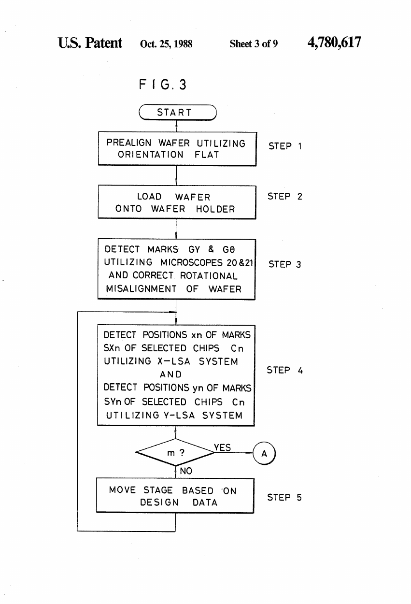
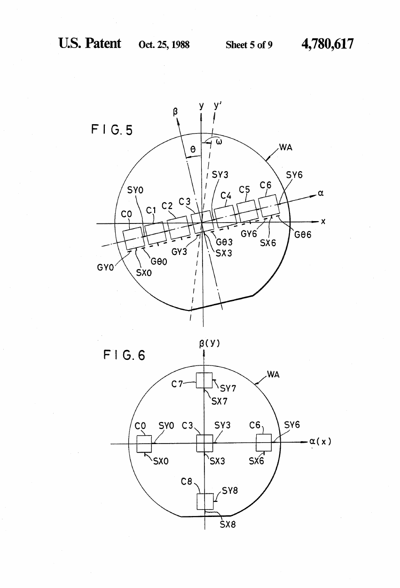
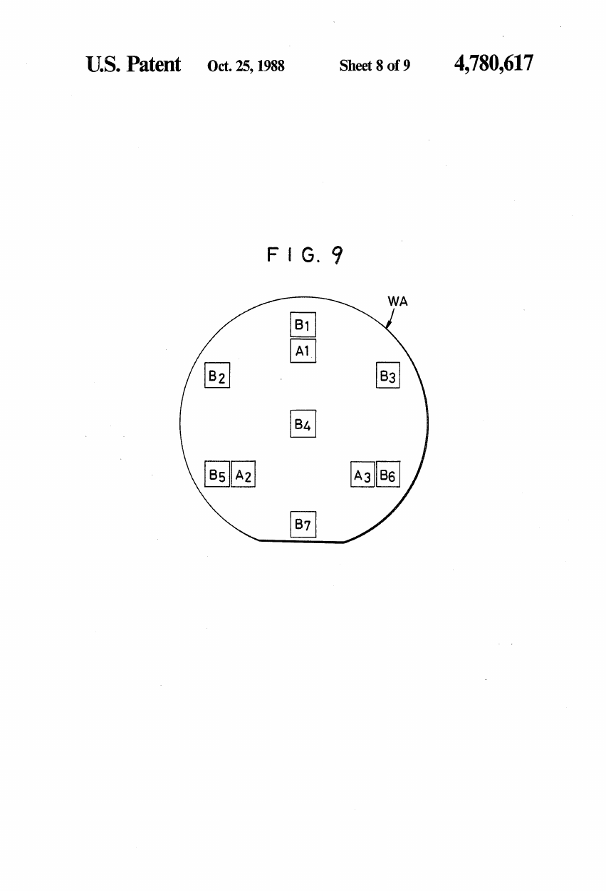

# US4780617 번역: 기판 위 칩 패턴을 차례로 정렬하는 방법

- 원제: Method for successive alignment of chip patterns on a substrate
- 원문: 같은 폴더의 `US4780617.pdf` (등록 공보, 22쪽, 도면 9장, 청구항 14)
- 번역 범위: 전문 (서지, 초록, 상세한 설명 전체, 수식 (1)~(28), 표, 청구항 1~14, 도면 설명). 인용 문헌 목록은 원문 그대로 둔다.
- 번역 원본 텍스트: `pdftotext -layout`으로 뽑은 본문. 두 단이 섞이고 수식이 깨진 곳은 해당 쪽을 이미지로 열어(pdftoppm -r 110) 직접 읽었다. 21~22쪽(청구항 2 뒷부분~14)은 글자 층이 없어 이미지에서 읽었다.
- 기호: 원문은 실측값에 윗줄을 쳐서 $\overline{F}$로, 연산식으로 구한 값을 $F$로 쓴다. 번역도 이 구분을 따른다. 도면 부호(2, 50, LXS 등)는 원문 그대로 둔다.
- 번역 2026-11-04.

## 서지

| 항목 | 내용 |
|---|---|
| 공보 | US 4,780,617 (등록 1988-10-25) |
| 출원 | 출원번호 915,027, 1986-10-03 출원 |
| 관련 출원 | 1985-07-29 출원 Ser. No. 760,037의 일부계속출원(포기됨) |
| 우선권 | 일본 59-167020 (1984-08-09), 일본 60-224163 (1985-10-08) |
| 발명자 | Toshikazu Umatate (가와사키), Hiroyuki Suzuki (도쿄) |
| 권리자 | Nippon Kogaku K.K. (도쿄) |
| 국제 분류 | G01B 11/26, G05B 15/00, G05D 3/00 |
| 미국 분류 | 250/548, 356/401, 364/491, 364/559 |
| 검색 분야 | 250/548, 557, 237 R, 356/399, 400, 401, 364/559, 490, 491 |
| 심사관 | Edward P. Westin |
| 대리인 | Shapiro and Shapiro |
| 청구항, 도면 | 청구항 14, 도면 9장 |

인용 문헌 (원문 그대로)

```
U.S. PATENT DOCUMENTS
4,342,090  7/1982   Caccoma et al. .......... 364/559
4,362,385 12/1982   Lobach .................. 250/548
```

## 초록

기판 위에 규칙적으로 늘어선 여러 칩 패턴을 하나씩 기준 위치에 맞추는 방법이다.
방법은 다음으로 이루어진다.

- 선택한 칩 패턴들의 위치를 나타내는 설계 자료에 따라 기판을 움직여, 선택한 칩 패턴을 차례로 기준 위치에 맞춘다.
- 기준 위치에 맞춘 상태에서 선택한 칩 패턴들의 위치를 잰다.
- 잰 위치를 바탕으로, 연산식으로 구한 선택 칩 패턴 위치와 설계 자료가 나타내는 위치 사이 편차의 제곱합이 최소가 되도록 연산식의 계수를 정한다.
- 이 연산식으로 모든 칩 패턴에 해당하는 위치를 정한다.
- 정한 위치에 따라 기판을 움직인다.

## 관련 출원과의 관계

이 출원은 1985-07-29에 낸 미국 출원 Ser. No. 760,037(지금은 포기됨)의 일부계속출원이다. 그 내용을 참조로 여기에 포함한다.

## 발명의 배경

### 1. 발명의 분야

이 발명은 반도체 소자를 만드는 스텝 앤 리피트 방식 노광 장치, 또는 스텝 앤 리피트 방식으로 차례로 검사하는 장치에 알맞은 정렬 방법에 관한 것이다.
특히 노광용 원판인 마스크나 레티클과, 노광 대상인 반도체 웨이퍼 같은 것을 정밀하게 정렬하는 방법에 관한 것이다.

### 2. 종래 기술

최근 IC, LSI 같은 반도체 소자는 빠르게 미세해지고 밀도가 높아졌다.
그래서 반도체 소자 제조 장치, 특히 마스크나 레티클의 회로 패턴을 웨이퍼 위 회로 패턴에 겹쳐 옮기는 노광 장치에 더 높은 정확도가 요구된다.
마스크 회로 패턴과 웨이퍼 회로 패턴은 예를 들어 0.1 μm 안의 정확도로 겹쳐야 한다.
그래서 요즘은 이른바 스텝 앤 리피트 방식 장치가 이 분야의 주류가 되었다.
이 방식은 마스크 회로 패턴을 웨이퍼의 좁은 영역(예: 칩 하나에 해당하는 영역)에 노광하고, 웨이퍼를 정해진 거리만큼 이동(스텝)시킨 뒤 다시 노광한다.
특히 축소 투영형 노광 장치(스테퍼)가 주류다.

스텝 앤 리피트 방식에서는 웨이퍼를 2차원으로 움직이는 스테이지에 올리고, 마스크 회로 패턴의 투영 상에 대해 위치를 맞춘다. 그래서 투영 상과 웨이퍼 위 각 칩을 정밀하게 겹칠 수 있다.
축소 투영형 노광 장치의 정렬 방법은 두 가지다.

- 스루 더 렌즈(TTL) 방식: 마스크나 레티클의 정렬 마크와 웨이퍼 칩에 딸린 마크를 투영 렌즈를 통해 직접 관찰하거나 검출해 정렬한다.
- 오프 액시스 방식: 투영 렌즈에서 정해진 거리만큼 떨어진 정렬 현미경으로 웨이퍼 전체를 정렬한 뒤, 웨이퍼를 투영 렌즈 바로 아래로 보낸다.

일반적으로 TTL 방식은 웨이퍼 위 칩마다 정렬하므로 겹침 정확도가 높다. 하지만 웨이퍼 한 장의 노광 처리 시간이 길다.
오프 액시스 방식은 웨이퍼 전체 정렬을 한 번 끝내면 칩 배열대로 스텝만 하면 되므로 처리 시간이 짧다.
하지만 칩마다 정렬하지 않으므로, 웨이퍼의 팽창과 수축, 스테이지 위 웨이퍼의 회전 오차, 스테이지 이동 자체의 직교도 같은 영향 때문에 충분한 겹침 정확도를 늘 얻지는 못했다.

## 발명의 요약

이 발명의 목적은 스텝 앤 리피트 방식 정렬에서, 웨이퍼 같은 처리 대상 기판 위 여러 칩 모두에 대해 마스크 패턴 투영 위치 같은 것을 기준 위치에 맞추지 않고도, 스텝만으로 더 정밀한 정렬을 이루는 방법을 주는 것이다.

이 발명은 축소 투영형 노광 장치, 등배 투영형 스테퍼, 근접형 스테퍼에 널리 쓸 수 있다.
노광 장치 말고도, 여러 칩 패턴이 있는 반도체 웨이퍼나 포토마스크를 검사하면서 칩마다 검사 시야나 프로브 같은 기준 위치에 스텝 앤 리피트 방식으로 맞추는 검사 장치에도 똑같이 쓸 수 있다.

한 측면에서 이 발명은, 정해진 좌표에 따라 기판 위에 규칙적으로 늘어선 여러 칩 패턴을 하나씩 기준 위치에 맞추는 방법이며, 다음 단계로 이루어진다.

- (a) 여러 칩 패턴 각각의 좌표 위치를 나타내는 설계 자료에 따라 기판을 움직여, 여러 칩 패턴 가운데 선택한 몇 개를 차례로 기준 위치에 맞춘다.
- (b) 기준 위치에 맞춘 상태에서 선택한 몇 개 칩 패턴의 위치를 잰다.
- (c) 잰 위치를 바탕으로, 연산식으로 구한 선택 칩 패턴 위치와 설계 자료가 나타내는 선택 칩 패턴 위치 사이 편차의 제곱합이 최소가 되도록 연산식의 계수를 정한다.
- (d) 이 연산식으로 여러 칩 패턴 모두에 해당하는 위치를 정한다.
- (e) 정한 위치에 따라 기판을 움직인다.

바람직한 실시예에서는 파라미터로 다음 두 가지를 쓴다.

- 변환 행렬 A: 웨이퍼의 잔류 회전 오차 θ, 스테이지의 직교도 ω, 웨이퍼의 선형 팽창과 수축 R을 담는다.
- 행렬 O: 웨이퍼의 2차원 오프셋 양을 담는다.

다른 바람직한 형태에서는, 기판마다 패턴 위치의 설계값과 실측값으로 기판 위 패턴 배열의 규칙성을 정할 때 다음처럼 한다.

- N장 가운데 처음부터 m번째(m<N)까지의 기판은, 규칙성을 정하는 여러 파라미터를 모두 기판마다 실측값으로 정한다.
- m+1번째 이후의 기판은, 여러 파라미터 가운데 기판마다 값이 바뀌는 파라미터만 기판마다 실측값으로 정한다. 나머지 파라미터는 1번째~m번째 기판에서 이미 정한 값을 쓴다.

## 도면의 간단한 설명

- 도 1은 이 발명의 방법을 실행하기에 알맞은 축소 투영형 노광 장치의 구성을 개략적으로 보인 사시도다.
- 도 2는 도 1 장치에서 정렬계 검출 중심들의 위치 관계를 보인 평면도다.
- 도 3과 도 4는 이 발명의 정렬 방법을 쓰는 전체 동작 절차를 보인 흐름도다.
- 도 5는 도 1 장치로 정렬과 노광을 하기에 알맞은 웨이퍼의 평면도다.
- 도 6은 스텝 정렬을 하는 칩의 위치를 보인 웨이퍼 평면도다.
- 도 7과 도 8은 이 발명의 다른 실시예에 따른 정렬 방법의 동작을 보인 흐름도다.
- 도 9는 웨이퍼 위에서 샘플 정렬용으로 지정한 샷의 배치를 보인 평면도다.
- 도 10은 이 발명의 다른 실시예에 알맞은 스테퍼의 구성 개요를 보인 도면이다.
- 도 11은 도 10 스테퍼로 처리할 웨이퍼의 마크 배치를 보인 평면도다.

## 바람직한 실시예의 설명

### 장치 구성 (도 1, 도 2)

도 1은 축소 투영형 노광 장치의 구성을 개략적으로 보인다.
투영 원판인 레티클 R은 투영 중심이 투영 렌즈 1의 광축을 지나도록 장치에 놓인다.
투영 렌즈 1은 레티클 R에 그려진 회로 패턴 상을 1/5이나 1/10로 줄여 웨이퍼 WA에 투영한다.
웨이퍼 홀더 2는 웨이퍼 WA를 진공으로 흡착하며, x 방향과 y 방향으로 2차원 이동하는 스테이지 3에 대해 조금 회전할 수 있다.
구동 모터 4는 스테이지 3에 고정되어 웨이퍼 홀더 2를 돌린다.
스테이지 3의 x 방향 이동은 모터 5가, y 방향 이동은 모터 6이 맡는다.
스테이지 3의 서로 직교하는 두 변에는, 반사면이 y 방향으로 뻗은 반사 거울 7과 반사면이 x 방향으로 뻗은 반사 거울 8이 붙어 있다.
레이저 간섭계 9는 반사 거울 8에 레이저 빛을 쏘아 스테이지 3의 y 방향 위치(또는 이동량)를 검출하고, 레이저 간섭계 10은 반사 거울 7에 레이저 빛을 쏘아 스테이지 3의 x 방향 위치(또는 이동량)를 검출한다.

투영 렌즈 1 옆에는 웨이퍼 WA 위 정렬 마크를 검출(또는 관찰)하는 오프 액시스형 웨이퍼 정렬 현미경 20과 21이 있다.
현미경 21은 도 1에서 투영 렌즈 1 뒤쪽에 있어 보이지 않는다.
현미경 20과 21은 투영 렌즈 1의 광축 AX와 나란한 광축을 가지며, 도 2처럼 x 방향으로 길쭉한 띠 모양 레이저 광점 YSP와 θSP를 웨이퍼 WA 위에 맺는다.
광점 YSP와 θSP는 웨이퍼 WA 위 감광제(포토레지스트)를 감광시키지 않는 파장의 빛이며, 이 실시예에서는 y 방향으로 작은 진폭으로 진동한다.
현미경 20과 21은 각각 마크에서 나온 산란광과 회절광을 받는 광전 소자, 그리고 그 광전 신호를 광점 진동 주기로 동기 정류하는 회로를 가진다. 그래서 광점의 y 방향 진동 중심에 대한 마크의 y 방향 편차에 해당하는 정렬 신호를 낸다.

이 장치에는 투영 렌즈 1을 통해 웨이퍼 WA 위 마크를 검출하는 레이저 스텝 정렬 광학계가 있다.
도시하지 않은 레이저 광원에서 나와, 도시하지 않은 확대기와 원통 렌즈 등을 지난 레이저 빔 LB는 포토레지스트를 감광시키지 않는 파장의 빛이다. 이 빔은 빔 분할기 30에 들어가 두 빔으로 나뉜다.
한 빔은 거울 31에서 반사되고 빔 분할기 32를 지나 결상 렌즈군 33으로 모여 단면이 띠 모양인 광점이 된다. 그 뒤 레티클 R과 투영 렌즈 1 사이에, 회로 패턴의 투영 광로를 가리지 않도록 놓인 첫째 반환 거울 34에 들어간다.
거울 34는 레이저 빔을 레티클 쪽 위로 반사한다.
이 빔은 레티클 아래에 있고 반사면이 레티클 면과 나란한 거울 35에 들어가, 투영 렌즈 1의 입사 동공 중심 쪽으로 반사된다.
거울 35에서 온 빔은 투영 렌즈 1로 모여 웨이퍼 WA 위에 x 방향으로 길쭉한 띠 모양 광점 LYS로 맺힌다.
광점 LYS는 웨이퍼 위에서 x 방향으로 뻗은 회절격자 모양 마크를 y 방향으로 상대 주사하여 그 마크의 위치를 검출하는 데 쓴다.
광점 LYS가 마크를 비추면 마크에서 회절광이 생긴다.
이 빛 정보는 다시 투영 렌즈 1, 거울 35, 거울 34, 결상 렌즈군 33을 거쳐 빔 분할기 32에서 반사되고, 집광 렌즈와 공간 필터로 된 광학 소자 36에 들어간다.
광학 소자 36은 마크에서 나온 1차 이상 회절광은 통과시키고 정반사광은 막으며, 회절광을 거울 37을 거쳐 광전 소자 38의 수광면에 모은다.
광전 소자 38은 모인 회절광의 양에 해당하는 광전 신호를 낸다.
위 요소 31~38이 함께 웨이퍼 위 마크의 y 방향 위치를 검출하는 TTL형 정렬 광학계(이하 Y-LSA 계)를 이룬다.

빔 분할기 30에서 나뉜 다른 빔은 웨이퍼 위 마크의 x 방향 위치를 검출하는 TTL형 정렬 광학계(이하 X-LSA 계)에 들어간다.
X-LSA 계는 Y-LSA 계와 같이 거울 41, 빔 분할기 42, 결상 렌즈군 43, 거울 44와 45, 광학 소자 46, 거울 47, 광전 소자 48로 이루어지며, 웨이퍼 WA 위에 y 방향으로 길쭉한 띠 모양 광점 LXS를 맺는다.

주 제어 장치 50은 광전 소자 38, 48의 광전 신호, 현미경 20, 21의 정렬 신호, 레이저 간섭계 9, 10의 위치 정보를 입력으로 받아 정렬을 위한 여러 연산을 하고, 모터 4, 5, 6을 구동하는 명령을 낸다.
주 제어 장치 50에는 마이크로컴퓨터나 미니컴퓨터 같은 연산 처리 장치가 있으며, 웨이퍼 위에 만들어진 여러 칩 CP의 설계 위치 정보, 곧 웨이퍼 WA 위 칩 배열 좌표값을 저장한다.

도 2는 투영 렌즈 1의 결상면 위에서 현미경 20, 21과 Y-LSA 계, X-LSA 계가 만드는 광점 θSP, YSP, LYS, LXS의 배치 관계를 보인다.
광축 AX를 원점으로 하는 좌표계 xy를 정하면, x축과 y축이 스테이지 3의 이동 방향을 나타낸다.
도 2에서 광축 AX를 중심으로 하는 원 영역은 상 시야 if이고, 그 안의 직사각형 영역은 레티클 R 유효 패턴 영역의 투영 상 Pr이다.
광점 LYS는 상 시야 안, 투영 상 밖에서 x축과 일치하도록 맺히고, 광점 LXS도 상 시야 안, 투영 상 밖에서 y축과 일치하도록 맺힌다.
광점 θSP와 YSP의 진동 중심은 x축과 나란하고 y 방향으로 Y0만큼 떨어진 선 l 위에 오도록 정하며, 두 광점의 간격 Dx는 웨이퍼 지름보다 작은 값이다.
이 장치에서 광점 θSP와 YSP는 y축에 대해 대칭으로 놓이며, 주 제어 장치 50은 광축 AX의 투영점에 대한 광점 θSP, YSP의 위치 정보를 저장한다.
주 제어 장치 50은 또 광축 AX의 투영점에서 광점 LYS, LXS 중심까지의 거리 X1, Y1 정보도 저장한다.

### 정렬 절차 (도 3, 도 4, 도 5)

이제 이 장치를 쓰는 정렬 방법을 도 3과 도 4로 설명한다.
이 정렬은 웨이퍼의 둘째 층 이후에 대해 하며, 웨이퍼 위에는 첫째 층 리소그래피 공정에서 만든 칩과 정렬 마크가 이미 있다.



*도 3 (공보 4쪽, 도면 3/9): 전체 동작 흐름도 앞부분. 단계 1 오리엔테이션 플랫으로 웨이퍼 사전 정렬, 단계 2 웨이퍼를 홀더에 올림, 단계 3 현미경 20, 21로 마크 GYθ, Gθ6을 검출해 웨이퍼 회전 어긋남 보정, 단계 4 X-LSA 계로 선택 칩 Cn의 마크 SXn 위치 xn 검출과 Y-LSA 계로 마크 SYn 위치 yn 검출, 단계 5 설계 자료로 스테이지 이동. 도 4(5쪽)는 이어서 단계 6 식 (10), (11), (14)~(17)로 파라미터 A, O 결정, 단계 7 파라미터와 설계 자료로 보정한 칩 배열 지도 작성, 단계 8 배열 지도대로 스테이지 주소 지정, 단계 9 인쇄, 단계 10 웨이퍼 내림이다.*

단계 1에서 도시하지 않은 사전 정렬 장치로 웨이퍼의 오리엔테이션 플랫이 정해진 방향을 향하도록 웨이퍼 WA를 대략 맞춘다.
웨이퍼의 플랫은 도 1처럼 x축과 나란하게 놓인다.
다음 단계 2에서 웨이퍼를 스테이지 3의 웨이퍼 홀더 2로 옮기고, 플랫이 x축과 나란함을 유지하도록 홀더 2에 놓아 진공 흡착한다.
웨이퍼 위에는 예를 들어 도 5처럼 여러 칩 Cn이 웨이퍼 위 직교 배열 좌표 αβ를 따라 행렬 꼴로 만들어져 있다.
배열 좌표 αβ의 α축은 웨이퍼 플랫과 거의 나란하다.
도 5에서는 여러 칩 Cn 가운데 웨이퍼 중심을 거의 지나는 α축 위에 한 줄로 놓인 칩 C0~C6만 대표로 보였다.
칩 C0~C6 각각에는 정렬 마크 GY, Gθ, SX, SY 네 개가 딸려 있다.
가운데 칩 C3의 중심을 배열 좌표 αβ의 원점으로 할 때, α 방향으로 곧게 뻗은 회절격자 모양 마크 SY0~SY6이 각각 칩 C0~C6의 오른쪽 α축 위에 있다.
또 β 방향으로 곧게 뻗은 회절격자 모양 마크 SX3이 칩 C3 아래, 칩 C3 중심을 지나는 β축 위에 있고, 마크 SX0~SX2와 SX4~SX6도 다른 칩 C0, C1, C2, C4, C5, C6의 중심을 지나며 β축과 나란한 선 위에 있다.
이 마크 SYn과 SXn은 각각 광점 LYS와 LXS로 검출한다.
칩 C0~C6 아래에는 웨이퍼 전체 정렬(글로벌 정렬)에 쓰는 마크 GY0~GY6과 Gθ0~Gθ6이 있다.
이 마크 GYn과 Gθn은 α축과 나란한 선 위에서 α 방향으로 곧게 뻗은 회절격자 모양 패턴이다.
또 α 방향으로 한 줄로 놓인 칩 C0~C6 가운데, 예를 들어 가장 왼쪽 칩 C0의 마크 GY0과 가장 오른쪽 칩 C6의 마크 Gθ6의 간격은 현미경 20, 21이 만드는 광점 θSP와 YSP의 간격 Dx와 같도록 정한다.
즉 이 실시예에서는 서로 떨어진 두 마크 GY0과 Gθ6으로 오프 액시스 방식 웨이퍼 글로벌 정렬을 한다.
그래서 나머지 마크 GY1~GY6과 Gθ0~Gθ5는 필요 없고 없애도 된다.
핵심은 α 방향으로 길쭉한 두 마크가 α축과 나란한(또는 일치하는) 선 위에서 간격 Dx로 놓이는 것이다.

주 제어 장치 50은 장치 고유 상수로, 사전 정렬 장치에서 웨이퍼를 받을 때의 스테이지 3 위치 정보와, 그 위치에서 마크 GY0과 Gθ0이 각각 현미경 21과 20의 관찰 시야 안에 들어올 때까지 스테이지 3이 움직일 방향과 양 같은 정보를 미리 저장한다.
그래서 다음 단계 3에서 주 제어 장치 50은 먼저 모터 5, 6을 구동해 마크 GY0이 현미경 21의 관찰 시야 안에 오도록 스테이지 3을 놓는다.
그 뒤 현미경 21의 정렬 신호와 레이저 간섭계 9의 위치 정보로 광점 YSP의 진동 중심이 마크 GY0의 y 방향 중심과 일치하도록 스테이지 3을 y 방향으로 정밀하게 놓는다.
광점 YSP의 진동 중심이 마크 GY0 중심과 일치하면, 주 제어 장치 50은 이 상태가 유지되도록 현미경 21의 정렬 신호로 모터 6을 되먹임 제어하면서, 모터 4를 구동해 웨이퍼 홀더 2를 돌려 마크 Gθ6이 현미경 20의 광점 θSP에 검출되게 한다.
또 주 제어 장치 50은 광점 θSP의 진동 중심이 마크 Gθ6의 y 방향 중심과 일치하도록 현미경 20의 정렬 신호로 모터 4를 서보 제어한다.
이 일련의 동작으로 광점 YSP와 θSP는 각각 마크 GY0, Gθ6과 일치하고, 스테이지 3의 이동 좌표계 곧 좌표계 xy에 대한 웨이퍼 배열 좌표 αβ의 회전 어긋남이 보정되며, y 방향(β 방향) 위치에 대해 좌표계 xy를 배열 좌표 αβ에 대응시키는 일이 끝난다.
이어서 위치를 맞춘 뒤, 웨이퍼 가운데 있는 칩 C3의 마크 SX3을 X-LSA 계의 광점 LXS가 주사하도록 스테이지 3을 x 방향으로 움직인다.
이때 주 제어 장치 50은 광전 소자 48의 시계열 광전 신호와 레이저 간섭계 10의 위치 정보로, 마크 SX3이 광점 LXS와 일치하는 때의 웨이퍼 x 방향 위치를 검출해 저장한다.
이로써 x 방향(α 방향) 위치에 대해 좌표계 xy를 배열 좌표 αβ에 대응시키는 일이 끝난다.
노광 동작 바로 앞에 X-LSA 계를 쓰는 경우에는 이 x 방향 대응이 필요 없다.
이 동작들로 주로 오프 액시스형 정렬로 이루어진 웨이퍼 글로벌 정렬(배열 좌표 αβ를 좌표계 xy에 대응시키는 일)이 끝난다.

종래 방법에서는 주 제어 장치 50이 웨이퍼 위 각 칩의 배열 설계값을 바탕으로 레이저 간섭계 9, 10의 위치 정보를 읽고, 레티클 R의 투영 상 Pr이 칩에 겹치도록 스테이지 3을 스텝 앤 리피트 방식으로 주소 지정한 뒤 그 칩에 노광(인쇄)한다.

### 샷 주소 오차의 네 요인

그러나 글로벌 정렬이 끝나기 전의 정렬 검출계 정확도의 들쭉날쭉함, 각 광점의 설정 정확도, 웨이퍼 위 각 마크의 광학 상태나 모양 상태에 따른 위치 검출 정확도 때문에 샷 주소 오차가 생긴다. 그래서 웨이퍼 위 각 칩이 좌표계 xy에 따라 늘 정밀하게 정렬(주소 지정)되지는 않는다.
위 샷 주소 오차는 주로 다음 네 요인에서 생긴다.

(1) 웨이퍼의 회전

예를 들어 웨이퍼를 회전 보정할 때 정렬 기준이 되는 두 광점 YSP와 θSP의 위치 관계가 정확하지 않기 때문에 생긴다. 좌표계 xy에 대한 배열 좌표 αβ의 잔류 회전 오차 θ로 나타낸다.

(2) 좌표계 xy의 직교도

모터 5와 6이 스테이지 3을 보내는 방향이 정확히 직교하지 않기 때문에 생긴다. 직교도 오차 ω로 나타낸다.

(3) x(α) 방향과 y(β) 방향의 웨이퍼 선형 팽창과 수축

웨이퍼는 가공 공정 때문에 전체적으로 팽창하거나 수축한다. 그래서 실제 칩 위치가 칩의 설계 배열 좌표값에 대해 α, β 방향으로 조금 어긋나며, 이는 웨이퍼 가장자리에서 특히 두드러진다.
웨이퍼 전체의 팽창과 수축 양을 α(x) 방향은 Rx, β(y) 방향은 Ry로 나타낸다.
Rx는 웨이퍼 위 x 방향(α 방향) 두 점 사이 거리의 실측값과 설계값의 비로, Ry는 y 방향(β 방향) 두 점 사이 거리의 실측값과 설계값의 비로 나타낸다고 이해한다.
그래서 Rx와 Ry가 모두 1이면 팽창도 수축도 없다.

(4) x(α) 방향과 y(β) 방향의 오프셋

정렬계 검출 정확도, 웨이퍼 홀더 2의 위치 결정 정확도 등 때문에 웨이퍼가 전체적으로 x, y 방향으로 조금 어긋나서 생긴다. 오프셋 양 Ox, Oy로 나타낸다.

도 5에는 웨이퍼 WA의 잔류 회전 오차 θ와 스테이지 3의 직교도 오차 ω를 과장해 그렸다.
이 경우 직교 좌표계 xy는 실제로는 작은 양 ω만큼 기운 경사 좌표계 xy′이고, 웨이퍼는 직교 좌표계 xy에 대해 θ만큼 돌아가 있다.



*도 5 (위): 웨이퍼 WA 위 α축을 따라 놓인 칩 C0~C6, 각 칩의 마크 SYn, SXn, GYn, Gθn. 배열 좌표 αβ가 좌표계 xy에 대해 θ만큼 돌고, 스테이지의 y′축이 y축에 대해 ω만큼 기운 모습을 과장해 그렸다. 도 6 (아래): 스텝 정렬(실측)할 칩 다섯 개. 중심 칩 C3과, 배열 좌표 각 축을 따라 중심에서 거의 같은 거리에 있는 C0, C6(α축), C7, C8(β축). 각 칩에 마크 SXn, SYn이 딸려 있다. (공보 6쪽, 도면 5/9)*

위 오차 요인 (1)~(4)를 적용하면, 설계 좌표 위치 (Dxn, Dyn)에 대한 각 샷의 샷 위치 Fxn, Fyn은 다음과 같다. 여기서 n은 정수이며 샷 번호를 나타낸다.

$$
\begin{bmatrix}F_{xn}\\F_{yn}\end{bmatrix}
=\begin{bmatrix}R_x&0\\0&R_y\end{bmatrix}
\begin{bmatrix}\cos\theta&-\sin\theta\\\sin\theta&\cos\theta\end{bmatrix}
\begin{bmatrix}1&-\tan\omega\\0&1\end{bmatrix}
\begin{bmatrix}D_{xn}\\D_{yn}\end{bmatrix}
+\begin{bmatrix}O_x\\O_y\end{bmatrix}
=\begin{bmatrix}R_x\cos\theta&-R_x(\cos\theta\tan\omega+\sin\theta)\\R_y\sin\theta&R_y(-\sin\theta\tan\omega+\cos\theta)\end{bmatrix}
\begin{bmatrix}D_{xn}\\D_{yn}\end{bmatrix}
+\begin{bmatrix}O_x\\O_y\end{bmatrix}
\tag{1}
$$

여기서 ω는 본디 작은 양이고, θ도 글로벌 정렬로 작은 양까지 줄어든다. 그래서 선형 근사를 하면 식 (1)은 아래 식 (2)가 된다.

$$
\begin{bmatrix}F_{xn}\\F_{yn}\end{bmatrix}
=\begin{bmatrix}R_x&-R_x(\omega+\theta)\\R_y\,\theta&R_y\end{bmatrix}
\begin{bmatrix}D_{xn}\\D_{yn}\end{bmatrix}
+\begin{bmatrix}O_x\\O_y\end{bmatrix}
\tag{2}
$$

이 식 (2)로부터 각 샷 위치에서 설계값과의 위치 편차 (εxn, εyn)는 아래 식 (3)이 된다.

$$
\begin{bmatrix}\epsilon_{xn}\\\epsilon_{yn}\end{bmatrix}
=\begin{bmatrix}F_{xn}\\F_{yn}\end{bmatrix}-\begin{bmatrix}D_{xn}\\D_{yn}\end{bmatrix}
=\begin{bmatrix}R_x-1&-R_x(\omega+\theta)\\R_y\,\theta&R_y-1\end{bmatrix}
\begin{bmatrix}D_{xn}\\D_{yn}\end{bmatrix}
+\begin{bmatrix}O_x\\O_y\end{bmatrix}
\tag{3}
$$

이제 식 (2)를 다음 행렬 연산식으로 다시 쓸 수 있다.

$$F_n=A\,D_n+O \tag{4}$$

여기서

$$F_n=\begin{pmatrix}F_{xn}\\F_{yn}\end{pmatrix}\tag{5}$$

$$A=\begin{pmatrix}a_{11}&a_{12}\\a_{21}&a_{22}\end{pmatrix}=\begin{pmatrix}R_x&-R_x(\omega+\theta)\\R_y\,\theta&R_y\end{pmatrix}\tag{6}$$

$$D_n=\begin{pmatrix}D_{xn}\\D_{yn}\end{pmatrix}\tag{7}$$

$$O=\begin{pmatrix}O_x\\O_y\end{pmatrix}\tag{8}$$

### 최소제곱으로 A와 O 정하기

그래서 마크를 검출해 실제 샷 위치를 재고 그 실측값을 $\overline{F}_n$으로 얻었을 때, 각 샷 위치 $F_n$에 대한 위치 편차, 곧 주소 오차 $E_n(=\overline{F}_n-F_n)$이 최소가 되도록 두 파라미터 A와 O를 정한다.
평가 함수로 최소제곱 오차법을 쓴다고 하면, 주소 오차 E는 아래 식 (9)가 된다.

$$
E=\sum_{n=1}^{m}(E_{xn})^2+\sum_{n=1}^{m}(E_{yn})^2
=\sum_{n=1}^{m}(\overline{F}_{xn}-F_{xn})^2+\sum_{n=1}^{m}(\overline{F}_{yn}-F_{yn})^2
\tag{9}
$$

그래서 주소 오차 E가 최소가 되도록 파라미터 A와 O를 정한다.
식 (9)에서 m은 웨이퍼 위 여러 칩 가운데 실측한 칩의 수다.
파라미터 A와 O를 구할 때 최소제곱법을 이대로 쓰면 연산량이 크다. 그래서 오프셋 양 O(Ox, Oy)를 따로 미리 정한다.
오프셋 양 (Ox, Oy)는 웨이퍼 전체의 오프셋 양이므로, 설계값 (Dxn, Dyn)에 대한 주소 오차를 웨이퍼 위 실측 칩 위치 $\overline{F}_n$의 개수 m으로 평균한 값으로 둘 수 있다. 즉

$$O_x=\frac{\sum_{n=1}^{m}(\overline{F}_{xn}-D_{xn})}{m}\tag{10}$$

$$O_y=\frac{\sum_{n=1}^{m}(\overline{F}_{yn}-D_{yn})}{m}\tag{11}$$

이제 위치 맞출 샷 위치 $F_n$과 실측값 $\overline{F}_n$ 사이 오차 $E_n$ 가운데, x 방향 성분 $E_{xn}$은 식 (4)~(8)에서 다음과 같다.

$$E_{xn}=\overline{F}_{xn}-F_{xn}=\overline{F}_{xn}-a_{11}D_{xn}-a_{12}D_{yn}-O_x\tag{12}$$

오차 $E_n$의 y 방향 성분 $E_{yn}$도 같이 다음과 같다.

$$E_{yn}=\overline{F}_{yn}-F_{yn}=\overline{F}_{yn}-a_{21}D_{xn}-a_{22}D_{yn}-O_y\tag{13}$$

그래서 식 (9)의 오차 E가 최소가 되도록 파라미터 A를 정하면, 원소 a11, a12, a21, a22는 다음과 같다. (아래 모든 합은 n=1부터 m까지. 분모는 네 식에 공통이다.)

$$\Delta=\sum D_{xn}^2\sum D_{yn}^2-\Big(\sum D_{xn}D_{yn}\Big)^2$$

$$a_{11}=\frac{\sum D_{xn}D_{yn}\sum D_{yn}(O_x-\overline{F}_{xn})-\sum D_{yn}^2\sum D_{xn}(O_x-\overline{F}_{xn})}{\Delta}\tag{14}$$

$$a_{12}=\frac{\sum D_{xn}D_{yn}\sum D_{xn}(O_x-\overline{F}_{xn})-\sum D_{xn}^2\sum D_{yn}(O_x-\overline{F}_{xn})}{\Delta}\tag{15}$$

$$a_{21}=\frac{\sum D_{xn}D_{yn}\sum D_{yn}(O_y-\overline{F}_{yn})-\sum D_{yn}^2\sum D_{xn}(O_y-\overline{F}_{yn})}{\Delta}\tag{16}$$

$$a_{22}=\frac{\sum D_{xn}D_{yn}\sum D_{xn}(O_y-\overline{F}_{yn})-\sum D_{xn}^2\sum D_{yn}(O_y-\overline{F}_{yn})}{\Delta}\tag{17}$$

(번역자 주: 공보 인쇄본에서 식 (14)~(17)의 F에 윗줄이 있는지는 해상도 때문에 분명하지 않다. 식 (12), (13)의 정의상 실측값 $\overline{F}$이어야 하므로 그렇게 적었다.)

원소 a11, a12, a21, a22를 구하면 선형 팽창과 수축 양 Rx, Ry, 잔류 회전 오차 θ, 직교도 오차 ω를 바로 얻는다.

$$R_x=a_{11}\tag{18}$$
$$R_y=a_{22}\tag{19}$$
$$\theta=a_{21}/R_y=a_{21}/a_{22}\tag{20}$$
$$\omega=-(a_{21}/R_y)-(a_{12}/R_x)=-(a_{21}/a_{22})-(a_{12}/a_{11})\tag{21}$$

따라서 오차 파라미터 A와 O를 정하려면, 글로벌 정렬이 끝난 뒤 X-LSA 계와 Y-LSA 계로 웨이퍼 위 몇 개, 예를 들어 네 개 이상의 칩에 대해 마크 SXn과 SYn의 위치를 실측해 실측값 $\overline{F}_{xn}$, $\overline{F}_{yn}$을 얻고, 동시에 실측한 칩의 설계값 Dxn, Dyn으로 식 (10), (11), (14)~(17)을 계산하면 된다.

### 5개 칩 스텝 정렬과 이상값 처리 (도 6)

도 3 흐름도로 돌아가 동작 설명을 잇는다.
주 제어 장치 50은 글로벌 정렬이 끝난 뒤 웨이퍼의 여러 칩 위치를 잰다.
먼저 단계 4에서 주 제어 장치 50은 배열 설계값으로, X-LSA 계의 광점 LXS가 도 5의 가장 왼쪽 칩 C0에 딸린 마크 SX0과 나란히 오도록 스테이지 3을 놓은 뒤, 마크 SX0이 광점 LXS를 가로지르도록 스테이지 3을 x 방향으로 정해진 양만큼 움직인다.
이 이동 동안 주 제어 장치 50은 광전 소자 48의 시계열 광전 신호 파형을 레이저 간섭계 10의 x 방향 위치 정보에 대응시켜 저장하고, 파형 상태로부터 마크 SX0과 광점 LXS가 x 방향으로 일치한 때의 위치 x0을 검출한다.
이어서 주 제어 장치 50은 배열 설계값으로, Y-LSA 계의 광점 LYS가 칩 C0에 딸린 마크 SY0과 나란히 오도록 스테이지 3을 놓는다.
그 뒤 마크 SY0이 광점 LYS를 가로지르도록 스테이지 3을 y 방향으로 정해진 양만큼 움직인다.
이때 주 제어 장치 50은 광전 소자 38의 시계열 광전 신호 파형을 레이저 간섭계 9의 y 방향 위치 정보에 대응시켜 저장하고, 파형 상태로부터 마크 SY0과 광점 LYS가 y 방향으로 일치한 때의 위치 y0을 검출한다.
그런 다음 주 제어 장치 50은 m개 칩에 대해 같은 위치 검출을 했는지 판단한다. 답이 "아니오"이면 단계 5로 가서 배열 설계값으로 스테이지 3을 웨이퍼 위 다른 칩으로 옮기고, 단계 4부터 같은 위치 검출 동작을 되풀이한다.
이 실시예에서는 단계 4의 위치 검출을, 도 6처럼 배열 좌표 αβ의 각 축을 따라 웨이퍼 WA 중심에서 거의 같은 거리에 있는 네 칩 C0, C6, C7, C8과 가운데 칩 C3, 모두 다섯 칩에 대해 한다고 이해한다.
그래서 m=5로 판단된 때 주 제어 장치 50에는 실측값 $(\overline{F}_{xn},\overline{F}_{yn})$ 다섯 개가 저장된다.
즉 칩 C0, C3, C6, C7, C8에 해당하는 다음 다섯 실측값을 차례로 검출한다.

- $(\overline{F}_{x1},\overline{F}_{y1})=(x_0,y_0)$
- $(\overline{F}_{x2},\overline{F}_{y2})=(x_3,y_3)$
- $(\overline{F}_{x3},\overline{F}_{y3})=(x_6,y_6)$
- $(\overline{F}_{x4},\overline{F}_{y4})=(x_7,y_7)$
- $(\overline{F}_{x5},\overline{F}_{y5})=(x_8,y_8)$

이 다섯 실측값을 검출할 때, 어떤 칩의 실측값이 그 칩의 설계값 (Dxn, Dyn)과 크게 다르면, 예를 들어 글로벌 정렬로 정해지는 위치 결정 정확도의 두 배 이상 다르면, 그 칩의 실측값은 버리고 예를 들어 이웃 칩에 대해 마크 위치를 실측해도 된다.
이것은 실측할 칩의 마크가 가공 공정으로 변형되었거나, 마크에 먼지가 붙었거나, 마크 광학 상의 대비(회절광 발생 세기)가 약해 광전 신호의 S/N 비가 낮을 때 생길 수 있는 위치 측정 정확도 저하를 메우기 위해서다.
위치 측정 정확도 저하를 메우는 방법으로는 다음도 있다.

- 여섯 개 이상의 칩, 예를 들어 도 6의 배열 좌표 αβ 네 사분면 각각에 있는 칩을 포함한 모두 아홉 칩의 위치를 미리 재고, 아홉 실측값 가운데 각 칩의 설계값 (Dxn, Dyn)에 가장 가까운 순서로 다섯 개를 고른다.
- 설계값 (Dxn, Dyn)과 크게 다른 실측값 $(\overline{F}_{xn},\overline{F}_{yn})$은 이후 연산 과정에 쓰지 않는다.

### 측정과 함께 합을 쌓는 계산

이어서 도 4의 단계 6에서 주 제어 장치 50은 식 (10), (11), (14)~(17)로 파라미터 A와 O를 정한다.
이 파라미터를 정할 때 주 제어 장치 50은 위 다섯 칩의 설계값 다섯 개를 미리 골라 다음처럼 저장한다.

- (Dx1, Dy1) = (x0′, y0′)
- (Dx2, Dy2) = (x3′, y3′)
- (Dx3, Dy3) = (x6′, y6′)
- (Dx4, Dy4) = (x7′, y7′)
- (Dx5, Dy5) = (x8′, y8′)

또 파라미터 A와 O를 실제로 정하기 전에, 다섯 칩의 위치 측정(이른바 스텝 정렬)이 하나 끝날 때마다, 예를 들어 단계 5에서 스테이지 3이 움직이는 동안, 식 (10), (11), (14)~(17)의 일부 연산을 함께 할 수 있다.
즉 식 (10), (11), (14)~(17)에서 각 칩 자료(실측값과 설계값)의 대수 합을 나타내는 연산 요소는, 칩 하나의 실측(스텝 정렬)이 끝날 때마다 차례로 더해 간다.
연산 요소는 다음과 같다(이 실시예에서 m=5).

$$\sum D_{xn},\ \sum D_{yn},\ \sum \overline{F}_{xn},\ \sum \overline{F}_{yn}$$
$$\sum D_{xn}^2,\ \sum D_{yn}^2,\ \sum D_{xn}D_{yn}$$
$$\sum D_{xn}\overline{F}_{xn},\ \sum D_{xn}\overline{F}_{yn}$$
$$\sum D_{yn}\overline{F}_{xn},\ \sum D_{yn}\overline{F}_{yn}$$

또 이 연산 요소 가운데 설계값 (Dxn, Dyn)만 들어 있는 것은, 실측할 칩이 미리 정해져 바뀌지 않는다면 단계 4, 5를 실행하기 전에 계산해 둘 수 있다.
이렇게 일부 연산을 실측 동작과 함께 하면 전체 정렬 시간이 그다지 길어지지 않는다.
다섯 실측값을 얻은 시점에서 주 제어 장치 50은 위 연산 요소 결과로 식 (10), (11)의 오프셋 양 (Ox, Oy)를 계산하고, 이어서 이 오프셋 값과 연산 요소 결과로 식 (14)~(17)의 배열 원소 a11, a12, a21, a22를 계산한다.
이로써 파라미터 A와 O가 정해지므로, 다음 단계 7에서 주 제어 장치 50은 웨이퍼의 각 칩에 대해 맞출 위치, 곧 파라미터로 보정한 샷 주소 (Fxn, Fyn)를 식 (4)로 계산하고, 칩들이 설계값 (Dxn, Dyn)에 대해 보정된 배열 지도(샷 주소 표)를 반도체 메모리에 만든다.
이 배열 지도는 칩 번호에 해당하는 위치 자료를 저장한다. 예를 들어 위치 (Fx0, Fy0)는 칩 C0에, 위치 (Fx1, Fy1)는 칩 C1에 대응하는 식이다.

이어서 단계 8에서 주 제어 장치 50은 저장한 배열 지도에 따라, 웨이퍼 위 칩 하나와 레티클 투영 상 Pr이 정확히 겹치도록 스테이지 3을 놓는다(주소 지정).
단계 9에서 그 칩에 투영 상 Pr을 인쇄한다.
웨이퍼 위 모든 칩의 인쇄가 끝났다고 판단되면 다음 단계 10에서 웨이퍼를 내리고, 웨이퍼 한 장의 노광 처리가 모두 끝난다.

### 측정 칩 수, 범위 지정, 블록 정렬

이 실시예에서 보듯, 웨이퍼 위에서 스텝 정렬할 칩이 많을수록 측정 정확도는 더 좋아지지만 그만큼 측정 시간이 늘어난다.
그래서 측정 시간 줄이기와 측정 정확도 높이기의 균형으로 보아, 스텝 정렬할 칩은 도 6처럼 놓인 다섯 칩으로 고르는 것이 바람직하다.
하지만 겹쳐 노광할 회로 패턴의 최소 선폭이 그다지 작지 않고(예: 2~5 μm) 측정 정확도를 크게 높일 필요가 없으면, 웨이퍼 위 서로 떨어진 세 칩(예: C0, C6, C7)의 위치만 재도 충분하며 측정 시간은 더 줄어든다.

또 스텝 정렬로 칩 위치를 더 효율적으로 재는 방법으로, 스텝 정렬할 여러 칩에 딸린 마크 SXn을 X-LSA 계의 광점 LXS로 주사해 각 칩의 x 방향 위치만 먼저 검출하고, 이어서 각 칩의 마크 SYn을 Y-LSA 계의 광점 LYS로 주사해 y 방향 위치를 검출해도 된다.

또 스텝 정렬할 칩을 고르는 자료를 도시하지 않은 키보드 장치로 주 제어 장치 50에 입력하면, 웨이퍼 처리 조건에 따라 바뀌는 마크 상태에 더 유연하게 대응할 수 있고 위치 측정 정확도 향상을 기대할 수 있다.
식 (10), (11)로 오프셋 양 (Ox, Oy)를 정할 때는 지정한 범위, 예를 들어 웨이퍼 중심에서 일정 범위 안 칩의 위치 측정 결과만 써도 된다.
지정 범위는 예를 들어 웨이퍼 지름의 절반을 지름으로 하는 원 안으로 정하거나, 웨이퍼 위에 칩과 마크를 만들 때 쓴 노광 장치(축소 투영형 스테퍼, 등배 투영형, 근접형 등)의 정확도 특성에 맞춰 그 크기를 마음대로 고를 수 있다.

이 실시예에서는 식 (4)를 웨이퍼 위 모든 칩에 적용해 스텝 앤 리피트 방식 주소 지정을 했다. 하지만 식 (4)는, 웨이퍼 면을 여러 블록으로 나누고 블록마다 최적 정렬을 하는 이른바 블록 정렬에도 똑같이 쓸 수 있다.
예를 들어 도 6에서 배열 좌표 αβ의 사분면에 있는 네 칩과 그림의 다섯 칩 C0, C3, C6, C7, C8, 모두 아홉 칩에 대해 스텝 정렬을 해 각 칩 위치의 실측값을 검출한다. 그 뒤 배열 좌표 αβ의 사분면마다 식 (10), (11), (14)~(17)로 오차 파라미터 A와 O를 정하고, 다시 식 (4)로 위치 (Fxn, Fyn)를 계산한다.
예를 들어 배열 좌표 αβ의 제1 사분면 블록은 제1 사분면 안 칩 하나와 칩 C3, C6, C7, 모두 네 칩의 실측값으로 식 (4)를 정하고, 제2 사분면 블록은 제2 사분면 안 칩 하나와 칩 C0, C3, C7, 모두 네 칩의 실측값으로 식 (4)를 정한다.
실제 노광 때는 블록마다 정한 식 (4)의 샷 위치 (Fxn, Fyn)로 웨이퍼 위 칩을 투영 상 Pr에 맞춘다.
이렇게 하면 웨이퍼 위 비선형 요소에 따른 위치 검출과 정렬의 결함이 줄어든다. 또 종래 블록 정렬과 달리 평균화 요소를 남긴 채 웨이퍼를 블록으로 나눌 수 있어, 각 블록 안 겹침 정확도가 어느 칩에서나 거의 고르다는 이점이 있다.
게다가 이 방법을 스테퍼가 아닌 노광 장치, 특히 거울 투영 노광 장치와 함께 쓸 때도 큰 이점을 얻을 수 있다.
일반적으로 거울 투영 노광 장치로 인쇄한 웨이퍼의 칩 배열은 휘어 있는 경우가 많다.
그래서 이런 웨이퍼에 스테퍼로 겹쳐 노광할 때 위의 블록 정렬을 하면, 각 블록 안 칩 배열의 휨은 무시할 만큼 작아져 웨이퍼 전체 면에서 매우 높은 겹침 정확도의 인쇄가 가능해진다.

이 발명의 정렬 방법은, 광점 하나를 웨이퍼 위에서 진동시키거나 일정한 속도로 곧게 주사하는 정렬계를 쓰는 노광 장치, 또는 레티클 위에 놓인 현미경 대물렌즈로 레티클 마크와 웨이퍼 마크를 관찰해 정렬하는 이른바 다이 바이 다이 정렬 광학계에도 쓸 수 있다.
이 경우 다이 바이 다이 정렬 동안 레티클을 x, y 방향으로 미세 이동하지 않는다고 하면, 레티클 마크의 투영 상이 이 실시예의 광점 LXS, LYS에 해당한다.
또 레티클을 미세 이동하는 방식에서는, 먼저 레티클을 원점 위치에 정확히 놓는다. 그런 다음 여러 칩의 스텝 정렬 동안 배열 설계값에 따라 스테이지를 스텝시킨 뒤, 레티클 마크와 실측할 칩의 마크가 정해진 위치 관계가 되도록 레티클을 미세 이동하고, 원점에서 레티클의 x, y 방향 이동량을 검출한다. 이로써 그 칩 위치의 실측값 $(\overline{F}_{xn},\overline{F}_{yn})$을 계산할 수 있다.

이 실시예에서는 오프셋 양 (Ox, Oy)를 따로 한 번에 구해 연산 과정을 단순하게 했다. 하지만 식 (9)의 주소 오차 E를 최소로 하는 오차 파라미터 A와 O를 엄밀한 연산 과정으로 계산해도 된다.

### 둘째 실시예: 웨이퍼마다 변하는 파라미터와 변하지 않는 파라미터 (도 7, 도 8, 도 9)

위 실시예에서는 웨이퍼 회전 θ, 직교도 ω, 선형 팽창과 수축 Rx, Ry를 담은 파라미터 A와, 오프셋 Ox, Oy를 담은 파라미터 O를 오차 파라미터로 다루었다.
그러나 다음 실시예에서는 위 네 오차 요인을 각각 하나의 오차 파라미터로 다룬다.

실제 웨이퍼 공정을 생각하면, 보통 한 로트의 약 25장 웨이퍼는 같은 공정을 거치므로 같은 로트 안 웨이퍼들은 앞 공정에서 매우 비슷한 영향을 받는다.
물론 로트가 달라도 차례로 처리하면 웨이퍼 사이 차이는 매우 작다.
그래서 네 오차 파라미터 가운데 스케일링(선형 팽창과 수축) 양과 직교도는, 차례로 처리하는 모든 웨이퍼에서 거의 같다고 본다.
정렬계의 오차 파라미터도, 드리프트를 무시한다면 미리 정해 둘 수 있다.
그러나 웨이퍼는 한 장씩 스테이지에 올라간다. 웨이퍼 정렬 현미경으로 스테이지 위 θ 테이블을 돌려 스테이지의 X 방향이 웨이퍼 샷 배열의 β축과 나란하도록 정렬(θ 정렬)한 뒤, 진공 흡착 등으로 웨이퍼를 θ 테이블에 고정한다.
그래서 웨이퍼를 스테이지에 고정할 때마다, 정렬계(웨이퍼 정렬 현미경이나 LSA 계)의 기준점에 대해 웨이퍼 원점이 조금씩 어긋난다.
따라서 오차 파라미터 가운데 오프셋은 웨이퍼마다 바뀌는 요인이다.
또 θ 정렬에서도 오차 양이 웨이퍼마다 바뀔 수 있다. 그래서 회전도 웨이퍼마다 바뀌는 요인이다.

둘째 실시예에서는 오프셋과 회전을 검출하는 과정 AP를 차례로 처리할 여러 웨이퍼 모두에 적용하고, 스케일링과 직교도를 검출하는 과정 BP는 처리 시작 뒤 처음 몇 장 웨이퍼에만 더 적용한다.
과정 BP를 적용하지 않는 웨이퍼는, 과정 BP를 적용한 다른 웨이퍼의 스케일링과 직교도 측정 결과를 써서 처리한다.

이 실시예의 조건은 다음과 같다.

- 과정 AP를 하는 웨이퍼 수(모든 웨이퍼 수): N
- 과정 BP를 하는 웨이퍼 수: m (m<N)
- 과정 AP를 하는 웨이퍼당 샷 수: a
- 과정 BP를 하는 웨이퍼당 샷 수: b
- 과정 AP를 하는 샷 번호: A1~Aa
- 과정 BP를 하는 샷 번호: B1~Bb

아래에서는 샷 수 a가 3, 샷 수 b가 7인 경우로 동작을 설명한다.

웨이퍼 WA 위 샷 번호 A1, A2, A3, B1, B2, B3, B4, B5, B6, B7에 해당하는 샷 위치는 도 9처럼 정한다.
샷 A1~A3은 웨이퍼 중심에서 거의 같은 거리, 거의 같은 각도 간격인 세 위치에 둔다.
샷 B1~B7 가운데 샷 B4는 웨이퍼 중심 근처에 두고, 샷 B1, B2, B3, B5, B6, B7은 샷 B4에서 거의 같은 거리, 거의 같은 각도 간격인 여섯 위치에 둔다.
이 실시예에서 샷 A1~A3과 샷 B1~B7은 서로 겹치지 않는다.



*도 9 (공보 9쪽, 도면 8/9): 샘플 정렬용 샷 배치. 과정 AP용 A1~A3은 중심에서 거의 같은 거리, 거의 같은 각도 간격의 세 곳. 과정 BP용 B4는 중심, B1~B3, B5~B7은 B4를 둘러싼 여섯 곳. A와 B는 겹치지 않는다.*

아래에서 도 7과 도 8의 단계를 차례로 설명한다.

차례로 처리할 N장 웨이퍼 가운데 첫 장을 앞 실시예의 단계 1과 같이 사전 정렬한다. 그런 다음 웨이퍼 홀더에 올려 진공 흡착한다. (단계 21)

다음으로 앞에서 말한 단계 3처럼 글로벌 정렬을 한다(단계 22). 이 단계에서 웨이퍼 위 배열 좌표 αβ의 원점과 스테이지 이동 좌표계 xy의 원점을, 예를 들어 1 μm 미만의 어긋남으로 서로 대응시킨다.

다음 단계 23에서 과정 AP로서, 스테이지 3을 움직이며 X-LSA 계와 Y-LSA 계로 샷 A1~A3(a=3)에 각각 딸린 마크 SX, SY의 위치를 검출한다.
이로써 샷 A1, A2, A3의 샘플 정렬이 끝난다.

이 실시예에서는 앞 실시예의 식 (12)에 따라 제곱합 $\sum E_{xn}^2$을 아래 식 (22)처럼 쓴다. 여기서 샘플 정렬을 하는 샷 수는 k다.

$$\sum_{n=1}^{k}E_{xn}^2=\sum_{n=1}^{k}(\overline{F}_{xn}-a_{11}D_{xn}-a_{12}D_{yn}-O_x)^2\tag{22}$$

식 (22)를 최소로 하는 a11, a12, Ox를 얻으려고, 식 (22)를 미지수 a11, a12, Ox로 각각 편미분해 각 식을 0으로 둔다.
이렇게 얻은 세 식은 다음 행렬식으로 다시 쓸 수 있다.

$$
\begin{bmatrix}\sum D_{xn}^2&\sum D_{xn}D_{yn}&\sum D_{xn}\\\sum D_{xn}D_{yn}&\sum D_{yn}^2&\sum D_{yn}\\\sum D_{xn}&\sum D_{yn}&\sum 1\end{bmatrix}
\begin{bmatrix}a_{11}\\a_{12}\\O_x\end{bmatrix}
=\begin{bmatrix}\sum\overline{F}_{xn}D_{xn}\\\sum\overline{F}_{xn}D_{yn}\\\sum\overline{F}_{xn}\end{bmatrix}
\tag{23}
$$

식 (13)의 y 성분도 같이 다음과 같다.

$$
\begin{bmatrix}\sum D_{xn}^2&\sum D_{xn}D_{yn}&\sum D_{xn}\\\sum D_{xn}D_{yn}&\sum D_{yn}^2&\sum D_{yn}\\\sum D_{xn}&\sum D_{yn}&\sum 1\end{bmatrix}
\begin{bmatrix}a_{21}\\a_{22}\\O_y\end{bmatrix}
=\begin{bmatrix}\sum\overline{F}_{yn}D_{xn}\\\sum\overline{F}_{yn}D_{yn}\\\sum\overline{F}_{yn}\end{bmatrix}
\tag{24}
$$

(번역자 주: 공보 인쇄본 식 (24) 우변은 $\overline{F}_{xn}$으로 찍혀 있다. 바로 뒤 본문이 $\sum\overline{F}_{yn}D_{xn}$ 등을 더한다고 쓰고, 식 (13)의 정의상 $\overline{F}_{yn}$이어야 하므로 그렇게 고쳐 적었다.)

따라서 샷 하나의 샘플 정렬이 끝날 때마다 $\sum D_{xn}$, $\sum D_{yn}$, $\sum D_{xn}^2$, $\sum D_{yn}^2$, $\sum D_{xn}D_{yn}$, $\sum\overline{F}_{xn}D_{xn}$, $\sum\overline{F}_{xn}D_{yn}$, $\sum\overline{F}_{xn}$, $\sum\overline{F}_{yn}D_{xn}$, $\sum\overline{F}_{yn}D_{yn}$, $\sum\overline{F}_{yn}$ 등을 각각 더해 두고, k번째 샷의 샘플 정렬이 끝났을 때 식 (23)과 (24)를 풀면 미지수 a11(=Rx), a12(=−Rx(ω+θ)), Ox, a21(=Ry θ), a22(=Ry), Oy를 모두 얻는다.

웨이퍼 위 샷 A1, A2, A3의 위치가 미리 정해져 있으면, 식 (23), (24) 좌변의 $\sum D_{xn}^2$, $\sum D_{yn}^2$, $\sum D_{xn}D_{yn}$, $\sum D_{xn}$, $\sum D_{yn}$은 설계값으로 미리 계산해 둘 수 있다.
그래서 식 (23), (24) 우변의 $\sum\overline{F}_{xn}D_{xn}$, $\sum\overline{F}_{xn}D_{yn}$, $\sum\overline{F}_{xn}$, $\sum\overline{F}_{yn}D_{xn}$, $\sum\overline{F}_{yn}D_{yn}$, $\sum\overline{F}_{yn}$만 샷 A1~A3의 샘플 정렬을 할 때마다 구해 각각 더하면 된다.

단계 24에서 식 (23)과 (24)를 풀어 미지수 여섯 개를 구하고, 처리 중인 웨이퍼의 회전 ℛj와 오프셋 𝒵j를 얻는다.
여기서 첨자 j는 처리할 웨이퍼의 번호다.
회전 ℛj는 a21/a22이고, 오프셋 𝒵j는 (Ox, Oy)다.

다음으로 이 웨이퍼에 과정 BP가 필요한지 판단한다. 즉 지금 처리 중인 웨이퍼가 미리 정한 m번째(과정 BP의 마지막) 웨이퍼 이하인지 판단한다.
j≤m이면 과정 BP를 하러 다음 단계 25로 가고, j>m이면 다음 판단으로 간다.

단계 25에서 과정 BP로서, LSA 계로 스테이지 3을 움직이며 샷 B1~B7(b=7)에 각각 딸린 마크 SX, SY의 위치를 검출한다.
그런 다음 샷 B1~B7의 측정값으로 단계 24와 같이 식 (23)과 (24)를 써서 미지수 여섯 개를 계산한다.
그러면 네 파라미터 모두, 곧 회전 ℛj′, 오프셋 𝒵j′, 스케일링 𝒮j′(곧 Rx, Ry), 직교도 𝒪j′(곧 −a12/a11 − a21/a22)를 얻는다. (단계 26)

다음으로 처리한 웨이퍼 수가 m번째에 이르렀는지 판단하고, j=m일 때만 단계 27을 실행한다.

처리한 웨이퍼 수가 m에 이르면, 주 제어 장치 50은 첫째부터 m번째 웨이퍼까지 웨이퍼마다 과정 AP와 과정 BP에서 정한 파라미터를 다음 표처럼 저장한다.

*표: 과정 AP, 과정 BP에서 정한 파라미터와 노광에 쓰는 파라미터 (공보 18쪽)*

| j | AP: ℛ | AP: 𝒵 | BP: 𝒮′ | BP: 𝒪′ | BP: ℛ′ | BP: 𝒵′ | 노광: 𝒮 | 노광: 𝒪 | 노광: ℛ | 노광: 𝒵 |
|---|---|---|---|---|---|---|---|---|---|---|
| 1 | R1 | Z1 | S1′ | O1′ | R1′ | Z1′ | S1′ | O1′ | R1′ | Z1′ |
| 2 | R2 | Z2 | S2′ | O2′ | R2′ | Z2′ | S2′ | O2′ | R2′ | Z2′ |
| 3 | R3 | Z3 | S3′ | O3′ | R3′ | Z3′ | S3′ | O3′ | R3′ | Z3′ |
| ⋮ | | | | | | | | | | |
| m−1 | Rm−1 | Zm−1 | Sm−1′ | Om−1′ | Rm−1′ | Zm−1′ | Sm−1′ | Om−1′ | Rm−1′ | Zm−1′ |
| m | Rm | Zm | Sm′ | Om′ | Rm′ | Zm′ | Sm′ | Om′ | Rm′ | Zm′ |
| m+1 | Rm+1 | Zm+1 | | | 없음 | | S | O | Rm+1+R | Zm+1+Z |
| m+2 | Rm+2 | Zm+2 | | | 없음 | | S | O | Rm+2+R | Zm+2+Z |
| ⋮ | | | | | | | | | | |
| N−1 | RN−1 | ZN−1 | | | 없음 | | S | O | RN−1+R | ZN−1+Z |
| N | RN | ZN | | | 없음 | | S | O | RN+R | ZN+Z |

(원문 표는 m+1번째 이후 과정 BP 칸에 줄표만 적었다. 여기서는 "없음"으로 옮겼다.)

단계 27에서는 과정 BP로 정한 m번째 웨이퍼까지의 스케일링과 직교도 값을 m+1번째 이후 웨이퍼 처리에 쓰려고, 첫째부터 m번째 웨이퍼까지 각 파라미터 값의 평균 파라미터, 곧 회전 R, 오프셋 Z, 스케일링 S, 직교도 O를 다음 식 (25), (26), (27), (28)로 계산한다.

$$R=\frac{1}{m}\sum_{j=1}^{m}\mathcal{R}'_j-\frac{1}{m}\sum_{j=1}^{m}\mathcal{R}_j\tag{25}$$

$$Z=\frac{1}{m}\sum_{j=1}^{m}\mathcal{Z}'_j-\frac{1}{m}\sum_{j=1}^{m}\mathcal{Z}_j\tag{26}$$

$$S=\frac{1}{m}\sum_{j=1}^{m}\mathcal{S}'_j\tag{27}$$

$$O=\frac{1}{m}\sum_{j=1}^{m}\mathcal{O}'_j\tag{28}$$

다음으로 처리한 웨이퍼 수 j가 m보다 큰지 판단해, j가 m보다 크면 단계 29로 간다.
첫째부터 m번째 웨이퍼는 단계 28을 실행한다.
즉 위 표처럼 파라미터 ℛj′, 𝒵j′, 𝒮j′, 𝒪j′를 실제 노광 샷 위치를 정하는 데 쓴다.
그런 다음 앞의 식 (1)이나 (2)로 설계값 (Dxn, Dyn)으로부터 웨이퍼 위 각 샷의 좌표 위치 (Fxn, Fyn)를 정해 샷 주소 지도를 만든다.

m+1번째부터 N번째 웨이퍼는 단계 29를 실행한다.
즉 파라미터 ℛj+R, 𝒵j+Z, S, O로 샷 위치를 정해 샷 주소 지도를 만든다.

m+1번째 이후 웨이퍼에서는 회전과 오프셋에 대해 m번째까지의 웨이퍼에서 얻은 값 R, Z를 더한다.
이것은 과정 BP처럼 샘플 정렬 샷이 많은 측정으로 정한 파라미터 ℛj′와 𝒵j′에 무게를 주어 더 높은 정확도를 얻기 위해서다.

이렇게 만든 샷 주소 지도에 따라 웨이퍼를 차례로 정렬하며 되풀이 노광해, 웨이퍼 한 장의 스텝 앤 리피트 방식 노광을 한다. (단계 30)

웨이퍼 한 장의 노광 처리가 끝나면 그 웨이퍼가 N번째인지 판단한다.
N번째이면 모든 노광 처리가 끝난 것이다. 아니면 다음 단계 31로 간다.

단계 31에서는 웨이퍼를 스테이지 3에서 내리고(꺼내고), 처리할 웨이퍼 수 변수 j를 1 늘려(+1) 단계 21부터 같은 동작을 되풀이한다.

이 실시예에서는 도 8의 각 단계를 과정 AP와 과정 BP로 뚜렷이 나누어 설명했다. 하지만 첫째부터 m번째 웨이퍼에 과정 BP를 한다는 것이 미리 정해져 있으므로, 단계 23과 단계 25를 이어서 해 샷 A1~Aa와 B1~Bb 각 위치의 실측값을 차례로 얻는 편이 더 효과적이다.

또 샘플 정렬의 샷 A1~Aa와 샷 B1~Bb는 서로 겹치지 않도록 정했다. 하지만 꼭 그래야 하는 것은 아니다. 샷 A1~Aa의 전부나 일부가 샷 B1~Bb와 겹치도록 정해도 같은 효과를 얻는다.

과정 AP와 과정 BP의 파라미터를 정할 때는, 적어도 기판마다 값이 바뀌는 파라미터(이 실시예에서는 회전과 오프셋)를 과정 AP에서, 나머지 파라미터(이 실시예에서는 스케일링과 직교도)를 과정 BP에서 구하면 충분하다.
그래서 예를 들어 오프셋은 측정값과 설계값의 차를 더해 평균한 값으로 써서 계산을 단순하게 하는 것도 생각할 수 있다.

또 단계 22의 글로벌 정렬로 웨이퍼 중심 위치와 회전을 잴 수 있으면, 그 값을 써서 단계 23을 생략할 수 있다.

### 셋째 형태: LSA 계가 없는 장치 (도 10, 도 11)

위 각 실시예에서는 LSA 계처럼 자동으로 빠르고 정확하게 정렬하는 기능을 가진 스테퍼를 예로 들었다.
하지만 LSA 계 같은 기능이 없는 장치로도 같은 효과를 얻을 수 있다.
예를 들어 도 10의 장치는 다음을 가진다.

- 레티클 R에 있는 마크 RM의 상 RM′과 웨이퍼 W 위 샷 영역에 딸린 마크 WM의 상 WM′을, 투영 렌즈 101, 거울 120, 연장 광학계 121을 거쳐 CRT 123에 비추는 ITV 122
- 조이스틱 124 조작에 따라 모터 110을 구동해 스테이지 103을 조금 움직여, CRT 123에 나타난 상 RM′과 WM′이 정해진 위치 관계가 되게 하는 제어기 111

이 장치에서는 노광할 샷 영역 하나를 수동 정렬로 레티클 패턴 상에 맞춘다.
이런 장치를 쓸 때는 스테이지 103에 올린 웨이퍼에 대해 웨이퍼 정렬 현미경 130으로 글로벌 정렬만 한다.
웨이퍼 정렬 현미경 130은 도 11의 검출 시야 130θ, 130Y처럼 여럿 있으며, 그 검출 중심인 광축 AX2는 투영 렌즈 101의 광축 AX1에서 기계적으로 정해진 거리를 유지하도록 고정된다.
노광할 모든 웨이퍼에는 글로벌 정렬용 마크 GMy, GMθ, GMx를 도 11처럼 미리 만든다.
여기서 마크 GMy와 GMθ는 배열 좌표 αβ의 β축과 나란한 선 위에 정해진 간격으로 놓이며, 각각 y 방향(α 방향) 정렬에 쓰고, 마크 GMx는 X 방향(β 방향) 정렬에 쓴다.
(번역자 주: 원문의 축 표기를 그대로 옮겼다.)

위 구성의 스테퍼를 쓸 때, 예를 들어 로트의 첫째부터 m번째 웨이퍼는 먼저 여러 웨이퍼 정렬 현미경 30으로 마크 GMy, GMθ, GMx를 검출한 뒤 글로벌 정렬을 해 배열 좌표계 αβ를 스테이지 103의 이동 좌표계 xy에 대응시킨다.
그 뒤 웨이퍼 위 여러 샷 영역에 대해 마크 RM과 마크 WM으로 수동 샘플 정렬을 해, 각 샷 영역이 바르게 정렬된 때의 스테이지 좌표 위치를 실측값으로 차례로 저장한다.
이 측정값과 설계값으로 위에서 말한 여러(네) 파라미터를 각각 구하고, 이 파라미터로 정해지는 실제 샷 배열의 규칙성에 따라 스텝 앤 리피트 방식 노광을 한다.

또 m+1번째부터 N번째 웨이퍼는, 글로벌 정렬에서 구한 웨이퍼 중심값(좌표계 xy에서 본 좌표계 αβ 원점 위치)을 오프셋으로 다루고, θ 정렬 뒤 웨이퍼 정렬 현미경 30으로 구한 웨이퍼 회전을 써서, m+1번째 이후 각 웨이퍼의 (샷별) 정렬을 생략할 수 있다.

다시 말해 이 실시예에서는 앞 실시예의 과정 AP 같은 샘플 정렬을 하지 않는다. 웨이퍼마다 바뀌는 파라미터는 글로벌 정렬로 검출한 여러 패턴 영역 전체의 위치 편차를 실측값으로 계산한다.
m+1번째 이후 각 웨이퍼의 스케일링과 직교도에는 사실상 첫째부터 m번째 웨이퍼에서 얻은 값을 쓴다.
그래서 m+1번째 이후 각 웨이퍼는, 로딩과 언로딩을 포함한 노광 처리에서 샷마다의 (정렬) 동작을 생략할 수 있다.

## 청구항

우리는 다음을 청구한다.

**1.** 정해진 좌표에 따라 기판 위에 규칙적으로 늘어선 여러 칩 패턴을 하나씩 기준 위치에 맞추는 방법으로서, 다음 단계로 이루어진다.
- (a) 여러 칩 패턴 각각의 좌표 위치를 나타내는 설계 자료에 따라 기판을 움직여, 여러 칩 패턴 가운데 선택한 몇 개를 차례로 기준 위치에 맞춘다.
- (b) 기준 위치에 맞춘 상태에서 선택한 몇 개 칩 패턴의 위치를 잰다.
- (c) 잰 위치를 바탕으로, 연산식으로 구한 선택 칩 패턴 위치와 설계 자료가 나타내는 선택 칩 패턴 위치 사이 편차의 제곱합이 최소가 되도록 연산식의 계수를 정한다.
- (d) 이 연산식으로 여러 칩 패턴 모두에 해당하는 위치를 정한다.
- (e) 정한 위치에 따라 기판을 움직인다.

**2.** 기판 위에 규칙적으로 늘어선 여러 칩 패턴을 하나씩 기준 위치에 맞추는 방법으로서, 여러 칩 패턴 각각에는 해당 칩 패턴과 정해진 위치 관계로 놓인 기준 마크 수단이 있고, 방법은 다음 단계로 이루어진다.
- (a) 기준 마크 수단으로, 여러 칩 패턴의 위치와 그 위치를 나타내는 설계 자료 사이 편차를 각각 잰다.
- (b) 설계 자료가 나타내는 위치에서 정해진 범위 안에 마크 수단이 없는 칩 패턴을 검출한다.
- (c) 검출한 칩 패턴을 뺀 여러 칩 패턴의 편차를 바탕으로, 검출한 칩 패턴을 포함한 여러 칩 패턴에 해당하는 위치를 정한다.
- (d) 정한 위치에 따라 기판을 움직인다.

**3.** 청구항 1의 방법으로서, 계수는 정해진 좌표에 대한 기판의 회전 오차, 기준 방향에 대한 기판의 이동 오차, 기판의 선형 팽창과 수축에 따르는 제1 파라미터와, 기준 위치에 대한 기판의 오프셋에 따르는 제2 파라미터를 포함한다.

**4.** 설계 자료에 따라 규칙적으로 배열된 여러 칩 패턴이 각각 마련된 여러 기판에 대해, 각 칩 패턴을 하나씩 기준 위치에 맞추는 방법으로서, 다음 단계로 이루어진다.
- (a) 첫째부터 m번째 기판 각각에 대해, 여러 칩 패턴 가운데 선택한 몇 개 칩 패턴의 실제 위치를 잰다. 잰 위치를 바탕으로 해당 기판 위 칩 패턴 배열의 규칙성을 얻는 연산식의 여러 파라미터 값을 각각 정한다. 설계 자료와 여러 파라미터 값을 바탕으로 칩 패턴 배열의 규칙성을 정한다. 정한 규칙성에 따라 기판을 움직인다.
- (b) 여러 기판 가운데 m+1번째 이후 각각에 대해, 선택한 몇 개 칩 패턴의 실제 위치를 잰다. 뒤에 잰 위치를 바탕으로, 연산식의 여러 파라미터 가운데 지정 파라미터가 아닌 적어도 하나의 파라미터 값을 정한다. 설계 자료, 그 적어도 하나의 파라미터 값, 단계 (a)에서 정한 여러 파라미터 값을 바탕으로 칩 패턴 배열의 규칙성을 정한다. 정한 규칙성에 따라 기판을 움직인다.

**5.** 청구항 4의 방법으로서, 단계 (a)에서 정한 파라미터 값을 지정 파라미터의 각 값에 적용해, m+1번째 이후 각 기판에 대해 칩 패턴 배열의 규칙성을 정한다.

**6.** 청구항 4의 방법으로서, 여러 기판 각각에서 여러 칩 패턴 각각에 정렬 마크가 붙어 있고, 선택한 몇 개 칩 패턴의 위치는 정렬 마크의 기준 위치에 대한 편차로 실측한다.

**7.** 청구항 4의 방법으로서, 여러 파라미터는 기판 정렬에서 생기는 기판 면 위의 회전 오차, 기판 면 위 한 방향의 이동에 해당하는 오프셋 오차, 기판 자체의 선형 팽창과 수축에 따른 스케일링 오차, 기판 위 칩 패턴 배열의 직교도를 포함한다.

**8.** 청구항 7의 방법으로서, m+1번째 이후 각 기판에 대해 칩 패턴 배열의 규칙성을 얻는 위 적어도 하나의 파라미터는 회전 오차와 오프셋 오차를 포함한다.

**9.** 정해진 좌표에 따라 기판 위에 규칙적으로 늘어선 여러 칩 패턴을 하나씩 기준 위치에 맞추는 방법으로서, 다음 단계로 이루어진다.
- (a) 여러 칩 패턴에서 선택한 몇 개 칩 패턴의 위치와, 선택한 칩 패턴의 위치를 나타내는 설계 자료 사이 편차를 잰다.
- (b) 편차를 바탕으로, 연산식으로 구한 선택 칩 패턴 위치와 설계 자료 사이 편차의 제곱합이 최소가 되도록 연산식의 계수를 정한다.
- (c) 이 연산식으로 여러 칩 패턴에 해당하는 위치를 정한다.
- (d) 정한 위치에 따라 기판을 움직인다.

**10.** 정해진 좌표에 따라 기판 위에 규칙적으로 늘어선 여러 칩 패턴을 하나씩 기준 위치에 맞추는 방법으로서, 다음 단계로 이루어진다.
- (a) 기판 면 위에 흩어진 여러 블록 영역 각각에 대해, 해당 블록 영역에 놓인 칩 패턴에서 선택한 몇 개 칩 패턴의 위치와, 선택한 칩 패턴의 위치를 나타내는 설계 자료 사이 편차를 잰다.
- (b) 각 블록 영역에 대해, 편차를 바탕으로, 연산식으로 구한 선택 칩 패턴 위치와 설계 자료 사이 편차의 제곱합이 최소가 되도록 연산식의 계수를 정한다.
- (c) 각 블록 영역에 대해, 이 연산식으로 해당 블록 영역에 놓인 칩 패턴에 해당하는 위치를 정한다.
- (d) 정한 위치에 따라 기판을 움직인다.

**11.** 청구항 10의 방법으로서, 계수는 정해진 좌표에 대한 기판의 회전 오차, 기준 방향에 대한 기판의 이동 오차, 기판의 선형 팽창과 수축에 따르는 제1 파라미터와, 기준 위치에 대한 기판의 오프셋에 따르는 제2 파라미터를 포함한다.

**12.** 정해진 좌표에 따라 기판 위에 규칙적으로 늘어선 여러 칩 패턴을 하나씩 기준 위치에 맞추는 방법으로서, 다음 단계로 이루어진다.
- (a) 여러 칩 패턴에서 선택한 몇 개 칩 패턴의 위치와, 그 몇 개 칩 패턴의 위치를 나타내는 설계 자료 사이 편차를 잰다.
- (b) 선택한 몇 개 칩 패턴 가운데, 설계 자료에서 정해진 양보다 크게 벗어난 위치에 놓인 칩 패턴을 검출한다.
- (c) 검출한 칩 패턴을 뺀 여러 칩 패턴의 편차를 바탕으로, 연산식으로 구한 나머지 칩 패턴 위치와 설계 자료 사이 편차의 제곱합이 최소가 되도록 연산식의 계수를 정한다.
- (d) 이 연산식으로 검출한 칩 패턴을 포함한 여러 칩 패턴에 해당하는 위치를 정한다.
- (e) 정한 위치에 따라 기판을 움직인다.

(번역자 주: 원문 청구항 12의 단계 기호는 (a), (b), (c), (c), (d)로 찍혀 있다. 여기서는 차례대로 (a)~(e)로 적었다.)

**13.** 청구항 12의 방법으로서, 계수는 정해진 좌표에 대한 기판의 회전 오차, 기준 방향에 대한 기판의 이동 오차, 기판의 선형 팽창과 수축에 따르는 제1 파라미터와, 기준 위치에 대한 기판의 오프셋에 따르는 제2 파라미터를 포함한다.

**14.** 기판 위에 규칙적으로 늘어선 여러 칩 패턴을 하나씩 기준 위치에 맞추는 방법으로서, 다음 단계로 이루어진다.
- (a) 여러 칩 패턴의 위치와 그 위치를 나타내는 설계 자료 사이 편차를 잰다.
- (b) 설계 자료에서 정해진 양보다 크게 벗어난 위치에 놓인 칩 패턴을 검출한다.
- (c) 검출한 칩 패턴을 뺀 칩 패턴들의 편차를 바탕으로, 검출한 칩 패턴을 포함한 여러 칩 패턴에 해당하는 위치를 정한다.
- (d) 정한 위치에 따라 기판을 움직인다.
