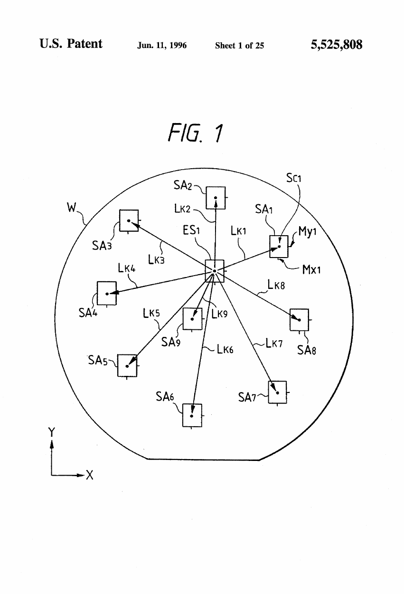
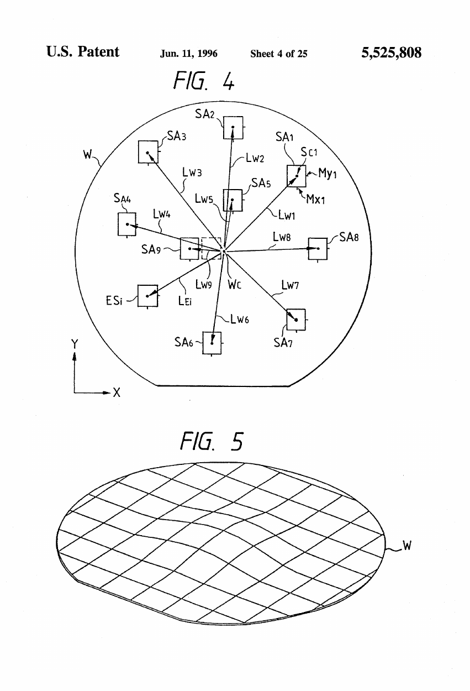
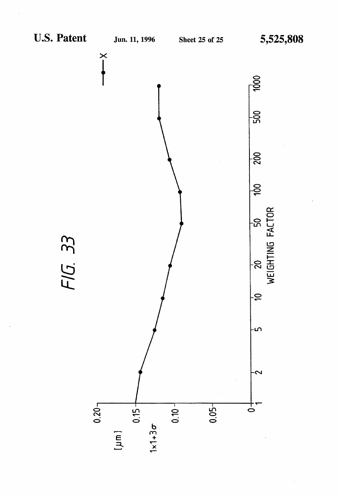

# US5525808 번역, 가중된 여러 좌표 위치를 쓰는 통계 계산으로 정렬하는 방법과 장치

- 원제: Alignment method and alignment apparatus with a statistic calculation using a plurality of weighted coordinate positions
- 원문: 같은 폴더의 `US5525808.pdf` (Google Patents 공보 PDF, 72쪽, 도면 25장)
- 번역 범위: 전문(초록, 발명의 상세한 설명 전체, 도면 설명, 청구항 전체). 서지 표의 인용 문헌은 원문 그대로 둔다.
- 번역 바탕: 본문 글자는 Google Patents 페이지 텍스트를 썼고, 수식과 도면은 공보 PDF를 보고 확인했다. 공보 PDF의 `pdftotext -layout` 결과는 OCR이라 수식이 깨져 있어 대조용으로만 썼다.
- 수식 표기: 원문의 식 번호 (1), (2) ...를 그대로 둔다. 원문에서 그림으로만 들어간 식(Google Patents의 ##EQU##)은 공보 PDF 쪽 이미지를 보고 옮겼다. 읽기 어려웠던 곳은 그 자리에 적었다.

## 서지

| 항목 | 내용 |
|---|---|
| 특허 번호 | US 5,525,808 (A) |
| 등록일 | 1996-06-11 |
| 출원 번호, 출원일 | 08/360,028, 1994-12-20 |
| 발명자 | Nobuyuki Irie (Kawasaki), Eiji Takane (Tokyo), Shigeru Hirukawa (Kashiwa), Yoshichika Iwamoto (Kumagaya), Ryoichi Kaneko (Zushi), 모두 일본 |
| 출원인(양수인) | Nikon Corporation, Tokyo, Japan |
| 관련 출원 | Ser. No. 174,080 (1993-12-27, 포기)의 일부 계속 출원. 이것은 Ser. No. 134,870 (1993-10-12, 포기)의 일부 계속 출원이고, 이것은 다시 Ser. No. 5,146 (1993-01-15, 포기)의 계속 출원이다. |
| 인용 문헌(원문 그대로) | 4,902,900 2/1990 Kamiya et al. 250/548; 5,243,195 9/1993 Nishi 356/401 |
| 심사관 | Primary Examiner Edward P. Westin, Assistant Examiner Que T. Le |
| 대리인 | Shapiro and Shapiro |

## 초록

기판 위에 설계 정렬 좌표에 따라 규칙적으로 늘어선 여러 처리 영역 각각을, 기판의 이동 위치를 정하는 정지 좌표계 안의 정해진 기준 위치에 맞추는 방법을 개시한다.
여러 처리 영역 가운데 특정 처리 영역으로 미리 고른 적어도 세 개 처리 영역의, 정지 좌표계 위 좌표 위치를 잰다.
그런 다음 기판 위 처리 영역 하나하나에 대해, 관심 처리 영역과 적어도 세 개의 특정 처리 영역 사이 거리에 따라 그 특정 처리 영역들의 좌표 위치에 가중을 준다.
가중한 여러 좌표 위치로 통계 계산을 해서, 기판 위 여러 처리 영역의 정지 좌표계 위 좌표 위치를 정한다.

*공보 도면 1쪽(Sheet 1 of 25), FIG. 1. 제1 실시예의 정렬 방법을 설명하는 그림. 웨이퍼 W 위 샘플 쇼트 SA1~SA9와 관심 쇼트 ES1, 그리고 둘 사이 거리 LK1~LK9.*

---

## 발명의 상세한 설명

이 출원은 1993년 12월 27일 출원한 출원 Ser. No. 08/174,080(포기)의 일부 계속 출원이다. 이 출원은 1993년 10월 12일 출원한 Ser. No. 08/134,870(포기)의 일부 계속 출원이고, 그것은 1993년 1월 15일 출원한 Ser. No. 08/005,146(포기)의 계속 출원이다.

### 발명의 배경

#### 1. 발명의 분야

본 발명은 기판 위에 늘어선 여러 처리 영역(쇼트 영역, 칩 패턴) 각각을 정해진 기준 위치에 맞추는 방법과 장치에 관한 것이다.
특히 반도체 소자와 액정 표시 소자를 만드는 리소그래피 공정의 노광 장치에 알맞은 정렬 방법과 장치에 관한 것이다.

#### 2. 관련 배경 기술

스텝 앤 리피트 노광 장치, 스텝 앤 스캔 노광 장치, 웨이퍼 프로버, 레이저 수리 장치 같은 장비에서는, 기판 위에 늘어선 여러 칩 패턴 영역(쇼트 영역) 각각을 기판의 이동 위치를 정하는 정지 좌표계 위의 정해진 기준점(예: 각 장치의 처리점)에 매우 높은 정확도로 맞춰야 한다.
특히 노광 장치에서는 기판(반도체 웨이퍼, 유리판 등)을 마스크나 레티클(이하 레티클)에 만든 패턴의 노광 위치에 맞출 때, 높은 정렬 정확도를 안정되게 유지해야 한다. 그래야 제조 공정에서 칩 불량이 생겨 수율이 떨어지는 일을 막을 수 있다.

보통 리소그래피 공정에서는 웨이퍼 위에 10층 이상의 회로 패턴(레티클 패턴)을 겹쳐 노광한다.
이때 이웃한 두 층 사이의 정렬(겹침) 정확도가 낮으면 회로 특성이 나빠진다. 더 구체적으로는 칩이 요구 특성을 만족하지 못한다. 최악의 경우 칩이 불량품이 되어 수율이 떨어진다.
그래서 노광 공정에서는 웨이퍼 위 여러 쇼트 영역마다 정렬 마크를 두고, 겹쳐 노광할 레티클 패턴을 기준으로 마크 위치(좌표값)를 검출한다.
그 뒤 이 마크 위치 정보를 바탕으로 웨이퍼 위 쇼트 영역 하나를 레티클 패턴에 맞추는 웨이퍼 정렬을 한다.

웨이퍼 정렬은 크게 두 방식으로 나뉜다.
하나는 다이 바이 다이(D/D) 정렬 방식으로, 웨이퍼 위 쇼트 영역마다 정렬 마크를 검출해 정렬한다.
다른 하나는 글로벌 정렬 방식으로, 웨이퍼 위 몇 개 쇼트 영역의 정렬 마크를 검출해 쇼트 배열 규칙을 구하고, 그것으로 쇼트 영역들을 정렬한다.
현재 소자 생산 라인은 처리량을 고려해 주로 글로벌 정렬 방식을 쓴다.
특히 현재는, 예를 들어 미국 특허 4,780,617에 개시된 것처럼, 통계 기법으로 웨이퍼 위 쇼트 배열 규칙을 높은 정확도로 정하는 향상된 글로벌 정렬(EGA) 방식이 널리 쓰인다.

EGA 방식에서는 웨이퍼 한 장 위에서 특정 쇼트 영역으로 고른 몇 개 쇼트 영역(세 개 이상 필요, 보통 10~15개)의 좌표 위치만 잰다.
이 측정값에서 통계 계산 처리(최소제곱법)로 웨이퍼 위 모든 쇼트 영역의 좌표 위치(쇼트 배열)를 계산한 뒤, 계산한 쇼트 배열에 따라 웨이퍼 스테이지의 스테핑을 일률적으로 실행한다.
EGA 방식은 쇼트 측정 시간만 들고, 무작위 측정 오차에 대한 평균 효과를 기대할 수 있다.

EGA 방식에서 쓰는 통계 처리 방법을 간단히 설명한다.
웨이퍼 위 m개(m은 m≧3인 정수) 특정 쇼트 영역(샘플 쇼트)의 설계 정렬 좌표를 (Xn, Yn) (n=1, 2, ..., m)으로 나타내고, 설계 정렬 좌표로부터의 어긋남 (ΔXn, ΔYn)에 대해 다음 식의 선형 모델을 가정한다.

$$\begin{pmatrix}\Delta X_n\\ \Delta Y_n\end{pmatrix}=\begin{pmatrix}a & b\\ c & d\end{pmatrix}\begin{pmatrix}X_n\\ Y_n\end{pmatrix}+\begin{pmatrix}e\\ f\end{pmatrix}\qquad(1)$$

또 m개 샘플 쇼트의 실제 정렬 좌표(측정값)를 (Δxn, Δyn)으로 나타내면, 이 모델을 적용했을 때 잔차 제곱합 E는 다음과 같다.

$$E=\sum\{(\Delta x_n-\Delta X_n)^2+(\Delta y_n-\Delta Y_n)^2\}\qquad(2)$$

따라서 이 식을 최소로 하는 파라미터 a, b, c, d, e, f만 구하면 된다.
EGA 방식에서는 이렇게 구한 파라미터 a~f와 설계 정렬 좌표로 웨이퍼 위 모든 쇼트 영역의 정렬 좌표를 계산한다.

이처럼 EGA 방식은 웨이퍼 위 쇼트 배열 오차를 선형 오차로 처리한다. 달리 말하면 EGA 계산은 선형 근사다.
그래서 EGA 방식은 웨이퍼 위 국소 정렬 오차의 변화, 곧 비선형 요인에 대응하지 못한다.
이 문제를 풀려고, 예를 들어 미국 특허 4,833,621에 개시된 이른바 블록 EGA(B-EGA) 방식이 제안되었다.
이 방식은 웨이퍼 위 국소 부분 블록 안에 있는 적어도 세 개 쇼트 영역을 샘플 쇼트로 지정하고 그 좌표 위치를 잰다.
그리고 이 여러 좌표 위치로 EGA 계산(통계 계산)을 해서 그 블록 안 모든 쇼트 영역의 좌표 위치(쇼트 배열)를 계산한다.
B-EGA 방식의 특징은 EGA 계산에 쓰는 샘플 쇼트를 정렬할 쇼트 영역마다 바꾼다는 점이다.
예를 들어 정렬할 쇼트 영역에 가까운 순서로 세 개 이상 쇼트 영역을 샘플 쇼트로 지정하고, 그 측정값을 쓴다.
그래서 웨이퍼 위 국소 정렬 오차의 변화(비선형성)에 대응할 수 있다.

그러나 위 종래 기술에서는, 정렬할 쇼트 영역마다 EGA 계산에 쓸 샘플 쇼트를 고르는 처리를 컴퓨터로 하면 계산량이 막대하다.
또 블록 안 쇼트 영역마다 샘플 쇼트 선택을 최적화하기 어렵다.
그래서 B-EGA 방식은 국소 정렬 오차의 변화(비선형 변형)에 대응할 수는 있지만, 이 방식으로 얻는 정렬 정확도는 요구 정확도를 충분히 만족하지 못한다.
게다가 B-EGA 방식은 쇼트 영역마다 샘플 쇼트를 바꾸므로 웨이퍼당 샘플 쇼트 수가 크게 늘고, 웨이퍼당 처리 시간이 길어져 처리량이 떨어진다.

웨이퍼를 홀더(유지 부재)를 거쳐 웨이퍼 스테이지에 올릴 때, 열처리 등으로 웨이퍼가 크게 휘어 있으면 웨이퍼 가장자리는 홀더에 흡착되지만 가운데는 흡착되지 못하고 들뜬다.
그래서 이런 현상을 겪는 웨이퍼 위 쇼트 영역, 특히 웨이퍼 가운데 근처 쇼트 영역은, 전면이 홀더에 흡착된 웨이퍼의 해당 쇼트 영역에 비해 웨이퍼 중심에서 멀어지는 방향으로 겉보기상 옆으로 밀린다(변위한다).

위 현상으로 비선형 변형을 겪는 웨이퍼에 B-EGA 방식을 쓰면, 웨이퍼의 들뜬 부분을 정확히 알 경우 비선형 변형에 맞춰 정렬 정확도 저하를 어느 정도 막을 수 있다.
그러나 이때도 위와 같은 문제(계산량과 샘플 쇼트 수 증가 등)가 생기고, 실제로 웨이퍼의 들뜬(부푼) 부분을 특정하기 어렵다.
더 구체적으로, B-EGA 방식에서는 웨이퍼 위 여러 쇼트 영역을 최적으로 블록으로 묶을 수 없어서, B-EGA를 써도 원하는 정렬 정확도를 얻기 어렵다.

예를 들어 비선형 변형을 겪는 웨이퍼에 EGA의 선형 근사 대신 고차 함수를 쓰는 비선형 근사를 적용하면 정렬 정확도 저하를 막을 수 있다.
그러나 이때는 EGA 방식보다 샘플 쇼트 수를 크게 늘려야 하고, 마크 측정 시간이 길어져 처리량이 떨어진다.

투영 노광 장치는 위의 D/D 방식, EGA 방식, B-EGA 방식 외에도 여러 방식을 쓸 수 있다.
그러므로 앞으로는 여러 방식(이하 정렬 모드)을 각각의 특징(장점)을 고려해 골라 써야 한다.
그래서 실제 노광 전에 파일럿 웨이퍼에 여러 정렬 모드 각각으로 시험 인쇄(겹침 노광)를 하고, 시험 인쇄 결과(겹침 정확도)를 바탕으로 최적 정렬 모드를 고른다(정한다).
그러나 이 방법은 파일럿 웨이퍼가 필요하고, 시험 인쇄와 겹침 정확도 측정에 시간이 많이 들어 장치 처리량이 낮아진다.

또 투영 노광 장치에서는 정렬 센서로 웨이퍼 위 마크를 검출하고, 검출 신호에 정해진 처리 조건으로 파형 처리를 해서 마크 위치를 정한다.
이때 웨이퍼 재질, 포토레지스트나 하지층의 종류, 정렬 마크의 형성 조건(예: 모양과 요철 정도) 등에 따라 공정 웨이퍼마다 신호 처리 조건을 최적화하지 않으면 원하는 겹침(정렬) 정확도를 얻을 수 없다.
종래에는 작업자가 경험을 바탕으로 시행착오를 거쳐 웨이퍼마다 신호 처리 조건을 정했다.
그래서 최적화에 시간이 많이 들고 작업자 부담이 컸다.

특히 EGA 방식에서는 샘플 쇼트 배치(개수와 위치)를 최적화하지 않으면 원하는 겹침 정확도를 얻을 수 없다.
이 문제를 풀려고 파일럿 웨이퍼에 EGA 방식으로 여러 샘플 쇼트 배치로 시험 인쇄(겹침 노광)를 하고, 시험 결과로 최적 샘플 쇼트 배치를 구할 수도 있다.
그러나 이 방법은 파일럿 웨이퍼가 많이 필요하고, 최적화에 시간이 많이 든다.

또 웨이퍼 표면 거칠기 등 때문에 정렬 센서의 측정 정확도가 나쁘다고 하자.
이때는 위 방식으로 샘플 쇼트 배치를 최적화한 뒤 EGA 방식으로 겹침 노광을 해도 원하는 겹침 정확도를 얻을 수 없다.
곧 신뢰도가 낮은 좌표 위치(측정값)로 정한 샘플 쇼트 배치는 웨이퍼(쇼트 배열)에 대해 늘 최적은 아니며, 겉보기로만 최적화된 샘플 쇼트 배치로는 원하는 겹침 정확도를 얻을 수 없다.

웨이퍼에 대해 측정 반복성이 낮은 정렬 센서로 원하는 겹침 정확도를 얻으려면 EGA 방식의 평균 효과를 높여야 한다. 곧 보통 운용보다 샘플 쇼트 수를 늘려 평균 효과를 최적화해야 한다.
그러나 위 최적화 방법은 정렬 센서의 측정 반복성과 상관없이, 원하는 겹침 정확도를 만족하는 샘플 쇼트 배치를 고를 뿐이다.
그래서 경우에 따라서는 측정 반복성이 나쁜 정렬 센서를 쓰는데도 적은 샘플 쇼트 수로 배치가 최적화되어 버린다.
이것은 샘플 쇼트 배치의 겉보기 최적화에 해당한다.
곧 종래 방법으로는 정렬 센서의 측정 반복성까지 고려해 샘플 쇼트 배치를 최적화할 수 없다.
그래서 웨이퍼에 따라 정렬 센서의 측정 반복성이 나빠지면, 그에 따른 겹침 정확도 저하를 막을 수 없다.

같은 로트의 웨이퍼들은 표면 상태가 거의 같다고 보지만, 다른 로트의 웨이퍼를 쓰면 정렬 센서의 측정 반복성이 바뀔 수 있다.
그래서 샘플 쇼트 배치나 위 신호 처리 조건을 최적화하려면 로트마다 시험 인쇄를 해야 하고, 작업 시간과 부담이 크게 늘어난다.
게다가 공정 웨이퍼를 쓰지 않고는 정렬 센서의 측정 반복성을 고려한 최적화를 할 수 없다.
그래서 측정 전용 공정 웨이퍼가 필요하고, 수율과 처리량이 크게 떨어진다.

### 발명의 요약

본 발명의 첫째 목적은, 국소 정렬 오차(비선형 변형)를 겪는 웨이퍼에도 적은 수의 샘플 쇼트만 필요하고, 계산량을 억제하면서 웨이퍼 위 쇼트 영역을 높은 정확도로 빠르게 정렬할 수 있는 정렬 방법을 제공하는 것이다.

본 발명의 둘째 목적은, 처리량을 떨어뜨리지 않고 웨이퍼의 특성에 따라 여러 정렬 모드를 정확하게 골라 쓰며, 웨이퍼 위 모든 쇼트 영역을 높은 정확도로 빠르게 정렬할 수 있는 정렬 방법과 장치를 제공하는 것이다.

본 발명의 셋째 목적은, 기판의 종류나 정렬 센서의 측정 반복성까지 고려해 정렬 모드의 여러 처리 조건을 최적화하고, 기판 위 모든 쇼트 영역을 높은 정확도로 빠르게 정렬할 수 있는 정렬 방법과 장치를 제공하는 것이다.

첫째 목적을 이루는 본 발명의 제1 정렬 방법에서는, 웨이퍼 위 여러 쇼트 영역 가운데 특정 쇼트 영역(샘플 쇼트)으로 미리 고른 적어도 세 개 쇼트 영역의 정지 좌표계 위 좌표 위치를 잰다.
그리고 웨이퍼 위 쇼트 영역마다, 관심 쇼트 영역(중심점)과 세 샘플 쇼트 각각 사이 거리에 따라 세 특정 쇼트 영역의 정지 좌표계 위 좌표 위치 각각에 가중을 준다.
가중한 여러 좌표 위치로 통계 계산(최소제곱법, 평균 처리 등)을 해서, 웨이퍼 위 여러 쇼트 영역의 정지 좌표계 위 좌표 위치를 정한다.

특히 제1 정렬 방법에서는 웨이퍼 위 어떤 쇼트 영역의 정지 좌표계 위 좌표 위치를 정할 때, 샘플 쇼트와 그 쇼트 영역 사이 거리가 짧을수록 그 샘플 쇼트의 정렬 데이터(좌표 위치)에 더 큰 계수로 가중한다.
각 샘플 쇼트의 정렬 데이터에 곱하는 가중 계수는 웨이퍼의 변형 상태, 곧 비선형 변형량에 따라 바꾼다.

제2 정렬 방법에서는, 웨이퍼 위 여러 쇼트 영역 가운데 샘플 쇼트로 미리 고른 적어도 세 개 쇼트 영역의 정지 좌표계 위 좌표 위치를 잰다.
그리고 웨이퍼 위 쇼트 영역마다, 관심 쇼트 영역과 웨이퍼 위에 미리 정한 관심점 사이 거리(첫째 정보), 그리고 관심점과 세 샘플 쇼트 각각 사이 거리(둘째 정보)에 따른 가중 계수를 세 샘플 쇼트의 좌표 위치 각각에 곱한다.
가중한 여러 좌표 위치로 통계 계산을 해서 웨이퍼 위 여러 쇼트 영역의 정지 좌표계 위 좌표 위치를 정한다.

특히 제2 정렬 방법에서는 웨이퍼 위 관심 쇼트 영역의 정지 좌표계 위 좌표 위치를 정할 때, 샘플 쇼트와 관심점 사이 거리가 관심점과 관심 쇼트 영역 사이 거리에 가까울수록 그 샘플 쇼트의 정렬 데이터(좌표 위치)에 더 큰 계수로 가중한다.
관심점은 웨이퍼의 변형 중심점(대칭 중심점)에 둔다.
예를 들어 웨이퍼가 웨이퍼 중심을 기준으로 열변형하거나, 가운데가 홀더에서 들뜬(부푼) 채로 홀더에 흡착된 경우에는 웨이퍼 중심점을 관심점으로 정한다.
각 샘플 쇼트의 정렬 데이터에 곱하는 가중 계수는 웨이퍼의 변형 상태, 곧 비선형 변형량에 따라 바꾼다.

제2 방법에서는 샘플 쇼트 정렬 데이터에 대한 가중과 통계 계산을 쇼트 영역마다 한다.
이때 관심점에서 같은 거리에 있는 여러 쇼트 영역, 곧 관심점을 중심으로 한 같은 원 위에 있는 여러 쇼트 영역은 각 샘플 쇼트의 좌표 위치에 곱하는 가중 계수가 같다.
그래서 관심점을 중심으로 한 같은 원 위에 여러 쇼트 영역이 있으면, 그 가운데 한 영역에 대해서만 위 가중과 통계 계산을 해서 파라미터(a~f)를 구하면 된다.
그런 다음 구한 파라미터(a~f)로 나머지 쇼트 영역의 좌표 위치를 정할 수 있다.
따라서 같은 원 위에 여러 쇼트 영역이 있으면, 모든 쇼트 영역의 좌표 위치를 같은 파라미터(a~f)로 계산해도 된다.
이 경우 좌표 위치를 정하는 계산량을 줄일 수 있어 유리하다.

제3 정렬 방법은, 예를 들어 웨이퍼가 홀더에 붙잡혀 있으면서 국소적으로 홀더에서 들뜬(부푼) 경우에 효과가 있다.
제3 정렬 방법에서는 웨이퍼 위 여러 쇼트 영역 가운데 샘플 쇼트로 미리 고른 적어도 세 개 쇼트 영역의 정지 좌표계 위 좌표 위치를 잰다.
그리고 세 샘플 쇼트의 정지 좌표계 위 좌표 위치 각각을 웨이퍼 평탄도를 바탕으로 보정하고, 보정한 여러 좌표 위치로 통계 계산을 해서 웨이퍼 위 여러 쇼트 영역의 정지 좌표계 위 좌표 위치를 정한다.
계산한 좌표 위치와 웨이퍼 평탄도에 따라 웨이퍼의 이동 위치를 제어해서, 여러 처리 영역 각각을 기준 위치에 차례로 맞춘다.

또 제4 정렬 방법도, 예를 들어 웨이퍼가 홀더에 붙잡혀 있으면서 국소적으로 홀더에서 들뜬(부푼) 경우에 효과가 있다.
제4 정렬 방법에서는 웨이퍼 위 여러 쇼트 영역 가운데 적어도 세 개를 샘플 쇼트로 고른다.
그리고 고른 샘플 쇼트의 표면이 이동 평면(정지 좌표계, 곧 두 간섭계가 정하는 직교 좌표계를 포함하는 평면)에 거의 평행할 때, 세 샘플 쇼트 각각의 정지 좌표계 위 좌표 위치를 구한다.
이때 관심 샘플 쇼트의 좌표 위치를 잴 때 웨이퍼 이동 평면에 대한 그 샘플 쇼트 표면의 기울기를, 예를 들어 면 위치 검출계로 검출하고, 그 검출값으로 관심 샘플 쇼트의 좌표 위치를 보정할 수 있다.
또는 면 위치 검출계로 관심 샘플 쇼트 표면을 웨이퍼 이동 평면에 거의 평행하게 맞춘 뒤 그 영역의 좌표 위치를 잴 수도 있고, 표면이 웨이퍼 이동 평면에 거의 평행한 쇼트 영역을 샘플 쇼트로 골라 그 좌표 위치를 잴 수도 있다.
그리고 검출한 여러 좌표 위치로 통계 계산을 해서 웨이퍼 위 여러 쇼트 영역의 정지 좌표계 위 좌표 위치를 계산한다.
그런 다음 계산한 좌표 위치와 웨이퍼 이동 평면에 대한 각 쇼트 영역의 기울기에 따라 웨이퍼 이동 위치를 제어해서, 여러 처리 영역 각각을 기준 위치에 차례로 맞춘다.

위에서 말했듯이 본 발명의 첫째 목적은 "비선형 변형"을 겪는 웨이퍼라도 모든 쇼트 영역을 정해진 기준 위치에 높은 정확도로 맞출 수 있는 정렬 방법을 제공하는 것이다.
그래서 첫째 목적을 이루는 정렬 방법이 정확도를 높이려는 대상인 "비선형 변형"을 FIG. 10A~10C로 설명한다.
FIG. 10A~10C는 웨이퍼 위 여러(여기서는 네 개) 특정 쇼트 영역(샘플 쇼트)의 위치 측정 결과(그림의 ◯)를 보여 주는 그래프다.
세로축은 변위량, 가로축은 웨이퍼 중심에서의 위치다.
간단히 하려고 웨이퍼에 배율(신축)만 있다고 가정한다.

FIG. 10A에서 샘플 쇼트의 정렬 데이터(좌표 위치)로 최소제곱법 선형 근사식을 만들면, 그 식은 그림의 실선이 된다.
FIG. 10A에서는 정렬 데이터가 1차 함수(직선)로 충분히 근사되므로, 웨이퍼에 선형 배율 오차(변형)가 있다고 본다. 종래 EGA 방식은 이런 근사법을 쓴다.
반면 FIG. 10B에서는 정렬 데이터(◯)가 완만한 점선 곡선 위에 놓이므로, 웨이퍼에 "규칙적 비선형 변형"이 있다고 본다.
FIG. 10C에서는 정렬 데이터(◯)에 규칙이 없으므로, 웨이퍼에 "불규칙 비선형 변형"이 있다고 본다.

종래 EGA 방식을 FIG. 10B와 10C에 그대로 적용해 FIG. 10A처럼 선형 근사식을 구하면, 그 식은 FIG. 10B와 10C의 실선이 된다.
FIG. 10B와 10C에서 보듯이 어느 경우든 정렬 정확도가 나쁜 쇼트 영역이 생긴다. 곧 1차 함수로 근사할 수 없는 쇼트 영역이 있다.
더 구체적으로, 종래 EGA 방식으로 비선형 변형을 보정하는 것은 이론상 불가능하다.
그래서 본 발명의 첫째 목적을 이루는 정렬 방법은 비선형 변형 가운데 특히 "규칙적 비선형 변형"(FIG. 10B)의 보정을 노리며, 웨이퍼에 "규칙적 비선형 변형"이 있어도 웨이퍼 위 모든 쇼트 영역을 기준 위치에 정확히 맞출 수 있다.

제1 정렬 방법은 "규칙적 비선형 변형"에 효과가 있다. 이 방법은 "웨이퍼에 규칙적 비선형 변형이 있어도 웨이퍼 위 국소 영역 안의 정렬 오차는 서로 거의 같다"는 사실에 주목한다.
그래서 제1 정렬 방법에서는 웨이퍼 위 관심 처리 영역(쇼트 영역) 하나의 정지 좌표계 위 좌표 위치를 정할 때, 적어도 세 개 특정 쇼트 영역(샘플 쇼트) 각각의 정렬 데이터(좌표 위치)에 관심 쇼트 영역과 각 샘플 쇼트 사이 거리에 따라 가중을 준다.
더 구체적으로, 샘플 쇼트와 관심 쇼트 영역 사이 거리가 짧을수록 그 샘플 쇼트의 정렬 데이터(좌표 위치)에 더 큰 계수로 가중한다.

그래서 웨이퍼에 국소 정렬 오차(규칙적 비선형 변형)가 있어도 웨이퍼 위 모든 쇼트 영역의 좌표 위치(쇼트 배열)를 정확히 정할 수 있다.
또 쇼트 영역마다 쓰는 정렬 데이터(적어도 세 개 샘플 쇼트의 좌표 위치)가 모든 쇼트 영역에 공통이므로, 쓸 정렬 데이터를 쇼트 영역마다 고를 필요가 없고 계산량을 줄일 수 있다.
게다가 가중 함수를 임의로 고르면(또는 웨이퍼에 맞춰 최적화하면) 정렬 데이터 가중 정도를 쉽게 바꿀(최적화할) 수 있다.
더 구체적으로, 웨이퍼마다 최적 처리 조건(계산 파라미터)으로 모든 쇼트 영역의 좌표 위치를 정할 수 있다.

제2 정렬 방법은 "규칙적이면서 특히 점대칭인 비선형 변형"에 효과가 있다. 이 방법은 "웨이퍼에 규칙적, 곧 점대칭인 비선형 변형이 있어도, 웨이퍼 위 대칭 중심점에서 같은 거리에 있는 위치들의 정렬 오차 크기는 서로 거의 같다"는 사실에 주목한다.
그래서 제2 정렬 방법에서는 웨이퍼 위 관심 처리 영역(쇼트 영역) 하나의 정지 좌표계 위 좌표 위치를 정할 때, 적어도 세 개 특정 쇼트 영역(샘플 쇼트) 각각의 정렬 데이터(좌표 위치)에, 관심 쇼트 영역과 웨이퍼 위에 미리 정한 관심점(대칭 중심점) 사이 거리, 그리고 관심점과 각 샘플 쇼트 사이 거리에 따라 가중을 준다.
더 구체적으로, 샘플 쇼트와 관심점 사이 거리가 관심점과 관심 쇼트 영역 사이 거리에 가까울수록 그 샘플 쇼트의 정렬 데이터에 더 큰 계수로 가중한다.
특히 웨이퍼가 웨이퍼 중심을 기준으로 열변형하거나, 가운데가 홀더에서 들뜬(부푼) 채로 홀더에 흡착된 경우에는, 대칭 중심점인 웨이퍼 중심점을 관심점으로 정한다.

그래서 제2 정렬 방법을 점대칭 국소 정렬 오차(규칙적 비선형 변형)가 있는 웨이퍼, 예를 들어 가운데가 홀더에서 들뜬 채 홀더에 붙잡힌 웨이퍼에 적용하면, 샘플 쇼트 수를 늘리지 않고도 웨이퍼 위 모든 쇼트 영역의 좌표 위치를 정확히 정할 수 있고, 제1 정렬 방법과 같은 효과를 얻는다.
가중 함수를 임의로 골라 정렬 데이터 가중 정도를 알맞게 바꾸면, 웨이퍼마다 최적 처리 조건(계산 파라미터)으로 모든 쇼트 영역의 좌표 위치를 정할 수 있다.

또 제3 정렬 방법은, 예를 들어 웨이퍼가 홀더에 붙잡혀 있으면서 국소적으로 홀더에서 들뜬(부푼) 경우에 효과가 있다.
제3 정렬 방법에서는, 웨이퍼의 임의 부분이 홀더에서 들뜬 채 웨이퍼가 홀더에 흡착되었을 때, 적어도 세 개 샘플 쇼트의 정지 좌표계 위 좌표 위치를 웨이퍼 평탄도를 바탕으로 보정(좌표 변환)하고, 보정한 여러 좌표 위치로 통계 계산을 해서 웨이퍼 위 여러 쇼트 영역의 정지 좌표계 위 좌표 위치를 계산한다.
여러 쇼트 영역 각각을 기준 위치에 맞출 때는 앞서 계산한 좌표 위치와 웨이퍼 평탄도를 쓴다.
곧 계산한 좌표 위치를 웨이퍼 평탄도를 바탕으로 다시 보정(좌표 변환)하고, 보정한 좌표 위치에 따라 웨이퍼 이동 위치를 제어한다.
그래서 웨이퍼에 임의의 부푼 부분이 있어도 웨이퍼 위 모든 쇼트 영역의 좌표 위치를 정확히 정할 수 있고, 샘플 쇼트 수를 늘리지 않고 정렬 정확도를 높일 수 있다.

또 제4 정렬 방법은 제3 정렬 방법처럼 웨이퍼가 홀더에 붙잡혀 있으면서 국소적으로 홀더에서 들뜬(부푼) 경우에 효과가 있다.
제4 정렬 방법에서는 적어도 세 개 샘플 쇼트 각각의 표면이 웨이퍼 이동 평면에 거의 평행할 때 각 샘플 쇼트의 좌표 위치를 검출한다.
예를 들어 면 위치 검출계로 관심 샘플 쇼트 표면을 웨이퍼 이동 평면에 거의 평행하게 맞춘 뒤 그 영역의 좌표 위치를 잴 수 있다.
그리고 검출한 여러 좌표 위치로 통계 계산을 해서 웨이퍼 위 여러 쇼트 영역의 정지 좌표계 위 좌표 위치를 계산한다.
여러 쇼트 영역 각각을 기준 위치에 맞출 때는 앞서 계산한 좌표 위치와, 웨이퍼 이동 평면에 대한 각 쇼트 영역의 기울기를 쓴다.
곧 각 쇼트 영역의 좌표 위치를 그 영역의 기울기로 보정하고, 보정한 좌표 위치에 따라 웨이퍼 이동 위치를 제어한다.
그래서 웨이퍼에 임의의 부푼 부분이 있어도 웨이퍼 위 모든 쇼트 영역의 좌표 위치를 정확히 정할 수 있고, 샘플 쇼트 수를 늘리지 않고 정렬 정확도를 높일 수 있다.

위에서 말했듯이 본 발명의 둘째 목적은, 웨이퍼 특성에 따라 여러 정렬 방법(정렬 모드)을 정확히 골라 쓰고, 웨이퍼 위 모든 쇼트 영역을 높은 정확도로 빠르게 정렬할 수 있는 정렬 방법과 장치를 제공하는 것이다.
골라 쓰는 정렬 모드에는 D/D 모드, EGA 모드, 위 제1, 제2 정렬 방법(이하 W-EGA 모드) 등이 있다.
둘째 목적을 이루는 정렬 방법과 장치는, N장(N은 N≧2인 정수) 웨이퍼 단위로, 웨이퍼 위에 늘어선 여러 쇼트 영역 각각을 웨이퍼 이동 위치를 정하는 정지 좌표계 위의 정해진 기준 위치에 맞출 때 효과가 있다.

그래서 둘째 목적을 이루는 정렬 방법에서는, k번째(k는 2≦k≦N인 정수) 웨이퍼 위 여러 쇼트 영역 각각을 정렬하기 전에, 1번째부터 (k-1)번째 웨이퍼 가운데 적어도 한 장에서 미리 고른 쇼트 영역 각각의 정지 좌표계 위 좌표 위치를 재고, 이 여러 좌표 위치를 바탕으로 웨이퍼 위 여러 쇼트 영역의 정렬 오차 특성(예: 비선형 변형의 유무나 정도)을 계산한다.
그리고 웨이퍼 위 여러 쇼트 영역의 정렬 오차에 대응하는 여러 정렬 모드(D/D, EGA, W-EGA) 가운데 계산한 정렬 오차 특성에 맞는 정렬 모드를 고르고, 고른 정렬 모드로 k번째 웨이퍼 위 여러 쇼트 영역 각각을 기준 위치에 맞춘다.

특히 1번째부터 (k-1)번째 웨이퍼 가운데 첫 웨이퍼에서는 웨이퍼 위 거의 모든 쇼트 영역의 정지 좌표계 위 좌표 위치를 재고, 첫 웨이퍼 위 여러 쇼트 영역 각각을 기준 위치에 맞출 때는 미리 골라 둔 정렬 모드를 쓴다.

EGA나 W-EGA 모드를 골라 쓸 때는 웨이퍼 위 여러 쇼트 영역 가운데 특정 쇼트 영역(샘플 쇼트)을 미리 고른다. 곧 샘플 쇼트 배치(개수와 위치)를 미리 최적화한다.
이때 웨이퍼 위 여러 쇼트 영역을 각각 적어도 세 개 쇼트 영역을 포함하는 여러 그룹으로 나누고, 적어도 세 개 샘플 쇼트를 고를 때 여러 그룹(샘플 쇼트 그룹) 가운데 적어도 하나를 고른다.

둘째 목적을 이루는 정렬 장치는 다음을 갖춘다.
웨이퍼 스테이지 이동 위치를 정하는 정지 좌표계 위에서 쇼트 영역의 좌표 위치를 재는 위치 측정 수단,
위치 측정 수단으로 잰, 1번째부터 (k-1)번째(2≦k≦N) 웨이퍼 가운데 적어도 한 장 위 미리 고른 여러 쇼트 영역의 정지 좌표계 위 좌표 위치를 바탕으로 여러 쇼트 영역의 정렬 오차 특성을 계산하는 계산 수단,
웨이퍼 위 여러 쇼트 영역의 정렬 오차에 대응하는 여러 정렬 모드 가운데 계산한 정렬 오차 특성에 맞는 정렬 모드를 고르는 선택 수단,
고른 정렬 모드에 따라 웨이퍼 스테이지 이동 위치를 제어해 웨이퍼 위 여러 쇼트 영역 각각을 기준 위치에 맞추는 제어 수단.

위에서 말했듯이 둘째 목적을 이루는 정렬 방법과 장치에서는 웨이퍼의 특성, 예를 들어 비선형 변형의 유무나 정도를 계산하므로, k번째 웨이퍼의 정렬 모드를 정확하고 빠르게 고를 수 있다.
그래서 웨이퍼 특성과 상관없이 늘 높은 정렬 정확도를 얻고, 처리량 저하를 최소로 줄일 수 있다.
정렬 모드를 고를 때 파일럿 웨이퍼 시험 인쇄가 필요 없어서, 처리량 향상과 작업자 부담 감소를 함께 이룬다.
특히 EGA와 W-EGA 모드에서는 샘플 쇼트 배치 같은 계산 조건도 최적화할 수 있다.

또 둘째 목적을 이루는 다른 정렬 방법에서는, 기판 위 거의 모든 처리 영역 각각의 정지 좌표계 위 좌표 위치를 재고, 웨이퍼 위 여러 쇼트 영역의 정렬 오차 특성(예: 비선형 변형의 유무나 정도)을 계산한다.
그런 다음 계산한 정렬 오차 특성을 바탕으로 여러 처리 영역을 여러 블록으로 묶는다.
그리고 모든 블록 가운데 관심 블록 하나의 정렬 오차 특성에 맞는 정렬 모드를, 기판 위 여러 처리 영역의 정렬 오차에 대응하는 여러 정렬 모드 가운데에서 고른다.
이렇게 여러 블록 각각에 대해 고른 정렬 모드로 기판 위 처리 영역 각각을 기준 위치에 맞춘다.

위에서 말했듯이 이 방법에 따르면 기판 위에 늘어선 여러 처리 영역을 그 정렬 오차 특성에 따라 여러 블록으로 묶는다.
또 각 블록의 정렬 오차 특성에 맞는 정렬 모드를 여러 정렬 모드 가운데 고른다.
곧 기판 위 블록마다 정렬 오차(국소 기판 변형)에 가장 알맞은 정렬 모드를 골라 쓸 수 있다.
그래서 국소적으로 비선형 변형이 있는 기판을 써도, 처리량 저하를 최소로 줄이면서 기판 위 모든 처리 영역을 기준 위치에 높은 정확도로 맞출 수 있다.

본 발명의 셋째 목적은 기판 종류나 정렬 센서의 측정 반복성까지 고려해, 정렬 모드의 여러 처리 조건(예: 정렬 센서의 신호 처리 조건, 샘플 쇼트 배치)을 최적화하고, 기판 위 모든 쇼트 영역을 높은 정확도로 빠르게 정렬하는 것이다.
그래서 셋째 목적을 이루는 정렬 방법은, 예를 들어 통계 기법을 쓰는 계산 처리로 기판 위 각 처리 영역의 정지 좌표계 위 좌표 위치를 구하고, 구한 좌표 위치로 각 처리 영역을 정지 좌표계 안 정해진 기준 위치에 맞출 때 효과가 있다.

그래서 셋째 목적을 이루는 정렬 방법에서는, 기판 위 적어도 세 개 특정 처리 영역(샘플 쇼트)의 정지 좌표계 위 좌표 위치를 잴 때, 특정 처리 영역에 붙은 정렬 마크에서 얻는 측정 신호(곧 정렬 센서가 내는 광전 신호)의 신호 처리 조건을 차례로 바꾸어 좌표 위치를 구한다.
또 구한 여러 좌표 위치를 통계 계산 처리해서 신호 처리 조건마다 변환 파라미터(a~f)를 구하고, 이 변환 파라미터로 계산한 처리 영역의 좌표 위치와 미리 잰 좌표 위치 사이 편차(잔차)를 구한다.
여러 세트의 변환 파라미터 가운데 이 잔차를 가장 작게 하는 세트로 기판 위 모든 처리 영역 각각의 정지 좌표계 위 좌표 위치를 계산한다.

위에서 말했듯이 이 방법에 따르면 잔차를 최소로 하도록 신호 처리 조건을 최적화하므로, 겹침 오차를 최소로 하면서 신호 조건 각각을 최적화할 수 있다.
또 시험 인쇄가 필요 없으므로 처리량 저하를 최소로 줄일 수 있다.

셋째 목적을 이루는 또 다른 정렬 방법은 다음 단계를 포함한다.
첫째 단계, 기판 위 각 처리 영역의 좌표 위치를 여러 번 재고, 잰 여러 좌표 위치에 통계 계산 처리(예: 평균 처리)를 해서 제1 좌표 위치를 정한다.
둘째 단계, 각 좌표 위치의 측정 신뢰도에 따라 특정 처리 영역(샘플 쇼트)마다 제1 좌표 위치를 보정하고, 보정한 여러 제1 좌표 위치에 통계 계산 처리(예: 최소제곱법)를 해서 여러 처리 영역 각각의 제2 좌표 위치를 계산한다.
셋째 단계, 각 처리 영역의 제1 좌표 위치가 해당 제2 좌표 위치에서 벗어난 양이 정해진 허용값 이하가 되도록 통계 계산 처리의 처리 조건을 정한다.
그리고 정한 처리 조건으로 통계 계산 처리를 해서 여러 처리 영역 각각의 좌표 위치를 계산한다.

위에서 말했듯이 이 방법에서는 기판 위 여러 처리 영역 각각의 좌표 위치를 여러 번 재서 처리 영역마다 제1 좌표 위치(참 좌표 위치)를 정하고, 각 특정 처리 영역(샘플 쇼트)의 제1 좌표 위치를 각 좌표 위치의 신뢰도에 따라 보정한 뒤 통계 계산 처리를 해서 제2 좌표 위치를 계산한다.
또 모든 처리 영역에서 제2 좌표 위치에 대한 제1 좌표 위치의 위치 어긋남이 모두 정해진 허용값 이하가 되도록 통계 계산 처리(EGA 또는 W-EGA 계산 처리)의 처리 조건(샘플 쇼트 배치, 파라미터 S 값 등)을 정한다.
이렇게 하면 각 좌표 위치의 신뢰도(정렬 센서의 측정 반복성)까지 고려해 처리 조건을 최적화할 수 있다.
그래서 늘 높은 정렬 정확도를 얻고 처리량 저하를 최소로 줄일 수 있다.

### 도면의 간단한 설명

FIG. 1은 본 발명의 제1 실시예에 따른 정렬 방법을 설명하는 그림이다.

FIG. 2는 본 발명의 실시예에 따른 정렬 장치를 갖춘 투영 노광 장치의 배치를 보여 주는 개략도다.

FIG. 3은 FIG. 2의 투영 노광 장치 제어계를 보여 주는 블록도다.

FIG. 4는 본 발명의 제2 실시예에 따른 정렬 방법을 설명하는 그림이다.

FIG. 5는 웨이퍼의 변형 상태를 보여 주는 그림이다.

FIG. 6은 FIG. 5 웨이퍼 위 쇼트 영역이 해당 이상 격자에서 벗어난 양을 보여 주는 벡터 지도다.

FIG. 7은 제1, 제2 실시예에서 파라미터 S를 정하는 방법을 설명하는 그림이다.

FIG. 8은 파라미터 S를 정하는 다른 방법을 설명하는 그림이다.

FIG. 9A와 9B는 제1 실시예 정렬 방법에 알맞은 샘플 쇼트 배치를 보여 주는 그림이다.

FIG. 10A~10C는 제1, 제2 실시예 정렬 방법을 적용할 비선형 변형을 설명하는 그림이다.

FIG. 11A~11E는 LSA 계의 마크 위치 측정 상태를 설명하는 그림이다.

FIG. 12A와 12B는 FIA 계의 마크 위치 측정 상태를 설명하는 그림이다.

FIG. 13은 LIA 계의 마크 위치 측정 상태를 설명하는 그림이다.

FIG. 14는 본 발명의 제3 실시예에 따른 정렬 방법의 원리를 설명하는 그림이다.

FIG. 15A와 15B로 이루어진 FIG. 15, 그리고 FIG. 16A와 16B로 이루어진 FIG. 16은 본 발명의 제5 실시예에 따른 노광 순서를 보여 주는 흐름도다.

FIG. 17은 EGA 모드에 알맞은 샘플 쇼트 그룹을 보여 주는 그림이다.

FIG. 18은 W-EGA 모드에 알맞은 샘플 쇼트 그룹을 보여 주는 그림이다.

FIG. 19는 EGA 모드에서 W-EGA 모드로 바꿀 때 알맞게 쓰는 샘플 쇼트 그룹을 보여 주는 그림이다.

FIG. 20A~20C는 정렬 모드를 고를 때 쓰는 정렬 오차 특성을 설명하는 그림이다.

FIG. 21은 k번째 이후 웨이퍼의 노광 순서 변형 예를 보여 주는 흐름도다.

FIG. 22는 첫 웨이퍼 위 쇼트 영역의 정렬 오차를 보여 주는 벡터 지도다.

FIG. 23은 k번째 웨이퍼 위 샘플 쇼트의 정렬 오차를 보여 주는 벡터 지도다.

FIG. 24는 첫 웨이퍼 위 쇼트 영역의 정렬 오차(FIG. 22)를 기준으로 한, k번째 웨이퍼 위 샘플 쇼트 정렬 오차(FIG. 23)의 변화량을 보여 주는 벡터 지도다.

FIG. 25는 본 발명의 제6 실시예의 노광 순서를 보여 주는 흐름도다.

FIG. 26은 제6 실시예의 정렬 동작을 설명하는 그림이다.

FIG. 27은 제6 실시예에서 쓰는 샘플 쇼트 배치를 보여 주는 그림이다.

FIG. 28은 본 발명의 제7 실시예의 동작을 설명하는 그림이다.

FIG. 29는 본 발명의 제8 실시예의 노광 순서를 보여 주는 흐름도다.

FIG. 30은 FIG. 30A와 30B로 이루어지며, 본 발명의 제9 실시예의 노광 순서 흐름도다.

FIG. 31은 정렬 센서의 측정 반복성(측정 오차 분포)에 해당하는 정규 분포를 보여 주는 그래프다.

FIG. 32는 웨이퍼 위 각 쇼트 영역의 잔차를 보여 주는 벡터 지도다.

FIG. 33은 샘플 쇼트 배치는 그대로 두고 가중 인자만 바꿨을 때 겹침 정확도와 가중 인자의 관계를 보여 주는 그래프다.

### 바람직한 실시예의 설명

FIG. 1을 참조해 본 발명의 제1 실시예에 따른 정렬 방법을 설명한다.
이 실시예의 정렬 방법(W1-EGA 방법)은 종래 EGA 방법을 바탕으로 한다.
특징은 웨이퍼 W 위 i번째 쇼트 영역 ESi의 좌표 위치를 정할 때, m개(FIG. 1에서는 m=9) 샘플 쇼트 SA1~SA9의 정렬 데이터(좌표 위치)에, 영역 ESi와 아홉 샘플 쇼트 SA1~SA9 사이 거리 Lk1~Lk9에 따른 가중 계수 Win을 곱한다는 점이다.
이 실시예에서는 정렬 센서로 각 샘플 쇼트의 정렬 마크 한 쌍(Mx1, My1)을 검출한 뒤, 위 식 (2)처럼 다음 식 (3)으로 잔차 제곱합 Ei를 평가하고, 식 (3)을 최소로 하도록 계산 파라미터 a~f를 정할 수 있다.

이 실시예에서는 쇼트 영역마다 같은 샘플 쇼트(정렬 데이터)를 쓰지만, 각 샘플 쇼트까지 거리는 쇼트 영역에 따라 당연히 달라지므로, 정렬 데이터(샘플 쇼트 좌표 위치)에 곱하는 가중 계수 Win은 쇼트 영역마다 바뀐다.
그래서 쇼트 영역마다 파라미터 a~f를 정해 그 쇼트 영역의 좌표 위치를 계산하고, 이렇게 모든 쇼트 영역의 좌표 위치(쇼트 배열)를 정한다.

$$E_i=\sum_{n=1}^{m}W_{in}\{(\Delta x_n-\Delta X_n)^2+(\Delta y_n-\Delta Y_n)^2\}\qquad(3)$$

이 실시예에서는 각 샘플 쇼트 정렬 데이터의 가중 계수 Win을 웨이퍼 W 위 쇼트 영역마다 바꾼다.
그래서 가중 계수 Win을 i번째 쇼트 영역 ESi와 n번째 샘플 쇼트 SAn 사이 거리 Lkn의 함수로 나타낸다.

$$W_{in}=\frac{1}{\sqrt{2\pi S}}\,e^{-L_{kn}^{2}/2S}\qquad(4)$$

여기서 S는 가중 정도를 바꾸는 파라미터다.

식 (4)에서 보듯이 샘플 쇼트와 i번째 쇼트 영역 ESi 사이 거리 Lkn이 짧을수록 그 샘플 쇼트의 정렬 데이터(좌표 위치)에 곱하는 가중 계수 Win이 커진다.

식 (4)의 파라미터 S 값이 충분히 크면 통계 계산 처리 결과는 종래 EGA 방법의 결과와 거의 같아진다.
반면 웨이퍼 위 노광할 모든 쇼트 영역을 샘플 쇼트로 고르고 파라미터 S 값을 0에 충분히 가깝게 하면, 통계 계산 처리 결과는 D/D 방법의 결과와 거의 같아진다.
더 구체적으로, 이 실시예에서 파라미터 S 값을 알맞게 정하면 EGA 방법과 D/D 방법의 중간 효과를 얻을 수 있다.

예를 들어 비선형 성분이 큰 웨이퍼에 파라미터 S를 작은 값으로 두면, D/D 방법과 거의 같은 효과(정렬 정확도)를 얻을 수 있다.
더 구체적으로, 이 실시예의 정렬 방법(EGA 계산)은 비선형 성분 때문에 생기는 정렬 오차를 충분히 없앨 수 있다.
정렬 센서의 측정 재현성이 나쁠 때는 파라미터 S를 큰 값으로 두면 EGA 방법과 거의 같은 효과를 얻고, 평균 효과로 정렬 오차를 없앨 수 있다.

또 가중 함수(식 (4))를 X 방향 정렬 마크(Mx1)와 Y 방향 정렬 마크(My1)에 각각 따로 마련해, 가중 계수 Win을 X와 Y 방향에서 따로 정할 수 있다.
그래서 비선형 변형의 정도(크기)나 규칙, 또는 스텝 피치(이웃한 두 쇼트 영역 중심 사이 거리. 웨이퍼 위 스트리트 선 폭에 따라 다르지만 쇼트 크기와 거의 같은 값)가 X와 Y 방향에서 달라도, 파라미터 S 값을 따로 정하면 웨이퍼 위 쇼트 배열 오차를 정확히 보정할 수 있다.
이때 위처럼 파라미터 S를 X와 Y 방향에서 다른 값으로 둘 수 있다. 또 X와 Y 방향 S가 같은 값이든 다른 값이든, "규칙적 비선형 변형"의 크기나 규칙, 스텝 피치, 정렬 센서의 측정 재현성 등에 따라 S 값을 알맞게 바꿀 수 있다.

위에서 말했듯이 파라미터 S 값을 알맞게 바꾸면 이 실시예의 효과를 EGA 방법에서 D/D 방법까지 바꿀 수 있다.
그래서 여러 층과 성분(X와 Y 방향)에 맞춰, 예를 들어 비선형 성분의 특성(크기, 규칙 등), 스텝 피치, 정렬 센서의 측정 재현성 등에 따라 정렬을 유연하게 바꾼다.
그래서 층과 성분에 맞는 최적 조건으로 정렬할 수 있다.

이 실시예(W1-EGA 방법)에 알맞은 샘플 쇼트 배치(개수와 위치)로는, EGA 방법처럼 웨이퍼 가장자리에 다각형을 이루게 샘플 쇼트를 두는 대신, 예를 들어 FIG. 9A처럼 웨이퍼 전면에 고르게 샘플 쇼트를 둘 수 있다.
특히 FIG. 9B처럼 도넛 모양(고리 모양) 영역에 샘플 쇼트를 많이 두어 웨이퍼 가장자리의 샘플 쇼트 밀도를 높일 수 있다. FIG. 9B에서는 도넛 모양 영역 안에 여러 샘플 쇼트를 둔다.
이 실시예에서는 웨이퍼 위에서 변위량 변화(곧 비선형 변형량)가 큰 국소 영역의 쇼트 영역을 샘플 쇼트로 고르는 것이 바람직하다.
또 그 국소 영역에 두는 샘플 쇼트 수를 다른 영역보다 많게 하는 것이 바람직하다.

FIG. 4를 참조해 본 발명의 제2 실시예에 따른 정렬 방법을 설명한다.
이 실시예에서는 웨이퍼 W에 규칙적이면서 특히 점대칭인 비선형 변형이 있는 경우, 더 구체적으로는 FIG. 5처럼 웨이퍼 W가 홀더에 붙잡혀 그 중심 Wc를 기준으로 부푼 경우에 알맞은 정렬 방법을 설명한다.
FIG. 6은 비선형 변형(FIG. 5)이 있는 웨이퍼 위 쇼트 영역이 이상 격자에서 벗어난 양을 보여 주는 벡터 지도다.

*공보 도면 4쪽(Sheet 4 of 25). 위: FIG. 4, 제2 실시예의 정렬 방법. 웨이퍼 중심 Wc에서 관심 쇼트 ESi까지 거리 LEi와 각 샘플 쇼트까지 거리 LW1~LW9. 아래: FIG. 5, 가운데가 부푼 웨이퍼의 변형 상태.*

이 실시예의 정렬 방법(W2-EGA 방법)도 EGA 방법을 바탕으로 한다.
특징은 m개(FIG. 4에서는 m=9) 샘플 쇼트 SA1~SA9의 정렬 데이터에 가중 계수 Win'을 곱한다는 점이다. 이 계수는, 웨이퍼 위 관심점인 변형 중심점(대칭 중심점), 곧 웨이퍼 중심 Wc와 웨이퍼 W 위 i번째 쇼트 영역 ESi 사이 거리(반지름) LEi, 그리고 웨이퍼 중심 Wc와 아홉 샘플 쇼트 SA1~SA9 사이 거리(반지름) LW1~LW9에 따라 정한다.
이 실시예에서는 정렬 센서로 각 샘플 쇼트의 정렬 마크 한 쌍(Mx1, My1)을 검출한 뒤, 위 식 (3)처럼 다음 식 (5)로 잔차 제곱합 Ei'을 평가하고, 식 (5)를 최소로 하도록 계산 파라미터 a~f를 정할 수 있다.
이 실시예에서도 제1 실시예처럼 정렬 데이터에 곱하는 가중 계수 Win'이 쇼트 영역마다 바뀌므로, 쇼트 영역마다 통계 계산을 해서 파라미터 a~f를 정하고, 그것으로 쇼트 영역의 좌표 위치를 정한다.

$$E_i'=\sum_{n=1}^{m}W_{in}'\{(\Delta x_n-\Delta X_n)^2+(\Delta y_n-\Delta Y_n)^2\}\qquad(5)$$

웨이퍼 W 위 쇼트 영역마다 각 샘플 쇼트의 가중 계수 Win'을 바꾸려고, Win'을 웨이퍼 W 위 i번째 쇼트 영역 ESi와 웨이퍼 중심 Wc 사이 거리(반지름) LEi의 함수로 다음처럼 나타낸다.

$$W_{in}'=\frac{1}{\sqrt{2\pi S}}\,e^{-(L_{Ei}-L_{Wn})^{2}/2S}\qquad(6)$$

여기서 S는 가중 정도를 바꾸는 파라미터다.

식 (6)에서 보듯이 샘플 쇼트와 웨이퍼 중심 Wc 사이 거리(반지름) LWn이 웨이퍼 중심 Wc와 웨이퍼 W 위 i번째 쇼트 영역 ESi 사이 거리(반지름) LEi에 가까울수록, 정렬 데이터에 곱하는 가중 계수 Win'이 커진다.
달리 말하면, 웨이퍼 중심 Wc를 중심으로 하고 반지름이 LEi인 원 위에 있는 샘플 쇼트의 정렬 데이터에 가장 큰 가중 계수 Win'을 곱하고, 샘플 쇼트가 이 원에서 반지름 방향으로 멀어질수록 그 정렬 데이터의 가중 계수 Win'을 줄인다.

식 (6)의 파라미터 S 값은 제1 실시예처럼 요구 정렬 정확도, 비선형 변형의 특성(크기, 규칙 등), 스텝 피치, 정렬 센서의 측정 재현성 등에 따라 알맞게 정하면 된다.
더 구체적으로, 비선형 성분이 비교적 크면 파라미터 S를 작게 두어 웨이퍼 중심 Wc에서의 거리 LWn이 크게 다른 샘플 쇼트의 나쁜 영향을 없앤다.
반면 비선형 성분이 비교적 작으면 파라미터 S를 크게 두어 정렬 센서(또는 층)의 측정 재현성이 나빠서 생기는 정렬 정확도 저하를 막는다.

또 이 실시예에서는 샘플 쇼트 정렬 데이터의 가중과 통계 계산(곧 파라미터 a~f 계산)을 쇼트 영역마다 한다.
그러나 웨이퍼 위 관심점(대칭 중심점)에서 거의 같은 거리에 있는 여러 쇼트 영역, 곧 관심점을 중심으로 한 원 위의 여러 쇼트 영역은 당연히 샘플 쇼트 정렬 데이터에 곱하는 가중 계수 Win'이 같다.
그래서 관심점을 중심으로 한 원 위에 여러 쇼트 영역이 있으면, 그 가운데 한 쇼트 영역에 대해서만 위 가중과 통계 계산을 해서 파라미터 a~f를 구한다.
그런 다음 구한 파라미터 a~f로 나머지 쇼트 영역의 좌표 위치를 정할 수 있다.
따라서 한 원 위에 여러 쇼트 영역이 있으면 같은 파라미터 a~f로 모든 쇼트 영역의 좌표 위치를 정해도 된다.
이 경우 좌표 위치를 정하는 계산량을 줄일 수 있다.

이 실시예(W2-EGA 방법)에 알맞은 샘플 쇼트 배치로는, 비선형 변형의 대칭 중심점, 곧 웨이퍼 중심 Wc에 대해 대칭이 되게 샘플 쇼트를 지정하는 것이 바람직하다.
예를 들어 웨이퍼 중심 Wc를 기준으로 X자 모양이나 십자 모양으로 샘플 쇼트를 고를 수 있다.
또는 제1 실시예(FIG. 9A와 9B) 같은 샘플 쇼트 배치를 써도 된다.
비선형 변형의 대칭 중심점이 웨이퍼 중심에서 벗어나 있으면, 당연히 그 대칭 중심점을 기준으로 X자 모양이나 십자 모양으로 샘플 쇼트를 고를 수 있다.
이 실시예에서도 파라미터 a~f를 정할 때 제1 실시예처럼 가중 함수(식 (5))를 X와 Y 방향에서 따로 정할 수 있다.
이 경우 비선형 변형의 크기나 규칙, 스텝 피치 등이 X와 Y 방향에서 달라도 파라미터 S 값을 따로 정하면 웨이퍼 위 쇼트 배열을 정확히 계산할 수 있다.

식 (6)에 S=120을 넣고 이 실시예의 정렬 방법을 FIG. 5의 웨이퍼에 적용했더니, 정렬 정확도는 X+3σ=0.09 μm였다.
반면 위 샘플 쇼트 배치를 그대로 두고 EGA 방법으로 정렬했더니 정렬 오차는 X+3σ=0.21 μm였다.
이렇게 종래 방법보다 정렬 정확도가 나아진 것을 확인했다.

제1, 제2 실시예에서는 식 (4)와 (6)이 주는 가중 계수 Win과 Win'을 샘플 쇼트 배치를 바탕으로 정한다.
또 제1, 제2 실시예의 정렬 방법(W-EGA 방법)에서는 각 샘플 쇼트 정렬 데이터의 가중 정도를 파라미터 S로 바꿀 수 있다.
아래에서 파라미터 S를 정하는 방법을 설명한다.
예를 들어 작업자가 가중 파라미터 D를 정해진 값으로 두면, 파라미터 S, 곧 가중 계수 Win 또는 Win'이 식 (7)로 자동으로 정해진다.

$$S=\frac{D^{2}}{8\cdot\log_{e}10}\qquad(7)$$

이때 가중 파라미터 D는 물리적으로, 웨이퍼 위 쇼트 영역의 좌표 위치를 계산하는 데 유효한 샘플 쇼트 구역(이하 간단히 구역)을 뜻한다.
그래서 구역이 넓으면 유효 샘플 쇼트 수가 늘어나므로 결과가 EGA 방법의 결과에 가까워진다.
반대로 구역이 좁으면 유효 샘플 쇼트 수가 줄어들므로 결과가 D/D 방법의 결과에 가까워진다.
그러나 "구역"은 가중의 기준일 뿐이다. 모든 샘플 쇼트가 구역 밖에 있어도, 좌표 위치를 정할 쇼트 영역에 가장 가까운 샘플 쇼트의 정렬 데이터 가중 계수를 가장 크게 해서 통계 계산을 한다.

FIG. 7은 가중 파라미터 D를 30, 60, 90, 120 [mm]로 두었을 때 구역의 크기를 눈으로 보여 준다.
이때 가중 파라미터(구역의 지름) D는 "웨이퍼 위 좌표 위치를 정할 쇼트 영역 하나의 가중 계수를 1로 둘 때, 가중 계수 값이 0.1이 되는 샘플링 구역의 지름(단위 mm)"으로 정의한다.
지름 D의 최적값은 보통 30~150 [mm] 범위에 있음을 확인했다.

그래서 위 실시예들에서 작업자는 경험, 실험, 또는 시뮬레이션으로 정한 최적 구역 지름 D를 입력 장치(예: 키보드)로 투영 노광 장치(주 제어계 10)에 입력하기만 하면, 정렬 데이터의 가중 정도, 곧 식 (4) 또는 (6)이 주는 가중 계수 Win 또는 Win'이 식 (7)로 정해진다.
그래서 여러 층에 맞춰, 예를 들어 비선형 성분의 크기, 정렬 센서의 측정 재현성 등에 따라 정렬을 유연하게 바꾼다.
그래서 층에 맞는 최적 조건으로 정렬할 수 있다.

작업자가 최적 구역 지름 D를 투영 노광 장치에 직접 입력하는 위 방법 말고 다음 방법도 쓸 수 있다.
예를 들어 로트에 담긴 여러 웨이퍼 가운데 첫 웨이퍼의 거의 모든 쇼트 영역에서 마크를 검출한다.
그런 다음 장치 자체(또는 작업자)가 검출 결과를 바탕으로 웨이퍼 비선형 변형의 규칙이나 크기 등을 계산해 최적 구역 지름 D(제2 실시예에서는 비선형 변형의 변형 중심도)를 정한다.
그래서 작업자에게 아무 수고를 끼치지 않고 식 (4) 또는 (6)이 주는 가중 계수 Win 또는 Win'을 자동으로 정할 수 있다.
둘째 이후 웨이퍼에서는 첫 웨이퍼로 정한 가중 함수로 위 정렬 동작을 한다.

첫 웨이퍼는 마크 검출 결과로 정렬할 수도 있고, 위처럼 정한 가중 함수로 쇼트 배열을 계산해 정렬할 수도 있다.
이 경우 거의 모든 쇼트 영역의 마크 검출(좌표 위치 측정)을 첫 웨이퍼에만 한다.
그러나 첫 웨이퍼부터 몇 장의 웨이퍼에서 거의 모든 쇼트 영역의 마크를 검출하고, 예를 들어 평균 처리로 비선형 변형의 규칙이나 크기를 계산해 가중 계수 Win 또는 Win'을 정해도 된다.
또 노광 장치가 계산한 비선형 변형의 규칙이나 크기를, 예를 들어 FIG. 6 같은 벡터 지도로 표시 장치(예: CRT)에 보여 주고, 작업자가 표시된 지도를 보고 최적 구역 지름 D를 정해 장치 본체에 입력해도 된다.

위 설명에서는 작업자가 최적 구역 지름 D 값을 장치 본체에 입력한다.
그러나 그 값을 웨이퍼나 여러 웨이퍼를 담는 로트(로더 카세트)에 식별 부호(예: 바코드)로 인쇄해 두고, 장치 자체가 판독기(예: 바코드 판독기)로 부호를 읽어 식 (7)로 파라미터 S를 자동으로 정해도 된다.
파라미터 S를 정하는 식은 식 (7)에 한정되지 않으며, 다음 식 (8)을 써도 된다.

$$S=\frac{A}{m\cdot C}\qquad(8)$$

여기서 A는 웨이퍼 면적(단위 mm²), m은 샘플 쇼트 수, C는 보정 계수(양의 실수)다.

식 (8)에서는 웨이퍼 크기(면적)나 샘플 쇼트 수의 변화가 파라미터 S 결정에 반영되므로, 결정에 쓰는 보정 계수 C의 최적값이 크게 바뀌지 않는다.
보정 계수 C가 작으면 파라미터 S 값이 커지므로, 식 (7)의 경우처럼 결과가 EGA 방법의 결과에 가까워진다.
반대로 보정 계수 C가 크면 파라미터 S 값이 작아지므로, 식 (7)의 경우처럼 결과가 D/D 방법의 결과에 가까워진다.
그래서 실험이나 시뮬레이션으로 미리 정한 보정 계수 C를 작업자나 식별 부호 판독기로 노광 장치에 입력하기만 하면, 정렬 데이터 가중 정도, 곧 식 (4) 또는 (6)이 주는 가중 계수 Win 또는 Win'이 식 (8)로 자동으로 정해진다.
그래서 여러 층과 성분(X와 Y 방향)에 맞춰, 예를 들어 비선형 성분의 특성(크기, 규칙 등), 스텝 피치, 정렬 센서의 측정 재현성 등에 따라 정렬을 유연하게 바꾼다.
그래서 층과 성분에 맞는 최적 조건으로 정렬할 수 있다.
특히 식 (8)을 쓰면 웨이퍼 크기, 스텝 피치(쇼트 크기), 샘플 쇼트 수 등이 바뀌어도 그 변화와 상관없이 웨이퍼 위 모든 쇼트 영역의 좌표 위치를 정확히 정할 수 있고, 늘 안정된 정확도로 정렬할 수 있다.

위 실시예들에서는 웨이퍼 위 여러 쇼트 영역 가운데 m개 샘플 쇼트를 고르고, 고른 샘플 쇼트의 가중된 정렬 데이터로 통계 계산을 한다.
이때 어떤 샘플 쇼트의 정렬 마크 한 쌍을 둘 다 잴 수 없거나, 정렬 마크 측정값의 믿음성이 의심스러우면(신뢰도가 낮으면), 이 샘플 쇼트 가까이에 있는 쇼트 영역을 대체 쇼트로 지정하고 그 대체 쇼트의 정렬 데이터를 써도 된다.
또는 정렬 마크를 잴 수 없거나 낮은 신뢰도로 잰 샘플 쇼트를 버리거나, 그런 샘플 쇼트의 정렬 데이터에 곱하는 가중 계수를 0으로 두고 나머지 샘플 쇼트의 정렬 데이터만 써도 된다.
어떤 샘플 쇼트의 정렬 마크 한 쌍 가운데 하나(예: X 마크)를 잴 수 없거나 한 정렬 마크의 측정값 신뢰도가 낮으면, 다른 정렬 마크(Y 마크)의 좌표 위치만 쓴다.
또는 해당 샘플 쇼트 가까이에 있는 쇼트 영역의 X 마크를 검출해 그 좌표 위치를 써도 된다.

FIG. 2와 3을 참조해 본 발명의 실시예에 따른 정렬 장치를 설명한다.
FIG. 2는 본 발명의 실시예에 따른 정렬 장치를 갖춘 투영 노광 장치의 개략 배치를 보여 주고, FIG. 3은 FIG. 2 투영 노광 장치 제어계의 블록도다.

FIG. 2에서, 노광 조명계(도시 안 함)가 내는 조명광 IL(i선, KrF 엑시머 레이저 등)은 콘덴서 렌즈 CL과 다이크로익 미러 DM을 거쳐 레티클 R 위 패턴 영역 PA를 거의 고른 조도로 비춘다.
패턴 영역 PA를 지난 조명광 IL은 양쪽 텔레센트릭인 투영 광학계 PL에 들어가고, 투영 광학계 PL은 패턴 영역 PA에 만든 회로 패턴의 상을 표면에 레지스트층을 입힌 웨이퍼 W 위에 맺어 투영한다.
웨이퍼 W는 웨이퍼 홀더(도시 안 함)를 거쳐 Z 스테이지 LS 위에 놓인다. Z 스테이지 LS는 구동계 13으로 투영 광학계 PL의 광축 AX 방향(Z 방향)으로 미세하게 움직이고, 임의 방향으로 기울일 수 있다.
Z 스테이지 LS는 웨이퍼 스테이지 WS 위에 놓이고, 웨이퍼 스테이지 WS는 구동계 12로 X, Y 방향으로 스텝 앤 리피트 방식으로 2차원 이동한다.
웨이퍼 스테이지 WS의 X, Y 방향 위치는 레이저 간섭계 15가 예를 들어 약 0.01 μm 분해능으로 늘 검출한다.
레이저 간섭계 15가 내는 레이저 빔을 반사하는 이동 거울 14는 간섭계 15의 끝부분에 고정된다. 이동 거울 14는 코너 큐브로 하는 것이 바람직하다.

FIG. 2에는 세 종류 정렬 센서가 있다. TTR(Through The Reticle)형 LIA(Laser Interferometric Alignment) 계 30A~30D, TTL(Through The Lens)형 LSA(Laser Step Alignment) 계 17, 그리고 오프축형 FIA(Field Image Alignment) 계 20이다.

TTR형 LIA 계 30A~30D는 레티클 R 위 정렬 마크와 웨이퍼 W 위 쇼트 영역에 둔 정렬 마크를 동시에 검출해 둘 사이 상대 변위량을 검출한다.
이 실시예에서는 패턴 영역 PA의 네 변에 맞춰 네 계를 둔다.
TTR형 LIA 계 30A~30D는 예를 들어 미국 특허 5,070,250과 5,138,176에 개시되어 있다.
네 LIA 계 30A~30D의 광전 신호는 정렬 신호 처리 회로 16(FIG. 3의 LIA 계산부 43)에 들어간다.
레티클 R과 쇼트 영역 사이 상대 변위량을 검출하고, 이 위치 정보를 주 제어계 10에 보낸다.

TTL형 LSA 계 17은 투영 광학계 PL을 거쳐 웨이퍼 위에 길쭉한 빔 스폿 LXS(FIG. 11A)를 만들고, 빔 스폿 LXS와 웨이퍼 위 쇼트 영역에 붙인 정렬 마크(회절 격자 마크) Mx를 상대적으로 주사할 때 정렬 마크 Mx에서 생기는 회절광(산란광)을 광전 검출한다.
LSA 계 17은 예를 들어 미국 특허 4,677,301에 개시되어 있다.
FIG. 2에는 정렬 마크의 Y 방향 위치를 검출하는 LSA 계 하나를 그렸다. 실제로는 X 방향 위치를 검출하는 LSA 계가 하나 더 있다.
LSA 계 17의 광전 신호는 간섭계 15의 위치 신호와 함께 정렬 신호 처리 회로 16(FIG. 3의 LSA 계산부 41)에 들어간다.
회로 16이 정렬 마크 위치를 검출하고, 그 위치 정보를 주 제어계 10에 보낸다.

FIA 계 20은 정해진 파장 폭을 가진 조명광(예: 백색광)을 비추어, FIG. 12A처럼 웨이퍼 위 정렬 마크(WM1)의 상과, 웨이퍼와 공액인 면에 둔 지표판 위 지표 마크(FM1)의 상을 촬상 소자(예: CCD 카메라)의 수광면에 맺는다.
FIA 계 20은 예를 들어 미국 특허 4,962,318에 개시되어 있다.
FIA 계 20의 영상 신호도 정렬 신호 처리 회로 16(FIG. 3의 FIA 계산부 42)에 들어간다.
회로 16이 정렬 마크 위치를 검출하고, 이 위치 정보를 주 제어계 10에 보낸다.

또 FIG. 2의 배치에는 사입사광형 면 위치 검출계 18과 19가 있다.
면 위치 검출계 18과 19는 비스듬한 방향에서 웨이퍼에 패턴광을 비추고, 웨이퍼에서 반사된 빛을 동기 검파 방식으로 광전 검출해 웨이퍼 표면의 높이 위치(Z 방향 위치)와 기울기 각을 검출한다.
면 위치 검출계 18과 19는 예를 들어 미국 특허 4,558,949에 개시되어 있다.
주 제어계 10은 웨이퍼 W 위 모든 쇼트 영역의 좌표 위치, 쇼트 영역 정렬 오차 특성 등을 계산하고, 장치 전체를 체계적으로 제어한다.
스테이지 제어기 11은 주 제어계 10의 구동 명령에 따라 간섭계 15를 구동 제어하고, 면 위치 검출계 18과 19의 여러 정보를 바탕으로 구동계 12와 13을 거쳐 웨이퍼 스테이지 WS와 Z 스테이지 LS를 구동 제어한다.

FIG. 3을 참조해 장치 제어계의 자세한 배치를 설명한다.
이 실시예에서 신호 데이터 메모리부 40부터 LIA 계산부 43까지의 구성 요소가 FIG. 2의 신호 처리 회로 16을 이루고, 정렬 데이터 저장부 501부터 시퀀스 제어기 508까지의 구성 요소가 주 제어계 10을 이룬다.

(FIG. 3 블록도는 공보 도면 3쪽(Sheet 3 of 25)에 있다. 여기서는 이미지로 넣지 않았다.)

FIG. 3에서 LSA 계산부 41은 LSA 계 17(광전 검출기)의 광전 신호와 간섭계 15의 위치 신호를 받아, 웨이퍼 스테이지 WS의 단위 이동량마다 생기는 업다운 펄스에 맞춰 광전 신호를 표본화한다.
또 계산부 41은 표본값을 디지털 값으로 바꾸어 메모리에 주소 순서로 저장한다.
그 뒤 계산부 41은 정해진 계산 처리로 웨이퍼 마크의 Y 위치를 계산하고, 이 정보를 정렬 데이터 저장부 501에 내보낸다.

FIA 계산부 42는 FIA 계 20(촬상 소자)의 영상 신호 파형을 바탕으로 정해진 계산 처리로 웨이퍼 마크 상과 지표 마크 상 사이 변위량을 계산한다.
또 계산부 42는 간섭계 15의 위치 신호를 받아, 웨이퍼 마크 상이 지표 마크 사이 가운데에 올 때(곧 변위량이 0이 될 때) 웨이퍼 스테이지 WS의 좌표 위치를 구하고, 이 정보를 정렬 데이터 저장부 501에 내보낸다.
위 배치의 FIA 계는 촬상 소자가 두 개이며, FIA 계산부 42는 두 촬상 소자의 영상 신호를 받아 X와 Y 방향 마크 위치를 동시에 검출할 수 있다.

또 LIA 계산부 43은 두 가지 위상차를 바탕으로 레티클 R과 웨이퍼 W 사이 상대 변위량을 계산한다.
하나는 웨이퍼 위 정렬 마크에서 생기는 ±1차 회절광 성분의 간섭광 광전 신호와, 두 출력 빔에서 따로 만든 기준 간섭광 광전 신호의 파형 사이 위상차다.
다른 하나는 모니터 회절 격자판에서 생기는 ±1차 회절광 성분의 간섭광 광전 신호와 기준 간섭광 광전 신호의 파형 사이 위상차다.
계산부 43은 변위량이 0이 될 때 웨이퍼 스테이지 WS의 좌표 위치를 계산하고, 이 정보들을 정렬 데이터 저장부 501에 내보낸다.
신호 데이터 메모리부 40은 LSA 계 17의 광전 신호, 예를 들어 LSA 계산부 41이 바꾼 디지털 파형 데이터를 저장한다.
또 메모리부 40은 FIA 계 20의 영상 신호와 네 LIA 계 30A~30D의 광전 신호도 저장할 수 있다.

정렬 데이터 저장부 501은 세 계산부 41~43 각각에서 마크 위치 정보를 받을 수 있다.
EGA 계산부 502는 계산부 505가 정한 정렬 모드에 따라 세 계산부 41~43의 위치 정보로 EGA 계산(통계 계산)을 하고, 계산 결과(계산 파라미터, 정렬 좌표값 등)를 계산부 505, 메모리부 506, 시퀀스 제어기 508에 보낸다.

예를 들어 EGA 모드를 고르면, EGA 계산부 502는 저장부 501에 저장된 여러(세 개 이상, 보통 10~15개) 쇼트 영역(샘플 쇼트)의 마크 위치 정보를 바탕으로 통계 계산(식 (2))으로 웨이퍼 W 위 모든 쇼트 영역의 정렬 좌표값을 계산한다.
제1, 제2 실시예에서 설명한 W-EGA 모드를 고르면, 계산부 502는 여러 샘플 쇼트의 위치 정보와 가중 생성부 507이 정한 가중 계수를 바탕으로 통계 계산(식 (3)과 (5))으로 웨이퍼 W 위 모든 쇼트 영역의 정렬 좌표값을 계산한다.
EGA 계산부 502는 통계 계산으로 계산 파라미터 a~f를 구하므로, 이 파라미터들도 메모리부 506에 저장한다.

FIG. 3에는 그리지 않았지만, 세 계산부 41~43 각각의 정보는 선택 스위치를 거쳐 정렬 데이터 저장부 501에 들어가며, 선택 스위치로 저장부 501과 시퀀스 제어기 508 가운데 골라 넣을 수도 있다.
계산부 505가 정렬 모드를 정하면, 시퀀스 제어기 508이 정한 모드에 따라 선택 스위치를 바꾼다.
더 구체적으로, EGA나 W-EGA 모드를 고르면 시퀀스 제어기 508은 정보가 저장부 501에 들어가도록 스위치를 바꾸고, D/D 모드를 고르면 정보가 시퀀스 제어기 508에 들어가도록 스위치를 바꾼다.

가중 생성부 507은 가중 함수(식 (4)와 (6))와 파라미터 S를 정하는 식(식 (7) 또는 (8))을 저장한다.
그래서 가중 생성부 507은 계산부 505가 정한 가중 파라미터 D나 보정 계수 C, 노광 쇼트 위치 데이터부 503에 저장된 쇼트 영역 설계 좌표 위치, 샘플 쇼트 지정부 504에 저장된 샘플 쇼트 배치를 바탕으로 샘플 쇼트 정렬 데이터에 곱할 가중 계수를 정한다.

계산부 505는 웨이퍼 위 쇼트 영역 정렬 오차의 특성(비선형 변형의 유무, 크기, 규칙 등)을 계산하고, 여러 정렬 모드 가운데 웨이퍼에 알맞은 모드를 골라(정해) EGA 계산부 502와 시퀀스 제어기 508에 설정한다.
정한 모드가 W-EGA 모드이면 계산부 505는 가중 파라미터 D나 보정 계수 C, 그리고 (필요하면) 비선형 변형의 대칭 중심점도 정해, 이 정보를 가중 생성부 507에 내보낸다.

또 계산부 505는 D/D 모드 말고 세 모드 가운데 하나를 고르면, 고른 모드로 EGA 계산부 502가 계산한 웨이퍼 위 모든 쇼트 영역의 좌표 위치(계산값)와, 저장부 501에 저장된 거의 모든 쇼트 영역의 좌표 위치(측정값)를 써서 쇼트 배열의 계산 정확도(뒤에 설명할 겹침 정확도 |X|+3σ)를 계산한다.
계산한 정확도가 요구 정확도를 만족하지 못하면, 계산부 505는 샘플 쇼트 지정부 504와 세 계산부 41~43에 지시를 보내 샘플 쇼트 배치(개수와 위치)와 계산부의 신호 처리 조건 가운데 하나 또는 둘 다를 바꾸게 한다.
그래서 EGA 계산부 502는 앞서 정한 모드로 새 조건에서 웨이퍼 위 쇼트 영역의 좌표 위치를 계산한다.

노광 쇼트 위치 데이터부 503은 웨이퍼 위 모든 쇼트 영역의 설계 정렬 좌표값(배열 모델)을 저장하고, 이 좌표값을 EGA 계산부 502, 가중 생성부 507, 샘플 쇼트 지정부 504에 보낸다.
샘플 쇼트 지정부 504는 데이터부 503의 쇼트 위치 정보를 바탕으로 EGA 계산에 쓸 샘플 쇼트 배치(개수와 위치)를 정하고, 이 정보를 EGA 계산부 502, 가중 생성부 507, 시퀀스 제어기 508에 보낸다.
뒤에서 자세히 설명하겠지만, 지정부 504에는 EGA 모드와 W1-EGA 또는 W2-EGA 모드에 알맞은 여러 샘플 쇼트 그룹이 미리 저장되어 있다.
그래서 위처럼 샘플 쇼트 배치를 바꿀 때는 여러 샘플 쇼트 그룹 가운데 적어도 하나를 고른다.
시퀀스 제어기 508은 위 여러 데이터를 바탕으로 정렬 동작이나 스텝 앤 리피트 노광 동작에서 웨이퍼 스테이지 WS 이동을 제어하는 순서를 정하고, 장치 전체를 체계적으로 제어한다.

또 FIG. 3에는 다음이 있다.
여러 장(약 25장) 웨이퍼를 담는 카세트(로트)나 각 웨이퍼에 인쇄된 식별 부호(예: 바코드)를 읽는 판독기 60,
작업자가 주 제어계 10(계산부 505)에 여러 처리 조건을 입력하는 입력부(예: 키보드) 61,
계산부 505의 계산 결과(예: 쇼트 영역 정렬 오차 특성), 장치가 지금 쓰는 정렬 모드 등을 작업자에게 알리는 표시부(예: 음극선관) 62.
주 제어계 10은 식별 부호에 적힌 정보를 바탕으로 웨이퍼 위 정렬 마크 검출에 알맞은 정렬 센서를 고르고, 고른 정렬 센서로 마크를 검출한다.
식별 부호에는 로트에 담긴 웨이퍼의 형성 조건(곧 기판, 하지층, 레지스트층의 종류와 두께), 정렬 마크의 패턴과 단차에 관한 정보를 적을 수 있다.
식별 부호에는 정렬 센서 이름만 적어도 된다.
또 작업자가 식별 부호를 쓰지 않고 입력부 61로 주 제어계 10에 정렬 센서를 설정해도 된다.

제1 또는 제2 실시예의 정렬 방법(W-EGA 모드)을 적용해도 정렬 정확도가 나아지는 경우가 많다. (역주: 원문 "may often be improved". 뒤 문맥은 "나아지지 않는 경우"를 다루므로 원문은 "나아지지 않는 경우가 있다"는 뜻으로 보인다.)
이것은 W-EGA 모드가 비선형 변형 가운데 특히 규칙적 비선형 변형의 보정을 노리기 때문이다.
그래서 정렬 정확도가 나아지지 않으면 웨이퍼에 불규칙 비선형 성분이 많다고 본다.
일반적으로 불규칙 비선형 변형이 있는 웨이퍼에는 어느 정렬 방법을 써도 정렬 정확도를 높이기 어렵다.
그래서 아래에서는 불규칙 비선형 변형이 있는, 달리 말해 정렬 정확도를 높일 수 없는 웨이퍼에 대해, 정렬 센서의 측정 재현성이 좋은 경우와 나쁜 경우 두 가지를 살펴본다.

정렬 센서의 측정 재현성이 나쁘면, 웨이퍼 자체에는 불규칙 비선형 변형이 없는데도 마치 불규칙 비선형 변형이 있는 웨이퍼처럼 결과가 나올 수 있다.
이 경우에는 그 웨이퍼에 좋은 측정 재현성을 얻는 정렬 센서와 그 신호 처리 조건 가운데 하나 또는 둘 다를 골라 쓸 수 있다.
예를 들어 웨이퍼 위 정렬 마크의 단차가 낮으면 LIA 계 30A~30D를 쓰고, 웨이퍼 표면에 금속층이 있으면 FIA 계 20을 쓸 수 있다.

또는 센서는 그대로 두고 정렬 센서의 신호 처리 조건을 바꾸어 측정 재현성을 높일 수도 있다.
LSA 계(LSA 계산부 41)의 신호 처리 조건에는 파형 분석 알고리즘, 알고리즘 슬라이스 레벨, 처리 게이트 폭 등이 있다.
처리 게이트 폭은 설계 마크 위치를 가운데로 두도록 정한다.
파형 분석 알고리즘으로는 예를 들어 아래 세 가지를 쓸 수 있다.

첫째 알고리즘에서는 정해진 처리 게이트 폭이 정하는 구간에서 신호 파형을 평활한 뒤, 평활한 신호 파형을 알고리즘 슬라이스 레벨이 정한 레벨에서 자른다.
FIG. 11B처럼 신호 파형의 왼쪽과 오른쪽에서 교점을 찾으면, 두 교점 사이 가운데 점을 마크 위치로 검출한다.
둘째 알고리즘에서는 정해진 레벨 L1(전압값)을 넘는 구간에서 신호 파형을 평활한 뒤, 레벨 L1과 최댓값에 가까운 레벨 L2 사이에 정해진 간격으로 여러 슬라이스 레벨을 두고, 슬라이스 레벨마다 교점과 길이(두 교점 사이 간격)를 구한다.
그런 다음 각 슬라이스 레벨의 길이를 바탕으로, 알고리즘 슬라이스 레벨이 정한 레벨 아래 부분에서 신호 파형 기울기가 가장 큰 곳에 해당하는 슬라이스 레벨을 고르고, 고른 레벨의 교점 사이 가운데 점을 마크 위치로 검출한다.
셋째 알고리즘에서는 알고리즘 슬라이스 레벨이 정한 레벨에서 신호 파형을 자르고, 자른 점 사이 가운데 점을 기준 위치로 구한다.
정해진 레벨 L1(전압값)을 넘는 구간에서 신호 파형을 평활한 뒤, 레벨 L1과 최댓값에 가까운 레벨 L2 사이에 정해진 간격으로 여러 슬라이스 레벨을 두고, 각 슬라이스 레벨의 두 교점 사이 가운데 점과 가운데 점 차이(이웃 슬라이스 레벨 가운데 점 사이 차이)를 구한다.
슬라이스 레벨의 가운데 점들이 앞서 구한 기준 위치에서 크게 벗어나지 않고 안정된 구역(곧 가운데 점 차이가 아주 작고, 해당 슬라이스 레벨이 가장 넓은 간격에 걸쳐 이어지는 구역)을 고르고, 고른 구역의 가운데 점을 마크 위치로 검출한다.

FIG. 12A, 12B와 FIG. 13을 참조해 FIA와 LIA 계산부 42와 43의 신호 처리 조건을 간단히 설명한다.
FIG. 12A는 FIA 계가 검출한 웨이퍼 마크 WM1의 상태를, FIG. 12B는 그때 얻는 영상 신호의 파형을 보여 준다.

FIG. 12A처럼 FIA 계 20(촬상 소자)은 웨이퍼 마크 WM1의 막대 마크 세 개와 지표 마크 FM1, FM2의 상을 주사선 VL을 따라 전기적으로 주사한다.
이때 주사선 하나로 얻은 영상 신호는 신호 대 잡음비에서 불리하므로, 영상 표본 구역 VSA(일점쇄선) 안에 드는 여러 수평 주사선의 영상 신호 레벨을 수평 방향 화소 단위로 더해 평균할 수 있다.

FIG. 12B처럼 영상 신호는 양쪽에 지표 마크 FM1과 FM2에 해당하는 파형 부분을 갖는다.
FIA 계산부 42는 이 파형 부분을 슬라이스 레벨 SL2로 처리해 마크의 가운데 위치(화소 위치)를 구하고, 그것으로 지표 마크 FM1과 FM2 사이 가운데 위치 x0을 구한다.
지표 마크 FM1과 FM2의 가운데 위치를 구하는 대신, 지표 마크 FM1의 오른쪽 가장자리와 지표 마크 FM2의 왼쪽 가장자리 위치를 구해 가운데 위치 x0을 구해도 된다.

FIG. 12B의 영상 신호에서 웨이퍼 마크 WM1에 해당하는 파형 부분은 막대 마크의 왼쪽과 오른쪽 가장자리에 해당하는 위치에 골이 있다.
그래서 FIA 계산부 42는 슬라이스 레벨 SL1로 파형 처리를 해서 막대 마크의 가운데 위치를 구하고, 이 위치들을 더해 평균해 웨이퍼 마크 WM1의 가운데 위치 xc를 계산한다.
또 계산부 42는 앞서 구한 위치 x0과 마크 측정 위치 xc의 차 Δx(=x0-xc)를 계산하고, 웨이퍼 마크 WM1을 FIA 계 관찰 영역 안에 맞췄을 때 얻은 웨이퍼 스테이지 WS 위치에 차 Δx를 더한 값을 마크 위치 정보로 내보낸다.

그래서 FIA 계산부 42에서 바꿀 수 있는 신호 처리 조건에는 파형 분석 알고리즘, 슬라이스 레벨 SL1(전압값), 대비 한계값, 처리 게이트 폭 Gx(화소 위 폭 Gx의 가운데 위치와 그 폭)가 있다.
또 Ser. No. 722,157(1991년 6월 27일 출원, 현재 포기)에 출원한 대로, 파형 분석 알고리즘에서 막대 마크 가운데 위치를 계산할 때, 막대 마크 왼쪽과 오른쪽 가장자리에 해당하는 파형 부분 BS1L, BS1R, BS2L, BS2R 가운데 (1) 바깥 경사 BS1L과 BS2R만 쓰는 모드, (2) 안쪽 경사 BS1R과 BS2L만 쓰는 모드, (3) 바깥 경사 BS1L, BS2R과 안쪽 경사 BS1R, BS2L을 모두 쓰는 모드를 쓸 수 있다.

FIG. 13을 참조해 LIA 계(특히 헤테로다인형)의 신호 처리 조건을 설명한다.
FIG. 13처럼 주파수 차 Δf가 있는 두 결맞음 빔(평행 빔) BM1과 BM2가 웨이퍼 위 선형 회절 격자 마크 WM2에 교차각(2φ0)으로 들어가면, 마크 WM2 위에 피치 P(격자 피치 2P)의 선형 간섭 무늬 IF가 생긴다.
간섭 무늬 IF는 주파수 차 Δf에 맞춰 회절 격자 마크 WM2의 피치 방향으로 움직이고, 그 속도 V는 V=Δf×P 관계로 나타난다.
그 결과 FIG. 13처럼 회절 격자 마크 WM2에서 회절광 성분 B1(-1), B2(+1), ...가 생긴다.
아래 첨자 1과 2는 입사 빔 BM1과 BM2에 대응함을 나타내고, 괄호 안 수는 회절 차수다.
보통 LIA 계는 광축 AX를 따라 진행하는 ±1차 회절광 성분 B1(-1)과 B2(+1)의 간섭광 광전 신호와, 두 출력 빔에서 따로 만든 기준 간섭광 광전 신호 사이 위상차를 구해 변위를 검출한다.
또는 0차와 -2차 회절광 성분 B2(0)과 B1(-2)의 간섭광 광전 신호와 기준 광전 신호 사이 위상차로 검출한 변위량, 그리고 0차와 -2차 회절광 성분 B1(0)과 B1(+2)의 간섭광 광전 신호와 기준 광전 신호 사이 위상차로 검출한 변위량을 더해 평균해 변위량을 계산할 수도 있다. (역주: 원문 표기 그대로 옮겼다. 뒤 문단에서는 B1(0)과 B2(+2)로 적혀 있다.)

그래서 LIA 계산부 43에서 바꿀 수 있는 신호 처리 조건은 광전 변환할 간섭광(회절광 차수)의 선택뿐이다.
더 구체적으로 다음 세 모드를 쓸 수 있다.
±1차 회절광 성분 B1(-1)과 B2(+1)을 쓰는 첫째 모드,
0차와 -2차 회절광 성분 B2(0)과 B1(-2), 그리고 0차와 -2차 회절광 성분 B1(0)과 B2(+2)를 쓰는 둘째 모드,
첫째와 둘째 모드의 간섭광 세기를 비교해 세기가 큰 모드를 골라 쓰는 셋째 모드.
그래서 LIA 계산부 43의 신호 처리 조건을 최적화할 때는 이 세 모드를 바꿔 가며 시뮬레이션한다.

위에서 말했듯이 정렬 센서의 측정 재현성이 나쁘면, 정렬 센서와 그 신호 처리 조건 가운데 하나 또는 둘 다를 바꾸어 층에 맞는 최적 조건으로 마크를 검출한다.
정렬 센서도 신호 처리 조건도 바꾸지 않을 때는 정렬 마크 하나를 여러 번 재도 된다.

한편 정렬 센서의 측정 재현성이 좋을 때는 측정값을 믿을 수 있는 경우와 믿을 수 없는 경우 두 가지를 살펴볼 수 있다.
샘플 쇼트 정렬 데이터의 신뢰도가 높고 정렬 데이터에 불규칙 비선형 변형이 들어 있으면, 웨이퍼에 실제로 불규칙 비선형 변형이 있다고 본다.
이 경우에는 샘플 쇼트 수를 늘리거나, 식 (7)의 구역 지름 D를 줄이거나, 식 (8)의 보정 계수 C를 키울 수 있다.
파라미터 S나 샘플 쇼트 배치(개수와 위치)를 최적화한 뒤에도 정렬 정확도가 나아지지 않으면, 예를 들어 커버리지의 나쁜 영향 때문에 정렬 센서가 마크 위치를 정확히 재지 못한다고, 곧 정렬 데이터 신뢰도가 낮다고 본다.
이 경우에는 커버리지 등의 나쁜 영향을 덜 받는 FIA 계로 정렬한다.

지금까지 웨이퍼에 불규칙 비선형 변형이 있는 경우를 설명했다.
규칙적 비선형 변형이 있는 웨이퍼에는 파라미터 S(곧 구역 지름 D나 보정 계수 C), 샘플 쇼트의 개수와 배치(위치), 정렬 센서, 정렬 센서의 신호 처리 조건 가운데 적어도 하나를 바꾸어 층에 맞는 최적 조건으로 정렬할 수 있다.
달리 말하면, 층에 맞는 정렬 센서와 그 신호 처리 조건을 고른 뒤, 파라미터 S와 샘플 쇼트의 개수와 배치(위치) 같은 다른 조건을 최적화하는 것이 바람직하다.

EGA 모드에서는 웨이퍼 한 장 위 쇼트 영역의 배열 규칙으로 다음 변수 요소를 도입한다.
웨이퍼의 X, Y 방향 배율량 Rx, Ry,
웨이퍼의 X, Y 방향 오프셋량 Ox, Oy,
쇼트 영역 배열 좌표계의 잔류 회전 오차 θ,
배열 좌표계의 기울기량(직교도) ω.
더 구체적으로, 이 여섯 요소는 계산 파라미터 a~f로 다음처럼 나타낸다.

Rx=a

Ry=d

Ox=e

Oy=f

θ=c/d

ω=-(b/a+c/d)

제1 또는 제2 실시예를 적용해 웨이퍼 한 장 위 쇼트 영역의 좌표 위치를 정할 때는 두 종류의 정렬 센서, 예를 들어 LSA 계와 FIA 계를 쓴다.
더 구체적으로, LSA 계와 FIA 계로 각각 모든 샘플 쇼트의 좌표 위치를 재고, 최소제곱법으로 계산 파라미터 a~f를 계산한다.
그 뒤 두 세트의 계산 파라미터 a~f로 쇼트 영역 하나의 좌표 위치를 정한다.

더 구체적으로, LSA 계 측정 결과로 계산한 계산 파라미터 a~f에서 위 여섯 변수 요소를 정하고, FIA 계 측정 결과로 계산한 계산 파라미터 a~f에서 여섯 변수 요소, 특히 배율 파라미터 Rx와 Ry를 정한다.
그런 다음 LSA 계의 배율 파라미터를 FIA 계의 배율 파라미터로 바꾼다.
그리고 FIA 계의 배율 파라미터 Rx, Ry와 LSA 계의 나머지 네 변수 요소(Ox, Oy, θ, ω)로 계산 파라미터 a~f를 정한다.
그 뒤 이 파라미터로 쇼트 영역 하나의 좌표 위치를 정한다.

위처럼 두 종류 정렬 센서를 골라 써서 계산 파라미터 a~f를 정하면, 위 실시예들보다 각 쇼트 영역 좌표 위치의 계산 정확도를 높일 수 있다.
LSA 계와 FIA 계가 같은 샘플 쇼트 배치(개수와 위치)를 쓴다고 하자. 또 두 계가 같은 가중 정도(파라미터 S 값)를 쓴다고 하자.
이 경우 LSA 계와 FIA 계를 썼다. 그러나 쓸 정렬 센서의 개수, 조합 등은 임의로 정해도 된다.

위 설명에서는 쇼트 영역 단위로 LSA 계와 FIA 계로 샘플 쇼트 마크를 검출하고, 최소제곱법으로 계산 파라미터를 계산한다.
이때 LSA 계와 FIA 계 측정 결과로 계산한 계산 파라미터 사이 차이가 크면, 두 계 가운데 하나의 측정 오차가 클 수 있고, 그래서 쇼트 영역 좌표 위치를 정확히 계산하기 어려울 수 있다.
이 경우 주 제어계 10은 경보, 화면 표시 등으로 작업자에게 이 상태를 알린다.
차이가 정해진 허용값을 넘으면 자동으로 다시 잰다.
다시 잴 때는 정렬 센서의 종류나 조합을 바꾸거나 새 정렬 센서를 더해도 된다.
반면 차이가 허용값 이하이면 다음 가운데 하나로 각 쇼트 영역의 좌표 위치를 정해도 된다.
위처럼 일부 변수 요소를 바꾼 뒤 정한 파라미터 a~f,
두 세트의 계산 파라미터 가운데 하나,
두 세트 계산 파라미터의 평균값,
두 세트 계산 파라미터에 가중을 준 뒤 정한 파라미터.

정렬 센서를 한 종류만 쓸 때는 가중 정도가 다른(파라미터 S 값이 다른) 두 세트의 가중 함수를 써도 된다.
더 구체적으로, 모든 샘플 쇼트의 좌표 위치를 잰 뒤 두 세트의 가중 함수로 통계 계산을 해서 계산 파라미터를 계산한다.
이때 파라미터 S 값은, 예를 들어 EGA 모드와 같은 결과를 얻는 값과, 예를 들어 D/D 모드와 같은 결과를 얻는 값으로 둔다.
그런 다음 EGA 같은 가중 함수로 계산한 여섯 변수 요소 가운데 오프셋량 Ox와 Oy, 그리고 D/D 같은 가중 함수로 계산한 나머지 네 변수 요소로 계산 파라미터 한 세트를 정하고, 정한 파라미터로 각 쇼트 영역의 좌표 위치를 계산한다.
두 파라미터 S는 임의 값이어도 되며, 층의 종류, 비선형 변형의 특성 등에 따라 알맞게 정하면 된다.

본 발명의 제3 실시예에 따른 정렬 방법을 설명한다.
이 실시예의 정렬 방법은 규칙적 비선형 변형이 있는 웨이퍼(FIG. 5)에 알맞다.
이 실시예의 특징은 샘플 쇼트 단위로 데이터에 가중을 주는 대신 웨이퍼 표면의 평탄도를 계산한다는 점이다.
예를 들어 면 위치 검출계 18과 19로 웨이퍼의 부푼 곳을 검출하고, 이 데이터를 이용해 정렬한다.

X와 Y 방향으로 피치 Px와 Py로 정해진 측정점(예: 정렬 마크)을 두고, 웨이퍼 위 임의 위치 (i, j)의 높이 h(i, j)를 재면, X와 Y 방향 기울기 IncX와 IncY(예: 웨이퍼 이동 평면, 곧 간섭계가 정하는 직교 좌표계 XY에 대한 기울기)는 각각 다음과 같다.

IncX={h(i+1, j)-h(i-1, j)}/2Px

IncY={h(i, j+1)-h(i, j-1)}/2Py　　　(9)

FIG. 14는 국소적으로 부푼 웨이퍼 부분(부푼 부분)의 확대 부분 단면도다.
웨이퍼 두께를 t로 나타내고, 웨이퍼 윗면과 아랫면의 가운데 부분에는 변위가 없다고 가정하면, 위치 (i, j)에서 X와 Y 방향 변위량(옆 밀림량) ΔSx와 ΔSy는 각각 다음과 같다.

ΔSx=IncX×t/2

ΔSy=IncY×t/2　　　(10)

그래서 웨이퍼의 부풂(휨)이 일으키는 비선형 변형은 웨이퍼(쇼트 영역)의 평탄도와 웨이퍼 두께 t로 구할 수 있다.
위치 (i, j)의 X와 Y 방향 기울기 IncX와 IncY를 면 위치 검출계 18과 19로 직접 재고, 그 측정 결과로 식 (10)에서 ΔSx와 ΔSy를 계산해도 된다.

이 실시예의 정렬 동작을 설명한다.
이 실시예에서는 웨이퍼 중심이 가장 부풀었다고 가정하고, 웨이퍼 평탄도, 예를 들어 웨이퍼 위 쇼트 영역과 웨이퍼 중심 사이 높이 차를 면 위치 검출계 18과 19로 미리 재서 측정 데이터를 메모리부 506에 저장한다.
메모리부 506은 웨이퍼 두께 t 정보도 저장한다.
또 면 위치 검출계 18과 19는, 예를 들어 웨이퍼 스테이지 WS의 이동 좌표계(직교 좌표계 XY)를 포함하는 평면이 영점 기준이 되도록 미리 교정되어 있다고 가정한다.
이 실시예의 정렬 방법은 FIG. 2와 3의 장치를 쓸 수 있다. 다만 이 실시예는 가중이 필요 없으므로 가중 생성부 507을 뺄 수 있다.

FIG. 2와 3의 장치에서, 미리 고른 여러 샘플 쇼트의 좌표 위치를 LSA 계 17로 잰 뒤, 측정값으로 식 (9)와 (10)에서 각 샘플 쇼트의 옆 밀림량 ΔSx와 ΔSy를 계산한다.
각 샘플 쇼트의 좌표 위치를 옆 밀림량 ΔSx와 ΔSy로 보정한다.
더 구체적으로, 웨이퍼가 겉보기상 거의 평평한 상태로 홀더에 흡착된 상태에서의 샘플 쇼트 좌표 위치를 계산한다.
그 뒤 EGA 계산부 502가 EGA 모드에서 보정한 여러 좌표 위치로 EGA 계산(식 (1)과 (2))을 해서 웨이퍼 위 모든 쇼트 영역의 좌표 위치(제1 쇼트 배열)를 계산한다.
그런 다음 계산한 좌표 위치로 식 (9)와 (10)에서 각 쇼트 영역의 X와 Y 방향 옆 밀림량을 계산(역산)하고, 앞서 계산한 쇼트 영역 좌표 위치(제1 쇼트 배열)를 그 옆 밀림량으로 보정한다.
그래서 모든 쇼트 영역의 좌표 위치(제2 쇼트 배열)를 얻는다.
따라서 제2 쇼트 배열을 바탕으로 웨이퍼 W(웨이퍼 스테이지 WS)의 이동 위치를 제어하면, 각 쇼트 영역을 기준 위치(노광 위치)에 높은 정확도로 차례로 맞출 수 있다.

위에서 말했듯이 이 실시예에 따르면 웨이퍼가 국소적으로 부풀어 있어도, 샘플 쇼트 수를 늘리지 않고 가중 EGA 계산도 하지 않으면서 모든 쇼트 영역의 좌표 위치를 정확하고 빠르게 계산할 수 있어 웨이퍼 전면의 정렬 정확도가 나아진다.
이 실시예에서는 웨이퍼 거의 가운데가 부푼 경우(FIG. 5)를 설명했다.
웨이퍼의 임의 부분이 부풀어 있을 때도 이 실시예를 그대로 적용해 같은 효과를 얻을 수 있다.

본 발명의 제4 실시예에 따른 정렬 방법을 설명한다.
이 실시예에서도 규칙적 비선형 변형이 있는 웨이퍼(FIG. 5)에 알맞은 정렬 방법을 설명한다.
다만 제3 실시예와 달리 웨이퍼 평탄도를 재지 않는다.

FIG. 2와 3의 장치에서 LSA 계 17로 여러 샘플의 좌표 위치를 잰다.
이때 면 위치 검출계 18과 19를 써서 각 샘플 쇼트 표면이 직교 좌표계 XY를 포함하는 평면에 거의 평행해지도록 Z 스테이지 LS를 기울이고, 그 뒤 각 샘플 쇼트의 좌표 위치를 잰다.
이렇게 얻은 좌표 위치는 웨이퍼가 겉보기상 거의 평평한 상태로 홀더에 흡착된 상태의 샘플 쇼트 좌표 위치와 거의 같다.
그 뒤 EGA 계산부 502가 EGA 모드에서 보정한 여러 좌표 위치로 EGA 계산(식 (1)과 (2))을 해서 웨이퍼 위 모든 쇼트 영역의 좌표 위치를 계산한다.

그런 다음 계산한 좌표 위치에 따라 웨이퍼 스테이지 WS 이동 위치를 제어해 각 쇼트 영역을 노광 위치에 맞춘다.
이때 웨이퍼 부풂 때문에 각 쇼트 영역이 노광 위치에서 어긋나게 맞춰진다. 특히 웨이퍼 가운데 쇼트 영역의 어긋남이 크다.
그래서 앞서 계산한 좌표 위치에 따라 각 쇼트 영역을 맞춘 뒤, 면 위치 검출계 18과 19로 이 영역 표면의 기울기(곧 직교 좌표계 XY에 대한 기울기)를 검출한다.
또 검출값으로 식 (9)와 (10)에서 쇼트 영역의 X와 Y 방향 옆 밀림량을 계산(역산)한다.
웨이퍼 스테이지 WS를 앞서 계산한 위치에서 옆 밀림량만큼 옮겨 맞추면, 쇼트 영역을 노광 위치에 정확히 맞출 수 있다.

그 뒤의 동작에서는 쇼트 영역마다 옆 밀림량을 검출하고, 그 검출값을 오프셋으로 써서 앞서 계산한 좌표 위치를 보정한다.
보정한 좌표 위치에 따라 웨이퍼 스테이지 WS를 맞추면 각 쇼트 영역을 노광 위치에 정확히 맞출 수 있다.

위에서 말했듯이 이 실시예에 따르면 웨이퍼가 국소적으로 부풀어 있어도, 샘플 쇼트 수를 늘리지 않고 가중 EGA 계산도 하지 않으면서 모든 쇼트 영역의 좌표 위치를 정확하고 빠르게 계산할 수 있다.
또 웨이퍼 평탄도를 미리 잴 필요가 없으므로 처리량을 떨어뜨리지 않고 웨이퍼 전면의 정렬 정확도를 높일 수 있다.
이 실시예에서는 웨이퍼 거의 가운데가 부푼 경우(FIG. 5)를 설명했다.
웨이퍼의 임의 부분이 부풀어 있을 때도 이 실시예를 그대로 적용해 같은 효과를 얻을 수 있다.

각 쇼트 영역에 레티클 패턴을 겹쳐 노광할 때는 투영 광학계 PL의 최량 초점면을 쇼트 영역 표면에 정확히 맞춰야 한다.
보통 투영 노광 장치에서는 면 위치 검출계 18과 19로 각 쇼트 영역의 기울기(최량 초점면에 대한 기울기)를 검출하고, 검출값을 바탕으로 Z 스테이지 LS를 기울인다.
이 경우 Z 스테이지 LS를 기울이면 쇼트 영역이 직교 좌표계 XY 안에서 노광 위치에 대해 옆으로 밀리고, 각 쇼트 영역 좌표 위치를 정확히 계산했더라도 최종 정렬 정확도가 떨어진다.
그러나 이 실시예에서는 면 위치 검출계 18과 19로 각 쇼트 영역의 기울기를 검출하므로, 검출값으로 Z 스테이지 LS를 기울일 때의 X와 Y 방향 어긋남을 예측하고, 옆 밀림량과 예측한 어긋남을 함께 고려해 각 쇼트 영역의 최종 좌표 위치를 정하는 것이 바람직하다.

면 위치 검출계 18과 19는 직교 좌표계 XY를 포함하는 평면이 영점 기준이 되도록 교정되어 있으므로, 검출계 18과 19의 검출값을 예측 어긋남 계산에 바로 쓸 수 없다.
그래서 직교 좌표계 XY를 포함하는 평면에 대한 투영 광학계 PL 최량 초점면의 기울기를 미리 구해, 면 위치 검출계 18과 19의 검출값에 오프셋으로 더한다.
그런 다음 보정한 값으로 Z 스테이지 LS를 기울일 때의 X와 Y 방향 어긋남을 예측하는 것이 바람직하다.
이 실시예에서는 쇼트 표면을 직교 좌표계 XY를 포함하는 평면에 거의 평행하게 둔 상태에서 각 샘플 쇼트의 좌표 위치를 잰다.
또는 쇼트 표면이 직교 좌표계 XY를 포함하는 평면에 대해 기운 상태에서 좌표 위치를 잴 수도 있다.
이 경우에는 좌표 위치를 잴 때 면 위치 검출계 18과 19가 검출한 기울기로 좌표 위치를 보정하고, 보정한 값을 EGA 계산에 쓴다.
또 웨이퍼의 부푼 곳을 분명히 특정할 수 있으면, 모든 샘플 쇼트를 부풂의 영향이 없는 평평한 구역(FIG. 5에서는 웨이퍼 바깥 둘레)에서 고르는 것이 바람직하다.
그러면 부풂 때문에 생기는 쇼트 표면 기울기로 좌표 변환(옆 밀림량에 따른 좌표 위치 보정)을 할 필요가 없어서, 좌표 변환에서 생길 수 있는 여러 오차를 없애고 측정과 계산 시간을 줄인다.

위 실시예들에서는 웨이퍼를 흡착할 때 생기는 부풂이 일으키는 비선형 변형을 풀 문제로 다뤘다.
그러나 위 실시예들은 다른 원인의 비선형 변형에도 적용할 수 있고, 위 실시예들과 같은 효과를 기대할 수 있다.
또 위 실시예들에서 쓰는 정렬 센서는 특별히 한정되지 않는다.
더 구체적으로 TTR, TTL, 오프축형 센서 가운데 어느 것을 써도 되고, 검출 방식도 LSA 계와 FIA 계 20 같은 영상 처리 방식이든 LIA 계 같은 2광속 간섭 방식이든 써도 된다.
위 정렬 방법들은 하드웨어로도 소프트웨어로도 구현할 수 있으며, 스텝 앤 리피트, 스텝 앤 스캔, 근접형 노광 장치(스테퍼, 얼라이너, X선 노광 장치) 말고 다른 장치(예: 검사 장치, 수리 장치, 웨이퍼 프로버 등)에도 적용할 수 있다.

여러 정렬 모드를 갖춘 투영 노광 장치의 노광 순서를 설명하기 전에, FIG. 17~19를 참조해 EGA 모드와 W1-EGA, W2-EGA 모드에서 쓰는 샘플 쇼트 배치를 설명한다.
아래 설명에서는 따로 말하지 않으면 W1-EGA와 W2-EGA 모드를 W-EGA 모드라고 부른다.

뒤에 설명할 노광 순서에서는 EGA 또는 W-EGA 모드의 겹침 정확도(|X|+3σ)를 계산한다.
겹침 정확도가 요구 정확도를 만족하지 못하면 샘플 쇼트 배치(개수와 위치)를 바꾸고, 모든 쇼트 영역의 정렬 좌표를 다시 계산한 뒤 겹침 정확도를 계산한다.
요구 정확도를 만족할 때까지 위 계산을 되풀이해서 샘플 쇼트 배치를 최적화한다.
이때 계산할 때마다 지정부 504가 샘플 쇼트 배치를 임의로 바꿔도 된다.
그러나 아래 실시예에서는 EGA와 W-EGA 모드 각각에 여러 샘플 쇼트 그룹을 마련하고, 여러 샘플 쇼트 그룹 가운데 고를 그룹의 개수와 조합 가운데 하나 또는 둘 다를 바꾸어 샘플 쇼트 배치(개수와 위치)를 바꾼다.

보통 EGA 모드에서는 적어도 세 개 샘플 쇼트를 웨이퍼 가장자리에 다각형을 이루도록 둔다.
그래서 EGA 모드에서는 FIG. 17의 세 샘플 쇼트 그룹을 지정부 504에 저장해 두고, 고를 샘플 쇼트 그룹의 개수와 조합 가운데 하나 또는 둘 다를 바꾸어 샘플 쇼트 배치를 바꿀 수 있다.
샘플 쇼트 배치를 바꿀 때는, 예를 들어 샘플 쇼트 여덟 개(FIG. 17에서 □로 표시한 쇼트 영역)를 가진 첫째 샘플 쇼트 그룹을 미리 고른다.
첫째 샘플 쇼트 그룹으로 얻은 겹침 정확도가 요구 정확도를 만족하지 못하면, 첫째 그룹에 둘째 샘플 쇼트 그룹(FIG. 17에서 ◯로 표시한 샘플 쇼트 네 개)을 더해 샘플 쇼트 배치를 바꾼다.
또 첫째와 둘째 그룹을 합친 샘플 쇼트 12개로도 겹침 정확도가 요구 정확도를 만족하지 못하면, 셋째 샘플 쇼트 그룹(FIG. 17에서 Δ로 표시한 샘플 쇼트 네 개)을 더해 샘플 쇼트 배치를 바꾼다.
이 경우 둘째와 셋째 샘플 쇼트 그룹을 차례로 첫째 그룹에 더한다.
예를 들어 고를 샘플 쇼트 그룹의 조합만 바꾸어 샘플 쇼트 배치를 바꿀 수도 있다.
곧 둘째와 셋째 샘플 쇼트 그룹을 미리 고르고, 샘플 쇼트 배치를 바꿀 때 첫째와 둘째 샘플 쇼트 그룹을 고를 수도 있다.

지정부 504에 저장할 샘플 쇼트 그룹 수는 둘 이상이면 되고, 각 그룹의 샘플 쇼트 수는 임의로 정할 수 있다.
그러나 각 그룹의 샘플 쇼트 수가 둘 이하이면 늘 둘 이상의 샘플 쇼트 그룹을 골라야 한다.
더 구체적으로, 샘플 쇼트 총수가 셋 이상이 되도록 각 그룹의 샘플 쇼트 수에 따라 고를 샘플 쇼트 그룹 수를 정한다.
실제로는 샘플 쇼트 그룹 하나만 골라도 EGA 계산으로 쇼트 배열을 계산할 수 있도록 각 그룹의 샘플 쇼트 수를 적어도 셋으로 두는 것이 바람직하다.
위 설명은 첫째 그룹에 둘째와 셋째 그룹을 차례로 더한다는 조건에서 했다.
그래서 FIG. 17에서는 둘째와 셋째 그룹의 샘플 쇼트 수를 각각 넷으로 두었다.
그러나 위 겹침 정확도를 고려해 샘플 쇼트 수를 늘려도 된다.
예를 들어 둘째와 셋째 그룹의 샘플 쇼트 수를 각각 여덟 이상으로 둘 수 있다.

한편 W-EGA 모드에서는 EGA 모드와 달리 웨이퍼 가장자리에 다각형을 이루게 샘플 쇼트를 두는 대신 웨이퍼 전면에 고르게 샘플 쇼트를 둔다.
그래서 W-EGA 모드에서는 FIG. 18의 세 샘플 쇼트 그룹을 지정부 504에 저장해 두고, 고를 그룹의 개수와 조합 가운데 하나 또는 둘 다를 바꾸어 샘플 쇼트 배치를 바꿀 수 있다.
샘플 쇼트 배치를 바꿀 때는, 예를 들어 첫째 샘플 쇼트 그룹(FIG. 18에서 □로 표시한 샘플 쇼트 아홉 개)에 둘째 샘플 쇼트 그룹(FIG. 18에서 ◯로 표시한 샘플 쇼트 네 개)과 셋째 샘플 쇼트 그룹(FIG. 18에서 Δ로 표시한 샘플 쇼트 여섯 개)을 차례로 더할 수 있다.
그룹을 단순히 더하는 대신 첫째~셋째 그룹 가운데 고를 그룹의 조합을 바꿔도 된다.

W-EGA 모드에서는 샘플 쇼트 그룹 수가 둘 이상이다.
또 고른 샘플 쇼트 총수가 셋 이상이 되도록 각 그룹의 샘플 쇼트 수에 따라 고를 그룹 수를 정하기만 하면, 각 그룹의 샘플 쇼트 수는 특별히 한정되지 않는다.
이 경우 W-EGA 모드는 EGA 모드보다 샘플 쇼트가 더 많이 필요하다.
그래서 요구 겹침 정확도에 따라 다르지만, 샘플 쇼트 그룹 수와 상관없이 고른 샘플 쇼트 총수를 늘 10 이상으로 두는 것이 바람직하다.

특히 W1-EGA 모드에서는 비선형 변형 변화가 큰 국소 영역의 쇼트 영역을 샘플 쇼트로 고르는 것이 효과적이다.
그래서 여러 샘플 쇼트 그룹 가운데 적어도 하나가 그 국소 영역의 쇼트 영역을 샘플 쇼트로 포함하도록 두는 것이 바람직하다.
또 W2-EGA 모드에서는 비선형 변형의 대칭 중심점을 기준으로 X자나 십자 모양 샘플 쇼트 배치를 쓰는 것도 효과적이다.
그래서 여러 샘플 쇼트 그룹 가운데 하나를 X자나 십자 모양 배치로 두거나, X자나 십자 모양 배치가 되는 조합으로 둘 이상의 그룹을 고르는 것이 바람직하다.

위 실시예들에서는 EGA 모드에서 샘플 쇼트 배치를 최적화하고 계산부 41~43의 신호 처리 조건을 최적화한 뒤에도 원하는 겹침 정확도를 얻지 못하면 정렬 모드를 W-EGA 모드로 바꾼다.
그래서 정렬 모드를 바꿀 때 샘플 쇼트 배치 최적화에 쓰는 샘플 쇼트 그룹도 FIG. 17의 배치에서 FIG. 18의 배치로 바꾼다.
EGA 모드가 샘플 쇼트 배치를 최적화하지 않는 순서를 쓰고 예를 들어 FIG. 17의 첫째 샘플 쇼트 그룹으로 원하는 겹침 정확도를 얻지 못할 때, 또는 샘플 쇼트 배치를 최적화하는 순서(FIG. 17)에서도 첫째 그룹으로 얻은 겹침 정확도가 요구 정확도와 크게 차이 날 때는 정렬 모드를 곧바로 W-EGA 모드로 바꾼다.

이 경우 FIG. 19의 세 샘플 쇼트 그룹을 지정부 504에 저장해 두고, 고를 그룹의 개수와 조합 가운데 하나 또는 둘 다를 바꾸어 샘플 쇼트 배치를 바꿀 수 있다.
샘플 쇼트 배치를 바꿀 때, 예를 들어 첫째 샘플 쇼트 그룹(FIG. 19에서 □로 표시한 샘플 쇼트 여덟 개)으로 EGA 모드에서 원하는 겹침 정확도를 얻지 못하면, 정렬 모드를 W-EGA 모드로 바꾸고 첫째 그룹에 둘째 샘플 쇼트 그룹(FIG. 19에서 ◯로 표시한 샘플 쇼트 네 개)과 셋째 샘플 쇼트 그룹(FIG. 19에서 Δ로 표시한 샘플 쇼트 다섯 개)을 차례로 더한다.

위 설명에서, 두 정렬 마크를 모두 잴 수 없거나 정렬 마크 측정값의 믿음성이 의심스러운(신뢰도가 낮은) 샘플 쇼트(불량 쇼트)가 나오면, 불량 쇼트 가까이에 있는 쇼트 영역을 대체 쇼트로 지정하고 그 정렬 데이터를 쓸 수 있다.
더 구체적으로, 불량 쇼트를 포함한 샘플 쇼트 그룹이 아닌 다른 그룹에서 불량 쇼트에 가장 가까운 샘플 쇼트를 대체 쇼트로 고르는 것이 바람직하다.
예를 들어 EGA 모드에서 FIG. 17 첫째 그룹(□)의 빗금 친 샘플 쇼트가 불량 쇼트이면, 둘째와 셋째 그룹 가운데 불량 쇼트에 가장 가까운 쇼트 영역, 곧 FIG. 17 셋째 그룹(Δ)의 빗금 친 샘플 쇼트를 대체 쇼트로 지정할 수 있다.

대체 쇼트를 지정하는 대신 불량 쇼트를 그냥 버려도 된다. 곧 불량 쇼트의 정렬 데이터를 EGA 계산에 쓰지 않게만 해도 된다.
W-EGA 모드에서는 불량 쇼트 정렬 데이터에 곱하는 가중 계수를 0으로 두기만 하면 그 정렬 데이터가 버려지고, 나머지 정렬 데이터만으로 EGA 계산을 한다.
두 정렬 마크 가운데 하나(예: X 마크)를 잴 수 없거나 그 측정값 신뢰도가 낮은 샘플 쇼트가 나오면, 다른 정렬 마크(Y 마크)의 정렬 데이터만 쓴다.
불량 쇼트 가까이에 있는 쇼트 영역의 X 마크를 검출해 그 정렬 데이터를 써도 된다.

이 경우 웨이퍼 위 각 쇼트 영역에 붙일 정렬 마크 수는 둘에 한정되지 않는다.
예를 들어 각 쇼트 영역의 변마다 정렬 마크 네 개(X 마크 둘, Y 마크 둘)를 둘 수 있다.
이 경우 어떤 샘플 쇼트의 정렬 마크 적어도 한 쌍(X와 Y 마크)을 잴 수 없거나 낮은 신뢰도로 쟀으면, 이웃 쇼트 영역을 대체로 지정하는 대신 나머지 정렬 마크 한 쌍(X와 Y 마크) 가운데 적어도 하나를 검출해 검출한 좌표 위치를 써도 된다.
또는 샘플 쇼트마다 정렬 마크 네 개를 검출해, 검출한 네 좌표 위치로 각 샘플 쇼트의 X와 Y 방향 위치를 정해도 된다.
이 경우 각 샘플 쇼트의 X 방향 좌표 위치는 두 X 마크의 좌표 위치를 평균 처리하거나, 두 좌표 위치에 가중을 주어 더한 뒤 가중 합으로 나누어 정할 수 있다.
각 샘플 쇼트의 Y 방향 좌표 위치도 같은 방법으로 두 Y 마크의 좌표 위치를 평균 처리 등을 해서 정할 수 있다.

또 웨이퍼 위 각 쇼트 영역에 붙일 정렬 마크는 1차원 마크가 아니라 2차원 마크여도 된다.
예를 들어 정렬 마크 하나를 FIG. 11A의 X 방향 마크 Mx와, 마크 Mx와 같은 배치로 그에 수직인 Y 방향 마크로 이룰 수 있다.
2차원 마크를 쓸 때는 각 쇼트 영역에 정렬 마크를 적어도 하나 두면 된다.
그러나 위처럼 각 쇼트 영역의 변마다 정렬 마크 네 개를 두거나, 각 쇼트 영역의 네 모서리마다 정렬 마크를 둘 수도 있다.
각 샘플 쇼트에 2차원 정렬 마크를 여러 개 두었다면, 웨이퍼 위 여러 샘플 쇼트 각각에서 같은 위치에 둔 정렬 마크를 검출하면 된다.
왜냐하면 앞 층의 회로 패턴을 인쇄한 투영 노광 장치의 투영 광학계 왜곡이나 열처리 때의 웨이퍼 변형(늘어남) 때문에 각 쇼트 영역이 왜곡되어, 웨이퍼 위 각 쇼트 영역의 좌표 위치를 정확히 얻지 못하기 때문이다.
각 샘플 쇼트에서 같은 위치의 정렬 마크를 검출할 수 없다고 하자.
이 경우 다른 위치의 정렬 마크를 검출한 샘플 쇼트의 좌표 위치를 위에서 말한 쇼트 영역 왜곡량, 곧 투영 광학계 왜곡으로 보정하고, 보정한 좌표 위치를 써도 된다.
샘플 쇼트의 X와 Y 방향 좌표 위치를 정렬 마크 하나만 검출해 얻는다고 하자.
이 경우 그 마크를 잴 수 없거나 낮은 신뢰도로 쟀으면, 나머지 세 정렬 마크 가운데 적어도 하나를 검출해 검출한 좌표 위치를 써도 된다.
또 정렬 마크를 둘 이상 검출하고, 여러 좌표 위치를 평균 처리하거나 가중 처리해서 각 샘플 쇼트의 X와 Y 방향 좌표 위치를 정해도 된다.
이 동작은 웨이퍼 위 각 쇼트 영역의 왜곡량이 충분히 작다는 전제에 선다.
이 왜곡량을 무시할 수 없으면 위처럼 투영 광학계 왜곡 등으로 해당 샘플 쇼트의 좌표 위치를 보정해야 한다.

EGA 또는 W-EGA 모드에서 샘플 쇼트의 정렬 데이터(좌표 위치)를 버릴지는 다음처럼 정할 수 있다.
예를 들어 정렬 센서로 재서 데이터 저장부 501에 저장한 좌표 위치와, 데이터부 503에 저장한 설계 좌표 위치 사이 편차를 구한다.
편차가 정해진 허용값을 넘을 때만 그 정렬 데이터를 버린다.
또는 샘플 정렬 전에 웨이퍼 위 몇 개(예: 두 개) 쇼트 영역의 정렬 마크를 검출해 그 쇼트 영역의 좌표 위치를 구한다.
구한 좌표 위치로 위 설계 좌표 위치를 보정한다.
보정한 좌표 위치와 위처럼 잰 좌표 위치 사이 편차를 샘플 쇼트마다 허용값과 비교해 정렬 데이터를 버릴지 정할 수 있다.
위 편차를 허용값과 비교하는 대신, 예를 들어 샘플 쇼트마다 위 편차를 구해 표준 편차(σ 또는 3σ)를 계산하고, 이 표준 편차로 정렬 데이터를 버릴지 정해도 된다.
또 위 허용값은 일정할 필요가 없고 샘플 쇼트마다 바꿔도 된다.
특히 W-EGA 모드에서는 식 (4)와 (6)이 주는 가중 Win과 Win'이 작을수록 그 정렬 데이터의 허용값을 키우고, 반대로 가중이 클수록 허용값을 줄일 수 있다.
이렇게 하면 평균 효과를 유지하면서 신뢰도가 낮은 정렬 데이터의 영향을 줄여, 웨이퍼 위 각 쇼트 영역의 좌표 위치를 정확히 구할 수 있다.
이 경우 각 샘플 쇼트의 허용값을 가중 Win과 Win'으로 정할 수 있다. 곧 각 샘플 쇼트의 허용값을 가중 Win과 Win'의 역수에 비례하는 값으로 둘 수 있다.
가중 Win과 Win'으로 각 샘플 쇼트의 허용값을 정하면, W-EGA 모드에서는 각 샘플 쇼트에 주는 가중 Win과 Win'이 웨이퍼 위 쇼트 영역마다 바뀌므로, 각 샘플 쇼트의 허용값도 쇼트 영역마다 바뀐다.
W-EGA 모드에서는 위처럼 설계 좌표 위치를 보정한 뒤, 각 샘플 쇼트의 정렬 데이터로 EGA 모드에 따라 웨이퍼 위 각 쇼트 영역(또는 각 샘플 쇼트만)의 좌표 위치를 구할 수도 있다.
구한 좌표 위치와 앞서 잰 좌표 위치 사이 편차를 허용값과 비교해 샘플 쇼트마다 정렬 데이터를 버릴지 정한다.

FIG. 15와 16을 참조해 본 발명의 제5 실시예를 설명한다.
이 실시예에서는 FIG. 2와 3의 투영 노광 장치, 곧 여러 정렬 모드를 갖춘 장치의 노광 순서를 설명한다.
투영 노광 장치에 네 정렬 모드, 곧 D/D 모드, EGA 모드, W1-EGA 모드, W2-EGA 모드가 설정되어 있다고 하자.
이 실시예에서는 한 로트에 담긴 여러 장(예: 25장) 웨이퍼를 한꺼번에 처리하고, 로트 안 모든 웨이퍼는 같은 조건과 같은 공정으로 여러 처리를 받는다.

FIG. 2의 투영 노광 장치에서 주 제어계 10은 로트의 첫 웨이퍼를 웨이퍼 스테이지 WS에 올린다(단계 100).
이때 주 제어계 10은 판독기 60으로 로트나 웨이퍼의 식별 부호에 적힌 정보(예: 웨이퍼, 하지층, 레지스트층의 종류와 두께, 정렬 마크의 패턴과 단차 등)를 받고, 받은 정보를 바탕으로 웨이퍼 위 정렬 마크 검출에 알맞은 정렬 센서를 고른다.
이 실시예에서는 LSA 계를 골랐다고 하고, LSA 계로 웨이퍼 사전 정렬을 한다(단계 101).
웨이퍼 한 장 위 정렬 마크 하나를 여러 정렬 센서로 여러 번 검출해 정렬 센서마다 표준 편차를 구하고, 이 표준 편차, 곧 측정 재현성을 바탕으로 최적 정렬 센서를 골라도 된다.

단계 101에서는 웨이퍼 중심에 대해 거의 대칭이 되게 가장자리에 놓인 정렬 마크를 적어도 두 개 검출한다.
그 뒤 두 마크의 좌표 위치로 웨이퍼 W의 잔류 회전 오차를 계산하고, 회전 오차가 거의 0이 되도록 웨이퍼 홀더(도시 안 함)를 미세하게 돌린다.
이렇게 웨이퍼 W의 사전 정렬을 마치고 단계 102로 간다.
단계 102에서는 웨이퍼 스테이지 WS 위 웨이퍼 W가 1번째부터 (k-1)번째(k는 2 이상인 정수) 웨이퍼 가운데 하나인지 확인한다.
여기서는 k=6으로 미리 정해 두었고 웨이퍼 W가 첫 웨이퍼이므로 단계 103으로 간다.

단계 103에서 주 제어계 10은 LSA 계로 웨이퍼 W 위 모든 측정 쇼트의 정렬 마크를 검출하고, LSA 계는 이 마크들에서 얻은 광전 신호를 LSA 계산부 41에 내보낸다.
여기서 측정 쇼트는 뒤에 설명할, 웨이퍼 위 쇼트 영역 정렬 오차 특성을 얻는 데 필요한 쇼트 영역을 뜻한다.
측정 쇼트로 지정할 쇼트 영역의 개수와 위치는 웨이퍼 종류(예: 신축 특성), 특성 측정 정확도, 처리량 등에 따라 미리 정하고, 이 정보를 메모리부 506에 저장한다.
이 실시예에서는 간단히 하려고 웨이퍼 W 위 모든 쇼트 영역을 측정 쇼트로 지정한다.
그러나 웨이퍼에 따라 측정 쇼트 수가 전체 쇼트 영역 수의 절반 이하가 될 수도 있다.

단계 104에서 LSA 계산부 41은 LSA 계의 광전 신호를 디지털 값으로 바꾸고, 얻은 파형 데이터를 메모리부 40에 내보내며, 계산부 505나 작업자가 정한 신호 처리 조건으로 파형 처리를 해서 마크의 좌표 위치를 구한다.
마크 위치, 곧 쇼트 영역의 좌표 위치는 정렬 데이터 저장부 501에 저장되고, 계산부 505는 모든 쇼트 영역의 좌표 위치로 웨이퍼 W 위 쇼트 영역 정렬 오차 특성을 계산한다(단계 105).

더 구체적으로, 단계 105에서 계산부 505는 모든 쇼트 영역의 정렬 오차, 곧 앞서 잰 쇼트 영역 좌표 위치와 설계 좌표 위치 사이 차이(어긋남량)를 계산한다.
FIG. 20A는 쇼트 영역 다섯 개의 정렬 오차를 벡터로 보여 준다.
그 뒤 계산부 505는 웨이퍼 전면에서 이웃 쇼트 영역 정렬 오차의 단위 길이당 변화량을 계산한다.
FIG. 20B는 FIG. 20A의 쇼트 영역 다섯 개의 변화량을 벡터로 보여 준다.
또 계산부 505는 위 변화량의 변화량(FIG. 20C)을 계산하고, 웨이퍼 전면에서 이 변화량(FIG. 20C)의 표준 편차를 계산한다.
이 계산 처리로 계산부 505는 웨이퍼 W 위 쇼트 영역 정렬 오차 특성을 알 수 있다.
계산한 특성, 곧 정렬 오차, 정렬 오차 변화량, 표준 편차(변화량의 변화량) 등은 메모리부 506에 저장한다.

위 정렬 오차를 계산할 때는 단계 101 또는 104에서 얻은 마크 위치로, 단계 104에서 얻은 쇼트 영역 배열 좌표계의 원점을 쇼트 영역 설계 배열 좌표계의 원점에 미리 맞춘다.
FIG. 20B에서 그림 면의 좌우 방향으로 늘어선 이웃 두 쇼트 영역 사이 정렬 오차 변화량은 늘 왼쪽 쇼트 영역의 정렬 오차를 기준으로 계산한다.
더 구체적으로, 정해진 방향으로 늘어선 이웃 두 쇼트 영역 사이 정렬 오차 변화량은 늘 정해진 쪽 쇼트 영역의 정렬 오차를 기준으로 계산해야 한다.

단계 106에서 계산부 505는 단계 105에서 얻은 쇼트 영역 정렬 오차 특성, 곧 FIG. 20B 같은 정렬 오차의 변화량과 표준 편차로 웨이퍼 W 위 쇼트 배열에 알맞은 정렬 모드를 정한다.
더 구체적으로, 계산부 505는 FIG. 20B의 정렬 오차 변화량에 주목해, 웨이퍼 전면에서 변화량(FIG. 20B의 벡터)의 방향과 크기가 서로 거의 같은지 확인한다.
변화량의 방향과 크기가 서로 거의 같다고 판단하면 웨이퍼 W에 선형 변형이 있다고 보고, 계산부 505는 최적 정렬 모드로 EGA 모드를 고른다. 그런 다음 단계 107로 간다.

한편 변화량의 방향과 크기 가운데 하나 또는 둘 다 흩어져 있으면, 계산부 505는 표준 편차에 주목해 표준 편차가 정해진 값을 넘는지 확인한다.
표준 편차가 정해진 값 이하이면 웨이퍼 W에 규칙적 비선형 변형이 있다고 보고, 계산부 505는 최적 정렬 모드로 W-EGA 모드를 고른다. 그런 다음 단계 117로 간다.
반면 표준 편차가 정해진 값을 넘으면 웨이퍼 W에 무작위 오차(불규칙 비선형 변형)가 있다고 보고, 계산부 505는 최적 정렬 모드로 D/D 모드를 고른다. 그런 다음 단계 137로 간다.
여기서는 웨이퍼에 선형 변형이 있다고 판단해 EGA 모드를 고르고 단계 107로 간다고 하자.

단계 105에서는 간단히 하려고 FIG. 20A~20C처럼 좌우 방향(예: X 방향) 쇼트 영역 정렬 오차의 변화량과 표준 편차를 웨이퍼 위 쇼트 영역 정렬 오차 특성으로 구한다.
그러나 쇼트 영역은 위 방향에 수직인 방향(예: Y 방향)으로도 늘어서 있으며, Y 방향 쇼트 영역 정렬 오차의 변화량과 표준 편차도 구하면 웨이퍼 전면 쇼트 영역 정렬 오차 특성을 더 정확히 알 수 있다.
위에서 말했듯이 Y 방향(그림 면의 위아래 방향)으로 이웃한 두 쇼트 영역 사이 정렬 오차 변화량은 늘 위쪽 또는 아래쪽 쇼트 영역의 정렬 오차를 기준으로 구해야 한다.
그래서 이 실시예에서는 X와 Y 방향 모두의 정렬 오차 변화량과 표준 편차를 계산한 뒤 웨이퍼 위 쇼트 배열에 최적인 정렬 모드를 정한다고 하자.
이 경우 X 방향만의 정렬 오차 변화량들이 서로 거의 같고, Y 방향만의 정렬 오차 변화량들이 서로 거의 같으면 웨이퍼에 선형 변형이 있다고 본다.
이때 X와 Y 방향 변화량이 서로 달라도 웨이퍼에 선형 변형이 있다고 판단할 수 있다.

단계 106에서 EGA 모드를 고르면, 단계 107에서 계산부 505는 EGA 계산부 502에 EGA 모드를 지정한다.
EGA 계산부 502는 샘플 쇼트 지정부 504에 저장된 첫째 샘플 쇼트 그룹(FIG. 17)의 배치 정보를 받고, 첫째 그룹을 이루는 샘플 쇼트의 정렬 데이터(좌표 위치)를 저장부 501에서 읽는다.
그 뒤 EGA 계산부 502는 최소제곱법으로 식 (2)에서 계산 파라미터 a~f를 정하고, 이 파라미터 a~f로 웨이퍼 W 위 모든 쇼트 영역의 좌표 위치를 계산해 메모리부 506에 저장한다.

그런 다음 계산부 505는 메모리부 506에 저장된 각 쇼트 영역 좌표 위치(계산값)와 저장부 501에 저장된 해당 쇼트 영역 좌표 위치(측정값) 사이 차이(잔차)를 쇼트 영역마다 계산한다.
계산부 505는 쇼트 영역별 잔차를 바탕으로 겹침 정확도(|X|+3σ)를 계산한다(단계 108).
또 계산부 505는 겹침 정확도(|X|+3σ)가 요구 정확도를 만족하는지 확인한다(단계 109).

겹침 정확도가 요구 정확도를 만족한다고 판단하면 단계 110으로 가서, 단계 107에서 쓴 첫째 샘플 쇼트 그룹을 최적 배치로 지정부 504에 저장(등록)한다.
시퀀스 제어기 508은 단계 107에서 메모리부 506에 저장한 모든 쇼트 영역 좌표 위치(계산값)에 따라 첫 웨이퍼 W의 각 쇼트 영역에 레티클 패턴 겹침 노광을 시작한다(단계 111).
겹침 노광을 마치면 단계 100으로 돌아가고, 시퀀스 제어기 508은 웨이퍼를 바꾸어 로트의 둘째 웨이퍼를 웨이퍼 스테이지 WS에 올린다.

한편 겹침 정확도가 요구 정확도를 만족하지 못한다고 판단하면 단계 112로 가서, 계산부 505는 샘플 쇼트 배치를 바꿀지 확인한다.
여기서는 샘플 쇼트 배치가 최적화되지 않아 겹침 정확도가 요구 정확도를 만족하지 못한다고 판단하고 단계 113으로 간다.
단계 113에서 샘플 쇼트 지정부 504는 샘플 쇼트 배치를 바꾼다. 곧 이 실시예에서는 첫째 그룹에 둘째 샘플 쇼트 그룹을 더한다.
또 EGA 계산부 502는 지정부 504에 저장된 둘째 그룹(FIG. 17)의 배치 정보를 바탕으로 둘째 그룹을 이루는 샘플 쇼트의 좌표 위치를 저장부 501에서 읽는다.
그 뒤 EGA 계산부 502는 첫째와 둘째 그룹 샘플 쇼트의 좌표 위치로 EGA 계산을 해서 웨이퍼 W 위 모든 쇼트 영역의 좌표 위치를 계산한다(단계 107).

계산부 505는 단계 108에서 계산한 겹침 정확도가 요구 정확도를 만족하는지 확인한다(단계 109).
만족한다고 판단하면 위처럼 단계 110과 111을 실행한 뒤 단계 100으로 돌아간다.
둘째 그룹을 더해 겹침 정확도가 요구 정확도를 만족했다는 것은 샘플 쇼트 배치가 최적화되었다는 뜻이다.
한편 만족하지 못한다고 판단하면 단계 112로 가서 샘플 쇼트 배치를 바꿀지 확인한다.

이 실시예에서는 EGA 모드에서 겹침 정확도가 요구 정확도를 만족할 때까지 샘플 쇼트 배치 변경과 EGA 계산을 되풀이한다.
그러나 이 실시예에서는 지정부 504에 저장된 샘플 쇼트 그룹을 차례로 더해 샘플 쇼트 배치를 바꾼다.
그래서 겹침 정확도가 요구 정확도를 만족하지 못해도 결국 샘플 쇼트 배치를 더 바꿀 수 없게 될 수 있다.
더 구체적으로, 더할 샘플 쇼트 그룹이 더 남아 있지 않으면 단계 114로 간다.
여러 샘플 쇼트 그룹을 차례로 더한 뒤에도 겹침 정확도가 요구 정확도를 만족하지 못하면, EGA 모드로는 웨이퍼 위 쇼트 배열에 대응할 수 없다고 판단할 수 있다.
여기서는 셋째 그룹이 아직 남아 있으므로 샘플 쇼트 배치를 바꾼다고 판단하고 단계 113으로 간다.
단계 113에서 셋째 그룹을 더해 샘플 쇼트 배치를 바꾼다.

그 뒤 위처럼 단계 107~109를 실행하고, 겹침 정확도가 요구 정확도를 만족하면 단계 110과 111을 실행한 뒤 단계 100으로 돌아간다.
반대로 겹침 정확도가 요구 정확도를 만족하지 못하면 단계 112로 간다.
이 경우 더할 샘플 쇼트 그룹이 더 남아 있지 않으므로 곧바로 단계 114로 가서, LSA 계산부 41의 위 신호 처리 조건을 바꿀지 확인한다.
계산부 505는 예를 들어 메모리부 40에 저장된 파형 데이터의 패턴을 바탕으로 신호 처리 조건을 바꿀지 확인한다.
신호 처리 조건을 바꿀 필요가 없다고 판단하면 단계 115로 간다.

한편 신호 처리 조건을 바꿔야 한다고 판단하면 단계 104로 돌아가고, 계산부 505는 신호 처리 조건, 예를 들어 파형 분석 알고리즘을 바꾼다.
그 뒤 EGA 계산부 502는 메모리부 40에서 모든 정렬 마크의 파형 데이터를 읽고, 바뀐 신호 처리 조건으로 파형 처리를 해서 마크 위치를 계산하고, 그 위치 정보를 정렬 데이터 저장부 501에 저장한다.
메모리부 40에 저장된 파형 데이터를 표시부 62에 보여 주고, 작업자가 보여 준 파형 데이터를 보고 최적 신호 처리 조건을 정해도 된다.
이 경우 정한 신호 처리 조건을 입력부 61로 EGA 계산부 502에 설정한다.

계산부 505는 저장부 501에 저장된 새 위치 정보로 위와 같이 단계 105와 106을 실행해 정렬 모드를 정한다.
여기서는 EGA 모드를 골랐다고 하고 단계 107로 간다.
EGA 계산부 502는 첫째 샘플 쇼트 그룹으로 EGA 계산을 해서 웨이퍼 위 모든 쇼트 영역의 좌표 위치를 계산한다.
그 뒤 겹침 정확도가 요구 정확도를 만족할 때까지 샘플 쇼트 배치 변경과 EGA 계산을 되풀이한다.
새 신호 처리 조건에서도 겹침 정확도가 요구 정확도를 만족하지 못하면, 만족할 때까지 위 동작을 되풀이해 신호 처리 조건을 최적화한다.
그러면 EGA 모드로 겹침 노광을 할 수 있다.

신호 처리 조건을 되풀이해 바꾼 뒤에도 겹침 정확도가 요구 정확도를 만족하지 못하면 단계 115로 간다.
단계 106에서 EGA 모드가 아닌 정렬 모드(W-EGA 모드나 D/D 모드)를 고르면 고른 모드(단계 117 또는 137)로 가기만 하면 된다.
FIG. 15에서는 신호 처리 조건을 바꾸고 마크 위치를 다시 계산한 뒤 단계 105와 106을 다시 실행해 정렬 모드를 정한다.
그러나 새 신호 처리 조건으로 마크 위치를 계산한 뒤 곧바로 EGA 모드(단계 107)로 가도 된다.

단계 115에서는 샘플 쇼트 배치와 신호 처리 조건을 바꾼 뒤에도 EGA 모드로 요구 겹침 정확도를 얻지 못한 웨이퍼에 대해 정렬 모드를 바꿀지 확인한다.
정렬 모드를 바꿀지는 계산부 505가 정해진 프로그램에 따라 정하거나, 예를 들어 버저로 작업자에게 EGA 모드 노광 불가 상태를 알려 작업자가 정할 수도 있다.
모드를 바꾸면 W-EGA 모드, 곧 단계 117로 간다. 그렇지 않으면 첫 웨이퍼에 겹침 노광을 하지 않고 버린다. 곧 첫 웨이퍼를 웨이퍼 스테이지 WS에서 내린다(단계 116).
그 뒤 첫 웨이퍼를 원래 로트나 반출 로트에 넣고, 시퀀스 제어기 508은 내리는 동작과 동시에 둘째 웨이퍼를 웨이퍼 스테이지 WS에 올린다.
위 설명에서는 EGA 모드에서 샘플 쇼트 배치와 신호 처리 조건을 둘 다 바꾼다.
또는 샘플 쇼트 배치와 신호 처리 조건 가운데 하나만 바꾸는 순서나, 둘 다 바꾸지 않는 순서를 써도 된다.

FIG. 16을 참조해 W-EGA 모드의 노광 순서를 설명한다.
단계 106에서 W-EGA 모드를 고르거나, 단계 115에서 정렬 모드를 EGA 모드에서 W-EGA 모드로 바꾸면 곧바로 단계 117로 간다.
단계 117에서 계산부 505는 메모리부 506에 저장된 정렬 오차 특성, 특히 정렬 오차 변화량을 바탕으로 규칙적 비선형 변형이 점대칭 변형인지 확인한다.
비선형 변형이 점대칭 변형이 아니면 W1-EGA 모드, 곧 단계 118로 가고, 점대칭 변형이면 W2-EGA 모드, 곧 단계 127로 간다.
여기서는 비선형 변형이 점대칭 변형이 아니라고 하고, W1-EGA 모드의 노광 순서를 설명한다.

단계 118에서 계산부 505는 EGA 계산부 502에 W1-EGA 모드를 지정하고, EGA 계산부 502는 샘플 쇼트 지정부 504에 저장된 첫째 샘플 쇼트 그룹(FIG. 18)의 배치 정보를 받는다.
그 뒤 EGA 계산부 502는 첫째 그룹을 이루는 샘플 쇼트의 좌표 위치를 저장부 501에서 읽는다.
계산부 505나 작업자는 위처럼 식 (4)의 파라미터 S 값(곧 가중 파라미터 D나 보정 계수 C)을 정해 가중 생성부 507에 보낸다.
가중 생성부 507은 파라미터 S 값으로 정한 가중 함수(식 (4))로, 아홉 샘플 쇼트의 좌표 위치에 곱할 가중 계수를 쇼트 영역마다 계산해 EGA 계산부 502에 내보낸다.
그 뒤 EGA 계산부 502는 쇼트 영역마다 샘플 쇼트 좌표 위치에 가중 생성부 507의 가중 계수를 곱하고, 최소제곱법으로 식 (3)에서 계산 파라미터 a~f를 정한다.
그런 다음 계산부 502는 계산한 파라미터 a~f로 모든 쇼트 영역의 좌표 위치를 계산한다.
계산한 모든 쇼트 영역의 좌표 위치는 파라미터 S 값과 함께 메모리부 506에 저장한다.

그런 다음 계산부 505는 EGA 모드(단계 108)처럼 W1-EGA 모드의 겹침 정확도(|X|+3σ)를 계산하고(단계 119), 겹침 정확도가 요구 정확도를 만족하는지 확인한다(단계 120).
만족한다고 판단하면 단계 121로 가서 첫째 샘플 쇼트 그룹을 지정부 504에 최적 배치로 지정하고, 가중 생성부 507에서 정한 가중 함수를 최적 함수로 설정한다.
시퀀스 제어기 508은 단계 118에서 메모리부 506에 저장한 모든 쇼트 영역 좌표 위치(계산값)에 따라 첫 웨이퍼 W의 각 쇼트 영역에 레티클 패턴 겹침 노광을 한다(단계 122).
겹침 노광을 마치면 단계 100으로 돌아가고, 시퀀스 제어기 508은 웨이퍼를 바꾸어 로트의 둘째 웨이퍼를 웨이퍼 스테이지 WS에 올린다.

한편 겹침 정확도가 요구 정확도를 만족하지 못한다고 판단하면 단계 123으로 가서, 계산부 505는 계산 조건, 곧 샘플 쇼트 배치와 파라미터 S 값 가운데 하나 또는 둘 다를 바꿀지 확인한다.
여기서는 파라미터 S 값이 최적화되지 않았다고 판단하고 단계 124로 간다.
단계 124에서 계산부 505(또는 작업자)는 보정 계수 C(또는 가중 파라미터 D) 값을 바꾸어 새 값을 가중 생성부 507에 보낸다.
단계 118에서 가중 생성부 507은 계산부 505(또는 작업자)가 보낸 보정 계수 C(또는 가중 파라미터 D) 값에 따라 파라미터 S, 곧 가중 함수(식 (4))를 바꾼다.
또 EGA 계산부 502는 첫째 그룹을 이루는 아홉 샘플 쇼트의 좌표 위치에 쇼트 영역마다 가중 생성부 507의 가중 계수를 곱한 뒤 EGA 계산을 해서 웨이퍼 W 위 모든 쇼트 영역의 좌표 위치를 계산한다.

계산부 505는 단계 119에서 계산한 겹침 정확도가 요구 정확도를 만족하는지 확인한다(단계 120).
만족하면 단계 121과 122를 실행하고 단계 100으로 돌아간다.
한편 만족하지 못하면 단계 123으로 가서 파라미터 S 값을 다시 바꿀지, 아니면 샘플 쇼트 배치도 바꿀지 확인한다.
여기서는 파라미터 S 값을 바꾼다고 판단하고 단계 124로 간다.
단계 124에서 보정 계수 C나 가중 파라미터 D 값을 바꾼다.
그 뒤 단계 118~120을 실행한다.
겹침 정확도가 요구 정확도를 만족하면 단계 121과 122를 실행하고 단계 100으로 돌아간다.
반대로 만족하지 못하면 단계 123으로 간다.

이 실시예에서는 W1-EGA 모드의 겹침 정확도가 요구 정확도를 만족할 때까지 파라미터 S 값과 샘플 쇼트 배치 가운데 적어도 하나를 차례로 바꾸며 EGA 계산을 되풀이한다.
W1-EGA 모드에서도 지정부 504에 저장된 샘플 쇼트 그룹(FIG. 18)을 차례로 더해 샘플 쇼트 배치를 바꾼다.
그래서 겹침 정확도가 요구 정확도를 만족하지 못해도 샘플 쇼트 배치를 더 바꿀 수 없으면, 곧 더할 샘플 쇼트 그룹이 더 남아 있지 않으면 단계 125로 간다.
W1-EGA 모드에서는 정해진 샘플 쇼트 배치에서 파라미터 S 값을 차례로 바꾸며 EGA 계산을 하고, 파라미터 S 값만 바꾸어서는 겹침 정확도가 요구 정확도를 만족하지 못한다고 판단될 때 샘플 쇼트 배치를 바꾸는 것이 바람직하다.

파라미터 S 값과 샘플 쇼트 배치를 바꾼 뒤에도 겹침 정확도가 요구 정확도를 만족하지 못하면, 단계 124에서 조건을 바꾸지 않는다고 판단하고 단계 125로 가서 정렬 모드를 W1-EGA 모드에서 D/D 모드로 바꿀지 확인한다.
정렬 모드를 바꿀지는 계산부 505가 정해진 프로그램에 따라 정하거나, 예를 들어 표시부 62나 버저로 작업자에게 W1-EGA 모드 노광 불가 상태를 알려 작업자가 정할 수도 있다.
모드를 바꾸면 D/D 모드, 곧 단계 137로 간다. 그렇지 않으면 첫 웨이퍼에 겹침 노광을 하지 않고 버린다(단계 126).
그 뒤 첫 웨이퍼를 원래 로트나 반출 로트에 넣고, 시퀀스 제어기 508은 내리는 동작과 동시에 둘째 웨이퍼를 웨이퍼 스테이지 WS에 올린다.
위 설명에서는 파라미터 S 값과 샘플 쇼트 배치를 바꾼다.
또는 이 조건 가운데 하나만 바꾸는 순서나 둘 다 바꾸지 않는 순서를 써도 된다.
또 EGA 모드처럼 LSA 계산부 41의 신호 처리 조건도 바꿀 수 있다.

W2-EGA 모드의 노광 순서를 설명한다.
W2-EGA 모드는 규칙적 비선형 변형의 대칭 중심점도 써서 샘플 쇼트 좌표 위치에 가중을 준다는 점 말고는 W1-EGA 모드와 거의 같으므로, 차이만 간단히 설명한다.
단계 117에서 규칙적 비선형 변형이 점대칭 변형이라고 판단하면 곧바로 W2-EGA 모드, 곧 단계 127로 간다.
계산부 505는 단계 105에서 계산한 쇼트 영역 정렬 오차 특성으로 비선형 변형 대칭 중심점의 좌표 위치를 계산해 가중 생성부 507에 보낸다.
이 경우 쇼트 영역 정렬 오차 특성을 표시부 62에 보여 주고 작업자가 비선형 변형 대칭 중심점의 좌표 위치를 정해 가중 생성부 507에 입력해도 된다.

단계 128에서 계산부 505는 EGA 계산부 502에 W2-EGA 모드를 지정한다.
EGA 계산부 502는 첫째 샘플 쇼트 그룹(FIG. 18)의 배치 정보를 바탕으로 저장부 501에서 샘플 쇼트 좌표 위치를 읽는다.
계산부 505나 작업자는 위처럼 식 (6)의 파라미터 S 값(가중 파라미터 D나 보정 계수 C)을 정해 가중 생성부 507에 보낸다.
가중 생성부 507은 파라미터 S 값과 대칭 중심점 좌표 위치를 바탕으로 가중 함수(식 (6))를 정하고, 정한 함수로 아홉 샘플 쇼트 좌표 위치에 곱할 가중 계수를 쇼트 영역마다 계산해 EGA 계산부 502에 내보낸다.
그 뒤 EGA 계산부 502는 쇼트 영역마다 샘플 쇼트 좌표 위치에 가중 생성부 507의 가중 계수를 곱하고, 최소제곱법으로 식 (5)에서 계산 파라미터 a~f를 정한다.
그런 다음 계산부 502는 계산한 파라미터 a~f로 모든 쇼트 영역의 좌표 위치를 계산한다.
계산한 모든 쇼트 영역 좌표 위치는 파라미터 S 값, 대칭 중심점 좌표 위치와 함께 메모리부 506에 저장한다.

계산부 505는 W2-EGA 모드의 겹침 정확도(|X|+3σ)를 계산하고(단계 129), 겹침 정확도가 요구 정확도를 만족하는지 확인한다(단계 130).
만족한다고 판단하면 단계 131로 가서 첫째 샘플 쇼트 그룹을 지정부 504에 최적 배치로 지정하고, 가중 생성부 507에서 정한 가중 함수를 최적 함수로 설정한다.
시퀀스 제어기 508은 단계 128에서 메모리부 506에 저장한 모든 쇼트 영역 좌표 위치(계산값)에 따라 첫 웨이퍼 W의 각 쇼트 영역에 레티클 패턴 겹침 노광을 한다(단계 132).

한편 겹침 정확도가 요구 정확도를 만족하지 못하면 단계 133으로 가서, 계산부 505는 계산 조건, 곧 대칭 중심점 좌표값, 파라미터 S 값, 샘플 쇼트 배치 가운데 적어도 하나를 바꿀지 확인한다.
대칭 중심점 좌표값을 계산 조건으로 둔 까닭은, 단계 127에서 정한 대칭 중심점 좌표값이 실제 중심점에서 벗어나 있으면 쇼트 배열의 계산 정확도(겹침 정확도)가 떨어지기 때문이다.
여기서는 대칭 중심점 좌표값이 정확하지 않다고 판단하고 단계 134로 간다.
계산부 505(또는 작업자)는 비선형 변형 대칭 중심점의 좌표 위치를 다시 계산해 가중 생성부 507에 보낸다.
단계 128에서 가중 생성부 507은 보정한 대칭 중심점 좌표 위치에 따라 가중 함수(식 (6))를 바꾸고, 바꾼 함수로 샘플 쇼트 좌표 위치에 곱할 가중 계수를 쇼트 영역마다 계산한다.
또 EGA 계산부 502는 쇼트 영역마다 샘플 쇼트 좌표 위치에 가중을 준 뒤 EGA 계산을 해서 웨이퍼 W 위 모든 쇼트 영역의 좌표 위치를 계산한다.

계산부 505는 단계 129에서 계산한 겹침 정확도가 요구 정확도를 만족하는지 확인한다(단계 130).
만족하면 단계 131과 132를 실행한 뒤 단계 100으로 돌아간다.
한편 만족하지 못하면 단계 133으로 가서 대칭 중심점 좌표값을 다시 바꿀지, 아니면 파라미터 S와 샘플 쇼트 배치 가운데 하나 또는 둘 다도 바꿀지 확인한다.
여기서는 파라미터 S 값을 바꾼다고 판단하고 단계 134로 가서, 위 W1-EGA 모드처럼 보정 계수 C나 가중 파라미터 D 값을 바꾼다.
그 뒤 단계 128~130을 실행한다.
만족하면 단계 131과 132를 실행한 뒤 단계 100으로 돌아간다.
만족하지 못하면 단계 133으로 간다.

이 경우 W2-EGA 모드에서는 겹침 정확도가 요구 정확도를 만족할 때까지 대칭 중심점 좌표값, 파라미터 S 값, 샘플 쇼트 배치 가운데 적어도 하나를 차례로 바꾸며 EGA 계산을 되풀이한다.
W2-EGA 모드에서도 샘플 쇼트 그룹(FIG. 18)을 차례로 더해 샘플 쇼트 배치를 바꾼다.
그래서 겹침 정확도가 요구 정확도를 만족하지 못해도 샘플 쇼트 배치를 더 바꿀 수 없으면, 곧 더할 샘플 쇼트 그룹이 남아 있지 않으면 단계 135로 간다.
W2-EGA 모드에서는 정해진 샘플 쇼트 배치와 정해진 파라미터 S 값에서 대칭 중심점 좌표값을 차례로 바꾸며 EGA 계산을 하고, 대칭 중심점 좌표값만 바꾸어서는 겹침 정확도가 요구 정확도를 만족하지 못한다고 판단될 때 샘플 쇼트 배치와 파라미터 S 값 가운데 하나 또는 둘 다를 바꾸는 것이 바람직하다.
또 샘플 쇼트 배치나 파라미터 S 값을 바꿀 때는 W1-EGA 모드처럼 파라미터 S 값만 바꾸어서는 겹침 정확도가 요구 정확도를 만족하지 못한다고 판단될 때 샘플 쇼트 배치를 바꾸는 것이 바람직하다.

대칭 중심점 좌표값, 파라미터 S 값, 샘플 쇼트 배치를 바꾼 뒤에도 겹침 정확도가 요구 정확도를 만족하지 못하면, 단계 134에서 조건을 바꾸지 않는다고 판단하고 단계 135로 가서 정렬 모드를 W2-EGA 모드에서 D/D 모드로 바꿀지 확인한다.
정렬 모드를 바꿀지는 계산부 505가 정해진 프로그램에 따라 정하거나, 예를 들어 표시부 62나 버저로 작업자에게 W2-EGA 모드 노광 불가 상태를 알려 작업자가 정할 수도 있다.
모드를 바꾸면 D/D 모드, 곧 단계 137로 간다. 그렇지 않으면 첫 웨이퍼에 겹침 노광을 하지 않고 버린다(단계 136).
그 뒤 첫 웨이퍼를 원래 로트나 반출 로트에 넣고, 시퀀스 제어기 508은 내리는 동작과 동시에 둘째 웨이퍼를 웨이퍼 스테이지 WS에 올린다.
위 설명에서는 대칭 중심점 좌표값, 파라미터 S 값, 샘플 쇼트 배치를 바꾼다.
또는 이 조건 가운데 하나나 둘만 바꾸는 순서, 또는 아무것도 바꾸지 않는 순서를 써도 된다.
또 EGA 모드처럼 LSA 계산부 41의 신호 처리 조건도 바꿀 수 있다.

지금까지 W1-EGA 모드와 W2-EGA 모드를 설명했다.
단계 118 또는 128에서 가중 생성부 507은 웨이퍼 위 쇼트 영역 하나와 여러 샘플 쇼트 사이 거리에 따라 샘플 쇼트 좌표 위치에 곱할 가중 계수를 계산한다.
이때 거리는 쇼트 영역의 좌표 위치와 샘플 쇼트의 좌표 위치로 계산한다.
이 경우 웨이퍼 위 쇼트 영역과 샘플 쇼트의 좌표 위치로는 노광 쇼트 위치 데이터부 503에 저장된 좌표 위치(설계값)를 써도 되고, 단계 104에서 저장부 501에 저장한 좌표 위치(측정값)를 써도 된다.
가중 함수는 X 방향 정렬 마크(Mx1)와 Y 방향 정렬 마크(My1) 각각에 마련하며, X와 Y 방향에서 따로 가중 계수 Win을 정할 수 있다.
그래서 웨이퍼 위 비선형 변형의 정도(크기)나 규칙, 또는 스텝 피치가 X와 Y 방향에서 달라도, 파라미터 S 값을 따로 정하면 웨이퍼 위 쇼트 배열 오차를 정확히 보정할 수 있다.
그래서 위처럼 파라미터 S 값을 바꿀 때 X와 Y 방향에 다른 값을 둘 수 있다.

단계 117에서는 규칙적 비선형 변형이 점대칭 변형인지 확인한다.
이때 정렬 모드를 EGA 모드에서 W1-EGA 모드로 바로 바꾸는 순서를 써도 된다.
또 단계 117에서 W2-EGA 모드를 골랐는데 이 모드의 겹침 정확도가 요구 정확도를 만족하지 못하면, FIG. 16에서 단계 135에서 단계 137로 가서 정렬 모드를 D/D 모드로 바꾼다.
그러나 정렬 모드를 W2-EGA 모드(단계 135)에서 W1-EGA 모드(단계 118)와 D/D 모드(단계 137) 가운데 하나로 바꾸는 순서를 써도 된다.

EGA, W1-EGA, W2-EGA 모드에서는 겹침 정확도(|X|+3σ)를 확인하고, 정확도가 낮으면 여러 조건을 바꾼다.
그래서 이 세 모드에서는 샘플 쇼트 배치, 파라미터 S 값, 대칭 중심점 좌표값, 신호 처리 조건 등을 최적화한다.
또는 단계 106에서 정렬 모드를 고르면 고른 정렬 모드로 곧바로 겹침 노광을 해도 된다.
또 EGA, W1-EGA, W2-EGA 모드에서 겹침 정확도가 요구 정확도를 만족하면 EGA 계산으로 계산한 모든 쇼트 영역 좌표 위치(계산값)로 겹침 노광을 한다.
또는 단계 104에서 얻은 모든 쇼트 영역 좌표값(측정값)으로 겹침 노광을 해도 된다.

단계 106에서 D/D 모드를 고르거나, 단계 125 또는 135에서 정렬 모드를 W-EGA 모드에서 D/D 모드로 바꾸면, 곧바로 FIG. 15의 단계 137로 간다.
단계 137에서 계산부 505는 시퀀스 제어기 508에 D/D 모드로 겹침 노광을 하라고 지시한다.
시퀀스 제어기 508은 쇼트 영역마다 LSA 계로 정렬 마크를 검출하고, 마크 좌표 위치에 따라 웨이퍼 스테이지 WS를 맞춘 뒤 레티클 패턴 겹침 노광을 한다.
모든 쇼트 영역의 겹침 노광을 마치면 단계 100으로 돌아가고, 시퀀스 제어기 508은 웨이퍼를 바꾸어 둘째 웨이퍼를 웨이퍼 스테이지 WS에 올린다.

D/D 모드로 겹침 노광을 할 때 LSA 계로 정렬 마크를 검출해도 된다.
또는 LSA 계로 다시 재지 않고 단계 104에서 저장부 501에 저장한 좌표 위치에 따라 웨이퍼 스테이지 WS를 맞춰도 된다.
FIG. 15에서는 EGA 모드의 겹침 정확도가 요구 정확도를 만족하지 못하면 단계 115에서 단계 117로 가서 W-EGA 모드를 실행한다.
이 경우 단계 115에서 단계 137로 가서 D/D 모드를 실행하는 순서를 써도 된다.
단계 116, 126, 136에서는 웨이퍼를 버릴 수 있다.
EGA, W1-EGA, W2-EGA 모드 가운데 적어도 하나에서 겹침 정확도가 요구 정확도를 만족하지 못해도, 웨이퍼를 버리지 않고 늘 단계 137로 가서 D/D 모드로 겹침 노광을 해도 된다.
D/D 모드로 겹침 노광을 할 때는 웨이퍼 위 정렬 마크를 검출할 수 있기만 하면, 단계 100에서 고른 정렬 센서(여기서는 LSA 계) 대신 다른 정렬 센서(LIA 계와 FIA 계)를 써도 된다.

위에서 말했듯이 로트의 첫 웨이퍼는 네 정렬 모드 가운데 하나로 겹침 노광을 받고, 그 뒤 둘째 웨이퍼를 웨이퍼 스테이지 WS에 올린다.
둘째 이후 웨이퍼의 노광 동작을 설명한다.
이 경우 첫째와 둘째 웨이퍼의 형성 조건(하지층 종류, 정렬 마크 패턴 등)이 같으므로, 둘째 이후 웨이퍼는 첫 웨이퍼에 쓴 정렬 센서(LSA 계)를 쓴다.
그래서 둘째 이후 웨이퍼에는 단계 100에서 정렬 센서를 고를 필요가 없다.

위에서 말했듯이 이 실시예에서는 단계 102에서 k=6으로 두었으므로, 둘째부터 다섯째 웨이퍼까지 첫 웨이퍼와 같은 순서를 실행한다.
더 구체적으로, 단계 100~106을 실행해 정렬 모드를 고르고, 고른 정렬 모드로 겹침 노광을 한다.
이 경우 첫 웨이퍼에서 고른 정렬 모드(D/D 모드를 뺀 세 정렬 모드 가운데 하나)는 여러 조건(샘플 쇼트 배치, 파라미터 S 등)이 이미 최적화되어 있다.
그래서 둘째~다섯째 웨이퍼에서 정한 정렬 모드가 첫 웨이퍼의 정렬 모드와 같으면, 둘째~다섯째 웨이퍼에서는 그 모드의 여러 계산 조건을 최적화할 필요가 없다.
더 구체적으로, 앞서 정한 정렬 모드와 최적화된 계산 조건으로 겹침 노광을 시작하기만 하면 된다.
둘째~다섯째 웨이퍼 가운데 적어도 한 장에서 앞서 최적화한 계산 조건으로 겹침 정확도(|X|+3σ)가 요구 정확도를 만족하지 못하면, 요구 정확도를 만족하지 못하는 웨이퍼마다 계산 조건을 바꾸며 최적화한다.
이 실시예에서는 첫째~다섯째 웨이퍼 모두에서 EGA 모드를 골랐고, 첫 웨이퍼에서 최적화한 계산 조건으로 이 웨이퍼들의 겹침 정확도가 요구 정확도를 만족한다고 하자.

여섯째 이후 웨이퍼의 노광 동작을 설명한다.
단계 100에서 여섯째 웨이퍼를 웨이퍼 스테이지 WS에 올리면, 시퀀스 제어기 508은 LSA 계로 사전 정렬을 한다(단계 101).
또 단계 102에서 여섯째 웨이퍼임을 판단하고 단계 138로 간다.
단계 138에서 계산부 505는 첫째~다섯째 웨이퍼에서 고른 정렬 모드에 따라 여섯째 웨이퍼의 정렬 모드를 정한다.
더 구체적으로, 첫째~다섯째 웨이퍼 모두에서 EGA 모드를 골랐으므로 여섯째 이후 웨이퍼에는 EGA 모드를 쓴다고 정한다.

단계 139에서 시퀀스 제어기 508은 첫째~다섯째 웨이퍼 처리에서 최적화한 샘플 쇼트 배치(그리고 신호 처리 조건)에 따라 LSA 계로 샘플 쇼트마다 정렬 마크를 검출하고, LSA 계산부 41은 마크 좌표 위치를 저장부 501에 내보낸다.
그 뒤 EGA 계산부 502는 저장부 501에 저장된 좌표 위치로 EGA 계산을 해서 여섯째 웨이퍼 위 모든 쇼트 영역의 좌표 위치를 계산한다.
또 시퀀스 제어기 508은 EGA 계산부 502가 계산한 쇼트 영역 좌표 위치에 따라 겹침 노광을 한다.

그런 다음 시퀀스 제어기 508은 로트 안 모든 웨이퍼의 겹침 노광을 마쳤는지 확인한다(단계 140).
여기서는 여섯째 웨이퍼까지만 노광을 마쳤으므로 곧바로 단계 100으로 돌아가 일곱째 웨이퍼를 웨이퍼 스테이지 WS에 올린다.
또 일곱째 웨이퍼의 겹침 노광을 EGA 모드로 한다(단계 139).
그 뒤 로트 안 모든 웨이퍼의 겹침 노광을 마칠 때까지 EGA 모드로 겹침 노광을 되풀이한다.
일곱째 이후 웨이퍼는 쓸 정렬 모드가 이미 정해져 있으므로, 단계 101의 사전 정렬 직후 곧바로 단계 139로 가서 겹침 노광을 한다.
위 노광 순서로 로트 안 모든 웨이퍼에 레티클 패턴을 정확히 겹쳐 노광할 수 있다.

이 실시예에서는 둘째~다섯째 웨이퍼 모두에서 EGA 모드를 골랐다고 했다.
그러나 이 웨이퍼 가운데 한 장에서 EGA 모드가 아닌 정렬 모드를 고르면, 이 웨이퍼를 로트의 첫 웨이퍼로 보고 고른 정렬 모드로 겹침 노광을 한다.
특히 D/D 모드가 아닌 모드를 고르면 고른 모드의 여러 계산 조건 최적화도 한다.
이 경우 첫 웨이퍼로 본 웨이퍼부터 (k-1)번째=다섯째 웨이퍼까지 각 웨이퍼에서 위 정렬 모드 선택을 한다.
예를 들어 넷째 웨이퍼에서 W1-EGA 모드를 고르면, 넷째 웨이퍼부터 다섯 장, 곧 넷째~여덟째 웨이퍼에서 정렬 모드를 고른다.
넷째~여덟째 웨이퍼 모두에서 W1-EGA 모드를 고르면, 아홉째 이후 웨이퍼는 W1-EGA 모드로 겹침 노광을 할 수 있다.

여러 로트를 이어서 처리할 때, 첫 로트의 1번째부터 (k-1)번째 웨이퍼 모두에서 같은 정렬 모드를 고르면 다음 로트의 k 값을 첫 로트보다 작게 둔다.
그 뒤에도 로트의 1번째부터 (k-1)번째 웨이퍼 모두에서 같은 정렬 모드를 고르는 동안에는 다음 로트의 k 값을 줄여 간다.
그래서 정렬 모드 선택을 받는 웨이퍼 수(모든 로트의 웨이퍼 총수 기준)를 줄일 수 있고, 로트 단위 정렬 모드 선택의 정확도를 유지하면서 처리량을 높일 수 있다.

단계 107, 118, 128의 EGA 계산으로 모든 쇼트 영역의 좌표 위치를 계산할 때, 한두 개 또는 몇 개 쇼트 영역의 정렬 오차 특성(경향)이 나머지 쇼트 영역과 크게 다를 수 있고, 다른 경향을 가진 이 쇼트 영역(고립 쇼트)이 샘플 쇼트로 지정될 수 있다.
이 경우 쇼트 배열의 계산 정확도(겹침 정확도 |X|+3σ)가 떨어질 수 있다.
어떤 쇼트 영역이 고립 쇼트인지는 단계 105에서 얻은 정렬 오차 특성으로 판단할 수 있다.
그래서 샘플 쇼트 그룹에 고립 쇼트가 들어 있으면, 위 불량 쇼트와 같은 방법으로 EGA 계산에서 고립 쇼트의 정렬 데이터를 버린다.
그 결과 EGA 계산으로 쇼트 배열을 정확히 계산할 수 있고, 겹침 정확도(|X|+3σ)가 나아진다.
그래서 EGA 계산에서 고립 쇼트의 좌표 위치를 계산할 필요가 없다.
1번째부터 (k-1)번째 웨이퍼에서 고립 쇼트로 판단된 쇼트 영역은 k번째 이후 웨이퍼에서 지정하지 않으며, 그런 쇼트 영역의 겹침 노광에는 D/D 모드를 쓰는 것이 바람직하다.

이 실시예에서는 1번째부터 (k-1)번째 웨이퍼 모두에서 고른 정렬 모드에 따라 k번째 이후 웨이퍼의 정렬 모드를 정한다.
또는 1번째부터 (k-1)번째 웨이퍼 가운데 적어도 한 장에서 고른 정렬 모드에 따라 k번째 이후 웨이퍼의 정렬 모드를 정해도 된다.
이때 1번째부터 (k-1)번째 웨이퍼 가운데 정렬 모드 선택에 쓴 웨이퍼 말고 다른 웨이퍼에서는 정렬 모드 선택(단계 103~106)을 할 필요가 없고, 그런 웨이퍼는 정해진 정렬 모드로 겹침 노광만 하면 된다.

(k-1) 값이 작으면, 예를 들어 3 이하 정도이면, 웨이퍼 재질, 처리 조건 등에 따라 다르지만 앞서 정한 정렬 모드로 k번째 이후 웨이퍼를 겹침 노광할 때 원하는 겹침 정확도를 얻지 못하는 일이 많다.
(k-1) 값을 키우면 로트 안 웨이퍼에 최적인 정렬 모드를 정확히 고를 수 있고, k번째 이후 어느 웨이퍼에서도 원하는 겹침 정확도를 얻을 수 있다.
그러나 이 경우 로트당 처리 시간이 길어지고 처리량이 크게 떨어진다.

그래서 로트 안 모든 웨이퍼에서 원하는 겹침 정확도를 유지하면서 처리량 저하를 최소로 줄이는 노광 순서를 아래에 설명한다.
여기서는 k=3으로 두고, 1번째부터 (k-1)번째 웨이퍼, 곧 첫째와 둘째 웨이퍼 각각에서 위와 같은 방법으로 정렬 모드를 정한다.
첫째와 둘째 웨이퍼의 노광 순서는 제5 실시예와 같으므로 자세한 설명은 빼고, k번째(k=3) 이후 웨이퍼의 노광 순서를 설명한다.
첫째와 둘째 웨이퍼 각각에서 정렬 모드로 EGA 모드를 골랐다고 하자.
FIG. 21은 이 실시예의 노광 순서를 보여 주는 흐름도다. FIG. 21에서 FIG. 15와 같은 단계 번호는 같은 단계를 나타내며 자세한 설명은 뺀다.

첫째와 둘째 웨이퍼 각각에서 EGA 모드를 골랐으므로, 계산부 505는 셋째 웨이퍼의 정렬 모드로 EGA 모드를 정한다(단계 138).
정한 정렬 모드가 D/D 모드가 아닌 세 모드 가운데 하나이면 단계 200으로 가고, D/D 모드를 골랐을 때만 단계 208로 간다.
단계 200에서 시퀀스 제어기 508은 첫째와 둘째 웨이퍼에서 골라 쓴 정렬 센서와 최적화한 샘플 쇼트 배치(그리고 신호 처리 조건)로 샘플 정렬을 한다. 곧 모든 샘플 쇼트의 좌표 위치를 구해 저장부 501에 저장한다.

그런 다음 셋째 웨이퍼의 정렬 오차 경향이 첫째와 둘째 웨이퍼와 거의 같은지 확인할지 판단한다(단계 201).
여기서는 위 정렬 모드 선택을 첫째와 둘째 웨이퍼에서만 했으므로, 셋째 웨이퍼부터 α장(예: α=3), 곧 셋째~다섯째 웨이퍼에서 위 확인을 한다고 판단하고 단계 202로 간다.
로트 하나에 담을 수 있는 최대 웨이퍼 수를 t로 나타내면, α 값은 1≦α≦(t-(k-1)) 범위 안에서 정한다.
한편 (k+α)번째, 곧 여섯째 이후 웨이퍼에서는 위 확인을 하지 않으므로 곧바로 단계 204로 간다.

단계 202에서 계산부 505는 단계 105에서 메모리부 506에 저장한, 첫 웨이퍼 위 모든 쇼트 영역의 정렬 오차를 읽는다.
FIG. 22는 읽은 쇼트 영역 정렬 오차를 벡터로 보여 준다.
이 경우 정렬 오차를 읽을 웨이퍼는 첫 웨이퍼에 한정되지 않고 1번째부터 (k-1)번째 웨이퍼 가운데 하나여도 된다.
또 모든 쇼트 영역의 정렬 오차를 늘 읽을 필요는 없다.
예를 들어 단계 200에서 셋째 웨이퍼에 쓴 샘플 쇼트 배치(예: FIG. 17의 첫째 샘플 쇼트 그룹)에 해당하는 여러 쇼트 영역의 정렬 오차만 읽어도 된다.
그런 다음 계산부 505는 단계 200에서 얻은 셋째 웨이퍼 위 샘플 쇼트의 정렬 오차를 계산한다.
FIG. 23은 샘플 쇼트의 정렬 오차를 벡터로 보여 준다.
또 계산부 505는 샘플 쇼트마다, 읽은 정렬 오차를 기준으로 샘플 쇼트 정렬 오차의 변화량을 계산하고, 샘플 쇼트별 변화량을 메모리부 506에 내보낸다.
FIG. 24는 정렬 오차 변화량을 벡터로 보여 준다.

위에서 말했듯이 EGA 계산은 배율량 Rx와 Ry, 오프셋량 Ox와 Oy, 잔류 회전 오차 θ, 직교도 ω를 변수 요소로 쓴다.
위 네 변수 요소 가운데 오프셋량 Ox, Oy와 잔류 회전 오차 θ는 같은 로트 안 웨이퍼라도 웨이퍼마다 달라질 수 있다.
그러나 배율량 Rx, Ry와 직교도 ω는 같은 로트 안 웨이퍼라면 모든 웨이퍼에서 거의 일정할 수 있다.
그래서 계산한 정렬 오차 변화량에서 두 성분, 곧 오프셋량 Ox, Oy와 잔류 회전 오차 θ를 빼면, 남은 양은 배율량 Rx, Ry와 직교도 ω에서 오는 한 로트 안 인쇄 위치의 변동으로 볼 수 있다.
한 로트 안 인쇄 위치 변동으로 본 이 양(이하 추정량)이 정해진 값보다 크면, 한 로트 안 정렬 오차 경향이 바뀌었거나 한 로트 안 변동이 크다고 본다.
반대로 추정량이 정해진 값 이하이면 한 로트 안 정렬 오차 경향이 같다고 본다.
그래서 k번째 웨이퍼 위 샘플 쇼트의 정렬 오차를 구하기만 하면, k번째 웨이퍼의 정렬 오차 경향이 1번째부터 (k-1)번째 웨이퍼와 같은지 쉽게 확인할 수 있다.

샘플 쇼트 정렬 오차 변화량(FIG. 23)을 계산한 뒤, EGA 계산부 502는 셋째 웨이퍼 위 샘플 쇼트 좌표 위치로 EGA 계산을 해서 계산 파라미터 a~f, 곧 오프셋량 Ox, Oy와 잔류 회전 오차 θ를 계산한다.
이때 배율량 Rx, Ry와 직교도 ω를 0으로 가정하고 EGA 계산을 해서 오프셋량 Ox, Oy와 잔류 회전 오차 θ만 얻는다.
그 뒤 계산부 505는 메모리부 506에 저장된 샘플 쇼트별 변화량에서 오프셋량 Ox, Oy와 잔류 회전 오차 θ 성분을 빼서 샘플 쇼트별 위 추정량을 얻는다.

또 계산부 505는 각 추정량을 정해진 값과 비교한다.
모든 샘플 쇼트의 추정량이 정해진 값 이하이면 셋째 웨이퍼의 정렬 오차 경향이 첫 웨이퍼와 같다고 판단하고 단계 204로 간다.
여기서는 정렬 오차 경향이 같다고 판단해 단계 204로 간다고 하자.
단계 204에서 EGA 계산부 502는 저장부 501에 저장된 샘플 쇼트 좌표 위치로 EGA 계산을 해서 셋째 웨이퍼 위 모든 쇼트 영역의 좌표 위치를 계산한다.
그 뒤 시퀀스 제어기 508은 모든 쇼트 영역 좌표 위치에 따라 웨이퍼 스테이지 WS를 맞추며 각 쇼트 영역에 겹침 노광을 한다(단계 205).

그런 다음 시퀀스 제어기 508은 로트 안 모든 웨이퍼의 겹침 노광을 마쳤는지 확인한다(단계 206).
셋째 웨이퍼까지만 노광을 마쳤으므로 곧바로 단계 100으로 돌아가 넷째 웨이퍼를 웨이퍼 스테이지 WS에 올린다.
그 뒤 위 동작을 되풀이해, 넷째와 다섯째 웨이퍼의 정렬 오차 경향을 확인한 뒤 겹침 노광을 한다.
이때 넷째와 다섯째 웨이퍼에 쓸 정렬 모드는 이미 정해져 있으므로, 단계 101의 사전 정렬을 마친 뒤 단계 200으로 가서 샘플 정렬을 한다.
다섯째 웨이퍼의 겹침 노광을 마치고 셋째~다섯째 웨이퍼의 정렬 오차 경향이 첫 웨이퍼와 같다고 확인되면, 여섯째 이후 웨이퍼는 곧바로 단계 200에서 단계 204로 가고, 남은 모든 웨이퍼를 EGA 모드로 겹침 노광한다.

단계 203에서 셋째~다섯째 웨이퍼 가운데 한 장의 정렬 오차 경향이 첫 웨이퍼와 다르다고 판단하면 단계 103으로 간다.
그런 다음 경향이 다른 웨이퍼를 첫 웨이퍼로 보고, 단계 103~106을 실행해 첫 웨이퍼로 본 웨이퍼의 정렬 모드를 정한다.
그 뒤 첫 웨이퍼로 본 웨이퍼를 고른 정렬 모드로 겹침 노광한다.
특히 D/D 모드가 아닌 모드를 고르면, 위처럼 노광 동작 전에 고른 모드의 여러 계산 조건도 최적화한다.

위에서 말했듯이 셋째~다섯째 웨이퍼 가운데 한 장에서 정렬 모드를 다시 정하면, 첫 웨이퍼로 본 웨이퍼부터 (k-1)장(여기서는 두 장)에서 정렬 모드를 고르고, 다시 α(=3)장의 정렬 오차 경향을 확인한다.
예를 들어 넷째 웨이퍼의 정렬 오차 경향이 첫 웨이퍼와 다르다고 판단하면, 넷째와 다섯째 웨이퍼 각각에서 정렬 모드를 고르고(다시 정하고), 여섯째~여덟째 웨이퍼의 정렬 오차 경향을 확인한다.
여섯째~여덟째 웨이퍼의 정렬 오차 경향이 넷째 또는 다섯째 웨이퍼와 같으면, 아홉째 이후 웨이퍼는 곧바로 단계 200에서 단계 204로 가고, 남은 모든 웨이퍼를 넷째와 다섯째 웨이퍼에서 고른 정렬 모드로 겹침 노광한다.

단계 138에서 D/D 모드를 고르면 단계 208로 가서, 셋째 이후 웨이퍼를 D/D 모드로 겹침 노광할지, 달리 말해 정렬 모드를 다시 고를지 판단한다.
이 판단은 계산부 505가 정해진 프로그램이나 작업자 지시에 따라 한다.
정렬 모드를 다시 고르지 않고 D/D 모드를 쓴다고 판단하면, 셋째 웨이퍼를 D/D 모드로 겹침 노광한다(단계 209).
그런 다음 시퀀스 제어기 508은 로트 안 모든 웨이퍼의 겹침 노광을 마쳤는지 확인한다(단계 210).
셋째 웨이퍼까지만 노광을 마쳤으므로 곧바로 단계 100으로 돌아가 넷째 웨이퍼를 웨이퍼 스테이지 WS에 올린다.
그 뒤 로트 안 모든 웨이퍼의 겹침 노광을 D/D 모드로 마칠 때까지 위 동작을 되풀이한다.

한편 단계 208에서 정렬 모드를 다시 고른다고 판단하면 단계 103으로 간다.
이 경우 셋째 웨이퍼를 로트의 첫 웨이퍼로 본다.
또 단계 103~106을 실행해 셋째 웨이퍼의 정렬 모드를 고르고, 고른 정렬 모드로 겹침 노광을 한다.
그 뒤 첫 웨이퍼로 본 웨이퍼부터 (k-1)번째(=둘째) 웨이퍼, 곧 넷째 웨이퍼까지 정렬 모드를 고르고, 고른 정렬 모드로 겹침 노광을 한다.

정렬 모드를 다시 고른 뒤 셋째와 넷째 웨이퍼의 정렬 모드로 D/D 모드를 고르면 단계 138에서 단계 208로 간다.
로트 안 웨이퍼에 무작위 오차(불규칙 비선형 변형)가 있다고 판단하고, 다섯째 이후 웨이퍼에도 D/D 모드를 쓴다고 판단한다.
반면 앞서 고른 정렬 모드가 D/D 모드가 아니면 단계 200으로 가서, 다섯째 웨이퍼부터 α(=3)장, 곧 다섯째~일곱째 웨이퍼의 정렬 오차 경향을 확인한다.
다섯째~일곱째 웨이퍼의 정렬 오차 경향이 셋째와 넷째 웨이퍼와 같으면, 여덟째 이후 웨이퍼는 곧바로 단계 200에서 단계 204로 가고, 남은 모든 웨이퍼를 앞서 고른 정렬 모드로 겹침 노광한다.

위 노광 순서에서는 간단히 하려고 1번째부터 (k-1)번째 웨이퍼 각각에서 EGA 모드를 골랐다.
그러나 W-EGA 모드를 골라도 노광 순서는 EGA 모드와 같다. 곧 FIG. 15의 노광 순서를 바꿀 필요가 없다.

FIG. 15에서는 EGA, W-EGA, D/D 모드를 마련하고, 단계 106에서 정렬 오차 특성에 따라 그 가운데 하나를 고른다.
예를 들어 EGA와 W-EGA 모드 가운데에서만 정렬 모드를 골라도 된다.
이 경우 단계 105에서 웨이퍼에 선형 변형이 있는지 비선형 변형이 있는지 판단한다.
또 단계 106에서는 선형 변형이 있는 웨이퍼에 EGA 모드를, 비선형 변형이 있는 웨이퍼에 W-EGA 모드를 고르기만 하면 된다.
이 경우 위처럼 여러 계산 조건을 바꾼 뒤에도 겹침 정확도가 요구 정확도를 만족하지 못하면, EGA와 W-EGA 모드 가운데 어느 것을 먼저 골랐든 정렬 모드를 D/D 모드로 바꿀 수 있다.
또는 처음에 EGA 모드를 골랐으면 W-EGA 모드, D/D 모드 순서로 정렬 모드를 바꿔도 된다.
단계 105에서 웨이퍼에 선형 변형이 있는지 비선형 변형이 있는지 판단하는 방법으로는, EGA 모드로 웨이퍼 위 모든 쇼트 영역의 좌표 위치를 계산하고, 좌표 위치(계산값)와 설계 좌표 위치 사이 차이(잔차)를 쇼트 영역마다 계산한다.
각 쇼트 영역의 잔차가 충분히 작으면 선형 근사를 적용할 수 있다고, 곧 웨이퍼에 선형 변형만 있다고 본다. 그렇지 않으면 웨이퍼에 비선형 변형이 있다고 본다.

또 FIG. 15의 노광 순서에서는 단계 105에서 얻은 정렬 오차 특성에 따라 EGA, W-EGA, D/D 모드 가운데 하나를 고른다.
예를 들어 정렬 모드로 늘 EGA 모드를 골라도 된다.
더 구체적으로 다음 순서를 쓸 수 있다.
곧 단계 104에서 모든 쇼트 영역의 좌표 위치를 계산한 뒤 곧바로 단계 107로 가서 EGA 계산을 한다.
그 뒤 여러 계산 조건을 바꾼 뒤에도 겹침 정확도가 요구 정확도를 만족하지 못하면 정렬 모드를 EGA 모드에서 W-EGA 모드로 바꾼다.
또 W-EGA 모드에서도 요구 정확도를 만족하지 못하면 정렬 모드를 D/D 모드로 바꾼다.
특히 단계 108에서 얻은 EGA 모드의 겹침 정확도가 요구 정확도와 크게 차이 나면, 여러 계산 조건을 바꾸지 않고 곧바로 정렬 모드를 W-EGA 모드로 바꿔도 된다.
단계 107에서 계산한 쇼트 영역 좌표 위치와 실제 좌표 위치(측정값) 사이 차이(잔차)가 크면, 겹침 정확도를 계산하지 않고 곧바로 정렬 모드를 W-EGA 모드로 바꿔도 된다.

FIG. 15의 단계 105에서는 이웃 두 쇼트 사이 정렬 오차 변화량과 그 변화량(표준 편차)을 정렬 오차 특성으로 계산하고, 단계 106에서 이 특성 데이터에 따라 정렬 모드를 고른다.
예를 들어 EGA 모드 등으로 쇼트 영역마다 위 잔차를 계산해 선형 변형과 비선형 변형을 구별할 수도 있다.
또 쇼트 영역별 정렬 오차를 정해진 함수(예: 고차(2차 이상) 함수, 지수 함수 등)로 근사할 때의 상관 정도를 최소제곱법으로 계산한다.
상관 정도가 높으면 웨이퍼에 규칙적 비선형 변형이 있다고 보고, 그렇지 않으면, 곧 상관 정도가 낮으면 웨이퍼에 무작위 오차가 있다고 본다.
그래서 상관 정도에 따라 규칙적 비선형 변형과 무작위 오차(불규칙 비선형 변형)를 구별할 수 있다.
규칙적 비선형 변형과 무작위 오차를 구별하는 다른 방법으로는, 단계 104에서 계산한 좌표 위치에 W1-EGA 모드를 적용해 웨이퍼 위 모든 쇼트 영역의 좌표 위치를 계산하고, 이 좌표 위치(계산값)와 실제 좌표 위치(측정값) 사이 차이(잔차)를 쇼트 영역마다 계산한다.
각 쇼트 영역의 잔차가 충분히 작으면 웨이퍼에 규칙적 비선형 변형이 있다고 보고, 반대로 잔차가 크면 웨이퍼에 무작위 오차가 있다고 본다.

다음으로 FIG. 25~28을 참조해 본 발명의 제6 실시예를 설명한다.
이 실시예에서는 FIG. 2와 3의 투영 노광 장치, 곧 여러 정렬 모드를 갖춘 장치의 노광 순서를 설명한다.
제5 실시예에서는 웨이퍼 한 장에 정렬 모드 하나만 쓴다.
반면 이 실시예의 특징은 웨이퍼 한 장에 여러 정렬 모드를 쓴다는 점이다.
투영 노광 장치에 네 정렬 모드, 곧 D/D 모드, EGA 모드, W1-EGA 모드, W2-EGA 모드가 설정되어 있다고 하자.
또 이 실시예에서는 같은 로트에 담긴 여러 장, 예를 들어 25장 웨이퍼를 묶음 처리한다고 하자.
또 로트 안 모든 웨이퍼가 같은 조건과 단계로 여러 처리를 받았다고 하자.

FIG. 2의 투영 노광 장치에서 시퀀스 제어기 508은 로트의 첫 웨이퍼 W를 웨이퍼 스테이지 WS에 올린다(단계 300).
이때 계산부 505는 판독부 60으로 웨이퍼 식별 부호에 적힌 정보(예: 웨이퍼, 하지층, 레지스트의 종류와 두께, 각 정렬 마크 모양, 단차 등)를 받고, 이 정보를 바탕으로 웨이퍼 위 정렬 마크 검출에 최적인 정렬 센서를 고른다.
이 실시예에서는 LSA 계를 골랐다고 하고, 이 LSA 계로 웨이퍼 W의 사전 정렬을 한다(단계 301).
첫 웨이퍼 위 임의 정렬 마크를 여러 정렬 센서 각각으로 여러 번 검출해 검출 결과의 표준 편차(σ 또는 3σ)를 구하고, 각 정렬 센서의 표준 편차, 곧 측정 반복성을 바탕으로 최적 정렬 센서를 골라도 된다.

단계 301에서는 LSA 계로 웨이퍼 중심에 대해 거의 대칭이 되게 가장자리에 놓인 정렬 마크를 적어도 두 개 검출한다.
그 뒤 두 정렬 마크의 좌표 위치로 웨이퍼 W의 잔류 회전 오차를 계산하고, 이 회전 오차를 없애도록 웨이퍼 홀더(도시 안 함)를 미세하게 돌린다.
이 동작으로 웨이퍼 W의 사전 정렬을 마치고 단계 302로 간다.
단계 302에서는 웨이퍼 스테이지 WS 위 웨이퍼 W가 로트에서 몇 번째인지 판단한다.
이 실시예에서는 첫째, 둘째, 셋째 웨이퍼이면 단계 303으로 가고, 넷째 이후 웨이퍼이면 단계 306으로 간다. (역주: 원문 그대로다. 뒤 설명에서는 넷째 이후 웨이퍼가 단계 307로 간다.)
여기서는 첫 웨이퍼이므로 곧바로 단계 303으로 간다.

단계 303에서 시퀀스 제어기 508은 LSA 계로 웨이퍼 W 위 모든 쇼트 영역의 정렬 마크를 검출한다.
LSA 계는 각 마크에서 얻은 광전 신호를 LSA 계산부 41에 내보낸다.
LSA 계산부 41은 LSA 계의 광전 신호를 디지털 값으로 바꾸고, 계산부 505나 작업자가 정한 신호 처리 조건으로 파형 처리를 해서 각 마크의 좌표 위치를 구한다.
이 단계에서 얻은 마크 위치, 곧 각 쇼트 영역의 좌표 위치는 정렬 데이터 저장부 501에 저장한다.

계산부 505는 정렬 데이터 저장부 501에 저장된 좌표 위치로 웨이퍼 W 위 모든 쇼트 영역의 정렬 오차 특성을 구한다(단계 304. 원문 표기는 "step 3034").
단계 304는 FIG. 15의 단계 105와 완전히 같으므로 여기서는 설명을 뺀다.
단계 304에서 얻은 특성은 메모리부 506에 저장한다.

단계 305에서 계산부 505는 단계 304에서 얻은 쇼트 영역 정렬 오차 특성으로 웨이퍼 W 위 쇼트 배열에 최적인 정렬 모드를 정한다.
더 구체적으로, 계산부 505는 FIG. 20B 같은 정렬 오차 변화량에 주목해, 웨이퍼 면 전체에서 각 변화량(벡터)의 방향과 크기가 서로 거의 같은지 판단한다.
각 변화량의 방향과 크기가 서로 거의 같으면 웨이퍼 W에 선형 변형이 있다고 본다. 그래서 계산부 505는 최적 정렬 모드로 EGA 모드를 고른다.
웨이퍼 면 전체에서 변화량의 방향과 크기 가운데 적어도 하나가 흩어져 있으면, 계산부 505는 표준 편차에 주목해 이 표준 편차가 정해진 값을 넘는지 판단한다.
표준 편차가 정해진 값 이하이면 웨이퍼 W에 규칙적 비선형 변형이 있다고 본다. 그래서 계산부 505는 최적 정렬 모드로 W-EGA 모드를 고른다.
표준 편차가 정해진 값을 넘으면 웨이퍼 W에 무작위 오차(불규칙 비선형 변형)가 있다고 본다. 그래서 계산부 505는 최적 정렬 모드로 D/D 모드를 고른다.

위 설명에서는 웨이퍼 W 전면에 변형이 한 종류만 있다고 가정했다.
그러나 이 실시예에서는 웨이퍼 W에 두 종류 이상의 변형이 생기면, 각 변형에 최적인 여러 정렬 모드를 고른다.
예를 들어 웨이퍼 W가 웨이퍼 면 전체에서는 선형 변형이 아니지만 국소적으로 선형 변형을 가지면, 곧 웨이퍼 W 위 정해진 국소 구역에서만 위 변화량의 방향과 크기가 서로 거의 같으면, 계산부 505는 그 국소 구역 안 각 쇼트 영역에 적용할 모드로 EGA 모드를 고르고 해당 정보를 메모리부 506에 저장한다.
또 선형 변형이 있는 국소 구역 말고 웨이퍼 W의 나머지 구역에는 비선형 변형이 생겼다고 보고, 계산부 505는 비선형 변형이 있는 구역 안 각 쇼트 영역에 적용할 모드로 W-EGA 모드를 고르고 해당 정보를 메모리부 506에 저장한다.
곧 계산부 505는 같은 웨이퍼에 대해 EGA와 W-EGA 모드를 고르고, EGA 계산부 502는 두 모드로 웨이퍼 W 위 모든 쇼트 영역의 좌표 위치를 계산한다.

여기서는 EGA와 W-EGA 모드를 골랐다.
그러나 비선형 변형이 있는 구역 안 쇼트 영역 가운데 위 정렬 오차가 정해진 허용값을 넘는 쇼트 영역에는, 그런 영역에 무작위 오차가 크다고 보고 D/D 모드를 골라도 된다.
이 경우 같은 웨이퍼에 세 정렬 모드를 고른다.
또 웨이퍼 면 전체에 비선형 변형(또는 선형 변형)이 생기고 적어도 한 쇼트 영역에 무작위 오차가 있으면, 계산부 505는 W-EGA 모드(또는 EGA 모드)와 D/D 모드를 고른다.
웨이퍼 W에 변형이 없거나 변형량을 정확도 면에서 무시할 수 있으면 계산부 505는 EGA 모드를 고른다.

이 실시예에서 웨이퍼 W가 국소적으로 비선형 변형을 가진다고, 곧 FIG. 26의 빗금 친 구역에 비선형 변형이 생기고 특히 이중 빗금으로 표시한 두 쇼트 영역에 불규칙 비선형 변형이 있다고 하자.
단계 305에서 계산부 505는 FIG. 26의 빗금 구역 밖 쇼트 영역에는 EGA 모드를, 빗금 구역 안 쇼트 영역에는 W-EGA 모드를 고른다.
또 계산부 505는 이중 빗금으로 표시한 두 쇼트 영역(이하 분할 쇼트)에는 D/D 모드를 고른다.
그런 다음 계산부 505는 FIG. 26처럼 묶은 여러 구역(블록)에 관한 정보(블록 안 쇼트 영역의 위치와 개수)와 블록마다 고른 정렬 모드를 EGA 계산부 502, 샘플 쇼트 지정부 504, 시퀀스 제어기 508에 내보낸다.
이때 계산부 505는 웨이퍼 W 위 쇼트 영역 단위로 쓸 정렬 모드 정보를 내보내도 된다.
W-EGA 모드를 고르면 비선형 변형이 점대칭인지 다시 판단한다.
점대칭이면 W2-EGA 모드를, 그렇지 않으면 W1-EGA 모드를 고른다.
W2-EGA 모드를 고르면 계산부 505는 비선형 변형 대칭 중심점의 좌표 위치도 구해 EGA 계산부 502에 내보낸다.

샘플 쇼트 지정부 504는 계산부 505에서 받은 정보를 바탕으로 FIG. 26 같은 웨이퍼 W에 최적인 샘플 쇼트 배치(FIG. 27)를 정한다(단계 306).
더 구체적으로, FIG. 27처럼 샘플 쇼트 지정부 504는 EGA 모드를 골랐으므로 웨이퍼 가장자리에 놓인 여러 쇼트 영역(이 실시예에서는 원으로 표시한 쇼트 영역 여덟 개)을 샘플 쇼트로 고른다.
또 W-EGA 모드를 골랐고 FIG. 26의 빗금 구역에 비선형 변형이 있으므로, 샘플 쇼트 지정부 504는 샘플 쇼트가 위 빗금 구역에 고르게 놓이도록 여러 쇼트 영역(이 실시예에서는 삼각형으로 표시한 쇼트 영역 여덟 개)을 샘플 쇼트로 고른다.
위처럼 샘플 쇼트 지정부 504는 FIG. 26의 웨이퍼 W에 대해 FIG. 27처럼 놓인 모두 16개 쇼트 영역을 샘플 쇼트로 골라 정한다.

이 실시예에서 웨이퍼 W에는 분할 쇼트(이중 빗금 표시)가 두 개 있고, 분할 쇼트에는 D/D 모드를 적용한다.
그래서 샘플 쇼트 지정부 504는 두 분할 쇼트(FIG. 27에서 사각형으로 표시한 쇼트 영역)도 겉보기 샘플 쇼트로 지정한다.
이 지정으로 분할 쇼트의 좌표 위치를 16개 샘플 쇼트의 좌표 위치와 함께 잰다.
분할 쇼트를 겉보기 샘플 쇼트로 지정하는 것은 샘플 쇼트 좌표 위치를 잴 때 그 좌표 위치도 함께 재기 위해서일 뿐이다.
그러나 뒤에 설명할 EGA 계산 처리에서는 쇼트 배열 계산 정확도를 고려해 분할 쇼트의 정렬 데이터(좌표 위치)를 쓰지 않는다.
계산부 505는 위처럼 정한 샘플 쇼트 배치를 표시부 62에 보여 주어 작업자에게 알릴 수 있다.
이 경우 예를 들어 정렬 모드 단위로 샘플 쇼트를 보여 줄 수 있다.

단계 307에서 웨이퍼 위 모든 샘플 쇼트(18개)의 좌표 위치를 구한다. 곧 샘플 정렬을 한다.
이 실시예에서는 웨이퍼 W 위 모든 쇼트 영역의 좌표 위치를 이미 쟀다.
그래서 EGA 계산부 502는 샘플 쇼트 지정부 504가 정한 샘플 쇼트 배치를 받으면, 정렬 데이터 저장부 501에 저장된 좌표 위치에서 18개 샘플 쇼트(원, 삼각형, 사각형으로 표시)의 좌표 위치를 읽는다.
이때 EGA 계산부 502는 읽은 좌표 위치 가운데 두 분할 쇼트(사각형 표시)의 좌표 위치를 시퀀스 제어기 508에 내보낸다.
여기서는 샘플 쇼트 좌표 위치를 정렬 데이터 저장부 501에서 읽는다.
그러나 LSA 계로 샘플 쇼트 좌표 위치를 다시 재도 된다.
이 실시예에서는 넷째 이후 웨이퍼에는 단계 303~306을 실행하지 않으므로, 단계 307에서 LSA 계로 샘플 쇼트 좌표 위치를 잰다.

단계 308에서 EGA 계산부 502는 FIG. 27에서 원과 삼각형으로 표시한 16개 샘플 쇼트의 좌표 위치로 FIG. 26 웨이퍼 W 위 모든 쇼트 영역(두 분할 쇼트 제외)의 좌표 위치를 정한다.
먼저 EGA 계산부 502는 EGA 모드를 써서 16개 샘플 쇼트(또는 FIG. 27에서 원으로 표시한 여덟 개 샘플 쇼트)의 좌표 위치로 EGA 계산 처리를 한다.
곧 EGA 계산부 502는 식 (2)에 따른 최소제곱법으로 계산 파라미터 a~f를 정하고, 이어서 웨이퍼 W 위 각 쇼트 영역, 곧 이 실시예에서는 FIG. 26의 빗금과 이중 빗금 쇼트 영역을 뺀 나머지 쇼트 영역(FIG. 26에서 27개) 각각의 좌표 위치를 계산한다.
EGA 모드에서는 27개 쇼트 영역의 좌표 위치를 파라미터 a~f 한 세트만으로 계산하고, 계산한 좌표 위치를 메모리부 506과 시퀀스 제어기 508에 내보낸다.

이어서 EGA 계산부 502는 W-EGA 모드를 써서, 16개 샘플 쇼트(또는 FIG. 26 빗금 구역 안 열 개 샘플 쇼트, 또는 빗금 구역 안과 근처의 14개 샘플 쇼트)의 좌표 위치에 가중을 주어 W-EGA 계산 처리를 한다.
곧 EGA 계산부 502는 FIG. 26 빗금 구역 안 여러 쇼트 영역(FIG. 26에서 23개) 각각에 대해 식 (3) 또는 (5)에 따른 최소제곱법으로 계산 파라미터 a~f를 정하고, 그 파라미터 a~f로 각 쇼트 영역의 좌표 위치를 계산한다.
W-EGA 모드에서는 쇼트 영역마다 파라미터 a~f를 정해 좌표 위치를 계산하고, 계산한 좌표 위치를 메모리부 506과 시퀀스 제어기 508에 내보낸다.
위 동작으로 FIG. 26 웨이퍼 W 위 모든 좌표 위치(52개)가 정해진다.

단계 309에서 시퀀스 제어기 508은 EGA 계산부 502에서 받은 모든 쇼트 영역 좌표 위치에 따라 웨이퍼 스테이지 WS를 차례로 맞추며 첫 웨이퍼 W의 각 쇼트 영역에 레티클 패턴 겹침 노광을 한다.
그 뒤 시퀀스 제어기 508은 로트 안 모든 웨이퍼의 겹침 노광을 마쳤는지 판단한다(단계 310).
여기서는 첫 웨이퍼의 겹침 노광만 마쳤으므로 곧바로 단계 300으로 돌아가 웨이퍼를 바꾸고 로트의 둘째 웨이퍼를 웨이퍼 스테이지 WS에 올린다.
이 경우 첫 웨이퍼와 그 이후 웨이퍼의 형성 조건(하지층과 레지스트 종류, 각 정렬 마크 모양 등)이 같으므로, 첫 웨이퍼에 쓴 정렬 센서, 곧 이 실시예에서는 LSA 계를 둘째 이후 웨이퍼에 쓴다.

둘째 웨이퍼에 대해 위 단계 301~309를 되풀이해 각 쇼트 영역에 레티클 패턴 겹침 노광을 한다.
단계 310에서 웨이퍼를 바꾼다고 판단한다.
그런 다음 로트의 셋째 웨이퍼를 웨이퍼 스테이지 WS에 올린다(단계 300).
이어서 위 단계 301~309를 되풀이해 셋째 웨이퍼의 각 쇼트 영역에 레티클 패턴 겹침 노광을 한다.
이 실시예에서는 단계 302에서 첫째, 둘째, 셋째 웨이퍼로 판단되면 단계 303으로 가므로, 단계 303~306을 실행해 웨이퍼의 변형 상태를 구한다.
곧 FIG. 26처럼 웨이퍼 위 쇼트 영역을 변형 종류(정렬 모드 단위)에 따라 나눈다.
이렇게 하는 까닭은 웨이퍼 한 장으로 쇼트 영역 분류를 늘 정확히 할 수는 없기 때문이다.
첫째~셋째 웨이퍼 각각의 쇼트 영역이 FIG. 26처럼 분류된다고 하자.
그래서 EGA 모드, W-EGA 모드, D/D 모드를 각각 적용할 쇼트 영역의 위치와 개수, 그리고 단계 306에서 정한 샘플 쇼트 배치가 첫째~셋째 웨이퍼에서 모두 같다.
단계 305에서 둘째나 셋째 웨이퍼의 쇼트 영역이 첫 웨이퍼와 같은 방식으로 분류되면, 단계 306에서 샘플 쇼트 배치를 다시 정할 필요 없이 첫 웨이퍼에서 정한 샘플 쇼트 배치를 쓸 수 있다.
또 첫째~셋째 웨이퍼에서는 단계 308에서 정한 쇼트 영역 좌표 위치를 쓰지 않고 단계 303에서 잰 좌표 위치로 겹침 노광을 해도 된다.

다음으로 넷째 이후 웨이퍼의 노광 동작을 설명한다.
이 경우 첫째~셋째 웨이퍼의 변형은 거의 같다.
그래서 이 실시예에서는 넷째 이후 웨이퍼도 첫째~셋째 웨이퍼와 같은 변형을 가진다고 보고, FIG. 26과 같은 방식으로 쇼트 영역을 분류한다.
곧 EGA 모드, W-EGA 모드, D/D 모드로 겹침 노광을 한다.
단계 300에서 로트의 넷째 웨이퍼를 웨이퍼 스테이지 WS에 올린 뒤, 시퀀스 제어기 508은 LSA 계로 사전 정렬을 한다(단계 301).
그 뒤 단계 302에서 현재 웨이퍼가 넷째 웨이퍼라고 판단하고 곧바로 단계 307로 간다.
단계 307에서 시퀀스 제어기 508은 첫 웨이퍼에서 정한 샘플 쇼트 배치(FIG. 27)에 따라 샘플 정렬을 한다.
더 구체적으로, 시퀀스 제어기 508은 샘플 쇼트 지정부 504에서 받은 샘플 쇼트 배치에 따라 LSA 계로 18개 샘플 쇼트 각각에 붙은 정렬 마크 두 쌍을 검출한다.
그런 다음 LSA 계산부 41은 각 마크의 좌표 위치를 정렬 데이터 저장부 501에 내보낸다.

EGA 계산부 502는 메모리부 506에서 첫 웨이퍼에 대해 정한 정렬 모드(단계 305)와 쇼트 영역 분류 정보를 받고, 18개 샘플 쇼트의 좌표 위치로 웨이퍼 위 모든 쇼트 영역의 좌표 위치를 정한다(단계 308).
EGA 계산부 502는 두 분할 쇼트(FIG. 27에서 사각형 표시)의 좌표 위치를 정렬 데이터 저장부 501에서 읽어 시퀀스 제어기 508에 내보낸다.
또 EGA 계산부 502는 위와 같은 방법으로 EGA 모드와 W-EGA 모드를 함께 써서 나머지 쇼트 영역(50개)의 좌표 위치를 계산하고, 계산한 좌표 위치를 시퀀스 제어기 508에 내보낸다.
이 경우 EGA 계산부 502는 두 분할 쇼트를 뺀 16개 샘플 쇼트(FIG. 27에서 원과 삼각형 표시)의 좌표 위치로, FIG. 26 빗금 구역 안 쇼트 영역의 좌표 위치는 W-EGA 모드로 계산하고 나머지 쇼트 영역의 좌표 위치는 EGA 모드로 계산한다.
시퀀스 제어기 508은 EGA 계산부 502에서 받은 모든 쇼트 영역 좌표 위치에 따라 웨이퍼 스테이지 WS(원문 표기 "SW")를 차례로 맞추며 쇼트 영역마다 레티클 패턴 겹침 노광을 한다(단계 309).

이어서 시퀀스 제어기 508은 로트 안 모든 웨이퍼의 겹침 노광을 마쳤는지 판단한다(단계 310).
여기서는 넷째 웨이퍼까지만 노광을 마쳤으므로 곧바로 단계 300으로 돌아가 다섯째 웨이퍼를 웨이퍼 스테이지 WS에 올린다.
그런 다음 위 단계 301, 302, 307~309를 실행해 다섯째 웨이퍼에 겹침 노광을 한다.
이어서 로트 안 모든 웨이퍼의 겹침 노광을 마칠 때까지 웨이퍼마다 EGA 모드, W-EGA 모드, D/D 모드로 겹침 노광을 한다.
위 노광 순서로 처리량 저하를 최소로 줄이면서 모든 웨이퍼의 쇼트 영역마다 레티클 패턴을 높은 정확도로 겹쳐 노광할 수 있다.

제6 실시예에서는 단계 304에서 얻은 정렬 오차 특성으로 정렬 모드를 골라 정한다.
그러나 예를 들어 EGA 모드를 써서 정렬 모드를 정할 수도 있다.
이 결정 방법을 간단히 설명한다.
단계 303에서 웨이퍼 위 모든 쇼트 영역의 좌표 위치를 재면, EGA 계산부 502는 샘플 쇼트 지정부 504에서 EGA 모드에 알맞은 샘플 쇼트 배치(예: FIG. 27에서 원으로 표시한 쇼트 영역 여덟 개)를 받고, 정렬 데이터 저장부 501에서 여덟 개 샘플 쇼트(원 표시)의 좌표 위치를 읽는다.
EGA 계산부 502는 여덟 개 샘플 쇼트의 좌표 위치로 EGA 계산 처리도 한다.
곧 EGA 계산부 502는 EGA 모드에서 식 (2)에 따른 최소제곱법으로 계산 파라미터 a~f를 정하고, 웨이퍼 W 위 모든 쇼트 영역의 좌표 위치를 계산한다.
EGA 계산부 502는 계산한 좌표 위치를 메모리부 506에 내보낸다.

계산부 505는 웨이퍼 위 쇼트 영역마다 단계 303에서 잰 좌표 위치(측정값)와 EGA 모드로 계산한 좌표 위치 사이 차이(잔차)를 구한다.
그런 다음 계산부 505는 웨이퍼 위 모든 쇼트 영역 가운데 잔차가 0이거나 정해진 값 이하인 쇼트 영역을 고른다.
고른 쇼트 영역의 좌표 위치는 EGA 모드(선형 근사)로도 충분히 높은 정확도로 계산할 수 있다.
곧 이 쇼트 영역들을 EGA 모드를 적용할 쇼트 영역으로 메모리부 506에 저장한다.
고른 쇼트 영역 말고 다른 쇼트 영역은 EGA 모드로는 좌표 위치를 충분히 높은 정확도로 계산할 수 없는 쇼트 영역, 곧 비선형 변형이 있는 쇼트 영역으로 본다.
그래서 이 쇼트 영역들을 W-EGA 모드를 적용할 쇼트 영역으로 메모리부 506에 저장한다.
이 경우 W-EGA 모드를 적용할 쇼트 영역 가운데 위 잔차가 아주 큰 쇼트 영역은 분할 쇼트로 지정하고, D/D 모드를 적용할 쇼트 영역으로 메모리부 506에 저장한다.
이 동작으로 정렬 모드 선택과 정렬 모드 단위 쇼트 영역 분류를 마친다.

위에서 말했듯이 EGA 모드만 써서 정렬 모드를 쉽게 정할 수 있다.
이 순서는 FIG. 25의 순서와 단계 304와 305의 동작만 다르고, 다른 동작은 FIG. 25와 같다.
단계 308에서는 EGA 모드를 적용할 쇼트 영역의 좌표 위치를 계산할 필요가 없다.
그 좌표 위치는 정렬 모드를 정할 때 이미 계산했기 때문이다.
그래서 메모리부 506에서 좌표 위치를 읽기만 하면 된다.

제6 실시예에서는 둘째와 셋째 웨이퍼가 첫 웨이퍼와 같은 변형을 가지며 같은 정렬 모드를 고른다.
그러나 적어도 둘째나 셋째 웨이퍼에서 고른 정렬 모드, 또는 웨이퍼 위 여러 국소 구역(FIG. 26) 각각에 있는 쇼트 영역의 위치나 개수가 첫 웨이퍼에서 정한 것과 다르면, 그 둘째나 셋째 웨이퍼를 로트의 첫 웨이퍼로 보고 고른 정렬 모드에 따라 이 웨이퍼에 겹침 노광을 한다.
이 경우 첫 웨이퍼로 본 웨이퍼와 그 뒤 두 장에서만 위 단계 303~306을 실행해 정렬 모드와 샘플 쇼트 배치를 정한다.
예를 들어 W-EGA 모드를 적용할 쇼트 영역의 위치나 개수가 첫째와 둘째 웨이퍼에서 정한 것과 다르면, 셋째 웨이퍼와 그 뒤 두 장, 곧 셋째~다섯째 웨이퍼에서만 단계 303~306을 실행한다.
셋째~다섯째 웨이퍼 각각에서 고른 정렬 모드와, 웨이퍼마다 정렬 모드 단위로 정한 쇼트 영역의 위치와 개수가 같으면, 여섯째 이후 웨이퍼는 셋째~다섯째 웨이퍼에서 정한 정렬 모드로 겹침 노광을 해도 된다.

FIG. 25의 순서에서는 첫째~셋째 웨이퍼에서 단계 303~306을 실행한다.
그러나 이런 처리를 받는 웨이퍼 수는 한 장 이상이어야 한다는 점 말고는 특별히 한정되지 않는다.
다만 단계 303~306 처리를 받는 웨이퍼 수를 늘리면 그만큼 처리량이 떨어진다.
그래서 웨이퍼 수는 처리량을 고려해 정하는 것이 바람직하다.
또 로트의 k번째(k는 2 이상인 정수) 웨이퍼에 겹침 노광을 할 때, 1번째부터 (k-1)번째 웨이퍼 가운데 적어도 한 장에서 위 단계 303~306을 실행해도 된다.
곧 단계 303~306을 늘 로트의 첫 웨이퍼에서 실행할 필요는 없다.

첫 웨이퍼에서만 단계 303~306을 실행하고 둘째 이후 웨이퍼에서 FIG. 25의 단계 307을 마친 뒤, EGA 모드나 W-EGA 모드로 여러 샘플 쇼트 각각의 좌표 위치를 계산하고, 계산한 각 좌표 위치와 단계 307에서 잰 해당 좌표 위치 사이 차이(잔차)를 계산한다.
그런 다음 첫째와 둘째 웨이퍼의 각 샘플 쇼트 잔차 경향(크기, 방향 등)이 거의 같은지 확인한다.
경향이 거의 같으면 첫 웨이퍼에서 정한 정렬 모드에 따라 단계 308과 309를 실행한다.
경향이 서로 다르면 단계 303~306을 실행한다.
이 경우 첫 웨이퍼의 여러 샘플 쇼트 각각의 잔차를 미리 구해 메모리부 506에 저장해 둔다.
위 순서를 쓰면 웨이퍼 한 장에서만 단계 303~306을 실행해도, 처리량 저하를 최소로 줄이면서 로트 안 모든 웨이퍼의 각 쇼트 영역을 높은 정확도로 맞출 수 있다.

여러 로트를 이어서 처리한다고 하자.
이 경우 첫 로트의 1번째부터 (k-1)번째 웨이퍼 각각에서 고르고 정한 정렬 모드와 정렬 모드별 쇼트 영역의 위치와 개수가 같으면, 다음 로트에서 단계 303~306을 실행할 웨이퍼 수를 첫 로트보다 적게 둔다.
각 로트의 1번째부터 (k-1)번째 웨이퍼 각각에서 고르고 정한 정렬 모드와 정렬 모드별 쇼트 영역의 위치와 개수가 같은 동안 뒤 로트에서 단계 303~306을 실행할 웨이퍼 수를 차례로 줄이면, 단계 303~306을 실행할 웨이퍼 수(모든 로트의 웨이퍼 총수 기준)를 줄여, 로트별 정렬 정확도를 유지하면서 처리량을 높일 수 있다.

다음으로 FIG. 28을 참조해 본 발명의 제7 실시예에 따른 정렬 방법을 설명한다.
이 실시예에서는 웨이퍼 면 전체에 규칙적 비선형 변형이 생겼다고 하자.
제7 실시예의 노광 순서는 기본적으로 제6 실시예(FIG. 25)와 같으므로, 두 실시예의 차이만 아래에 설명한다.

웨이퍼 면 전체에 규칙적 비선형 변형이 생기면, FIG. 25의 단계 304에서 정렬 모드로 W-EGA 모드만 고른다.
단계 308에서는 W-EGA 모드로 모든 쇼트 영역의 좌표 위치를 계산한다.
더 구체적으로, 여러 샘플 쇼트(예: FIG. 28에서 원으로 표시한 쇼트 영역 13개)의 좌표 위치에 쇼트 영역마다 가중을 준 뒤, 식 (3) 또는 (5)에 따른 최소제곱법으로 파라미터 a~f를 정한다.
그런 다음 이 파라미터 a~f로 쇼트 영역의 좌표 위치를 계산한다.
그 뒤 계산한 좌표 위치에 따라 웨이퍼 스테이지 WS(원문 표기 "SW")를 차례로 맞추며 겹침 노광을 해서, 웨이퍼 위 모든 쇼트 영역에서 원하는 겹침 정확도를 얻는다.

그러나 W-EGA 모드에서는 웨이퍼 가장자리에 있는 쇼트 영역, 예를 들어 FIG. 28에서 빗금으로 표시한 쇼트 영역의 좌표 위치 측정 정확도가 웨이퍼 가운데 쇼트 영역보다 낮아서, 경우에 따라 웨이퍼 가장자리 쇼트 영역의 겹침 정확도가 요구 정확도를 만족하지 못한다.
그 까닭은 웨이퍼 가장자리 쇼트 영역에서 각 쇼트 영역 좌표 위치 계산에 유효한 샘플 쇼트 수, 곧 정해진 값보다 큰 가중을 받는 샘플 쇼트 수가 웨이퍼 가운데 쇼트 영역보다 적기 때문이다.
FIG. 28의 쇼트 영역 SAr의 경우, 예를 들어 원 안에 있는 샘플 쇼트 네 개(원 표시)가 정해진 값보다 큰 가중을 받는다.
이 샘플 쇼트 수가 가운데 쇼트 영역의 경우보다 적은 것은 분명하다.
요구 정확도를 만족하지 못하는 웨이퍼 위 쇼트 영역의 위치와 개수는 샘플 쇼트 배치와 웨이퍼 비선형 변형 정도에 따라 조금씩 다르다.
그러나 웨이퍼 위 많은 쇼트 영역 가운데 적어도 가장 바깥 둘레에 있는 쇼트 영역에서는 요구 정확도를 만족하기 어렵다.

그래서 제7 실시예에서는 제6 실시예와 같은 방법으로 단계 304에서 정렬 오차 특성을 계산한 뒤, 단계 305에서 정확도 모드(역주: 원문 "accuracy mode". 정렬 모드를 뜻한다)로 W-EGA 모드만 고른다.
이 경우 제7 실시예에서는 W-EGA 모드만 골랐으므로 웨이퍼 가장자리 쇼트 영역의 겹침 정확도가 요구 정확도를 만족하지 못한다고 판단한다.
계산부 505(또는 작업자)는 웨이퍼 가장자리 쇼트 영역(예: FIG. 28의 빗금 구역)에 D/D 모드를 적용한다고 정하고, 해당 정보를 메모리부 506에 저장한다.
이 경우 D/D 모드를 적용할 쇼트 영역의 개수와 위치는 예를 들어 단계 304에서 계산한 정렬 오차 특성, 곧 표준 편차(σ 또는 3σ) 등에 따라 정한다.
위에서 말했듯이 제7 실시예에서는 단계 305에서 웨이퍼 가장자리 쇼트 영역에 D/D 모드를, 웨이퍼 가운데 쇼트 영역에 W-EGA 모드를 고른다.

단계 306에서 샘플 쇼트 배치를 정한다.
이 실시예에서는 W-EGA 모드에 알맞은 샘플 쇼트 배치(예: FIG. 28처럼 샘플 쇼트가 웨이퍼 전면에 고르게 퍼진 배치)에 따른 쇼트 영역과, D/D 모드를 적용할 모든 쇼트 영역을 모두 샘플 쇼트로 골라 정한다.
단계 307에서 샘플 정렬(원문 표기 "sample accuracy")을 한다.
더 구체적으로, EGA 계산부 502는 정렬 데이터 저장부 501에서 각 샘플 쇼트의 좌표 위치를 읽고, D/D 모드를 적용할 각 쇼트 영역의 좌표 위치를 시퀀스 제어기 508에 내보낸다.
또 EGA 계산부 502는 W-EGA 모드로 웨이퍼 가운데에 있는 쇼트 영역의 좌표 위치만 계산하고, 계산한 좌표 위치를 시퀀스 제어기 508에 내보낸다.
이 동작으로 웨이퍼 위 모든 쇼트 영역의 좌표 위치가 시퀀스 제어기 508에 전달된다.
단계 309에서 시퀀스 제어기 508은 EGA 계산부 502에서 받은 좌표 위치에 따라 웨이퍼 스테이지 WS를 차례로 맞추며 각 쇼트 영역에 레티클 패턴 겹침 노광을 한다.
다른 순서는 제6 실시예와 같으므로 설명을 뺀다.
제6 실시예처럼 제7 실시예에서도 웨이퍼 가운데 쇼트 영역 가운데 적어도 하나가 분할 쇼트이면 이 분할 쇼트에 D/D 모드를 적용한다.

위에서 말했듯이 제7 실시예에서는 비선형 변형이 있는 웨이퍼에 W-EGA 모드와 D/D 모드를 쓰므로, 웨이퍼 위 모든 쇼트 영역에 레티클 패턴을 높은 정확도로 겹쳐 노광할 수 있다.
이 실시예에서는 단계 305에서 웨이퍼 가장자리 쇼트 영역에 D/D 모드를 적용하기로 정한다.
그러나 예를 들어 W1-EGA 모드로 D/D 모드를 적용할 쇼트 영역을 정해도 된다.
더 구체적으로, 단계 303에서 얻은 모든 좌표 위치, 또는 여러 샘플 쇼트(FIG. 28에서 원 표시 쇼트 영역)의 좌표 위치에 W1-EGA 모드를 적용해 웨이퍼 위 모든 쇼트 영역의 좌표 위치를 계산할 수 있다.
그런 다음 계산한 좌표 위치(계산값)와 단계 303에서 잰 좌표 위치 사이 차이(잔차)를 쇼트 영역마다 구한다.
잔차가 충분히 작은 쇼트 영역은 규칙적 비선형 변형을 가진다고 판단해 W-EGA 모드를 적용한다.
반면 잔차가 아주 큰 쇼트 영역은 무작위 오차를 가진다고 판단해 D/D 모드를 적용한다.
또 각 쇼트 영역의 정렬 오차를 정해진 함수(예: 2차보다 높은 고차 함수나 지수 함수)로 최소제곱 근사해 상관 정도를 구한다.
상관 정도가 높으면 웨이퍼에 규칙적 비선형 변형이 있다고 본다.
그렇지 않으면, 곧 상관 정도가 낮으면 웨이퍼에 무작위 오차가 있다고 본다.
그래서 위 상관 정도에 따라 규칙적 비선형 변형과 무작위 오차(불규칙 비선형 변형)를 구별하고, 쇼트 영역을 W-EGA 모드와 D/D 모드를 각각 적용할 쇼트 영역 그룹으로 나눌 수 있다.

제6, 제7 실시예에서 EGA 모드나 W-EGA 모드로 웨이퍼 위 각 쇼트 영역의 좌표 위치를 정할 때, 제5 실시예에서 설명한 것처럼 두 종류의 정확도 센서(역주: 원문 "accuracy sensors". 정렬 센서를 뜻한다)를 골라 써서 파라미터 a~f를 정해도 된다.

다음으로 FIG. 29를 참조해 본 발명의 제8 실시예를 설명한다.
이 실시예에서는 FIG. 2와 3의 투영 노광 장치 노광 순서의 한 예를 설명한다.
더 구체적으로, EGA 모드나 W-EGA 모드를 쓴다는 가정 아래 정렬 센서 검출 신호 각각의 처리 조건을 최적화하는 방법을 설명한다.
FIA 계 20을 쓰는 EGA 모드를 쓴다고 하고, FIA 계산부 42의 신호 처리 조건을 최적화한다.

FIG. 29의 단계 401에서 시퀀스 제어기 508(FIG. 3)은 FIA 계 20으로 웨이퍼 W 위 몇 개(예: 아홉 개) 샘플 쇼트 각각에 붙은 정렬 마크를 검출한다.
FIA 계 20은 각 마크에서 얻은 영상 신호를 FIA 계산부 42에 내보낸다.
FIA 계산부 42는 FIA 계 20의 각 영상 신호를 디지털 값으로 바꾸고, 그 파형 데이터를 메모리부 40에 내보낸다.

단계 402에서 시퀀스 제어기 508(또는 작업자)은 FIA 계산부 42의 신호 처리 조건, 예를 들어 파형 분석 알고리즘과 슬라이스 레벨 등 측정 파라미터를 초기값으로 둔다.
이어서 단계 403에서 FIA 계산부 42는 단계 401(역주: 문맥상 단계 402)에서 정한 조건으로 메모리부 40에서 읽은 파형 데이터(측정 신호)를 처리해 각 마크의 좌표 위치를 구한다.
마크 위치, 곧 샘플 쇼트의 좌표 위치는 정렬 데이터 저장부 501에 저장되고, 정렬 데이터 저장부 501을 거쳐 EGA 계산부 502에도 보내진다.

단계 404에서 EGA 계산부 502는 식 (2)에 따른 최소제곱법으로 파라미터 a~f를 구한다.
또 EGA 계산부 502는 단계 404에서 파라미터 a~f로 계산한 좌표 위치와 미리 재서 정렬 데이터 저장부 501에 저장한 좌표 위치 사이 잔차를 바탕으로 잔차 성분, 곧 계산 좌표 위치와 측정 좌표 위치 사이 잔차 제곱합을 구한다.
웨이퍼 마크 Mxn의 X 방향 계산 좌표 위치를 Xn, 측정 좌표 위치를 XMn, 웨이퍼 마크 Myn의 Y 방향 계산 좌표 위치를 Yn, 측정 좌표 위치를 YMn이라 하면, EGA 방식의 잔차 성분은 다음처럼 정의한다.

$$\text{잔차 성분}=\sum_{n=1}^{m}\{(X_n-XM_n)^2+(Y_n-YM_n)^2\}\qquad(11)$$

여기서 m은 9다.

이 계산은 첫 EGA 계산이다.
그래서 EGA 계산부 502는 단계 404에서 얻은 변환 파라미터 a~f와 잔차 성분을 메모리부 506에 저장한 뒤 단계 406으로 가서, FIA 계산부 42에 설정한 측정 파라미터 값 P1도 메모리부에 저장한다.
그 뒤 단계 407에서 EGA 계산부 502는 측정 파라미터를 바꿀지 확인한다.
단계 407에서 "예"이면 단계 408에서 측정 파라미터 값을 정해진 값만큼 바꾸고 단계 403으로 돌아간다.

FIA 계산부 42는 바뀐 측정 파라미터로 메모리부 40에서 읽은 측정 신호를 처리해 각 웨이퍼 마크 Mxi와 Myi의 좌표 위치를 계산한다.
단계 404에서 EGA 계산부 502는 식 (2)에 따른 최소제곱법으로 변환 파라미터 a~f 여섯 개를 구한다.

단계 405에서 EGA 계산부 502는 단계 404에서 얻은 변환 파라미터 a~f로 계산한 좌표 위치와 FIA 계산부 42가 다시 계산한 좌표 위치를 바탕으로 잔차 성분을 구하고, 메모리부 506에 저장된 잔차 성분과 비교한다.
지금 구한 잔차 성분이 저장된 성분보다 크면 단계 407로 간다.
지금 구한 잔차 성분이 저장된 성분보다 작으면, 곧 지금까지 구한 모든 성분 가운데 가장 작으면, EGA 계산부 502는 지금 구한 변환 파라미터 a~f와 잔차 성분을 메모리부 506에 저장한다.
그런 다음 단계 406으로 가서 FIA 계산부 42에 지금 설정된 측정 파라미터 값 P2도 메모리부 506에 저장한다.

단계 407에서 측정 파라미터를 바꾼다고 판단하면 단계 408과 407을 되풀이한다.
단계 407에서 "아니오"이면 단계 409에서 시퀀스 제어기 508은 평가할 다른 측정 파라미터가 있는지 확인한다.
단계 409에서 "예"이면 단계 410에서 시퀀스 제어기 508은 평가를 위해 바꿀 측정 파라미터의 종류를 EGA 계산부 502에 지정한다.
이 지정에 따라 EGA 계산부 502는 평가할 측정 파라미터의 종류를 바꾸고 단계 403~408의 동작을 되풀이해, 잔차 성분이 가장 작을 때 얻은 변환 파라미터 a~f, 가장 작은 잔차 성분, 해당 측정 파라미터 값을 메모리부 506에 저장하게 한다.

단계 409에서 평가할 다른 측정 파라미터가 없다고 판단하면 단계 411로 간다.
단계 411에서 EGA 계산부 502는 잔차 성분이 가장 작을 때 얻은 변환 파라미터 a~f로 웨이퍼 위 각 쇼트의 좌표 위치를 구한다.
FIA 계 20의 측정 중심과 투영 광학계 노광 시야 안 기준점 사이 거리인 베이스라인 양은 미리 구해 둔다.
단계 412에서 시퀀스 제어기 508은 EGA 계산부 502가 계산한 좌표 위치를 베이스라인 양으로 보정한 좌표 위치를 바탕으로 각 쇼트 영역을 맞추고, 레티클 R의 패턴 상을 노광한다.

웨이퍼 W 위 모든 쇼트 영역의 노광을 마치면 웨이퍼 W를 내린다.
그 뒤 같은 로트의 다음 웨이퍼에 대해 FIG. 29의 흐름에 따라 측정 파라미터 자동 최적화를 하고, 그 웨이퍼를 노광한다.
같은 로트 웨이퍼에서 얻는 측정 신호는 비슷한 경향을 보이는 경우가 많으므로, 첫 웨이퍼에서 정한 같은 측정 파라미터를 같은 로트의 둘째 이후 웨이퍼에 써도 된다.

제8 실시예에서는 잔차 성분을 최소로 하는 조건으로 측정 파라미터를 최적화한다.
이 방법 대신, 예를 들어 변환 파라미터 a~f 가운데 배율 파라미터 a와 d가 측정값에 가장 가까워지도록 측정 파라미터를 최적화해도 된다.
더 구체적으로, 배율 파라미터 a와 d는 웨이퍼의 선형 수축과 신장량을 나타내는 파라미터다.
이 경우 웨이퍼 위에 정해진 거리를 두고 마크 두 개를 미리 만들어 둔다.
둘째 이후 노광 전에 두 마크 사이 거리를 재서 배율 파라미터 a와 d 값을 추정할 수 있다.
그래서 FIG. 29의 단계 405에서 잔차 성분이 최소인지 확인하는 대신, 단계 404에서 얻은 변환 파라미터 a~f의 배율 파라미터 a, d와 그 추정값 사이 편차 제곱합을 구하고, 이 제곱합을 최소로 하도록 측정 파라미터를 최적화해도 된다.
또 위 신호 처리 조건 말고도 예를 들어 샘플 쇼트 배치나 정확도 센서(역주: 정렬 센서) 종류를 차례로 바꾸며 해당 잔차 성분(식 (11))을 구하면, 그 조건도 최적화할 수 있다.

이 실시예에서는 EGA 모드를 쓴다.
그러나 W1-EGA 모드나 W2-EGA 모드를 써도 이 실시예와 같은 방법으로 위 신호 처리 조건을 최적화할 수 있다.
W1-EGA 모드와 W2-EGA 모드에서는 식 (11) 대신 각각 식 (12)와 (13)으로 잔차 성분을 정의한다.

$$\text{잔차 성분}=\sum_{n=1}^{m}W_{in}\{(X_n-XM_n)^2+(Y_n-YM_n)^2\}\qquad(12)$$

$$\text{잔차 성분}=\sum_{n=1}^{m}W_{in}'\{(X_n-XM_n)^2+(Y_n-YM_n)^2\}\qquad(13)$$

식 (12)와 (13)에서 분명하듯이 위 신호 처리 조건(측정 파라미터)과 가중 Win, 곧 파라미터 S를 함께 차례로 바꾸며 잔차 성분을 구하면, 신호 처리 조건과 파라미터 S를 둘 다 최적화할 수 있다.
W-EGA 모드에서 식 (12)와 (13)에 쓰는 샘플 쇼트 계산 좌표 위치는 샘플 쇼트마다 식 (3) 또는 (5)에 따라 파라미터 a~f를 정해 계산한다.
이 실시예에서는 m개 샘플 쇼트의 좌표 위치로 식 (11)~(13)의 잔차 성분을 구하지만, 식 (11)~(13)에 쓰는 쇼트 수를 샘플 쇼트 수와 같게 둘 필요는 없다.

다음으로 FIG. 30A~33을 참조해 본 발명의 제9 실시예를 설명한다.
이 실시예에서는 FIG. 2와 3의 투영 노광 장치 노광 순서의 한 예를 설명한다.
더 구체적으로, 정렬 센서의 측정 반복성을 고려해 정렬 모드의 여러 조건(예: 샘플 쇼트 배치)을 최적화하는 방법을 설명한다.
이 경우 FIG. 3의 난수 발생기 509는 제9 실시예에서만 필요하다.
난수 발생기 509(뒤에 자세히 설명)는 계산부 505가 계산한 각 쇼트 영역의 참 좌표 위치와 정렬 센서의 측정 반복성(표준 편차 3σ)을 받아, 이 참 좌표 위치와 표준 편차를 갖는 정규 난수를 EGA 계산부 502에 내보낸다.
이 실시예에서는 같은 로트에 담긴 여러 장, 예를 들어 25장 웨이퍼를 묶음 처리한다고 가정한다.
또 로트 안 모든 웨이퍼가 같은 조건과 단계로 여러 처리를 받았다고 가정한다.

FIG. 2의 투영 노광 장치에서 시퀀스 제어기 508은 로트의 첫 웨이퍼 W를 웨이퍼 스테이지 WS에 올린다(단계 600).
단계 601에서 시퀀스 제어기 508은 정렬 센서로 사전 정렬을 한다.
이 경우 예를 들어 웨이퍼 W 중심에 대해 거의 대칭이 되게 가장자리에 놓인 정렬 마크 두 개를 검출한다.
또 두 마크의 좌표 위치로 웨이퍼 W의 잔류 회전 오차를 계산하고, 이 회전 오차를 없애도록 웨이퍼 홀더(도시 안 함)를 미세하게 돌린다.
이 동작으로 웨이퍼 W의 사전 정렬을 마친다.
이 경우 정렬 센서로는 LSA 계나 FIA 계를 쓴다.

단계 602에서 시퀀스 제어기 508은 LSA 계, FIA 계, LIA 계 가운데 하나, 예를 들어 LSA 계로 웨이퍼 W 위 임의 쇼트 영역에 붙은 정렬 마크(이하 지정 마크)를 여러 번, 예를 들어 10번 검출(상대 주사)한다.
이 경우 LSA 계 17은 주사할 때마다 얻은 광전 신호를 LSA 계산부 41에 내보낸다.
LSA 계산부 41은 LSA 계 17이 차례로 내는 광전 신호를 디지털 값으로 바꾸고 해당 파형 데이터를 메모리부 40에 내보낸다.
또 LSA 계산부 41은 계산부 505(또는 작업자)가 정한 신호 처리 조건으로 파형 처리를 해서 신호마다 좌표 위치를 정한다.
그 결과 지정 마크 하나에 대해 좌표 위치 10개를 얻고, 각 좌표 위치를 메모리부 501에 저장한다(단계 603).

단계 604에서 계산부 505는 메모리부 501에 저장된 좌표 위치 10개에 통계 계산 처리, 예를 들어 평균 처리를 해서 지정 마크의 좌표 위치를 정하고, 좌표 위치 10개의 흩어짐(표준 편차 σ 또는 3σ)을 구한다.
FIG. 31은 계산부 505가 구한 좌표 위치(평균값)와 표준 편차(3σ)를 갖는 정규 분포를 보여 준다.
FIG. 31의 정규 분포는 LSA 계 17의 측정 반복성에 해당한다.

이어서 계산부 505(또는 작업자)는 단계 604에서 얻은 표준 편차에 따라 단계 602의 지정 마크 측정 횟수가 충분한지 판단한다(단계 605).
이 실시예에서는 측정 횟수를 10으로 두었으므로, 표준 편차(3σ)가 나쁘면, 곧 정규 분포(FIG. 31)가 넓으면 측정 횟수(데이터 수)가 부족하다고 판단하고 단계 606으로 간다.
표준 편차(3σ)가 좋으면, 곧 정규 분포가 뾰족하면 측정 횟수(데이터 수)가 충분하다고 판단하고 단계 607로 간다.
측정 횟수를 미리 큰 값, 예를 들어 20 정도로 두었다고 하자.
이 경우 정규 분포가 넓어도 측정 횟수가 충분하다고 판단해 단계 607로 가도 된다.

단계 605에서 측정 횟수가 충분하다고 판단하면, 계산부 505는 단계 604에서 얻은 좌표 위치(평균값)와 표준 편차(3σ), 그리고 위 측정 횟수(10번)를 메모리부 506에 저장한다(단계 607).
이때 계산부 505는 메모리부 506에 저장한 좌표 위치와 표준 편차를 갖는 정규 분포(FIG. 31)를, LSA 계산부 41에 설정한 신호 처리 조건과 측정 횟수와 함께 표시부 62에 보여 준다.
측정 횟수가 너무 많으면 설정값을 줄여 메모리부 506에 저장해도 된다.

단계 605에서 측정 횟수가 부족하다고 판단하면, 계산부 505는 단계 604에서 얻은 표준 편차에 따라 지정 마크의 측정 횟수를 바꾼다(늘린다)(단계 606).
여기서는 측정 횟수에 15를 더해 모두 25로 바꾼다.
이어서 단계 602와 603을 다시 실행해 더한 횟수(15)만큼의 좌표 위치를 메모리부 501에 저장한다.
그 결과 메모리부 501에 좌표 위치가 모두 25개 저장된다.
또 계산부 505는 좌표 위치 25개로 지정 마크의 좌표 위치(평균값)와 표준 편차(3σ)를 구한다(단계 604).
이 경우 측정 횟수를 이미 늘렸으므로 측정 횟수(데이터 수)가 충분하다고 판단하고 곧바로 단계 607로 간다.
그런 다음 계산부 505는 단계 604에서 얻은 좌표 위치(평균값)와 표준 편차(3σ), 측정 횟수(25번)를 메모리부 506에 저장한다.
아래 설명은 측정 횟수를 25로 늘렸다는 가정에 선다.

단계 608에서 계산부 505(또는 작업자)는 여러 신호 처리 조건 각각에서 표준 편차(3σ)를 얻었는지 판단한다.
여기서는 신호 처리 조건 하나에서만 표준 편차를 얻었으므로 단계 609로 간다.
여러 신호 처리 조건은 계산부 505나 작업자가 로트 단위로 미리 정해 둔다.
단계 609에서 계산부 505는 LSA 계산부 41에서 바꿀 수 있는 여러 조건 가운데 적어도 하나, 예를 들어 파형 분석 알고리즘을 바꾼다.

LSA 계산부 41은 메모리부 40에 이미 저장한 파형 데이터 25개를 차례로 읽고 새 신호 처리 조건으로 파형 처리를 해서 각 좌표 위치를 메모리부 501에 내보낸다(단계 603).
계산부 505는 새로 얻은 좌표 위치 25개로 지정 마크의 좌표 위치(평균값)와 표준 편차(3σ)를 계산하고, 계산한 값을 메모리부 506과 표시부 62에 내보낸다(단계 604).
그런 다음 모든 신호 처리 조건 각각에서 표준 편차(3σ)를 얻었는지 확인한다(단계 608).
이어서 모든 신호 처리 조건에서 표준 편차(3σ)를 얻을 때까지 위 동작을 되풀이한다.
이 경우 표시부 62 화면을 여러 화면 구역으로 나누고, 각 화면 구역에 신호 처리 조건별 표준 편차(정규 분포)를 보여 준다.
또는 모든 신호 처리 조건의 정규 분포를 같은 그래프(화면)에 구별해 보여 주거나, 화면을 바꾸며 신호 처리 조건 단위로 정규 분포를 차례로 보여 줘도 된다.

모든 신호 처리 조건의 표준 편차(3σ)를 얻으면, 계산부 505(또는 작업자)는 메모리부 506에 저장된 여러 표준 편차를 서로 비교해 가장 작은 표준 편차를 고르고, 고른 편차를 얻은 신호 처리 조건을 최적 조건으로 정한다(단계 610).
이 경우 표준 편차(3σ)를 최소로 한다는 것은 신호 처리 조건이 최적화되어 정렬 센서의 측정 반복성이 나아졌다는 뜻일 수 있다.
그러나 표준 편차(3σ), 곧 정렬 센서의 측정 반복성은 신호 처리 조건 말고도 여러 공정으로 거칠어진 웨이퍼 표면 같은 요인 때문에 크게 나빠진다.
그래서 표준 편차(3σ)를 최소로 해도 정렬 센서의 측정 반복성이 정해진 허용값보다 낮을 수 있다. 곧 좌표 위치(측정값)의 신뢰도가 높아 참 좌표 위치로 볼 수 있다고 늘 말할 수는 없다.

메모리부 506에 저장된 데이터 가운데, 앞서 고른 표준 편차(와 좌표 위치)와 최적 신호 처리 조건 말고 다른 데이터는 지워도 된다.
또 신호 처리 조건 단위로 얻은 여러 데이터(표준 편차 등)를 모두 메모리부 506에 저장할 필요는 없다.
그 대신 둘째 이후 신호 조건에서 얻은 표준 편차(3σ)가 메모리부 506에 이미 저장된 표준 편차보다 작아질 때, 메모리부 506의 데이터를 그 조건에서 얻은 여러 데이터로 바꿔도 된다.
또는 단계 607에서 표준 편차(3σ)가 허용값보다 작아지면, 모든 신호 처리 조건의 표준 편차를 얻지 않았더라도 신호 처리 조건이 최적화되었다고 보고 곧바로 단계 610으로 가도 된다.

그런 다음 계산부 505는 정렬 센서를 바꿀지 확인한다.
곧 LSA 계, FIA 계, LIA 계가 각각 신호 처리 조건을 바꾸며 최소 표준 편차(3σ)를 얻었는지 판단한다(단계 611).
여기서는 LSA 계만 표준 편차를 얻었으므로 곧바로 단계 602로 돌아간다.
단계 602에서 시퀀스 제어기 508은 FIA 계 20으로 지정 마크(LSA 계가 검출한 것과 같은 마크)를 여러 번, 예를 들어 10번 정도 검출한다.
FIA 계 20(촬상 소자)은 지정 마크 상과 지표 마크 상을 여러 번 전기적으로 주사하고, 주사마다 얻은 영상 신호를 FIA 계산부 42에 내보낸다.
이어서 LSA 계처럼 FIA 계 20에 대해 단계 602~610을 실행해 최소 표준 편차(3σ)와 최적 신호 처리 조건을 정한다.

FIA 계산부 42의 신호 처리 조건을 최적화하면 다시 단계 602로 돌아간다.
그런 다음 시퀀스 제어기 508은 LIA 계 30으로 지정 마크(LSA 계와 FIA 계가 검출한 것과 같은 마크)를 여러 번, 예를 들어 10번 정도 검출한다.
LIA 계 30은 사인파 광전 신호를 계속 내므로, LIA 계산부 43은 단위 시간마다 사인파 광전 신호를 여러 번 받아들인다.
이 경우 광전 신호 하나를 받아들이는 데 걸리는 시간은 같다.
이어서 LSA 계와 FIA 계처럼 LIA 계에 대해 단계 602~610을 실행해 최소 편차(3σ)와 최적 신호 처리 조건을 정한다.
LIA 계 30에는 신호 처리 조건으로 세 모드가 있다.
이 경우 ±1차 회절광의 간섭광을 검출하는 첫째 모드와 0차와 2차 회절광의 간섭광을 검출하는 둘째 모드에서 각각 표준 편차를 구해도 된다.

LSA 계, FIA 계, LIA 계에서 각각 최소 표준 편차를 얻으면 단계 612로 가서, 메모리부 506의 세 표준 편차를 비교해 그 웨이퍼에 대해 측정 반복성이 가장 좋은(표준 편차가 가장 작은) 정렬 센서를 고른다(정한다).
이 경우 각 표준 편차를 갖는 정규 분포를 표시부 62에 보여 주어 작업자가 최적 정렬 센서를 고르게 해도 된다.
여기서 LSA 계를 골랐다고 하면, 메모리부 506에 저장된 최적 신호 처리 조건을 LSA 계산부 41에 설정하고, 최적 신호 처리 조건에서 얻은 표준 편차(3σ)를 난수 발생기 509에 내보낸다.
위 동작으로 그 웨이퍼에 최적인 정렬 센서 선택과 신호 처리 조건 최적화를 마친다.

이어서 시퀀스 제어기 508은 LSA 계로 웨이퍼 W 위 각 쇼트 영역에 붙은 정렬 마크 두 쌍을 검출한다.
LSA 계는 각 마크에서 얻은 광전 신호를 LSA 계산부 41에 내보낸다.
LSA 계산부 41은 단계 612에서 설정한 신호 처리 조건으로 파형 처리를 해서 각 마크의 좌표 위치를 구하고 메모리부 501에 내보낸다(단계 613).

또 시퀀스 제어기 508은 메모리부 501에 저장된 모든 쇼트 영역 좌표 위치로 웨이퍼 W(쇼트 배열)에 최적인 정렬 모드를 정한다(단계 614).
먼저 계산부 505는 FIG. 15A의 단계 105와 같은 방법으로 FIG. 20A 같은 정렬 오차, FIG. 20B 같은 정렬 오차 변화량, FIG. 20C 같은 변화량의 표준 편차(σ 또는 3σ)를 구해 메모리부 506에 저장한다.
또 구한 값을 해당 벡터와 함께 표시부 62에 보여 준다.
이 경우 표시부 62에는 쇼트 영역 단위로 정렬 오차(FIG. 20A)를 나타내는 벡터만 보여 줄 수 있고, 정렬 오차 변화량(FIG. 20B), 변화량의 변화량(FIG. 20C), 표준 편차(정규 분포)는 작업자 지정에 따라 차례로 바꿔 보여 줄 수 있다.

FIG. 20B의 정렬 오차 변화량을 보자.
웨이퍼 면 전체에서 각 변화량(벡터)의 방향과 크기가 거의 같으면 웨이퍼 W에 선형 변형이 있다고 보고 정렬 모드로 EGA 모드를 고른다.
변화량의 방향이나 크기 가운데 적어도 하나가 흩어져 있으면 표준 편차에 주목한다.
표준 편차가 정해진 값보다 작으면 웨이퍼 W에 규칙적 비선형 변형이 있다고 보고 정렬 모드로 W-EGA 모드를 고른다.
반면 표준 편차가 정해진 값을 넘으면 웨이퍼 W에 무작위 오차(불규칙 비선형 변형)가 있다고 보고 정렬 모드로 D/D 모드를 고른다.

계산부 505(또는 작업자)는 위 판단 기준에 따라 최적 정렬 모드를 고른다(정한다).
여기서 EGA 모드를 골랐다고 하면, EGA 계산부 502에 EGA 모드를 지정하고 단계 615로 간다.
이 실시예는 단계 614에서 EGA 모드와 W-EGA 모드 가운데 하나만 고를 수 있게 만들어도 된다.
이 경우 D/D 모드를 고를 수 없으므로 단계 614에서 FIG. 20C 같은 변화량(표준 편차)을 구할 필요가 없다.

계산부 505(또는 작업자)는 단계 612에서 고른 정렬 센서의 측정 반복성, 곧 표준 편차(3σ)가 좋은지 확인한다.
달리 말하면, 계산부 505는 단계 613에서 얻은 좌표 위치의 신뢰도가 높아 참 좌표 위치로 볼 수 있는지 확인한다(단계 615).
계산부 505는 단계 612에서 정하고 단계 607에서 저장한 최적 신호 처리 조건의 표준 편차(3σ)를 메모리부 506에서 읽고, 읽은 표준 편차를 정해진 허용값과 비교한다.
표준 편차가 허용값보다 작다고, 곧 측정 반복성이 좋다고 판단하면 단계 619로 간다.
반면 표준 편차가 허용값을 넘는다고, 곧 측정 반복성이 나쁘다고 판단하면 단계 616으로 간다.
아래 설명은 측정 반복성이 나쁘다고 판단했다는 가정에 선다.

시퀀스 제어기 508은 LSA 계로 웨이퍼 W 위 각 쇼트 영역에 붙은 정렬 마크 두 쌍을 여러 번(예: 단계 607에서 저장한 측정 횟수와 같은 25번) 검출한다.
그런 다음 LSA 계는 주사마다 얻은 광전 신호를 LSA 계산부 41에 내보낸다.
LSA 계산부 41은 LSA 계가 차례로 내는 광전 신호에 파형 처리를 해서 정렬 마크마다 여러(25개) 좌표 위치를 구하고, 각 좌표 위치를 메모리부 501에 내보낸다(단계 616).
이 경우 단계 612에서 신호 처리 조건을 이미 최적화했으므로, LSA 계산부 41이 디지털 값으로 바꾼 파형 데이터를 메모리부 40에 저장할 필요는 없다.

계산부 505는 단계 616에서 메모리부 501에 저장한 여러(25개) 좌표 위치에 정렬 마크 단위로 통계 계산 처리, 예를 들어 평균 처리를 하고, 그 평균값을 참 좌표 위치(제1 좌표 위치)로 정해 각 정렬 마크의 참 좌표 위치를 메모리부 506에 내보낸다(단계 617).
이 경우 계산부 505는 참 좌표 위치와 설계 좌표 위치 사이 차이(정렬 오차)를 구해 쇼트 영역 단위로 표시부 62에 벡터로 보여 줘도 된다.
위 동작은, 측정값 신뢰도를 높이려고 같은 마크를 여러 번 검출하면, 정렬 센서의 측정 반복성이 나쁘더라도 여러 측정값으로 정한 좌표 위치(평균값)를 참 좌표 위치로 볼 수 있다는 생각에 선다.

위에서 말했듯이 LSA 계에서는 같은 마크를 여러 번 검출해 좌표 위치를 여러 개 얻으면, 그 평균값을 참 좌표 위치로 볼 수 있다.
마찬가지로 FIA 계에서는 같은 마크 상을 여러 번 전기적으로 주사해 좌표 위치를 여러 개 얻으면, 그 평균값을 참 좌표 위치로 볼 수 있다.
반면 LIA 계에서는 사인파 광전 신호 하나를 받아들이는 시간을 보통 정렬 동작보다 크게(충분히) 길게 둔 뒤 광전 신호를 여러 번 받아들여 좌표 위치를 여러 개 얻으면, 그 평균값을 참 좌표 위치로 볼 수 있다.

웨이퍼에 대한 정렬 센서의 측정 반복성이 나빠 측정값을 참 좌표 위치로 볼 수 없다고 하자.
이 경우 위에서 말했듯이 정렬 센서의 측정 반복성을 고려해 EGA 모드(또는 W-EGA 모드)의 처리 조건(샘플 쇼트 배치, 가중 인자 등)을 최적화해야 한다.
곧 좌표 위치(측정값)가 흩어진다는 가정 아래 각 처리 조건을 최적화해야 한다.
그래서 이 실시예에서는 단계 617에서 정한 참 좌표 위치에, 정렬 센서의 측정 반복성, 곧 최적화된 신호 처리 조건 말고 다른 요인(특히 웨이퍼 표면 거칠기)이 일으키는 측정 오차를 일부러 더하고, 측정 오차를 더한 좌표 위치를 쓴다.
이 실시예의 특징은 각 참 좌표 위치에 더할 측정 오차로 계산 장치가 만든 난수를 쓴다는 점이다.

단계 618에서 EGA 계산부 502는 샘플 쇼트 지정부 504가 정한, EGA 모드에 알맞은 첫째 샘플 쇼트 배치(개수와 위치)를 받고, 단계 617에서 메모리부 506에 저장한 참 좌표 위치 n개 가운데 각 샘플 쇼트의 참 좌표 위치 (Xtm, Ytm)를 읽는다.
n은 웨이퍼 위 쇼트 총수다.
이 경우 모든 쇼트 영역 가운데 샘플 쇼트만 반전(예: 흑백 반전)해 표시부 62에 보여 주어 작업자에게 첫째 샘플 쇼트 배치를 알린다.
첫째 샘플 쇼트 배치가 샘플 쇼트 m개(3≦m≦n인 정수)를 가지고, 첫째부터 m번째 샘플 쇼트의 좌표 위치를 (Xt1, Yt1), (Xt2, Yt2), ..., (Xtm, Ytm)으로 나타낸다고 하자.

난수 발생기 509는 단계 612에서 받은 표준 편차(3σ)를 바탕으로 여러 난수를 만든다.
곧 최적 신호 처리 조건에서 얻은 지정 마크의 참 좌표 위치(평균값)를 중심으로 하고 표준 편차(3σ)를 갖는 정규 분포 난수 (RXij, RYij)를 X와 Y 방향에서 따로 만든다.
여기서 첨자 i는 난수 발생기 509가 만든 i번째 정규 분포 난수 세트를, 첨자 j는 i번째 세트의 j번째 난수를 나타낸다.
이 실시예에서는 난수 발생기 509가 위 측정 오차에 대해 첫째 정규 분포 난수 세트를 만들므로 첨자 i는 1이다.
또 샘플 쇼트 수가 m이므로 첨자 j는 1~m이다.
샘플 쇼트 수가 m이면 난수 발생기 509는 정규 분포 난수 m개 (RX11, RY11), (RX12, RY12), ..., (RX1m, RY1m)을 만들고, EGA 계산부 502는 난수 발생기 509의 각 정규 분포 난수를 위 측정 오차로 해당 샘플 쇼트의 참 좌표 위치에 더한다.
그 결과 각 샘플 쇼트의 좌표 위치는 (Xt1+RX11, Yt1+RY11), (Xt2+RX12, Yt2+RY12), ..., (Xtm+RX1m, Ytm+RY1m)이 되고, 정렬 센서의 측정 반복성을 고려한 좌표 위치 보정을 마친다.

단계 619에서 EGA 계산부 502는 단계 601(역주: 문맥상 단계 618)에서 보정한 m개 샘플 쇼트의 좌표 위치와 데이터부에 저장된 각 샘플 쇼트의 좌표 위치(설계값)로 EGA 모드 통계 계산 처리를 한다.
곧 EGA 계산부 502는 식 (2)에 따른 최소제곱법으로 계산 파라미터 a~f를 정하고, 정한 파라미터 a~f로 웨이퍼 W 위 모든 쇼트 영역의 좌표 위치를 계산해 메모리부 506에 내보낸다.

이 경우 EGA 모드(또는 W-EGA 모드)로 계산한 좌표 위치(계산값)에 따라 웨이퍼 스테이지 WS를 맞추면, 웨이퍼 스테이지 WS를 맞출 좌표 위치 둘레에 오차, 곧 스테핑 오차가 생긴다.
그래서 정렬 센서의 측정 반복성뿐 아니라 스테핑 오차까지 고려해 EGA 모드의 처리 조건을 최적화하지 않으면 원하는 겹침 정확도를 얻기 어렵다.
정렬 센서의 측정 반복성처럼 스테핑 오차(분포)도 FIG. 31 같은 정규 분포로 나타낼 수 있다.
그래서 이 실시예에서는 위 측정 오차(단계 617) 말고도, 실험 등으로 미리 구한 스테핑 오차 분포에 해당하는 표준 편차(σ 또는 3σ)를 갖는 정규 분포 난수를 위 스테핑 오차로 단계 619에서 계산한 좌표 위치에 일부러 더한다.
스테핑 오차를 더한 좌표 위치로 EGA 모드(또는 W-EGA 모드)의 처리 조건을 최적화한다.

EGA 모드(또는 W-EGA 모드)에서 위 측정 오차는 정렬 마크를 검출할 때 샘플 쇼트에서만 생긴다.
그러나 스테핑 오차는 웨이퍼 위 모든 쇼트 영역에서 생긴다.
그래서 스테핑 오차인 위 정규 분포 난수는 모든 쇼트 영역 각각의 좌표 위치에 더한다.
또는 웨이퍼 스테이지의 경향을 고려해 스테핑 오차인 정규 분포 난수를 만들어도 된다.
쇼트 영역 배열 방향을 따라 웨이퍼 스테이지가 오른쪽에서 왼쪽으로 움직일 때 생기는 스테핑 오차가 반대 방향으로 움직일 때와 다르다고 하자.
이 경우 웨이퍼 스테이지 이동 방향에 따라 쇼트 열 단위로, 각 오차 분포에 해당하는 표준 편차를 갖는 정규 분포 난수를 바꿔 가며 각 좌표 위치에 더할 수 있다.

단계 620에서 계산부 505는 메모리부 506에 저장된 모든 쇼트 영역의 좌표 위치(계산값)를 읽는다.
실험 등으로 얻은 웨이퍼 스테이지 WS의 스테핑 오차 분포를 난수 발생기 509에 미리 넣어 둔다.
난수 발생기 509는 이 오차 분포에 해당하는 표준 편차(σ 또는 3σ)를 갖는 정규 분포 난수를 만든다.
간단히 하려고 난수 발생기 509에 오차 분포(표준 편차) 한 종류만 넣는다고 하자.
난수 발생기 509에 넣은 오차 분포(표준 편차)는 예를 들어 정규 분포로 표시부 62에 보여 준다.
위에서 말했듯이 웨이퍼 위 쇼트 총수가 n이면 난수 발생기 509는 정규 분포 난수 n개를 만든다.
계산부 505는 난수 발생기 509의 정규 분포 난수를 위 스테핑 오차로 모든 쇼트 영역 각각의 좌표 위치(계산값)에 더하고, 정규 분포 난수를 더한 좌표 위치(제2 좌표 위치. 이하 보정 좌표 위치)를 메모리부 506에 내보낸다.
이 동작으로 스테핑 오차를 고려한 좌표 위치 보정을 마친다.
이때 보정 좌표 위치를 단계 619에서 얻은 좌표 위치(계산값) 대신 메모리부 506에 저장해도 된다.
이 실시예에서는 위 바꿔 넣기를 해서, 메모리부 506에 참 좌표 위치(제1 좌표 위치)와 보정 좌표 위치(제2 좌표 위치)를 저장한다.

단계 621에서 계산부 505는 단계 617에서 메모리부 506에 저장한 참 좌표 위치(측정값)와 단계 620에서 메모리부 506에 저장한 보정 좌표 위치(계산값) 사이 차이(잔차)를 쇼트 영역마다 구하고, 각 쇼트 영역의 잔차를 바탕으로 겹침 정확도(|X|+3σ, 3σ, 또는 |X|)를 계산한다.
|X|는 X 방향 겹침 오차 평균값의 절댓값이다.
이 경우 계산부 505는 잔차를 쇼트 영역 단위로 표시부 62에 벡터로 보여 준다.
또 측정 반복성이나 스테핑 오차 분포에 해당하는 표준 편차(정규 분포)와 첫째 샘플 쇼트 배치를 잔차와 함께 보여 줘도 된다.
그 뒤 계산부 505(또는 작업자)는 겹침 정확도(|X|+3σ)가 요구 정확도(예: 0.09 μm)를 만족하는지 확인한다(단계 622).

겹침 정확도가 요구 정확도를 만족하면 EGA 모드의 처리 조건, 곧 샘플 쇼트 배치가 최적화되었다고 본다.
그래서 단계 623으로 가서 단계 619에서 쓴 첫째 샘플 쇼트 배치를 최적 조건으로 샘플 쇼트 지정부 504에 저장(등록)한다.
위 동작으로 EGA 모드 처리 조건 최적화를 마친다.
이 경우 겹침 정확도가 요구 정확도를 만족하면, 계산부 505는 난수 발생기 509에서 정규 분포 난수 n개를 다시 받아 보정 좌표 위치를 구하고, 그 보정 좌표 위치로 겹침 정확도를 다시 확인해도 된다.
이 경우 정규 분포 난수(스테핑 오차) 두 세트로 겹침 정확도를 확인하므로, 정규 분포 난수 한 세트만 쓰는 위 경우보다 샘플 쇼트 배치를 더 높은 정확도로 최적화할 수 있다.
정규 분포 난수 두 세트를 쓸 때 겹침 정확도가 요구 정확도를 만족하지 못하면 샘플 쇼트 배치를 다시 바꾸고, 정규 분포 난수 두 세트로 겹침 정확도가 요구 정확도를 만족한다고 판단될 때의 샘플 쇼트 배치를 최적 조건으로 정한다.
또 난수 발생기 509로 정규 분포 난수를 세 세트 이상 만들고, 각 세트에 따른 겹침 정확도가 요구 정확도를 만족하도록 샘플 쇼트 배치를 최적화해도 된다.

이어서 시퀀스 제어기 508은 단계 623에서 등록한 샘플 쇼트 배치에 따라 LSA 계로 모든 샘플 쇼트에 붙은 정렬 마크를 검출한다.
LSA 계산부 41은 LSA 계 광전 신호에 파형 처리를 해서 정렬 마크의 좌표 위치를 구하고, 각 샘플 쇼트의 좌표 위치를 메모리부 501에 내보낸다.
EGA 계산부 502는 메모리부 501에 저장된 좌표 위치(측정값)와 데이터부 503에 저장된 좌표 위치(설계값)로 통계 계산 처리(식 (2))를 해서 웨이퍼 W 위 모든 쇼트 영역의 좌표 위치를 계산하고, 계산한 모든 좌표 위치를 시퀀스 제어기 508에 내보낸다.
시퀀스 제어기 508은 EGA 계산부 502의 좌표 위치(계산값)에 따라 웨이퍼 스테이지 WS(원문 표기 "SW")를 맞추며 첫 웨이퍼 W의 각 쇼트 영역에 겹침 노광을 한다(단계 624).

이 경우 단계 624에서는 최적화한 샘플 쇼트 배치에 따라 EGA 모드로 모든 쇼트 영역의 좌표 위치를 계산한다.
그러나 단계 617에서 정한 각 쇼트 영역의 참 좌표 위치를 그대로 써서 겹침 노광을 해도 된다.
로트의 둘째 이후 웨이퍼는 위처럼 첫 웨이퍼에서 최적화한 여러 조건으로 EGA 모드를 써서 겹침 노광한다.

단계 622에서 요구 정확도를 만족하지 못한다고 판단하면 곧바로 단계 625로 간다.
단계 625에서 계산부 505는 샘플 쇼트 배치를 바꿀지 확인한다.
여기서는 EGA 모드의 샘플 쇼트 배치가 최적화되지 않았다고 보므로, 샘플 쇼트 배치를 바꾼다고 판단하고 곧바로 단계 626으로 간다.
단계 626에서 샘플 쇼트 지정부 504는 계산부 505(또는 작업자)의 지정에 따라 샘플 쇼트 배치를 바꾼다.
이 실시예에서는 첫째 샘플 쇼트 배치를, 샘플 쇼트 수는 같지만 샘플 쇼트 위치가 완전히 다른 둘째 샘플 쇼트 배치로 바꾼다고 하자.

단계 627에서는 정렬 센서의 측정 반복성이 좋은지 나쁜지 확인한다.
단계 615에서 이미 측정 반복성이 나쁘다고 판단했으므로, 곧바로 단계 618로 가서 둘째 샘플 쇼트 배치의 m개 샘플 쇼트 참 좌표 위치 (Xtm+1, Ytm+1), (Xtm+2, Ytm+2), ..., (Xt2m, Yt2m) 각각에 정규 분포 난수를 더한다.
이 경우 난수 발생기 509는 첫째 샘플 쇼트 배치에서 정규 분포 난수 m개 (RX11, RY11), (RX12, RY12), ..., (RX1m, RY1m)을 이미 만들었다.
그래서 난수 발생기 509는 첫째 정규 분포 난수 세트 가운데 다음 m개, 곧 (m+1)번째부터 2m번째 정규 분포 난수 (RX1m+1, RY1m+1), (RX1m+2, RY1m+2), ..., (RX12m, RY12m)을 만든다.
EGA 계산부 502는 난수 발생기 509의 정규 분포 난수를 측정 오차로 샘플 쇼트의 참 좌표 위치에 더해 보정 좌표 위치 (Xtm+1+RX1m+1, Ytm+1+RY1m+1), (Xtm+2+RX1m+2, Ytm+2+RY1m+2), ..., (Xt2m+RX12m, Yt2m+RY12m)을 얻는다. (역주: 원문 첫 항은 "Xtm+m"으로 적혀 있으나 Xtm+1의 오기로 보인다.)
이 경우 첫째와 둘째 샘플 쇼트 배치에 함께 쓰는 샘플 쇼트는 없다.
그러나 첫째와 둘째 샘플 쇼트 배치가 적어도 일부 겹치면, 겹친 샘플 쇼트에는 첫째 샘플 쇼트 배치에서 만든 정규 분포 난수를 그대로 더해도 된다.

EGA 계산부 502는 둘째 샘플 쇼트 배치 m개 샘플 쇼트의 보정 좌표 위치와 데이터부 503에 저장된 각 샘플 쇼트 좌표 위치(설계값)로 통계 계산 처리(식 (2))를 다시 해서 웨이퍼 W 위 모든 쇼트 영역의 좌표 위치를 계산한다(단계 619).
계산부 505는 난수 발생기 509에서 받은 정규 분포 난수 n개를 EGA 계산부 502가 계산한 좌표 위치에 더한다(단계 620).
이 경우 n개 좌표 위치에 더하는 정규 분포 난수는 위처럼 첫째 샘플 쇼트 배치에서 얻은 좌표 위치에 더한 정규 분포 난수 n개와 완전히 같다.

계산부 505는 각 쇼트 영역의 잔차(각 참 좌표 위치와 해당 보정 좌표 위치 사이 차이)를 바탕으로 겹침 정확도를 계산하고(단계 621), 겹침 정확도가 요구 정확도를 만족하는지 확인한다(단계 622).
만족한다고 판단하면 위처럼 단계 623과 624를 실행해 겹침 노광을 마친다.
반면 요구 정확도를 만족하지 못하면 다시 단계 625로 간다.
이어서 겹침 정확도가 요구 정확도를 만족할 때까지 단계 625~627과 618~621을 되풀이한다.
겹침 정확도가 요구 정확도를 만족하면 샘플 쇼트 배치가 최적화되었다고 보고 단계 623으로 간다.
단계 615에서 측정 반복성이 나쁘다고 판단했다면, 샘플 쇼트 수를 늘리도록 샘플 쇼트 배치를 바꾸는 것이 바람직하다.

단계 615에서 측정 반복성이 좋다고 판단하면 곧바로 단계 619로 가서 통계 계산 처리를 한다.
측정 반복성이 좋을 때 실행할 순서를 아래에 설명한다.
단계 619에서 EGA 계산부 502는 샘플 쇼트 지정부 504에서 받은 첫째 샘플 쇼트 배치에 따라, 단계 613에서 메모리부 501에 저장한 좌표 위치 가운데 각 샘플 쇼트의 좌표 위치를 읽는다.
이 경우 측정 반복성이 좋다고 가정하므로, 위 경우처럼 여러 번 재지 않고 LSA 계산부 41이 얻은 좌표 위치를 그대로 쓸 수 있다.
곧 단계 613에서 얻은 좌표 위치를 참 좌표 위치(제1 좌표 위치)로 볼 수 있다.
또 EGA 계산부 502는 앞서 읽은 좌표 위치(측정값)와 데이터부 503의 좌표 위치(설계값)로 EGA 모드 통계 계산 처리(식 (2))를 해서 웨이퍼 W 위 모든 쇼트 영역 각각의 좌표 위치를 계산하고, 그 좌표 위치를 메모리부 506에 내보낸다.

계산부 505는 난수 발생기 509에서 받은 정규 분포 난수 n개를 EGA 계산부 502가 계산한 좌표 위치에 더하고(단계 620), 그렇게 얻은 보정 좌표 위치와 단계 613에서 메모리부 501에 저장한 좌표 위치(측정값) 사이 차이(잔차)를 구한다.
그 뒤 계산부 505는 각 쇼트 영역의 잔차로 겹침 정확도를 계산한다(단계 621).
그런 다음 겹침 정확도가 요구 정확도를 만족하는지 확인한다(단계 622).
만족하면 단계 623으로 가서 단계 619에서 쓴 첫째 샘플 쇼트 배치를 지정부 504에 최적 조건으로 설정한다.
시퀀스 제어기 508은 메모리부 506에 저장된 좌표 위치(계산값)에 따라 웨이퍼 스테이지 WS를 맞추며 첫 웨이퍼 W의 각 쇼트 영역에 레티클 패턴 겹침 노광을 한다(단계 624).

겹침 정확도가 요구 정확도를 만족하지 못하면 단계 625로 간다.
단계 625에서 샘플 쇼트 배치를 바꾼다고 판단하므로 단계 626으로 간다.
단계 626에서 지정부 504는 샘플 쇼트 배치를 바꾼다.
그 뒤 단계 627에서 측정 정확도가 좋다고 판단하고 단계 619로 돌아간다.
단계 619에서 EGA 계산부 502는 지정부 504에서 받은 둘째 샘플 쇼트 배치에 따라 메모리부 501에서 각 샘플 쇼트의 좌표 위치를 읽는다.
EGA 계산부 502는 다시 통계 계산 처리(식 (2))를 해서 웨이퍼 위 모든 쇼트 영역 각각의 좌표 위치를 계산하고, 각 좌표 위치를 메모리부 506에 내보낸다.
이어서 위와 같은 방법으로 단계 620~622를 실행한다.
겹침 정확도가 요구 정확도를 만족하면 단계 623과 624를 실행해 겹침 노광을 마친다.
요구 정확도를 만족하지 못하면 다시 단계 625로 간다.
겹침 정확도가 요구 정확도를 만족할 때까지 단계 625~627과 619~621을 되풀이한다.
겹침 정확도가 요구 정확도를 만족하면 샘플 쇼트 배치가 최적화되었다고 보고 단계 623으로 간다.

위 설명에서는 단계 614에서 고른 EGA 모드의 샘플 쇼트 배치를 최적화한다.
그러나 경우에 따라서는 정렬 센서의 측정 반복성과 상관없이, 위처럼 샘플 쇼트 배치를 바꿔도 겹침 정확도가 요구 정확도를 만족하지 못한다.
그래서 샘플 쇼트 배치를 정해진 횟수만큼 바꾼 뒤에도 겹침 정확도가 요구 정확도를 만족하지 못하면, 단계 625에서 샘플 쇼트 배치를 바꾸지 않는다고 판단하고 단계 628로 가서 EGA 모드를 W-EGA 모드(또는 D/D 모드)로 바꿀지 확인한다.
정렬 모드를 바꿀 필요는 계산부 505가 정해진 프로그램에 따라 판단한다.
또는 표시부 62나 버저 등으로 작업자에게 EGA 모드로 노광할 수 없음을 알려, 작업자가 정렬 모드를 바꿀 필요를 판단하게 할 수도 있다.
이 경우 모드를 바꾸면 단계 629로 간다.
그렇지 않으면 첫 웨이퍼에 겹침 노광을 하지 않고 웨이퍼를 바꾸어 둘째 웨이퍼를 웨이퍼 스테이지 WS(원문 표기 "SW")에 올린다.

단계 629에서 첫 웨이퍼에 적용할 정렬 모드를 정한다.
이 경우 단계 614에서 정한 정렬 모드가 EGA 모드이면 W-EGA 모드나 D/D 모드를 고를 수 있다.
단계 614에서 정한 정렬 모드가 W-EGA 모드(원문 표기 "W-FGA")이면 D/D 모드를 고를 수 있다.
그래서 이 실시예에서는 W-EGA 모드나 D/D 모드를 고를 수 있다.
그러나 이 경우 장치 처리량을 고려해 W-EGA 모드를 고른다.
이때 계산부 505나 작업자는 EGA 계산부 502에 W-EGA 모드를 지정한다.

단계 630에서 지금 정렬 모드가 D/D 모드인지 확인한다.
단계 630에서 "예"이면 곧바로 단계 624로 가서 겹침 노광을 한다.
이때 단계 615에서 측정 정확도가 좋다고 판단했으면, 시퀀스 제어기 508은 LSA 계로 쇼트 영역마다 정렬 마크를 검출하며 겹침 노광을 한다.
또는 시퀀스 제어기 508이 단계 613에서 메모리부 501에 저장한 좌표 위치에 따라 웨이퍼 스테이지 WS를 맞춰도 된다.
반면 단계 615에서 이미 측정 반복성이 나쁘다고 판단했으면, 시퀀스 제어기 508은 단계 617에서 메모리부 506에 저장한 좌표 위치에 따라 웨이퍼 스테이지 WS를 맞추며 겹침 노광을 한다.
첫 웨이퍼에 D/D 모드를 고르면 둘째 이후 웨이퍼에도 D/D 모드를 적용한다.
단계 629에서 D/D 모드를 고르거나 측정 반복성이 나쁜 상태에서 D/D 모드를 고르면, 둘째 이후 웨이퍼에도 첫 웨이퍼와 같은 순서를 써서 정렬 모드 선택 등을 다시 하는 것이 바람직하다.

이 실시예에서는 W-EGA 모드를 골랐으므로 단계 630에서 단계 627로 가서 정렬 센서의 측정 반복성을 확인한다.
측정 반복성이 좋으면 단계 619로 간다.
반면 측정 반복성이 나쁘면 단계 618로 간다.
이 경우 W-EGA 모드를 고르면, 정렬 센서의 측정 반복성과 상관없이 예를 들어 단계 614에서 계산한 정렬 오차 특성을 바탕으로 W1-EGA 모드나 W2-EGA 모드를 고를 수 있다.
아래에서는 W1-EGA 모드를 고른 경우를 설명한다.
측정 반복성이 나쁘므로 단계 618로 간다고 하자.

단계 618에서 EGA 계산부 502는 샘플 쇼트 지정부 504가 정한, W1-EGA 모드에 알맞은 첫째 샘플 쇼트(배치)를 받고, 단계 617에서 메모리부 506에 이미 저장한 참 좌표 위치 n개 가운데 m개 샘플 쇼트의 참 좌표 위치를 읽는다.
EGA 계산부 502는 난수 발생기 509에서 받은 정규 분포 난수 m개(측정 오차에 해당)를 각 샘플 쇼트의 참 좌표 위치에 더한다.

계산부 505(또는 작업자)는 식 (4)의 파라미터 S 값(곧 가중 파라미터 D나 보정 계수 C)을 정해 가중 생성부 507에 보낸다.
가중 생성부 507은 파라미터 S 값으로 가중 함수(식 (4))를 정하고, 정한 함수로 쇼트 영역마다 m개 샘플 쇼트의 좌표 위치(참 좌표 위치에 정규 분포 난수를 더해 얻은 것)에 줄 가중을 계산한다.
그런 다음 가중 생성부 507은 계산한 가중을 EGA 계산부 502에 내보낸다.
EGA 계산부 502는 가중 생성부 507이 보낸 가중을 각 샘플 쇼트 좌표 위치에 주고, 식 (3)에 따른 최소제곱법으로 계산 파라미터 a~f를 정한다.
그런 다음 EGA 계산부 502는 이 파라미터 a~f로 각 쇼트 영역의 좌표 위치를 계산한다.
이 동작으로 계산한 모든 쇼트 영역 좌표 위치는 파라미터 S 값과 함께 메모리부 506에 저장한다(단계 619).
계산부 505는 난수 발생기 509에서 받은 정규 분포 난수 n개(스테핑 오차에 해당)를 EGA 계산부 502가 계산한 좌표 위치에 더하고(단계 620), 그렇게 얻은 보정 좌표 위치와 단계 617에서 메모리부 506에 저장한 참 좌표 위치 사이 차이(잔차)를 구한다.
그 뒤 계산부 505는 쇼트 영역마다의 잔차로 겹침 정확도를 계산한다(단계 621).

계산부 505는 각 쇼트 영역의 잔차, 첫째 샘플 쇼트 배치, 파라미터 S 값(가중 인자)을 표시부 62에 내보낸다.
FIG. 32처럼 표시부 62는 각 쇼트 영역의 잔차를 벡터로 보여 주고, 샘플 쇼트로 고른 m개(FIG. 32에서는 28개) 쇼트 영역에 원을 붙여 보여 준다.
또 X와 Y 방향 가중 인자를 보여 주어 작업자에게 알린다.
계산부 505가 계산한 겹침 정확도(|X|+3σ, 3σ, 또는 |X|)도 수치나 정규 분포 꼴로 보여 줄 수 있다.

이어서 겹침 정확도가 요구 정확도를 만족하는지 확인한다(단계 622).
만족하면 단계 623으로 가서 첫째 샘플 쇼트 배치를 최적 조건으로 샘플 쇼트 지정부 504에 설정하고, 가중 인자(파라미터 S 값)를 최적값으로(또는 가중 함수를 최적 함수로) 가중 생성부 507에 설정한다.
그런 다음 시퀀스 제어기 508은 단계 623에서 설정한 샘플 쇼트 배치에 따라 LSA 계로 모든 샘플 쇼트의 정렬 마크를 검출한다.
LSA 계산부 41은 LSA 계 광전 신호에 파형 처리를 해서 정렬 마크의 좌표 위치를 구하고, 각 샘플 쇼트의 좌표 위치를 메모리부 501에 내보낸다.
EGA 계산부 502는 가중 생성부 507이 쇼트 영역마다 만든 각 샘플 쇼트의 가중을 받아, 메모리부 501에 저장된 각 샘플 쇼트 좌표 위치(측정값)에 가중을 준다.
또 EGA 계산부 502는 가중한 좌표 위치와 데이터부 503에 저장된 좌표 위치(설계값)로 W-EGA 모드 통계 계산 처리(식 (3))를 해서 웨이퍼 W 위 모든 쇼트 영역의 좌표 위치를 계산하고, 계산한 모든 좌표 위치를 시퀀스 제어기 508에 내보낸다.
시퀀스 제어기 508은 EGA 계산부 502의 좌표 위치(계산값)에 따라 웨이퍼 스테이지 WS를 맞추며 첫 웨이퍼 W의 각 쇼트 영역에 레티클 패턴 겹침 노광을 한다(단계 624).

겹침 정확도가 요구 정확도를 만족하지 못하면 단계 625로 가서, W-EGA 모드의 처리 조건, 곧 샘플 쇼트 배치와 가중 인자(파라미터 S 값) 가운데 적어도 하나를 바꿀지 확인한다.
이 경우 가중 인자가 최적화되지 않았다고 판단했다고 하자.
단계 626에서 계산부 505(또는 작업자)는 가중 인자 값(곧 보정 계수 C나 가중 파라미터 D)을 바꾼다.
그 뒤 단계 627에서 측정 반복성이 좋은지 확인한다.
EGA 모드(단계 615)의 측정 반복성이 좋으면 단계 619로 간다. 그렇지 않으면 단계 618로 간다.
여기서는 측정 반복성이 나쁘다고 판단하므로 단계 618로 간다.
그러나 단계 626에서는 가중 인자만 바꾸고 샘플 쇼트 배치는 바꾸지 않는다.
그래서 단계 618에서 샘플 쇼트 좌표 위치를 보정하려고 난수 발생기 509에서 정규 분포 난수를 새로 만들 필요가 없다.
대신 곧바로 단계 619로 간다.
곧 측정 반복성이 나쁘면 단계 618로 간다.
그러나 단계 626에서 샘플 쇼트 배치를 바꾼 경우에만, 계산부 505는 지정부 504가 더한(바꾼) 샘플 쇼트에 대해 난수 발생기 509에서 정규 분포 난수를 받아 각 샘플 쇼트의 참 좌표 위치를 보정한다.

가중 생성부 507은 단계 626에서 바꾼 가중 인자(파라미터 S)에 따라 가중 함수(식 (4))를 정하고, 정한 함수로 쇼트 영역마다 m개 샘플 쇼트 좌표 위치에 줄 가중을 계산해 EGA 계산부 502에 내보낸다.
또 EGA 계산부 502는 쇼트 영역마다 각 샘플 쇼트 좌표 위치(참 좌표 위치에 정규 분포 난수를 더해 얻은 것)에 가중 생성부 507이 보낸 가중을 주고 식 (3)에 따른 최소제곱법으로 계산 파라미터 a~f를 정하며, 그 파라미터 a~f로 각 쇼트 영역의 좌표 위치를 계산한다.
계산한 모든 쇼트 영역 좌표 위치는 파라미터 S 값과 함께 메모리부 506에 저장한다(단계 619).

계산부 505는 난수 발생기 509에서 받은 정규 분포 난수 n개를 EGA 계산부 502가 계산한 좌표 위치에 더하고(단계 620), 그렇게 얻은 보정 좌표 위치와 메모리부 506에 저장된 참 좌표 위치 사이 차이(잔차)를 구한다.
그 뒤 각 쇼트 영역의 잔차로 겹침 정확도를 계산한다(단계 621).
그런 다음 겹침 정확도가 요구 정확도를 만족하는지 확인한다(단계 622).
만족하면 위처럼 단계 623과 624를 실행한다.
만족하지 못하면 단계 625로 가서 가중 인자를 다시 바꿀지, 아니면 샘플 쇼트 배치도 바꿀지 확인한다.
여기서는 겹침 정확도가 요구 정확도를 만족하지 못한다고 판단하므로 단계 626으로 가서 가중 인자만 바꾼다.
단계 627과 618~622를 실행한 뒤 겹침 정확도가 요구 정확도를 만족하면 단계 623과 624를 실행한다.
요구 정확도를 만족하지 못하면 단계 625로 간다.
이어서 W1-EGA 모드의 겹침 정확도가 요구 정확도를 만족할 때까지, 가중 인자와 샘플 쇼트 배치 가운데 적어도 하나를 차례로 바꾸며 단계 618~622를 되풀이한다.
측정 반복성이 좋으면 단계 627에서 단계 619로 가서, EGA 모드처럼 단계 613에서 얻은 좌표 위치를 그대로 써서 위 가중 인자나 샘플 쇼트 배치를 최적화할 수 있다.

이 경우 이 실시예에서는 같은 샘플 쇼트 배치에 대해 가중 인자만 차례로 바꾸고, 최적 겹침 정확도를 얻는 가중 인자를 고른다.
FIG. 33은 FIG. 32의 샘플 쇼트 배치에 대해 가중 인자만 차례로 바꿨을 때 가중 인자와 겹침 정확도(|X|+3σ)의 관계를 보여 준다.
FIG. 33에서 가중 인자가 50일 때 겹침 정확도가 가장 좋다.
이 경우 가중 인자 50을 고르고, 겹침 정확도가 요구 정확도를 만족하면 그 값을 가중 생성부 507에 설정한다. (역주: 원문은 "the value of the superposition accuracy is set"이지만 문맥상 가중 인자 값을 설정한다는 뜻이다.)
이때 FIG. 33의 관계를 표시부 62에 보여 줄 수 있다.
이 경우 작업자가 겹침 정확도가 가장 좋은 가중 인자를 고르고, 그 가중 인자 값을 가중 생성부 507에 설정한다.
같은 샘플 쇼트 배치에서 얻은 어떤 겹침 정확도도 요구 정확도를 만족하지 못하면, 샘플 쇼트 배치를 바꾸고 여러 가중 인자로 겹침 정확도를 다시 구한다.

*공보 도면 25쪽(Sheet 25 of 25), FIG. 33. 샘플 쇼트 배치를 고정하고 가중 인자만 1~1000으로 바꿨을 때 X 방향 겹침 정확도 |X|+3σ (μm). 그래프 눈금을 눈으로 읽으면 가중 인자 1에서 약 0.15 μm, 50 부근에서 약 0.09 μm로 가장 작고, 500~1000에서 약 0.12 μm로 다시 커진다(본문에 수치 표는 없다).*

가중 인자와 샘플 쇼트 배치를 바꾼 뒤에도 겹침 정확도가 요구 정확도를 만족하지 못하면, 단계 625에서 어떤 조건도 바꾸지 않는다고 판단하고 단계 628로 가서 정렬 모드를 W1-EGA 모드에서 D/D 모드로 바꿀지 확인한다.
정렬 모드를 바꿀 필요는 계산부 505가 정해진 프로그램에 따라 판단한다.

또는 표시부 62나 버저 등으로 작업자에게 W1-EGA 모드로 노광할 수 없음을 알려, 작업자가 정렬 모드를 바꿀 필요를 판단하게 할 수도 있다.
모드를 바꾼다고 판단하면 단계 629에서 정렬 모드를 D/D 모드로 바꾸고, 단계 630에서 단계 624로 가서 위와 같은 방법으로 D/D 모드 겹침 노광을 한다.
모드를 바꾸지 않는다고 판단하면 첫 웨이퍼에 겹침 노광을 하지 않고 웨이퍼를 원래 로트(캐리어)나 반출용 로트(캐리어)에 넣는다.
그동안 시퀀스 제어기 508은 둘째 웨이퍼를 웨이퍼 스테이지 WS에 올린다.

위 설명은 W1-EGA 모드에 관한 것이다.
W2-EGA 모드의 순서는 W1-EGA 모드와 같으므로 설명을 뺀다.
W2-EGA 모드에서는 가중 인자와 샘플 쇼트 배치뿐 아니라 비선형 변형의 대칭 중심도 바꾸어 최적화하는 일이 있다.
W2-EGA 모드는 이 점에서만 W1-EGA 모드와 다르다.
또 단계 614에서 W-EGA 모드를 고르면 위와 같은 방법으로 가중 인자와 샘플 쇼트 배치(그리고 비선형 변형의 대칭 중심)를 최적화한다.

또 W-EGA 모드에서는 좌표 위치를 정할 쇼트 영역과 여러 샘플 쇼트 사이 거리로 각 샘플 쇼트 좌표 위치에 줄 가중을 구한다.
이 경우 위 거리는 쇼트 영역의 좌표 위치와 샘플 쇼트의 좌표 위치로 구할 수 있다.
웨이퍼 위 임의 쇼트 영역이나 샘플 쇼트의 좌표 위치로는 쇼트 위치 데이터부 503에 저장된 설계 좌표 위치나 단계 617에서 메모리부 506에 저장한 참 좌표 위치를 쓸 수 있다.
특히 측정 반복성이 좋으면 단계 613에서 메모리부 501에 저장한 좌표 위치(측정값)를 써도 된다.

가중 함수(식 (4))는 X 방향 정렬 마크와 Y 방향 정렬 마크에 각각 마련해 X와 Y 방향에서 가중 Win을 따로 정할 수 있다.
그래서 웨이퍼 비선형 분포(역주: 원문 "distribution". 비선형 변형을 뜻한다)의 정도(크기)나 규칙성, 또는 스텝 피치, 곧 이웃 두 쇼트 중심 사이 거리(웨이퍼 위 스트리트 선 폭에 따라 다르지만 쇼트 크기와 거의 같다)가 X 방향과 Y 방향에서 달라도, X와 Y 방향 가중 인자를 따로 정하면 웨이퍼 위 쇼트 배열 오차를 높은 정확도로 보정할 수 있다.
그래서 위처럼 가중 인자를 바꿀 때 X와 Y 방향에 다른 가중 인자를 각각 둘 수 있다.

위 제9 실시예에서는 단계 617에서 정규 분포 난수 한 세트 (RX11, RY11), (RX12, RY12), ..., (RX1m, RY1m)을 만들어 각 샘플 쇼트의 좌표 위치를 보정한다.
그러나 예를 들어 둘째 정규 분포 난수 세트 (RX21, RY21), (RX22, RY22), ..., (RX2m, RY2m)을 다시 만들어 각 샘플 쇼트의 좌표 위치를 보정하고, 보정한 좌표 위치로 겹침 정확도를 구해, 둘째 정규 분포 난수 세트로도 겹침 정확도가 요구 정확도를 만족하는지 확인해도 된다.
둘째 정규 분포 난수 세트를 쓸 때 겹침 정확도가 요구 정확도를 만족하지 못하면, 샘플 쇼트 배치, 가중 인자, 비선형 변형 대칭 중심 등을 다시 바꾸어 둘째 정규 분포 난수 세트 각각으로도 겹침 정확도가 요구 정확도를 만족하도록 처리 조건을 최적화한다.
이 경우 EGA 모드나 W-EGA 모드의 처리 조건을 둘째 정규 분포 난수(측정 오차) 세트 각각으로 최적화한다.
그래서 이 경우 위처럼 정규 분포 난수 한 세트만 쓰는 경우보다 처리 조건을 더 높은 정확도로 최적화할 수 있다.
또 난수 발생기 509로 정규 분포 난수를 세 세트 이상 만들어, 각 세트에서 겹침 정확도가 요구 정확도를 만족하도록 처리 조건을 최적화해도 된다.
곧 정규 분포 난수 세트를 둘 이상 마련하면, 무작위로 생기는 측정 오차를 높은 정확도로 재현해 더 높은 신뢰도로 처리 조건을 최적화할 수 있다.
여러 세트의 정규 분포 난수를 쓸 때는 단계 626에서 처리 조건은 바꾸지 않고 정규 분포 난수만 바꾸어 단계 618~622를 되풀이해도 된다.

단계 617에서 각 샘플 쇼트의 좌표 위치를 보정할 때, X와 Y 방향 좌표 위치에 각각 다른 정규 분포 난수 세트를 더해도 된다.
예를 들어 LSA 계로 같은 X 방향 정렬 마크를 여러 번 검출해 측정 오차 분포(표준 편차)를 구하고, 이 표준 편차를 갖는 정규 분포 난수를 해당 X 방향 좌표 위치에 더한다.
마찬가지로 LSA 계로 같은 Y 방향 정렬 마크를 여러 번 검출해 측정 오차 분포(표준 편차)를 구하고, 이 표준 편차를 갖는 정규 분포 난수를 해당 Y 방향 좌표 위치에 더한다.

웨이퍼 가장자리의 정렬 마크는 공정 등의 나쁜 영향을 받기 쉬우므로, 웨이퍼 가장자리 쇼트 영역의 측정 오차는 커지기 쉽다.
그래서 측정 오차가 커질 것으로 보는 웨이퍼 위 구역(예: 웨이퍼 가장자리 고리 구역)의 각 쇼트 좌표 위치에는 표준 편차가 큰 정규 분포 난수를 더하고, 측정 오차가 작아질 것으로 보는 구역(예: 웨이퍼 가운데 원형 구역)의 각 샘플 쇼트 좌표 위치에는 표준 편차가 작은 정규 분포 난수를 더해도 된다.
이 경우 웨이퍼 가장자리 고리 구역 안 정렬 마크 하나와 웨이퍼 가운데 원형 구역 안 정렬 마크 하나를 각각 지정 마크로 같은 정렬 센서로 여러 번 검출해 구역별 측정 오차 분포(표준 편차)를 구하고, 이를 난수 발생기 509에 미리 저장해 둘 수 있다.
또는 측정 오차 정도에 따라 웨이퍼 전면을 세 구역으로 나누고, 각 구역의 측정 오차 분포에 해당하는 표준 편차를 갖는 정규 분포 난수를 샘플 쇼트 좌표 위치에 더해도 된다.
예를 들어 측정 오차가 웨이퍼 가운데에서 가장자리로 갈수록 점점 커지면, 웨이퍼 면을 가운데 원형 구역과 동심인 여러 고리 구역으로 나눌 수 있다.

이 실시예의 순서(FIG. 30A와 30B)에서는 스테핑 오차 분포에 해당하는 표준 편차를 갖는 정규 분포 난수를 웨이퍼 위 각 좌표 위치에 더한다.
그러나 스테핑 오차 분포의 정도(크기)에 따라서는 그런 정규 분포 난수를 각 좌표 위치에 더하지 않아도 된다.
곧 단계 619에서 계산한 각 좌표 위치를 본 발명의 제2 좌표 위치로 그대로 써서 겹침 정확도를 구해도 된다.

FIG. 30A와 30B에는 그리지 않았지만, 단계 614에서 D/D 모드를 고르고 측정 반복성이 좋으면 단계 615에서 곧바로 단계 624로 가서 겹침 노광을 한다.
반면 측정 반복성이 나쁘면 단계 616과 617을 실행해 각 쇼트 영역의 참 좌표 위치를 구하고, 단계 624로 가서 겹침 노광을 한다.
이 경우 둘째 이후 웨이퍼에서도 D/D 모드를 고르면, 곧 각 쇼트 영역의 참 좌표 위치를 구하면 처리량이 크게 떨어진다.
그래서 첫 웨이퍼에서 D/D 모드를 골랐고 측정 반복성이 나쁘면, 둘째 웨이퍼에서는 단계 614에서 EGA 모드나 W-EGA 모드를 고르고 고른 정렬 모드의 처리 조건을 최적화해 원하는 겹침 정확도를 얻는 것이 바람직하다.
또는 둘째 웨이퍼에 FIG. 30의 순서를 다시 적용해 정렬 모드를 정하고 측정 반복성을 구해도 된다.
FIG. 30의 순서는 정렬 모드 종류, 측정 반복성 등과 상관없이 (예: 첫 웨이퍼부터 정해진 순번의 웨이퍼까지) (역주: 원문 문장이 여기서 끊겨 있다. 빠진 말을 지어 넣지 않았다.)

웨이퍼, 특히 가장자리에 만든 정렬 마크가 커버리지 공정 같은 공정의 영향으로 비대칭이 되면, 정렬 센서로 잰 좌표 위치에 오차(오프셋)가 생긴다. 곧 잘못 검출된다.
이런 오차는 특정 방향(예: 웨이퍼 중심에서 멀어지는 방향)으로만 생기며, 위에서 말한 참 좌표 위치를 중심으로 하는 측정 오차와 달리 여러 번 재도 이 오차(검출 오차량)를 구할 수 없다.
곧 잘못 검출되면 단계 617에서 얻은 참 좌표 위치는 "잘못 검출된 좌표 위치"다.
그래서 측정 반복성이 나쁘면 실험이나 경험 등으로 구한 오차를 단계 617의 "잘못 검출된 좌표 위치"에서 빼서 참 좌표 위치를 얻는다.
측정 반복성이 좋으면 단계 613에서 얻은 모든 쇼트 영역 좌표 위치에서 위 오차를 빼서 참 좌표 위치를 얻는다.
이 좌표 위치로 겹침 정확도를 구해도 된다.
이렇게 하면 EGA 모드나 W-EGA 모드의 처리 조건을 더 높은 정확도로 최적화할 수 있다.

단계 614에서 정렬 모드를 정하는 데 쓰는 좌표 위치는 단계 613에서 얻은 것이지만, 단계 613에서는 각 정렬 마크를 여러 번 검출하지 않으므로 이 단계에서 얻은 좌표 위치가 꼭 참 좌표 위치인 것은 아니다.
그래서 측정 반복성이 아주 나쁘면 단계 614에서 정한 정렬 모드가 최적 모드라고 확신할 수 없다(곧 신뢰도가 낮다).
그래서 단계 607에서 저장한 측정 반복성, 곧 표준 편차(3σ)가 정해진 허용값보다 크면, 단계 613에서 각 정렬 마크를 여러 번 검출해 모든 쇼트 영역의 참 좌표 위치를 구해도 된다.
단계 614에서는 각 쇼트 영역의 참 좌표 위치로 정렬 모드를 정해도 된다.
FIG. 30의 순서에서는 단계 615에서 측정 반복성이 나쁘다고 판단해 단계 616으로 간다.
그러나 단계 616과 617의 동작은 단계 613에서 이미 마쳤으므로 곧바로 단계 618로 가서 좌표 위치 보정을 한다.
다른 순서는 제9 실시예와 같다.

제9 실시예에서는 EGA 모드나 W-EGA 모드의 처리 조건을 최적화하는 순서를 설명했다.
그러나 EGA 모드나 W-EGA 모드의 여러 처리 조건 각각에서 겹침 정확도를 구하고, 각 정렬 모드의 처리 조건별 겹침 정확도를 분석(시뮬레이션)하기만 해도 된다.
FIG. 33은 샘플 쇼트 배치를 그대로 두고 가중 인자만 바꾼 경우 겹침 정확도와 가중 인자의 관계를 보여 준다.
그러나 위 관계를 여러 샘플 쇼트 (배치) 각각에서 구해 같은 그래프에 보여 줄 수도 있다.
이 경우 가중 인자와 샘플 쇼트 배치를 바꿨을 때의 겹침 정확도를 쉽게 확인할 수 있다.
FIG. 32에서는 각 쇼트 영역에서 데이터(잔차) 하나만 벡터로 보여 준다.
그러나 각 쇼트 영역에서 여러 데이터를 벡터로 보여 줄 수도 있다.
예를 들어 위 시뮬레이션 결과, 실제 노광 결과, 시뮬레이션 결과와 노광 결과의 차이를 세 벡터로 동시에 보여 줄 수 있다.
이 경우 각 데이터 벡터의 축척을 바꾸어 필요한 데이터 하나의 벡터만 보여 줄 수 있다.
이 동작은 메모리부 506에 저장된 데이터를 표시부 62에 벡터로 보여 줄 때 데이터 배율을 바꾸면 쉽게 구현할 수 있다.

단계 614에서 EGA 모드와 W-EGA 모드 가운데 하나만 고를 수 있으면, 웨이퍼에 선형 변형이 있는지 비선형 변형이 있는지만 확인하면 된다.
그래서 예를 들어 다음 방법으로 이 판단을 할 수 있다.
EGA 모드로 웨이퍼 위 모든 쇼트 영역의 좌표 위치를 계산하고, 좌표 위치(계산값)와 단계 613에서 얻은 좌표 위치 사이 차이(잔차)를 쇼트 영역마다 구한다.
각 쇼트 영역의 잔차가 충분히 작으면 선형 근사를 쓸 수 있다고, 곧 웨이퍼에 선형 변형만 있다고 볼 수 있다.
반면 이 잔차가 크면 웨이퍼에 비선형 변형만 있다고 볼 수 있다.

위 실시예에서는 최적 정렬 센서 선택까지 한다.
그러나 예를 들어 로트(캐리어)나 웨이퍼에 여러 정보(예: 웨이퍼, 하지층, 레지스트의 종류와 두께, 정렬 마크 모양, 단차 등)를 적어 두고, 장치 자체가 이 식별 부호를 읽어 그 웨이퍼에 최적인 정렬 센서를 고르게 할 수도 있다.
정렬 센서로는 TTR 센서, TTL 센서, 오프축 센서 가운데 어느 것을 써도 된다.
또 검출 방식으로는 위 LSA 방식, FIA 계 20의 영상 처리 방식, LIA 계 30의 2광속 간섭 방식 가운데 어느 것을 써도 된다.
또 본 발명의 노광 장치는 소프트웨어나 하드웨어로 구현할 수 있다.
게다가 본 발명은 스텝 앤 리피트, 스텝 앤 스캔, 근접 방식을 비롯한 여러 방식의 노광 장치(투영 노광 장치, X선 노광 장치 등)뿐 아니라 수리 장치, 웨이퍼 프로버 등에도 똑같이 적용할 수 있다.

---

## 청구항

청구항은 모두 57개다. 원문 문장 구조를 살리되 쉬운 말로 옮겼다.

청구하는 것은 다음과 같다.

1. 기판 위에 설계 정렬 좌표에 따라 규칙적으로 늘어선 여러 처리 영역 각각을, 기판의 이동 위치를 정하는 정지 좌표계 안의 정해진 기준 위치에 맞추는 방법으로서, 다음 단계를 포함한다.
여러 처리 영역 가운데 특정 처리 영역으로 미리 고른 적어도 세 개 처리 영역의 정지 좌표계 위 좌표 위치를 재는 단계,
기판 위 처리 영역마다, 관심 처리 영역과 적어도 세 개 특정 처리 영역 각각 사이 거리에 따라 그 특정 처리 영역들의 정지 좌표계 위 좌표 위치에 가중을 주고, 가중한 여러 좌표 위치로 통계 계산을 해서 기판 위 여러 처리 영역의 정지 좌표계 위 좌표 위치를 정하는 단계.

2. 청구항 1의 방법으로서, 기판 위 처리 영역의 정지 좌표계 위 좌표 위치를 정할 때, 특정 처리 영역이 관심 처리 영역까지 거리가 짧을수록 그 특정 처리 영역 좌표 위치에 곱하는 가중 계수를 키운다.

3. 청구항 2의 방법으로서, 특정 처리 영역의 정지 좌표계 X와 Y 방향 좌표 위치에 대해 가중을 따로 한다.

4. 청구항 2의 방법으로서, 특정 처리 영역 좌표 위치에 곱하는 가중 계수를 기판의 변형 상태에 따라 바꾼다.

5. 청구항 4의 방법으로서, 기판은 비선형 변형을 가진다.

6. 청구항 1의 방법으로서, 기판 위 여러 처리 영역 각각의 좌표 위치를 정할 때, 기판 위 여러 처리 영역의 배열에 대응하는 모델식을 통계 계산으로 처리 영역마다 정하고, 정한 모델식으로 정지 좌표계 안의 좌표 위치를 계산한다.

7. 청구항 6의 방법으로서, 기판 위 관심 처리 영역의 모델식을 정할 때, 모델식으로 미리 추정한 적어도 세 개 특정 처리 영역 각각의 좌표 위치와 잰 좌표 위치 사이 잔차의 제곱에, 그 특정 처리 영역과 관심 처리 영역 사이 거리에 따라 가중을 주고, 잔차가 가장 작아지도록 가중한 잔차로 통계 계산을 한다.

8. 청구항 1의 방법으로서, 적어도 세 개 특정 처리 영역 가운데 잰 좌표 위치와 해당 기준 위치 사이 차이가 정해진 허용값을 넘는 적어도 한 특정 처리 영역의 정지 좌표계 위 좌표 위치를 버리는 단계를 더 포함해, 버린 좌표 위치를 뺀 여러 좌표 위치로 통계 계산을 한다.

9. 청구항 8의 방법으로서, 허용값을 특정 처리 영역 좌표 위치에 주는 가중에 따라 정한다.

10. 청구항 8의 방법으로서, 기판 위 처리 영역의 정지 좌표계 위 좌표 위치를 정할 때, 그 처리 영역까지 거리가 줄수록 특정 처리 영역 좌표 위치에 주는 가중을 키우고, 가중이 클수록 그 특정 처리 영역의 허용값을 줄인다.

11. 청구항 10의 방법으로서, 허용값을 특정 처리 영역 좌표 위치에 주는 가중의 역수에 비례하는 값으로 둔다.

12. 기판 위에 설계 정렬 좌표에 따라 규칙적으로 늘어선 여러 처리 영역 각각을, 기판의 이동 위치를 정하는 정지 좌표계 안의 정해진 기준 위치에 맞추는 방법으로서, 다음 단계를 포함한다.
여러 처리 영역 가운데 특정 처리 영역으로 미리 고른 적어도 세 개 처리 영역의 정지 좌표계 위 좌표 위치를 재는 단계,
기판 위 처리 영역마다, 관심 처리 영역과 기판 위에 미리 정한 관심점 사이 거리, 그리고 관심점과 적어도 세 개 특정 처리 영역 각각 사이 거리에 따라 그 특정 처리 영역들의 정지 좌표계 위 좌표 위치에 가중을 주고, 가중한 여러 좌표 위치로 통계 계산을 해서 기판 위 여러 처리 영역의 정지 좌표계 위 좌표 위치를 정하는 단계.

13. 청구항 12의 방법으로서, 기판 위 처리 영역의 정지 좌표계 위 좌표 위치를 정할 때, 특정 처리 영역의 관심점까지 거리가 관심점과 관심 처리 영역 사이 거리에 가까울수록 그 특정 처리 영역 좌표 위치에 곱하는 가중 계수를 키운다.

14. 청구항 13의 방법으로서, 기판 위 관심점까지 거리가 거의 같은 처리 영역들에 대해서는 특정 처리 영역 좌표 위치에 곱하는 가중 계수를 서로 거의 같게 둔다.

15. 청구항 12의 방법으로서, 관심점은 기판의 변형 중심점이다.

16. 청구항 15의 방법으로서, 기판은 변형 중심점에 대해 대칭인 비선형 변형을 가진다.

17. 청구항 15의 방법으로서, 변형 중심점은 거의 기판의 중심점이다.

18. 청구항 13의 방법으로서, 특정 처리 영역 좌표 위치에 곱하는 가중 계수를 기판의 변형 상태에 따라 바꾼다.

19. 청구항 12의 방법으로서, 기판 위 여러 처리 영역 각각의 좌표 위치를 정할 때, 기판 위 여러 처리 영역의 배열에 대응하는 모델식을 통계 계산으로 처리 영역마다 정하고, 정한 모델식으로 정지 좌표계 안의 좌표 위치를 계산한다.

20. 청구항 19의 방법으로서, 기판 위 관심 처리 영역의 모델식을 정할 때, 모델식으로 미리 추정한 적어도 세 개 특정 처리 영역 각각의 좌표 위치와 잰 좌표 위치 사이 잔차의 제곱에, 관심 처리 영역과 정해진 관심점 사이 거리, 그리고 정해진 관심점과 그 특정 처리 영역 사이 거리에 따라 가중을 주고, 잔차가 가장 작아지도록 가중한 잔차로 통계 계산을 한다.

21. 기판 위에 설계 정렬 좌표에 따라 규칙적으로 늘어선 여러 처리 영역 각각을, 기판의 이동 위치를 정하는 정지 좌표계 안의 정해진 기준 위치에 맞추는 방법으로서, 다음을 포함한다.
여러 처리 영역 가운데 특정 처리 영역으로 미리 고른 적어도 세 개 처리 영역의 정지 좌표계 위 좌표 위치를 재는 측정 단계,
적어도 세 개 특정 처리 영역의 정지 좌표계 위 좌표 위치를 기판 평탄도를 바탕으로 보정하는 보정 단계,
보정한 여러 좌표 위치로 통계 계산을 해서 기판 위 여러 처리 영역의 정지 좌표계 위 좌표 위치를 계산하는 계산 단계.
계산한 좌표 위치와 기판 평탄도에 따라 기판의 이동 위치를 제어해서 여러 처리 영역 각각을 기준 위치에 맞춘다.

22. 기판 위에 설계 정렬 좌표에 따라 규칙적으로 늘어선 여러 처리 영역 각각을, 기판의 이동 위치를 정하는 정지 좌표계 안의 정해진 기준 위치에 맞추는 방법으로서, 다음을 포함한다.
여러 처리 영역 가운데 적어도 세 개를 특정 처리 영역으로 고르고, 고른 특정 처리 영역 각각의 표면이 기판 이동 평면에 거의 평행할 때 그 적어도 세 개 특정 처리 영역의 정지 좌표계 위 좌표 위치를 검출하는 검출 단계,
검출한 여러 좌표 위치로 통계 계산을 해서 기판 위 여러 처리 영역의 정지 좌표계 위 좌표 위치를 계산하는 계산 단계.
계산한 좌표 위치와, 기판 이동 평면에 대한 처리 영역 단위 기울기에 따라 기판의 이동 위치를 제어해서 여러 처리 영역 각각을 기준 위치에 맞춘다.

23. 기판 위에 늘어선 여러 처리 영역 각각을, N장(N은 N≧2인 정수) 기판 단위로, 기판의 이동 위치를 정하는 정지 좌표계 안의 정해진 기준 위치에 맞추는 방법으로서, 다음 단계를 포함한다.
k번째(k는 2≦k≦N인 정수) 기판 위 여러 처리 영역을 정렬하기 전에, (k-1)번째 기판까지의 기판 가운데 적어도 한 장을 특정 기판으로 지정하고, 특정 기판 위 측정 처리 영역으로 미리 지정한 여러 처리 영역의 정지 좌표계 위 좌표 위치를 재고, 그 여러 좌표 위치를 바탕으로 여러 처리 영역의 정렬 오차 특성을 계산하는 단계,
기판 위 여러 처리 영역의 정렬 오차에 대응하는 여러 정렬 모드 가운데 계산한 정렬 오차 특성에 맞는 정렬 모드를 고르고, 고른 정렬 모드를 k번째 기판에 쓰는 단계.

24. 청구항 23의 방법으로서, 여러 측정 처리 영역은 특정 기판 위 거의 모든 처리 영역이다.

25. 청구항 23의 방법으로서, (k-1)번째 기판까지의 기판 가운데 첫 기판을 특정 기판으로 정하고, 첫 기판 위 거의 모든 처리 영역의 정지 좌표계 위 좌표 위치를 재며, 그 여러 좌표 위치로 계산한 정렬 오차 특성에 맞는 정렬 모드를 쓴다.

26. 청구항 25의 방법으로서, (k-1)번째 기판까지의 모든 기판을 특정 기판으로 정하고, 모든 특정 기판의 정렬 오차 특성을 계산해 정렬 모드를 고른다.

27. 청구항 26의 방법으로서, k 값을 k≧3으로 두고, 둘째 이후 특정 기판 가운데 한 장에서 고른 정렬 모드가 그 앞 특정 기판에서 고른 정렬 모드와 다르면, 정렬 모드가 다른 그 특정 기판을 첫 기판으로 보고, 그 특정 기판부터 (k-1)번째 기판까지를 특정 기판으로 써서 정렬 모드를 고른다.

28. 청구항 23의 방법으로서, 특정 기판에서 측정 처리 영역의 잰 좌표 위치와 설계 좌표 위치 사이 차이를 정렬 오차로 계산하고, 이웃한 두 측정 처리 영역 사이 정렬 오차 변화량을 정렬 오차 특성으로 계산한다.

29. 청구항 23의 방법으로서, 특정 기판에서 여러 측정 처리 영역의 잰 좌표 위치로 통계 계산을 해서 여러 측정 처리 영역의 좌표 위치를 계산하고, 계산한 좌표 위치와 측정 처리 영역의 잰 좌표 위치 사이 차이를 정렬 오차 특성으로 계산한다.

30. 청구항 23의 방법으로서, 여러 정렬 모드는 제1 모드를 포함한다. 제1 모드는 기판 위 여러 처리 영역 가운데 특정 처리 영역으로 미리 고른 적어도 세 개 처리 영역의 정지 좌표계 위 좌표 위치를 재고, 잰 여러 좌표 위치로 통계 계산을 해서 기판 위 여러 처리 영역의 정지 좌표계 위 좌표 위치를 계산하고, 계산한 여러 처리 영역 좌표 위치에 따라 기판 이동 위치를 제어한다.

31. 청구항 30의 방법으로서, 특정 기판에 제1 모드를 고르면, k번째 기판에 대해 특정 처리 영역의 계산 좌표 위치와 잰 좌표 위치 사이 차이에 따라 정렬 오차 특성을 계산하고, k번째 기판의 정렬 오차 특성을 특정 기판의 정렬 오차 특성과 비교하며, 비교 결과에 따라 k번째 기판에 제1 모드를 쓸지 정한다.

32. 청구항 30의 방법으로서, 기판 위에 각각 여러 처리 영역을 포함하는 여러 그룹을 두고, 여러 그룹 가운데 적어도 하나를 적어도 세 개 특정 처리 영역으로 쓴다.

33. 청구항 30의 방법으로서, 특정 기판에 제1 모드를 고르면, 기판 위 처리 영역의 계산 좌표 위치와 잰 좌표 위치 사이 차이를 바탕으로 정렬 정확도를 계산하고, 정확도가 정해진 요구 정확도를 만족할 때까지 특정 처리 영역 배치를 바꾼다.

34. 청구항 30의 방법으로서, 제1 모드는 여러 특정 처리 영역의 좌표 위치로 통계 계산을 해서 기판 위 여러 처리 영역의 좌표 위치를 계산하는 모드와, 여러 특정 처리 영역의 좌표 위치에 가중을 주고 가중한 좌표 위치로 통계 계산을 해서 기판 위 처리 영역의 좌표 위치를 계산하는 모드를 포함한다.

35. 청구항 34의 방법으로서, 가중 정도를 관심 처리 영역과 여러 특정 처리 영역 각각 사이 거리에 따라 정한다.

36. 청구항 34의 방법으로서, 가중 정도를 관심 처리 영역과 기판 위에 미리 정한 관심점 사이 거리, 그리고 관심점과 적어도 세 개 특정 처리 영역 각각 사이 거리에 따라 정한다.

37. 청구항 30의 방법으로서, 여러 정렬 모드는 기판 위 처리 영역 단위로 좌표 위치를 재고 처리 영역 각각을 기준 위치에 맞추는 제2 모드를 포함한다.

38. 기판 위에 늘어선 여러 처리 영역 각각을, N장(N은 N≧2인 정수) 기판 단위로, 기판의 이동 위치를 정하는 정지 좌표계 안의 정해진 기준 위치에 맞추는 장치로서, 다음을 포함한다.
기판을 붙잡고 2차원으로 움직이는 기판 스테이지,
기판 위 여러 처리 영역 각각에 붙은 마크를 검출하는 마크 검출계를 갖추고, 처리 영역의 정지 좌표계 위 좌표 위치를 재는 위치 측정 수단,
(k-1)번째(k는 2≦k≦N인 정수) 기판까지의 기판 가운데 적어도 한 장을 특정 기판으로 지정하고, 특정 기판 위 측정 처리 영역으로 미리 지정한 여러 처리 영역의 좌표 위치를 바탕으로 기판 위 여러 처리 영역의 정렬 오차 특성을 계산하는 계산 수단,
기판 위 여러 처리 영역의 정렬 오차에 대응하는 여러 정렬 모드를 갖추고, 그 가운데 계산한 정렬 오차 특성에 맞는 정렬 모드를 고르는 선택 수단,
고른 정렬 모드에 따라 기판 스테이지 이동 위치를 제어해 k번째 기판 위 여러 처리 영역 각각을 기준 위치에 맞추는 제어 수단.

39. 기판 위에 놓인 여러 처리 영역 각각을, 기판의 이동 위치를 정하는 정지 좌표계 안의 정해진 기준 위치에 맞추는 방법으로서, 다음 단계를 포함한다.
여러 처리 영역 가운데 일부 특정 처리 영역의 정지 좌표계 안 좌표 위치를 재는 단계,
기판 위 관심 처리 영역을 기준 위치에 맞추기 전에, 관심 처리 영역과 특정 처리 영역 각각 사이 거리에 따른 가중을 써서 잰 좌표 위치로 통계 계산을 해서, 관심 처리 영역의 정지 좌표계 안 좌표 위치를 정하는 단계.

40. 청구항 39의 방법으로서, 관심 처리 영역과 특정 처리 영역 사이 거리의 지수 함수를 바탕으로 가중을 만드는 단계를 더 포함한다.

41. 청구항 40의 방법으로서, 지수 함수를 비선형 변형 특성에 따라 바꾼다.

42. 청구항 40의 방법으로서, 서로 다른 여러 지수 함수로 만든 여러 가중 세트 각각으로 통계 계산을 하고, 그 여러 계산 결과를 바탕으로 관심 처리 영역의 정지 좌표계 안 좌표 위치를 정한다.

43. 청구항 39의 방법으로서, 일부 특정 처리 영역 가운데 잰 좌표 위치와 해당 기준 위치 사이 차이가 정해진 허용값을 넘는 적어도 한 특정 처리 영역의 정지 좌표계 위 좌표 위치를 버리는 단계를 더 포함한다.

44. 청구항 43의 방법으로서, 관심 처리 영역의 정지 좌표계 위 좌표 위치를 정할 때, 관심 처리 영역까지 거리가 줄수록 특정 처리 영역 좌표 위치에 주는 가중을 키우고, 가중이 클수록 그 특정 처리 영역의 허용값을 줄인다.

45. 청구항 39의 방법으로서, 잰 여러 좌표 위치 가운데 해당 기준 위치와의 차이가 정해진 허용값을 넘는 적어도 한 좌표 위치를 버리는 단계를 더 포함한다.

46. 청구항 39의 방법으로서, 잰 여러 좌표 위치의 표준 편차를 써서 그 가운데 적어도 한 이상값을 버리는 단계를 더 포함한다.

47. 기판 위에 놓인 여러 처리 영역 각각을, 기판의 이동 위치를 정하는 정지 좌표계 안의 정해진 기준 위치에 맞추는 방법으로서, 다음 단계를 포함한다.
여러 처리 영역 가운데 일부 특정 처리 영역의 정지 좌표계 안 좌표 위치를 재는 단계,
기판 위 관심 처리 영역을 기준 위치에 맞추기 전에, 관심 처리 영역과 기판 위 정해진 관심점 사이 거리, 그리고 정해진 관심점과 특정 처리 영역 사이 거리에 따른 가중을 써서 잰 좌표 위치로 통계 계산을 해서, 관심 처리 영역의 정지 좌표계 안 좌표 위치를 정하는 단계.

48. 청구항 47의 방법으로서, 일부 특정 처리 영역 가운데 잰 좌표 위치와 해당 기준 위치 사이 차이가 정해진 허용값을 넘는 적어도 한 특정 처리 영역의 정지 좌표계 위 좌표 위치를 버리는 단계를 더 포함한다.

49. 기판 위에 놓인 여러 처리 영역 각각을, 기판의 이동 위치를 정하는 정지 좌표계 안의 정해진 기준 위치에 맞추는 방법으로서, 다음 단계를 포함한다.
기판 위 측정 처리 영역으로 지정한 여러 처리 영역 각각의 정지 좌표계 위 좌표 위치를 재고, 기판 위 여러 처리 영역의 정렬 오차 특성을 계산하며, 계산한 정렬 오차 특성을 바탕으로 여러 처리 영역을 여러 블록으로 묶는 단계,
블록 가운데 하나에 주목하고, 기판 위 여러 처리 영역의 정렬 오차에 대응하는 여러 정렬 모드 가운데 주목한 블록의 정렬 오차 특성에 맞는 정렬 모드를 고르는 단계.
블록 단위로 고른 여러 정렬 모드를 그 기판에 쓴다.

50. 청구항 49의 방법으로서, 여러 측정 처리 영역은 기판 위 거의 모든 처리 영역이다.

51. N장(N≧2인 정수) 기판 각각에 놓인 여러 처리 영역 각각을, 기판의 이동 위치를 정하는 정지 좌표계 안의 정해진 기준 위치에 맞추는 방법으로서, 다음 단계를 포함한다.
k번째(2≦k≦N인 정수) 기판 위 여러 처리 영역 각각을 기준 위치에 맞추기 전에, 1번째부터 (k-1)번째 기판 가운데 적어도 한 장을 특정 기판으로 정하고, 특정 기판 위 측정 처리 영역으로 지정한 여러 처리 영역 각각의 정지 좌표계 위 좌표 위치를 재고, 특정 기판 위 여러 좌표 위치를 바탕으로 여러 처리 영역의 정렬 오차 특성을 계산하며, 계산한 정렬 오차 특성을 바탕으로 여러 처리 영역을 여러 블록으로 묶는 단계,
블록 가운데 하나에 주목하고, 특정 기판 위 여러 처리 영역의 정렬 오차에 대응하는 여러 정렬 모드 가운데 주목한 블록의 정렬 오차 특성에 맞는 정렬 모드를 고르는 단계.
블록 단위로 고른 여러 정렬 블록(역주: 원문 "alignment blocks". 정렬 모드를 뜻한다)을 k번째 기판에 쓴다.

52. 기판 위에 놓인 여러 처리 영역 각각을 정지 좌표계 안 정해진 기준 위치에 맞추기 전에, 그 가운데 일부 처리 영역의 정지 좌표계(기판 이동 위치를 정함) 위 좌표 위치를 재고, 잰 좌표 위치를 통계 계산 처리해서 구한 계산 파라미터로 기판 위 각 처리 영역의 정지 좌표계 위 좌표 위치를 계산하는 정렬 방법으로서, 다음 단계를 포함한다.
계산 파라미터의 계산 조건을 차례로 바꾸며 통계 계산 처리를 해서 여러 계산 파라미터를 계산하고, 잰 좌표 위치 각각과, 여러 계산 파라미터 각각으로 구한 처리 영역의 정지 좌표계 위 좌표 위치 가운데 해당하는 것 사이 편차를 구하는 단계,
여러 계산 파라미터 가운데 편차가 가장 작은 계산 파라미터로 기판 위 각 처리 영역의 정지 좌표계 위 좌표 위치를 계산하는 단계.

53. 기판 위에 놓인 여러 처리 영역 각각을 정지 좌표계 안 정해진 기준 위치에 맞추기 전에, 그 가운데 일부 처리 영역의 정지 좌표계(기판 이동 위치를 정함) 위 좌표 위치를 재고, 잰 좌표 위치를 통계 계산 처리해서 구한 계산 파라미터로 기판 위 각 처리 영역의 정지 좌표계 위 좌표 위치를 계산하는 정렬 방법으로서, 다음 단계를 포함한다.
일부 처리 영역 각각에 붙은 마크를 검출해 그 정지 좌표계 위 좌표 위치를 잴 때, 마크 검출 조건을 차례로 바꾸며 통계 계산 처리를 해서 여러 계산 파라미터를 계산하고, 여러 계산 파라미터 각각으로 구한 처리 영역 각각의 정지 좌표계 위 좌표 위치와, 각 계산 파라미터에 대응하는 검출 조건으로 잰 좌표 위치 사이 편차를 구하는 단계,
여러 계산 파라미터 가운데 편차가 가장 작은 계산 파라미터로 기판 위 각 처리 영역의 정지 좌표계 위 좌표 위치를 계산하는 단계.

54. 청구항 53의 방법으로서, 검출 조건은 마크를 검출하는 마크 검출계 출력 신호의 신호 처리 조건이다.

55. 기판 위에 놓인 여러 처리 영역 각각을 정지 좌표계 안 정해진 기준 위치에 맞추기 전에, 그 가운데 일부 처리 영역의 정지 좌표계(기판 이동 위치를 정함) 위 좌표 위치를 재고, 잰 좌표 위치를 통계 계산 처리해서 여러 처리 영역 각각의 정지 좌표계 위 좌표 위치를 계산하는 정렬 방법으로서, 다음을 포함한다.
일부 처리 영역을 포함하는 여러 측정 처리 영역 각각의 정지 좌표계 위 좌표 위치를 여러 번 재고, 잰 좌표 위치를 통계 계산 처리해서 측정 처리 영역 각각의 정지 좌표계 위 제1 좌표 위치를 계산하는 제1 단계,
일부 처리 영역의 제1 좌표 위치 각각을 그 좌표 위치의 측정 신뢰도에 따라 보정하고, 보정한 여러 제1 좌표 위치를 통계 계산 처리해서 여러 측정 처리 영역 각각의 정지 좌표계 위 제2 좌표 위치를 계산하는 제2 단계,
여러 측정 처리 영역 각각의 제1 좌표 위치 사이 편차(역주: 원문에 "와 제2 좌표 위치"가 빠져 있다)가 정해진 값 이하가 되도록 제2 단계 통계 계산 처리의 처리 조건을 정하는 제3 단계.

56. 청구항 55의 방법으로서, 여러 측정 처리 영역은 기판 위 거의 모든 처리 영역이다.

57. 청구항 55의 방법으로서, 제2 단계는 측정 신뢰도에 해당하는 정규 분포 난수로 제1 좌표 위치를 보정하는 것을 포함한다.
