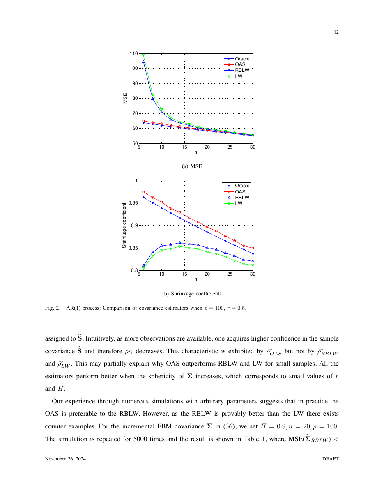
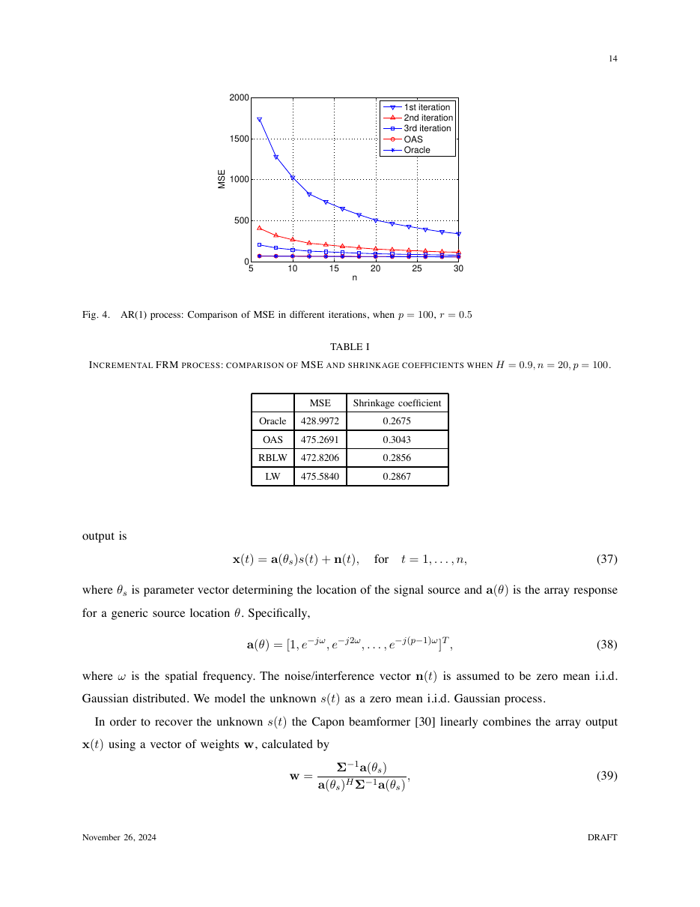
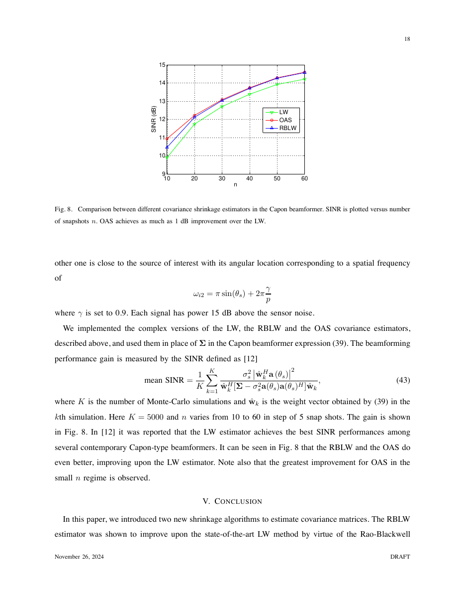

# MMSE 공분산 추정을 위한 축소 알고리즘 (번역)

- 원제: Shrinkage Algorithms for MMSE Covariance Estimation
- 저자: Yilun Chen, Ami Wiesel, Yonina C. Eldar, Alfred O. Hero III
- 번역 대상: arXiv:0907.4698v1 (2009-07-27, stat.ME) 원고. 같은 폴더의 `Chen2010_IEEETSP_shrinkage_MMSE_covariance.pdf`, 28쪽.
- 학술지 판: IEEE Transactions on Signal Processing, 2010, doi:10.1109/TSP.2010.2053029. 학술지 판과 이 원고의 차이는 확인하지 못했다.
- 번역 범위: 전문(초록, 본문, 그림과 표 캡션, 부록). 참고문헌은 원문 그대로 둔다.
- 수식은 원문 기호를 따른다. $\hat{S}$는 표본 공분산, $\hat{F}$는 축소 목표, $\hat\rho$는 축소 계수다.

---

## 초록

가우스 표본에 대해, 최소 평균제곱오차(MMSE) 의미의 공분산 추정을 다룬다.
특히 차원은 높고 표본 수는 적은 문제(large p small n)에 맞는 축소(shrinkage) 방법을 다룬다.

첫째, 충분 통계량을 조건으로 걸어 Ledoit-Wolf(LW) 방법을 개선한다.
Rao-Blackwell 정리에 따라 이렇게 얻은 새 추정량을 RBLW라 부른다.
가우스 변수에서 RBLW의 평균제곱오차는 LW보다 항상 작거나 같다(지배한다).

둘째, 추정 오차를 더 줄이려고, 투시(clairvoyant) 축소 추정량을 근사하는 반복법을 제안한다.
이 반복법이 수렴함을 보이고, 극한의 닫힌 식을 구한다.
이 극한을 오라클 근사 축소(oracle approximating shrinkage, OAS) 추정량이라 부른다.

RBLW와 OAS는 모두 식이 간단하고 구현이 쉽다.
두 방법은 다른 관점에서 나왔지만, 정해진 상수를 빼면 구조가 같다.
RBLW는 LW를 지배함이 증명된다.
수치 모의실험에서는 OAS가 RBLW보다도 더 나을 수 있었다. 특히 n이 p보다 훨씬 작을 때 그렇다.
적응 빔형성(adaptive beamforming)에서도 이 방법들의 성능을 보인다.

색인어: 공분산 추정, 축소, 최소 평균제곱오차(MMSE), 빔형성

저자 소속: Y. Chen, A. Wiesel, A. O. Hero는 미국 미시간대학교(Ann Arbor) 전기공학 및 컴퓨터과학과 소속이다. Y. C. Eldar는 이스라엘 Technion 소속이다. 이 연구는 AFOSR 과제 FA9550-06-1-0324와 NSF 과제 CCF 0830490의 일부 지원을 받았다. A. Wiesel은 EU 제7차 프레임워크 프로그램의 Marie Curie Outgoing International Fellowship 지원을 받았다.

---

## I. 서론

공분산 행렬 추정은 신호처리와 관련 분야의 기본 문제다.
배열 처리 [12]부터 기능 유전체학 [17]까지 많은 응용이 정확한 공분산 추정에 기댄다.
최근에는 표본 수 n이 적을 때 p×p 고차원 공분산을 추정하는 문제가 많은 관심을 받았다.
예로는 마이크로어레이 유전자 발현 분류, 금융 예측, 분광 영상, fMRI 뇌 활성 지도 등이 있다.
표준 추정 방법은 이런 large p small n 상황에서 성능이 나쁘다. 이것이 이 연구의 주된 동기다.

표본 공분산은 미지 공분산의 흔한 추정값이다.
가역이면 표본 공분산은 고전적 최대우도 추정과 같다.
그러나 표본 공분산은 불편 추정량이지만 평균제곱오차(MSE)를 최소로 하지는 않는다.
실제로 Stein은 표본 공분산을 축소하면 더 나은 성능을 얻을 수 있음을 보였다 [2], [3].
그 뒤 여러 성능 기준 아래에서 많은 축소 추정량이 나왔다.
예를 들어 Haff [4]는 경험적 베이즈에서 착안한 추정량을 냈다.
Dey와 Srinivasan [5]은 Stein 엔트로피 손실 아래 최소최대(minimax) 추정량을 유도했다.
Yang과 Berger [6]는 공분산의 사전분포 한 부류 아래 베이즈 추정량의 식을 얻었다.
이 연구들은 n ≥ p여서 표본 공분산이 가역인 경우를 다뤘다.

최근 Ledoit와 Wolf(LW)는 n < p인 경우에 MSE를 점근적으로 최소화하는 축소 추정량을 냈다 [8].
LW 추정량은 표본이 적어도 조건수가 좋아서 고차원 문제에 쓸 수 있다.
이전 방법과 달리, 이들은 성능 이점이 분포에 무관하며 가우스 가정에 묶이지 않음을 보였다.

이 논문에서는 표본이 실제로 가우스일 때 LW 추정량을 크게 개선할 수 있음을 보인다.
구체적으로, 서로 다른 고려에서 나온 두 추정 기법을 개발한다.
첫째는 Rao-Blackwell 정리에서 나오고, 둘째는 [11]의 생각을 공분산 추정에 적용한 것이다.

먼저 MSE 손실 기준 아래 최적 투시 축소 추정량의 닫힌 식을 제시한다.
이 추정량은 미지 공분산의 명시적 함수이므로, 오라클 성능 한계로 쓸 수 있다.
첫 추정량은 잘 알려진 Rao-Blackwell 정리 [31]를 LW 방법에 적용해 얻으므로 RBLW라 부른다.
몇 가지 자명하지 않은 Haar 적분 계산으로, MSE 면에서 LW를 지배함이 증명되는 간단한 닫힌 해를 얻는다.
다음으로 오라클을 근사하려는 반복 축소 추정량을 소개한다.
이 접근은 [11]에서 선형 회귀에 대해 개발한 방법론을 따른다.
처음에 단순한 선택에서 시작하고, 각 반복에서는 미지 공분산을 이전 반복의 추정값으로 바꾼 오라클 해를 쓴다.
놀랍게도 이 반복의 극한을 닫힌 식으로 구할 수 있다. 이 극한을 오라클 근사 축소(OAS) 추정량이라 부른다.

OAS와 RBLW 해는 [18]~[20]에서 논의된 구형성 검정(sphericity test)과 관련된 비슷한 구조를 가진다.
OAS와 RBLW는 모두 직관적이고, 계산이 쉽고, 유한 표본에서 성능이 좋다.
RBLW는 LW를 지배함이 증명된다.
수치 결과는 표본이 적을 때 OAS가 RBLW와 LW보다 낫다는 것을 보인다.

제안한 공분산 추정량을 보이려고, 시계열 분석과 배열 신호처리 문제에 적용한다.
시계열 분석에서는 자기회귀(AR) 모형과 분수 브라운 운동(FBM) 모형의 공분산 추정에서 OAS와 RBLW가 LW보다 낫다는 것을 보인다.
빔형성에서는 RBLW와 OAS로 Capon 빔형성기를 크게 개선할 수 있음을 보인다.
[12]에서는 여러 공분산 추정량을 Capon 빔형성기에 넣어 비교했고, LW 접근이 다른 방법보다 성능을 크게 높였다고 보고했다.
여기서는 이 논문의 기법으로 더 좋은 성능을 얻을 수 있음을 보인다.

논문의 구성은 다음과 같다.
2절은 문제를 정식화한다.
3절은 오라클 추정량과 RBLW, OAS 방법을 소개한다.
4절은 수치 모의실험 결과와 적응 빔형성 응용을 보인다.
5절은 주요 결론을 정리한다.
정리와 보조정리의 증명은 부록에 둔다.

표기: 벡터는 굵은 소문자, 행렬은 굵은 대문자로 쓴다.
$(\cdot)^T$와 $(\cdot)^H$는 전치와 켤레 전치다.
$\mathrm{Tr}(\cdot)$, $\|\cdot\|_F$, $\det(\cdot)$은 각각 대각합, 프로베니우스 노름, 행렬식이다.
$A \prec B$는 $B-A$가 양의 정부호라는 뜻이고, $A \succ B$는 $A-B$가 양의 정부호라는 뜻이다.

---

## II. 문제 정식화

$\{x_i\}_{i=1}^n$을 평균 0, 공분산 $\Sigma$인 p차원 가우스 벡터의 독립 동일분포(i.i.d.) 표본이라 하자.
n ≥ p를 가정하지 않는다.
목표는 다음 MSE를 최소로 하는 추정량 $\hat\Sigma(\{x_i\}_{i=1}^n)$을 찾는 것이다.

$$E\left\{\left\|\hat\Sigma(\{x_i\}_{i=1}^n)-\Sigma\right\|_F^2\right\} \tag{1}$$

추가 제약 없이 $\hat\Sigma$의 MSE를 계산하기는 어렵다.
그래서 축소를 쓰는 특정 부류의 추정량으로 범위를 좁힌다 [1], [7].
$\Sigma$의 비구조적 고전 추정량은 표본 공분산 $\hat S$다.

$$\hat S=\frac{1}{n}\sum_{i=1}^n x_i x_i^T \tag{2}$$

이 추정량은 불편($E\{\hat S\}=\Sigma$)이고, n ≥ p이면 최대우도 해이기도 하다.
그러나 분산이 커서 MSE가 꼭 작지는 않고, p가 큰 문제에서는 보통 불량 조건(ill-posed)이다.
반대로, 가장 조건이 좋은 단순한 추정을 생각할 수 있다.

$$\hat F=\frac{\mathrm{Tr}(\hat S)}{p}I \tag{3}$$

이 "구조적" 추정은 분산을 줄이는 대신 편향을 늘린다.
$\hat S$를 $\hat F$ 쪽으로 축소하면 낮은 편향과 낮은 분산 사이에서 적당히 절충할 수 있다. 그 결과 다음 부류의 추정량을 얻는다.

$$\hat\Sigma=(1-\hat\rho)\hat S+\hat\rho\hat F \tag{4}$$

추정량 $\hat\Sigma$는 축소 계수 $\hat\rho$로 정해진다. $\hat\rho$는 0과 1 사이의 값이고 관측 $\{x_i\}$의 함수일 수 있다.
행렬 $\hat F$를 축소 목표(shrinkage target)라 부른다. (각주 1: (4)의 볼록 결합은 $\hat S$와 $\hat F$의 선형 결합으로 일반화할 수 있다. 자세한 논의는 [13]을 보라.)

이 논문 전체에서 (4) 꼴의 축소 추정만 다룬다.
목표는 MSE (1)을 최소로 하는 축소 계수 $\hat\rho$를 찾는 것이다.
다음 절에서 보이듯, MSE를 최소로 하는 최적 $\hat\rho$는 일반적으로 미지의 $\Sigma$에 의존하므로 구현할 수 없다.
대신 최적 축소 계수를 근사하는 서로 다른 두 접근을 제안한다.

---

## III. 축소 알고리즘

### A. 오라클 추정량

먼저 평균제곱오차를 최소로 하는 최적의 비확률 계수를 쓰는 투시 오라클 추정량을 유도한다.
다음 소절들에서 이 오라클을 데이터로 구현 가능한 방법으로 근사하는 법을 보인다.

오라클 추정 $\hat\Sigma_O$는 다음 문제의 해다.

$$\min_\rho E\left\{\|\hat\Sigma_O-\Sigma\|_F^2\right\}\quad \text{s.t.}\quad \hat\Sigma_O=(1-\rho)\hat S+\rho\hat F \tag{5}$$

최적 매개변수 $\rho_O$는 다음 정리로 주어진다.

**정리 1.** $\hat S$를 p차원 벡터 집합 $\{x_i\}_{i=1}^n$의 표본 공분산이라 하자. $\{x_i\}$가 공분산 $\Sigma$인 i.i.d. 가우스 벡터이면 (5)의 해는 다음과 같다.

$$\rho_O=\frac{E\left\{\mathrm{Tr}\left((\Sigma-\hat S)(\hat F-\hat S)\right)\right\}}{E\left\{\|\hat S-\hat F\|_F^2\right\}} \tag{6}$$

$$=\frac{(1-2/p)\mathrm{Tr}(\Sigma^2)+\mathrm{Tr}^2(\Sigma)}{(n+1-2/p)\mathrm{Tr}(\Sigma^2)+(1-n/p)\mathrm{Tr}^2(\Sigma)} \tag{7}$$

*증명:* 식 (6)은 [7]에서 임의의 분포에 대해 세워졌다. 가우스 가정을 더하면 기댓값을 직접 계산해 (7)을 얻는다.

$$E\{\mathrm{Tr}((\Sigma-\hat S)(\hat F-\hat S))\}=\frac{\mathrm{Tr}(\Sigma)}{p}E\{\mathrm{Tr}(\hat S)\}-\frac{E\{\mathrm{Tr}^2(\hat S)\}}{p}-E\{\mathrm{Tr}(\Sigma\hat S)\}+E\{\mathrm{Tr}(\hat S^2)\} \tag{8}$$

$$E\{\|\hat S-\hat F\|_F^2\}=E\{\mathrm{Tr}(\hat S^2)\}-2E\{\mathrm{Tr}(\hat S\hat F)\}+E\{\mathrm{Tr}(\hat F^2)\}=E\{\mathrm{Tr}(\hat S^2)\}-\frac{E\{\mathrm{Tr}^2(\hat S)\}}{p} \tag{9}$$

식 (7)은 다음 항등식 [27]을 써서 얻는다.

$$E\{\mathrm{Tr}(\hat S)\}=\mathrm{Tr}(\Sigma) \tag{10}$$

$$E\{\mathrm{Tr}(\hat S^2)\}=\frac{n+1}{n}\mathrm{Tr}(\Sigma^2)+\frac{1}{n}\mathrm{Tr}^2(\Sigma) \tag{11}$$

$$E\{\mathrm{Tr}^2(\hat S)\}=\mathrm{Tr}^2(\Sigma)+\frac{2}{n}\mathrm{Tr}(\Sigma^2) \tag{12}$$

(6)은 어떤 표본 분포에서도 최적 축소 계수를 주지만, (7)은 가우스 분포에서만 성립한다.

### B. Rao-Blackwell Ledoit-Wolf (RBLW) 추정량

(5)로 정의한 오라클 추정량은 최적이지만 구현할 수 없다. (6)과 (7)의 해가 모두 미지의 $\Sigma$에 의존하기 때문이다.
Ledoit와 Wolf [7], [8]는 표본 분포를 전혀 모르는 상태에서 (6)의 다음 일치 추정으로 오라클을 근사하자고 제안했다.

$$\hat\rho_{LW}=\frac{\sum_{i=1}^n\|x_ix_i^T-\hat S\|_F^2}{n^2\left[\mathrm{Tr}(\hat S^2)-\mathrm{Tr}^2(\hat S)/p\right]} \tag{13}$$

그들은 n, p → ∞이고 p/n → c (0 < c < ∞)일 때, 표본 분포와 무관하게 (13)이 (6)으로 확률 수렴함을 증명했다.
LW 추정량 $\hat\Sigma_{LW}$는 $\hat\rho_{LW}$를 (4)에 넣어 정의한다.
[8]에서 Ledoit와 Wolf는 최적 $\rho_O$ (6)이 항상 0과 1 사이에 있음도 보였다.
성능을 더 높이려고, 그들은 $\hat\rho_{LW}$ 대신 다음의 수정 축소 매개변수를 쓰자고 했다.

$$\hat\rho^*_{LW}=\min(\hat\rho_{LW},1) \tag{14}$$

아래에서 설명하는 Rao-Blackwell LW(RBLW) 추정량은 가우스 모형 아래에서 LW를 개선함이 증명된다.
RBLW의 동기는 다음 사실에서 온다. $\{x_i\}$가 가우스라는 가정 아래, $\Sigma$를 추정하는 충분 통계량은 표본 공분산 $\hat S$다.
직관적으로, LW 추정량은 $\hat S$뿐 아니라 다른 통계량의 함수이기도 하므로, Rao-Blackwell 정리로 개선할 수 있다.
구체적으로 Rao-Blackwell 정리 [31]는 다음을 말한다. $g(X)$가 매개변수 θ의 추정량이고 $T(X)$가 충분 통계량이면, $T(X)$가 주어졌을 때 $g(X)$의 조건부 기댓값은 어떤 볼록 손실 기준에서도 원래 추정량 $g(X)$보다 나쁘지 않다.
LW 추정량에 Rao-Blackwell 정리를 적용하면 다음 결과를 얻는다.

**정리 2.** $\{x_i\}_{i=1}^n$을 공분산 $\Sigma$인 독립 p차원 가우스 벡터라 하고, $\hat S$를 그 표본 공분산이라 하자. LW 공분산 추정량의 조건부 기댓값은 다음과 같다.

$$\hat\Sigma_{RBLW}=E\left[\hat\Sigma_{LW}\,\middle|\,\hat S\right] \tag{15}$$

$$=(1-\hat\rho_{RBLW})\hat S+\hat\rho_{RBLW}\hat F \tag{16}$$

여기서

$$\hat\rho_{RBLW}=\frac{\frac{n-2}{n}\mathrm{Tr}(\hat S^2)+\mathrm{Tr}^2(\hat S)}{(n+2)\left[\mathrm{Tr}(\hat S^2)-\mathrm{Tr}^2(\hat S)/p\right]} \tag{17}$$

이 추정량은 모든 $\Sigma$에 대해 다음을 만족한다.

$$E\left\{\|\hat\Sigma_{RBLW}-\Sigma\|_F^2\right\}\le E\left\{\|\hat\Sigma_{LW}-\Sigma\|_F^2\right\} \tag{18}$$

정리 2의 증명은 부록에 있다.
LW 추정량과 마찬가지로, $\hat\rho_{RBLW}$ 대신 다음 수정을 제안한다.

$$\hat\rho^*_{RBLW}=\min(\hat\rho_{RBLW},1) \tag{19}$$

### C. 오라클 근사 축소 (OAS) 추정량

LW 추정량의 기본 생각은 오라클을 점근적으로 근사하는 것이고, 이것은 표본이 많을 때를 위해 설계됐다.
표본이 많으면 LW는 축소 추정량 가운데 최소 MSE를 점근적으로 달성한다. RBLW도 이 성질을 물려받는다.
그러나 n이 아주 작을 때, 흔히 관심이 있는 바로 그 경우에는, 그런 최적성이 계속 성립한다는 보장이 없다.
극단적인 예로 표본이 하나뿐인 경우를 보자.
n = 1이면 $\hat\rho^*_{LW}=1$이고 $\hat\rho^*_{RBLW}=1$이 되어, $\hat\Sigma_{LW}=\hat\Sigma_{RBLW}=\hat S$가 된다. (역자 주: 원고에는 계수가 1이라고 적혀 있다. 그런데 계수가 1이면 식 (4)에 따라 결과는 $\hat F$여야 한다. n=1을 식 (13), (17)에 직접 넣으면 $\hat S=x_1x_1^T$이므로 두 계수의 분자가 모두 0이 되고, 결과는 $\hat S$다. 따라서 "계수 = 1"은 원고의 오기이고 "계수 = 0, 결과 = $\hat S$"가 맞는 것으로 보인다. 논지는 그대로다. 학술지 판은 확인하지 못했다.)
이것은 우리의 기대와 맞지 않는다. 표본이 하나뿐이면 $\hat S$보다 더 간결한 $\hat F$를 더 믿는 것이 합리적이기 때문이다.

이 절에서는 [11]에 기반해 오라클 추정량을 근사하는 다른 접근을 생각한다.
(7)에서 가우스 가정 아래 오라클 추정량의 닫힌 식을 얻었다.
OAS의 생각은 이 오라클을 반복 절차로 근사하는 것이다.
$\Sigma$의 초기 추정으로 반복을 시작해 점차 다듬는다.
초기 추정 $\hat\Sigma_0$는 표본 공분산, RBLW 추정, 또는 다른 대칭 음이 아닌 정부호 추정 어느 것이든 된다.
오라클 해의 $\Sigma$를 $\hat\Sigma_0$로 바꿔 $\hat\Sigma_1$을 얻고, 이것이 제안한 반복으로 다시 $\hat\Sigma_2$를 만든다.
반복은 수렴할 때까지 이어진다. 극한을 $\hat\Sigma_{OAS}$로 쓰고 이것이 OAS 해다.
제안한 반복은 구체적으로 다음과 같다.

$$\hat\rho_{j+1}=\frac{(1-2/p)\mathrm{Tr}(\hat\Sigma_j\hat S)+\mathrm{Tr}^2(\hat\Sigma_j)}{(n+1-2/p)\mathrm{Tr}(\hat\Sigma_j\hat S)+(1-n/p)\mathrm{Tr}^2(\hat\Sigma_j)} \tag{20}$$

$$\hat\Sigma_{j+1}=(1-\hat\rho_{j+1})\hat S+\hat\rho_{j+1}\hat F \tag{21}$$

(7)과 비교하면, (20)에서는 $\mathrm{Tr}(\Sigma)$와 $\mathrm{Tr}(\Sigma^2)$를 각각 $\mathrm{Tr}(\hat\Sigma_j)$와 $\mathrm{Tr}(\hat\Sigma_j\hat S)$로 바꿨다.
여기서 $\mathrm{Tr}(\hat\Sigma_j^2)$ 대신 $\mathrm{Tr}(\hat\Sigma_j\hat S)$를 쓴 이유가 있다. 앞의 것은 $\hat\rho_j$를 항상 1로 수렴시키지만, 뒤의 것은 더 의미 있는 극한값을 준다.

**정리 3.** 0과 1 사이의 어떤 초기값 $\hat\rho_0$에 대해서도, (20), (21)로 정한 반복은 j → ∞일 때 다음 추정으로 수렴한다.

$$\hat\Sigma_{OAS}=(1-\hat\rho^*_{OAS})\hat S+\hat\rho^*_{OAS}\hat F \tag{22}$$

여기서

$$\hat\rho^*_{OAS}=\min\left(\frac{(1-2/p)\mathrm{Tr}(\hat S^2)+\mathrm{Tr}^2(\hat S)}{(n+1-2/p)\left[\mathrm{Tr}(\hat S^2)-\mathrm{Tr}^2(\hat S)/p\right]},\,1\right) \tag{23}$$

또한 $0<\hat\rho^*_{OAS}\le 1$이다.

*증명:* (21)의 $\hat\Sigma_j$를 (20)에 넣고 정리하면 다음을 얻는다.

$$\hat\rho_{j+1}=\frac{1-(1-2/p)\hat\phi\hat\rho_j}{1+n\hat\phi-(n+1-2/p)\hat\phi\hat\rho_j} \tag{24}$$

여기서

$$\hat\phi=\frac{\mathrm{Tr}(\hat S^2)-\mathrm{Tr}^2(\hat S)/p}{\mathrm{Tr}(\hat S^2)+\mathrm{Tr}^2(\hat S)} \tag{25}$$

$\mathrm{Tr}(\hat S^2)\ge\mathrm{Tr}^2(\hat S)/p$이므로 $0\le\hat\phi<1$이다. 다음과 같이 변수를 바꾸면

$$\hat b_j=\frac{1}{1-(n+1-2/p)\hat\phi\hat\rho_j} \tag{26}$$

(24)는 다음 등비 수열과 같다.

$$\hat b_{j+1}=\frac{n\hat\phi}{1-(1-2/p)\hat\phi}\hat b_j+\frac{1}{1-(1-2/p)\hat\phi} \tag{27}$$

다음을 쉽게 알 수 있다.

$$\lim_{j\to\infty}\hat b_j=\begin{cases}\infty, & \dfrac{n\hat\phi}{1-(1-2/p)\hat\phi}\ge 1\\[2mm] \dfrac{1}{1-(n+1-2/p)\hat\phi}, & \dfrac{n\hat\phi}{1-(1-2/p)\hat\phi}<1\end{cases} \tag{28}$$

따라서 j → ∞일 때 $\hat\rho_j$도 수렴하고, $\hat\rho^*_{OAS}$는 다음과 같다.

$$\hat\rho^*_{OAS}=\lim_{j\to\infty}\hat\rho_j=\begin{cases}\dfrac{1}{(n+1-2/p)\hat\phi}, & (n+1-2/p)\hat\phi>1\\[2mm] 1, & (n+1-2/p)\hat\phi\le 1\end{cases} \tag{29}$$

(29)는 다음과 같이 같은 뜻으로 쓸 수 있다.

$$\hat\rho^*_{OAS}=\min\left(\frac{1}{(n+1-2/p)\hat\phi},\,1\right) \tag{30}$$

(25)를 (29)에 넣으면 (23)을 얻는다.

(29)의 $\hat\rho^*_{OAS}$는 자연스럽게 [0, 1] 안에 놓인다.
$\hat\rho^*_{LW}$와 $\hat\rho^*_{RBLW}$에서는 [0, 1] 제약을 임시방편으로 덧붙인 것과 다르다.

### D. 축소와 구형성 통계량

이제 RBLW와 OAS를 이론적으로 비교한다.
둘의 차이는 축소 계수뿐이다.
서로 다른 접근에서 나왔지만, $\hat\rho^*_{OAS}$와 $\hat\rho^*_{RBLW}$가 같은 구조라는 것을 쉽게 알 수 있다.
실제로 둘 다 다음 매개변수 함수로 쓸 수 있다.

$$\hat\rho^*_E=\min\left(\alpha+\frac{\beta}{\hat U},\,1\right) \tag{31}$$

여기서 $\hat U$는 다음과 같다.

$$\hat U=\frac{1}{p-1}\left(\frac{p\,\mathrm{Tr}(\hat S^2)}{\mathrm{Tr}^2(\hat S)}-1\right) \tag{32}$$

$\hat\rho^*_E=\hat\rho^*_{OAS}$일 때 (31)의 α, β는 다음과 같다.

$$\alpha_{OAS}=\frac{1}{n+1-2/p},\qquad \beta_{OAS}=\frac{p+1}{(n+1-2/p)(p-1)} \tag{33}$$

$\hat\rho^*_E=\hat\rho^*_{RBLW}$일 때는 다음과 같다.

$$\alpha_{RBLW}=\frac{n-2}{n(n+2)},\qquad \beta_{RBLW}=\frac{(p+1)n-2}{n(n+2)(p-1)} \tag{34}$$

따라서 $\hat\rho^*_{OAS}$와 $\hat\rho^*_{RBLW}$의 차이는 α와 β의 선택뿐이다.
통계량 $\hat U$는 $\Sigma$의 구형성 검정 [19], [20], 즉 $\Sigma$가 단위행렬의 상수배인지 검정하는 데서 나온다.
특히 $\hat U$는 직교 변환 아래 구형성에 대한 국소 최강력 불변 검정 통계량이다 [18].
$\hat U$가 작을수록 $\Sigma$가 단위행렬 I에 비례할 가능성이 크다.
마찬가지로 우리 축소 알고리즘에서도 $\hat U$가 작을수록 $\hat\Sigma_{OAS}$와 $\hat\Sigma_{RBLW}$에서 축소가 더 많이 일어난다.

---

## IV. 수치 모의실험

이 절에서는 제안한 공분산 추정량을 구현하고 시험한다.
먼저 RBLW와 OAS 기법의 MSE 추정값을 LW 방법과 비교한다.
다음으로 적응 빔형성 문제에 적용해 Capon 빔형성기의 성능을 높임을 보인다.

### A. MSE 비교

공분산 추정량의 MSE를 시험하려고, $\Sigma$의 모양이 다른 두 실험 묶음을 설계했다. 이런 공분산 행렬은 [10]에서 공분산 추정량 연구에 쓰였다.
LW, RBLW, OAS의 축소 계수는 각각 (14), (19), (23)으로 계산한다.
비교를 위해 참 $\Sigma$를 쓰는 오라클 추정량 (5)를 MSE의 하한 기준으로 넣었다.
모든 모의실험에서 p = 100으로 두고 n을 6부터 30까지 바꿨다.
각 모의실험은 5000번 반복하고, MSE와 축소 계수를 n의 함수로 그렸다.
MSE와 축소 계수의 95% 신뢰구간은 표시 기호보다 작아서 그림에서 뺐다.

첫 실험에서는 자기회귀 구조의 $\Sigma$를 쓴다. $\Sigma$를 가우스 AR(1) 과정 [32]의 공분산 행렬로 둔다.

$$\Sigma_{ij}=r^{|i-j|} \tag{35}$$

여기서 $\Sigma_{ij}$는 $\Sigma$의 i행 j열 원소다. 아래 보고하는 모의실험마다 r = 0.1, 0.5, 0.9를 쓴다.
그림 1(a)~3(a)는 r 값에 따른 추정량의 MSE를, 그림 1(b)~3(b)는 해당 축소 계수를 보인다.

> 그림 1. AR(1) 과정: p = 100, r = 0.1일 때 공분산 추정량 비교. (a) MSE, (b) 축소 계수.

> 그림 2. AR(1) 과정: p = 100, r = 0.5일 때 공분산 추정량 비교. (a) MSE, (b) 축소 계수. (위 이미지는 원문 12쪽 전체다.)

> 그림 3. AR(1) 과정: p = 100, r = 0.9일 때 공분산 추정량 비교. (a) MSE, (b) 축소 계수.

그림 4에는 (21)과 (20)의 반복 절차로 얻은 처음 세 번 반복의 MSE를 그렸다.
비교를 위해 OAS와 오라클 추정량의 결과도 함께 그렸다.
이 예에서는 r = 0.5로 두고 초기 추정 $\hat\Sigma_0=\hat S$에서 반복을 시작했다.
그림 4에서 보듯, 반복이 진행되면서 MSE는 OAS 추정량의 MSE 쪽으로 차츰 줄어들고, 이 값은 오라클의 MSE에 매우 가깝다.

> 그림 4. AR(1) 과정: p = 100, r = 0.5일 때 반복 차수별 MSE 비교. 1차, 2차, 3차 반복, OAS, 오라클. (위 이미지는 원문 14쪽 전체이며 표 I도 함께 있다.)

둘째 실험에서는 $\Sigma$를 장기 의존성을 보이는 분수 브라운 운동(FBM)의 증분 과정 공분산으로 둔다.
이런 과정은 인터넷 트래픽 [29] 같은 복잡한 현상을 모형화하는 데 자주 쓰인다.
공분산 행렬의 꼴은 다음과 같다.

$$\Sigma_{ij}=\frac{1}{2}\left[(|i-j|+1)^{2H}-2|i-j|^{2H}+(|i-j|-1)^{2H}\right] \tag{36}$$

여기서 H ∈ [0.5, 1]은 Hurst 매개변수다. 실제 응용에서 H의 전형적 값은 0.9 아래다.
H를 0.6, 0.7, 0.8로 골랐다. MSE와 축소 계수는 각각 그림 5(a)~7(a)와 그림 5(b)~7(b)에 그렸다.

> 그림 5. 증분 FBM 과정: p = 100, H = 0.6일 때 공분산 추정량 비교. (a) MSE, (b) 축소 계수.

> 그림 6. 증분 FBM 과정: p = 100, H = 0.7일 때 공분산 추정량 비교. (a) MSE, (b) 축소 계수.

> 그림 7. 증분 FBM 과정: p = 100, H = 0.8일 때 공분산 추정량 비교. (a) MSE, (b) 축소 계수.

위 두 실험의 모의실험 결과를 보면, OAS 추정량은 이상적인 오라클 추정량에 매우 가깝게 동작한다.
n이 작을 때 OAS는 LW와 RBLW보다 뚜렷이 낫다.
RBLW는 LW보다 조금 나아지지만, 그림의 축척에서는 잘 보이지 않는다.
예상대로, n이 커지면 모든 추정량이 같은 값으로 수렴한다.

(5)에서 보이고 모의실험 결과에서도 보이듯, 오라클 축소 계수 $\rho_O$는 표본 수 n이 늘수록 줄어든다.
$(1-\rho_O)$를 $\hat S$에 주는 "신뢰"의 척도로 볼 수 있으므로 이는 자연스럽다.
직관적으로 관측이 많을수록 표본 공분산 $\hat S$를 더 믿게 되므로 $\rho_O$가 줄어든다.
이 특성은 $\hat\rho^*_{OAS}$에서는 나타나지만 $\hat\rho^*_{RBLW}$와 $\hat\rho^*_{LW}$에서는 나타나지 않는다.
이것이 표본이 적을 때 OAS가 RBLW와 LW보다 나은 이유를 부분적으로 설명할 수 있다.
$\Sigma$의 구형성이 클수록, 즉 r과 H가 작을수록 모든 추정량의 성능이 좋아진다.

임의의 매개변수로 여러 모의실험을 해 본 경험으로는, 실제로는 OAS가 RBLW보다 바람직하다.
그러나 RBLW는 LW보다 낫다는 것이 증명되지만, OAS에는 반례가 있다.
증분 FBM 공분산 (36)에서 H = 0.9, n = 20, p = 100으로 두었다.
모의실험을 5000번 반복한 결과를 표 1에 보였다. 여기서 MSE($\hat\Sigma_{RBLW}$) < MSE($\hat\Sigma_{OAS}$) < MSE($\hat\Sigma_{LW}$)다.
차이는 매우 작지만, OAS 추정량이 RBLW를 항상 지배하지는 않음을 보여 준다.
다만 이런 일은 $\Sigma$의 구형성이 아주 작을 때만 생긴다고 짐작한다. 그런 경우는 실제 관심이 덜하다. 구형성이 작으면 $\hat F$와 다른 축소 목표를 쓰는 편이 맞기 때문이다.

> 표 I. 증분 FBM 과정: H = 0.9, n = 20, p = 100일 때 MSE와 축소 계수 비교.

| 추정량 | MSE | 축소 계수 |
|---|---|---|
| Oracle | 428.9972 | 0.2675 |
| OAS | 475.2691 | 0.3043 |
| RBLW | 472.8206 | 0.2856 |
| LW | 475.5840 | 0.2867 |

### B. Capon 빔형성기 응용

다음으로 제안한 축소 추정량을 적응 빔형성이라는 신호처리 문제에 적용했다.
관심 협대역 신호 s(t)가 교란 없는 p개 센서의 균일 선형 배열(ULA) [30]에 들어온다고 하자.
배열 출력의 n개 스냅샷으로 된 복소 벡터는 다음과 같다.

$$x(t)=a(\theta_s)s(t)+n(t),\qquad t=1,\dots,n \tag{37}$$

여기서 $\theta_s$는 신호원의 위치를 정하는 매개변수 벡터이고, $a(\theta)$는 일반적인 신호원 위치 θ에 대한 배열 응답이다. 구체적으로

$$a(\theta)=[1,e^{-j\omega},e^{-j2\omega},\dots,e^{-j(p-1)\omega}]^T \tag{38}$$

여기서 ω는 공간 주파수다. 잡음과 간섭 벡터 n(t)는 평균 0인 i.i.d. 가우스 분포로 가정한다.
미지의 s(t)는 평균 0인 i.i.d. 가우스 과정으로 모형화한다.

미지의 s(t)를 복원하려고, Capon 빔형성기 [30]는 다음으로 계산한 가중 벡터 w로 배열 출력 x(t)를 선형 결합한다.

$$w=\frac{\Sigma^{-1}a(\theta_s)}{a(\theta_s)^H\Sigma^{-1}a(\theta_s)} \tag{39}$$

여기서 $\Sigma$는 x(t)의 공분산이다.
공분산 $\Sigma$는 모르지만 배열 응답 $a(\theta)$와 신호원의 도래각(DOA) $\theta_s$는 안다.
가중 벡터 w를 구한 뒤, 관심 신호 s(t)는 $w^Hx(t)$로 추정한다.

(39)를 구현하려면 행렬 $\Sigma$를 추정해야 한다.
[12]에서는 LW 추정량을 쓰면 Capon 빔형성기의 성능이 기존 방법보다 크게 좋아짐을 보였다.
아래에서 보듯 OAS와 RBLW 축소 추정량은 더 좋은 결과를 낼 수 있다.

신호와 잡음 과정은 복소수이므로 $\Sigma$는 복소(에르미트 대칭) 공분산 행렬이다.
OAS와 RBLW 추정량을 적용하려고, [12]에서 실수 LW 추정량을 복소 경우로 넓힌 방법을 그대로 쓴다.
p×1 복소 확률 벡터 x를 실수부와 허수부로 된 2p×1 벡터로 나타낸다.

$$x_s=\begin{bmatrix}\mathrm{Re}(x)\\ \mathrm{Im}(x)\end{bmatrix} \tag{40}$$

그러면 복소 공분산의 추정은 다음과 같이 나타낼 수 있다.

$$\hat\Sigma_s=\begin{bmatrix}\hat\Sigma_{rr}&\hat\Sigma_{ri}\\ \hat\Sigma_{ir}&\hat\Sigma_{ii}\end{bmatrix} \tag{41}$$

여기서 $\hat\Sigma_{rr}$, $\hat\Sigma_{ri}$, $\hat\Sigma_{ir}$, $\hat\Sigma_{ii}$는 p×p 부분 행렬이다.
실수 표현 (41)은 다음과 같이 전체 복소 공분산 행렬로 옮길 수 있다.

$$\hat\Sigma=(\hat\Sigma_{rr}+\hat\Sigma_{ii})+j(\hat\Sigma_{ir}-\hat\Sigma_{ri}) \tag{42}$$

이 표현을 쓰면 실수형 LW, RBLW, OAS 추정량을 복소 상황으로 쉽게 넓힐 수 있다.

빔형성 모의실험은 다음과 같이 했다.
반파장 간격의 센서 p = 10개로 된 ULA를 가정하고, 세 신호가 배열에 들어오도록 모의했다.
관심 신호의 DOA는 $\theta_s=20°$이고, 전력 $\sigma_s^2$은 복소 가우스 센서 잡음보다 10 dB 높다.
다른 두 신호는 서로 독립인 간섭이다.
하나는 DOA $\theta_{i1}=-30°$에 있고, 다른 하나는 관심 신호원 가까이 있으며 각 위치가 다음 공간 주파수에 해당한다.

$$\omega_{i2}=\pi\sin(\theta_s)+2\pi\frac{\gamma}{p}$$

여기서 γ = 0.9로 둔다. 각 간섭 신호의 전력은 센서 잡음보다 15 dB 높다.

위에서 설명한 LW, RBLW, OAS 공분산 추정량의 복소형을 구현해, Capon 빔형성기 식 (39)의 $\Sigma$ 자리에 넣었다.
빔형성 성능 이득은 [12]처럼 정의한 SINR로 잰다.

$$\text{mean SINR}=\frac{1}{K}\sum_{k=1}^K\frac{\sigma_s^2\left|\hat w_k^Ha(\theta_s)\right|^2}{\hat w_k^H\left[\Sigma-\sigma_s^2a(\theta_s)a(\theta_s)^H\right]\hat w_k} \tag{43}$$

여기서 K는 몬테카를로 모의실험 횟수이고, $\hat w_k$는 k번째 모의실험에서 (39)로 얻은 가중 벡터다.
여기서 K = 5000이고, n은 10부터 60까지 스냅샷 5개 간격으로 바꿨다.
이득은 그림 8에 보였다.
[12]에서는 LW 추정량이 당시의 여러 Capon형 빔형성기 가운데 SINR이 가장 좋았다고 보고했다.
그림 8에서 RBLW와 OAS는 LW보다 더 좋아, LW 추정량을 개선함을 볼 수 있다.
또 OAS의 개선이 가장 큰 곳은 n이 작은 구간이다.

> 그림 8. Capon 빔형성기에서 여러 공분산 축소 추정량의 비교. 스냅샷 수 n에 대한 SINR을 그렸다. OAS는 LW보다 최대 1 dB 개선을 얻는다. (위 이미지는 원문 18쪽 전체다.)

---

## V. 결론

이 논문에서는 공분산 행렬을 추정하는 새 축소 알고리즘 두 가지를 소개했다.
RBLW 추정량은 Rao-Blackwell 정리 덕분에 당시 최고 수준인 LW 방법을 개선함을 보였다.
OAS 추정량은 최적 오라클 추정을 반복해 얻었고, 그 극한 형태를 해석적으로 구했다.
RBLW는 LW를 지배함이 증명되고, OAS는 우리가 한 대부분의 실험에서 RBLW와 LW보다 실험적으로 나았다.
제안한 OAS와 RBLW 추정량은 명시적 식이 간단하고 구현이 쉽다.
또 축소 계수의 꼴만 다를 뿐 구조가 비슷하다.
이 추정량들을 Capon 빔형성기에 적용해, LW Capon 빔형성기 구현보다 성능이 크게 좋아짐을 얻었다.

논문 전체에서 축소 목표를 단위행렬의 상수배로 두었다.
여기서 개발한 이론은 단위행렬이 아닌 다른 축소 목표로 넓힐 수 있다.
구체적인 응용에서 알맞은 목표를 어떻게 고를지는 앞으로 연구할 흥미로운 문제다.

---

## VI. 부록

이 부록에서는 정리 2를 증명한다.
정리 2는 자명하지 않으며, Haar 측도와 특이 Wishart 분포 이론의 결과를 조심스럽게 써야 한다.
증명에는 몇 가지 중간 결과가 필요하며, 이를 보조정리로 적는다. 먼저 정의 하나로 시작한다.

**정의 1.** $\{x_i\}_{i=1}^n$을 평균 0, 공분산 $\Sigma$인 p차원 i.i.d. 가우스 벡터의 표본이라 하자. p×n 행렬 X를 다음과 같이 정의한다.

$$X=(x_1,x_2,\dots,x_n) \tag{44}$$

r = min(p, n)으로 두고 X의 특잇값 분해를 다음과 같이 정의한다.

$$X=H\Lambda Q \tag{45}$$

여기서 H는 $H^TH=I$인 p×r 행렬, Λ는 확률 1로 대각인 r×r 행렬로 X의 특잇값으로 이뤄지고, Q는 $QQ^T=I$인 r×n 행렬이다.

다음으로 세 보조정리를 적고 증명한다.

**보조정리 1.** (H, Λ, Q)를 정의 1의 행렬이라 하자. 그러면 Q는 H, Λ와 독립이다.

*증명:* n ≤ p인 경우, H는 p×n 행렬, Λ는 n×n 정사각 대각행렬, Q는 n×n 직교행렬이다. X의 확률밀도함수는 다음과 같다.

$$p(X)=\frac{1}{(2\pi)^{pn/2}\det(\Sigma)^{n/2}}e^{-\frac{1}{2}\mathrm{Tr}(XX^T\Sigma^{-1})} \tag{46}$$

$XX^T=H\Lambda\Lambda^TH^T$이므로 (H, Λ, Q)의 결합 밀도는 다음과 같다.

$$p(H,\Lambda,Q)=\frac{1}{(2\pi)^{pn/2}\det(\Sigma)^{n/2}}e^{-\frac{1}{2}\mathrm{Tr}(H\Lambda\Lambda^TH^T\Sigma^{-1})}J(X\to H,\Lambda,Q) \tag{47}$$

여기서 $J(X\to H,\Lambda,Q)$는 X에서 (H, Λ, Q)로 바꾸는 야코비안이다. [21]의 보조정리 2.4에 따르면

$$J(X\to H,\Lambda,Q)=2^{-n}\det(\Lambda)^{p-n}\prod_{j<k}\left(\lambda_j^2-\lambda_k^2\right)g_{n,p}(H)\,g_{n,n}(Q) \tag{48}$$

여기서 $\lambda_j$는 Λ의 j번째 대각 원소이고, $g_{n,p}(H)$와 $g_{n,n}(Q)$는 [21]에서 정의한 H와 Q의 함수다.
(48)을 (47)에 넣으면 p(H, Λ, Q)는 (H, Λ)의 함수와 Q의 함수의 곱으로 나뉜다. 따라서 Q는 H, Λ와 독립이다.
n > p일 때도 같은 방법으로 Q가 H, Λ와 독립임을 보일 수 있다.

**보조정리 2.** Q를 정의 1의 행렬이라 하자. q를 Q의 임의의 열 벡터, $q_j$를 q의 j번째 원소라 하자. 그러면

$$E\{q_j^4\}=\frac{3}{n(n+2)} \tag{49}$$

$$E\{q_k^2q_j^2\}=\frac{1}{n(n+2)},\qquad k\ne j \tag{50}$$

*증명:* n ≤ p인 경우와 n > p인 경우의 증명이 달라 따로 다룬다.

(1) n ≤ p인 경우:
이때 Q는 실수 Haar 행렬이고 등방적으로 분포한다 [22], [24], [25]. 즉 Q와 독립인 임의의 유니터리 행렬 Φ, Ψ에 대해 ΦQ와 QΨ는 Q와 같은 밀도를 가진다.

$$p(\Phi Q)=p(Q\Psi)=p(Q) \tag{51}$$

복소 경우의 [23]을 따라, (51)을 써서 Q 원소의 4차 모멘트를 계산한다.
Q와, 왼쪽 위 2×2 블록이 회전 $\begin{bmatrix}\cos\theta&\sin\theta\\-\sin\theta&\cos\theta\end{bmatrix}$이고 나머지 대각이 1인 행렬을 Q에 곱한 것은 같은 분포를 가지므로 다음을 얻는다.

$$\begin{aligned}E\{Q_{11}^4\}&=E\{(Q_{11}\cos\theta+Q_{21}\sin\theta)^4\}\\&=\cos^4\theta E\{Q_{11}^4\}+\sin^4\theta E\{Q_{22}^4\}+6\cos^2\theta\sin^2\theta E\{Q_{11}^2Q_{21}^2\}\\&\quad+2\cos^3\theta\sin\theta E\{Q_{11}^3Q_{21}\}+2\cos\theta\sin^3\theta E\{Q_{11}Q_{21}^3\}\end{aligned} \tag{52}$$

(52)에서 θ를 −θ로 바꾸면 다음을 쉽게 알 수 있다.

$$2\cos^3\theta\sin\theta E\{Q_{11}^3Q_{21}\}+2\cos\theta\sin^3\theta E\{Q_{11}Q_{21}^3\}=0$$

$[Q_{ii}]$의 원소는 같은 분포를 가진다. 따라서 $E\{Q_{11}^4\}=E\{Q_{22}^4\}$이고, 그러므로

$$E\{Q_{11}^4\}=(\cos^4\theta+\sin^4\theta)E\{Q_{11}^4\}+6\cos^2\theta\sin^2\theta E\{Q_{11}^2Q_{21}^2\} \tag{53}$$

θ = π/3을 넣으면

$$E\{Q_{11}^4\}=3E\{Q_{11}^2Q_{21}^2\} \tag{54}$$

이제 $E\{(\sum_{j=1}^nQ_{j1}^2)^2\}$를 보자. $Q^TQ=QQ^T=I$이므로 $\sum_{j=1}^nQ_{j1}^2=1$이다. 이는 다음을 뜻한다.

$$1=\sum_{j=1}^nE\{Q_{j1}^4\}+\sum_{j\ne k}E\{Q_{j1}^2Q_{k1}^2\}=nE\{Q_{11}^4\}+n(n-1)E\{Q_{11}^2Q_{21}^2\} \tag{55}$$

(54)를 (55)에 넣으면 다음을 얻는다.

$$E\{Q_{11}^4\}=\frac{3}{n(n+2)} \tag{56}$$

$$E\{Q_{11}^2Q_{21}^2\}=\frac{1}{n(n+2)} \tag{57}$$

$E\{q_j^4\}=E\{Q_{11}^4\}$이고 $E\{q_j^2q_k^2\}=E\{Q_{11}^2Q_{21}^2\}$임은 쉽게 알 수 있다. 따라서 n ≤ p인 경우 (49)와 (50)이 증명된다.

(2) n > p인 경우:
q의 밀도는 [21]의 보조정리 2.2로 얻을 수 있다.

$$p(q)=C_1\det(I-qq^T)^{(n-p-2)/2}\,\mathbb{I}(qq^T\prec I) \tag{58}$$

여기서

$$C_1=\frac{\pi^{-p/2}\Gamma\{n/2\}}{\Gamma\{(n-p)/2\}} \tag{59}$$

이고 $\mathbb{I}(\cdot)$는 q의 지지 집합을 나타내는 지시 함수다.
(58)은 q의 원소들이 같은 분포를 가짐을 보인다. 따라서 $E\{q_j^4\}=E\{q_1^4\}$, $E\{q_j^2q_k^2\}=E\{q_1^2q_2^2\}$이다.
기댓값의 정의에 따라

$$E\{q_1^4\}=C_1\int_{qq^T\prec I}q_1^4\det(I-qq^T)^{(n-p-2)/2}dq \tag{60}$$

$$E\{q_1^2q_2^2\}=C_1\int_{qq^T\prec I}q_1^2q_2^2\det(I-qq^T)^{(n-p-2)/2}dq \tag{61}$$

다음을 주목하면

$$qq^T\prec I\iff q^Tq<1 \tag{62}$$

$$\det(I-qq^T)=1-q^Tq \tag{63}$$

다음을 얻는다.

$$E\{q_1^4\}=C_1\int_{q^Tq<1}q_1^4(1-q^Tq)^{\frac{1}{2}(n-p-2)}dq=C_1\int_{\sum_j q_j^2<1}q_1^4\left(1-\sum_{j=1}^pq_j^2\right)^{\frac{1}{2}(n-p-2)}dq_1\cdots dq_p \tag{64}$$

적분 변수 $(q_1,q_2,\dots,q_p)$를 다음과 같은 $(r,\theta_1,\theta_2,\dots,\theta_{p-1})$로 바꾸면

$$\begin{cases}q_1=r\cos\theta_1\\ q_2=r\sin\theta_1\cos\theta_2\\ q_3=r\sin\theta_1\sin\theta_2\cos\theta_3\\ \quad\vdots\\ q_{p-1}=r\sin\theta_1\sin\theta_2\cdots\sin\theta_{p-2}\cos\theta_{p-1}\\ q_p=r\sin\theta_1\sin\theta_2\cdots\sin\theta_{p-2}\sin\theta_{p-1}\end{cases} \tag{65}$$

다음을 얻는다.

$$E\{q_1^4\}=C_1\int_0^\pi d\theta_1\int_0^\pi d\theta_2\cdots\int_0^\pi d\theta_{p-2}\int_0^{2\pi}d\theta_{p-1}\int_0^1 r^4\cos^4\theta_1(1-r^2)^{\frac{1}{2}(n-p-2)}\frac{\partial(q_1,\dots,q_p)}{\partial(r,\theta_1,\dots,\theta_{p-1})}dr \tag{66}$$

여기서

$$\frac{\partial(q_1,\dots,q_p)}{\partial(r,\theta_1,\dots,\theta_{p-1})}=r^{p-1}\sin^{p-2}\theta_1\sin^{p-3}\theta_2\cdots\sin\theta_{p-2}$$

는 변수 변환의 야코비안이다. 따라서

$$\begin{aligned}E\{q_1^4\}&=C_1\int_0^\pi\cos^4\theta_1\sin^{p-2}\theta_1d\theta_1\int_0^\pi\sin^{p-3}\theta_2d\theta_2\int_0^\pi\sin^{p-4}\theta_3d\theta_3\cdots\int_0^\pi\sin\theta_{p-2}d\theta_{p-2}\int_0^{2\pi}d\theta_{p-1}\int_0^1r^{p+3}(1-r^2)^{\frac{1}{2}(n-p-2)}dr\\&=\frac{\pi^{-p/2}\Gamma\{n/2\}}{\Gamma\{(n-p)/2\}}\cdot\frac{3\pi^{\frac12}\Gamma\{(p-1)/2\}}{4\Gamma\{(p+4)/2\}}\cdot\pi^{\frac12}\frac{\Gamma\{(p-2)/2\}}{\Gamma\{(p-1)/2\}}\cdot\pi^{\frac12}\frac{\Gamma\{(p-3)/2\}}{\Gamma\{(p-2)/2\}}\cdots\pi^{\frac12}\frac{\Gamma\{3/2\}}{\Gamma\{5/2\}}\cdot\pi^{\frac12}\frac{\Gamma\{1\}}{\Gamma\{3/2\}}\cdot2\pi\int_0^1r^{p+3}(1-r^2)^{\frac12(n-p-2)}dr\\&=\frac{3}{2}\frac{\Gamma\{n/2\}}{\Gamma\{(n-p)/2\}\Gamma\{p/2+2\}}\int_0^1r^{p+3}(1-r^2)^{\frac12(n-p-2)}dr\\&=\frac{3}{2}\frac{\Gamma\{n/2\}}{\Gamma\{(n-p)/2\}\Gamma\{p/2+2\}}\cdot\frac12\frac{\Gamma\{(n-p)/2\}\Gamma\{p/2+2\}}{\Gamma\{n/2+2\}}\\&=\frac{3\Gamma\{n/2\}}{4\Gamma\{n/2+2\}}=\frac{3}{n(n+2)}\end{aligned} \tag{67}$$

마찬가지로

$$\begin{aligned}E\{q_1^2q_2^2\}&=C_1\int_{\sum_kq_k^2<1}q_1^2q_2^2\left(1-\sum_{k=1}^pq_k^2\right)^{\frac12(n-p-2)}dq_1\cdots dq_p\\&=C_1\int_0^\pi d\theta_1\cdots\int_0^{2\pi}d\theta_{p-1}\int_0^1r^2\cos^2\theta_1\,r^2\sin^2\theta_1\cos^2\theta_2(1-r^2)^{\frac12(n-p-2)}\frac{\partial(q_1,\dots,q_p)}{\partial(r,\theta_1,\dots,\theta_{p-1})}dr\\&=C_1\int_0^\pi\cos^2\theta_1\sin^p\theta_1d\theta_1\int_0^\pi\cos^2\theta_2\sin^{p-3}\theta_2d\theta_2\int_0^\pi\sin^{p-4}\theta_3d\theta_3\cdots\int_0^\pi\sin\theta_{p-2}d\theta_{p-2}\int_0^{2\pi}d\theta_{p-1}\int_0^1r^{p+3}(1-r^2)^{\frac12(n-p-2)}dr\\&=\frac{\pi^{-p/2}\Gamma\{n/2\}}{\Gamma\{(n-p)/2\}}\cdot\frac{\pi^{\frac12}\Gamma\{(p+1)/2\}}{2\Gamma\{p/2+2\}}\cdot\frac{\pi^{\frac12}\Gamma\{(p-2)/2\}}{2\Gamma\{(p+1)/2\}}\cdot\pi^{\frac12}\frac{\Gamma\{(p-3)/2\}}{\Gamma\{(p-2)/2\}}\cdot\pi^{\frac12}\frac{\Gamma\{(p-4)/2\}}{\Gamma\{(p-3)/2\}}\cdots\pi^{\frac12}\frac{\Gamma\{1\}}{\Gamma\{3/2\}}\cdot2\pi\cdot\frac12\frac{\Gamma\{(n-p)/2\}\Gamma\{p/2+2\}}{\Gamma\{n/2+2\}}\\&=\frac{1}{n(n+2)}\end{aligned} \tag{68}$$

따라서 n > p인 경우에도 (49)와 (50)이 증명된다. 이로써 보조정리 2의 증명을 마친다.

**보조정리 3.** $\hat S$를 p차원 벡터 집합 $\{x_i\}_{i=1}^n$의 표본 공분산이라 하자. $\{x_i\}$가 공분산 $\Sigma$인 i.i.d. 가우스 벡터이면

$$E\left\{\|x_i\|_2^4\,\middle|\,\hat S\right\}=\frac{n}{n+2}\left[2\mathrm{Tr}(\hat S^2)+\mathrm{Tr}^2(\hat S)\right] \tag{69}$$

*증명:* 간단히 하려고 다음과 같이 정의한 척도 공분산 행렬 M으로 계산한다.

$$M=\sum_{i=1}^nx_ix_i^T=n\hat S \tag{70}$$

$E\{\|x_i\|_2^4\mid\hat S\}$ 대신 $E\{\|x_i\|_2^4\mid M\}$을 계산한다. 다음을 증명하려 한다.

$$E\left\{\|x_i\|_2^4\,\middle|\,M\right\}=\frac{1}{n(n+2)}\left(2\mathrm{Tr}(M^2)+\mathrm{Tr}^2(M)\right) \tag{71}$$

보조정리 1과 2를 써서 (71)을 세운다.
X와 (H, Λ, Q)를 정의 1의 행렬이라 하고, q를 Q의 i번째 열이라 하자. 그러면

$$x_i=H\Lambda q \tag{72}$$

다음과 같이 두자.

$$D=\Lambda^2 \tag{73}$$

그러면

$$M=XX^T=H\Lambda^2H^T=HDH^T \tag{74}$$

$$x_i^Tx_i=q^T\Lambda^TH^TH\Lambda q=q^TDq \tag{75}$$

따라서 다음을 얻는다.

$$E\left\{\|x_i\|_2^4\,\middle|\,M\right\}=E\left\{(q^TDq)^2\,\middle|\,M\right\} \tag{76}$$

보조정리 1에 따라 Q는 H, Λ와 독립이다. q는 Q의 함수이고 M과 D는 H, Λ의 함수이므로 q는 M, D와 독립이다.
전체 기댓값 법칙에 따라

$$E\{(q^TDq)^2\mid M\}=E\left\{E\{(q^TDq)^2\mid M,D\}\,\middle|\,M\right\} \tag{77}$$

$q^TDq$를 다음과 같이 전개한다.

$$q^TDq=\sum_{j=1}^nd_jq_j^2 \tag{78}$$

여기서 $d_j$는 D의 j번째 대각 원소다. q는 M, D와 독립이므로 보조정리 2에 따라

$$\begin{aligned}E\{(q^TDq)^2\mid M,D\}&=E\left\{\sum_{j=1}^nd_j^2q_j^4+\sum_{j\ne k}d_jd_kq_j^2q_k^2\,\middle|\,M,D\right\}\\&=\sum_{j=1}^nd_j^2E\{q_j^4\}+\sum_{j\ne k}d_jd_kE\{q_j^2q_k^2\}\\&=\frac{1}{n(n+2)}\left(3\sum_{j=1}^nd_j^2+\sum_{j\ne k}d_jd_k\right)\\&=\frac{1}{n(n+2)}\left(2\mathrm{Tr}(D^2)+\mathrm{Tr}^2(D)\right)\end{aligned} \tag{79}$$

$\mathrm{Tr}(D)=\mathrm{Tr}(M)$이고 $\mathrm{Tr}(D^2)=\mathrm{Tr}(M^2)$이므로 (79)를 (77)에 넣으면 다음을 얻는다.

$$\begin{aligned}E\{(q^TDq)^2\mid M\}&=E\left\{\frac{1}{n(n+2)}\left(2\mathrm{Tr}(D^2)+\mathrm{Tr}^2(D)\right)\,\middle|\,M\right\}\\&=E\left\{\frac{1}{n(n+2)}\left(2\mathrm{Tr}(M^2)+\mathrm{Tr}^2(M)\right)\,\middle|\,M\right\}\\&=\frac{1}{n(n+2)}\left(2\mathrm{Tr}(M^2)+\mathrm{Tr}^2(M)\right)\end{aligned} \tag{80}$$

이제 보조정리 3으로 정리 2를 증명할 수 있다.

### A. 정리 2의 증명

*증명:*

$$\hat\Sigma_{RBLW}=E\{\hat\Sigma_{LW}\mid\hat S\}=E\{(1-\hat\rho_{LW})\hat S+\hat\rho_{LW}\hat F\mid\hat S\}=\left(1-E\{\hat\rho_{LW}\mid\hat S\}\right)\hat S+E\{\hat\rho_{LW}\hat F\mid\hat S\} \tag{81}$$

따라서 $\hat\Sigma_{RBLW}$의 축소 계수는 다음과 같다.

$$\hat\rho_{RBLW}=E\{\hat\rho_{LW}\mid\hat S\}=\frac{E\left\{\sum_{i=1}^n\|x_ix_i^T-\hat S\|_F^2\,\middle|\,\hat S\right\}}{n^2\left[\mathrm{Tr}(\hat S^2)-\mathrm{Tr}^2(\hat S)/p\right]} \tag{82}$$

다음에 주목한다.

$$E\left\{\sum_{i=1}^n\|x_ix_i^T-\hat S\|_F^2\,\middle|\,\hat S\right\}=\sum_{i=1}^nE\{\|x_i\|_2^4\mid\hat S\}-n\mathrm{Tr}(\hat S^2) \tag{83}$$

보조정리 3에서 다음을 얻는다.

$$E\left\{\sum_{i=1}^n\|x_ix_i^T-\hat S\|_F^2\,\middle|\,\hat S\right\}=\frac{n(n-2)}{n+2}\mathrm{Tr}(\hat S^2)+\frac{n^2}{n+2}\mathrm{Tr}^2(\hat S) \tag{84}$$

(84)를 (82)에 넣으면 식 (17)을 얻는다.

---

## 참고문헌 (원문 그대로)

[1] C. Stein, "Inadmissibility of the usual estimator for the mean of a multivariate distribution," Proc. Third Berkeley Symp. Math. Statist. Prob. 1, pp. 197-206, 1956.
[2] W. James and C. Stein, "Estimation with quadratic loss," Proceedings of the 4th Berkeley Symposium on Mathematical Statistics and Probability, Berkeley, CA, vol. 1, page 361-379, University of California Press, 1961.
[3] C. Stein, "Estimation of a covariance matrix," In Rietz Lecture, 39th Annual Meeting, IMS, Atlanta, GA, 1975.
[4] L. R. Haff, "Empirical Bayes Estimation of the Multivariate Normal Covariance Matrix," Annals of Statistics, vol. 8, no. 3, pp. 586-597, 1980.
[5] D. K. Dey and C. Srinivasan, "Estimation of a covariance matrix under Stein's loss," Annals of Statistics, vol. 13, pp. 1581-1591, 1985.
[6] R. Yang, J. O. Berger, "Estimation of a covariance matrix using the reference prior," Annals of Statistics, vol. 22, pp. 1195-1211, 1994.
[7] O. Ledoit, M. Wolf, "Improved estimation of the covariance matrix of stock returns with an application to portfolio selection," Journal of Empirical Finance, vol. 10, no. 5, pp. 603-621, Dec. 2003.
[8] O. Ledoit and M. Wolf, "A well-conditioned estimator for large-dimensional covariance matrices," Journal of Multivariate Analysis, vol. 88, no. 2, pp. 365-411, Feb. 2004.
[9] O. Ledoit, M. Wolf, "Honey, I Shrunk the Sample Covariance Matrix," Journal of Portfolio Management, vol. 31, no. 1, 2004.
[10] P. Bickel, E. Levina, "Regularized estimation of large covariance matrices," Annals of Statistics, vol. 36, pp. 199-227, 2008.
[11] Y. C. Eldar and J. Chernoi, "A Pre-Test Like Estimator Dominating the Least-Squares Method," Journal of Statistical Planning and Inference, vol. 138, no. 10, pp. 3069-3085, 2008.
[12] R. Abrahamsson, Y. Selén and P. Stoica, "Enhanced covariance matrix estimators in adaptive beamforming," IEEE Proc. of ICASSP, pp. 969-972, 2007.
[13] P. Stoica, J. Li, X. Zhu and J. Guerci, "On using a priori knowledge in space-time adaptive processing," IEEE Trans. Signal Process., vol. 56, pp. 2598-2602, 2008.
[14] J. Li, L. Du and P. Stoica, "Fully automatic computation of diagonal loading levels for robust adaptive beamforming," IEEE Proc. of ICASSP, pp. 2325-2328, 2008.
[15] P. Stoica, J. Li, T. Xing, "On Spatial Power Spectrum and Signal Estimation Using the Pisarenko Framework," IEEE Trans. Signal Process., vol. 56, pp. 5109-5119, 2008.
[16] Y. I. Abramovich and B. A. Johnson, "GLRT-Based Detection-Estimation for Undersampled Training Conditions," IEEE Trans. Signal Process., vol. 56, no. 8, pp. 3600-3612, Aug. 2008.
[17] J. Schäfer and K. Strimmer, "A Shrinkage approach to large-scale covariance matrix estimation and implications for functional genomics," Statistical Applications in Genetics and Molecular Biology, vol. 4, no. 1, 2005.
[18] S. Johh, "Some optimal multivariate tests," Biometrika, vol. 58, pp. 123-127, 1971.
[19] M. S. Srivastava and C. G. Khatri, An introduction to multivariate statistics, 1979.
[20] O. Ledoit and M. Wolf, "Some Hypothesis Tests for the Covariance Matrix When the Dimension Is Large Compared to the Sample Size," Annals of Statistics, vol. 30, no. 4, pp. 1081-1102, Aug. 2002.
[21] M. S. Srivastava, "Singular Wishart and multivariate beta distributions," Annals of Statistics, vol. 31, no. 5, pp. 1537-1560, 2003.
[22] B. Hassibi and T. L. Marzetta, "Multiple-antennas and isotropically random unitary inputs: the received signal density in closed form," IEEE Trans. Inf. Theory, vol. 48, no. 6, pp. 1473-1484, Jun. 2002.
[23] F. Hiai and D. Petz, "Asymptotic freeness almost everywhere for random matrices," Acta Sci. Math. Szeged, vol. 66, pp. 801C826, 2000.
[24] T. L. Marzetta and B. M. Hochwald, "Capacity of a mobile multipleantenna communication link in Rayleigh flat fading," IEEE Trans. Inf. Theory, vol. 45, no. 1, pp. 139-157, 1999.
[25] Y. C. Eldar and S. Shamai, "A covariance shaping framework for linear multiuser detection," IEEE Trans. Inf. Theory, vol. 51, no. 7, pp. 2426-2446, 2005.
[26] R. K. Mallik, "The pseudo-Wishart distribution and its application to MIMO systems," IEEE Trans. Inf. Theory, vol. 49, pp. 2761-2769, Oct. 2003.
[27] G. Letac and H. Massam, "All invariant moments of the Wishart distribution," Scand. J. Statist., vol. 31, no. 2, pp. 285-318, 2004.
[28] T. Bodnar and Y. Okhrin, "Properties of the singular, inverse and generalized inverse partitioned Wishart distributions," Journal of Multivariate Analysis, vol. 99, no. 10, pp. 2389-2405, Nov. 2008.
[29] W. E. Leland, M.S. Taqqu, W. Willinger and D.V.,Wilson, "On the self-similar nature of Ethernet traffic," IEEE Trans. Networking, vol. 2, pp. 1-15, 1994.
[30] P. Stoica and R. Moses, Spectral Analysis of Signals, Prentice Hall, Upper Saddle River, NJ, 2005.
[31] H. L. Van Trees, Detection, Estimation, and Modulation Theory, Part I, New York, NY: John Wiley & Sons, Inc., 1971.
[32] S. M. Pandit and S. Wu, Time Series and System Analysis with Applications, John Wiley & Sons, Inc., 1983.
