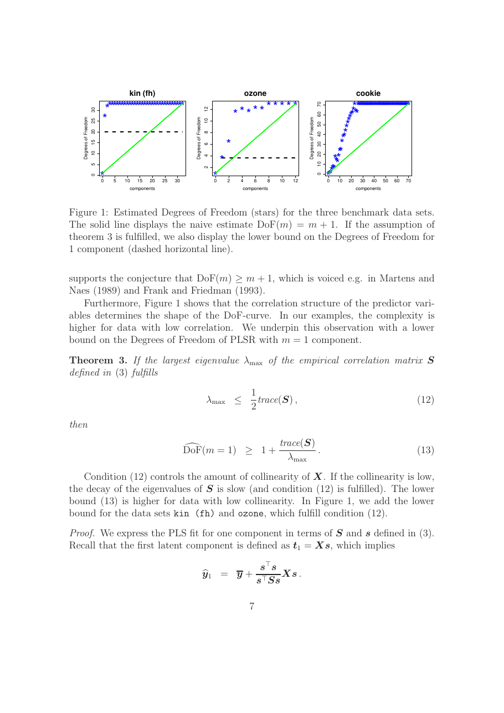
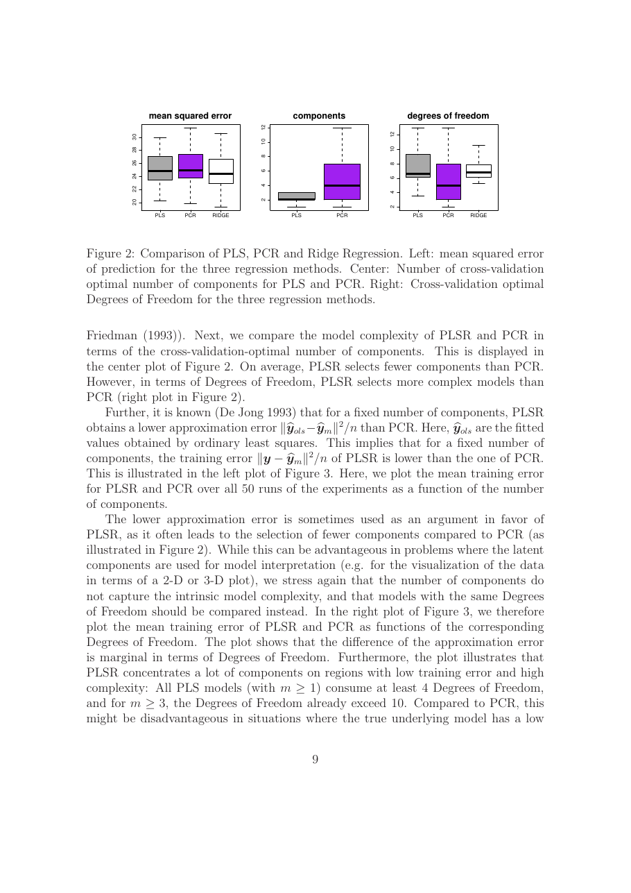
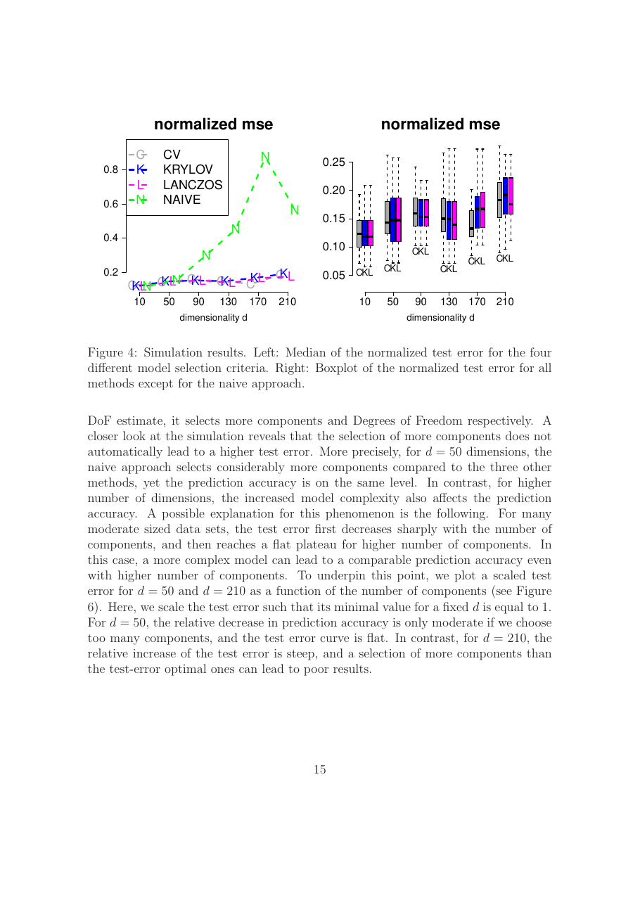

# Krämer & Sugiyama 2011 번역: 부분최소제곱 회귀의 자유도

- 번역 범위: 전문 (초록, 1~5절, 감사의 글, 부록 A, B, 그림과 표 캡션). 참고문헌은 원문 그대로 두었다.
- 원문: 같은 폴더의 `Kramer2011_JASA_PLS_degrees_of_freedom.pdf` (arXiv:1002.4112v3, 2011-02-09판, 23쪽, 2026-11-04 arXiv에서 내려받음). 학술지 판은 Journal of the American Statistical Association 106(494):697-705, 2011, doi:10.1198/jasa.2011.tm10107 이다. 이 번역은 arXiv 판을 옮겼다. 학술지 판과 쪽 번호, 문구가 조금 다를 수 있다.
- 본문은 `pdftotext -layout`으로 뽑아 옮겼다. 수식은 뽑은 글자가 깨져서 원문 PDF를 보고 다시 적었다. 기호는 원문을 그대로 쓴다. `ᵀ`는 전치, `ŷ`는 적합값, `β̂`는 추정 계수다.
- 팀 내부 연구용 번역이다.

---

## 초록

부분최소제곱 회귀(PLSR)의 통계적 성질을 유도하는 일은 어려울 수 있다. 예측 변수에서 잠재 성분을 만들 때 반응 변수도 함께 쓰기 때문이다. 이 성질은 실제로는 대개 좋은 성능과 해석하기 쉬운 모형을 주지만, 통계 분석은 더 복잡하게 만든다.

이 논문은 PLSR의 고유한 복잡도를 연구한다. 우리의 기여는 PLSR 자유도(Degrees of Freedom)의 **불편 추정량**이다. 자유도는 적합값을 반응의 함수로 보았을 때 그 1차 도함수의 대각합(trace)으로 정의한다. PLS와 행렬 분해, 크릴로프(Krylov) 부분공간 기법이 밀접하게 연결된다는 점을 써서 서로 같은 두 표현을 세운다.

자유도는 예측 변수의 공선성에 따라 달라진다. **공선성이 낮을수록 자유도가 높다.** 특히 자유도는 보통 "자유도 = 성분 수"로 두는 단순한 방법보다 높다. 또 이 자유도 추정값으로 서로 다른 회귀 방법을 비교하는 방법을 보인다. 실험 절에서는 이 자유도 추정값을 정보 기준과 함께 쓰면 모형 선택에 쓸모 있음을 보인다.

핵심어: 회귀, 모형 선택, 부분최소제곱, 자유도

(각주: Journal of the American Statistical Association (2011)에 실릴 예정)

## 1. 서론

부분최소제곱 회귀(PLSR)(Wold 1975)는 두 단계로 된 정규화 회귀 기법이다. 먼저 예측 변수에서 서로 직교하는 잠재 성분을 하나씩 만든다. 각 성분은 반응 변수와 공분산이 가장 크다. 그다음 이 저차원 표현으로 선형 회귀 모형을 적합한다. 예측 변수를 변환하면 PLSR을 비선형 회귀로 넓힐 수 있다(Durand and Sabatier 1997, Rosipal and Trejo 2001).

PLSR에서 모형을 고르려면 최적 성분 수를 정해야 한다. 교차검증이 표준 방법이다. 대안으로 정보 기준이 있다. 정보 기준은 적합한 모형의 복잡도를 쓴다. 회귀에서 적합 방법의 복잡도는 자유도로 정의한다. 자유도는 모형 선택에 쓸모 있을 뿐 아니라 회귀 방법의 고유한 복잡도를 수치로 나타낸다(개관은 Van der Voet (1999) 참고).

주성분 회귀(PCR)나 능형 회귀(Ridge) 같은 다른 표준 회귀 기법에서는 자유도가 모자 행렬(hat-matrix)의 대각합과 같다. PLSR은 그렇게 쉽게 유도되지 않는다. PLSR은 "적합한 반응이 반응에 선형으로 의존한다"는 뜻의 선형 방법이 아니기 때문이다. 잠재 성분 집합을 지도 방식으로(반응을 보고) 만들기 때문에, 반응을 이 성분에 투영한 값은 반응의 매우 비선형인 함수다. 그래서 PLSR의 자유도가 성분 수보다 크다는 주장이 있었다(예: Martens and Naes (1989), Frank and Friedman (1993)).

우리는 PLSR의 일반화 자유도의 불편 추정량을 낸다. 이것은 적합값을 반응의 함수로 보았을 때 야코비안 행렬의 대각합으로 정의한다. 벤치마크 자료에서 PLSR의 복잡도가 예측 변수의 공선성에 따라 달라짐을 보인다. 공선성이 높을수록 복잡도는 낮다. 공선성 구조에 대한 추가 가정을 두면, 성분 하나를 쓸 때의 자유도 범위를 준다.

두 가지 구현을 낸다.
- (i) PLSR 적합의 1차 도함수를 반복 계산해 유도한다. 이를 위해 PLSR이 예측 변수 행렬의 란초스(Lanczos) 분해와 같다는 점을 쓴다. 이 구현은 PLSR 회귀 계수의 점근 분포도 주므로 신뢰구간을 만드는 데 쓸 수 있다(Phatak et al. 2002, Denham 1997).
- (ii) 자유도를 직접 계산한다. 즉 도함수 자체를 계산하지 않는다. 그래서 실행 시간이 더 짧다. 유도에는 PLS 회귀와 크릴로프 부분공간 기법의 밀접한 관계를 쓴다.

두 알고리즘 모두 R 패키지 `plsdof`(Krämer and Braun 2009)에 구현했다.

PLSR 성분 수를 고르는 모형 선택에서 PLSR 자유도의 성능을 조사한다. 모의실험에서 10겹 교차검증에 기반한 시험 오차와 베이즈 정보 기준(BIC)(Schwarz 1978)에 기반한 시험 오차를 비교한다. BIC에는 우리의 자유도 추정값과, 자유도를 성분 수로 정의하는 단순한 방법을 각각 쓴다. 실험 결과, 우리의 자유도 추정값으로 고른 모형은 대개 단순한 방법으로 고른 모형보다 덜 복잡하다. 이 때문에 단순한 방법의 시험 오차가 더 높아질 수 있다. 예측 정확도에서 우리의 자유도 방법은 기준 방법인 교차검증과 대등하다. 이것은 우리 추정값이 실제 모형 복잡도를 바르게 잡는다는 추가 증거다.

## 2. 방법 배경

다변량 회귀 문제를 생각한다.

    R ∋ Y_i = f(x_i) + ε_i,  ε_i ~ N(0, σ²)                    (1)

과제는 (1)에서 뽑은 유한한 예제 n개 (x_1, y_1), ..., (x_n, y_n) ∈ Rᵖ × R 로부터 모르는 함수 f: Rᵖ → R 를 추정하는 것이다. 오차 변수 ε_i 는 서로 독립이라고 가정한다. 예측 예제 x_i 의 평균을 x̄, 표준편차를 s(x), 반응 표본 y_i 의 평균을 ȳ 로 적는다. n × p 자료 행렬 X 의 행은 중심화하고 (분산 1로) 척도 조정한 x_i 다. 벡터 y ∈ Rⁿ 은 중심화한 반응 y_i 로 이루어진다. 이 논문에서는 회귀 함수 f 가 선형이라고 가정한다.

    f(x) = β⁽⁰⁾ + βᵀx,  β⁽⁰⁾ ∈ R, β ∈ Rᵖ                        (2)

다만 2.1절의 정의에는 f 가 선형일 필요가 없다. 끝으로 다음을 정의한다.

    S = XᵀX/(n − 1) ∈ R^{p×p},  s = Xᵀy/(n − 1) ∈ Rᵖ            (3)

### 2.1 자유도와 모형 선택

정규화 회귀 방법은 대개 참 회귀 함수 f 의 추정값 집합 f̂_λ 를 낸다. 매개변수 λ 가 정규화 정도를 정한다. 부분최소제곱 회귀에서 λ 는 잠재 성분 수에 해당한다.

과제는 최적 매개변수 λ 를 정하는 것이다. 정보 기준은 f̂_λ 의 참 오차를 학습 오차와 복잡도로 추정할 수 있다는 생각에 기반한다. 회귀 문제에서 복잡도는 자유도로 정의한다. 자유도는 적합값이 y 의 선형 함수인 방법들, 즉 ŷ_λ = H_λ y 이고 H_λ 가 y 에 의존하지 않는 방법들에 대해 정의된다. 능형 회귀와 주성분 회귀가 대표적인 예다. 행렬 H_λ 를 모자 행렬이라고 한다. 선형인 경우 자유도는 모자 행렬의 대각합이다.

    DoF(λ) = trace(H_λ)                                        (4)

아래에서 보듯이 PLS 회귀는 선형 방법이 아니므로 위 정의를 쓸 수 없다. 자유도 개념을 PLSR로 넓히기 위해 Efron (2004)이 제안한 일반화 정의를 쓴다.

**정의 1.** f̂_λ 를 참 회귀 함수 f 의 추정값이라 하고 λ 로 매개변수화한다. 적합값 벡터를 ŷ_λ = (f̂_λ(x_1), ..., f̂_λ(x_n))ᵀ 로 둔다. 자유도는 다음과 같다.

    DoF(λ) = E[ trace( ∂ŷ_λ / ∂y ) ]

여기서 입력 X 는 고정이라고 보고, 기댓값 E 는 y_1, ..., y_n 에 대해 취한다.

자유도는 적합값을 y 의 함수로 보았을 때의 민감도를 잰다. 선형 방법이라는 특수한 경우에는 이 정의가 (4)와 같아진다.

대표적인 정보 기준으로 아카이케 정보 기준(Akaike 1973), 일반화 최소 기술 길이(Hansen and Yu 2001), 베이즈 정보 기준(BIC)(Schwarz 1978)이 있다.

    bic(λ) = ‖ŷ_λ − y‖² + log(n) σ² DoF(λ)

정보 기준을 쓰려면 (1)에 정의한 잡음 수준 σ 의 추정값이 필요하다. 선형 방법 ŷ_λ = H_λ y 에서는 다음처럼 구한다. 잔차는 y − ŷ_λ = (I_n − H_λ) y 꼴이다. 평균제곱오차를 편향과 분산으로 나누면

    E‖y − ŷ_λ‖² = ‖E[y − ŷ_λ]‖² + trace((I_n − H_λ)(I_n − H_λᵀ)) σ²

이다. 모르는 편향 항 ‖E[y − ŷ_λ]‖² 를 버리면 σ 의 추정값을 얻는다.

    σ̂*² = ‖ŷ_λ − y‖² / trace((I_n − H_λ)(I_n − H_λᵀ))            (5)

H_λ 가 투영 연산자이면(예: 주성분 회귀) 식은 다음처럼 단순해진다.

    σ̂² = ‖ŷ_λ − y‖² / (n − DoF(λ))                              (6)

위 가정이 맞지 않더라도 실제로는 이 추정값을 가장 많이 쓴다.

### 2.2 부분최소제곱 회귀

PLSR은 예측 변수 X 에서 잠재 성분 m 개 T = (t_1, ..., t_m) ∈ R^{n×m} 을 만든다. 성분 t_i 는 서로 직교하고, 반응 y 와 공분산이 가장 크다. NIPALS 알고리즘(Wold 1975)에서 첫 성분 t_1 = Xw_1 은 반응 y 와의 공분산 제곱을 최대로 한다.

    w_1 = argmax_w ‖cov(Xw, y)‖² / (wᵀw) = argmax_w (wᵀXᵀyyᵀXw)/(wᵀw) ∝ Xᵀy      (7)

이후 성분 t_2, t_3, ... 은 y 와의 공분산 제곱을 최대로 하면서 모든 성분이 서로 직교하도록 고른다. 직교성은 원래 변수 X 를 수축(deflation)해서 강제한다.

    X_i = X − P_{t_1,...,t_{i−1}} X                              (8)

여기서 P_{t_1,...,t_{i−1}} 은 t_1, ..., t_{i−1} 이 펼치는 공간으로의 직교 투영이다. 그다음 (7)에서 X 를 X_i 로 바꾼다. 행렬 T = (t_1, ..., t_m) 은 만드는 방식 때문에 직교하고, 행렬 W = (w_1, ..., w_m) ∈ R^{d×m} 도 직교함을 보일 수 있다(예: Hoskuldsson (1988)). 잠재 성분 m 개 T 를 X 대신 설명 변수로 써서 최소제곱 적합을 하면 적합값은 다음과 같다.

    ŷ_m = ȳ1_n + T(TᵀT)⁻¹Tᵀy = ȳ1_n + P_T y                       (9)

다시 강조하면 PLSR은 2.1절에 정의한 뜻의 선형 추정량이 아니다. 잠재 성분 T 가 X 와 y 둘 다로 정의되므로 투영 행렬 P_T 도 반응에 의존한다.

(2)의 추정 회귀 계수와 절편을 구하기 위해 다음을 정의한다.

    L = TᵀXW ∈ R^{m×m}                                          (10)

그러면 회귀 계수는 β̂_m = DWL⁻¹Tᵀy (Manne 1987, Hoskuldsson 1988), 절편은 β̂_m⁽⁰⁾ = ȳ − x̄ᵀβ̂_m 이다. D 는 대각 원소가 d_ii = 1/s(x)_i 인 p × p 대각 척도 행렬이다.

**표 1: 세 벤치마크 자료의 성질. 자료에 대한 자세한 설명은 부록에 있다.**

| 자료 | 변수 수 | 예제 수 | 평균 절대 상관 |
|---|---|---|---|
| kin (fh) | 32 | 8192 | 낮음 (0.009) |
| ozone | 12 | 203 | 중간 (0.260) |
| cookie | 700 | 70 | 높음 (0.867) |

## 3. 자유도의 불편 추정

PLSR의 잠재 성분 T 는 반응 y 에 의존한다. 그래서 y 와 PLSR 적합값 ŷ_m 의 관계는 비선형이고, 자유도의 간단한 식 (4)를 쓸 수 없다. 하지만 더 일반적인 정의 1을 써서 불편한 대입(plug-in) 추정량을 얻을 수 있다.

**명제 2.** 잠재 성분 m 개 T = (t_1, ..., t_m) 을 쓰는 PLSR의 자유도 불편 추정량은 다음과 같다.

    DoF̂(m) = 1 + trace( ∂(P_T y) / ∂y )                          (11)

상수 1은 절편 β⁽⁰⁾ 의 추정에 해당하며 자유도 하나를 쓴다. 유도하려면 (11)의 도함수 대각합을 명시적으로 계산해야 한다. 3.3절과 3.4절에서 서로 같은 두 알고리즘을 제안한다.

### 3.1 예시와 하한

구현의 세부로 들어가기 전에 벤치마크 자료에서 자유도의 성질을 보인다. 자료 개요는 표 1에 있다(자세한 내용은 부록). 세 자료는 예측 변수의 공선성 구조가 서로 달라서 골랐다. 공선성 정도의 지표로 절대 경험 상관 계수의 평균 s̄ = (2/(p² − p)) Σ_{i<j} |s_ij| 를 계산한다. s_ij 는 X 의 경험 상관 행렬 S 의 (i, j) 원소다. s̄ 값은 표 1의 넷째 열에 있다.

그림 1에 세 자료의 자유도를 성분 수의 함수로 그렸다. (큰 자료 kin (fh)는 크기 300의 부분 표본을 쓴다.) 단순 추정값 DoF(m) = m + 1 도 함께 그렸다. 예에서 우리의 자유도 추정값은 언제나 단순한 방법보다 크다.

**그림 1: 세 벤치마크 자료에서 추정한 자유도(별표). 실선은 단순 추정값 DoF(m) = m + 1 이다. 정리 3의 가정이 맞으면 성분 1개일 때 자유도의 하한(가로 점선)도 함께 그렸다.**

이것은 예컨대 Martens and Naes (1989), Frank and Friedman (1993)이 제기한 추측 DoF(m) ≥ m + 1 을 뒷받침한다.

또 그림 1은 예측 변수의 상관 구조가 자유도 곡선의 모양을 정함을 보여 준다. 예에서 상관이 낮은 자료일수록 복잡도가 높다. 이 관찰을 성분 m = 1 인 PLSR 자유도의 하한으로 뒷받침한다.

**정리 3.** (3)에 정의한 경험 상관 행렬 S 의 최대 고윳값 λ_max 가

    λ_max ≤ (1/2) trace(S)                                       (12)

를 만족하면

    DoF̂(m = 1) ≥ 1 + trace(S)/λ_max                              (13)

이다.

조건 (12)는 X 의 공선성 정도를 제한한다. 공선성이 낮으면 S 의 고윳값이 천천히 줄어든다(그래서 조건 (12)가 성립한다). 하한 (13)은 공선성이 낮은 자료에서 더 높다. 그림 1에는 조건 (12)를 만족하는 kin (fh)와 ozone 자료의 하한을 넣었다.

**증명.** 성분 하나의 PLS 적합을 (3)에 정의한 S 와 s 로 나타낸다. 첫 잠재 성분이 t_1 = Xs 로 정의됨을 떠올리면

    ŷ_1 = ȳ + (sᵀs / sᵀSs) Xs

이다. 이 항을 y 로 미분하고 대각합을 계산하면

    DoF̂(m = 1) = 3 + (sᵀs / sᵀSs) [ trace(S) − 2 (sᵀS²s / sᵀSs) ]

를 얻는다. 최대 고윳값의 정의에 따라 sᵀS²s / sᵀSs ≤ λ_max 이고 sᵀs / sᵀSs ≥ 1/λ_max 이다. 따라서

    trace(S) − 2 (sᵀS²s / sᵀSs) ≥ trace(S) − 2λ_max

이다. 조건 (12)는 이 부등식의 오른쪽이 음이 아님을 보장한다. 그러므로

    DoF̂(m = 1) ≥ 3 + (sᵀs / sᵀSs)[trace(S) − 2λ_max]
               ≥ 3 + (1/λ_max)[trace(S) − 2λ_max] = 1 + trace(S)/λ_max

이다. (증명 끝)

### 3.2 회귀 방법의 비교

서로 경쟁하는 두 회귀 방법의 정규화 매개변수 λ_1, λ_2 는 직접 비교할 수 없다. 하지만 그에 해당하는 자유도 값 DoF(λ_1), DoF(λ_2)는 같은 척도에 있다. 그래서 자유도로 서로 다른 정규화 회귀 방법의 모형 복잡도를 비교할 수 있다.

이를 보이기 위해 ozone 자료에서 PLSR, 주성분 회귀(PCR), 능형 회귀의 모형 복잡도를 비교한다. PCR의 자유도는 주성분 수 더하기 1이고, 능형 회귀의 자유도는 다음과 같다.

    DoF(λ)_ridge = 1 + trace( X(XᵀX + λI_p)⁻¹Xᵀ )

자료를 학습 예제 50개와 시험 예제 153개로 나눈다. 학습 자료에서 10겹 교차검증으로 각 방법의 최적 모형 매개변수를 구한다. 시험 자료에서 예측 평균제곱오차를 계산해 예측 성능을 평가한다. 이 절차를 50번 반복한다.

먼저 이 자료에서 세 방법의 예측 성능이 비슷하다는 관찰에서 시작한다(그림 2 왼쪽). 이것은 이 방법들이 자주 비슷한 성능을 낸다는 이전 관찰(예: Frank and Friedman (1993))과 맞는다.

**그림 2: PLS, PCR, 능형 회귀의 비교. 왼쪽: 세 회귀 방법의 예측 평균제곱오차. 가운데: PLS와 PCR에서 교차검증으로 고른 최적 성분 수. 오른쪽: 세 회귀 방법에서 교차검증으로 고른 최적 자유도.**

다음으로 교차검증 최적 성분 수로 PLSR과 PCR의 모형 복잡도를 비교한다. 그림 2 가운데에 보였다. 평균적으로 PLSR은 PCR보다 성분을 적게 고른다. 하지만 자유도로 보면 PLSR이 PCR보다 더 복잡한 모형을 고른다(그림 2 오른쪽).

또 성분 수가 같을 때 PLSR의 근사 오차 ‖ŷ_ols − ŷ_m‖²/n 이 PCR보다 낮다는 것이 알려져 있다(De Jong 1993). ŷ_ols 는 보통최소제곱으로 얻은 적합값이다. 이것은 성분 수가 같으면 PLSR의 학습 오차 ‖y − ŷ_m‖²/n 이 PCR보다 낮다는 뜻이다. 그림 3 왼쪽이 이를 보여 준다. 실험 50번 전체에 걸친 PLSR과 PCR의 평균 학습 오차를 성분 수의 함수로 그렸다.

근사 오차가 낮다는 점은 PLSR을 지지하는 논거로 가끔 쓰인다. PCR보다 성분을 적게 고르는 경우가 많기 때문이다(그림 2). 잠재 성분을 모형 해석에 쓰는 문제(예: 자료를 2차원, 3차원 그림으로 보이는 경우)에서는 이것이 유리할 수 있다. 하지만 다시 강조하면 성분 수는 모형의 고유한 복잡도를 잡지 못한다. 자유도가 같은 모형끼리 비교해야 한다. 그래서 그림 3 오른쪽에는 PLSR과 PCR의 평균 학습 오차를 해당 자유도의 함수로 그렸다. 자유도로 보면 근사 오차 차이가 미미하다. 또 이 그림은 PLSR이 학습 오차가 낮고 복잡도가 높은 영역에 성분을 많이 몰아 둔다는 것을 보여 준다. 모든 PLS 모형(m ≥ 1)은 자유도를 적어도 4 쓰고, m ≥ 3 이면 자유도가 이미 10을 넘는다. 참 모형의 복잡도가 낮은 상황에서는 이것이 PCR보다 불리할 수 있다. PLSR 모형은 자유도의 전체 범위를 탐색하지 못하기 때문이다.

**그림 3: PLSR과 PCR의 학습 오차. 왼쪽: 성분 수의 함수로 본 학습 오차. 오른쪽: 자유도의 함수로 본 학습 오차.**

정리하면, 서로 다른 회귀 방법의 모형 매개변수를 직접 비교하는 것은 일반적으로 불가능하다. 척도가 다르거나(예: PLSR과 능형 회귀), 같은 척도처럼 보이기만 하기(예: PLSR과 PCR) 때문이다. 그런 직접 비교는 잘못된 결론으로 이끈다. 자유도는 이 문제의 유용한 해법이다.

### 3.3 란초스 분해의 1차 도함수

이제 자유도 추정량의 첫 번째 구현을 제시한다. Denham (1997)과 Serneels et al. (2004)이 제안한 방법을 확장한다. 그 연구들은 NIPALS 알고리즘의 반복 표현으로 β̂_m 의 도함수를 만든다. 우리 알고리즘은 대신 (10)으로 정의한 행렬 분해에 기반한다. 행렬 L 은 위쪽 이중대각(upper bidiagonal) 행렬이다. 즉 i > j 또는 i < j − 1 이면 l_ij = 0 이다. 관계 (10)은 X 의 란초스 분해(Lanczos 1950)를 정의한다. 즉 X 를 정규직교 행렬 T, W 와 위쪽 이중대각 행렬 L 로 분해한다. y 와 m 이 고정이면 이 분해는 하나뿐이다. 란초스 분해는 주성분 분석이 정의하는 특잇값 분해에 대응하는 것으로 볼 수 있다. PLSR과 란초스 분해의 동등성은 Eldén (2004)을 참고한다.

란초스 분해에 기반해 투영 연산자 P_T 의 도함수를 반복해서 만드는 PLSR 구현을 제안한다. 이 방법은 회귀 계수 β̂_m 의 도함수도 함께 주므로, 근사 신뢰구간을 만드는 데 쓸 수 있다(Denham 1997, Phatak et al. 2002).

세 단계로 진행한다. 첫째, 란초스 분해에 기반한 빠른 재귀 PLSR 알고리즘을 유도한다. 이 알고리즘은 (8)처럼 X 를 명시적으로 수축하지 않고 1차원 부분공간으로의 투영에만 의존한다. 둘째, 1차원 투영 연산자의 1차 도함수를 구한다(Krämer and Braun 2007).

    ∂(v/‖v‖_S)/∂y := ∂(v/√(vᵀSv))/∂y = (1/‖v‖_S)(I_n − vvᵀS/(vᵀv)) ∂v/∂y

    ∂(vvᵀz)/∂y = (vzᵀ + vᵀz I_n) ∂v/∂y + vvᵀ ∂z/∂y

마지막으로 란초스 표현의 재귀식을 미분한다. 알고리즘 1이 그 결과다. 유도는 부록에 있다.

**알고리즘 1: 회귀 계수의 도함수와 자유도**

    1: 입력: 중심화하고 척도 조정한 자료 X, y, 성분 수 m
    2: n = 예제 수
    3: S = XᵀX/(n − 1), s = Xᵀy/(n − 1)
    4: 초기화: β̂_0 = 0_p, ∂β̂_0/∂y = 0_{p×n}
    5: for i = 1, ..., m do
    6:   w_i = s − Sβ̂_{i−1}
    7:   ∂w_i/∂y = Xᵀ/(n − 1) − S ∂β̂_{i−1}/∂y
    8:   v_i = w_i − Σ_{j=1}^{i−1} v_j v_jᵀ S w_i
    9:   ∂v_i/∂y = ∂w_i/∂y − Σ_{j=1}^{i−1} ∂(v_j v_jᵀ S w_i)/∂y
    10:  v_i = √(n − 1) v_i / ‖v_i‖_S
    11:  ∂v_i/∂y = √(n − 1) ∂(v_i/‖v_i‖_S)/∂y
    12:  β̂_i = β̂_{i−1} + v_i v_iᵀ s
    13:  ∂β̂_i/∂y = ∂β̂_{i−1}/∂y + ∂(v_i v_iᵀ s)/∂y
    14: end for
    15: DoF(m) = 1 + trace(X ∂β̂_m/∂y)

회귀 계수의 도함수도 계산하므로, 1차 테일러 근사 β̂_m ≈ (∂β̂_m/∂y) y 를 써서 PLSR 계수의 공분산을 추정할 수 있다.

    cov̂(β̂_m) = σ̂² (∂β̂_m/∂y)(∂β̂_m/∂y)ᵀ

또 1차 테일러 전개로 PLSR의 근사 모자 행렬을 만들 수 있다.

    H_{m, approx} = ∂ŷ_m/∂y                                        (14)

이 행렬을 식 (5)에 넣어 잡음 수준을 추정할 수 있다.

### 3.4 크릴로프 표현의 대각합

3.3절에서 ŷ_m 의 도함수를 계산하려면 행렬과 행렬의 곱을 되풀이해야 한다. 고차원 자료에서는 시간이 많이 걸릴 수 있다. 자유도에는 도함수 자체가 아니라 그 대각합만 필요하므로, 도함수 계산 순서를 영리하게 바꿔 계산량을 줄인다.

이를 위해 크릴로프 부분공간에 기반한 적합값 ŷ_m 의 닫힌 꼴 표현을 쓴다. span{t_1, ..., t_m} = span{Ky, ..., K^m y} =: K_m 이라는 사실(Hoskuldsson 1988)을 쓴다. K = XXᵀ 는 n × n 커널 행렬이다. 오른쪽 공간을 K 와 Ky 로 정의한 크릴로프 부분공간이라고 한다. 도함수를 계산하기 위해 명시적 표현 ŷ_m = ȳ + P_{K_m} y 를 쓴다. Phatak et al. (2002)에서는 β̂_m 에 대한 해당 식으로 그 근사 분포를 구했다. 우리는 이 결과를 적합값의 도함수로 넓힌다. 또 도함수를 계산한 뒤 수치 안정성을 높이기 위해 기저 변환 B = (⟨t_i, K^j y⟩) ∈ R^{m×m} 을 적용한다. 그러면 다음 결과를 얻는다.

**명제 4.** c = B⁻¹Tᵀy ∈ Rᵐ, V = (v_1, ..., v_m) = T(B⁻¹)ᵀ ∈ R^{n×m} 으로 둔다. 그러면

    ∂ŷ_m/∂y = (1/n) I_n + Σ_{j=1}^{m} c_j (I_n − TTᵀ) K^j + Σ_{j=1}^{m} v_j (y − ŷ_m)ᵀ K^j + TTᵀ

이다.

란초스 표현(3.3절)과 달리 명제 4의 표현은 대각합을 바로 계산할 수 있어서 자유도 계산에 더 편하다.

**명제 5.** 성분 m 개 PLSR의 자유도 불편 추정량은

    DoF̂(m) = 1 + Σ_{j=1}^{m} c_j trace(K^j) − Σ_{j,l=1}^{m} t_lᵀ K^j t_l + Σ_{j=1}^{m} (y − ŷ_m)ᵀ K^j v_j + m

이다.

따라서 PLSR 자유도를 계산하려면 잠재 성분 행렬 T 를 내놓는 PLSR 알고리즘을 한 번만 적합하면 된다. NIPALS 알고리즘의 원래 형식(2.2절)이나, 도함수 계산을 뺀 란초스 분해(알고리즘 1) 중 하나를 쓰면 된다.

## 4. 실험

이 절에서는 PLSR 모형 선택에서 자유도 추정량의 성능을 평가한다. 예측 정확도와 모형 복잡도(4.1절), 회귀 모형의 잡음 수준 σ 추정(4.2절)을 함께 조사한다. 4.3절에서는 제안한 알고리즘의 수치 문제와 계산 효율을 다룬다.

실험에서는 베이즈 정보 기준을 쓴다. 아카이케 정보 기준과 일반화 최소 기술 길이로도 실험했지만, 우리 자유도 추정값과 단순 방법 DoF(m) = m + 1 의 차이에 대한 주요 관찰은 어느 기준을 쓰든 같았다. 그래서 명확성을 위해 베이즈 정보 기준 결과만 보고한다.

이 절의 주목적은 BIC와 우리 자유도 추정값의 조합을 기존 방법보다 언제나 나은 새 모형 선택 기준으로 홍보하는 것이 아니다. 우리 추정값이 PLSR의 고유한 모형 복잡도를 믿을 만하게 잡는다는 경험적 증거를 더하려는 것이다.

모의실험의 출발점으로 ozone 자료를 쓴다. 전처리로 자료의 모든 변수를 [−1, +1] 구간으로 척도 조정한다. 식 (1)의 참 회귀 함수 f 는 다음 꼴이다.

    f(x) = Σ_{j=1}^{d} β_j φ_j(x),  고정 기저 함수 φ_j(x) = exp(−‖x − c_j‖²)

중심점 c_j ∈ Rᵖ 의 좌표는 [−1, +1]에서 균등하게 고른다. 회귀 계수 β_j 는 [1, 3] 위의 균등 분포에서 무작위로 고른다. 중심점과 그에 따른 기저 함수는 미리 고정한다. 이것은 베이즈 정보 기준이 맞는 모수 회귀 상황에 머물기 위해서다. 모의실험에서는 기저 함수 수 d 를 10부터 210까지 40씩 바꾼다. 잡음 변수의 분산 σ² 는 신호 대 잡음비가 9가 되도록 고른다. 처음 자료 행렬 X 를 기저 함수 (φ_1, ..., φ_d)로 변환하면 d 차원 자료가 되고, 선형 회귀 모형의 상황이 된다.

자료를 학습 50개와 시험 153개로 나눈다. 학습 표본이 작아서 고차원 상황을 다룰 수 있고, 시험 표본이 커서 시험 오차를 믿을 만하게 추정할 수 있다. 학습 자료에 네 가지 모형 선택 기준을 적용한다.
- (a) CV: 10겹 교차검증.
- (b) LANCZOS: 란초스 분해(알고리즘 1)로 계산한 자유도를 쓰는 베이즈 정보 기준. 잡음 수준은 (14)의 근사 모자 행렬과 식 (5)로 추정한다.
- (c) KRYLOV: 크릴로프 표현(명제 5)으로 계산한 자유도를 쓰는 베이즈 정보 기준. 잡음 수준은 식 (6)으로 추정한다.
- (d) NAIVE: 단순 자유도 DoF(m) = m + 1 을 쓰는 베이즈 정보 기준. 잡음 수준은 식 (6)으로 추정한다.

LANCZOS와 KRYLOV는 같은 자유도 추정값을 쓰고 잡음 수준 σ 추정만 다르다. 자유도 계산이 서로 다른 두 구현에 의존하므로 실행 시간이 다르다. 네 방법 모두 성분 수 범위를 0부터 30까지로 둔다.

네 기준 각각에 대해 크기 153의 보류 자료에서 정규화 평균제곱오차를 계산해 성능을 잰다. 평균제곱 시험 오차를 자명한 모형(학습 자료 평균과 같은 상수 모형)의 평균제곱 시험 오차로 나눈다. 이렇게 정규화하면 d 값이 달라도 비교하기 쉽다. 이 절차를 50번 반복한다.

### 4.1 예측 정확도와 모형 복잡도

정규화 시험 오차의 중앙값과 상자 그림을 그림 4에 보였다. 평균적으로 우리 자유도 추정값과 BIC의 조합은 교차검증과 비슷한 예측 정확도를 보인다(그림 4 오른쪽). 자유도를 계산하는 두 방법(KRYLOV와 LANCZOS)은 σ 추정만 다른데, 여러 모의 설정에서 뚜렷한 차이가 없다. 다만 LANCZOS는 일반적으로 계산 비용이 더 크다. 계산 시간은 4.3절에서 더 자세히 다룬다.

모의실험의 고차원 경우(d ≥ 90)에서는 단순 방법이 다른 세 방법보다 상당히 나쁜 결과를 낸다(그림 4 왼쪽). 그림 5는 단순 방법이 참 모형 복잡도를 과소추정하는 경향이 있음을 보여 준다. 교차검증과 우리 자유도 추정값에 비해 단순 방법은 각각 더 많은 성분과 더 큰 자유도를 고른다.

**그림 4: 모의실험 결과. 왼쪽: 네 모형 선택 기준의 정규화 시험 오차 중앙값. 오른쪽: 단순 방법을 뺀 모든 방법의 정규화 시험 오차 상자 그림.**

모의실험을 더 자세히 보면, 성분을 더 많이 고른다고 해서 시험 오차가 저절로 높아지지는 않는다. 정확히는 d = 50 차원에서 단순 방법이 다른 세 방법보다 성분을 상당히 많이 고르지만 예측 정확도는 같은 수준이다. 반면 차원이 더 높으면 늘어난 모형 복잡도가 예측 정확도에도 영향을 준다. 이 현상의 한 가지 설명은 다음과 같다. 중간 크기 자료의 많은 경우, 시험 오차는 성분 수가 늘면서 먼저 급하게 줄고, 그다음 성분 수가 많은 쪽에서 평평한 고원에 이른다. 이런 경우 더 복잡한 모형도 성분 수가 많아도 비슷한 예측 정확도를 낼 수 있다. 이 점을 뒷받침하기 위해 d = 50 과 d = 210 에서 척도 조정한 시험 오차를 성분 수의 함수로 그렸다(그림 6). 고정된 d 에서 최솟값이 1이 되도록 시험 오차를 척도 조정했다. d = 50 에서는 성분을 너무 많이 골라도 예측 정확도가 상대적으로 조금만 나빠지고, 시험 오차 곡선이 평평하다. 반대로 d = 210 에서는 시험 오차의 상대 증가가 가파르고, 시험 오차 최적보다 성분을 많이 고르면 결과가 나빠질 수 있다.

**그림 5: 모의실험 결과. 왼쪽: 고른 성분 수. 오른쪽: 고른 모형의 자유도.**

### 4.2 잡음 수준 σ 의 추정

이제 KRYLOV, LANCZOS, NAIVE로 얻는 PLS 기반 잡음 수준 추정값 세 가지의 품질을 조사한다.

그림 7은 학습 표본 50개에서 얻은 정규화 추정값 σ̂ 를 보여 준다. 각 추정값을 신호 대 잡음비(9로 둠)로 정해지는 참 잡음 수준 σ 로 나눴다. 가로 점선은 이론 최적값 1이다. KRYLOV와 LANCZOS는 잡음 수준을 조금 과대추정한다. 이것을 추론 문제에 쓰면 신뢰구간이 조금 지나치게 보수적이 된다. 반면 단순 방법은 σ 를 과소추정한다. 그리고 고차원에서 복잡한 모형을 고르기 때문에(4.1절) 추정값의 품질이 나빠진다.

**그림 6: 예시. 성분 수의 함수로 본 척도 조정 평균 시험 오차. 각 d 값(차원)마다 최솟값이 1이 되도록 시험 오차를 척도 조정했다.**

**그림 7: 모의실험 결과. 정규화한 잡음 수준 추정값 σ̂/σ. 가로 점선은 이론 최적값이다.**

### 4.3 수치 안정성과 실행 시간

3.3절에서 설명했듯이 (10)에 정의한 행렬 L 의 성긴 구조 덕분에 PLSR과 그 도함수의 빠른 반복 알고리즘(알고리즘 1)을 유도할 수 있다. 실제로는 이 성긴 구조가 수치 문제를 일으킨다. 성분이 어느 수를 넘으면 잠재 성분 t_i 가 더 이상 서로 직교하지 않는다. 이것은 대개 자유도 계산에도 영향을 주어 그럴듯하지 않은 결과(예: 음의 자유도)를 낸다. Krämer and Braun (2007)에서는 L 의 성긴 구조를 쓰면서 잠재 성분이 직교하도록 추가 정지 기준을 두었다. 하지만 이 알고리즘은 매우 일찍 멈출 수 있다. 그래서 우리는 부록의 식 (16)을 쓴다. 이 식은 추가 계산 시간이 적으면서 안정성을 보장한다.

일부 자료에서는 성분 수가 꽤 클 때 두 구현 모두 음의 자유도를 낸다. 이것은 수치 문제를 뜻한다. 그래서 실험에서는 성분 m* + 1 개에서 음의 자유도가 나오면 최대 성분 수를 m* 로 둔다.

끝으로 그림 8에서 모의실험의 네 방법 실행 시간을 비교한다. 절댓값은 작지만 네 기준은 뚜렷한 차이를 보인다. 란초스 분해가 단연 가장 느리다. 자유도를 계산하기 전에 PLSR 적합의 도함수를 먼저 계산하기 때문이다. 그래서 명시적 도함수가 필요 없다면 실행 시간 면에서 크릴로프 표현 기반 알고리즘이 낫다. 이 알고리즘은 10겹 교차검증보다도 빠르다. 단순 방법은 PLSR 알고리즘을 한 번만 돌리고 자유도를 따로 계산하지 않으므로 언제나 가장 빠르다.

**그림 8: 모의실험 결과. 왼쪽: 네 방법의 실행 시간 중앙값(초). 오른쪽(원문 표기는 "Left"): LANCZOS를 뺀 모든 방법의 실행 시간 중앙값(초).**

## 5. 논의와 결론

우리 결과는 대개 예측 변수의 상관이 낮은 자료에서 자유도가 더 높고, PLSR 성분 하나가 자유도를 하나보다 많이 쓴다는 것을 보여 준다. 이것은 오랜 추측 DoF(m) ≥ m + 1 을 확인한다. 이 결과는 그리 놀랍지 않을 수 있다. 성분 수가 같을 때 PLSR은 주성분 회귀보다 편향이 작다(De Jong 1993). 편향이 줄어든 만큼 자유도로 본 복잡도가 늘어나 균형을 이룬다.

평균적으로 PLSR 자유도를 정보 기준과 함께 쓰면 교차검증과 비슷한 예측 정확도를 낸다. 자유도를 성분 수 더하기 1로 정의하는 단순 방법은 더 복잡한 모형을 고르고, 그 결과 예측 정확도가 나빠질 수 있다. 이것은 회귀 모형의 잡음 수준 σ 추정에도 영향을 준다. 우리 방법은 σ 를 조금 과대추정하지만, 단순 방법은 상당히 아래로 치우친 추정값을 낸다. 계산 면에서는 크릴로프 표현 기반 구현이 란초스 기반 알고리즘보다 낫고, 분할 수 k 에 따라 k겹 교차검증보다 빠르다.

이 논문에서는 자유도 추정값을 최적 PLSR 성분 수 선택에 적용했다. 추가 평활 매개변수를 골라야 하는 벌점 PLSR(Goutis and Fearn 1996, Reiss and Ogden 2007, Krämer et al. 2008)로 이 틀을 넓힐 수 있다. 자유도 유도도 그에 맞게 고칠 수 있다.

자유도의 두 구현은 PLSR과 수치 선형대수 방법, 즉 란초스 분해와 크릴로프 부분공간 근사의 밀접한 관계를 활용한다. 이 논문에서 짚은 계산상 이점 말고도, 이 관계는 PLSR의 통계적 성질을 간결하게 분석하는 데 매우 유용하다. 벌점 PLSR과 전처리(preconditioning)의 대응(Krämer et al. 2008), PLSR의 예측 일치성(Blanchard and Krämer 2010a;b)에 대한 최근 결과가 이 관계의 잠재력을 뒷받침한다. 우리는 수치 선형대수와 PLSR의 상호작용이 통계학 분야를 더 자극하리라 굳게 믿는다.

**감사의 글.** 이 연구는 일부 유럽공동체 FP7-ICT 프로그램의 PASCAL2 우수 네트워크(ICT-216886)와, 세계 선도 혁신 연구개발 지원 프로그램(FIRST)의 지원을 받았다.

## 참고문헌 (원문 그대로)

Akaike, H. (1973). Information Theory and an Extension of the Likelihood Ratio Principle. In Second International Symposium of Information Theory, pages 267–281.

Blanchard, G. and Krämer, N. (2010a). Kernel Partial Least Squares is Universally Consistent. JMLR Workshop and Conference Proceedings (AISTATS 2010), 9:57–64.

Blanchard, G. and Krämer, N. (2010b). Optimal learning rates for kernel conjugate gradient regression. Advances in Neural Information Processing Systems (NIPS), 23:226 234.

Brown, P., Fearn, T., and Vannucci, M. (2001). Bayesian Wavelet Regression on Curves with Application to a Spectroscopic Calibration Problem. Journal of the American Statistical Association, 96(454).

De Jong, S. (1993). PLS fits closer than PCR. Journal of Chemometrics, 7:551–551.

Denham, M. C. (1997). Prediction Intervals in Partial Least Squares. Journal of Chemometrics, 11(1):39–52.

Durand, J. and Sabatier, R. (1997). Additive Splines for Partial Least Squares Regression. Journal of the American Statistical Association, 92:1546–1554.

Efron, B. (2004). The Estimation of Prediction Error: Covariance Penalties and Cross-Validation. Journal of the American Statistical Association, 99(467):619–633.

Eldén, L. (2004). Partial least-squares vs. Lanczos bidiagonalization I: analysis of a projection method for multiple regression. Computational Statistics and Data Analysis, 46(1):11–31.

Frank, I. and Friedman, J. (1993). A Statistical View of Some Chemometrics Regression Tools. Technometrics, 35(2):109–135.

Goutis, C. and Fearn, T. (1996). Partial Least Squares Regression on Smooth Factors. Journal of the American Statistical Association, 91:627–632.

Hansen, M. and Yu, B. (2001). Model Selection and Minimum Descripion Length Principle. Journal of the American Statistical Association, 96:746–774.

Hoskuldsson, A. (1988). PLS Regression Methods. Journal of Chemometrics, 2(3):211–228.

Krämer, N. and Boulesteix, A.-L. (2009). ppls: Penalized Partial Least Squares. R package version 1.4.

Krämer, N., Boulesteix, A.-L., and Tutz, G. (2008). Penalized Partial Least Squares with Applications to B-Spline Transformations and Functional Data. Chemometrics and Intelligent Laboratory Systems, 94:60–69.

Krämer, N. and Braun, M. (2007). Kernelizing PLS, Degrees of Freedom, and Efficient Model Selection. In Ghahramani, Z., editor, Proceedings of the 24th International Conference on Machine Learning, pages 441 – 448.

Krämer, N. and Braun, M. L. (2009). plsdof: Degrees of Freedom and Confidence Intervals for Partial Least Squares Regression. R package version 0.2-1.

Lanczos, C. (1950). An Iteration Method for the Solution of the Eigenvalue Problem of Linear Differential and Integral Operators. Journal of Research of the National Bureau of Standards, 45:225–280.

Leisch, F. and Dimitriadou, E. (2010). mlbench: Machine Learning Benchmark Problems. R package version 1.1-6.

Manne, R. (1987). Analysis of Two Partial-Least-Squares Algorithms for Multivariate Calibration. Chemometrics and Intelligent Laboratory Systems, 2:187–197.

Martens, H. and Naes, T. (1989). Multivariate Calibration. Wiley, New York.

Osborne, B., Miller, A., Fearn, T., and Douglas, S. (1984). Application of Near Infrared Reflectance Spectroscopy to the Compositional Analysis of Biscuits and Biscuit Doughs. Journal of the Science of Food and Agriculture, 35:99–105.

Phatak, A., Rilley, P., and Penlidis, A. (2002). The Asymptotic Variance of the Univariate PLS Estimator. Linear Algebra and its Applications, 354:245–253.

Reiss, P. and Ogden, R. (2007). Functional Principal Component Regression and Functional Partial Least Squares. Journal of the American Statistical Association, 102(479):984–996.

Rosipal, R. and Trejo, L. (2001). Kernel Partial Least Squares Regression in Reproducing Kernel Hilbert Spaces. Journal of Machine Learning Research, 2:97–123.

Schwarz, G. (1978). Estimating the Dimension of a Model. The Annals of Statistics, 6(2):461–464.

Serneels, S., Lemberge, P., and Espen, P. V. (2004). Calculation of PLS Prediction Intervals Using Efficient Recursive Relations for the Jacobian Matrix. Journal of Chemometrics, 18:76–80.

Van der Voet, H. (1999). Pseudo-Degrees of Freedom for Complex Predictive Models: the Example of Partial Least Squares. Journal of Chemometrics, 13:195–208.

Wold, H. (1975). Path models with Latent Variables: The NIPALS Approach. In et al., H. B., editor, Quantitative Sociology: International Perspectives on Mathematical and Statistical Model Building, pages 307–357. Academic Press.

## 부록 A. 알고리즘 1의 유도

가중 벡터 w_i 는 w_i = Xᵀ(y − ŷ_{i−1}) ∝ s − Sβ̂_{i−1} 로 다시 쓸 수 있다. "의사" 가중 벡터 v_i 를 t_i = X_i w_i =: X v_i 로 정의한다. (10)에 정의한 행렬 L = TᵀXW 가 위삼각 행렬이라는 사실을 쓰면

    v_i = w_i − v_{i−1} v_{i−1}ᵀ S w_i                             (15)
          − Σ_{j=1}^{i−2} v_j v_jᵀ S w_i                           (16)

를 얻는다. L 은 사실 위쪽 이중대각이므로 둘째 줄 항은 0이다. 하지만 수치 안정성을 위해 계산에 이 항을 넣는다. t_i 를 길이 1로 정규화하는 것은

    v_i ← (√(n − 1)/‖v_i‖_S) v_i = (√(n − 1)/√(v_iᵀSv_i)) v_i

에 해당한다. 따라서 β̂_i = β̂_{i−1} + v_i v_iᵀ s 이다.

## 부록 B. 자료 설명

**kin (fh)** 회전 관절 8개로 된 로봇 팔의 순방향 동역학 모의 자료다. 예측 변수 32개는 관절 위치와, 링크의 비틀림 각, 길이, 오프셋 거리다. 과제는 끝단(end-effector)과 목표 사이 거리를 예측하는 것이다. 문제는 꽤 선형이고(f) 잡음이 많다(h). 자료는 delve 저장소 http://www.cs.toronto.edu/~delve/ 에서 받을 수 있다.

**ozone** 1976년 로스앤젤레스 오존 오염 자료다. 예측 변수 12개는 측정 날짜와 풍속, 습도, 기온 등의 정보다. 과제는 하루 최대 1시간 평균 오존 값을 예측하는 것이다. 원자료에는 빠진 값이 있다. 예제 366개 중 빠진 값이 없는 203개를 쓴다. 자료는 R 패키지 `mlbench`(Leisch and Dimitriadou 2010)가 제공한다.

**cookie** 반죽 조각에 대한 정량 근적외선(NIR) 분광 자료다. 반죽 조각마다 근적외선 반사 스펙트럼이 있다. 스펙트럼 자료는 1100 nm부터 2498 nm까지 2 nm 간격으로 잰 700점이다. 과제는 지방 함량(%)을 예측하는 것이다. 이 자료는 Brown et al. (2001), Osborne et al. (1984)에서 처음 분석했다. R 패키지 `ppls`(Krämer and Boulesteix 2009)가 주는 자료에는 자당, 마른 밀가루, 물의 함량도 들어 있다.
