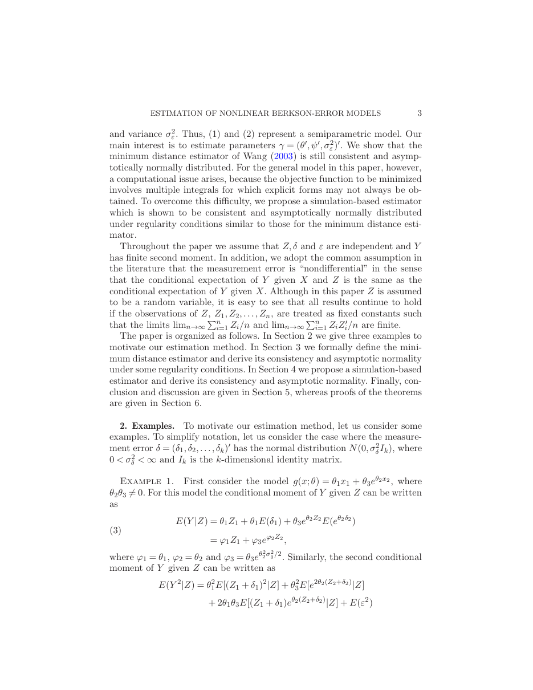
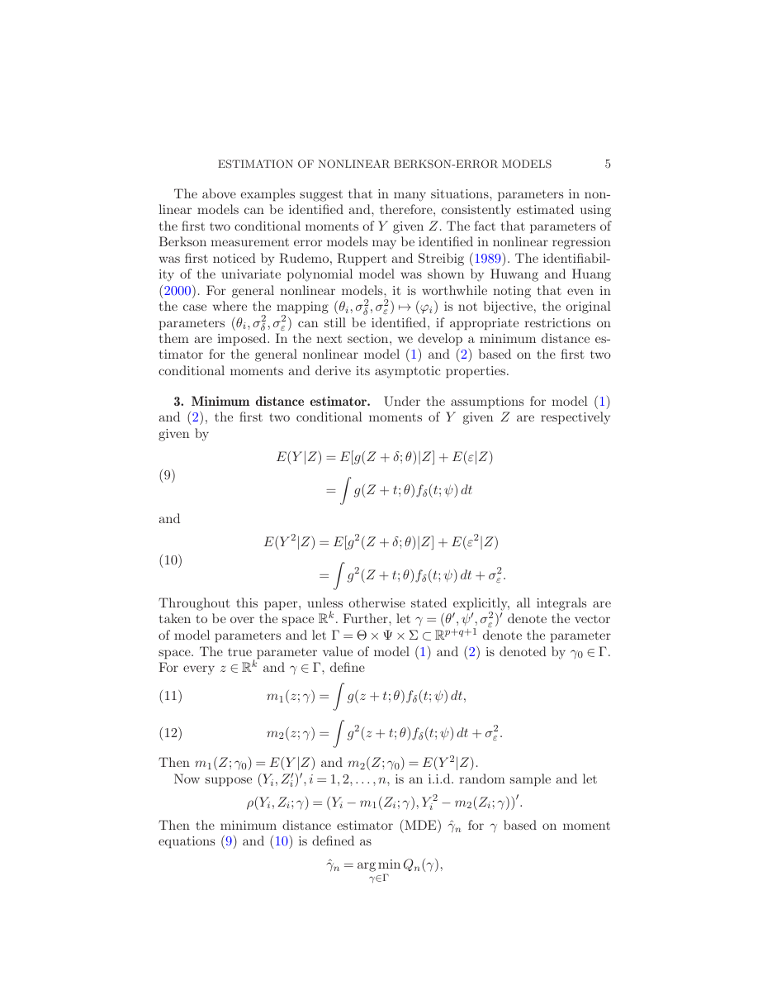
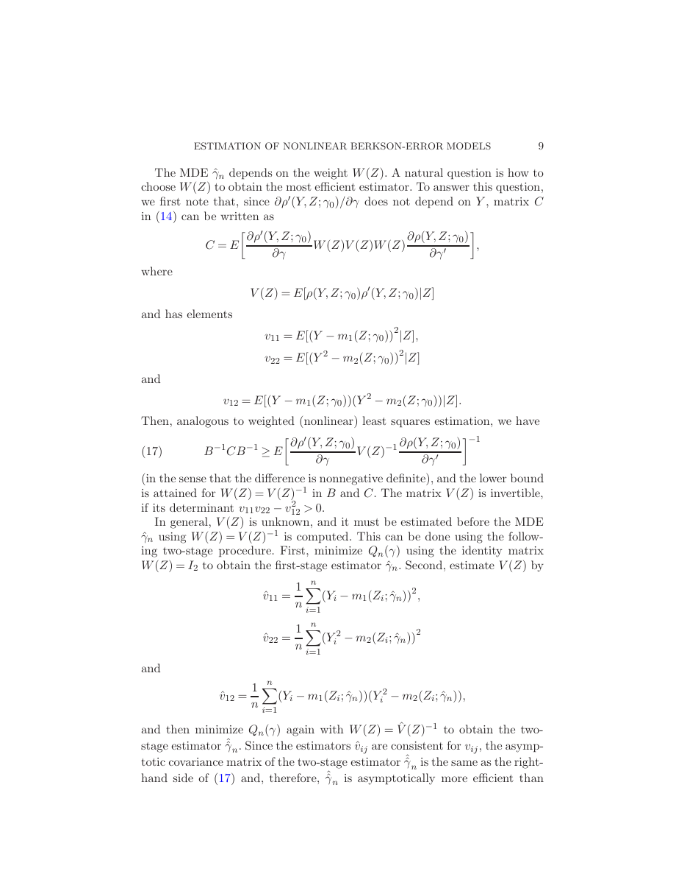

# Berkson 측정 오차가 있는 비선형 모형의 추정 (번역)

번역 범위: 전문 (초록, 본문 1~5절, 6절 증명, 감사의 글). 참고문헌은 원문 그대로 둔다.
원문: 같은 폴더의 `Wang2004_AnnStat_Berkson_nonlinear.pdf` (arXiv:math/0508600v1, 학술지판의 전자 재인쇄본. 쪽 번호와 조판이 학술지판과 다르다)
원문에는 그림과 표가 없다. 식이 핵심이므로 핵심 식이 있는 쪽을 이미지로 넣었다.

- 학술지: The Annals of Statistics, 2004, Vol. 32, No. 6, 2559-2579
- DOI: 10.1214/009053604000000670
- 저자: Liqun Wang, University of Manitoba
- 접수 2003년 3월, 수정 2003년 8월
- 연구비: Natural Sciences and Engineering Research Council of Canada
- AMS 2000 분류: 주 62J02, 62F12. 부 65C60, 65C05
- 핵심어: 비선형 회귀, 준모수 모형, 변수 오차(errors-in-variables), 적률법, 가중 최소제곱, 최소 거리 추정량, 시뮬레이션 기반 추정량, 일치성, 점근 정규성

---

## 초록

이 논문은 예측 변수에 Berkson형 측정 오차가 있는 일반 비선형 회귀 모형을 다룬다.
측정 오차는 일반적인 모수 분포를 따른다고 가정한다. 정규 분포일 필요는 없다.
또 회귀식의 무작위 오차 분포는 비모수다(분포 모양을 정하지 않는다).
관측한 예측 변수가 주어졌을 때 반응 변수의 처음 두 조건부 적률을 바탕으로 하는 최소 거리 추정량을 제안한다.
목적 함수에 다중 적분이 들어 있어 최소화가 어려울 수 있다. 이를 피하려고 시뮬레이션 기반 추정량도 만든다.
두 추정량 모두 꽤 일반적인 정칙 조건 아래에서 일치성과 점근 정규성을 보인다.

---

## 1. 서론

많은 과학 연구에서 다음 비선형 관계에 관심이 있다.

$$Y = g(X;\theta) + \varepsilon \qquad (1)$$

여기서 $Y\in\mathbb{R}$는 반응 변수, $X\in\mathbb{R}^k$는 예측 변수, $\theta\in\mathbb{R}^p$는 모르는 회귀 모수, $\varepsilon$은 무작위 오차다.
많은 실험에서 예측 변수 $X$를 정확히 재는 것은 너무 비싸거나 불가능하다. 대신 $X$의 대리값 $Z$를 잰다.

예를 들어 역학자가 어떤 도시 주민의 폐 질환 중증도 $Y$와 특정 대기 오염 물질의 양 $X$의 관계를 연구한다고 하자.
오염 물질은 도시의 몇몇 관측소에서 잰다고 하자. 그런데 주민이 실제로 노출된 양 $X$는 관측소에서 잰 값 $Z$와 무작위로 다를 수 있다.
이 경우 $X$는 $Z$에 무작위 오차를 더한 것으로 쓸 수 있다. 이 오차는 잰 노출량에서 개인의 실제 노출량이 벗어난 정도를 나타낸다.

다른 예로 농업이나 의학 연구가 있다. 작물 수확량이나 약 효과 $Y$와 비료나 약의 사용량 $X$의 관계를 본다.
비료나 약을 미리 정한 용량 $Z$로 준다고 하자. 그런데 작물이 실제로 흡수한 비료, 환자 혈액에 실제로 들어간 약의 양은 땅 조건이나 개인의 생체 조건 때문에 정한 용량 주위에서 무작위로 달라질 수 있다.
이런 경우 $Z$를 제대로 보정해 두었다면, 실제 흡수량 $X$는 $Z$ 주위에서 무작위로 흩어지고, 평균적으로 $X-Z$는 0이 된다.

위의 모든 상황에서 측정 오차의 합리적인 모형은 이른바 Berkson 모형이다.

$$X = Z + \delta \qquad (2)$$

여기서 $\delta$는 관측되지 않는 무작위 측정 오차이고, 관측한 예측 변수 $Z$와 독립이라고 가정한다.
Berkson 오차 모형의 더 자세한 설명과 동기는 Fuller [(1987), 79-80쪽]에 있다.

Berkson 측정 오차 모형 (2)의 확률 구조는 고전적 변수 오차 모형과 근본적으로 다르다.
고전 모형에서는 측정 오차가 $X$와 독립이고 $Z$와는 종속이다.
이 차이 때문에 모수 추정과 추론 절차가 완전히 달라진다.

선형 Berkson 측정 오차 모형의 추정은 Fuller [(1987), 81-83쪽]와 Cheng and Van Ness [(1995), 35-38쪽]에서 다룬다.
비선형 모형에 대해서는 회귀 보정(regression calibration)이라는 근사 방법이 Carroll, Ruppert and Stefanski [(1995), 3장]에 있다.
최근 Huwang and Huang (2000)은 $g(x;\theta)$가 차수를 아는 $x$의 다항식인 일변수 다항 모형을 연구했다. 그리고 $Z$가 주어졌을 때 $Y$의 처음 두 조건부 적률에 기반한 최소제곱 추정량이 일치 추정량임을 보였다.
Wang (2003)은 모든 무작위 오차가 정규 분포인 일반 일변수 비선형 모형을 다뤘다. 그리고 $Z$가 주어졌을 때 $Y$의 처음 두 조건부 적률에 기반한 최소 거리 추정량이 일치성과 점근 정규성을 가짐을 보였다.

그러나 실제 응용에서는 측정 오차가 있는 예측 변수가 하나보다 많은 경우가 흔하다.
또 무작위 오차 $\varepsilon$과 $\delta$가 정규 분포가 아닌 분포를 따를 수 있다.
이 논문의 목표는 Wang (2003)의 결과를 다변수 예측 변수를 가진 비선형 모형으로 일반화하는 것이다.
여기서 측정 오차 $\delta$는 일반 모수 분포 $f_\delta(t;\psi)$, $\psi\in\Psi\subset\mathbb{R}^q$를 따르고, 무작위 오차 $\varepsilon$은 평균 0, 분산 $\sigma_\varepsilon^2$인 비모수 분포를 따른다.
따라서 (1)과 (2)는 준모수 모형이다. 주된 관심은 모수 $\gamma=(\theta',\psi',\sigma_\varepsilon^2)'$의 추정이다.
Wang (2003)의 최소 거리 추정량이 여전히 일치성과 점근 정규성을 가짐을 보인다.
그런데 이 논문의 일반 모형에서는 계산 문제가 생긴다. 최소화할 목적 함수에 다중 적분이 들어가고, 그 적분이 늘 닫힌 꼴로 구해지지는 않기 때문이다.
이 어려움을 넘으려고 시뮬레이션 기반 추정량을 제안한다. 이 추정량도 최소 거리 추정량과 비슷한 정칙 조건 아래에서 일치성과 점근 정규성을 가짐을 보인다.

논문 전체에서 $Z$, $\delta$, $\varepsilon$은 서로 독립이고 $Y$는 유한한 2차 적률을 가진다고 가정한다.
또 문헌의 흔한 가정을 따라 측정 오차가 "비차별적(nondifferential)"이라고 가정한다. 즉 $X$와 $Z$가 주어졌을 때 $Y$의 조건부 기댓값은 $X$만 주어졌을 때의 조건부 기댓값과 같다.
이 논문에서는 $Z$를 확률 변수로 가정하지만, $Z$의 관측값 $Z_1,Z_2,\dots,Z_n$을 고정 상수로 다루어도 모든 결과가 그대로 성립함을 쉽게 볼 수 있다. 단 극한 $\lim_{n\to\infty}\sum_{i=1}^n Z_i/n$과 $\lim_{n\to\infty}\sum_{i=1}^n Z_iZ_i'/n$이 유한해야 한다.

논문의 구성은 다음과 같다.
2절에서 추정 방법의 동기를 주는 예 세 개를 든다.
3절에서 최소 거리 추정량을 정식으로 정의하고, 정칙 조건 아래에서 일치성과 점근 정규성을 유도한다.
4절에서 시뮬레이션 기반 추정량을 제안하고 일치성과 점근 정규성을 유도한다.
5절에 결론과 논의를 두고, 정리의 증명은 6절에 둔다.

## 2. 예

추정 방법의 동기를 주려고 몇 가지 예를 보자.
표기를 간단히 하려고 측정 오차 $\delta=(\delta_1,\delta_2,\dots,\delta_k)'$가 정규 분포 $N(0,\sigma_\delta^2 I_k)$를 따르는 경우를 생각한다. 여기서 $0<\sigma_\delta^2<\infty$이고 $I_k$는 $k$차원 단위 행렬이다.



**예 1.** 먼저 모형 $g(x;\theta)=\theta_1x_1+\theta_3e^{\theta_2x_2}$, $\theta_2\theta_3\neq0$을 보자.
이 모형에서 $Z$가 주어졌을 때 $Y$의 조건부 적률은 다음처럼 쓸 수 있다.

$$E(Y|Z)=\theta_1Z_1+\theta_1E(\delta_1)+\theta_3e^{\theta_2Z_2}E(e^{\theta_2\delta_2}) = \varphi_1Z_1+\varphi_3e^{\varphi_2Z_2} \qquad (3)$$

여기서 $\varphi_1=\theta_1$, $\varphi_2=\theta_2$, $\varphi_3=\theta_3e^{\theta_2^2\sigma_\delta^2/2}$이다.
비슷하게 $Z$가 주어졌을 때 $Y$의 2차 조건부 적률은 다음처럼 쓸 수 있다.

$$\begin{aligned}E(Y^2|Z)&=\theta_1^2E[(Z_1+\delta_1)^2|Z]+\theta_3^2E[e^{2\theta_2(Z_2+\delta_2)}|Z]+2\theta_1\theta_3E[(Z_1+\delta_1)e^{\theta_2(Z_2+\delta_2)}|Z]+E(\varepsilon^2)\\&=\theta_1^2(Z_1^2+\sigma_\delta^2)+\theta_3^2e^{2\theta_2Z_2}E(e^{2\theta_2\delta_2})+2\theta_1\theta_3Z_1e^{\theta_2Z_2}E(e^{\theta_2\delta_2})+\sigma_\varepsilon^2\\&=\varphi_4+\varphi_1^2Z_1^2+\varphi_5e^{2\varphi_2Z_2}+2\varphi_1\varphi_3Z_1e^{\varphi_2Z_2}\end{aligned}\qquad(4)$$

여기서 $\varphi_4=\theta_1^2\sigma_\delta^2+\sigma_\varepsilon^2$, $\varphi_5=\theta_3^2e^{2\theta_2^2\sigma_\delta^2}$이다.
(3)과 (4)는 보통의 비선형 회귀식이고 $Y$와 $Z$는 모두 관측되므로, $(\varphi_i)$는 이 식들로 식별되고 비선형 최소제곱법으로 일치 추정할 수 있다.
또 사상 $(\theta_i,\sigma_\delta^2,\sigma_\varepsilon^2)\mapsto(\varphi_i)$가 전단사이므로 원래 모수 $(\theta_i,\sigma_\delta^2,\sigma_\varepsilon^2)$도 식별된다.
실제로 다음을 바로 계산할 수 있다.
$\theta_1=\varphi_1$, $\theta_2=\varphi_2$, $\theta_3=\varphi_3^2/\sqrt{\varphi_5}$, $\sigma_\delta^2=\log(\varphi_5/\varphi_3^2)/\varphi_2^2$, $\sigma_\varepsilon^2=\varphi_4-\varphi_1^2\log(\varphi_5/\varphi_3^2)/\varphi_2^2$.

**예 2.** 다음으로 모형 $g(x;\theta)=\theta_1\exp(x'\theta_2)$를 보자. 여기서 $\theta_1\neq0$, $0\neq\theta_2\in\mathbb{R}^{p-1}$, $p>1$이다.
이 모형에서 $Z$가 주어졌을 때 $Y$의 1차 조건부 적률은 다음처럼 쓸 수 있다.

$$E(Y|Z)=\theta_1e^{Z'\theta_2}E(e^{\delta'\theta_2})=\varphi_1e^{Z'\varphi_2}\qquad(5)$$

여기서 $\varphi_1=\theta_1\exp(\theta_2'\theta_2\sigma_\delta^2/2)$, $\varphi_2=\theta_2$이다. 2차 조건부 적률은 다음과 같다.

$$E(Y^2|Z)=\theta_1^2e^{2Z'\theta_2}E(e^{2\delta'\theta_2})+E(\varepsilon^2)=\varphi_3e^{2Z'\varphi_2}+\varphi_4\qquad(6)$$

여기서 $\varphi_3=\theta_1^2e^{2\theta_2'\theta_2\sigma_\delta^2}$, $\varphi_4=\sigma_\varepsilon^2$이다.
이번에도 $(\varphi_i)$는 (5)와 (6)과 비선형 최소제곱법으로 식별된다.
또 사상 $(\theta_i,\sigma_\delta^2,\sigma_\varepsilon^2)\mapsto(\varphi_i)$가 전단사이므로 원래 모수도 식별된다.
실제로 바로 계산하면 $\theta_1=\varphi_1^2/\sqrt{\varphi_3}$, $\theta_2=\varphi_2$, $\sigma_\delta^2=\log(\varphi_3/\varphi_1^2)/\varphi_2'\varphi_2$, $\sigma_\varepsilon^2=\varphi_4$이다.

**예 3.** 나아가 다항 모형 $g(x;\theta)=\theta_1x_1+\theta_2x_2+\theta_3x_1^2+\theta_4x_2^2+\theta_5x_1x_2$를 보자.
이 모형의 처음 두 조건부 적률은 각각 다음과 같다.

$$E(Y|Z)=(\theta_3+\theta_4)\sigma_\delta^2+\theta_1Z_1+\theta_2Z_2+\theta_3Z_1^2+\theta_4Z_2^2+\theta_5Z_1Z_2\qquad(7)$$

$$E(Y^2|Z)=E[g^2(Z+\delta;\theta)|Z]+E(\varepsilon^2|Z)=E[g^2(Z+\delta;\theta)|Z]+\sigma_\varepsilon^2\qquad(8)$$

이번에도 모수 $(\theta_i)$와 $\sigma_\delta^2$는 비선형 회귀식 (7)로 식별되고, $\sigma_\varepsilon^2$는 (8)로 식별됨을 쉽게 알 수 있다.
따라서 이 모형의 모든 모수는 처음 두 조건부 적률 식으로 일치 추정할 수 있다.

위의 예들은 많은 상황에서 비선형 모형의 모수가 식별되고, 따라서 $Z$가 주어졌을 때 $Y$의 처음 두 조건부 적률로 일치 추정할 수 있음을 보여 준다.
Berkson 측정 오차 모형의 모수가 비선형 회귀에서 식별될 수 있다는 사실은 Rudemo, Ruppert and Streibig (1989)가 처음 알아챘다.
일변수 다항 모형의 식별 가능성은 Huwang and Huang (2000)이 보였다.
일반 비선형 모형에서는, 사상 $(\theta_i,\sigma_\delta^2,\sigma_\varepsilon^2)\mapsto(\varphi_i)$가 전단사가 아닌 경우에도 적절한 제약을 주면 원래 모수를 식별할 수 있다는 점을 짚어 둔다.
다음 절에서 일반 비선형 모형 (1), (2)에 대해 처음 두 조건부 적률에 기반한 최소 거리 추정량을 만들고 그 점근 성질을 유도한다.

## 3. 최소 거리 추정량



모형 (1), (2)의 가정 아래에서 $Z$가 주어졌을 때 $Y$의 처음 두 조건부 적률은 각각 다음과 같다.

$$E(Y|Z)=E[g(Z+\delta;\theta)|Z]+E(\varepsilon|Z)=\int g(Z+t;\theta)f_\delta(t;\psi)\,dt\qquad(9)$$

$$E(Y^2|Z)=E[g^2(Z+\delta;\theta)|Z]+E(\varepsilon^2|Z)=\int g^2(Z+t;\theta)f_\delta(t;\psi)\,dt+\sigma_\varepsilon^2\qquad(10)$$

따로 밝히지 않으면 이 논문의 모든 적분은 공간 $\mathbb{R}^k$ 위에서 한다.
또 $\gamma=(\theta',\psi',\sigma_\varepsilon^2)'$를 모형 모수 벡터, $\Gamma=\Theta\times\Psi\times\Sigma\subset\mathbb{R}^{p+q+1}$를 모수 공간이라 하자.
모형 (1), (2)의 참 모수값을 $\gamma_0\in\Gamma$로 쓴다. 모든 $z\in\mathbb{R}^k$와 $\gamma\in\Gamma$에 대해 다음을 정의한다.

$$m_1(z;\gamma)=\int g(z+t;\theta)f_\delta(t;\psi)\,dt\qquad(11)$$

$$m_2(z;\gamma)=\int g^2(z+t;\theta)f_\delta(t;\psi)\,dt+\sigma_\varepsilon^2\qquad(12)$$

그러면 $m_1(Z;\gamma_0)=E(Y|Z)$, $m_2(Z;\gamma_0)=E(Y^2|Z)$이다.
이제 $(Y_i,Z_i')'$, $i=1,2,\dots,n$이 i.i.d. 표본이라 하고 다음을 둔다.

$$\rho(Y_i,Z_i;\gamma)=(Y_i-m_1(Z_i;\gamma),\;Y_i^2-m_2(Z_i;\gamma))'$$

그러면 적률식 (9), (10)에 기반한 $\gamma$의 최소 거리 추정량(MDE) $\hat\gamma_n$을 다음처럼 정의한다.

$$\hat\gamma_n=\arg\min_{\gamma\in\Gamma}Q_n(\gamma)$$

여기서 목적 함수는

$$Q_n(\gamma)=\sum_{i=1}^n\rho'(Y_i,Z_i;\gamma)W(Z_i)\rho(Y_i,Z_i;\gamma)\qquad(13)$$

이고, $W(Z_i)$는 $Z_i$에 따라 달라질 수 있는 $2\times2$ 가중 행렬이다.

$\hat\gamma_n$이 식별되고, 일치성과 점근 정규성을 가지는 정칙 조건은 비선형 회귀 문헌에 잘 알려져 있다. 예를 들어 Amemiya [(1985), 5장], Gallant [(1987), 5장], Seber and Wild [(1989), 12장]을 보라. 보통 이 조건들은 여러 형태로 표현된다.

아래에서는 Amemiya (1985)의 틀을 따르되, 이 정칙 조건들을 회귀 함수 $g(x;\theta)$와 측정 오차 분포 $f_\delta(t;\psi)$로 표현한다.
$\mu$는 르베그 측도, $\|\cdot\|$는 $\mathbb{R}^d$의 유클리드 노름이다. MDE $\hat\gamma_n$의 일치성을 위해 다음 조건을 가정한다.

**가정 A1.** $g(x;\theta)$는 모든 $\theta\in\Theta$에 대해 $x$의 가측 함수이고, $\mu$-거의 모든 $x$에 대해 $\theta\in\Theta$에서 연속이다.

**가정 A2.** $f_\delta(t;\psi)$는 $\mu$-거의 모든 $t$에 대해 $\psi\in\Psi$에서 연속이다.

**가정 A3.** 모수 공간 $\Gamma\subset\mathbb{R}^{p+q+1}$는 콤팩트하다.

**가정 A4.** 가중 $W(Z)$는 확률 1로 음이 아닌 정부호이고 $E\|W(Z)\|<\infty$를 만족한다.

**가정 A5.** $\int\sup_\Psi f_\delta(t;\psi)\,dt<\infty$이고 $E(\|W(Z)\|+1)\int\sup_{\Theta\times\Psi}g^4(Z+t;\theta)f_\delta(t;\psi)\,dt<\infty$이다.

**가정 A6.** $E[\rho(Y,Z;\gamma)-\rho(Y,Z;\gamma_0)]'W(Z)[\rho(Y,Z;\gamma)-\rho(Y,Z;\gamma_0)]=0$은 $\gamma=\gamma_0$일 때, 그리고 그때만 성립한다.

위 정칙 조건들은 비선형 회귀 문헌에서 흔하다.
특히 가정 A1과 A2는 보통 목적 함수 $Q_n(\gamma)$가 $\gamma$에 대해 연속임을 보장하는 데 쓴다.
비슷하게 모수 공간 $\Gamma$의 콤팩트성도 흔히 가정한다.
실용 관점에서 가정 A3은 보기만큼 제약이 세지 않다. 어떤 문제든 보통 모수의 가능한 범위에 대해 어느 정도 알고 있기 때문이다.
가정 A5는 $Q_n(\gamma)$의 균등 수렴을 뜻하는 적률 조건을 담는다. (9)와 (10)에 비추어 보면, 이 가정은 $Y$와 $\varepsilon$이 유한한 4차 적률을 가진다는 뜻이다.
$g(x;\theta)$가 $x$의 다항식이고 측정 오차 $\delta$가 정규 분포이면 가정 A1, A2, A5가 만족됨을 쉽게 알 수 있다.
끝으로 가정 A6은 모수 식별 가능성의 보통 조건이다. 큰 $n$에서 참 모수값 $\gamma_0$가 목적 함수 $Q_n(\gamma)$의 유일한 최소점이라는 뜻이다.

**정리 1.** 가정 A1~A6 아래에서 $n\to\infty$일 때 MDE $\hat\gamma_n\xrightarrow{P}\gamma_0$이다.

MDE $\hat\gamma_n$의 점근 분포를 유도하려고 다음 정칙 조건을 더 가정한다.

**가정 A7.** 열린 부분 집합 $\theta_0\in\Theta_0\subset\Theta$, $\psi_0\in\Psi_0\subset\Psi$가 있어서, 그 안에서 $\mu$-거의 모든 $x$와 $t$에 대해 $g(x;\theta)$는 $\theta$에 대해, $f_\delta(t;\psi)$는 $\psi$에 대해 각각 두 번 연속 미분 가능하다. 또 처음 두 도함수가 다음을 만족한다.

$$E\|W(Z)\|\int\sup_{\Theta_0\times\Psi_0}\left\|\frac{\partial g(Z+t;\theta)}{\partial\theta}\right\|^2f_\delta(t;\psi)\,dt<\infty,$$

$$E\|W(Z)\|\int\sup_{\Theta_0\times\Psi_0}\left\|\frac{\partial^2g(Z+t;\theta)}{\partial\theta\,\partial\theta'}\right\|^2f_\delta(t;\psi)\,dt<\infty,$$

$$E\|W(Z)\|\int\sup_{\Psi_0}\left\|\frac{\partial f_\delta(t;\psi)}{\partial\psi}\right\|dt<\infty,$$

$$E\|W(Z)\|\int\sup_{\Theta_0\times\Psi_0}g^2(Z+t;\theta)\left\|\frac{\partial f_\delta(t;\psi)}{\partial\psi}\right\|dt<\infty,$$

$$E\|W(Z)\|\int\sup_{\Theta_0\times\Psi_0}\left\|\frac{\partial g(Z+t;\theta)}{\partial\theta}\right\|^2\left\|\frac{\partial f_\delta(t;\psi)}{\partial\psi}\right\|dt<\infty,$$

$$E\|W(Z)\|\int\sup_{\Theta_0\times\Psi_0}|g(Z+t;\theta)|\left\|\frac{\partial^2f_\delta(t;\psi)}{\partial\psi\,\partial\psi'}\right\|dt<\infty,$$

$$E\|W(Z)\|\int\sup_{\Theta_0\times\Psi_0}g^2(Z+t;\theta)\left\|\frac{\partial^2f_\delta(t;\psi)}{\partial\psi\,\partial\psi'}\right\|dt<\infty.$$

**가정 A8.** 행렬

$$B=E\left[\frac{\partial\rho'(Y,Z;\gamma_0)}{\partial\gamma}W(Z)\frac{\partial\rho(Y,Z;\gamma_0)}{\partial\gamma'}\right]$$

는 특이하지 않다. 여기서

$$\frac{\partial\rho'(Y,Z;\gamma_0)}{\partial\gamma}=-\left(\frac{\partial m_1(Z;\gamma_0)}{\partial\gamma},\frac{\partial m_2(Z;\gamma_0)}{\partial\gamma}\right)$$

이다.

가정 A7과 A8도 최소 거리 추정량의 점근 정규성에 충분한, 흔히 보는 정칙 조건이다.
가정 A7은 $Q_n(\gamma)$의 1차 도함수가 1차 테일러 전개를 허용하고, 2차 도함수가 균등 수렴하도록 보장한다.
이 가정과 지배 수렴 정리를 함께 쓰면 1차 도함수 $\partial m_1(z;\gamma)/\partial\gamma$와 $\partial m_2(z;\gamma)/\partial\gamma$가 존재하고, 그 원소는 각각 다음과 같다.

$$\frac{\partial m_1(z;\gamma)}{\partial\theta}=\int\frac{\partial g(z+t;\theta)}{\partial\theta}f_\delta(t;\psi)\,dt,\quad\frac{\partial m_1(z;\gamma)}{\partial\psi}=\int g(z+t;\theta)\frac{\partial f_\delta(t;\psi)}{\partial\psi}dt,\quad\frac{\partial m_1(z;\gamma)}{\partial\sigma_\varepsilon^2}=0$$

$$\frac{\partial m_2(z;\gamma)}{\partial\theta}=2\int\frac{\partial g(z+t;\theta)}{\partial\theta}g(z+t;\theta)f_\delta(t;\psi)\,dt,\quad\frac{\partial m_2(z;\gamma)}{\partial\psi}=\int g^2(z+t;\theta)\frac{\partial f_\delta(t;\psi)}{\partial\psi}dt,\quad\frac{\partial m_2(z;\gamma)}{\partial\sigma_\varepsilon^2}=1$$

끝으로 가정 A8은 $Q_n(\gamma)$의 2차 도함수가 특이하지 않은 극한 행렬을 가짐을 뜻한다.
이번에도 다항 모형 $g(x;\theta)$와 정규 측정 오차 $\delta$에서는 가정 A7과 A8이 만족된다.

**정리 2.** 가정 A1~A8 아래에서 $n\to\infty$일 때 $\sqrt n(\hat\gamma_n-\gamma_0)\xrightarrow{L}N(0,B^{-1}CB^{-1})$이다. 여기서

$$C=E\left[\frac{\partial\rho'(Y,Z;\gamma_0)}{\partial\gamma}W(Z)\rho(Y,Z;\gamma_0)\rho'(Y,Z;\gamma_0)W(Z)\frac{\partial\rho(Y,Z;\gamma_0)}{\partial\gamma'}\right]\qquad(14)$$

이다. 또

$$B=\operatorname*{plim}_{n\to\infty}\frac1n\sum_{i=1}^n\frac{\partial\rho'(Y_i,Z_i;\hat\gamma_n)}{\partial\gamma}W(Z_i)\frac{\partial\rho(Y_i,Z_i;\hat\gamma_n)}{\partial\gamma'}\qquad(15)$$

$$4C=\operatorname*{plim}_{n\to\infty}\frac1n\frac{\partial Q_n(\hat\gamma_n)}{\partial\gamma}\frac{\partial Q_n(\hat\gamma_n)}{\partial\gamma'}\qquad(16)$$

이고, 여기서

$$\frac{\partial Q_n(\gamma)}{\partial\gamma}=2\sum_{i=1}^n\frac{\partial\rho'(Y_i,Z_i;\gamma)}{\partial\gamma}W(Z_i)\rho(Y_i,Z_i;\gamma)$$

이다.



MDE $\hat\gamma_n$은 가중 $W(Z)$에 따라 달라진다. 가장 효율적인 추정량을 얻으려면 $W(Z)$를 어떻게 골라야 하는가가 자연스러운 질문이다.
이 질문에 답하려고, 먼저 $\partial\rho'(Y,Z;\gamma_0)/\partial\gamma$가 $Y$에 의존하지 않으므로 (14)의 행렬 $C$를 다음처럼 쓸 수 있음을 본다.

$$C=E\left[\frac{\partial\rho'(Y,Z;\gamma_0)}{\partial\gamma}W(Z)V(Z)W(Z)\frac{\partial\rho(Y,Z;\gamma_0)}{\partial\gamma'}\right]$$

여기서 $V(Z)=E[\rho(Y,Z;\gamma_0)\rho'(Y,Z;\gamma_0)|Z]$이고 원소는 다음과 같다.

$$v_{11}=E[(Y-m_1(Z;\gamma_0))^2|Z],\quad v_{22}=E[(Y^2-m_2(Z;\gamma_0))^2|Z],$$
$$v_{12}=E[(Y-m_1(Z;\gamma_0))(Y^2-m_2(Z;\gamma_0))|Z].$$

그러면 가중 (비선형) 최소제곱 추정과 비슷하게 다음이 성립한다.

$$B^{-1}CB^{-1}\ge\left(E\left[\frac{\partial\rho'(Y,Z;\gamma_0)}{\partial\gamma}V(Z)^{-1}\frac{\partial\rho(Y,Z;\gamma_0)}{\partial\gamma'}\right]\right)^{-1}\qquad(17)$$

(두 행렬의 차가 음이 아닌 정부호라는 뜻이다.) 그리고 $B$와 $C$에서 $W(Z)=V(Z)^{-1}$일 때 하한에 도달한다.
행렬 $V(Z)$는 행렬식 $v_{11}v_{22}-v_{12}^2>0$이면 역행렬을 가진다.

일반적으로 $V(Z)$는 모르므로, $W(Z)=V(Z)^{-1}$를 쓰는 MDE $\hat\gamma_n$을 계산하기 전에 추정해야 한다. 다음 2단계 절차로 할 수 있다.
먼저 단위 행렬 $W(Z)=I_2$로 $Q_n(\gamma)$를 최소화해 1단계 추정량 $\hat\gamma_n$을 얻는다.
다음으로 $V(Z)$를 다음처럼 추정한다.

$$\hat v_{11}=\frac1n\sum_{i=1}^n(Y_i-m_1(Z_i;\hat\gamma_n))^2,\quad\hat v_{22}=\frac1n\sum_{i=1}^n(Y_i^2-m_2(Z_i;\hat\gamma_n))^2,$$
$$\hat v_{12}=\frac1n\sum_{i=1}^n(Y_i-m_1(Z_i;\hat\gamma_n))(Y_i^2-m_2(Z_i;\hat\gamma_n)).$$

그리고 $W(Z)=\hat V(Z)^{-1}$로 $Q_n(\gamma)$를 다시 최소화해 2단계 추정량 $\hat{\hat\gamma}_n$을 얻는다.
추정량 $\hat v_{ij}$가 $v_{ij}$의 일치 추정량이므로, 2단계 추정량 $\hat{\hat\gamma}_n$의 점근 공분산 행렬은 (17)의 오른쪽과 같다. 따라서 $\hat{\hat\gamma}_n$은 1단계 추정량 $\hat\gamma_n$보다 점근적으로 더 효율적이다.
이른바 실행 가능한 일반화 최소제곱 추정량(feasible GLS)에 대한 더 자세한 논의는 예를 들어 Amemiya (1974)와 Gallant [(1987), 5장]에 있다.

## 4. 시뮬레이션 기반 추정량

앞 절의 MDE $\hat\gamma_n$은 (13)의 목적 함수 $Q_n(\gamma)$를 최소화해 얻는다.
$m_1(z;\gamma)$와 $m_2(z;\gamma)$의 닫힌 꼴을 얻을 수 있으면 보통의 수치 최적화 절차로 계산할 수 있다.
그러나 어떤 회귀 함수 $g(x;\theta)$에서는 (11), (12)의 적분을 닫힌 꼴로 유도하기 어렵거나 불가능하다. 이 경우 구적법 같은 수치 적분 기법을 쓸 수 있다.
실제로는 다중 적분이 들어 있는 목적 함수의 수치 최적화가 골치 아플 수 있다. 특히 함수의 차원이 3이나 4보다 클 때 그렇다.
이 계산 어려움을 넘으려고, 이 절에서는 적분을 중요도 표본추출 같은 몬테카를로 방법으로 시뮬레이션하는 추정 방법을 생각한다.
이 방법은 McFadden (1989), Pakes and Pollard (1989)의 시뮬레이션 적률법(MSM)과 비슷하다.

시뮬레이션 기반 추정량은 다음처럼 만든다.
먼저 알려진 밀도 함수 $\phi(t)$를 고르고, 각 $1\le i\le n$에 대해 $\phi(t)$에서 i.i.d. 표본 $\{t_{is},\,s=1,2,\dots,2S\}$를 만든다.
분명히 모든 표본 $\{t_{is},\,s=1,\dots,2S,\;i=1,\dots,n\}$은 i.i.d. 확률 변수열을 이룬다.
그러면 $m_1(z;\gamma)$와 $m_2(z;\gamma)$를 다음 몬테카를로 시뮬레이터로 근사할 수 있다.

$$m_{1,S}(Z_i;\gamma)=\frac1S\sum_{s=1}^S\frac{g(Z_i+t_{is};\theta)f_\delta(t_{is};\psi)}{\phi(t_{is})},\qquad m_{1,2S}(Z_i;\gamma)=\frac1S\sum_{s=S+1}^{2S}\frac{g(Z_i+t_{is};\theta)f_\delta(t_{is};\psi)}{\phi(t_{is})},$$

$$m_{2,S}(Z_i;\gamma)=\frac1S\sum_{s=1}^S\frac{g^2(Z_i+t_{is};\theta)f_\delta(t_{is};\psi)}{\phi(t_{is})}+\sigma_\varepsilon^2,\qquad m_{2,2S}(Z_i;\gamma)=\frac1S\sum_{s=S+1}^{2S}\frac{g^2(Z_i+t_{is};\theta)f_\delta(t_{is};\psi)}{\phi(t_{is})}+\sigma_\varepsilon^2.$$

따라서 목적 함수 $Q_n(\gamma)$의 시뮬레이션판을 다음처럼 정의할 수 있다.

$$Q_{n,S}(\gamma)=\sum_{i=1}^n\rho_i^{(S)\prime}(\gamma)W(Z_i)\rho_i^{(2S)}(\gamma)\qquad(18)$$

여기서

$$\rho_i^{(S)}(\gamma)=(Y_i-m_{1,S}(Z_i;\gamma),\;Y_i^2-m_{2,S}(Z_i;\gamma))',\qquad\rho_i^{(2S)}(\gamma)=(Y_i-m_{1,2S}(Z_i;\gamma),\;Y_i^2-m_{2,2S}(Z_i;\gamma))'$$

이다.
$S\to\infty$일 때 $Q_{n,S}(\gamma)$가 $Q_n(\gamma)$에 가까워짐은 어렵지 않게 볼 수 있다. 구성상

$$E[m_{1,S}(Z_i;\gamma)|Z_i]=E[m_{1,2S}(Z_i;\gamma)|Z_i]=m_1(Z_i;\gamma),\qquad E[m_{2,S}(Z_i;\gamma)|Z_i]=E[m_{2,2S}(Z_i;\gamma)|Z_i]=m_2(Z_i;\gamma)$$

이기 때문이다.
또 $Q_{n,S}(\gamma)$는 $EQ_{n,S}(\gamma)=EQ_n(\gamma)$라는 뜻에서 $Q_n(\gamma)$의 비편향 시뮬레이터다. $Y_i$, $Z_i$가 주어지면 $\rho_i^{(S)}(\gamma)$와 $\rho_i^{(2S)}(\gamma)$가 조건부 독립이어서 다음이 성립하기 때문이다.

$$E[\rho_i^{(S)\prime}(\gamma)W(Z_i)\rho_i^{(2S)}(\gamma)]=E[E(\rho_i^{(S)\prime}(\gamma)|Y_i,Z_i)W(Z_i)E(\rho_i^{(2S)}(\gamma)|Y_i,Z_i)]=E[\rho(Y_i,Z_i;\gamma)W(Z_i)\rho(Y_i,Z_i;\gamma)]$$

끝으로 $\gamma$의 시뮬레이션 기반 추정량(SE)을 다음처럼 정의한다.

$$\hat\gamma_{n,S}=\arg\min_{\gamma\in\Gamma}Q_{n,S}(\gamma)$$

$Q_{n,S}(\gamma)$에는 더 이상 적분이 없으므로, 함수 $g(x;\theta)$와 $f_\delta(t;\psi)$가 연속이고 미분 가능하면 $Q_{n,S}(\gamma)$도 $\gamma$에 대해 연속이고 미분 가능하다.
특히 $\rho_i^{(S)}(\gamma)$의 1차 도함수는

$$\frac{\partial\rho_i^{(S)\prime}(\gamma)}{\partial\gamma}=-\left(\frac{\partial m_{1,S}(Z_i;\gamma)}{\partial\gamma},\frac{\partial m_{2,S}(Z_i;\gamma)}{\partial\gamma}\right)$$

가 된다. 여기서 $\partial m_{1,S}(Z_i;\gamma)/\partial\gamma$는 다음 원소를 가진 열 벡터다.

$$\frac{\partial m_{1,S}}{\partial\theta}=\frac1S\sum_{s=1}^S\frac{\partial g(Z_i+t_{is};\theta)}{\partial\theta}\frac{f_\delta(t_{is};\psi)}{\phi(t_{is})},\quad\frac{\partial m_{1,S}}{\partial\psi}=\frac1S\sum_{s=1}^S\frac{g(Z_i+t_{is};\theta)}{\phi(t_{is})}\frac{\partial f_\delta(t_{is};\psi)}{\partial\psi},\quad\frac{\partial m_{1,S}}{\partial\sigma_\varepsilon^2}=0$$

그리고 $\partial m_{2,S}(Z_i;\gamma)/\partial\gamma$는 다음 원소를 가진 열 벡터다.

$$\frac{\partial m_{2,S}}{\partial\theta}=\frac2S\sum_{s=1}^S\frac{\partial g(Z_i+t_{is};\theta)}{\partial\theta}\frac{g(Z_i+t_{is};\theta)f_\delta(t_{is};\psi)}{\phi(t_{is})},\quad\frac{\partial m_{2,S}}{\partial\psi}=\frac1S\sum_{s=1}^S\frac{g^2(Z_i+t_{is};\theta)}{\phi(t_{is})}\frac{\partial f_\delta(t_{is};\psi)}{\partial\psi},\quad\frac{\partial m_{2,S}}{\partial\sigma_\varepsilon^2}=1$$

도함수 $\partial m_{1,2S}(Z_i;\gamma)/\partial\gamma$와 $\partial m_{2,2S}(Z_i;\gamma)/\partial\gamma$도 비슷하게 쓸 수 있다.
시뮬레이션 기반 추정량에 대해 다음 결과가 있다.

**정리 3.** $\phi(t)$의 지지 집합이 모든 $\psi\in\Psi$에 대해 $f_\delta(t;\psi)$의 지지 집합을 덮는다고 하자. 그러면 시뮬레이션 추정량 $\hat\gamma_{n,S}$는 다음 성질을 가진다.

1. 가정 A1~A6 아래에서 $n\to\infty$일 때 $\hat\gamma_{n,S}\xrightarrow{P}\gamma_0$이다.
2. 가정 A1~A8 아래에서 $n\to\infty$일 때 $\sqrt n(\hat\gamma_{n,S}-\gamma_0)\xrightarrow{L}N(0,B^{-1}C_SB^{-1})$이다. 여기서

$$2C_S=E\left[\frac{\partial\rho_1^{(S)\prime}(\gamma_0)}{\partial\gamma}W(Z_1)\rho_1^{(2S)}(\gamma_0)\rho_1^{(2S)\prime}(\gamma_0)W(Z_1)\frac{\partial\rho_1^{(S)}(\gamma_0)}{\partial\gamma'}\right]+E\left[\frac{\partial\rho_1^{(S)\prime}(\gamma_0)}{\partial\gamma}W(Z_1)\rho_1^{(2S)}(\gamma_0)\rho_1^{(S)\prime}(\gamma_0)W(Z_1)\frac{\partial\rho_1^{(2S)}(\gamma_0)}{\partial\gamma'}\right]\qquad(19)$$

이다. 또

$$4C_S=\operatorname*{plim}_{n\to\infty}\frac1n\frac{\partial Q_{n,S}(\hat\gamma_{n,S})}{\partial\gamma}\frac{\partial Q_{n,S}(\hat\gamma_{n,S})}{\partial\gamma'}\qquad(20)$$

이다.

일반적으로 시뮬레이션 기반 추정량 $\hat\gamma_{n,S}$는 앞 절의 MDE $\hat\gamma_n$보다 덜 효율적이다. $\rho_i(\gamma)$를 $\rho_i^{(S)}(\gamma)$와 $\rho_i^{(2S)}(\gamma)$로 근사하기 때문이다.
시뮬레이션 때문에 효율이 얼마나 줄어드는가가 자연스러운 질문이다. 다음 따름정리가 답을 준다.

**따름정리 4.** 정리 3의 조건 아래에서 다음이 성립한다.

$$C_S=C+\frac1{2S}E\left[\frac{\partial\rho_1'W(Z)(\rho_{11}-\rho_1)}{\partial\gamma}\frac{\partial(\rho_{11}-\rho_1)'W(Z)\rho_1}{\partial\gamma'}\right]+\frac1{4S^2}E\left[\frac{\partial(\rho_{11}-\rho_1)'W(Z)(\rho_{12}-\rho_1)}{\partial\gamma}\frac{\partial(\rho_{12}-\rho_1)'W(Z)(\rho_{11}-\rho_1)}{\partial\gamma'}\right]\qquad(21)$$

여기서 $\rho_1=\rho(Y_1,Z_1;\gamma_0)$이고

$$\rho_{is}=\left(Y_i-\frac{g(Z_i+t_{is};\theta_0)f_\delta(t_{is};\psi_0)}{\phi(t_{is})},\;Y_i^2-\frac{g^2(Z_i+t_{is};\theta_0)f_\delta(t_{is};\psi_0)}{\phi(t_{is})}-\sigma_{\varepsilon0}^2\right)'$$

는 $\rho_i^{(S)}(\gamma_0)=\sum_{s=1}^S\rho_{is}/S$의 각 항이다.

(옮긴이 주: (21)의 셋째 항 계수 $1/(4S^2)$는 원문 12쪽 이미지에서 확인했다.)

위 따름정리는 시뮬레이션 때문에 생기는 효율 손실의 크기가 $O(1/S)$임을 보여 준다.
따라서 시뮬레이션 크기 $S$가 클수록 효율 손실이 작다. 또 효율 손실은 $O(1/S)$의 속도로 줄어든다.
점근적으로는, 중요도 밀도 $\phi(t)$가 정리 3의 조건만 만족하면 추정량의 효율에 영향을 주지 않는다.
그러나 실제로는 $\phi(t)$의 선택이 $m_{1,S}(Z_i;\gamma)$ 같은 몬테카를로 추정량의 유한 표본 분산에 영향을 준다.
이론적으로 가장 좋은 $\phi(t)$는 피적분 함수의 절댓값에 비례하는 것이다. $m_1(z;\gamma)$라면 $|g(z+t;\theta)f_\delta(t;\psi)|$이다.
실용적으로는 피적분 함수에 거의 비례하는 밀도가 좋은 선택이다.
수치 적분의 중요도 표본추출과 분산 감소 방법에 대한 더 자세한 논의는 예를 들어 Evans and Swartz [(2000), 6장]을 보라.

따름정리 4에 비추어, 앞 절의 최적 가중 $W(Z)=V(Z)^{-1}$에 대한 논의는 시뮬레이션 기반 추정량에도 적용된다. 여기서 되풀이하지 않는다.

## 5. 결론

예측 변수에 Berkson 측정 오차가 있는 일반 비선형 회귀 모형을 다뤘다.
측정 오차는 정규일 필요가 없는 일반 모수 분포를 따른다고 가정했고, 회귀식의 무작위 오차 분포는 비모수로 두었다.
관측한 예측 변수가 주어졌을 때 반응 변수의 처음 두 조건부 적률에 기반한 최소 거리 추정량을 제안했다.
이 추정량이 꽤 일반적인 정칙 조건 아래에서 일치성과 점근 정규성을 가짐을 보였다.
목적 함수에 다중 적분이 들어 있을 때 생길 수 있는 계산 어려움을 넘으려고 시뮬레이션 기반 추정량을 만들었다.
이 추정량의 일치성과 점근 정규성도 최소 거리 추정량과 비슷한 정칙 조건 아래에서 유도했다.
얻은 결과는 정규 분포 아래의 일변수 모형을 다룬 Wang (2003)의 결과를 일반화한다.

## 6. 증명

### 6.1. 준비

먼저 읽기 쉽게, 증명에 쓰는 기존 결과를 다시 적는다.
이를 위해 $X=(X_1,X_2,\dots,X_n)$을 i.i.d. 표본, $\gamma$를 모르는 모수 벡터라 하자.
또 $H(X_1,\gamma)$와 $S_n(X,\gamma)$는 모든 $\gamma\in\Gamma$에 대해 가측 함수이고, $X$의 거의 모든 가능한 값에 대해 $\gamma\in\Gamma$에서 연속이라 하자. 그리고 모수 공간 $\Gamma\subset\mathbb{R}^d$는 콤팩트하다.
이 표기로 Amemiya (1985)의 정리 4.2.1, 4.1.1, 4.1.5를 다음처럼 쓸 수 있다.

**보조정리 5.** $E\sup_{\gamma\in\Gamma}|H(X_1,\gamma)|<\infty$라 하자. 그러면 $\frac1n\sum_{i=1}^nH(X_i,\gamma)$는 $\gamma\in\Gamma$에 대해 균등하게 $EH(X_1,\gamma)$로 확률 수렴한다.

**보조정리 6.** $n\to\infty$일 때 $S_n(X,\gamma)$가 $\gamma\in\Gamma$에 대해 균등하게 비확률 함수 $S(\gamma)$로 확률 수렴하고, $S(\gamma)$가 $\gamma_0\in\Gamma$에서 유일한 최소를 가진다고 하자. 그러면 추정량 $\hat\gamma_n=\arg\min_{\gamma\in\Gamma}S_n(X,\gamma)$는 $\gamma_0$로 확률 수렴한다.

**보조정리 7.** $n\to\infty$일 때 $S_n(X,\gamma)$가 $\gamma_0$의 열린 근방에서 $\gamma$에 대해 균등하게 비확률 함수 $S(\gamma)$로 확률 수렴하고, $S(\gamma)$가 $\gamma_0$에서 연속이라 하자. 그러면 $\operatorname{plim}_{n\to\infty}\hat\gamma_n=\gamma_0$이면 $\operatorname{plim}_{n\to\infty}S_n(X,\hat\gamma_n)=S(\gamma_0)$이다.

증명의 표기를 간단히 하려고, 헷갈리지 않는 한 $\rho(Y_i,Z_i;\gamma)$를 $\rho_i(\gamma)$로, $W(Z_i)$를 $W_i$로 쓴다.
행렬 $A$의 유클리드 노름은 $\|A\|=\sqrt{\operatorname{trace}(A'A)}$로, $\operatorname{vec}A$는 $A$의 열들을 이어 붙인 열 벡터로 쓴다. 또 $\otimes$는 크로네커 곱이다.

### 정리 1의 증명

가정 A1~A6이 보조정리 6의 모든 조건에 충분함을 보인다. 먼저 횔더 부등식과 가정 A5로

$$E\int\sup_{\Theta\times\Psi}|g(Z+t;\theta)|^jf_\delta(t;\psi)\,dt<\infty\qquad(22)$$

가 $j=1,2,3$에 대해 성립한다.
가정 A1, A2와 지배 수렴 정리로 $m_1(z;\gamma)$, $m_2(z;\gamma)$, 따라서 $Q_n(\gamma)$는 $\gamma\in\Gamma$에서 연속이다. 다음을 둔다.

$$Q(\gamma)=E\rho_1'(\gamma)W(Z_1)\rho_1(\gamma)$$

다시 횔더 부등식, (22), 가정 A3으로 다음을 얻는다.

$$E\|W_1\|\sup_\Gamma[Y_1-m_1(Z_1;\gamma)]^2\le2E\|W_1\|Y_1^2+2E\|W_1\|\sup_\Gamma m_1^2(Z_1;\gamma)\le2E\|W_1\|Y_1^2+2E\|W_1\|\int\sup_{\Theta\times\Psi}g^2(Z_1+t;\theta)f_\delta(t;\psi)\,dt<\infty$$

$$E\|W_1\|\sup_\Gamma[Y_1^2-m_2(Z_1;\gamma)]^2\le3E\|W_1\|Y_1^4+3E\|W_1\|\int\sup_{\Theta\times\Psi}g^4(Z_1+t;\theta)f_\delta(t;\psi)\,dt+3E\|W_1\|\sup_\Sigma\sigma_\varepsilon^4<\infty$$

이것들로부터

$$E\sup_\Gamma\rho_1'(\gamma)W_1\rho_1(\gamma)\le E\|W_1\|\sup_\Gamma\|\rho_1(\gamma)\|^2<\infty$$

이다. 보조정리 5로 $\frac1nQ_n(\gamma)$는 $\gamma\in\Gamma$에 대해 균등하게 $Q(\gamma)$로 확률 수렴한다. 또

$$E[\rho_1'(\gamma_0)W_1(\rho_1(\gamma)-\rho_1(\gamma_0))]=E[E(\rho_1'(\gamma_0)|Z_1)W_1(\rho_1(\gamma)-\rho_1(\gamma_0))]=0$$

이므로

$$Q(\gamma)=Q(\gamma_0)+E[(\rho_1(\gamma)-\rho_1(\gamma_0))'W_1(\rho_1(\gamma)-\rho_1(\gamma_0))]$$

이다. 따라서 $Q(\gamma)\ge Q(\gamma_0)$이고, 가정 A6으로 등호는 $\gamma=\gamma_0$일 때, 그리고 그때만 성립한다.
그러므로 보조정리 6의 모든 조건이 성립하고 $\hat\gamma_n\xrightarrow{P}\gamma_0$이 따른다. (증명 끝)

### 정리 2의 증명

가정 A7로 1차 도함수 $\partial Q_n(\gamma)/\partial\gamma$가 존재하고, $\gamma_0$의 근방 $\Gamma_0\subset\Gamma$에서 1차 테일러 전개를 가진다.
$\partial Q_n(\hat\gamma_n)/\partial\gamma=0$이고 $\hat\gamma_n\xrightarrow{P}\gamma_0$이므로, 충분히 큰 $n$에서

$$0=\frac{\partial Q_n(\gamma_0)}{\partial\gamma}+\frac{\partial^2Q_n(\tilde\gamma_n)}{\partial\gamma\,\partial\gamma'}(\hat\gamma_n-\gamma_0)\qquad(23)$$

이다. 여기서 $\|\tilde\gamma_n-\gamma_0\|\le\|\hat\gamma_n-\gamma_0\|$이다. (23)의 $Q_n(\gamma)$ 1차 도함수는

$$\frac{\partial Q_n(\gamma)}{\partial\gamma}=2\sum_{i=1}^n\frac{\partial\rho_i'(\gamma)}{\partial\gamma}W_i\rho_i(\gamma),\qquad\frac{\partial\rho_i'(\gamma)}{\partial\gamma}=-\left(\frac{\partial m_1(Z_i;\gamma)}{\partial\gamma},\frac{\partial m_2(Z_i;\gamma)}{\partial\gamma}\right)$$

이고, $m_1(Z_i;\gamma)$와 $m_2(Z_i;\gamma)$의 $\gamma$에 대한 1차 도함수는 가정 A8에서 주었다. 따라서 중심 극한 정리로

$$\frac1{\sqrt n}\frac{\partial Q_n(\gamma_0)}{\partial\gamma}\xrightarrow{L}N(0,4C)\qquad(24)$$

이다. 여기서 $C=E\left[\frac{\partial\rho_i'(\gamma_0)}{\partial\gamma}W_i\rho_i(\gamma_0)\rho_i'(\gamma_0)W_i\frac{\partial\rho_i(\gamma_0)}{\partial\gamma'}\right]$로 (14)와 같다.
(23)의 $Q_n(\gamma)$ 2차 도함수는

$$\frac{\partial^2Q_n(\gamma)}{\partial\gamma\,\partial\gamma'}=2\sum_{i=1}^n\left[\frac{\partial\rho_i'(\gamma)}{\partial\gamma}W_i\frac{\partial\rho_i(\gamma)}{\partial\gamma'}+(\rho_i'(\gamma)W_i\otimes I_{p+q+1})\frac{\partial\operatorname{vec}(\partial\rho_i'(\gamma)/\partial\gamma)}{\partial\gamma'}\right]$$

이고, 여기서

$$\frac{\partial\operatorname{vec}(\partial\rho_i'(\gamma)/\partial\gamma)}{\partial\gamma'}=-\left(\frac{\partial^2m_1(z;\gamma)}{\partial\gamma\,\partial\gamma'},\frac{\partial^2m_2(z;\gamma)}{\partial\gamma\,\partial\gamma'}\right)'$$

이다. 이번에도 가정 A7로 $\partial^2m_1(z;\gamma)/\partial\gamma\,\partial\gamma'$의 0이 아닌 원소는

$$\frac{\partial^2m_1}{\partial\theta\,\partial\theta'}=\int\frac{\partial^2g(z+t;\theta)}{\partial\theta\,\partial\theta'}f_\delta(t;\psi)\,dt,\quad\frac{\partial^2m_1}{\partial\theta\,\partial\psi'}=\int\frac{\partial g(z+t;\theta)}{\partial\theta}\frac{\partial f_\delta(t;\psi)}{\partial\psi'}dt,\quad\frac{\partial^2m_1}{\partial\psi\,\partial\psi'}=\int g(z+t;\theta)\frac{\partial^2f_\delta(t;\psi)}{\partial\psi\,\partial\psi'}dt$$

이고, $\partial^2m_2(z;\gamma)/\partial\gamma\,\partial\gamma'$의 0이 아닌 원소는

$$\frac{\partial^2m_2}{\partial\theta\,\partial\theta'}=2\int\frac{\partial^2g(z+t;\theta)}{\partial\theta\,\partial\theta'}g(z+t;\theta)f_\delta(t;\psi)\,dt+2\int\frac{\partial g(z+t;\theta)}{\partial\theta}\frac{\partial g(z+t;\theta)}{\partial\theta'}f_\delta(t;\psi)\,dt,$$
$$\frac{\partial^2m_2}{\partial\theta\,\partial\psi'}=2\int g(z+t;\theta)\frac{\partial g(z+t;\theta)}{\partial\theta}\frac{\partial f_\delta(t;\psi)}{\partial\psi'}dt,\quad\frac{\partial^2m_2}{\partial\psi\,\partial\psi'}=\int g^2(z+t;\theta)\frac{\partial^2f_\delta(t;\psi)}{\partial\psi\,\partial\psi'}dt$$

이다. 정리 1의 증명과 비슷하게, 가정 A7과 보조정리 5로 $(1/n)\partial^2Q_n(\gamma)/\partial\gamma\,\partial\gamma'$가 $\gamma\in\Gamma_0$에 대해 균등하게 $\partial^2Q(\gamma)/\partial\gamma\,\partial\gamma'$로 확률 수렴함을 확인할 수 있다. 따라서 보조정리 7로

$$\frac1n\frac{\partial^2Q_n(\tilde\gamma_n)}{\partial\gamma\,\partial\gamma'}\xrightarrow{P}2E\left[\frac{\partial\rho_1'(\gamma_0)}{\partial\gamma}W_1\frac{\partial\rho_1(\gamma_0)}{\partial\gamma'}+(\rho_1'(\gamma_0)W_1\otimes I_{p+q+1})\frac{\partial\operatorname{vec}(\partial\rho_1'(\gamma_0)/\partial\gamma)}{\partial\gamma'}\right]=2B\qquad(25)$$

이다. 둘째 등호는 다음 때문에 성립한다.

$$E\left[(\rho_1'(\gamma_0)W_1\otimes I_{p+q+1})\frac{\partial\operatorname{vec}(\partial\rho_1'(\gamma_0)/\partial\gamma)}{\partial\gamma'}\right]=E\left[(E(\rho_1'(\gamma_0)|Z_1)W_1\otimes I_{p+q+1})\frac{\partial\operatorname{vec}(\partial\rho_1'(\gamma_0)/\partial\gamma)}{\partial\gamma'}\right]=0$$

그러면 (23)~(25), 가정 A8, 슬럿스키 정리로 $\sqrt n(\hat\gamma_n-\gamma_0)\xrightarrow{L}N(0,B^{-1}CB^{-1})$이 따른다.
끝으로 (15)와 (16)도 보조정리 7로 비슷하게 확인할 수 있다. (증명 끝)

### 정리 3의 증명

정리 3의 1번 증명은 정리 1의 증명과 비슷하다. 먼저 가정 A1과 A2로 $Q_{n,S}(\gamma)$는 $\gamma\in\Gamma$에서 연속이다.
그러면 보조정리 5로 $n\to\infty$일 때 $\gamma\in\Gamma$에 대해 균등하게

$$\frac1nQ_{n,S}(\gamma)\xrightarrow{P}E[\rho_1^{(S)\prime}(\gamma)W(Z_1)\rho_1^{(2S)}(\gamma)]=E[E(\rho_1^{(S)\prime}(\gamma)|Y_1,Z_1)W(Z_1)E(\rho_1^{(2S)}(\gamma)|Y_1,Z_1)]=E[\rho_1'(\gamma)W(Z_1)\rho_1(\gamma)]=Q(\gamma)$$

이다. 끝으로 가정 A6과 보조정리 6으로 $\hat\gamma_{n,S}\xrightarrow{P}\gamma_0$이 따른다.

정리 3의 2번 증명은 정리 2의 증명과 비슷하다. 먼저 가정 A7로 $\gamma_0$의 근방 $\Gamma_0\subset\Gamma$에서 $\partial Q_{n,S}(\gamma)/\partial\gamma$의 1차 테일러 전개를 얻는다.

$$0=\frac{\partial Q_{n,S}(\gamma_0)}{\partial\gamma}+\frac{\partial^2Q_{n,S}(\tilde\gamma_{n,S})}{\partial\gamma\,\partial\gamma'}(\hat\gamma_{n,S}-\gamma_0)\qquad(26)$$

여기서 $\|\tilde\gamma_{n,S}-\gamma_0\|\le\|\hat\gamma_{n,S}-\gamma_0\|$이고, $Q_{n,S}(\gamma)$의 1차 도함수는

$$\frac{\partial Q_{n,S}(\gamma)}{\partial\gamma}=\sum_{i=1}^n\left[\frac{\partial\rho_i^{(S)\prime}(\gamma)}{\partial\gamma}W_i\rho_i^{(2S)}(\gamma)+\frac{\partial\rho_i^{(2S)\prime}(\gamma)}{\partial\gamma}W_i\rho_i^{(S)}(\gamma)\right]$$

이다. $\rho_i^{(S)}(\gamma)$와 $\rho_i^{(2S)}(\gamma)$는 같은 분포를 가지므로, 위 합의 모든 항은 i.i.d.이고 공통 공분산 행렬은 다음과 같다.

$$\begin{aligned}&E\left[\frac{\partial\rho_i^{(S)\prime}(\gamma_0)}{\partial\gamma}W_i\rho_i^{(2S)}(\gamma_0)\rho_i^{(2S)\prime}(\gamma_0)W_i\frac{\partial\rho_i^{(S)}(\gamma_0)}{\partial\gamma'}\right]+E\left[\frac{\partial\rho_i^{(S)\prime}(\gamma_0)}{\partial\gamma}W_i\rho_i^{(2S)}(\gamma_0)\rho_i^{(S)\prime}(\gamma_0)W_i\frac{\partial\rho_i^{(2S)}(\gamma_0)}{\partial\gamma'}\right]\\&+E\left[\frac{\partial\rho_i^{(2S)\prime}(\gamma_0)}{\partial\gamma}W_i\rho_i^{(S)}(\gamma_0)\rho_i^{(2S)\prime}(\gamma_0)W_i\frac{\partial\rho_i^{(S)}(\gamma_0)}{\partial\gamma'}\right]+E\left[\frac{\partial\rho_i^{(2S)\prime}(\gamma_0)}{\partial\gamma}W_i\rho_i^{(S)}(\gamma_0)\rho_i^{(S)\prime}(\gamma_0)W_i\frac{\partial\rho_i^{(2S)}(\gamma_0)}{\partial\gamma'}\right]=4C_S\end{aligned}$$

중심 극한 정리로 $n\to\infty$일 때

$$\frac1{\sqrt n}\frac{\partial Q_{n,S}(\gamma_0)}{\partial\gamma}\xrightarrow{L}N(0,4C_S)\qquad(27)$$

이다. 이제 (26)의 2차 도함수는

$$\frac{\partial^2Q_{n,S}(\gamma)}{\partial\gamma\,\partial\gamma'}=\sum_{i=1}^n\left[\frac{\partial\rho_i^{(S)\prime}(\gamma)}{\partial\gamma}W_i\frac{\partial\rho_i^{(2S)}(\gamma)}{\partial\gamma'}+(\rho_i^{(2S)\prime}(\gamma)W_i\otimes I_{p+q+1})\frac{\partial\operatorname{vec}(\partial\rho_i^{(S)\prime}(\gamma)/\partial\gamma)}{\partial\gamma'}\right]+\sum_{i=1}^n\left[\frac{\partial\rho_i^{(2S)\prime}(\gamma)}{\partial\gamma}W_i\frac{\partial\rho_i^{(S)}(\gamma)}{\partial\gamma'}+(\rho_i^{(S)\prime}(\gamma)W_i\otimes I_{p+q+1})\frac{\partial\operatorname{vec}(\partial\rho_i^{(2S)\prime}(\gamma)/\partial\gamma)}{\partial\gamma'}\right]$$

이고, 여기서

$$\frac{\partial\operatorname{vec}(\partial\rho_i^{(S)\prime}(\gamma)/\partial\gamma)}{\partial\gamma'}=-\left(\frac{\partial^2m_{1,S}(z;\gamma)}{\partial\gamma\,\partial\gamma'},\frac{\partial^2m_{2,S}(z;\gamma)}{\partial\gamma\,\partial\gamma'}\right)'$$

이다. $\partial^2m_{1,S}(Z_i;\gamma)/\partial\gamma\,\partial\gamma'$의 0이 아닌 원소는

$$\frac{\partial^2m_{1,S}}{\partial\theta\,\partial\theta'}=\frac1S\sum_{s=1}^S\frac{\partial^2g(Z_i+t_{is};\theta)}{\partial\theta\,\partial\theta'}\frac{f_\delta(t_{is};\psi)}{\phi(t_{is})},\quad\frac{\partial^2m_{1,S}}{\partial\theta\,\partial\psi'}=\frac1S\sum_{s=1}^S\frac{\partial g(Z_i+t_{is};\theta)}{\partial\theta}\frac{\partial f_\delta(t_{is};\psi)}{\partial\psi'}\frac1{\phi(t_{is})},\quad\frac{\partial^2m_{1,S}}{\partial\psi\,\partial\psi'}=\frac1S\sum_{s=1}^S\frac{g(Z_i+t_{is};\theta)}{\phi(t_{is})}\frac{\partial^2f_\delta(t_{is};\psi)}{\partial\psi\,\partial\psi'}$$

이고, $\partial^2m_{2,S}(Z_i;\gamma)/\partial\gamma\,\partial\gamma'$의 0이 아닌 원소는

$$\frac{\partial^2m_{2,S}}{\partial\theta\,\partial\theta'}=\frac2S\sum_{s=1}^S\left[\frac{\partial^2g(Z_i+t_{is};\theta)}{\partial\theta\,\partial\theta'}\frac{g(Z_i+t_{is};\theta)f_\delta(t_{is};\psi)}{\phi(t_{is})}+\frac{\partial g(Z_i+t_{is};\theta)}{\partial\theta}\frac{\partial g(Z_i+t_{is};\theta)}{\partial\theta'}\frac{f_\delta(t_{is};\psi)}{\phi(t_{is})}\right],$$
$$\frac{\partial^2m_{2,S}}{\partial\theta\,\partial\psi'}=\frac2S\sum_{s=1}^S\frac{g(Z_i+t_{is};\theta)}{\phi(t_{is})}\frac{\partial g(Z_i+t_{is};\theta)}{\partial\theta}\frac{\partial f_\delta(t_{is};\psi)}{\partial\psi'},\quad\frac{\partial^2m_{2,S}}{\partial\psi\,\partial\psi'}=\frac1S\sum_{s=1}^S\frac{g^2(Z_i+t_{is};\theta)}{\phi(t_{is})}\frac{\partial^2f_\delta(t_{is};\psi)}{\partial\psi\,\partial\psi'}$$

이다. 이번에도 가정 A7과 보조정리 7로 $\gamma\in\Gamma$에 대해 균등하게

$$\begin{aligned}\frac1n\frac{\partial^2Q_{n,S}(\tilde\gamma_n)}{\partial\gamma\,\partial\gamma'}\xrightarrow{P}\;&E\left[\frac{\partial\rho_1^{(S)\prime}(\gamma_0)}{\partial\gamma}W_1\frac{\partial\rho_1^{(2S)}(\gamma_0)}{\partial\gamma'}+(\rho_1^{(2S)\prime}(\gamma_0)W_1\otimes I_{p+q+1})\frac{\partial\operatorname{vec}(\partial\rho_1^{(S)\prime}(\gamma_0)/\partial\gamma)}{\partial\gamma'}\right]\\&+E\left[\frac{\partial\rho_1^{(2S)\prime}(\gamma_0)}{\partial\gamma}W_1\frac{\partial\rho_1^{(S)}(\gamma_0)}{\partial\gamma'}+(\rho_1^{(S)\prime}(\gamma_0)W_1\otimes I_{p+q+1})\frac{\partial\operatorname{vec}(\partial\rho_1^{(2S)\prime}(\gamma_0)/\partial\gamma)}{\partial\gamma'}\right]\\=\;&E\left[\frac{\partial\rho_1^{(S)\prime}(\gamma_0)}{\partial\gamma}W_1\frac{\partial\rho_1^{(2S)}(\gamma_0)}{\partial\gamma'}+\frac{\partial\rho_1^{(2S)\prime}(\gamma_0)}{\partial\gamma}W_1\frac{\partial\rho_1^{(S)}(\gamma_0)}{\partial\gamma'}\right]\\=\;&2E\left[\frac{\partial\rho_1^{(S)\prime}(\gamma_0)}{\partial\gamma}W_1\frac{\partial\rho_1^{(2S)}(\gamma_0)}{\partial\gamma'}\right]=2B\end{aligned}\qquad(28)$$

이다. 첫째 등호는 다음에서 나온다.

$$E\left[(\rho_1^{(2S)\prime}(\gamma_0)W_1\otimes I_{p+q+1})\frac{\partial\operatorname{vec}(\partial\rho_1^{(S)\prime}(\gamma_0)/\partial\gamma)}{\partial\gamma'}\right]=E\left[(E(\rho_1^{(2S)\prime}(\gamma)|Z_i)W_1\otimes I_{p+q+1})\frac{\partial\operatorname{vec}(\partial\rho_1^{(S)\prime}(\gamma)/\partial\gamma)}{\partial\gamma'}\right]=0$$

마지막 등호는 다음 때문에 성립한다.

$$E\left[\frac{\partial\rho_1^{(S)\prime}(\gamma_0)}{\partial\gamma}W_1\frac{\partial\rho_1^{(2S)}(\gamma_0)}{\partial\gamma'}\right]=E\left[E\left(\frac{\partial\rho_1^{(S)\prime}(\gamma_0)}{\partial\gamma}\Big|Z_1\right)W_1E\left(\frac{\partial\rho_1^{(2S)}(\gamma_0)}{\partial\gamma'}\Big|Z_1\right)\right]=E\left[\frac{\partial\rho_1'(\gamma_0)}{\partial\gamma}W_1\frac{\partial\rho_1(\gamma_0)}{\partial\gamma'}\right]$$

(26)~(28)과 슬럿스키 정리로 $\sqrt n(\hat\gamma_{n,S}-\gamma_0)\xrightarrow{L}N(0,B^{-1}C_SB^{-1})$을 얻는다.
끝으로 (20)도 보조정리 7로 비슷하게 보일 수 있다. (증명 끝)

### 따름정리 4의 증명

표기를 간단히 하려고 아래에서 $\rho_i=\rho_i(\gamma_0)$, 그에 맞춰 $\rho_i^{(S)}=\rho_i^{(S)}(\gamma_0)$로 쓴다.
그러면 (26)에서 $\partial Q_{n,S}(\gamma_0)/\partial\gamma$의 공통 항은 다음처럼 쓸 수 있다.

$$T=\frac{\partial\rho_i^{(S)\prime}W_i\rho_i^{(2S)}}{\partial\gamma}=T_1+T_2+T_3$$

여기서

$$T_1=\frac{\partial\rho_i'W_i\rho_i}{\partial\gamma},\qquad T_2=\frac{\partial\rho_i'W_i(\rho_i^{(S)}-\rho_i)}{\partial\gamma}+\frac{\partial\rho_i'W_i(\rho_i^{(2S)}-\rho_i)}{\partial\gamma},\qquad T_3=\frac{\partial(\rho_i^{(S)}-\rho_i)'W_i(\rho_i^{(2S)}-\rho_i)}{\partial\gamma}$$

이다. $Y_i$와 $Z_i$가 주어지면 $\rho_i^{(S)}$와 $\rho_i^{(2S)}$가 조건부 독립이므로 $T_1$, $T_2$, $T_3$은 서로 상관이 없고, 따라서

$$E(TT')=E(T_1T_1')+E(T_2T_2')+E(T_3T_3')\qquad(29)$$

이다. 여기서 $E(TT')=4C_S$, $E(T_1T_1')=4C$이다. 또 $\rho_i^{(S)}$와 $\rho_i^{(2S)}$가 같은 분포를 가지므로

$$E(T_2T_2')=2E\left[\frac{\partial\rho_i'W_i(\rho_i^{(S)}-\rho_i)}{\partial\gamma}\frac{\partial(\rho_i^{(S)}-\rho_i)'W_i\rho_i}{\partial\gamma'}\right]$$

이다. 이제 $\rho_i^{(S)}(\gamma_0)=\frac1S\sum_{s=1}^S\rho_{is}$로 쓰자. 여기서

$$\rho_{is}=\left(Y_i-\frac{g(Z_i+t_{is};\theta_0)f_\delta(t_{is};\psi_0)}{\phi(t_{is})},\;Y_i^2-\frac{g^2(Z_i+t_{is};\theta_0)f_\delta(t_{is};\psi_0)}{\phi(t_{is})}-\sigma_{\varepsilon0}^2\right)'$$

이다. 그러면 $Y_i$, $Z_i$가 주어졌을 때 $\rho_{is}$, $s=1,2,\dots,S$가 독립이므로

$$E(T_2T_2')=\frac2{S^2}E\left[\sum_{s=1}^S\frac{\partial\rho_i'W_i(\rho_{is}-\rho_i)}{\partial\gamma}\sum_{s=1}^S\frac{\partial(\rho_{is}-\rho_i)'W_i\rho_i}{\partial\gamma'}\right]=\frac2SE\left[\frac{\partial\rho_1'W_1(\rho_{11}-\rho_1)}{\partial\gamma}\frac{\partial(\rho_{11}-\rho_1)'W_1\rho_1}{\partial\gamma'}\right]\qquad(30)$$

이다. 같은 방법으로 다음을 보일 수 있다.

$$E(T_3T_3')=\frac1{S^2}E\left[\frac{\partial(\rho_{11}-\rho_1)'W(Z)(\rho_{12}-\rho_1)}{\partial\gamma}\frac{\partial(\rho_{12}-\rho_1)'W(Z)(\rho_{11}-\rho_1)}{\partial\gamma'}\right]\qquad(31)$$

따름정리는 (29)~(31)에서 나온다. (증명 끝)

(옮긴이 주: (31)의 계수 $1/S^2$는 원문 20쪽 이미지에서 확인했다.)

## 감사의 글

저자는 건설적인 의견과 제안으로 이전 판을 개선하게 해 준 편집장 John I. Marden, 부편집장, 심사자에게 감사한다.

## 참고문헌 (원문 그대로)

```
Amemiya, T. (1974). The nonlinear two-stage least-squares estimator. J. Econometrics 2
  105–110. MR431585
Amemiya, T. (1985). Advanced Econometrics. Basil Blackwell Ltd., Oxford.
Berkson, J. (1950). Are there two regressions? J. Amer. Statist. Assoc. 45 164–180.
Carroll, R. J., Ruppert, D. and Stefanski, L. A. (1995). Measurement Error in
  Nonlinear Models. Chapman and Hall, London. MR1630517
Cheng, C. and Van Ness, J. W. (1999). Statistical Regression with Measurement Error.
  Arnold, London. MR1719513
Evans, M. and Swartz, T. (2000). Approximating Integrals via Monte Carlo and Deter-
  ministic Methods. Oxford Univ. Press. MR1859163
Fuller, W. A. (1987). Measurement Error Models. Wiley, New York. MR898653
Gallant, A. R. (1987). Nonlinear Statistical Models. Wiley, New York. MR921029
Huwang, L. and Huang, Y. H. S. (2000). On errors-in-variables in polynomial
  regression—Berkson case. Statist. Sinica 10 923–936. MR1787786
McFadden, D. (1989). A method of simulated moments for estimation of discrete response
  models without numerical integration. Econometrica 57 995–1026. MR1014539
Pakes, A. and Pollard, D. (1989). Simulation and the asymptotics of optimization
  estimators. Econometrica 57 1027–1057. MR1014540
Rudemo, M., Ruppert, D. and Streibig, J. C. (1989). Random-effect models in non-
  linear regression with applications to bioassay. Biometrics 45 349–362. MR1010506
Seber, G. A. F. and Wild, C. J. (1989). Nonlinear Regression. Wiley, New York.
  MR986070
Wang, L. (2003). Estimation of nonlinear Berkson-type measurement error models.
  Statist. Sinica 13 1201–1210. MR2026069
```

(본문은 Cheng and Van Ness를 1995년으로 인용하지만 참고문헌 목록은 1999년이다. 원문 그대로 둔다.)

저자 소속: Department of Statistics, University of Manitoba, Winnipeg, Manitoba, Canada R3T 2N2
