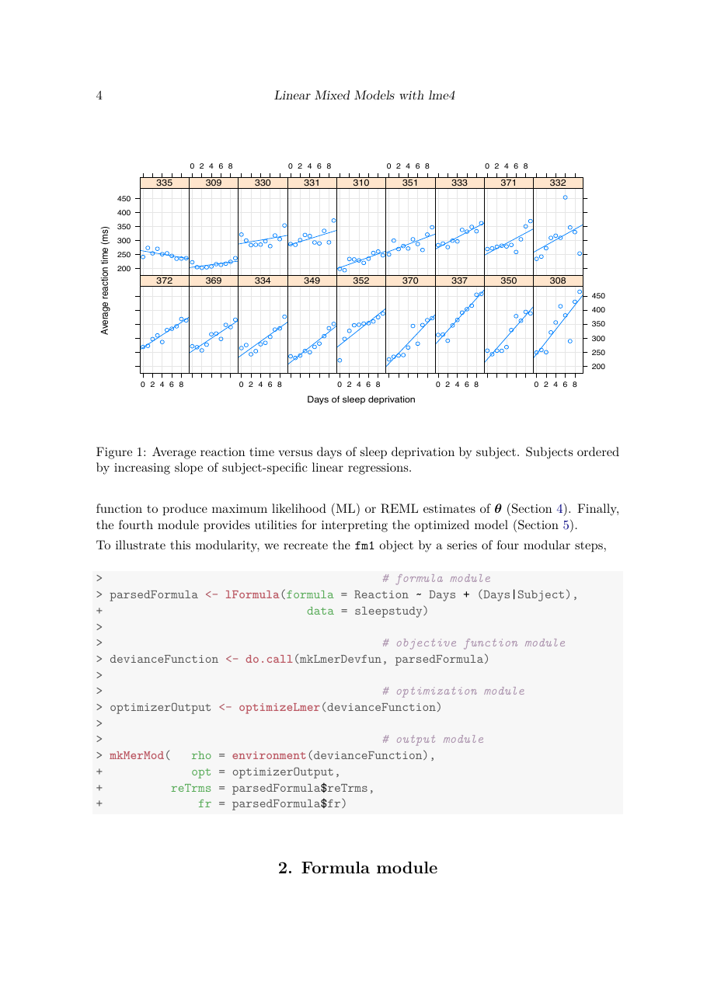
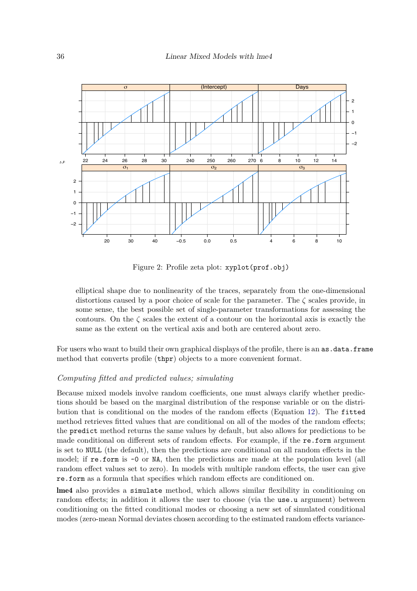
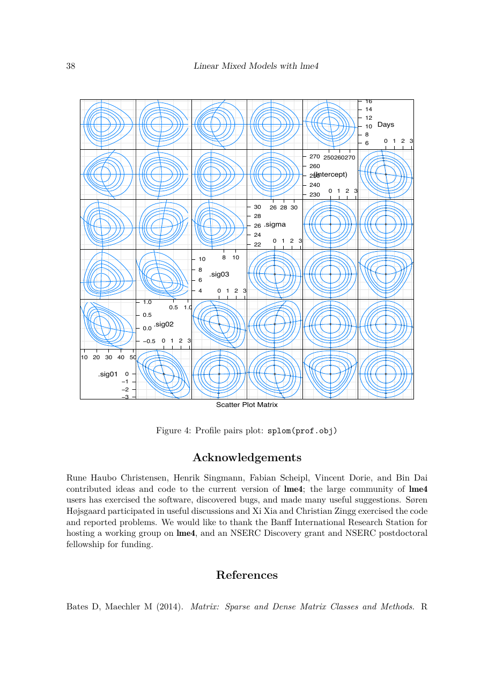

# lme4로 선형 혼합 효과 모형 적합하기 (전문 번역)

- 원제: Fitting Linear Mixed-Effects Models Using lme4
- 저자: Douglas Bates (U. of Wisconsin, Madison), Martin Mächler (ETH Zurich), Benjamin M. Bolker (McMaster University), Steven C. Walker (McMaster University)
- 번역 대상 원문: 같은 폴더의 `Bates2015_JSS_lme4.pdf` (arXiv:1406.5823v1, 2014-06-23, "Submitted to Journal of Statistical Software", 51쪽)
- 번역 범위: 전문(초록, 본문, 그림과 표 캡션, 부록). 참고문헌은 원문 그대로 둔다.
- 주의: 이 번역은 arXiv 투고본(v1)을 옮긴 것이다. 학술지 게재본(J. Statistical Software 67(1), 2015, doi:10.18637/jss.v067.i01)은 절 구성과 문구가 일부 다를 수 있다. 게재본과의 차이는 확인하지 않았다.
- R 코드와 출력은 원문 그대로 둔다. 수식은 원문 기호를 따른다. 번역자 메모는 [역주]로 표시한다.

---

## 초록

선형 혼합 효과 모형의 모수는 R용 lme4 패키지의 lmer 함수로 최대우도(ML) 또는 제한 최대우도(REML)로 추정할 수 있다. R의 다른 모형 적합 함수와 마찬가지로, lmer 호출에서 모형은 공식(formula)으로 기술한다. 이 경우 공식에는 고정 효과 항과 무작위 효과 항이 모두 들어간다. 공식과 자료가 함께 모형의 수치 표현을 정하고, 이 표현으로부터 프로파일 이탈도(profiled deviance) 또는 프로파일 REML 기준을 일부 모수의 함수로 계산할 수 있다. 적절한 기준을 R의 제약 최적화 함수 가운데 하나로 최적화하여 모수 추정값을 얻는다. 이 논문은 모형의 구조, 프로파일 이탈도나 REML 기준을 계산하는 단계, 그리고 그런 모형을 표현하는 클래스(형)의 구조를 설명한다. lmer가 쓰는 공식 언어로 쉽게 표현되지 않는 특수한 선형 혼합 모형(예: 가계도나 평활 스플라인을 포함하는 모형)을 적합하는 함수를 직접 쓰려는 사용자가 이 구조를 특수화할 수 있도록 충분히 자세히 적었다.

핵심어: 희소 행렬 방법, 선형 혼합 모형, 벌점 최소제곱, 숄레스키 분해

---

## 1. 서론

R용 lme4 패키지는 선형 혼합 모형, 일반화 선형 혼합 모형, 비선형 혼합 모형을 적합하고 분석하는 함수를 제공한다. 이 이름들에서 "혼합" 또는 더 길게 "혼합 효과"는, 반응의 조건부 평균을 계산하는 선형 예측식에 고정 효과 항과 무작위 효과 항을 함께 넣는 모형을 뜻한다. 이 논문은 선형 혼합 모형의 정식화와 표현을 설명한다. 일반화 선형 혼합 모형과 비선형 혼합 모형에 쓰는 기법은 이후 별도 논문에서 설명한다.

혼합 모형을 적합하는 범용 소프트웨어 개발은 아직 열린 문제가 많은 활발한 연구 분야다. 그래서 lme4 패키지는 처음 공개된 뒤로 계속 바뀌어 왔고, 혼합 모형에 대해 더 배우면서 계속 개선되고 있다. 그러나 lme4가 널리 쓰이려면 안정성과 하위 호환성을 지켜야 한다는 점도 알고 있다. 안정성을 지키면서 혼합 모형 계산을 계속 발전시키기 위해, lme4의 기본 생각을 쓰되 구조나 구현을 여러 방식으로 바꾼 별도 틀을 몇 가지 만들었다. Julia의 MixedModels 패키지, R의 lme4pureR 패키지, lme4의 flexLambda 개발 브랜치가 그것이다. 이 논문은 대부분 lme4 패키지의 현재 안정판(1.1-7)을 설명하는 데 한정한다. 부록 A는 확장 개발을 위해 만든 계산 장치의 연결 지점(hook)을 설명한다. gamm4(Wood and Scheipl 2013)와 blme(Dorie 2013) 패키지가 현재 이 연결 지점을 쓴다.

이 논문의 또 다른 목표는 lme4의 접근을 이전의 혼합 모형 정식화와 대비하는 것이다. 3.4절에서 유도하는 프로파일 로그우도와 프로파일 REML(제한 최대우도) 기준의 식은 Bates and DebRoy (2004)의 식과 비슷하고, 실제로 "Henderson의 혼합 모형 방정식"(Henderson 1982)과 밀접하다. 그렇지만 모형의 정식화와, 그 결과로 풀어야 하는 벌점 최소제곱(PLS) 문제의 구조에 미묘하지만 중요한 변화가 있다(3.6절). 현재 판의 PLS 문제를 유도하고(3.2절) 이전 정식화와 대비한다(3.5절).

이 논문은 네 개의 주요 절(2, 3, 4, 5)로 이루어진다. 각 절은 lme4를 이루는, 서로 거의 독립인 네 모듈 하나씩에 해당한다. 각 모듈을 자세히 설명하기 전에 lme4의 바탕인 선형 혼합 모형의 일반형을 설명하고(1.1절), 글 전체에서 예로 쓸 sleepstudy 자료를 소개하고(1.2절), lme4의 모듈 구조를 개략한다(1.3절).

### 1.1. 선형 혼합 모형

선형 모형이 관측값이 $y_{obs}$인 벡터값 확률 반응 변수 $\mathcal{Y}$의 분포로 기술되는 것처럼, 선형 혼합 모형은 두 벡터값 확률 변수의 분포로 기술된다. 반응 $\mathcal{Y}$와 무작위 효과 벡터 $\mathcal{B}$다. 선형 모형에서 $\mathcal{Y}$의 분포는 다변량 정규분포다.

$$\mathcal{Y} \sim \mathcal{N}(X\beta + o,\ \sigma^2 W^{-1}) \qquad (1)$$

여기서 $n$은 반응 벡터의 차원, $W$는 알려진 사전 가중치의 대각 행렬, $\beta$는 $p$차원 계수 벡터, $X$는 $n \times p$ 모형 행렬, $o$는 알려진 사전 오프셋 항의 벡터다. 모형의 모수는 계수 $\beta$와 척도 모수 $\sigma$다.

선형 혼합 모형에서는 $\mathcal{B}=b$가 주어졌을 때 $\mathcal{Y}$의 조건부 분포가 이런 꼴이다.

$$(\mathcal{Y}\mid\mathcal{B}=b) \sim \mathcal{N}(X\beta + Zb + o,\ \sigma^2 W^{-1}) \qquad (2)$$

여기서 $Z$는 $q$차원 벡터값 무작위 효과 변수 $\mathcal{B}$에 대한 $n \times q$ 모형 행렬이고, $\mathcal{B}$의 값을 $b$로 고정하고 있다. $\mathcal{B}$의 무조건부 분포도 평균이 0이고, 모수화된 $q \times q$ 분산공분산 행렬 $\Sigma$를 가진 다변량 정규분포다.

$$\mathcal{B} \sim \mathcal{N}(0, \Sigma) \qquad (3)$$

$\Sigma$는 분산공분산 행렬이므로 양의 준정부호여야 한다. 모형을 상대 공분산 인자 $\Lambda_\theta$로 표현하면 편하다. $\Lambda_\theta$는 분산 성분 모수 $\theta$에 의존하는 $q \times q$ 행렬이고, 다음과 같이 대칭 $q \times q$ 분산공분산 행렬 $\Sigma$를 만든다.

$$\Sigma_\theta = \sigma^2 \Lambda_\theta \Lambda_\theta^\top \qquad (4)$$

여기서 $\sigma$는 조건부 분포 (2)와 같은 척도 인자다.

식 2, 3, 4가 lme4가 적합할 수 있는 선형 혼합 모형의 부류를 완전히 기술하지만, 이 짧은 기술은 많은 중요한 세부를 감춘다. 세부로 가기 전에 몇 가지를 짚어 둔다.

- 이 정식화를 쓰면 $\theta$의 프로파일 로그우도를 비교적 간결하게 쓸 수 있다(3.4절, 식 34).
- 무작위 효과와 관련된 행렬 $Z$와 $\Lambda_\theta$는 보통 희소 구조를 가진다. 그 희소 패턴에 여러 모형 가정이 담긴다. 2.3절과 3.7절이 이 구조와 효율적인 표현법을 자세히 다룬다.
- lme4의 lmer 함수가 제공하는 인터페이스는 식 2, 3, 4가 기술하는 모형보다 조금 덜 일반적이다. 가능한 범위를 다 쓰려면 모듈 함수(1.3절과 부록 A)를 쓰거나 Github에 있는 lme4의 실험적 flexLambda 브랜치를 살펴보면 된다.

### 1.2. 예제

lme4를 논의하는 내내, 수면 박탈 연구에서 피험자별 하루 평균 반응 시간 자료(Belenky et al. 2003)를 쓴다. 0일째에 피험자는 평소만큼 잤다. 그날 밤부터 하룻밤 수면을 3시간으로 제한했다. 반응 변수 Reaction은 매일(Day) 각 피험자(Subject)가 치른 일련의 검사의 평균 반응 시간(밀리초, ms)이다(그림 1).

```
> str(sleepstudy)

'data.frame': 180 obs. of 3 variables:
 $ Reaction: num 250 259 251 321 357 ...
 $ Days    : num 0 1 2 3 4 5 6 7 8 9 ...
 $ Subject : Factor w/ 18 levels "308","309","310",..: 1 1 1 1 1 1 ..
```



그림 1: 피험자별로 본 수면 박탈 일수에 따른 평균 반응 시간. 피험자는 피험자별 선형 회귀의 기울기가 커지는 순서로 배열했다.

각 피험자의 반응 시간은 수면 박탈 일수에 따라 대략 선형으로 늘어난다. 그러나 피험자마다 이 관계의 기울기와 절편도 다른 것으로 보인다. 이는 무작위 기울기와 무작위 절편을 가진 모형을 시사한다. 뒤에서 보겠지만, 이런 모형은 다음과 같이 REML 기준(식 39)을 최소화하여 적합할 수 있다.

```
> fm1 <- lmer(Reaction ~ Days + (Days | Subject), sleepstudy)
```

절편과 기울기에 대한 무작위 효과 표준편차의 추정값은 24.74 ms와 5.92 ms/일이다. 고정 효과 계수 $\beta$는 절편 251.4 ms, 기울기 10.47 ms/일이다. 이 모형에서 고정 효과의 한 가지 해석은, 무작위 절편과 기울기의 모집단 평균 추정값이라는 것이다(2.2절).

### 1.3. 상위 모듈 구조

lmer 함수는 서로 거의 독립인 네 모듈로 이루어진다. 첫 모듈은 혼합 모형 공식을 해석하여 선형 혼합 모형을 지정하는 데 필요한 입력으로 바꾼다(2절). 둘째 모듈은 이 입력으로 R 함수를 만든다. 이 함수는 공분산 모수 $\theta$를 인수로 받아 로그 프로파일 우도의 −2배 또는 REML 기준을 돌려준다(3절). 셋째 모듈은 이 목적 함수를 최적화하여 $\theta$의 최대우도(ML) 또는 REML 추정값을 낸다(4절). 마지막으로 넷째 모듈은 최적화된 모형을 해석하는 도구를 제공한다(5절).

이 모듈성을 보이기 위해, fm1 객체를 네 모듈 단계로 다시 만든다.

```
>                                         # formula module
> parsedFormula <- lFormula(formula = Reaction ~ Days + (Days|Subject),
+                              data = sleepstudy)
>
>                                         # objective function module
> devianceFunction <- do.call(mkLmerDevfun, parsedFormula)
>
>                                         # optimization module
> optimizerOutput <- optimizeLmer(devianceFunction)
>
>                                         # output module
> mkMerMod(   rho = environment(devianceFunction),
+             opt = optimizerOutput,
+          reTrms = parsedFormula$reTrms,
+              fr = parsedFormula$fr)
```

| 모듈 | R 함수 | 설명 |
|---|---|---|
| 공식 모듈 (2절) | lFormula | 혼합 모형 공식, 자료, 다른 사용자 입력을 받아, 선형 혼합 모형 적합에 필요한 객체 목록을 돌려준다. |
| 목적 함수 모듈 (3절) | mkLmerDevfun | lFormula의 결과를 받아, 공분산 모수 $\theta$의 함수로 이탈도(또는 제한 이탈도)를 계산하는 함수를 돌려준다. |
| 최적화 모듈 (4절) | optimizeLmer | mkLmerDevfun이 돌려준 이탈도 함수를 받아, 그 함수를 최적화한 결과를 돌려준다. |
| 출력 모듈 (5절) | mkMerMod | 최적화된 이탈도 함수를 받아, 결과를 쓸모 있는 객체로 묶는다. |

표 1: lmer의 상위 모듈 구조.

---

## 2. 공식 모듈

### 2.1. 혼합 모형 공식

R의 대부분 모형 적합 함수처럼 lmer는 첫 두 인수로 모형을 지정하는 공식과, 공식을 계산할 자료를 받는다. 둘째 인수 data는 선택이지만 권장하며, 보통 R 데이터 프레임의 이름이다. 선형 모형을 적합하는 R의 lm 함수에서 공식은 `resp ~ expr` 꼴이다. resp는 반응 변수를 정하고, expr는 모형 행렬의 열을 지정하는 식이다. lmer 함수의 공식에는 특별한 무작위 효과 항이 들어간다.

```
> resp ~ FEexpr + (REexpr1|factor1) + (REexpr2|factor2) + ...
```

여기서 FEexpr는 고정 효과 모형 행렬 $X$의 열을 정하는 식이다. 무작위 효과 항 (REexpr1 | factor1)과 (REexpr2 | factor2)는 무작위 효과 모형 행렬 $Z$(2.3.1절)와 상대 공분산 인자 $\Lambda_\theta$의 구조(2.3.2절)를 함께 정한다. 원리적으로 혼합 모형 공식에는 무작위 효과 항이 몇 개든 들어갈 수 있지만, 실제로는 보통 적다.

### 2.2. 혼합 모형 공식 이해하기

lme4가 혼합 모형 공식을 어떻게 해석하는지(2.3절) 설명하기 전에, 비공식 설명과 몇 가지 예를 든다. 표준 R 모형화 방식(Chambers 1993)에 익숙하다고 가정한다.

각 무작위 효과 항은 (expr|factor) 꼴이다. 식 expr는 선형 모형 공식으로 계산되어, 표준 R 모형화 함수(예: lm, glm)와 같은 규칙으로 모형 행렬을 만든다. 식 factor는 R 인자(factor)로 계산된다.

| 공식 | 다른 표기 | 뜻 |
|---|---|---|
| (1\|g) | 1+(1\|g) | 고정 평균을 가진 무작위 절편 |
| 0+offset(o)+(1\|g) | -1+offset(o)+(1\|g) | 사전에 알려진 평균을 가진 무작위 절편 |
| (1\|g1/g2) | (1\|g1)+(1\|g1:g2) | g1 사이와 g1 안의 g2 사이에서 달라지는 절편 |
| (1\|g1)+(1\|g2) | 1+(1\|g1)+(1\|g2) | g1 사이와 g2 사이에서 달라지는 절편 |
| x+(x\|g) | 1+x+(1+x\|g) | 상관된 무작위 절편과 기울기 |
| x+(x\|\|g) | 1+x+(1\|g)+(0+x\|g) | 상관 없는 무작위 절편과 기울기 |

표 2: 혼합 효과 모형 공식 오른쪽의 예. 묶음 인자 이름은 g, g1, g2로, 공변량과 사전에 알려진 오프셋은 x와 o로 적었다.

세로 막대 연산자는 모형 행렬과 묶음 인자 사이의 특별한 상호작용으로 생각할 수 있다. 이 상호작용 때문에 모형 행렬의 열은 묶음 인자의 수준마다 다른 효과를 가진다. 이것이 특별한 상호작용인 까닭은, 그 효과를 알려지지 않은 고정 모수가 아니라 관측되지 않는 확률 변수로 모형화하기 때문이다. 이 두 종류의 상호작용 사이의 중요한 실무적, 철학적 차이에 대해서는 많은 글이 있다(예: Henderson (1982); Gelman (2005)). 예를 들어 이런 상호작용을 무작위 효과로 구현하면 회귀 계수의 축소 추정값을 얻을 수 있고(예: Efron and Morris (1977)), 블록 구조나 반복 측정 때문에 잔차가 독립이 아닌 점을 반영할 수 있다(예: Laird and Ware (1982)).

표 2에 혼합 모형 공식 오른쪽의 예를 몇 가지 들었다. 첫 예 (1|g)는 가장 단순한 혼합 모형 공식이다. 묶음 인자 g의 수준마다 자기 무작위 절편을 가진다. 이 절편들의 평균과 표준편차가 추정할 모수다. 이 모형에 대한 우리 설명에서는 무작위 효과의 0이 아닌 평균을 고정 효과 모수로 넣는다. 무작위 절편의 평균이 사전에 알려져 있다고 지정하고 싶으면, 표 2의 둘째 모형처럼 offset 함수를 쓰면 된다. 이 모형에는 고정 효과가 없다. 더 정확히는 고정 효과 모형 행렬 $X$의 열이 0개이고 $\beta$의 길이가 0이다.

묶음 인자가 여럿인 모형도 만들 수 있다. 예를 들어 관측이 g1 안에 내포된 g2로 묶여 있으면, 표 2의 셋째 공식으로 절편의 변동을 모형화할 수 있다. 혼합 모형의 흔한 목적은 이런 내포(위계) 구조를 반영하는 것이다. 그러나 lme4의 가장 쓸모 있는 면 하나는 내포되지 않은 묶음 인자에 연결된 무작위 효과도 적합할 수 있다는 점이다. 예를 들어 자료가 두 인자 g1과 g2를 완전히 교차하여 묶여 있으면 표 2의 넷째 공식을 쓸 수 있다. 이런 모형은 피험자 인자와 문항 인자가 완전히 교차하는 문항 반응 이론에서 흔하다(Doran, Bates, Bliese, and Dowling 2007).

절편뿐 아니라 기울기도 달라질 수 있다(예: sleepstudy 자료, 1.2절). 표 2의 다섯째 예는 절편과 기울기가 모두 묶음 인자 수준마다 달라지는 모형이다.

#### 상관 없는 무작위 효과 지정하기

lme4는 기본적으로 같은 무작위 효과 항에 속한 계수는 모두 상관되어 있다고 가정한다. 예를 들어 기울기와 절편이 상관 없다고 지정하려면, 이중 막대 표기 (x||g)를 쓰거나, 같은 뜻으로 표 2의 마지막 예처럼 무작위 효과 항을 여러 개 x+(1|g)+(0+x|g)로 쓸 수 있다.

| 기호 | 크기 |
|---|---|
| $n$ | 반응 벡터 $\mathcal{Y}$의 길이 |
| $p$ | 고정 효과 모형 행렬 $X$의 열 수 |
| $q=\sum_i^k q_i$ | 무작위 효과 모형 행렬 $Z$의 열 수 |
| $p_i$ | 원 모형 행렬 $X_i$의 열 수 |
| $\ell_i$ | 묶음 인자 지표 $i_i$의 수준 수 |
| $q_i = p_i \ell_i$ | 항별 모형 행렬 $Z_i$의 열 수 |
| $k$ | 무작위 효과 항의 수 |
| $m_i = \binom{p_i+1}{2}$ | 항 $i$의 공분산 모수 수 |
| $m=\sum_i^k m_i$ | 전체 공분산 모수 수 |

표 3: 선형 혼합 모형의 차원. 아래첨자 $i = 1, \dots, k$는 특정 무작위 효과 항을 가리킨다.

예를 들어 sleepstudy 자료의 모형 fm1(1.2절) 출력을 보면, Days 기울기와 절편 사이의 추정 상관이 꽤 낮다(0.066). (무작위 효과 공분산 행렬을 꺼내는 방법은 아래 5.2.2절을 본다.) 상관 모수를 뺀 모형은 이중 막대 표기로 적합할 수 있다.

```
> fm2 <- lmer(Reaction ~ Days + (Days || Subject), sleepstudy)
```

무작위 기울기와 절편이 독립이라고 가정한 혼합 모형은 무작위 기울기 모형의 복잡도를 줄이려고 흔히 쓰지만, 미묘한 단점이 하나 있다. 기울기와 절편이 0이 아닌 상관을 가질 수 있는 모형(예: fm1)은 연속 예측 변수(여기서는 Days)를 더하기로 옮기는 것에 불변이다. 상관을 0으로 묶으면 이 불변성이 깨진다. 예측 변수를 조금만 옮겨도 추정 상관이 반드시 바뀌고, 모형의 우도와 예측도 바뀐다. 예를 들어 fm1의 상관은 Days를, 추정된 피험자 간 표준편차의 비에 추정 상관을 곱한 만큼(즉 $\sigma_{slope}/\sigma_{intercept}\cdot\rho_{slope:intercept}$) 옮기기만 해도 없앨 수 있다. 이런 모형은 예측 변수가 비율 척도로 측정된 경우(즉 척도의 0점이 편의나 관례로 정한 위치가 아니라 뜻이 있는 경우)로 쓰임을 한정하는 것이 이상적이다.

[역주] 우리 과제에 비추면, 절편과 기울기 상관을 0으로 묶을 때는 Y, T 명령값의 0점(센터)이 물리적으로 뜻 있는 점인지가 중요하다는 경고로 읽을 수 있다.

### 2.3. 혼합 모형 공식의 대수적, 계산적 설명

혼합 모형 공식의 고정 효과 항은 R의 lm 함수가 모형 행렬을 만드는 것과 같은 방식으로 해석되어 고정 효과 모형 행렬 $X$를 만든다. 그러나 혼합 모형 공식에는 (r|f) 꼴의 무작위 효과 항도 $k \ge 1$개 들어간다. 이 $k$개 항으로 무작위 효과 모형 행렬 $Z$(식 2, 2.3.1절)와 상대 공분산 인자 $\Lambda_\theta$의 구조(식 4, 2.3.2절)를 만든다. 둘 다 보통 희소 구조를 가진 행렬이다. 이제 무작위 효과 항으로부터 이 행렬들을 만드는 방법을 설명한다. 먼저 항 하나 (r|f)를 보고, 이어 여러 항으로 일반화한다. 표 3과 표 4에 $Z$와 $\Lambda_\theta$의 구조를 정하는 행렬과 벡터를 정리했다.

| 기호 | 크기 | 설명 |
|---|---|---|
| $X_i$ | $n \times p_i$ | 원 무작위 효과 모형 행렬 |
| $J_i$ | $n \times \ell_i$ | 묶음 인자 지표의 지시 행렬 |
| $X_{ij}$ | $p_i \times 1$ | $X_i$의 $j$번째 행을 담은 열 벡터 |
| $J_{ij}$ | $\ell_i \times 1$ | $J_i$의 $j$번째 행을 담은 열 벡터 |
| $i_i$ | $n$ | 묶음 인자 지표 벡터 |
| $Z_i$ | $n \times q_i$ | 항별 무작위 효과 모형 행렬 |
| $\theta$ | $m$ | 공분산 모수 |
| $T_i$ | $p_i \times p_i$ | 하삼각 틀(template) 행렬 |
| $\Lambda_i$ | $q_i \times q_i$ | 항별 상대 공분산 인자 |

표 4: 무작위 효과 모형 행렬과 상대 공분산 인자의 구조를 기술하는 기호. 아래첨자 $i = 1, \dots, k$는 특정 무작위 효과 항을 가리킨다.

식 r은 선형 모형 공식으로, 크기 $n \times p_i$의 R 모형 행렬 $X_i$로 계산된다. 이를 항 $i$의 원 무작위 효과 모형 행렬이라 부른다. $p_i = 1$이면 그 항을 스칼라 무작위 효과 항이라 하고, 그렇지 않으면 벡터값 항이라 한다. (1|f) 꼴의 단순 스칼라 무작위 효과 항이면 $X_i$는 1로 채운 $n\times 1$ 행렬이고, 이는 무작위 절편 모형을 뜻한다.

식 f는 그 항의 묶음 인자라 부르는 R 인자로 계산된다. $i$번째 항에 대해 이 인자를 수학적으로는 인자 지표 벡터 $i_i$로 나타낸다. 이는 $1, \dots, \ell_i$ 값을 가진 $n$차원 벡터다.[각주 1] $J_i$를 $i_i$에 대한 지시 열들로 이뤄진 $n \times \ell_i$ 행렬이라 하자. R의 Matrix 패키지(Bates and Maechler 2014)를 쓰면, 인자 벡터 f를 sparseMatrix 객체로 바꿔 $J_i$의 전치를 만들 수 있다. 예를 들어

```
> (f <- gl(3,2))

[1] 1 1 2 2 3 3
Levels: 1 2 3

> (Ji <- t(as(f, Class="sparseMatrix")))

6 x 3 sparse Matrix of class "dgCMatrix"
     1 2 3
[1,] 1 . .
[2,] 1 . .
[3,] . 1 .
[4,] . 1 .
[5,] . . 1
[6,] . . 1
```

$k > 1$이면 무작위 효과 항을 $\ell_1 \ge \ell_2 \ge \dots \ge \ell_k$가 되도록 정렬한다. 일반적으로 이 순서는 "채움(fill-in)"을 줄인다. 채움이란 $\Lambda_\theta^\top Z^\top W Z \Lambda_\theta + I$의 하삼각에서는 0이지만, 아래 식 18에서 설명할 그 왼쪽 숄레스키 인자 $L_\theta$의 하삼각에서는 0이 아닌 원소의 비율이다. 채움이 줄면 벌점 최소제곱 알고리즘(3.2절) 안의 행렬 연산이 더 효율적이다.

[각주 1] 실제로는 고정 효과 모형 행렬과 무작위 효과 항을 모형 프레임에 대해 계산한다. 그래서 묶음 인자에 대한 식은 모두 인자로 바뀌고, 그 인자의 쓰이지 않는 수준은 버려진다. 즉 $i$번째 무작위 효과 항의 묶음 인자 수준 수 $\ell_i$가 잘 정의된다.

#### 무작위 효과 모형 행렬 만들기

$i$번째 무작위 효과 항은 모형 행렬 $Z$에 $q_i = \ell_i p_i$개 열을 보탠다. 이 열들을 행렬 $Z_i$로 묶고, 이를 $i$번째 항의 항별 모형 행렬이라 부른다. 따라서 $Z$의 열 수이자 확률 변수 $\mathcal{B}$의 차원인 $q$는 다음과 같다.

$$q = \sum_{i=1}^k q_i = \sum_{i=1}^k \ell_i p_i \qquad (5)$$

$X_i$와 $J_i$로 $Z_i$를 만드는 것은 개념상 간단하지만 설명하기는 조금 어색하다. $Z_i$를 다시 $p_i$개 열씩 $\ell_i$개 블록으로 나눈다고 생각하자. 첫 블록의 행은 $X_i$의 행에 $J_i$의 첫 열의 0/1 값을 곱한 것이다. 다음 블록들도 마찬가지다. 이 정의로 $i$번째 항의 항별 무작위 효과 모형 행렬 $Z_i$를 전치된 Khatri-Rao 곱으로 정의할 수 있다.

$$Z_i = (J_i^\top * X_i^\top)^\top = \begin{bmatrix} J_{i1}^\top \otimes X_{i1}^\top \\ J_{i2}^\top \otimes X_{i2}^\top \\ \vdots \\ J_{in}^\top \otimes X_{in}^\top \end{bmatrix} \qquad (6)$$

여기서 $*$와 $\otimes$는 Khatri-Rao 곱[각주 2](Khatri and Rao 1968)과 크로네커 곱이고, $J_{ij}^\top$와 $X_{ij}^\top$는 $J_i$와 $X_i$의 $j$번째 행을 나타내는 행 벡터다. 이 행들은 반응 벡터 $\mathcal{Y}$의 $j$번째 표본에 대응하므로 $j$는 $1 \dots n$이다. R의 Matrix 패키지에는 $Z_i$를 만드는 데 쓸 수 있는 KhatriRao 함수가 있다. 예를 들어 원 모형 행렬이 다음과 같다면

```
> (Xi <- cbind(1,rep.int(c(-1,1),3L)))

       [,1] [,2]
[1,]      1   -1
[2,]      1    1
[3,]      1   -1
[4,]      1    1
[5,]      1   -1
[6,]      1    1
```

항별 무작위 효과 모형 행렬은 다음과 같다.

```
> (Zi <- t(KhatriRao(t(Ji),t(Xi))))

6 x 6 sparse Matrix of class "dgCMatrix"

[1,] 1 -1 . . . .
[2,] 1 1 . . . .
[3,] . . 1 -1 . .
[4,] . . 1 1 . .
[5,] . . . . 1 -1
[6,] . . . . 1 1
```

[각주 2] Khatri-Rao 곱의 원래 정의는 Matrix 패키지의 정의보다 더 일반적이다. 여기서는 Matrix 패키지의 정의를 쓴다.

특히 단순 스칼라 항이면 $Z_i$는 지시 열 행렬 $J_i$와 정확히 같다. 다른 스칼라 항이면 $Z_i$는 $X_i$의 단일 열을 $J_i$의 각 열에 원소별로 곱해 만든다.

각 $Z_i$는 지시 열로 만들어지므로, 그 교차곱 $Z_i^\top Z_i$는 크기 $p_i$인 대각 블록 $\ell_i$개로 이루어진 블록 대각 행렬이다.[각주 3] 이는 $k = 1$일 때(즉 무작위 효과 항이 하나여서 $Z_i = Z$일 때) $Z^\top Z$가 블록 대각이라는 뜻이다. 이 블록 대각 성질 덕분에 희소 행렬 계산이 더 효율적이다(3.7절).

전체 무작위 효과 모형 행렬 $Z$는 $k \ge 1$개 블록으로 만든다.

$$Z = \begin{bmatrix} Z_1 & Z_2 & \dots & Z_k \end{bmatrix} \qquad (7)$$

식 7을 전치하고 식 6을 대입하면, 전치된 무작위 효과 모형 행렬의 구조를 다음처럼 나타낼 수 있다.

$$Z^\top = \begin{array}{c} \\ \text{항 }1 \\ \text{항 }2 \\ \vdots \end{array}\begin{bmatrix} J_{11}\otimes X_{11} & J_{12}\otimes X_{12} & \dots & J_{1n}\otimes X_{1n} \\ J_{21}\otimes X_{21} & J_{22}\otimes X_{22} & \dots & J_{2n}\otimes X_{2n} \\ \vdots & \vdots & \ddots & \vdots \end{bmatrix} \qquad (8)$$

(열은 왼쪽부터 표본 1, 표본 2, ..., 표본 $n$이다.)

$Z^\top$의 원소 중 구조적 0의 비율은 다음과 같다.

$$\frac{\sum_{i=1}^k p_i(\ell_i - 1)}{\sum_{i=1}^k p_i} \qquad (9)$$

[역주] 원문 식 9는 위와 같이 인쇄되어 있다. 비율로 읽으려면 분모에 $\ell_i$가 곱해져야 한다($\sum p_i(\ell_i-1)/\sum p_i \ell_i$). 원문 표기를 그대로 옮겼다.

따라서 $Z^\top$의 희소성은 묶음 인자의 수준 수가 많을수록 커진다. 실제로는 수준 수가 많은 경우가 흔하므로, 혼합 모형을 적합할 때 이 희소성을 (예를 들어 희소 행렬 방법으로) 활용하는 것이 속도와 효율에 꼭 필요하다(3.7절).

[각주 3] 이를 보려면, 크로네커 곱의 성질에 따라 교차곱 행렬 $Z_i^\top Z_i$를 $\sum_{j=1}^n J_{ij}J_{ij}^\top \otimes X_{ij}X_{ij}^\top$로 쓸 수 있음에 주목한다. $J_{ij}$는 좌표축 방향의 단위 벡터이므로, 교차곱 $J_{ij}J_{ij}^\top$는 대각에 1 하나만 있고 나머지가 모두 0인 행렬이다. 따라서 교차곱 $X_{ij}X_{ij}^\top$는 $Z_i^\top Z_i$ 대각의 크기 $p_i \times p_i$인 $\ell_i$개 블록 가운데 하나에 더해진다.

#### 상대 공분산 인자 만들기

$q \times q$ 공분산 인자 $\Lambda_\theta$는 블록 대각 행렬이고, $i$번째 대각 블록 $\Lambda_i$의 크기는 $q_i$다($i = 1, \dots, k$). $\Lambda_i$를 항별 상대 공분산 인자라 부른다. 또한 $\Lambda_i$는 균질한 블록 대각 행렬이어서, 대각의 하삼각 블록 $\ell_i$개 각각이 $p_i \times p_i$ 하삼각 틀 행렬 $T_i$의 복사본이다. 길이 $m_i = \binom{p_i+1}{2}$인 공분산 모수 벡터 $\theta$는 $T_i$($i = 1, \dots, k$)의 하삼각 원소로 이루어진다. 표현을 유일하게 하려고 $T_i$의 대각 원소가 음이 아니도록 요구한다.

틀 $T_i$는 $p_i$만으로 만들 수 있다. R 코드에서는 $p_i$를 nc로 적는다. 예를 들어 nc <- 3으로 두면 항 $i$의 틀은 다음과 같이 만들 수 있다.

```
> (rowIndices <- rep(1:nc, 1:nc))

[1] 1 2 2 3 3 3

> (colIndices <- sequence(1:nc))

[1] 1 1 2 1 2 3

> (template <- sparseMatrix(rowIndices, colIndices,
+                           x = 1*(rowIndices==colIndices)))

3 x 3 sparse Matrix of class "dgCMatrix"

[1,] 1 . .
[2,] 0 1 .
[3,] 0 0 1
```

rowIndices와 colIndices가 하삼각 전체를 채운다는 점에 주목한다. 이 하삼각에 공분산 모수 벡터 $\theta$의 초깃값이 담긴다.

```
> (theta <- template@x)

[1] 1 0 0 1 0 1
```

(희소 행렬 template의 @x 슬롯은 0이 아닌 원소를 담은 수치 벡터이기 때문이다.) 이 틀에는 세 종류의 원소가 있다. 구조적 0(.로 표시), 대각 밖 공분산 모수(0으로 초기화), 대각 분산 모수(1로 초기화)다. 상대 공분산 인자를 만드는 다음 단계는, 묶음 인자 수준마다 틀을 한 번씩 반복해 희소 블록 대각 행렬을 만드는 것이다. 예를 들어 수준 수 $\ell_i$를 2로 두면(nl <- 2), Matrix 패키지의 .bdiag 함수로 전치된 항별 상대 공분산 인자 $\Lambda_i^\top$를 만들 수 있다.

```
> (Lambdati <- .bdiag(rep(list(t(template)), nl)))

6 x 6 sparse Matrix of class "dgTMatrix"

[1,] 1 0 0 . . .
[2,] . 1 0 . . .
[3,] . . 1 . . .
[4,] . . . 1 0 0
[5,] . . . . 1 0
[6,] . . . . . 1
```

무작위 효과 항이 하나인 모형이면 $\Lambda_i^\top$가 곧 전치된 상대 공분산 인자의 초깃값이다.

공식과 자료를 해석해서 나온 전치 상대 공분산 인자 $\Lambda_\theta^\top$는 공분산 모수 $\theta$의 초깃값으로 설정된다. 그러나 모형 적합 중에는 반복마다 새 $\theta$ 값으로 갱신해야 한다(3.6.1절 참고). 이를 위해 theta의 어느 원소를 Lambdat의 어느 원소에 넣을지 알려 주는 지표 벡터 Lind를 만든다.

```
> LindTemplate <- rowIndices + nc*(colIndices - 1) - choose(colIndices, 2)
> (Lind <- rep(LindTemplate, nl))

 [1] 1 2 4 3 5 6 1 2 4 3 5 6
```

예를 들어 theta의 새 값을 무작위로 만들면

```
> thetanew <- round(runif(length(theta)), 1)
```

Lambdat를 다음과 같이 갱신할 수 있다.

```
> Lambdati@x <- thetanew[Lind]
```

3.6.1절이 상대 공분산 인자의 갱신 과정을 더 자세히 설명한다.

---

## 3. 목적 함수 모듈

### 3.1. 계산 안정성을 위한 모형 재정식화

선형 혼합 모형의 처음 정식화(식 2, 3, 4)에서 공분산 모수 벡터 $\theta$는 무작위 효과의 주변 분포(식 3)에만 나타난다. 그러나 계산 안정성과 효율 면에서는, $\theta$가 무작위 효과가 주어졌을 때 반응 벡터의 조건부 분포에만 나타나도록 모형을 다시 쓰는 편이 유리하다. 이렇게 다시 쓰면 실제로 자주 생기는 특이(singular) 공분산 행렬(예: 비선형 최적화기의 중간 단계, 4절)도 다룰 수 있다.

재정식화는 다음 분포를 가진 구형(spherical)[각주 4] 무작위 효과 변수 $\mathcal{U}$를 정의하여 한다.

$$\mathcal{U} \sim \mathcal{N}(0, \sigma^2 I_q) \qquad (10)$$

[각주 4] $\mathcal{N}(\mu, \sigma^2 I)$ 분포를 "구형"이라 부르는 것은 확률 밀도의 등고선이 구이기 때문이다.

다음과 같이 두면

$$\mathcal{B} = \Lambda_\theta \mathcal{U} \qquad (11)$$

$\mathcal{B}$는 원하는 $\mathcal{N}(0, \Sigma_\theta)$ 분포(식 3)를 가진다. $\mathcal{U}$를 $\mathcal{B}$로 정의하는 것이 더 자연스러워 보일 수 있지만, 특이한 $\Lambda_\theta$를 허용하려면 관계를 식 11처럼 써야 한다. 이제 무작위 효과가 주어졌을 때 반응 벡터의 조건부 분포(식 2)를 다음처럼 다시 쓸 수 있다.

$$(\mathcal{Y}\mid\mathcal{U}=u) \sim \mathcal{N}(\mu_{\mathcal{Y}\mid\mathcal{U}=u},\ \sigma^2 W^{-1}) \qquad (12)$$

여기서

$$\mu_{\mathcal{Y}\mid\mathcal{U}=u} = X\beta + Z\Lambda_\theta u + o \qquad (13)$$

는 선형 예측값의 벡터로, 조건부 평균(또는 최빈값)으로 해석할 수 있다. 마찬가지로 $\mu_{\mathcal{U}\mid\mathcal{Y}=y_{obs}}$를, 반응 벡터의 관측값이 주어졌을 때 구형 무작위 효과의 조건부 평균(또는 최빈값)으로 정의한다. 또 글 전체에서 기호 $u$는 확률 변수 $\mathcal{U}$의 특정 값을 나타낸다.

### 3.2. 벌점 최소제곱

선형 혼합 모형을 최대우도로 적합하는 우리 계산 방법은 벌점 최소제곱(PLS)을 되풀이해 적용한다. 구체적으로 PLS 문제는 벌점 가중 잔차 제곱합

$$r^2(\theta, \beta, u) = \rho^2(\theta, \beta, u) + \|u\|^2 \qquad (14)$$

을 $\begin{bmatrix}u\\ \beta\end{bmatrix}$에 대해 최소화하는 것이다. 여기서

$$\rho^2(\theta, \beta, u) = \left\| W^{1/2}\left[y_{obs} - \mu_{\mathcal{Y}\mid\mathcal{U}=u}\right] \right\|^2 \qquad (15)$$

는 가중 잔차 제곱합이다. 이 표기는 $r^2$와 $\rho^2$가 모두 $\theta$, $\beta$, $u$에 의존함을 드러낸다. "벌점"이라는 말은 식 14의 항 $\|u\|^2$가 $u$의 크기가 큰 모형에 벌을 주기 때문이다.

이른바 "가짜 자료(pseudo-data)" 접근에서는 벌점 가중 잔차 제곱합을 블록 행렬 방정식의 길이 제곱으로 쓴다.

$$r^2(\theta, \beta, u) = \left\| \begin{bmatrix} W^{1/2}(y_{obs} - o) \\ 0 \end{bmatrix} - \begin{bmatrix} W^{1/2}Z\Lambda_\theta & W^{1/2}X \\ I_q & 0 \end{bmatrix}\begin{bmatrix} u \\ \beta \end{bmatrix} \right\|^2 \qquad (16)$$

이 가짜 자료 접근은 PLS 문제를 확장된 반응 벡터에 대한 표준 최소제곱 문제로도 볼 수 있음을 보여 준다. 따라서 최소화하는 값 $\begin{bmatrix}\mu_{\mathcal{U}\mid\mathcal{Y}=y_{obs}}\\ \hat\beta_\theta\end{bmatrix}$는 정규 방정식을 만족한다.

$$\begin{bmatrix} \Lambda_\theta^\top Z^\top W(y_{obs}-o) \\ X^\top W(y_{obs}-o) \end{bmatrix} = \begin{bmatrix} \Lambda_\theta^\top Z^\top W Z\Lambda_\theta + I & \Lambda_\theta^\top Z^\top W X \\ X^\top W Z\Lambda_\theta & X^\top W X \end{bmatrix}\begin{bmatrix} \mu_{\mathcal{U}\mid\mathcal{Y}=y_{obs}} \\ \hat\beta_\theta \end{bmatrix} \qquad (17)$$

여기서 $\mu_{\mathcal{U}\mid\mathcal{Y}=y_{obs}}$는 $\mathcal{Y} = y_{obs}$가 주어졌을 때 $\mathcal{U}$의 조건부 평균이다. 이 조건부 평균은 $\theta$에 의존하지만, 표기를 덜 복잡하게 하려고 그 의존을 드러내 적지 않는다.

식 17의 교차곱 행렬은 숄레스키 분해할 수 있다.

$$\begin{bmatrix} \Lambda_\theta^\top Z^\top W Z\Lambda_\theta + I & \Lambda_\theta^\top Z^\top W X \\ X^\top W Z\Lambda_\theta & X^\top W X \end{bmatrix} = \begin{bmatrix} L_\theta & 0 \\ R_{ZX}^\top & R_X^\top \end{bmatrix}\begin{bmatrix} L_\theta^\top & R_{ZX} \\ 0 & R_X \end{bmatrix} \qquad (18)$$

이 분해로 벌점 가중 잔차 제곱합을 다음처럼 다시 쓸 수 있다.

$$r^2(\theta, \beta, u) = r^2(\theta) + \left\| L_\theta^\top(u - \mu_{\mathcal{U}\mid\mathcal{Y}=y_{obs}}) + R_{ZX}(\beta - \hat\beta_\theta) \right\|^2 + \left\| R_X(\beta - \hat\beta_\theta) \right\|^2 \qquad (19)$$

여기서 $r^2(\theta, \hat\beta_\theta, \mu_{\mathcal{U}\mid\mathcal{Y}=y_{obs}})$를 $r^2(\theta)$로 줄여 썼다. 이것은 lme4 바탕 이론에서 중요한 식이다. 벌점 가중 잔차 제곱합 $r^2(\theta, \beta, u)$를 그 최솟값 $r^2(\theta)$와 연결한다. 이 관계는 최대우도 추정에 필요한, 무작위 효과에 대한 적분을 다음 절에서 할 때 쓸모가 있다.

### 3.3. 확률 밀도

앞 절의 잔차 제곱합으로, 선형 혼합 모형의 최대우도 추정에 필요한 여러 확률 밀도를 나타낼 수 있다.[각주 5]

$$f_{\mathcal{Y}\mid\mathcal{U}}(y_{obs}\mid u) = \frac{|W|^{1/2}}{(2\pi\sigma^2)^{n/2}}\exp\left[\frac{-\rho^2(\theta,\beta,u)}{2\sigma^2}\right] \qquad (20)$$

$$f_{\mathcal{U}}(u) = \frac{1}{(2\pi\sigma^2)^{q/2}}\exp\left[\frac{-\|u\|^2}{2\sigma^2}\right] \qquad (21)$$

$$f_{\mathcal{Y},\mathcal{U}}(y_{obs}, u) = \frac{|W|^{1/2}}{(2\pi\sigma^2)^{(n+q)/2}}\exp\left[\frac{-r^2(\theta,\beta,u)}{2\sigma^2}\right] \qquad (22)$$

$$f_{\mathcal{U}\mid\mathcal{Y}}(u\mid y_{obs}) = \frac{f_{\mathcal{Y},\mathcal{U}}(y_{obs}, u)}{f_{\mathcal{Y}}(y_{obs})} \qquad (23)$$

여기서

$$f_{\mathcal{Y}}(y_{obs}) = \int f_{\mathcal{Y},\mathcal{U}}(y_{obs}, u)\,du \qquad (24)$$

[각주 5] 이 식들은 엄밀히는 반응 벡터 $\mathcal{Y}$의 관측값 $y_{obs}$에서만 성립한다.

따라서 최대화할 로그우도는 다음과 같이 쓸 수 있다.

$$\mathcal{L}(\theta, \beta, \sigma^2 \mid y_{obs}) = \log f_{\mathcal{Y}}(y_{obs}) \qquad (25)$$

식 24의 적분은 더 명시적으로 다음처럼 쓸 수 있다.

$$f_{\mathcal{Y}}(y_{obs}) = \frac{|W|^{1/2}}{(2\pi\sigma^2)^{(n+q)/2}}\exp\left[\frac{-r^2(\theta) - \|R_X(\beta-\hat\beta_\theta)\|^2}{2\sigma^2}\right]\int\exp\left[\frac{-\|L_\theta^\top(u-\mu_{\mathcal{U}\mid\mathcal{Y}=y_{obs}}) + R_{ZX}(\beta-\hat\beta_\theta)\|^2}{2\sigma^2}\right]du \qquad (26)$$

이는 다음 변수 변환으로 계산할 수 있다.

$$v = L_\theta^\top(u - \mu_{\mathcal{U}\mid\mathcal{Y}=y_{obs}}) + R_{ZX}(\beta - \hat\beta_\theta) \qquad (27)$$

$u$에서 $v$로의 변환의 야코비 행렬식은 $|L_\theta|$다. 따라서 적분을 다음처럼 쓸 수 있다.

$$f_{\mathcal{Y}}(y_{obs}) = \frac{|W|^{1/2}}{(2\pi\sigma^2)^{(n+q)/2}}\exp\left[\frac{-r^2(\theta) - \|R_X(\beta-\hat\beta_\theta)\|^2}{2\sigma^2}\right]\int\exp\left[\frac{-\|v\|^2}{2\sigma^2}\right]|L_\theta|^{-1}dv \qquad (28)$$

지수 피적분 함수의 성질에 따라 이는 다음이 된다.

$$\exp\mathcal{L}(\theta,\beta,\sigma^2\mid y_{obs}) = f_{\mathcal{Y}}(y_{obs}) = \frac{|W|^{1/2}|L_\theta|^{-1}}{(2\pi\sigma^2)^{n/2}}\exp\left[\frac{-r^2(\theta) - \|R_X(\beta-\hat\beta_\theta)\|^2}{2\sigma^2}\right] \qquad (29)$$

### 3.4. 이탈도와 REML 기준의 계산과 프로파일링

이제 식 2와 3의 정식화가 왜 특히 쓸모 있는지 알 수 있다. 로그우도(식 25)에서 $\beta$와 $\sigma$를 명시적으로 프로파일하여 없앨 수 있고, 그 결과 프로파일 이탈도(프로파일 로그우도의 −2배)와 프로파일 REML 기준을 상대 공분산 모수 $\theta$만의 함수로 간결하게 쓸 수 있다. 게다가 이 기준들은 빠르고 정확하게 계산된다.

모수 $\theta$, $\beta$, $\sigma^2$를 추정하려고 로그우도의 −2배를 최소화한다. 이는 다음과 같이 쓸 수 있다.

$$-2\mathcal{L}(\theta,\beta,\sigma^2\mid y_{obs}) = \log\frac{|L_\theta|^2}{|W|} + n\log(2\pi\sigma^2) + \frac{r^2(\theta)}{\sigma^2} + \frac{\|R_X(\beta-\hat\beta_\theta)\|^2}{\sigma^2} \qquad (30)$$

$\beta$는 마지막 항으로만 ML 기준에 들어가므로 프로파일하기가 매우 쉽다. 마지막 항은 $\beta = \hat\beta_\theta$이면 0이고, $\hat\beta_\theta$는 식 16의 벌점 최소제곱 문제를 풀어 얻는다. 따라서 부분 프로파일 ML 기준을 다음과 같이 쓸 수 있다.

$$-2\mathcal{L}(\theta,\sigma^2\mid y_{obs}) = \log\frac{|L_\theta|^2}{|W|} + n\log(2\pi\sigma^2) + \frac{r^2(\theta)}{\sigma^2} \qquad (31)$$

이 기준은 아직 $\sigma^2$에 의존하므로 부분적으로만 프로파일되었다. 이 기준을 $\sigma^2$로 미분해 0으로 두면

$$0 = \frac{n}{\hat\sigma_\theta^2} - \frac{r^2(\theta)}{\hat\sigma_\theta^4} \qquad (32)$$

이고, 최대 프로파일 우도 추정값

$$\hat\sigma_\theta^2 = \frac{r^2(\theta)}{n} \qquad (33)$$

을 얻는다. 이 추정값을 부분 프로파일 기준에 대입하면 완전 프로파일 ML 기준을 얻는다.

$$-2\mathcal{L}(\theta\mid y_{obs}) = \log\frac{|L_\theta|^2}{|W|} + n\left[1 + \log\left(\frac{2\pi r^2(\theta)}{n}\right)\right] \qquad (34)$$

이 프로파일 이탈도 식은 $\theta$에만 의존한다. $Z$의 열 수이자 $\Sigma_\theta$의 크기인 $q$는 매우 클 수 있지만, $\theta$의 차원은 작고 흔히 10보다 작다. lme4 패키지는 범용 비선형 최적화기(4절)로 이 식을 $\theta$에 대해 최적화하여 최대우도 추정값을 찾는다.

#### REML 기준

REML 기준은 $\mathcal{Y}$의 주변 밀도를 고정 효과에 대해 적분하여 얻을 수 있다(Laird and Ware 1982).

$$\int f_{\mathcal{Y}}(y_{obs})\,d\beta = \frac{|W|^{1/2}|L_\theta|^{-1}}{(2\pi\sigma^2)^{n/2}}\exp\left[\frac{-r^2(\theta)}{2\sigma^2}\right]\int\exp\left[\frac{-\|R_X(\beta-\hat\beta_\theta)\|^2}{2\sigma^2}\right]d\beta \qquad (35)$$

이는 다음 변수 변환으로 계산할 수 있다.

$$v = R_X(\beta - \hat\beta_\theta) \qquad (36)$$

$\beta$에서 $v$로의 변환의 야코비 행렬식은 $|R_X|$다. 따라서 적분을 다음처럼 쓸 수 있다.

$$\int f_{\mathcal{Y}}(y_{obs})\,d\beta = \frac{|W|^{1/2}|L_\theta|^{-1}}{(2\pi\sigma^2)^{n/2}}\exp\left[\frac{-r^2(\theta)}{2\sigma^2}\right]\int\exp\left[\frac{-\|v\|^2}{2\sigma^2}\right]|R_X|^{-1}dv \qquad (37)$$

이는 다음과 같이 간단해진다.

$$\int f_{\mathcal{Y}}(y_{obs})\,d\beta = \frac{|W|^{1/2}|L_\theta|^{-1}|R_X|^{-1}}{(2\pi\sigma^2)^{(n-p)/2}}\exp\left[\frac{-r^2(\theta)}{2\sigma^2}\right] \qquad (38)$$

이 적분의 로그의 −2배가 (프로파일하지 않은) REML 기준이다.

$$-2\mathcal{L}_R(\theta,\sigma^2\mid y_{obs}) = \log\frac{|L_\theta|^2|R_X|^2}{|W|} + (n-p)\log(2\pi\sigma^2) + \frac{r^2(\theta)}{\sigma^2} \qquad (39)$$

$\beta$가 적분되어 사라지므로 REML 기준으로는 $\beta$의 점추정값을 찾을 수 없다는 점에 주의한다. 그러나 다른 연구자들처럼, 최적값 $\theta = \hat\theta$에서의 최대우도 추정값 $\hat\beta_{\hat\theta}$를 쓴다. $\sigma^2$의 REML 추정값은

$$\hat\sigma_\theta^2 = \frac{r^2(\theta)}{n-p} \qquad (40)$$

이고, 이로부터 프로파일 REML 기준을 얻는다.

$$-2\mathcal{L}_R(\theta\mid y_{obs}) = \log\frac{|L_\theta|^2|R_X|^2}{|W|} + (n-p)\left[1 + \log\left(\frac{2\pi r^2(\theta)}{n-p}\right)\right] \qquad (41)$$

### 3.5. 이전 정식화와 달라진 점

3.2절에서 정식화한 PLS 문제를 이전 판과 비교하고, 왜 이 판을 쓰는지 설명한다. 이른바 "Henderson의 혼합 모형 방정식"은 Henderson (1982)의 식 6으로 주어졌고, 우리 표기로는(일반성을 잃지 않고 가중치와 오프셋을 무시하면) 다음과 같다.

$$\begin{bmatrix} X^\top X/\sigma^2 & X^\top Z/\sigma^2 \\ Z^\top X/\sigma^2 & Z^\top Z/\sigma^2 + \Sigma^{-1} \end{bmatrix}\begin{bmatrix} \hat\beta_\theta \\ \mu_{\mathcal{B}\mid\mathcal{Y}=y_{obs}} \end{bmatrix} = \begin{bmatrix} X^\top y_{obs}/\sigma^2 \\ Z^\top y_{obs}/\sigma^2 \end{bmatrix} \qquad (42)$$

Henderson (1982)에서 $R$로 적힌 행렬은 우리 정식화에서 $\sigma^2 I_n$이다.

Bates and DebRoy (2004)는 PLS 방정식을 다음과 같이 고쳤다.

$$\begin{bmatrix} Z^\top Z + \Omega & Z^\top X \\ X^\top Z & X^\top X \end{bmatrix}\begin{bmatrix} \mu_{\mathcal{B}\mid\mathcal{Y}=y_{obs}} \\ \hat\beta_\theta \end{bmatrix} = \begin{bmatrix} Z^\top y_{obs} \\ X^\top y_{obs} \end{bmatrix} \qquad (43)$$

여기서 $\Omega_\theta = \left(\Lambda_\theta^\top\Lambda_\theta\right)^{-1} = \sigma^2\Sigma^{-1}$은 주어진 $\theta$ 값에 대한 상대 정밀도 행렬이다. 그들은 또 프로파일 로그우도를 (이탈도 척도로) 다음처럼 나타낼 수 있음을 보였다.

$$-2\tilde{\mathcal{L}}(\theta) = \log\left(\frac{|Z^\top Z + \Omega|}{|\Omega|}\right) + n\left[1 + \log\left(\frac{2\pi r_\theta^2}{n}\right)\right] \qquad (44)$$

식 42와 식 43의 주된 차이는 시스템 행렬의 블록 순서다. PLS 문제는 블록이 어느 순서든 시스템 행렬의 숄레스키 인자로 풀 수 있다. 식 43 배치의 이점은 프로파일 로그우도를 계산할 수 있게 한다는 것이다. 숄레스키 인자로 $|Z^\top Z + \Omega|$를 계산하려면 그 블록이 오른쪽 아래가 아니라 왼쪽 위에 있어야 한다. 또 $Z$는 희소하지만 $X$는 보통 조밀하다. 이 행렬을 담은 블록이 먼저 분해되는 블록이면, 숄레스키 분해에서 $Z^\top Z$의 희소성을 활용하기 쉽다. $X^\top X$가 먼저 분해되는 블록이면 희소성을 지키기가 훨씬 어렵다.

Bates and DebRoy (2004)의 정식화에서 지금 정식화로 바뀐 주된 점은, 상대 정밀도 행렬 $\Omega_\theta$ 대신 상대 공분산 인자 $\Lambda_\theta$를 쓰고, $\mathcal{B}\mid\mathcal{Y}=y_{obs}$의 평균 대신 $\mathcal{U}\mid\mathcal{Y}=y_{obs}$의 평균을 푼다는 것이다. 이 변화는 안정성을 높인다. 3.2절의 PLS 문제의 해는 $\Lambda_\theta$가 특이해도 잘 정의되지만, 식 43의 정식화는 이 경우 $\Omega_\theta$가 존재하지 않으므로 쓸 수 없기 때문이다.

$\Lambda_\theta$가 특이한 것을 허용하는 것이 중요하다. 모수 추정값 $\hat\theta$가 특이한 $\Lambda_{\hat\theta}$를 낳는 상황이 실제로 생기기 때문이다. 그리고 모수 추정값이 특이한 $\Lambda_\theta$에 해당하지 않더라도, 기준을 수치 최적화하는 도중에 그런 값에서 추정 기준을 계산하고 싶을 수 있다.

Bates and DebRoy (2004)는 식 44로 나타낸 프로파일 로그우도의 기울기(gradient) 식도 제시했다. 이 식은 현재 정식화로 옮길 수 있다. 식 34로부터(다시 가중치를 무시하면) 다음을 알 수 있다.

$$\begin{aligned}\nabla(-2\mathcal{L}(\theta)) &= \nabla\log(|L_\theta|^2) + \nabla\left(n\log(r^2(\theta))\right) \\ &= \nabla\log(|\Lambda_\theta^\top Z^\top Z\Lambda_\theta + I|) + n\left(\nabla r^2(\theta)\right)/r^2(\theta) \\ &= \nabla\log(|\Lambda_\theta^\top Z^\top Z\Lambda_\theta + I|) + \left(\nabla r^2(\theta)\right)/(\widehat{\sigma^2})\end{aligned} \qquad (45)$$

첫 기울기는 쓰기는 쉽지만 일반 모형에서 계산하기는 어렵다. 이 기울기의 개별 원소는 다음과 같다.

$$\begin{aligned}\frac{\partial\log(|\Lambda_\theta^\top Z^\top Z\Lambda_\theta + I|)}{\partial\theta_i} &= \mathrm{tr}\left[\frac{\partial\left(\Lambda_\theta^\top Z^\top Z\Lambda_\theta\right)}{\partial\theta_i}\left(\Lambda_\theta^\top Z^\top Z\Lambda_\theta + I\right)^{-1}\right] \\ &= \mathrm{tr}\left[\left(L_\theta L_\theta^\top\right)^{-1}\left(\Lambda_\theta^\top Z^\top Z\frac{\partial\Lambda_\theta}{\partial\theta_i} + \frac{\partial\Lambda_\theta^\top}{\partial\theta_i}Z^\top Z\Lambda_\theta\right)\right]\end{aligned} \qquad (46)$$

둘째 기울기 항은 Golub and Pereyra (1973)의 결과를 써서 잔차의 선형 함수로 나타낼 수 있고, 개별 원소는 다음 꼴이다.

$$\frac{\partial r^2(\theta)}{\partial\theta_i} = -2u^\top\frac{\partial\Lambda_\theta^\top}{\partial\theta_i}Z^\top\left(y - Z\Lambda_\theta u - X\hat\beta_\theta\right) \qquad (47)$$

lme4에서는 이 결과를 쓰지 않지만, Julia의 MixedModels 패키지는 일부 모형 형태에 이를 쓰며 실제로 성능이 좋아진다.

### 3.6. 벌점 최소제곱 알고리즘

효율을 위해 lme4 자체에서는 PLS를 수치 선형대수용 Eigen 템플릿 C++ 패키지를 쓰는 컴파일된 C++ 코드로 구현한다. 그러나 여기서는 읽기 쉽도록 순수 R 판을 설명한다. 3.7절은 계산 효율을 위한 기법과 개념을 더 자세히 다룬다. 비선형 최적화기(4절)가 반복을 많이 해야 하는 경우 이것이 중요하다.

PLS 알고리즘은 공분산 모수 벡터 $\theta$를 입력으로 받아 프로파일 이탈도(식 34) 또는 REML 기준(식 41)을 돌려준다. 이 PLS 알고리즘은 네 주요 단계로 이루어진다.

1. 상대 공분산 인자를 갱신한다(3.6.1절)
2. 정규 방정식을 푼다(3.6.2절)
3. 선형 예측값과 잔차를 갱신한다(3.6.3절)
4. 프로파일 이탈도를 계산해 돌려준다(3.6.4절)

PLS에는 모형 구조를 정하는 표 5의 객체도 필요하다. 이 객체들은 PLS 반복 동안 갱신되지 않으므로, 이들을 포함한 여러 행렬 곱을 저장해 두면 쓸모 있다(표 6). 표 7은 PLS 반복에서 갱신되는 객체를 나열한다. 이 표의 기호는 전부 R로 구현한(즉 lme4 자체처럼 컴파일 코드가 없는) lme4 판에 대응한다. 이 구현은 lme4pureR라 부르며 현재 Github(https://github.com/lme4/lme4pureR/)에서 받을 수 있다.

| 이름, 설명 | 의사코드 | 수학 | 형 |
|---|---|---|---|
| 공분산 모수에서 상대 공분산 인자로의 사상 | mapping | | 함수 |
| 반응 벡터 | y | $y_{obs}$ (1.1절) | double 벡터 |
| 고정 효과 모형 행렬 | X | $X$ (식 2) | double 조밀[a] 행렬 |
| 전치 무작위 효과 모형 행렬 | Zt | $Z^\top$ (식 2) | double 희소 행렬 |
| 제곱근 가중치 행렬 | sqrtW | $W^{1/2}$ (식 2) | double 대각 행렬 |
| 오프셋 | offset | $o$ (식 2) | double 벡터 |

[a] 이전 판 lme4에서는 수준이 많은 범주형 고정 효과 예측 변수가 있는 모형에 유용한 희소 $X$ 행렬을 지정할 수 있었다. 이 기능은 현재 쓸 수 없다.

표 5: LMM의 입력.

| 의사코드 | 수학 |
|---|---|
| ZtW | $Z^\top W^{1/2}$ |
| ZtWy | $Z^\top W y_{obs}$ |
| ZtWX | $Z^\top W X$ |
| XtWX | $X^\top W X$ |
| XtWy | $X^\top W y_{obs}$ |

표 6: 벌점 최소제곱에 쓰이는 상수 기호.

| 이름, 설명 | 의사코드 | 수학 | 형 |
|---|---|---|---|
| 상대 공분산 인자 | lambda | $\Lambda_\theta$ (식 4) | 희소 double 하삼각 행렬 |
| 무작위 효과 숄레스키 인자 | L | $L_\theta$ (식 18) | double 희소 삼각 행렬 |
| 정규 방정식 풀이의 중간 벡터 | cu | $c_u$ (식 48) | double 벡터 |
| 전체 숄레스키 인자의 블록 | RZX | $R_{ZX}$ (식 18) | double 조밀 행렬 |
| 고정 효과 숄레스키 인자의 교차곱 | RXtRX | $R_X^\top R_X$ (식 50) | double 조밀 행렬 |
| 고정 효과 계수 | beta | $\beta$ (식 2) | double 벡터 |
| 구형 조건부 최빈값 | u | $u$ (3.1절) | double 벡터 |
| 비구형 조건부 최빈값 | b | $b$ (식 2) | double 벡터 |
| 선형 예측값 | mu | $\mu_{\mathcal{Y}\mid\mathcal{U}=u}$ (식 13) | double 벡터 |
| 가중 잔차 | wtres | $W^{1/2}(y_{obs}-\mu)$ | double 벡터 |
| 벌점 가중 잔차 제곱합 | pwrss | $r^2(\theta)$ (식 19) | double |
| 무작위 효과 숄레스키 인자의 로그 행렬식 2배 | logDet | $\log\lvert L_\theta\rvert^2$ | double |

표 7: 선형 혼합 모형 목적 함수를 한 번 계산하는 동안 갱신되는 양.

#### PLS 단계 I: 상대 공분산 인자 갱신

PLS의 첫 단계는 공분산 모수 벡터 $\theta$의 현재 값으로 상대 공분산 인자 $\Lambda_\theta$를 갱신하는 것이다. 갱신한 $\Lambda_\theta$로 무작위 효과 숄레스키 인자 $L_\theta$(식 18)를 갱신한다. 공분산 모수에서 상대 공분산 인자로의 사상은 여러 형태일 수 있지만, 일반적으로 $\theta$를 $\Lambda_\theta$의 0이 아닌 원소 값으로 보내는 함수다.

$\Lambda_\theta$가 R Matrix 패키지의 "dgCMatrix" 클래스 객체로 저장되어 있으면, $\theta$로부터 $\Lambda_\theta$를 다음처럼 갱신할 수 있다.

```
> Lambdat@x[] <- mapping(theta)
```

여기서 mapping은 수치 벡터를 받아 수치 벡터를 돌려주는 R 함수다. Matrix의 희소 행렬 클래스에서 0이 아닌 원소는 x라는 슬롯에 저장된다.

현재 판 lme4(v. 1.1-7)에서 $\theta$에서 $\Lambda_\theta$로의 사상은 지표의 R 정수 벡터 Lind로 표현되어 다음과 같다.

```
> mapping <- function(theta) theta[Lind]
```

지표 벡터 Lind는 모형 설정 중에 계산되어 함수의 환경에 저장된다. 2.3.2절의 예를 이어서, theta의 새 값을 생각하자.

```
> thetanew <- c(1, -0.1, 2, 0.1, -0.2, 3)
```

이 값들을 Lambdati의 알맞은 원소에 넣으려고 mapping을 쓴다.

```
> Lambdati@x[] <- mapping(thetanew)
> Lambdati

6 x 6 sparse Matrix of class "dgTMatrix"

[1,] 1 -0.1 2.0 . .    .
[2,] . 0.1 -0.2 . .    .
[3,] . .    3.0 . .    .
[4,] . .    .   1 -0.1 2.0
[5,] . .    .   . 0.1 -0.2
[6,] . .    .   . .    3.0
```

이 Lind 접근은 혼합 모형 적합의 모듈 접근을 써서 lme4의 기능을 넓히는 데 쓸모 있다. 예를 들어 부록 A.2는 Lind로 무작위 기울기와 절편이 상관 없고 분산이 같은 모형을 적합하는 법을 보인다.

공분산 모수에서 상대 공분산 인자로의 사상은 lme4 방식의 다른 구현에서는 다르게 다룬다. 다른 극단으로, lme4의 flexLambda 브랜치와 lme4pureR 패키지는 완전히 일반적인 사상을 허용한다. 이 추가 유연성은 훨씬 다양한 모형(예: 복합 대칭, 자기회귀)을 허용한다는 장점이 있다. 그러나 훨씬 다양한 잘못 설정된(ill-posed) 모형도 적합할 수 있게 된다는 단점이 있다. 끝으로 현재 안정판 lme4에서 이런 유연성을 원하면, 언제든 모듈 접근으로 Lind 기반 이탈도 함수를, 최적화할 모수(예: $\phi$)를 $\theta$로 보내는 일반 사상 함수로 감쌀 수 있다. 그러나 이 접근은 많은 경우 비효율적일 것이다.

Matrix 패키지의 update 메서드는 새 $\theta$ 값과 갱신한 $\Lambda_\theta$로 무작위 효과 숄레스키 인자 $L_\theta$를 효율적으로 갱신한다.

```
> L <- update(L, Lambdat %*% ZtW, mult = 1)
```

mult = 1 인수는 식 18 왼쪽의 왼쪽 위 블록에 단위 행렬을 더하는 것에 해당한다.

#### PLS 단계 II: 정규 방정식 풀기

새 공분산 모수를 $\Lambda_\theta$에 넣었으면, 다음 단계는 고정 효과 계수의 현재 추정값 $\hat\beta_\theta$와 조건부 최빈값 $\mu_{\mathcal{U}\mid\mathcal{Y}=y_{obs}}$에 대한 정규 방정식(식 17)을 푸는 것이다. 이 방정식은 희소 숄레스키 분해(식 18)로 푼다. 큰 자료에 적합한 복잡한 모형에서, 프로파일 이탈도(식 34)나 REML 기준(식 41) 계산의 주된 계산량은 이 희소 숄레스키 분해(식 18)다. 분해는 두 단계로 한다. 기호(symbolic) 단계와 수치(numeric) 단계다. 기호 단계에서는 채움을 줄이는 치환 $P$와 $L_\theta$의 0이 아닌 원소 위치를 정한다. 이 단계는 $\theta$ 값에 의존하지 않고 $Z\Lambda_\theta$의 0이 아닌 원소 위치에만 의존한다. 수치 단계는 $\theta$로 $L_\theta$의 0이 아닌 원소의 수치 값을 정한다. 이 분해를 써서 풀이는 다음 단계로 진행한다.

$$L_\theta c_u = P\Lambda_\theta^\top Z^\top W y \qquad (48)$$

$$L_\theta R_{ZX} = P\Lambda_\theta^\top Z^\top W X \qquad (49)$$

$$R_X^\top R_X = X^\top W X - R_{ZX}^\top R_{ZX} \qquad (50)$$

$$\left(R_X^\top R_X\right)\hat\beta_\theta = X^\top W y - R_{ZX}c_u \qquad (51)$$

$$L_\theta^\top P u = c_u - R_{ZX}\hat\beta \qquad (52)$$

이는 Matrix 패키지로 다음과 같이 풀 수 있다.

```
> cu[] <- as.vector(solve(L, solve(L, Lambdat %*% ZtWy,
+                                  system="P"), system="L"))
> RZX[] <- as.vector(solve(L, solve(L, Lambdat %*% ZtWX,
+                                   system="P"), system="L"))
> RXtRX <- as(XtWX - crossprod(RZX), "dpoMatrix")
> beta[] <- as.vector(solve(RXtRX, XtWy - crossprod(RZX, cu)))
> u[] <- as.vector(solve(L, solve(L, cu - RZX %*% beta,
+                                 system = "Lt"), system="Pt"))
> b[] <- as.vector(crossprod(Lambdat,u))
```

solve가 겹쳐 호출된다는 점에 주목한다. 처음 두 대입에서 안쪽 호출은 치환 행렬을 정하고 적용하며(system="P"), 바깥 호출이 실제로 방정식을 푼다(system="L"). u[]로의 대입에서는 원래 치환으로 돌아가려고 겹침 순서가 거꾸로다.

#### PLS 단계 III: 선형 예측값과 잔차 갱신

다음 단계는 $\hat\beta_\theta$와 $\mu_{\mathcal{B}\mid\mathcal{Y}=y_{obs}}$의 새 값으로 선형 예측값 $\mu_{\mathcal{Y}\mid\mathcal{U}}$(식 13)와 가중 잔차를 계산하는 것이다. lme4pureR에서는 다음처럼 계산할 수 있다.

```
> mu[] <- as.vector(crossprod(Zt,b) + X %*% beta + offset)
> wtres <- sqrtW*(y-mu)
```

여기서 b는 $\mu_{\mathcal{B}\mid\mathcal{Y}=y_{obs}}$의 현재 추정값이다.

#### PLS 단계 IV: 프로파일 이탈도 계산

끝으로 갱신된 선형 예측값과 가중 잔차로 프로파일 이탈도(또는 REML 기준)를 계산한다. lme4pureR에서는 다음과 같다.

```
> pwrss <- sum(wtres^2) + sum(u^2)
> logDet <- 2*determinant(L, logarithm = TRUE)$modulus
> if (REML) logDet <- logDet + determinant(RXtRX,
+                                          logarithm = TRUE)$modulus
> attributes(logDet) <- NULL
> profDev <- logDet + degFree*(1 + log(2*pi*pwrss) - log(degFree))
```

프로파일 이탈도는 세 성분으로 이루어진다. (1) 숄레스키 분해의 로그 행렬식(logDet), (2) 자유도(degFree), (3) 벌점 가중 잔차 제곱합(pwrss)이다.

### 3.7. 희소 행렬 방법

선형 혼합 모형을 적합할 때는 $\theta$에 대한 최적화(4절) 중 목적 함수를 계산할 때마다 벌점 최소제곱(PLS) 문제 (17)을 한 번씩 풀어야 한다. 이 연산을 여러 번 해야 하므로, 무작위 효과 항(2.3절)과 연결된 희소 행렬이 들어가는 객체와 계산을 효과적으로 계산하는 방법을 생각해 볼 가치가 있다.

C 함수 라이브러리 CHOLMOD(Chen, Davis, Hager, and Rajamanickam 2008)는 R Matrix 패키지의 희소 행렬 기능과 Julia의 희소 숄레스키 분해의 바탕인데, 기호 단계와 수치 단계를 분리할 수 있게 해 준다. 그래서 기호 단계는 모형을 나타내는 구조를 세우는 과정(2절)의 일부로 수행한다. 또 CHOLMOD 함수는 $\Lambda_\theta^\top Z^\top Z\Lambda_\theta + I$를 실제로 만들지 않고 행렬 $\Lambda_\theta^\top Z^\top$로부터 $L_\theta$를 직접 갱신할 수 있게 하므로, $Z$ 대신 $Z^\top$를 만들어 저장한다(단순하게 하려고 가중치 행렬 $W$는 무시했다). $\Lambda_\theta$를 만들고 두 희소 행렬을 곱하지 않고도 $\theta$로부터 $\Lambda_\theta^\top Z^\top$를 직접 갱신할 수 있다. Julia의 MixedModels 패키지는 이런 직접 접근을 쓰지만, lme4에서는 먼저 $\Lambda_\theta^\top$를 갱신한 뒤 희소 곱 $\Lambda_\theta^\top Z^\top$를 만든다. lme4pureR에서 쓰는 셋째 대안은, 반복을 시작하기 전에 모형 행렬 $X$, $Z$와 반응 $y$의 교차곱을 계산해 저장하는 것이다. 사례 가중치를 허용하기 위해 곱 $X^\top WX$, $X^\top Wy$, $Z^\top WX$, $Z^\top Wy$, $Z^\top WZ$를 저장한다(표 6 참고).

새 $\theta$ 값을 받아 $L_\theta$(식 18)를 효율적으로 계산하게 해 주는 구조와 알고리즘을 쓰고 싶다. 그 열쇠는 $\Lambda_\theta^\top Z^\top W^{1/2}$의 특별한 구조다. 왜 그 전치가 아니라 이 행렬이 관심 대상인지 이해하기 위해, Julia와 R의 Matrix 패키지가 쓰는 희소 행렬 구조를 설명한다.

R과 Julia에서 조밀 행렬은 열 우선 순서로 주소가 매겨진 연속 저장 위치의 1차원 배열로 저장된다. 즉 같은 열의 원소는 인접한 위치에 있지만 같은 행의 원소는 메모리에서 멀리 떨어질 수 있다. 그래서 열 단위로 작업하는 알고리즘이 행 단위로 작업하는 알고리즘보다 선호된다.

희소 행렬은 0이 아닌 원소의 행 위치, 열 위치, 값을 세 쌍으로 기록하는 세쌍(triplet) 형식으로 저장할 수도 있지만, 실제 계산에 선호하는 저장 형식은 압축 희소 열(CSC) 또는 압축 희소 행(CSR) 형식이다(Davis 2006, 2장). CHOLMOD(더 넓게는 C 라이브러리 묶음 SuiteSparse)는 CSC 저장 형식을 쓴다. 이 형식에서는 한 열의 0이 아닌 원소가 인접한 위치에 있고, 한 열의 모든 원소에 접근하는 것이 한 행의 원소에 접근하는 것보다 훨씬 쉽다(열 우선 순서로 저장한 조밀 행렬과 비슷하다).

행렬 $Z$와 $Z\Lambda_\theta$는 각 행의 0이 아닌 원소 수 $\sum_{i=1}^k p_i$가 일정하다는 성질이 있다. CSC 행렬에서는 행보다 열의 일관성이 필요하므로, 이들의 전치 대신 $Z^\top$와 $\Lambda_\theta^\top Z^\top$를 다룬다.

CSC 형식의 임의 $m\times n$ 희소 행렬은 두 지표 벡터(행 지표와 열 포인터)와, 0이 아닌 값의 수치 벡터로 나타낸다. 행 지표와 0이 아닌 값의 원소는 서로 맞춰져 있고, 먼저 열 번호가 커지는 순서로, 열 안에서는 행 번호가 커지는 순서로 정렬된다. 열 포인터는 크기 $n + 1$인 벡터로, 행 지표와 0이 아닌 값의 벡터에서 각 열이 시작하는 위치를 준다.

$Z^\top$의 각 열과, $Z^\top$에서 나온 행렬(예: $\Lambda_\theta^\top Z^\top W^{1/2}$)의 각 열에서 0이 아닌 원소 수가 일정하므로, CSC 형식의 0이 아닌 값 벡터는 크기 $(\sum_{i=1}^k p_i)\times n$인 조밀 행렬(예: $N$)로 볼 수 있다. $Z^\top$의 열이 $N$의 열에 대응하므로 열 포인터는 저장할 필요가 없다. 필요한 것은 0이 아닌 값의 조밀 행렬 $N$과 행 지표뿐이다. 행 지표는 묶음 인자 지표 벡터 $i_i$($i = 1, \dots, k$)에서 나오며, 역시 크기 $(\sum_{i=1}^k p_i)\times n$인 조밀 행렬로 배열할 수 있다. $Z^\top$처럼 각 열의 0이 아닌 원소 수가 같은 행렬을 정규 희소 열 지향(RSC) 행렬이라 부르기도 한다.

---

## 4. 비선형 최적화 모듈

목적 함수 모듈은 특정 혼합 모형에 대한 벌점 최소제곱 알고리즘을 구현하는 함수를 만든다. 다음 단계는 이 함수를 공분산 모수 $\theta$에 대해 최적화하는 것이고, 이는 비선형 최적화 문제다. lme4 패키지는 주어진 $\theta$ 값에서 프로파일 우도와 이탈도를 계산하는 데 필요한 효율적 선형대수 계산을, 범용 비선형 최적화기를 쓰는 비선형 최적화 알고리즘과 분리한다.

이 분리의 한 가지 이점은 여러 비선형 최적화기를 시험해 볼 수 있다는 것이다. lme4를 개발하는 동안 기본 최적화기와 제어 모수는 효율과 수렴 성질에 대한 사용자 의견에 따라 바뀌어 왔다. lme4에는 두 가지 내장 최적화 선택이 있다. Steven Johnson의 NLopt C 라이브러리(Johnson 2014)에서 가져온 Nelder-Mead 단체법 구현과, Powell의 원래 FORTRAN 코드(Powell 2009)를 감싼 minqa 패키지(Bates, Mullen, Nash, and Varadhan (2014))에 구현된 Powell의 BOBYQA 알고리즘 래퍼다. 더 일반적으로 lme4는 다음 조건을 만족하는 사용자 지정 최적화기라면 무엇이든 허용한다. (1) 목적 함수만으로 동작한다(즉 기울기 함수를 지정할 필요가 없다). (2) 모수에 상자(box) 제약을 허용한다. (3) 인수 이름과 출력 구조에 대한 몇 가지 간단한 규칙을 따른다. 내부 래퍼로 optimx 패키지(Nash and Varadhan 2011)도 쓸 수 있지만, optimx가 제공하는 최적화기 가운데 위 제약을 만족하는 것은 nlminb와 L-BFGS-B 알고리즘뿐이고, 이들도 기본 R에 있는 판의 래퍼다. Steven Johnson의 NLopt 패키지에 있는 다른 여러 알고리즘도 nloptr 래퍼 패키지로 쓸 수 있다(예: Nelder-Mead와 BOBYQA의 다른 구현, Powell의 COBYLA 알고리즘).

이 유연성은 수렴 문제를 진단하는 데 도움이 된다. 여러 알고리즘을 쉽게 바꿔 가며, 문제가 비선형 최적화 단계의 실패인지, 아니면 모형 오지정이나 식별 불가능성, 또는 바탕 PLS 알고리즘의 문제인지 가릴 수 있다. 지금까지 우리가 본 PLS 실패는, 척도가 나쁜 문제(즉 연속 예측 변수가 매우 크거나 매우 작은 수치 범위의 값을 가지는 문제)에서 목적 함수 계산 중 $X^\top WX - R_{ZX}^\top R_{ZX}$가 특이해질 때뿐이었다.

상자 제약을 다룰 수 있는 최적화기가 필요한 것은, 특이 적합을 허용하려고 분산공분산 행렬을 제약된 공간에서 모수화하기로 했기 때문이다. nlme 패키지(Pinheiro, Bates, DebRoy, Sarkar, and R Core Team 2014)는 제약 없는 분산공분산 모수화(로그 숄레스키 모수화: Pinheiro and Bates (1996))를 쓰려고 꽤 애를 쓴다. 이와 달리 우리는 숄레스키 모수화를 쓰되, 숄레스키 인자의 대각 원소에 해당하는 $\theta$ 원소가 음이 아니도록 요구한다. 이 제약에서 분산공분산 행렬은 대각 원소 중 하나라도 정확히 0일 때, 그리고 그때만 특이하다. 실제 자료 분석, 특히 작은 자료에서 중간 크기 자료와 복잡한 분산공분산 모형에서는 특이 적합이 흔하다. 그래서 특이 모형을 적합할 수 있는 것은 이점이다. 가장 잘 맞는 모형이 제약 공간의 경계에 있을 때, 변환된 척도에서 모수를 적합하여 제약을 없애려는 접근은, 알고리즘이 점근적으로 평평한 면에서 최댓값을 찾으려 하므로 수렴 경고를 자주 낸다(Bolker et al. 2013).

원리적으로 우리가 최적화하려는 우도 면은 매끄럽지만, 실제로 최적화에 기울기 정보를 쓰는 것이 그만한 가치가 있는지는 경우에 따라 다르다. 특수한 경우에는 기울기의 닫힌 해(식 45~47)가 있지만, 일반적으로는 유한 차분으로 근사해야 하고, 이는 비싸고 정확도도 제한된다. (자동 미분으로 기울기를 더 효율적으로 계산하는 방법도 고려했지만, 이 전략은 많은 추가 장치가 필요하고, 큰 문제에서는 메모리 요구량 면에서 단점이 있다.) 이것이 현재 판 lme4에서 BOBYQA나 Nelder-Mead 같은 무미분 최적화기로 바꾼 주된 이유다. 다만 위에서 말했듯 유한 차분에 기반한 미분 기반 최적화기도 대안으로 쓸 수 있다.

비선형 최적화 모듈에는 개선할 여지가 더 있을 가능성이 크다. 예를 들어 여러 시험점을 한 번에 계산하는 무미분 최적화기의 병렬 구현을 쓰면 속도를 조금 높일 수 있다(Klein and Neira 2013). 실제로 사용자가 가장 자주 겪는 최적화 어려움은 척도가 나쁘거나 중심화되지 않은 자료에서 생긴다. 이런 상황을 감지하는 적절한 진단 검정과 경고를 구현하려고 작업 중이다.

---

## 5. 출력 모듈

여기서는 적합한 선형 혼합 모형을 살펴보는 lme4의 메서드 몇 가지를 설명한다(표 8). 적합한 모형은 S4 클래스 lmerMod의 객체로 표현된다. 먼저 이 메서드들의 바탕 이론을 설명하고(5.1절), 이어 1.2절에서 소개한 sleepstudy 예를 계속하여 이 생각을 실제로 보인다.

### 5.1. 출력 모듈의 바탕 이론

#### 고정 효과 계수의 공분산 행렬

lm 함수에서 계수의 분산공분산 행렬은 모형 행렬 교차곱의 역행렬에 잔차 분산을 곱한 것이다(Chambers 1993). 역 교차곱 행렬은, 먼저 모형 행렬의 QR 분해에서 나온 상삼각 행렬을 역행렬로 만들고, 그 교차곱을 취해 계산한다.

$$\mathrm{Var}_{\theta,\sigma}\left(\begin{bmatrix}\mu_{\mathcal{U}\mid\mathcal{Y}=y_{obs}}\\ \hat\beta\end{bmatrix}\right) = \sigma^2\begin{bmatrix} L_\theta^\top & R_{ZX} \\ 0 & R_X \end{bmatrix}^{-1}\begin{bmatrix} L_\theta & 0 \\ R_{ZX}^\top & R_X^\top \end{bmatrix}^{-1} \qquad (53)$$

정규성 때문에 $\hat\beta$의 주변 공분산 행렬은 $\mathrm{Var}_{\theta,\sigma}\left(\begin{bmatrix}\mu_{\mathcal{U}\mid\mathcal{Y}=y_{obs}}\\ \hat\beta\end{bmatrix}\right)$의 오른쪽 아래 $p\times p$ 블록이다. 이 오른쪽 아래 블록은

$$\mathrm{Var}_{\theta,\sigma}(\hat\beta) = \sigma^2 R_X^{-1}(R_X^\top)^{-1} \qquad (54)$$

이고, 이는 슈어 보수 항등식(Horn and Zhang (2005)의 정리 1.2)에서 나온다. 이 행렬은 적합한 merMod 객체에서 다음처럼 꺼낼 수 있다.

```
> RX <- getME(fm1, "RX")
> sigma2 <- sigma(fm1)^2
> sigma2*chol2inv(RX)

       [,1]   [,2]
[1,] 46.575 -1.451
[2,] -1.451 2.389
```

lme4에서는 vcov(fm1)로 계산할 수 있다.

이 공분산 행렬 대각의 제곱근은 고정 효과 계수의 표준오차 추정값이다. 이 표준오차로 confint(., method = "Wald")로 Wald 신뢰구간을 만든다. 이런 신뢰구간은 근사이며, 고정 효과의 우도 프로파일이 $\zeta$ 척도에서 선형이라는 가정에 의존한다(5.1.2절).

#### 프로파일링

우도 프로파일 이론은 간단하다. 관심 모형 모수 $P$에 대한 이탈도(또는 우도) 프로파일 $-2\mathcal{L}_p()$는 $P$의 특정 값을 조건으로 한 이탈도의 최솟값이다. 관심 모수마다, 프로파일의 모양(특히 2차인지 여부. 2차면 Wald 신뢰구간과 검정을 쓸 수 있다)을 평가하고, $-2\mathcal{L}_p(P) = -2\mathcal{L}(\hat P) + \chi^2(1-\alpha)$인 $P$ 값(프로파일 신뢰구간)을 찾을 수 있을 만큼 넓은 범위와 높은 해상도로, 많은 점에서 이탈도 프로파일을 계산하는 것이 목표다. 이때마다 관심 밖 모수 전부에 대해 최적화한다. 프로파일 신뢰구간은 최소 이탈도의 점근 분포에 의존하지만, 이는 Wald 검정이 요구하는 로그 2차 우도 면보다 훨씬 약한 가정이다.

PLS 함수의 모수가 아닌 관심량의 프로파일을 계산하려 할 때 추가 어려움이 생긴다. 위에서 정의한 이탈도 함수로 선형 혼합 모형을 프로파일하는 데는 두 문제가 있다. 첫째, 무작위 효과 분산공분산 행렬을 표준편차와 상관, 또는 분산과 공분산으로 모수화하는 것이, 상대 공분산 인자의 모수 $\theta$보다 사용자에게 훨씬 익숙하고 통계 모형의 출력으로도 훨씬 적절하다. 사용자는 $\theta$가 아니라 분산이나 표준편차에 대한 추론에 관심이 있다. 둘째, 사용자가 역시 관심을 두는 고정 효과 계수와 잔차 표준편차는 이탈도 함수에서 (위의 뜻으로) 프로파일되어 빠져 있다(3.4절). 그래서 프로파일된 값이 아닌 $\beta$와 $\sigma^2$ 값에 대해 이탈도를 추정하는 전략을 찾아야 한다.

첫 문제를 다루려고 이탈도 함수의 새 판을 만든다. 이 함수는 먼저 표준편차(와 상관)의 벡터와 잔차 표준편차 값을 받아 $\theta$ 벡터로 사상한 뒤, 앞에서처럼 PLS를 계산한다. 이탈도 계산에서는 표준편차의 PLS 추정값(식 33) 대신 지정한 잔차 표준편차를 쓴다. 이탈도 계산에서 프로파일되어 빠진 고정 효과 모수에 대해서는, $\beta$의 관심 원소에 대한 오프셋을 선형 예측값에 더하여 프로파일 우도를 계산한다. 이렇게 만든 함수는 일반 비선형 최적화에는 쓸모가 없다. 실현 불가능한(양의 준정부호가 아닌) 분산공분산 행렬에 해당하는 모수 영역으로 쉽게 들어가 버리기 때문이다. 그러나 한 번에 관심 모수 하나만 바꾸고 다른 모수에 대한 최적화가 최적점 가까이에서 시작할 가능성이 큰 우도 프로파일링에는 쓸 수 있다.

실제로 profile 메서드는 모형의 모수를 체계적으로 바꾸어, 한 모수를 특정 값에 고정했을 때 얻을 수 있는 가장 좋은 적합을 평가하고, 이를 모든 모수가 움직일 수 있었던 원래 모형 적합(전역 최적 적합)과 비교한다. 모형은 이탈도 변화, 즉 우도비 검정 통계량으로 비교한다. 이 통계량에 부호 있는 제곱근 변환을 하고, 그 결과 함수를 모수 값에 대해 그린다. 이 함수를 프로파일 제타 함수 또는 $\zeta$라 부른다. 변환에 부호가 있다는 것은, 모수 추정값으로부터의 편차가 양이면 $\zeta$가 양이고 그렇지 않으면 음이라는 뜻이다. 그래서 전역 최적점에서 0인 단조 증가 함수가 된다. $\zeta$ 값은 표준정규분포의 분위수와 비교할 수 있다. 예를 들어 모수의 95% 프로파일 이탈도 신뢰구간은 $-1.96 < \zeta < 1.96$인 값들로 이루어진다. 적합한 모형을 프로파일하는 과정은 모형을 여러 번 다시 적합해야 해서 계산이 많을 수 있으므로, 큰 자료에 적합한 복잡한 모형에는 조심해야 한다.

이 계산 문제에 대한 표준 접근은 제한된 수의 모수 값에서 $\zeta$를 계산하고, 보간 스플라인을 적합해 빈틈을 채우는 것이다. 흔히 스플라인을 역으로 풀어 $\zeta$에서 관심 모수로 가는 함수를 얻을 수 있고, 이는 프로파일 신뢰구간을 만드는 데 필요하다. 그러나 점들 자체가 단조여도 단조가 아닌 보간 곡선이 나올 수 있다. 그런 경우 lme4는 경고와 함께 선형 보간으로 물러선다.

프로파일 계산의 기술 명세에서 마지막 부분은 표본점을 고르는 전략이다. 어떤 방식이든 각 모수의 추정값에서 시작해 바깥쪽으로, 제약에 닿을 때까지(즉 표준편차 모수는 0, 상관 모수는 ±1) 또는 최소 이탈도로부터 충분히 큰 차이에 이를 때까지 나아가고 싶다. lme4의 프로파일러는 자유도가 모형의 전체 모수 수와 같은 $\chi^2$ 분포의 $1-\alpha_{max}$ 임계값을 바탕으로 기준값 $\phi$를 고른다. $\alpha_{max}$는 기본값이 0.05다. 프로파일 계산은 처음에 관심 모수 $p_i$를 ML 또는 REML 추정값 $\hat p_i$에서 $\epsilon = 1.01\hat p_i$만큼 조정한다($\hat p_i$가 0이면, 즉 특이 분산공분산 모형이면 $\epsilon = 0.001$만큼). 우도 프로파일의 국소 기울기 $(\zeta(\hat p_i + \epsilon) - \zeta(\hat p_i))/\epsilon$를 써서 다음 계산점을 고른다. 국소 기울기를 외삽해, 원하는 단계 크기 $\Delta\zeta$(기본값 $\phi/8$. 그래서 로그우도 면이 정확히 2차라면 양쪽으로 프로파일을 덮는 데 16점이 쓰인다)에 해당할 것으로 예상되는 새 $\epsilon$을 찾는다. 고른 단계가 늘 양수이고 최댓값보다 작도록 안전 점검을 한다. 초기 적합이 수치 문제로 틀렸을 때 생길 수 있는, ML 이탈도보다 낮은 이탈도가 감지되면 프로파일러는 오류를 내고 멈춘다.

#### 모수적 부트스트랩

우도비 검정의 점근 가정을 피하려면, 계산 시간이 크게 느는 대가로 모수적 부트스트랩으로 신뢰구간을 추정할 수 있다. 즉 적합한 모형에서 자료를 모의 생성하고, 모형을 다시 적합하고, 새로 추정한 모수(또는 다른 관심량)를 꺼낸다. 이미 simulate 메서드가 있고, 이전 (RE)ML 추정값에서 시작해 이전에 계산한 모형 구조(채움을 줄이는 치환 포함)를 다시 써서 새 자료에 대해 (RE)ML 모수를 효율적으로 다시 추정하는 refit 함수가 있으므로, 이 작업은 꽤 간단하다. 그래서 bootMer 함수는 simulate/refit 반복을 감싼 꽤 얇은 래퍼이고, 병렬 계산과 오류 처리를 위한 약간의 추가 논리가 있다. (bootMer의 몇몇 생각은 merBoot에서 가져왔다. merBoot는 lme4 모형 적합을 부트스트랩하는 더 야심 찬 틀이었지만, 아쉽게도 현재는 구할 수 없는 것으로 보인다(Sánchez-Espigares and Ocaña 2009).)

#### 무작위 효과의 조건부 분산

lme4의 조건부 공분산 개념이 선형 혼합 모형의 단순화에 기반한다는 점을 분명히 해 둔다. 구체적으로 $\beta$, $\Lambda_\theta$, $\sigma$가 알려져 있다고(즉 추정값으로 고정한다고) 가정하여 모형을 단순화한다. 사실 조건부 공분산은 모수 값을 고정해야만 정의할 수 있다. 여기서의 근사는 알려지지 않은 "참" 모수 값 대신 추정한 모수 값을 쓰는 것이다. 이 단순화된 경우, $\mathcal{U}$는 통계 모형에서 무작위이면서 알려지지 않은 유일한 양이다.

이 단순화된 선형 혼합 모형에서, 베이즈 선형 회귀 모형화의 표준 결과(Gelman et al. 2013)에 따르면, 관측 반응 벡터가 주어졌을 때 구형 무작위 효과의 조건부 분포는 가우스 분포다.

$$(\mathcal{U}\mid\mathcal{Y}=y_{obs}) \sim \mathcal{N}(\mu_{\mathcal{U}\mid\mathcal{Y}=y_{obs}},\ \hat\sigma^2 V) \qquad (55)$$

여기서

$$V = \left(\Lambda_{\hat\theta}^\top Z^\top W Z\Lambda_{\hat\theta} + I_q\right)^{-1} = \left(L_{\hat\theta}^{-1}\right)^\top\left(L_{\hat\theta}^{-1}\right) \qquad (56)$$

는 척도를 곱하지 않은 조건부 분산이고,

$$\mu_{\mathcal{U}\mid\mathcal{Y}=y_{obs}} = V\Lambda_{\hat\theta}^\top Z^\top W\left(y_{obs} - o - X\hat\beta\right) \qquad (57)$$

는 조건부 평균(최빈값)이다. 실제로는 식 56의 역행렬을 직접 계산하지 않고, 희소 구조를 활용하는 효율적인 방법을 쓴다는 점에 유의한다.

무작위 효과 계수 벡터 $b$가 더 관심 대상인 경우가 많다. $\mathcal{B}$의 조건부 공분산 행렬은 다음과 같이 쓸 수 있다.

$$\hat\sigma^2\Lambda_{\hat\theta}V\Lambda_{\hat\theta}^\top \qquad (58)$$

#### 모자 행렬

모자 행렬(hat matrix) $H$는 선형 모형 진단에서 쓸모 있는 객체다(Cook and Weisberg 1982). 일반적으로 $H$는 관측 반응 벡터와 적합 반응 벡터를 잇지만, 여기서는 구체적으로 다음과 같이 정의한다.

$$\mu_{\mathcal{Y}\mid\mathcal{U}=u} - o = H(y_{obs} - o) \qquad (59)$$

$H$를 찾기 위해 다음에 주목한다.

$$\mu_{\mathcal{Y}\mid\mathcal{U}=u} - o = \begin{bmatrix} Z\Lambda & X \end{bmatrix}\begin{bmatrix}\mu_{\mathcal{U}\mid\mathcal{Y}=y_{obs}}\\ \hat\beta_\theta\end{bmatrix} \qquad (60)$$

다음으로 정규 방정식(식 17)을 풀어 $\begin{bmatrix}\mu_{\mathcal{U}\mid\mathcal{Y}=y_{obs}}\\ \hat\beta_\theta\end{bmatrix}$의 식을 얻는다.

$$\begin{bmatrix}\mu_{\mathcal{U}\mid\mathcal{Y}=y_{obs}}\\ \hat\beta_\theta\end{bmatrix} = \begin{bmatrix} L_\theta^\top & R_{ZX} \\ 0 & R_X \end{bmatrix}^{-1}\begin{bmatrix} L_\theta & 0 \\ R_{ZX}^\top & R_X^\top \end{bmatrix}^{-1}\begin{bmatrix}\Lambda_\theta^\top Z^\top \\ X^\top\end{bmatrix}W(y_{obs} - o) \qquad (61)$$

슈어 보수 항등식(Horn and Zhang 2005)에 따라

$$\begin{bmatrix} L_\theta^\top & R_{ZX} \\ 0 & R_X \end{bmatrix}^{-1} = \begin{bmatrix} \left(L_\theta^\top\right)^{-1} & -\left(L_\theta^\top\right)^{-1}R_{ZX}R_X^{-1} \\ 0 & R_X^{-1} \end{bmatrix} \qquad (62)$$

이다. 따라서 모자 행렬을 다음처럼 쓸 수 있다.

$$H = (C_L^\top C_L + C_R^\top C_R) \qquad (63)$$

여기서

$$L_\theta C_L = \Lambda_\theta^\top Z^\top W^{1/2} \qquad (64)$$

이고

$$R_X^\top C_R = X^\top W^{1/2} - R_{ZX}^\top C_L \qquad (65)$$

이다. 모자 행렬의 대각합은 흔히 유효 자유도의 척도로 쓰인다(예: Vaida and Blanchard (2005)). 대각합과 vec 연산자 사이의 관계를 쓰면 $H$의 대각합을 다음처럼 쓸 수 있다.

$$\mathrm{tr}(H) = \|\mathrm{vec}(C_L)\|^2 + \|\mathrm{vec}(C_R)\|^2 \qquad (66)$$

### 5.2. 출력 모듈 쓰기

출력 모듈의 사용자 인터페이스는 대부분 merMod 클래스 객체(lmer가 돌려주는 객체의 클래스)에 대한 메서드 묶음(표 8)이다. (이 메서드들 외에, getME 함수로 lme4에서 적합한 혼합 모형의 여러 객체를 꺼낼 수 있다.) 여기서 이 메서드 몇 가지의 쓰임을 보인다.

#### 적합한 혼합 모형 갱신

merMod 객체의 update 메서드를 보이려고, 무작위 절편만 있는 모형을 만든다. 여러 방법이 있지만, 여기서는 먼저 무작위 효과 항 (Days|Subject)을 빼고 무작위 절편을 가진 새 항을 더한다.

```
> fm3 <- update(fm1, .~. - (Days|Subject) + (1|Subject))
> formula(fm3) # how the updated formula is parsed

Reaction ~ Days + (1 | Subject)
```

[역주] fm3은 피험자마다 절편만 다르고 기울기는 공통인 "무작위 절편" 모형이다. 우리 과제의 "날짜나 세션마다 영점만 다르다"는 가정에 해당하는 형태다.

#### 모형 요약과 관련 접근 함수

merMod 객체의 summary 메서드는 모형 적합 정보를 준다. 여기서는 summary(fm1)의 출력을 네 단계로 살펴본다. 출력의 처음 몇 줄은 모형이 제한 최대우도(REML)로 적합되었음과, 수렴 시 REML 기준(식 39)의 값을 알려 준다(deviance(fm1)로도 꺼낼 수 있다). 요약 첫 부분은 모형 공식과 척도화한 피어슨 잔차도 보여 준다.

```
Linear mixed model fit by REML ['lmerMod']
Formula: Reaction ~ Days + (Days | Subject)
   Data: sleepstudy

REML criterion at convergence: 1744

Scaled residuals:
   Min     1Q Median          3Q      Max
-3.954 -0.463 0.023        0.463    5.179
```

| 제네릭 (절) | 반환값의 간단한 설명 |
|---|---|
| anova (5.2.4) | 고정 효과 기여의 분해 또는 모형 비교 |
| as.function | 프로파일 이탈도 또는 REML 기준을 돌려주는 함수 |
| coef | 수준별 무작위 효과와 고정 효과의 합 |
| confint (5.2.6) | 선형 혼합 모형 모수의 신뢰구간 |
| deviance (5.2.2) | 최대 로그우도의 −2배 (REML 기준은 REMLcrit 사용) |
| df.residual | 잔차 자유도 |
| drop1 | 허용되는 단일 항을 모형에서 뺌 |
| extractAIC | 일반화 아카이케 정보 기준 |
| fitted | 조건부 최빈값이 주어졌을 때의 적합값 (식 13) |
| fixef (5.2.2) | 고정 효과 계수 추정값 $\hat\beta$ |
| formula (2.2.1) | 적합한 모형의 혼합 모형 공식 |
| logLik | 최대 로그우도 |
| model.frame | 모형 적합에 필요한 자료 |
| model.matrix | 고정 효과 모형 행렬 $X$ |
| ngrps (5.2.2) | 묶음 인자별 수준 수 |
| nobs (5.2.2) | 관측 수 |
| plot | 혼합 모형 적합의 진단 그림 |
| predict (5.2.8) | 여러 종류의 예측값 |
| print | 혼합 모형 객체의 기본 출력 |
| profile (5.1.2) | 여러 모형 모수에 대한 프로파일 우도 |
| ranef (5.2.2) | 무작위 효과의 조건부 최빈값 |
| refit (5.1.3) | 반응 변수의 새 관측 묶음에 (다시) 적합한 모형 |
| refitML (5.2.4) | 최대우도로 (다시) 적합한 모형 |
| residuals (5.2.2) | 여러 종류의 잔차 값 |
| sigma (5.2.2) | 잔차 표준편차 |
| simulate (5.2.8) | 적합한 혼합 모형에서 모의 생성한 자료 |
| summary (5.2.2) | 혼합 모형 요약 |
| terms | 혼합 모형의 항 표현 |
| update (5.2.1) | 고친 공식이나 다른 인수로 갱신한 모형 |
| VarCorr (5.2.2) | 추정한 무작위 효과 분산, 표준편차, 상관 |
| vcov (5.2.2) | 고정 효과 추정값의 공분산 행렬 |
| weights | 모형 적합에 쓴 사전 가중치 |

표 8: merMod 클래스 객체에 대해 현재 쓸 수 있는 메서드 목록.

이 정보는 표준 접근 함수로도 얻을 수 있다.

```
> formula(fm1)
> REMLcrit(fm1)
> quantile(residuals(fm1, "pearson", scaled = TRUE))
```

summary 출력의 둘째 부분은 무작위 효과와 잔차 변동에 대한 정보를 준다.

```
Random effects:
 Groups   Name        Variance Std.Dev. Corr
 Subject (Intercept) 612.1     24.74
          Days         35.1     5.92    0.07
 Residual             654.9    25.59
Number of obs: 180, groups: Subject, 18
```

이는 다음으로도 얻을 수 있다.

```
> print(vc <- VarCorr(fm1), comp = c("Variance","Std.Dev."))
> nobs(fm1) # number of rows in sleepstudy data
> ngrps(fm1) # number of levels of the Subject grouping factor
> sigma(fm1) # residual standard deviation
```

VarCorr의 print 메서드는 VarCorr.merMod 객체의 내부 구조를 감춘다. 이 클래스 객체의 내부 구조는 무작위 효과 항마다 하나씩인 행렬의 목록이다. 각 항의 표준편차와 상관 행렬은 분산공분산 행렬의 속성 stddev와 correlation에 저장되고, 잔차 표준편차는 속성 sc에 저장된다. 프로그래밍용으로는 as.data.frame 메서드로 이 객체를 다르게 요약할 수 있다.

```
> as.data.frame(VarCorr(fm1))

       grp       var1 var2    vcov    sdcor
1 Subject (Intercept) <NA> 612.090 24.74045
2 Subject        Days <NA> 35.072 5.92213
3 Subject (Intercept) Days   9.604 0.06555
4 Residual       <NA> <NA> 654.941 25.59182
```

여기에는 분산 또는 공분산 모수마다 한 행이 있다. grp 열은 이 모수에 연결된 묶음 인자를 준다. var1과 var2 열은 모수에 연결된 변수 이름을 준다(var2는 공분산 모수가 아니면 <NA>다). vcov 열은 분산과 공분산을, sdcor 열은 이 수를 표준편차와 상관 척도로 준다.

다음 출력 묶음은 고정 효과 추정값이다.

```
Fixed effects:
            Estimate Std. Error t value
(Intercept)   251.41       6.82    36.8
Days           10.47       1.55     6.8
```

p값이 없다는 점에 주목한다(5.2.5절 참고). 고정 효과 점추정값은 fixef(fm1)로 따로 얻을 수 있다. 무작위 효과 계수의 조건부 최빈값은 ranef로 얻는다(이론은 5.1.4절 참고). 마지막으로 고정 효과 추정값 사이의 상관이 있다.

```
Correlation of Fixed Effects:
     (Intr)
Days -0.138
```

고정 효과 추정값의 전체 분산공분산 행렬은 보통의 R 방식대로 vcov 메서드로 얻는다(5.1.1절). 또는 coef(summary(fm1))가 요약에 보인 고정 효과 모수 표 전체를 돌려준다.

#### 진단 그림

lme4는 표준 진단 그림 대부분(영향 측도를 쓰는 그림, 예를 들어 Cook 거리와 지렛값 그림은 제외)을 nlme의 진단 그래픽(Pinheiro and Bates 2000)을 본뜬 방식으로 만드는 도구를 제공한다. 특히 다음 명령은 선형 모형(lm 클래스 객체)에 대한 기본 R의 plot 메서드로 익숙한 표준 그림인 적합값 대 잔차, 척도-위치, 분위수-분위수 그림을 보여 준다.

```
> plot(fm1,type=c("p","smooth"))          ## fitted vs residual
> plot(fm1,sqrt(abs(resid(.)))~fitted(.), ## scale-location
+      type=c("p","smooth"))
> qqmath(fm1,id=0.05)                     ## quantile-quantile
```

(plot.lm과 달리, 이 척도-위치 그림과 Q-Q 그림은 표준화 잔차가 아니라 원 잔차에 기반한다.)

잔차 수준에서 여러 가정(선형성, 등분산성, 정규성)의 타당성을 살피는 이 표준 진단 그림 외에도, 조건부 최빈값(ranef(fit)이 만드는 ranef.mer 객체)에 dotplot과 qqmath 메서드를 써서 조건부 최빈값의 흥미로운 패턴과 정규성을 점검할 수 있다. lme4는 영향 진단을 제공하지 않지만, 이것들(과 다른 유용한 진단 절차)은 의존 패키지 HLMdiag와 influence.ME에서 쓸 수 있다(Loy and Hofmann 2014; Nieuwenhuis, Te Grotenhuis, and Pelzer 2012).

끝으로 사후 예측 모의(Gelman and Hill 2006)는 베이즈 방법에서 가져온, 모형 적합을 살피는 일반적으로 쓸모 있는 진단 도구다. 사용자가 관심 있는 요약 통계량을 하나 고른다. 모의 묶음(5.2.8절)에 대해 그 요약 통계량을 계산하고, 관측 자료가 모의 분포의 어디에 놓이는지 본다. 관측 자료가 극단에 있으면 모형이 현실을 잘 나타내지 못한다고 결론 낼 수 있다. 예를 들어 수면 연구 적합을 쓰고 반응 시간의 사분위 범위를 요약 통계량으로 고르면 다음과 같다.

```
> iqrvec <- sapply(simulate(fm1,1000),IQR)
> obsval <- IQR(sleepstudy$Reaction)
> post.pred.p <- mean(obsval>=c(obsval,iqrvec))
```

(단측) 사후 예측 p값 0.78은, 적어도 이 요약 통계량에 대해서는 모형이 자료를 적절히 나타낸다는 것을 보여 준다. 완전한 베이즈 경우와 달리, 여기 설명한 절차는 추정 모수의 불확실성을 반영하지 않는다. 그러나 잔차 변동이 크면 합리적인 근사일 것이다.

#### 순차 분해와 모형 비교

merMod 클래스 객체에는 고정 효과 항 기여의 순차 분해에 해당하는 F 통계량을 돌려주는 anova 메서드가 있다. 이 순차 ANOVA 분해를 보이려고, 직교하는 1차와 2차 Days 항을 가진 모형을 적합한다.

```
> fm4 <- lmer(Reaction ~ polyDays[,1] + polyDays[,2] +
+             (polyDays[,1] + polyDays[,2] | Subject),
+             within(sleepstudy, polyDays <- poly(Days, 2)))
> anova(fm4)

Analysis of Variance Table
              Df Sum Sq Mean Sq F value
polyDays[, 1] 1 23874     23874   46.08
polyDays[, 2] 1     340     340    0.66
```

두 제곱합의 상대 크기는 2차 항이 1차 항보다 훨씬 적은 변동을 설명함을 보여 준다. 또 두 F 통계량의 크기는 1차 항은 유의하고 2차 항은 그렇지 않음을 강하게 시사한다. 이 F 통계량에는 p값이 붙지 않으므로 이것은 유의성의 비공식 평가일 뿐이다. 이 문제는 5.2.5절에서 더 자세히 다룬다.

이 양들이 어떻게 계산되는지 이해하기 위해, $R_i$를 $i$번째 고정 효과 항에 연결된 $R_X$(식 18)의 행들이라 하자. 그러면 항 $i$의 제곱합은

$$SS_i = \hat\beta^\top R_i^\top R_i\hat\beta \qquad (67)$$

이다. $DF_i$가 $R_i$의 열 수이면, 항 $i$의 F 통계량은

$$F_i = \frac{SS_i}{\hat\sigma^2 DF_i} \qquad (68)$$

이다. 인수가 여럿이면 anova 메서드는 모형 비교 통계량을 돌려준다.

```
> anova(fm1,fm2,fm3)

refitting model(s) with ML (instead of REML)

Data: sleepstudy
Models:
fm3: Reaction ~ Days + (1 | Subject)
fm2: Reaction ~ Days + ((1 | Subject) + (0 + Days | Subject))
fm1: Reaction ~ Days + (Days | Subject)
    Df AIC BIC logLik deviance Chisq Chi Df Pr(>Chisq)
fm3 4 1802 1815    -897     1794
fm2 5 1762 1778    -876     1752 42.08      1    8.8e-11
fm1 6 1764 1783    -876     1752 0.06       1        0.8
```

출력은 연이은 모형 사이의 이탈도 차이를 나타내는 $\chi^2$ 통계량과, 우도비 검정 비교에 기반한 p값을 보여 준다. 이 경우 순차 비교는, 절편과 상관 없는 시간의 1차 효과를 더하면 이탈도가 크고 유의하게 떨어지지만($\Delta$이탈도 ≈ 42, $p \approx 10^{-10}$), 기울기와 절편 사이의 상관을 더 넣으면 이탈도 변화가 사소하고 유의하지 않음($\Delta$이탈도 ≈ 0.06)을 보여 준다. lmerMod 클래스 객체에서 기본 동작은, REML = TRUE로 적합한 모형을 ML로 다시 적합하는 것이다. 고정 효과가 다른 모형을 비교할 때 타당한 답을 얻으려면 이것이 필요하다. 이 동작은 refit 인수로 조절할 수 있다.

[역주] "고정 효과가 다른 모형을 REML 기준으로 비교하면 안 된다"는 점은, 우리가 고정 절편 모형과 무작위 절편 모형을 비교할 때도 지켜야 할 규칙이다.

#### p값 계산

lme4의 설계 결정 중 논란이 큰 것 하나는, 고정 효과의 순차 ANOVA 분해에 붙는 p값을 출력하지 않기로 한 것이다. 복잡한 상황(예: 불균형 설계나 부분 교차 설계)에서 모수 추정값의 귀무 분포에 대한 해석적 결과가 없는 것은 혼합 모형 추론의 오래된 문제다. 귀무 분포(와 귀무가 아닌 추정값의 표본 분포)는 점근적으로 정규지만, 유한 표본에서는 t 분포가 아니다. 척도화한 이탈도 차이의 해당 귀무 분포도 F 분포가 아니다. 그래서 t 분포의 근사 자유도나 F 통계량의 분모 자유도를 계산하는 근사 방법(Satterthwaite 1946; Kenward and Roger 1997)은 기껏해야 임시방편이다.

그러나 유한 표본 보정 p값을 계산해야 할 때도 있다. 그래서 패키지가 이를 제공하지는 않지만(모수적 부트스트랩, 5.1.3절은 예외), 사용자가 적절한 방법을 찾도록 안내하는 도움말 쪽을 만들었다.

```
> help("pvalues")
```

이 도움말 쪽은 merMod 객체에 연결된 p값을 계산하는 장치를 제공하는 다른 패키지를 알려 준다. 또 추론 문제를 우도비 검정으로 구성하는 방법(anova 메서드에 merMod 객체를 여러 개 주어서, 5.2.4절)과, 신뢰구간 같은 p값의 대안(5.2.6절)도 제안한다.

이전 판 lme4는 모수의 사후 분포(평평한 사전분포 가정)에서 마르코프 연쇄 몬테카를로 표본을 만드는 mcmcsamp 함수를 제공했다. 추정한 무작위 효과 분산이 0 가까이 있는 경우에도 믿을 만한 mcmcsamp 판을 만들기 어려워서 mcmcsamp는 철회했다.

#### 신뢰구간 계산

위에서 설명했듯(5.1.1, 5.1.2, 5.1.3절), lme4는 confint로 Wald 근사(고정 효과 모수만), 우도 프로파일링, 모수적 부트스트랩에 의한 신뢰구간을 제공한다(type 인수로 방법을 고른다).

R에서 계산이 많은 프로파일 신뢰구간이 흔히 그렇듯, 구간은 적합한 merMod 객체에서 직접 계산하거나(이 경우 중간 단계로 프로파일링을 한다), 미리 계산한 우도 프로파일("theta profile"의 뜻인 thpr 클래스)에서 계산할 수 있다. 모수적 부트스트랩 신뢰구간은 bootMer 함수를 감싼 얇은 래퍼를 써서, 결과를 boot 패키지(Canty and Ripley 2013; Davison and Hinkley 1997)의 boot.ci에 넘겨 신뢰구간을 계산한다.

계속 써 온 수면 연구 예에서 세 방법으로 추정한 95% 신뢰구간은 꽤 비슷하다. 가장 큰 차이는 절편과 기울기 무작위 효과 사이 상관에 대해, 프로파일 방법과 모수적 부트스트랩 방법의 신뢰구간 폭이 26% 다른 것이다({−0.54,0.98} 대 {−0.48,0.68}).

#### 일반 프로파일 제타 그림과 관련 그림

lme4는 프로파일 제타 함수(5.1.2절)와 다른 관련 양을 그리는 함수를 몇 가지 제공한다(lattice 그래픽 기반).

- 프로파일 제타 그림(그림 2, xyplot)은 모형 모수마다 프로파일 제타 함수를 그린 것이다. 어떤 모수에서 이 그림이 직선이면 우도 프로파일이 2차라는 뜻이다(따라서 Wald 근사가 꽤 정확할 것이다).
- 프로파일 밀도 그림(그림 3, densityplot)은 모수마다 표본 분포의 확률 밀도 함수 근사를 보여 준다. 이 밀도는 누적 분포 함수(c.d.f.)를 $\Phi(\zeta)$로 두어 얻는다. $\Phi$는 표준정규분포의 c.d.f.다. 이것은 모수 추정량의 분포를 계산하는 것(혼합 모형에서는 매우 어려울 수 있다)과 꼭 같지는 않지만 합리적인 근사를 준다. 프로파일 제타 그림이 직선이면 프로파일 밀도 그림은 가우스형이다.
- 프로파일 쌍 그림(그림 4, splom)은 모수 쌍의 2차원 프로파일 근사를 준다. Bates and Watts (1988, 6장)에 설명된 대로 1변량 프로파일에서 보간한다. 프로파일 쌍 그림은 우도비에 기반한 2차원 50%, 80%, 90%, 95%, 99% 주변 신뢰 영역과 프로파일 궤적을 보여 준다. 프로파일 궤적은 다른 모수 값을 고정했을 때 각 모수의 조건부 추정값을 나타낸다. 대각선 위 칸은 원래 모수에 대한 프로파일을 보여 주고(모든 프로파일 그림처럼 무작위 효과 모수는 표준편차와 상관 척도), 대각선 아래 칸은 $(\zeta_i, \zeta_j)$ 척도로 그린다. 대각선 아래 칸에서는 궤적의 비선형성 때문에 생기는 타원 모양의 왜곡을, 모수 척도를 잘못 고른 데서 오는 1차원 왜곡과 따로 볼 수 있다. $\zeta$ 척도는 어떤 의미에서 등고선을 평가하기에 가장 좋은 단일 모수 변환 묶음이다. $\zeta$ 척도에서는 등고선의 가로축 범위가 세로축 범위와 정확히 같고, 둘 다 0을 중심으로 한다.



그림 2: 프로파일 제타 그림: xyplot(prof.obj)

그림 3: 프로파일 밀도 그림: densityplot(prof.obj) (원문 37쪽. 이미지로 넣지 않았다.)



그림 4: 프로파일 쌍 그림: splom(prof.obj)

[역주] 그림 2와 그림 4의 .sig01, .sig02, .sig03은 각각 절편 표준편차($\sigma_1$), 절편과 기울기의 상관($\sigma_2$), 기울기 표준편차($\sigma_3$)다. .sigma는 잔차 표준편차다.

프로파일을 직접 그래픽으로 보이고 싶은 사용자를 위해, 프로파일(thpr) 객체를 더 편한 형식으로 바꾸는 as.data.frame 메서드가 있다.

#### 적합값과 예측값 계산, 모의 생성

혼합 모형에는 무작위 계수가 있으므로, 예측을 반응 변수의 주변 분포에 기반할지, 무작위 효과 최빈값을 조건으로 한 분포(식 12)에 기반할지 늘 분명히 해야 한다. fitted 메서드는 무작위 효과의 최빈값 전부를 조건으로 한 적합값을 꺼낸다. predict 메서드는 기본적으로 같은 값을 돌려주지만, 다른 무작위 효과 묶음을 조건으로 한 예측도 허용한다. 예를 들어 re.form 인수를 NULL(기본값)로 두면 예측은 모형의 모든 무작위 효과를 조건으로 한다. re.form이 ~0이나 NA이면 예측은 모집단 수준에서 한다(모든 무작위 효과 값을 0으로 둔다). 무작위 효과가 여럿인 모형에서는 어느 무작위 효과를 조건으로 할지 지정하는 공식을 re.form에 줄 수 있다.

[역주] 우리 과제에 옮기면, 새 날짜의 첫 사진처럼 그 묶음의 무작위 절편을 아직 모를 때는 모집단 수준 예측(re.form=~0)을 쓰고, 같은 날짜 사진이 쌓이면 그 날짜의 조건부 최빈값을 쓰는 구분에 해당한다.

lme4는 무작위 효과를 조건으로 하는 데 비슷한 유연성을 가진 simulate 메서드도 제공한다. 또 사용자가 (use.u 인수로) 적합한 조건부 최빈값을 조건으로 할지, 새 조건부 최빈값 묶음(추정한 무작위 효과 분산공분산 행렬에 따라 고른 평균 0 정규 편차)을 모의할지 고를 수 있다. 끝으로 simulate 메서드에는 formula 객체용 메서드가 있어서, 적합한 모형 없이 처음부터 모의할 수 있다. 이 경우 사용자는 무작위 효과($\theta$), 고정 효과($\beta$), 잔차 표준편차($\sigma$) 모수를 newparams 인수로 지정해야 한다. (merMod 객체에 기반한) 표준 모의 방법은 모수적 부트스트랩(5.1.3절)과 사후 예측 모의(5.2.3절)의 바탕이다. 공식에 기반한 처음부터의 모의는 검정력 분석을 위한 유연한 틀을 제공한다.

---

## 6. 결론

혼합 모형은 매우 쓸모 있지만 계산이 많은 접근이다. 혼합 모형은 흔히 꽤 큰 자료($10^4$~$10^6$개 관측)에 적용되므로 계산 한계가 특히 중요하다. R에서 혼합 모형을 적합하는 효율적이고, 일반적이고, (이제) 문서화가 잘 된 기반을 개발함으로써, 자료 분석에 관심 있는 최종 사용자에게는 실용 도구를, R에서 쉽고 효율적으로 분석할 수 있는 모형 부류를 넓히려는 후속 개발자에게는 재사용 가능한 모듈형 틀을 제공하기를 바란다.

lme4를 개발하면서, 견고하고 믿을 만한 절차를 만들려는 우리 시도와 넓은 lme4 사용자 공동체로부터 선형 혼합 모형에 대해 많이 배웠다. 그 교훈 다수를 여기 적으려 했다. 앞으로 우리의 주된 우선순위는 (1) CRAN의 lme4 기준 구현을 유지하면서 새 기능은 비교적 적게 개발하는 것, (2) Julia의 MixedModels 패키지와 lme4의 실험적 flexLambda 브랜치를 포함해, 서로 호환되는 여러 구현에 걸쳐 혼합 모형 분석의 유연성, 효율, 확장성을 높이는 것이다.

## 감사의 글

Rune Haubo Christensen, Henrik Singmann, Fabian Scheipl, Vincent Dorie, Bin Dai가 현재 판 lme4에 생각과 코드를 보탰다. 큰 lme4 사용자 공동체가 소프트웨어를 써 보고, 버그를 찾고, 쓸모 있는 제안을 많이 했다. Søren Højsgaard가 유익한 논의에 참여했고, Xi Xia와 Christian Zingg가 코드를 시험하고 문제를 보고했다. lme4 작업 모임을 열어 준 Banff International Research Station과, 연구비를 준 NSERC Discovery grant와 NSERC 박사후 연구 장학금에 감사한다.

## 참고문헌 (원문 그대로)

```
Bates D, Maechler M (2014). Matrix: Sparse and Dense Matrix Classes and Methods. R

  package version 1.1-3, URL http://CRAN.R-project.org/package=Matrix.

Bates D, Mullen KM, Nash JC, Varadhan R (2014). minqa: Derivative-free optimization
  algorithms by quadratic approximation. R package version 1.2.3, URL http://CRAN.
  R-project.org/package=minqa.

Bates DM, DebRoy S (2004). “Linear mixed models and penalized least squares.” Journal of
  Multivariate Analysis, 91(1), 1–17. doi:10.1016/j.jmva.2004.04.013.

Bates DM, Watts DG (1988). Nonlinear Regression Analysis and Its Applications. Wiley,
  Hoboken, NJ. ISBN 0-471-81643-4.

Belenky G, Wesensten NJ, Thorne DR, Thomas ML, Sing HC, Redmond DP, Russo MB,
  Balkin TJ (2003). “Patterns of performance degradation and restoration during sleep re-
  striction and subsequent recovery: a sleep dose-response study.” Journal of Sleep Research,
  12, pp. 1–12.

Bolker BM, Gardner B, Maunder M, Berg CW, Brooks M, Comita L, Crone E, Cubaynes S,
  Davies T, de Valpine P, Ford J, Gimenez O, Kéry M, Kim EJ, Lennert-Cody C, Magnusson
  A, Martell S, Nash J, Nielsen A, Regetz J, Skaug H, Zipkin E (2013). “Strategies for fitting
  nonlinear ecological models in R, AD Model Builder, and BUGS.” Methods in Ecology
  and Evolution, 4(6), 501–512. ISSN 2041210X. doi:10.1111/2041-210X.12044. URL
  http://doi.wiley.com/10.1111/2041-210X.12044.

Canty A, Ripley B (2013). boot: Bootstrap R (S-Plus) Functions. R package version 1.3-9,
  URL http://CRAN.R-project.org/package=boot.

Chambers JM (1993). “Linear Models.” In JM Chambers, TJ Hastie (eds.), Statistical Models
  in S, chapter 4, pp. 95–144. Chapman & Hall.

Chen Y, Davis TA, Hager WW, Rajamanickam S (2008). “Algorithm 887: CHOLMOD,
  Supernodal Sparse Cholesky Factorization and Update/Downdate.” ACM Trans. Math.
  Softw., 35(3), 22:1–22:14. ISSN 0098-3500. doi:10.1145/1391989.1391995. URL http:
  //doi.acm.org/10.1145/1391989.1391995.

Cook RD, Weisberg S (1982). Residuals and influence in regression. New York: Chapman
  and Hall.

Davis T (2006). Direct Methods for Sparse Linear Systems. SIAM, Philadelphia, PA.

Davison AC, Hinkley DV (1997). Bootstrap Methods and Their Applications. Cambridge
  University Press, Cambridge, England. ISBN 0-521-57391-2.

Doran H, Bates D, Bliese P, Dowling M (2007). “Estimating the multilevel Rasch model:
 With the lme4 package.” Journal of Statistical Software, 20(2), 1–18.

Dorie V (2013). blme: Bayesian Linear Mixed-Effects Models. R package version 1.0-1, URL
 http://CRAN.R-project.org/package=blme.

Efron B, Morris C (1977). “Stein’s Paradox in Statistics.” Scientific American, 236, 119–127.
  doi:10.1038/scientificamerican0577-119.

Gelman A (2005). “Analysis of variance — why it is more important than ever.” The Annals
 of Statistics, 33(1), 1–53.
Gelman A, Carlin JB, Stern HS, Dunson DB, Vehtari A, Rubin DB (2013). Bayesian data
 analysis. CRC press.
Gelman A, Hill J (2006). Data Analysis Using Regression and Multilevel/Hierarchical Models.
 Cambridge University Press, Cambridge, England. URL http://www.stat.columbia.
 edu/~gelman/arm/.
Golub GH, Pereyra V (1973). “The Differentiation of Pseudo-Inverses and Nonlinear Least
 Squares Problems Whose Variables Separate.” SIAM Journal on Numerical Analysis, 10(2),
 pp. 413–432. ISSN 00361429. URL http://www.jstor.org/stable/2156365.
Henderson Jr CR (1982). “Analysis of Covariance in the Mixed Model: Higher-Level, Nonho-
  mogeneous, and Random Regressions.” Biometrics, 38(3), 623–640. ISSN 0006341X. URL
  http://www.jstor.org/stable/2530044.
Horn R, Zhang F (2005). “Basic Properties of the Schur Complement.” In F Zhang (ed.), The
 Schur Complement and Its Applications, volume 4 of Numerical Methods and Algorithms,
 pp. 17–46. Springer US. URL http://dx.doi.org/10.1007/0-387-24273-2_2.
Johnson SG (2014). “The NLopt nonlinear-optimization package.” URL http://ab-initio.
  mit.edu/nlopt.
Kenward MG, Roger JH (1997). “Small sample inference for fixed effects from restricted
 maximum likelihood.” Biometrics, 53(3), 983–997.
Khatri C, Rao CR (1968). “Solutions to some functional equations and their applications to
 characterization of probability distributions.” Sankhyā: The Indian Journal of Statistics,
 Series A, pp. 167–180.
Klein K, Neira J (2013). “Nelder-Mead Simplex Optimization Routine for Large-Scale
  Problems: A Distributed Memory Implementation.” Computational Economics. doi:
  10.1007/s10614-013-9377-8.
Laird NM, Ware JH (1982). “Random-Effects Models for Longitudinal Data.” Biometrics,
  38, 963–974.
Loy A, Hofmann H (2014). “HLMdiag: A Suite of Diagnostics for Hierarchical Linear Models
  in R.” Journal of Statistical Software, 56(5), 1–28. URL http://www.jstatsoft.org/
  v56/i05/.
Nash JC, Varadhan R (2011). “Unifying Optimization Algorithms to Aid Software System
 Users: optimx for R.” Journal of Statistical Software, 43(9), 1–14. URL http://www.
 jstatsoft.org/v43/i09/.
Nieuwenhuis R, Te Grotenhuis M, Pelzer B (2012). “Influence.ME: Tools for Detecting Influ-
  ential Data in Mixed Effects Models.” R Journal, 4(2), 38–47.
Pinheiro J, Bates D, DebRoy S, Sarkar D, R Core Team (2014). nlme: Linear and Nonlinear
  Mixed Effects Models. R package version 3.1-117, URL http://CRAN.R-project.org/
  package=nlme.

Pinheiro JC, Bates DM (1996). “Unconstrained parametrizations for variance-covariance
  matrices.” Statistics and Computing, 6(3), 289–296. doi:10.1007/BF00140873.

Pinheiro JC, Bates DM (2000). Mixed-Effects Models in S and S-Plus. Springer. ISBN
  0-387-98957-0.

Powell MJD (2009). “The BOBYQA algorithm for bound constrained optimization without
  derivatives.” Technical Report DAMTP 2009/NA06, Centre for Mathematical Sciences, Uni-
  versity of Cambridge, Cambridge, England. URL http://www.damtp.cam.ac.uk/user/
  na/NA_papers/NA2009_06.pdf.

Satterthwaite FE (1946). “An Approximate Distribution of Estimates of Variance Compo-
  nents.” Biometrics Bulletin, 2(6), 110–114.

Sánchez-Espigares JA, Ocaña J (2009). “An R implementation of bootstrap procedures for
  mixed models.” Conference presentation, useR! Accessed 25 May 2014, URL http://www.
  r-project.org/conferences/useR-2009/slides/SanchezEspigares+Ocana.pdf.

Vaida F, Blanchard S (2005). “Conditional Akaike information for mixed-effects models.”
  Biometrika, 92(2), 351–370.

Wood S, Scheipl F (2013). gamm4: Generalized additive mixed models using mgcv and lme4.
 R package version 0.2-2, URL http://CRAN.R-project.org/package=gamm4.
```

---

## 부록 A. 모듈화 예

### A.1. 무작위 효과 항 사이의 균질 공분산

다음 혼합 모형 공식을 생각하자.

```
> form <- respVar ~ 1 + (explVar1|groupFac1) + (explVar2|groupFac2)
```

여기에는 고정 절편 하나와 무작위 효과 항 두 개가 있고, 각 항은 무작위 기울기와 절편을 가진다. lmer 함수는 이 공식을 자료에 적합할 때 $2\times 2$ 공분산 행렬 두 개(무작위 효과 항마다 하나)를 추정한다. 현재 판 lmer로는 두 항이 같은 $2\times 2$ 공분산 행렬을 공유하는 모형을 적합할 수 없다. lme4의 모듈 함수로 그런 모형을 적합하는 법을 보인다.

두 묶음 인자를 교차한 균형 설계로, 이 균질 공분산 모형에서 자료를 모의 생성한다.

```
> set.seed(1)
>                                         # number of groups per
>                                         # grouping factor
> nGrps <- 50
>                                         # two explanatory variables
> explVar <- data.frame(explVar1 = rnorm(nGrps^2),
+                       explVar2 = rnorm(nGrps^2))
>                                         # two group factors
> groupFac <- expand.grid(groupFac1 = as.factor(1:nGrps),
+                         groupFac2 = as.factor(1:nGrps))
>                                         # random intercepts
> randomIntercept <- expand.grid(randomIntercept1 = rnorm(nGrps),
+                                randomIntercept2 = rnorm(nGrps))
>                                         # random slopes, negatively
>                                         # correlated with the
>                                         # intercepts
> rnmdSlope <- expand.grid(randomSlope1 = rnorm(nGrps),
+                          randomSlope2 = rnorm(nGrps)) - randomIntercept
>                                         # linear predictor
> linearPredictor <- apply(randomIntercept + rnmdSlope*explVar, 1, sum)
>                                         # residual error
> residError <- rnorm(nGrps^2)
>                                         # resp variable
> respVar <- residError + linearPredictor
>                                         # data set
> dat <- data.frame(respVar, explVar, groupFac)
> head(dat)

  respVar explVar1 explVar2 groupFac1 groupFac2
1 -1.9019 -0.6265 -1.8055           1         1
2 2.2711    0.1836 -0.6780          2         1
3 -3.1781 -0.8356 -0.4734           3         1
4 -3.0882   1.5953   1.0274         4         1
5 -0.2488   0.3295 -0.5974          5         1
6 -3.6511 -0.8205    1.1598         6         1
```

균질 공분산 모형으로 form을 dat에 적합하려고 homoLmer 함수를 만든다. 이 함수를 부분별로 설명한다. 문제를 단순하게 하려고 인수 세 개(formula, data, use.mkMerMod)만 지정하게 한다. 마지막 인수는 적합한 모형을 어떻게 처리할지 정하며, 아래에서 다룬다. 다른 관련 모수는 아래에서 따로 말하지 않으면 모두 lmer 기본값으로 둔다. homoLmer의 인수 목록은 다음과 같다.

```
> homoLmer <- function(formula, data, use.mkMerMod = FALSE) {}
```

호출을 저장한 뒤, 다음 단계는 모듈 함수 lFormula로 공식과 자료를 해석하는 것이다(단순하게 하려고 REML을 FALSE로 둔다).

```
>      mc <- match.call()
>      lfHetero <- lfHomo <- lFormula(formula = formula, data = data, REML = FALSE)
```

그다음 이 공식이 균질 공분산 모형의 후보인지 확인한다. 특히 균질 공분산 모형은 각 무작위 효과 항의 무작위 효과 계수 수가 같을 때만 뜻이 있다.

```
> if(length(pRE <- unique(sapply(cnms <- lfHomo$reTrms$cnms, length))) > 1L) {
+         stop("each random effects term must have the same number\n",
+              "of model matrix columns for a homogeneous structure")
+     }
```

고정 효과 계수 수 p, 항당 공분산 모수 수 nth, 무작위 효과 항 수 n_trms를 저장한다.

```
>      p <- ncol(lfHomo$X)
>      nth <- choose(pRE + 1, 2)
>      n_trms <- length(cnms)
```

이제 해석한 무작위 효과 항을 균질 공분산 구조를 갖도록 고친다. 세 줄이 필요하다. 첫째, 공분산 모수 theta의 처음 nth개 원소만 쓴다. 이 원소들이 반복되어 무작위 효과 항들에 공통 공분산 구조를 만든다. 둘째, 공분산 모수의 하한을 새 theta에 맞춘다. 셋째, 새 theta에서 전치 상대 공분산 인자 Lambdat의 0이 아닌 원소로의 사상을 조정한다.

```
>      lfHomo$reTrms <- within(lfHomo$reTrms, {
+          theta <- theta[1:nth]
+          lower <- lower[1:nth]
+          Lind <- rep(1:nth, length = length(lfHomo$reTrms$Lambdat@x))
+      })
```

그다음 균질 모형의 이탈도 함수를 만들고 최소화한다.

```
>      devf <- do.call(mkLmerDevfun, lfHomo)
>      opt <- optimizeLmer(devf)
```

객체 opt에는 균질 공분산 모수의 최적값이 들어 있다. 그러나 이 모형을 해석하고 추론하려면 일이 더 필요하다. 이를 위한 두 가지 일반 접근을 소개한다. 이 예에서는 논리 인수 use.mkMerMod로 고른다. use.mkMerMod가 FALSE이면 해석한 자료와 공식 객체 lfHomo, 이탈도 함수 devf, 최적화 결과 opt를 돌려준다.

```
>      if(!use.mkMerMod) {
+          return(list(lf = lfHomo, devf = devf, opt = opt))
+      }
```

이 선택지에서는 결과 객체가 merMod 객체가 아니므로 lme4 출력 모듈(5절)의 편의 함수를 쓸 수 없다. 그러나 출력 모듈의 편의 함수가 알맞게 다룰 merMod 객체를 만드는 것은 꽤 어렵고 때로는 불가능하므로 늘 조심해서 해야 한다. 특히 mkMerMod는 출력 모듈의 특정 함수와 함께 쓰려고 써야 한다. 모듈 적합으로 만든 merMod 객체에서 출력 모듈의 일부가 알맞은 결과를 준다고 해서 모든 부분이 동작한다고 가정해서는 절대 안 된다. 다음에 보이듯, merMod 클래스를 확장하고 이 새 클래스에 특화된 출력 모듈 메서드 일부를 다시 써야 할 때가 있다.

다음으로 고친 모형의 공분산 모수 추정값을 잡아서, 고치지 않은 모형을 갱신한다.

```
>      th <- rep(opt$par, n_trms)
```

고치지 않은 모형의 이탈도 함수를 만들고,

```
>      devf0 <- do.call(mkLmerDevfun, lfHetero)
```

고치지 않은 이탈도 함수의 환경에 모수를 넣는다.

```
>      devf0(opt$par <- th)
```

끝으로 merMod 클래스를 확장하고,

```
> setClass("homoLmerMod", representation(thetaUnique = "numeric"),
+          contains = "lmerMod")
```

이 확장에 대해 일부 메서드를 다시 정의한다.

```
> logLik.homoLmerMod <- function(object, ...) {
+     ll <- lme4:::logLik.merMod(object, ...)
+     attr(ll, "df") <- length(object@beta) +
+         length(object@thetaUnique) +
+             object@devcomp[["dims"]][["useSc"]]
+     return(ll)
+ }
> refitML.homoLmerMod <- function(object, newresp, ...) {
+     if(!isREML(object) && missing(newresp)) return(object)
+     stop("can't refit homoLmerMod objects yet")
+ }


> mod <- homoLmer(form, dat, use.mkMerMod = TRUE)
> summary(mod)

Linear mixed model fit by maximum likelihood            ['homoLmerMod']
Formula: form
   Data: dat

      AIC       BIC     logLik deviance df.resid
     7920      7950      -3955     7910     2492

Scaled residuals:
   Min     1Q Median         3Q      Max
-3.094 -0.640 -0.008      0.648    3.426

Random effects:
 Groups    Name        Variance Std.Dev. Corr
 groupFac1 (Intercept) 0.955    0.977
           explVar1    1.878    1.370    -0.76
 groupFac2 (Intercept) 0.955    0.977
           explVar2    1.878    1.370    -0.76
 Residual              1.026    1.013
Number of obs: 2500, groups: groupFac1, 50 groupFac2, 50

Fixed effects:
            Estimate Std. Error t value
(Intercept) -0.0477      0.1291   -0.37
```

### A.2. 모든 무작위 효과에 걸친 균질 분산

sleepstudy 예를 고친다.

```
> parsedFormula <- lFormula(formula = Reaction ~ Days + (Days|Subject),
+                           data = sleepstudy)
```

무작위 기울기와 절편이 상관 없고 분산이 같도록 고친다(기울기와 절편은 단위가 다르므로 이 예가 완전히 타당하지는 않다. 기술적 예시로만 든다). parsedFormula의 reTrms 성분에 관련 정보가 있고, within 함수로 고칠 수 있다.

```
> parsedFormula$reTrms <- within(parsedFormula$reTrms, {
+                                         # capture the dimension of
+                                         # Lambda
+     q <- nrow(Lambdat)
+                                         # alter the mapping from theta
+                                         # to the non-zero elements of
+                                         # Lambda
+     Lind <- rep(1, q)
+                                         # construct a diagonal Lambda
+     Lambdat <- sparseMatrix(1:q, 1:q, x = Lind)
+                                         # initialize 1-dimensional
+                                         # theta
+     theta <- 1
+ })
```

고친 모형을 모듈 함수로 적합한다.

```
> devianceFunction <- do.call(mkLmerDevfun, parsedFormula)
> optimizerOutput <- optimizeLmer(devianceFunction)
```

lme4는 이런 모형의 후처리를 위해 설계되지 않았으므로, mkMerMod가 타당한 결과를 줄 것이라 기대할 수 없다. 이 점을 보이려고 그래도 써 보고 어디서 틀리는지 짚는다.

```
> mkMerMod(   rho = environment(devianceFunction),
+             opt = optimizerOutput,
+          reTrms = parsedFormula$reTrms,
+              fr = parsedFormula$fr)

Linear mixed model fit by REML ['lmerMod']
REML criterion at convergence: 1759

Warning:    data length is not a multiple of split variable

Random effects:
 Groups   Name        Std.Dev. Corr
 Subject (Intercept) 8.9
          Days        12.6     0.71
 Residual             27.4
Number of obs: 180, groups: Subject, 18
Fixed Effects:
(Intercept)         Days
      251.4         10.5
```

mkMerMod가 기울기와 절편 사이 상관을 추정하려 한다는 점에 주목한다. 이는 현재 모형에서 뜻이 없다. 모듈 함수를 쓸 때는 해석 가능한 출력을 만드는 책임이 사용자에게 있다. 예를 들어 잔차와 무작위 효과 표준편차를 찾으려면 다음을 쓸 수 있다.

```
> with(environment(devianceFunction), {
+                                                   # dimensions of the problem
+     n <- length(resp$y)
+     p <- length(pp$beta0)
+                                                   # penalized weighted residual
+                                                   # sum-of-squares
+     pwrss <- resp$wrss() + pp$sqrL(1)
+                                                   # residual standard deviation
+     sig <- sqrt(pwrss/(n-p))
+     c(Residual = sig,
+                                                   # random effects variance
+                                                   # requires no matrix algebra
+                                                   # in this case because the
+                                                   # covariance matrix of the
+                                                  # random effects
+                                                  # is proportional to the
+                                                  # identity matrix
+          Subject = sig*pp$theta)
+ })

Residual    Subject
  27.374      8.899
```

### A.3. 가법 모형

가법 모형은 혼합 모형의 특정 부류로 해석할 수 있다(Wood and Scheipl 2013). 이 접근의 주된 이점은 교차 검증이나 일반화 교차 검증으로 평활 모수를 고를 필요가 없다는 것이다. 그러나 lme4 공식 인터페이스로 가법 모형을 지정하기는 불편하다. gamm4 패키지는 lme4의 모듈 함수를 더 편한 인터페이스로 감싼다(Wood and Scheipl 2013). 구체적으로 전략은 다음 단계로 이루어진다.

1. gamm4 공식을, 의도한 모형을 근사하는 lme4 공식으로 바꾼다.
2. 이 공식을 lFormula로 해석한다.
3. 결과로 나온 전치 무작위 효과 모형 행렬 $Z^\top$를 의도한 가법 모형이 되도록 고친다.
4. 나머지 모듈 함수(표 1)로 결과 모형을 적합한다.

간단한 모의 자료로 이 일반 전략을 보인다.

```
> library("gamm4")
> library("splines")
>
> set.seed(1)
>                                                  # sample size
> n <- 100
>                                                  # number of columns in the
>                                                  # simulation model matrix
> pSimulation <- 3
>                                                  # number of columns in the
>                                                  # statistical model matrix
> pStatistical <- 8
>                                                  # explanatory variable
> x <- rnorm(n)
>                                                  # simulation model matrix
> Bsimulation <- ns(x, pSimulation)
>                                                  # statistical model matrix
> Bstatistical <- ns(x, pStatistical)
>                                         # simulation model coefficients
> beta <- rnorm(pSimulation)
>                                         # response variable
> y <- as.numeric(Bsimulation%*%beta + rnorm(n, sd = 0.3))
```

결과 자료와 생성 모형의 예측을 함께 그린다.

```
> par(mar = c(4, 4, 1, 1), las=1, bty="l")
> plot(x, y, las = 1)
> lines(x[order(x)], (Bsimulation%*%beta)[order(x)])
```

(원문 48쪽 산점도: x 대 y와 생성 곡선. 이미지로 넣지 않았다.)

이제 근사 lme4 모형 공식을 세우고 lFormula로 해석한다.

```
> pseudoGroups <- as.factor(rep(1:pStatistical, length = n))
> parsedFormula <- lFormula(y ~ x + (1|pseudoGroups))
```

parsedFormula 객체에 스플라인 기저를 넣는다.

```
> parsedFormula$reTrms <- within(parsedFormula$reTrms, {
+     Bt <- t(as.matrix(Bstatistical))[]
+     cnms$pseudoGroups <- "spline"
+     Zt <- as(Bt, class(Zt))
+ })
```

끝으로 나머지 모듈 단계를 이어 간다.

```
> devianceFunction <- do.call(mkLmerDevfun, parsedFormula)
> optimizerOutput <- optimizeLmer(devianceFunction)
> mSpline <- mkMerMod(    rho = environment(devianceFunction),
+                         opt = optimizerOutput,
+                      reTrms = parsedFormula$reTrms,
+                          fr = parsedFormula$fr)
> mSpline

Linear mixed model fit by REML ['lmerMod']
REML criterion at convergence: 60.73
Random effects:
 Groups       Name   Std.Dev.
 pseudoGroups spline 0.293
 Residual            0.300
Number of obs: 100, groups: pseudoGroups, 8
Fixed Effects:
(Intercept)            x
    -0.0371      -0.1714
```

이 가법 모형의 적합값을 계산하려면 맞춤 코드가 필요하다. 이는 모듈 적합으로 만든 merMod 객체에 대한 메서드는 사용자가 무엇을 하는지 알 때만 써야 한다는 일반 원칙을 보여 준다.

```
>                                         # evenly spaced x-values
>                                         # for constructing smooth
>                                         # curve
> xNew <- seq(min(x), max(x), length = 100)
>                                         # construct spline matrix
>                                         # over these x-values
> newBstatistical <- predict(Bstatistical, xNew)
>                                         # calculate the linear
>                                         # predictor
> yHat <-   cbind(1,xNew) %*% getME(mSpline, "fixef") +
+         newBstatistical %*% getME(mSpline, "u")
>                                         # plot the results
> par(mar = c(4, 4, 1, 1), las=1, bty="l")
> plot(x, y)
> lines(xNew, yHat)
>                                         # add true relationship
> lines(x[order(x)], (Bsimulation%*%beta)[order(x)],lty=2)
> legend("topright",bty="n",c("fitted","generating"),lty=1:2,col=1)
```

(원문 50쪽 그림: 적합 곡선(fitted, 실선)과 생성 곡선(generating, 점선). 이미지로 넣지 않았다.)

## 저자 소속

Douglas Bates, Department of Statistics, University of Wisconsin, 1300 University Ave., Madison, WI 53706, U.S.A.

Martin Mächler, Seminar für Statistik, HG G 16, ETH Zurich, 8092 Zurich, Switzerland

Benjamin M. Bolker, Departments of Mathematics & Statistics and Biology, McMaster University, 1280 Main Street W, Hamilton, ON L8S 4K1, Canada

Steven C. Walker, Department of Mathematics & Statistics, McMaster University, 1280 Main Street W, Hamilton, ON L8S 4K1, Canada

(원문의 전자우편 주소는 옮기지 않았다.)
