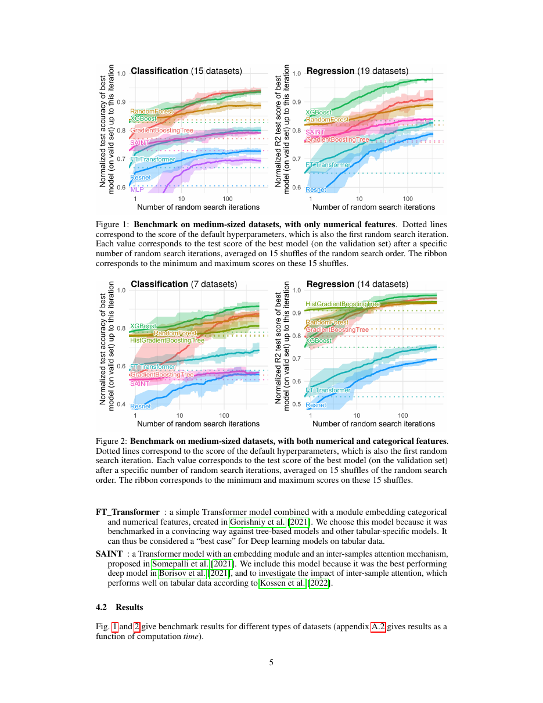
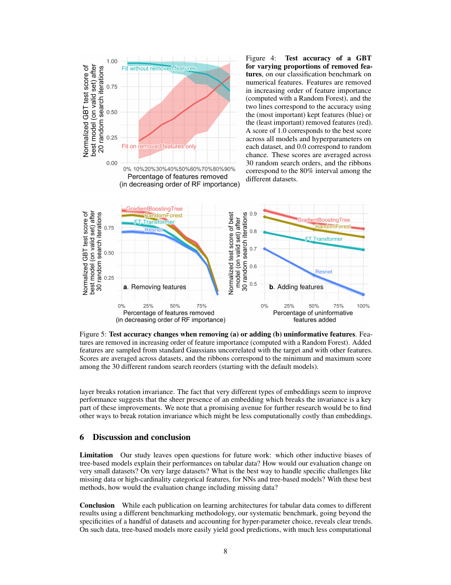
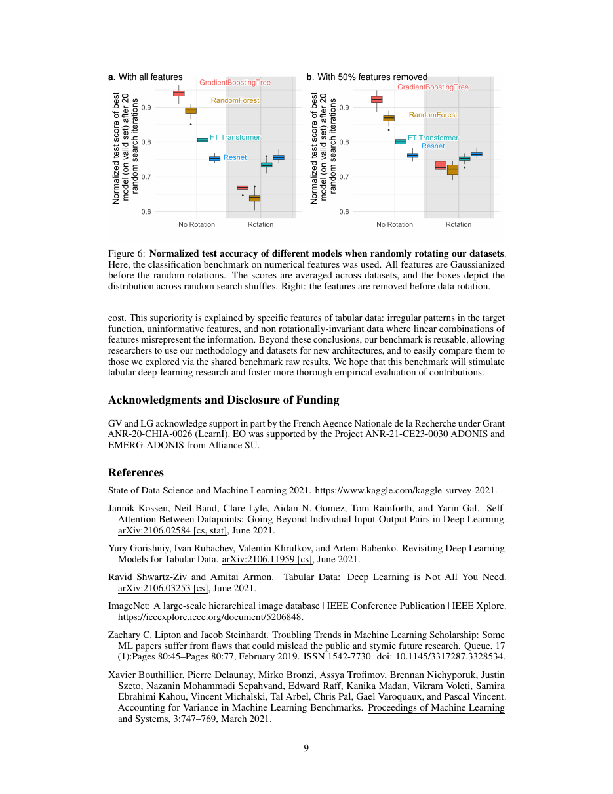

# Grinsztajn, Oyallon, Varoquaux 2022 번역: 트리 기반 모델은 왜 표형 자료에서 아직도 딥러닝보다 나은가?

- 번역 범위: 전문 (초록, 1~6절, 감사의 글, 부록 A.1~A.7, 그림과 표 캡션). 참고문헌은 원문 그대로 두었다.
- 원문: 같은 폴더의 `Grinsztajn2022_NeurIPS_tree_vs_deep_tabular.pdf` (arXiv:2207.08815v1, 2022-07-18판, 33쪽, 2026-11-04 arXiv에서 내려받음). arXiv에는 v1 하나만 있다(2026-11-04 arXiv API 확인).
- 학술지 판: Advances in Neural Information Processing Systems 35 (NeurIPS 2022, Datasets and Benchmarks Track), pp. 507-520, doi:10.52202/068431-0037. 학술지 판 제목에는 "typical"이 들어간다("... on Typical Tabular Data?"). 이 번역은 arXiv v1("Preprint. Under review.")을 옮겼다. 학술지 판과 문구, 그림, 쪽 번호가 다를 수 있다.
- 본문은 `pdftotext -layout`으로 뽑아 옮겼다. 부록 A.4.1의 수식은 뽑은 글자가 깨져서 원문 PDF를 보고 다시 적었다.
- 그림은 원문 쪽을 `pdftoppm -r 110`으로 이미지화했다(그림 1과 2는 5쪽, 그림 4와 5는 8쪽, 그림 6은 9쪽). 나머지 그림은 캡션만 옮겼다.
- 용어: tabular data는 "표형 자료", tree-based model은 "트리 기반 모델", NN(neural network)은 "신경망", inductive bias는 "귀납 편향", uninformative feature는 "쓸모없는 특징", random search는 "무작위 탐색"으로 옮겼다.
- 팀 내부 연구용 번역이다.

---

## 초록

딥러닝은 글과 이미지 자료에서 큰 발전을 이끌었다. 그러나 표형 자료에서 딥러닝이 더 낫다는 것은 분명하지 않다. 우리는 표준 딥러닝 방법과 새 딥러닝 방법, 그리고 XGBoost와 랜덤 포레스트 같은 트리 기반 모델을 많은 자료와 많은 초매개변수 조합에서 폭넓게 비교한 벤치마크를 내놓는다.

여러 분야에서 모은 45개 자료로 표준 묶음을 정했다. 이 자료들은 표형 자료의 특징이 뚜렷하다. 또 모델 학습과 좋은 초매개변수 찾기를 함께 고려하는 벤치마크 방법을 정했다.

결과를 보면, 중간 크기 자료(약 1만 표본)에서는 트리 기반 모델이 여전히 최고 수준이다. 트리 기반 모델이 더 빠르다는 점을 빼고 봐도 그렇다. 이 차이를 이해하려고 트리 기반 모델과 신경망의 서로 다른 귀납 편향을 실험으로 조사했다. 그 결과로 표형 자료 전용 신경망을 만들려는 연구자가 풀어야 할 과제를 정리했다.

1. 쓸모없는 특징에 강건해야 한다.
2. 자료의 방향(축)을 보존해야 한다.
3. 불규칙한 함수를 쉽게 배울 수 있어야 한다.

표형 자료용 구조 연구를 북돋우려고, 표준 벤치마크와 기준 모델의 원자료를 공개한다. 학습기마다 2만 계산 시간을 들인 초매개변수 탐색의 모든 점이 들어 있다.

## 1. 서론

딥러닝은 이미지, 언어, 소리 자료의 학습에서 큰 발전을 이끌었다. 그러나 표형 자료에서는 그림이 더 흐리다. XGBoost 같은 결정 트리 앙상블 모델이 대부분의 실무자[Sta]와 데이터 과학 대회[Kossen et al., 2021]에서 여전히 먼저 쓰는 도구다.

딥러닝 구조는 자료의 불변성과 공간 의존성에 맞는 귀납 편향을 갖도록 설계됐다. 표형 자료에서는 그런 불변성을 찾기 어렵다. 표형 자료는 성질이 서로 다른 특징, 적은 표본 수, 극단값으로 이루어져 있다.

트리 기반 모델은 미분할 수 없다. 그래서 다른 딥러닝 블록과 쉽게 묶어 함께 학습할 수 없다. 이 때문에 표형 자료 전용 딥러닝 구조를 만드는 연구가 매우 활발하다(2절 참고). 이런 논문 대부분은 트리 기반 모델을 이기거나 비슷하다고 주장한다. 하지만 그 주장은 의심을 받았다. 단순한 Resnet이 이런 새 모델 몇몇과 경쟁할 만하다는 결과가 있고[Gorishniy et al., 2021], 이런 방법 대부분이 새 자료에서는 실패하는 것 같다는 결과도 있다[Shwartz-Ziv and Armon, 2021].

사실 표형 자료 학습에 정해진 벤치마크가 없어서, 연구자가 자기 방법을 평가할 때 고를 수 있는 여지가 더 많다. 게다가 온라인에 있는 표형 자료 대부분은 ImageNet[Ima] 같은 다른 기계학습 분야의 벤치마크보다 작다. 그래서 평가에 잡음이 더 많다. 이런 문제는 기계학습 전반의 다른 재현 불가 원인에 더해진다. 예를 들면 초매개변수 조정 노력이 모델마다 같지 않은 것[Lipton and Steinhardt, 2019], 벤치마크의 통계적 불확실성을 고려하지 않는 것[Bouthillier et al., 2021]이 있다.

이런 걱정을 덜기 위해, 자료 포함 기준과 초매개변수 조정 절차가 정확한 표형 자료 벤치마크를 내놓는다. 이것으로 아직 독립적으로 평가받지 않은 최근 딥러닝 모델을 평가할 수 있다. 그리고 딥러닝 알고리즘의 느린 학습을 고려하지 않아도, 중간 크기 표형 자료에서 트리 기반 모델이 여전히 최고 수준임을 보인다.

트리 기반 모델이 표형 자료에서 뛰어나다는 점에 주목해, 어떤 귀납 편향이 이 모델을 표형 자료에 잘 맞게 하는지 이해하려 했다. 표형 자료를 변환해 여러 모델의 성능을 바꿔 보았다. 그 결과 트리 기반 모델과 딥러닝 알고리즘의 편향이 서로 다르고, 이것이 성능 차이를 일부 설명한다는 것을 찾았다.

- 신경망은 목표 함수의 불규칙한 패턴을 배우기 어려워한다.
- 신경망의 회전 불변성이 성능을 해친다. 특히 표형 자료에 많은 쓸모없는 특징을 다룰 때 그렇다.

기여는 다음과 같다.

1. 표형 자료용 새 벤치마크를 만들었다. 대표적인 자료를 많이 고르고 전처리하는 방법을 정확히 정했다. 이 자료를 OpenML[Vanschoren et al., 2014]로 공유해 쉽게 쓸 수 있게 했다.
2. 일반 표형 자료에서 딥러닝 모델과 트리 기반 모델을 여러 설정으로 폭넓게 비교했다. 초매개변수를 고르는 비용도 고려했다. 무작위 탐색의 원 결과도 공유한다. 연구자는 정해진 초매개변수 최적화 예산 안에서 새 알고리즘을 싸게 시험할 수 있다.
3. 트리 기반 모델이 딥러닝보다 나은 이유를 실험으로 조사했다. 성능 차이를 좁히거나 넓히는 자료 변환을 찾았다. 이것은 표형 자료 학습에 바람직한 편향을 드러낸다. 다른 연구자가 표형 자료용 딥러닝 모델을 만드는 데 도움이 되기를 바란다.

2절에서 관련 연구를 다룬다. 3절은 벤치마크 방법(자료, 자료 처리, 초매개변수 조정)을 짧게 설명한다. 4절은 폭넓은 무작위 탐색 뒤 딥러닝과 트리 기반 모델의 원 결과를 보인다. 5절은 표형 자료에 바람직한 암묵적 편향을 드러내는 실험 연구 결과다.

## 2. 관련 연구

**표형 자료용 딥러닝.** Borisov et al. [2021]의 분야 개관이 말하듯, 딥러닝을 표형 자료에 쓰려는 시도는 여러 가지다.

- 표형 자료를 딥러닝에 더 잘 맞게 바꾸는 자료 부호화 기법[Hancock and Khoshgoftaar, 2020, Yoon et al., 2020]
- 신경망의 유연성을 얻으면서 트리 기반 모델 같은 다른 알고리즘의 귀납 편향을 유지하려는 "혼합 방법"[Lay et al., 2018, Popov et al., 2020, Abutbul et al., 2020, Hehn et al., 2019, Tanno et al., 2019, Chen, 2020, Kontschieder et al., 2015, Rodriguez et al., 2019, Popov et al., 2020, Lay et al., 2018], 또는 인수분해 기계 Guo et al. [2017]
- 표형 자료 전용 트랜스포머 구조 Somepalli et al. [2021], Kossen et al. [2021], Arik and Pfister [2019], Huang et al. [2020]
- 고전 구조를 표형 자료에 맞추는 여러 정규화 기법[Lounici et al., 2021, Shavitt and Segal, 2018, Kadra et al., 2021a, Fiedler, 2021]

이 논문은 고전 딥러닝 모델, 특히 트랜스포머와 다층 퍼셉트론(MLP)에서 바로 나온 구조에 집중한다.

**신경망과 트리 기반 모델의 비교.** 기계학습 알고리즘을 가장 폭넓게 비교한 연구들은 새 딥러닝 방법이 나오기 전에 나왔거나, 특정 문제에 한정된다[Fernández-Delgado et al., 2014, Sakr et al., 2017, Korotcov et al., 2017, Uddin et al., 2019]. 최근 Shwartz-Ziv and Armon [2021]이 표형 자료 전용 최신 딥러닝 방법을 평가했다. 그러나 목적은 폭넓은 벤치마크를 만드는 것보다 "새 딥러닝 구조는 새 자료로 일반화되지 못한다"는 것을 드러내는 데 있었다. Borisov et al. [2022]는 표형 자료용 딥러닝 개관에서 최근 알고리즘을 비교했지만 자료는 3개뿐이었다. 그리고 표형 자료에 "통일된 벤치마크가 필요함을 강조"했다. 표형 자료용 새 구조를 내는 논문 대부분은 여러 알고리즘을 비교하지만, 평가 방법이 제각각이고 자료 수가 적으며, 저자의 모델에 유리하게 치우칠 수 있다 Shwartz-Ziv and Armon [2021]. 우리 연구와 가장 가까운 논문은 Gorishniy et al. [2021]이다. 11개 표형 자료로 새 알고리즘을 비교했다. 우리는 45개 자료로 더 폭넓은 벤치마크를 내놓는다. 자료를 여러 설정(중간 크기와 큰 크기, 범주형 특징 있음과 없음)으로 나누고, 초매개변수 조정 비용을 고려해 표준 벤치마크를 세운다.

**표형 자료에는 표준 벤치마크가 없다.** 컴퓨터 비전[Ima]이나 자연어 처리[Wang et al., 2020] 같은 다른 기계학습 분야와 달리, 표형 자료에는 표준 벤치마크가 없다. 일반 기계학습 벤치마크는 있지만, 우리가 아는 한 표형 자료 전용은 없다. 예를 들어 OpenML 벤치마크 CC-18, CC-100[Bischl et al., 2021]과 AutoML 벤치마크 Gijsbers et al. [2019]에는 표형 자료가 있지만 이미지와 인공 자료도 섞여 있다. 그래서 표형 딥러닝 논문에서 쓰이지 않았을 것이다.

**신경망과 트리 기반 모델의 차이 이해.** 우리가 아는 한, 트리 기반 모델이 표형 자료에서 신경망보다 나은 이유를 실험으로 조사한 것은 이 논문이 처음이다. 다만 추측에 가까운 설명은 몇 가지 있었다[Klambauer et al., 2017, Borisov et al., 2021]. Kadra et al. [2021a]는 MLP에 쓸 13가지 정규화 기법을 탐색해 자료마다 맞는 조합을 찾으면 최고 수준의 성능이 나온다고 주장한다. 이것은 부분적 설명을 준다. MLP는 표형 자료를 표현할 만큼 표현력이 있지만, 알맞은 정규화가 부족할 수 있다.

## 3. 표형 학습 벤치마크

### 3.1 기준 표형 자료 45개

벤치마크를 위해 여러 분야의 표형 자료 45개를 모았다. 주로 OpenML에서 가져왔고, 목록은 A.1에 있다. 고른 기준은 다음과 같다.

- **열의 성질이 서로 다름.** 열마다 성질이 다른 특징이어야 한다. 그래서 각 열이 여러 센서에서 잰 같은 신호인 이미지나 신호 자료는 뺐다.
- **고차원이 아님.** 특징 수 d와 표본 수 n의 비 d/n이 1/10보다 작은 자료만 남겼다.
- **설명이 없는 자료 제외.** 정보가 너무 적은 자료는 뺐다. 열 이름이 숨겨져 있어도 특징의 성질이 서로 다름이 분명하면 남겼다.
- **독립 동일 분포(I.I.D.) 자료.** 흐름형 자료와 시계열은 뺐다.
- **실제 자료.** 인공 자료는 뺐지만 일부 모의 자료는 남겼다. 구분이 미묘하다. 그 자료를 배우는 것이 실용적으로 중요하면(Higgs 자료처럼) 남기고, 특정 모델 능력을 시험하는 장난감 예제일 뿐이면 뺐다.
- **너무 작지 않음.** 특징이 너무 적거나(4개 미만) 표본이 너무 적은(3,000개 미만) 자료는 뺐다. 수치 특징만 쓰는 벤치마크에서는 범주형 특징을 먼저 지우고 나서 특징과 표본이 충분히 남는지 확인했다.
- **너무 쉽지 않음.** 너무 쉬운 자료는 뺐다. 구체적으로, 기본 설정 로지스틱 회귀(회귀 문제는 선형 회귀)의 점수가 기본 설정 Resnet(Gorishniy et al. [2021])과 기본 설정 HistGradientBoosting 모델(scikit-learn) 두 점수 모두와 상대 차이 5% 안이면 그 자료를 뺐다. 다른 벤치마크는 너무 쉬운 자료를 다른 기준으로 뺀다. 예를 들어 결정 트리 하나로 완벽하게 배울 수 있는 자료를 뺀다[Bischl et al., 2021]. 그러나 이 기준은 자료마다 베이즈 오류율이 다르다는 점을 고려하지 못한다. 우리 설정에서 트리 기반 방법이 로지스틱 회귀보다 낫다고 알려져 있으므로[Fernández-Delgado et al., 2014], 두 종류 모델의 점수가 가깝다는 것은 이미 얻을 수 있는 최고 점수에 가깝다는 뜻일 수 있다.
- **결정론적이지 않음.** 목표가 자료의 결정론적 함수인 자료는 뺐다. 주로 포커나 체스 같은 게임 자료다. 이런 자료는 대부분의 실제 표형 자료와 매우 다르며 따로 연구해야 한다고 본다.

### 3.2 곁가지 문제 제거

학습 과제를 되도록 균질하게 하고 표형 자료 고유의 어려움에 집중하기 위해, 따로 분석할 만한 하위 문제는 뺐다.

- **중간 크기 학습 자료.** 큰 자료는 학습 자료를 10,000 표본으로 자른다. 이렇게 중간 크기 자료 영역을 조사한다. 큰 크기(50,000) 영역은 기준에 맞는 자료가 더 적어서 A.2에서 다룬다.
- **결측값 없음.** 결측값은 모두 지웠다. 트리 기반 모델과 신경망 모두에서 결측값을 다루는 기법이 많고 성능도 제각각이다[Perez-Lebel et al., 2022]. 실제로는 결측이 많은 열을 먼저 지우고, 그다음 결측이 하나라도 있는 행을 모두 지웠다.
- **균형 잡힌 범주.** 분류 문제에서 범주가 여럿이면 가장 많은 두 범주만 남겨 이진화하고, 각 범주에서 표본의 절반씩을 남긴다.
- **값 종류가 적은 범주형 특징.** 항목이 20개보다 많은 범주형 특징은 뺐다.
- **값 종류가 많은 수치 특징.** 서로 다른 값이 10개보다 적은 수치 특징은 뺐다. 서로 다른 값이 2개인 수치 특징은 범주형 특징으로 바꿨다.

### 3.3 초매개변수 선택을 포함한 모델 벤치마크 절차

초매개변수 조정은 벤치마크에 통제되지 않는 분산을 낳는다[Bouthillier et al., 2021]. 모델 평가 예산이 작을 때 특히 그렇다. 우리는 초매개변수 조정의 분산을 함께 표집하면서, 모델 평가 예산을 점점 키워 가며 살피는 벤치마크 절차를 설계했다. 초매개변수 조정에는 무작위 탐색을 쓴다[Bergstra et al., 2013]. 탐색 공간은 Hyperopt-Sklearn Komer et al. [2014]에 있으면 그것을, 없으면 가능한 한 원 논문의 것을 쓰고, MLP, Resnet, XGBoost는 Gorishniy et al. [2021]의 것을 썼다(A.3 참고). 자료마다 약 400회 무작위 탐색을 돌렸다. 트리 기반 모델은 CPU, 신경망은 GPU에서 돌렸다(자세한 내용은 A.3).

무작위 탐색 반복 수 n에 따른 성능을 보기 위해, (모델과 자료마다) n회 반복 중 검증 자료에서 가장 좋은 초매개변수 조합을 고르고 그것을 시험 자료로 평가한다. 이것을 무작위 탐색 순서를 매번 섞어 15번 한다. 그러면 무작위 탐색 반복 수마다 "검증 자료에서 가장 좋은 모델"의 기대 시험 점수를 부트스트랩과 비슷하게 추정할 수 있다. 또 무작위 탐색은 언제나 각 모델의 기본 초매개변수로 시작한다.

**재사용 가능한 코드와 벤치마크 원자료.** 모든 실험과 비교에 쓴 코드는 https://github.com/LeoGrin/tabular-benchmark 에 있다. 연구자가 자기 알고리즘을 결과에 싸게 더할 수 있도록, 2만 계산 시간을 들인 무작위 탐색의 모든 반복 결과를 담은 표도 같은 곳에 공유한다.

### 3.4 자료 사이 결과 합치기

모델 성능은 시험 자료 정확도(분류)와 R2 점수(회귀)로 잰다. 난이도가 다른 자료의 결과를 합치기 위해, 최솟값까지의 거리(자료 평균일 때는 최솟값까지의 평균 거리, ADTM)와 비슷한 지표를 쓴다. 이 지표는 Feurer et al. [2021]에서 쓰였고 Wistuba et al. [2015]가 도입했다. 각 시험 정확도를 가장 좋은 모델과 가장 나쁜 모델 사이에서 아핀 변환으로 0과 1 사이로 정규화한다. 가장 나쁜 모델 대신, 시험 오류의 10% 분위(분류) 또는 50% 분위(회귀)에 해당하는 모델을 쓴다. 가장 나쁜 점수는 이상치 모델이 내므로 자료의 난이도를 대표하지 못하기 때문이다. 회귀에서는 매우 낮은 점수의 영향을 줄이려고 음수 점수(즉 50% 분위 아래 점수)를 모두 0으로 자른다.

### 3.5 자료 준비

수동 전처리는 되도록 적게 하고, 다음 변환만 적용했다.

- **가우스화한 특징.** 신경망 학습에서는 scikit-learn의 QuantileTransformer로 특징을 가우스 분포 모양으로 바꾼다.
- **변환한 회귀 목표.** 회귀에서 목표 변수의 분포 꼬리가 두꺼우면(예: 집값, A.1 참고) 로그 변환한다. 또 모델 학습 때 목표 변수를 가우스화하고 평가 때 되돌리는 선택지를 초매개변수로 더했다(scikit-learn의 TransformedTargetRegressor와 QuantileTransformer 사용).
- **OneHotEncoder.** 범주형 변수를 스스로 다루지 못하는 모델에서는 scikit-learn의 OneHotEncoder로 범주형 특징을 부호화한다.

## 4. 트리 기반 모델은 표형 자료에서 여전히 딥러닝보다 낫다

### 4.1 비교한 모델

트리 기반 모델로는 실무자가 쓰는 최고 수준 모델 3개를 골랐다. scikit-learn의 RandomForest, GradientBoostingTrees(GBT)(범주형 특징을 쓸 때는 HistGradientBoostingTrees), 그리고 XGBoost Chen and Guestrin [2016]이다. 딥러닝 모델은 다음을 비교한다.

- **MLP**: Gorishniy et al. [2021]의 고전 MLP. 단순 MLP에서 바뀐 점은 PyTorch의 ReduceOnPlateau 학습률 조절기를 쓴 것뿐이다.
- **Resnet**: Gorishniy et al. [2021]과 같다. MLP와 비슷하지만 드롭아웃, 배치 또는 층 정규화, 건너뛰기 연결이 있다.
- **FT_Transformer**: 범주형과 수치 특징을 임베딩하는 모듈에 단순한 트랜스포머를 결합한 모델로, Gorishniy et al. [2021]이 만들었다. 트리 기반 모델 및 다른 표형 전용 모델과 설득력 있게 비교된 모델이라 골랐다. 그래서 표형 자료에서 딥러닝 모델의 "가장 좋은 경우"로 볼 수 있다.
- **SAINT**: 임베딩 모듈과 표본 사이 주의(attention) 기법을 가진 트랜스포머 모델로, Somepalli et al. [2021]이 제안했다. Borisov et al. [2021]에서 가장 성능이 좋은 딥러닝 모델이었고, Kossen et al. [2022]에 따르면 표형 자료에서 잘 되는 표본 사이 주의의 영향을 보려고 넣었다.

**그림 1: 중간 크기 자료, 수치 특징만 쓴 벤치마크.** (왼쪽: 분류 15개 자료, 오른쪽: 회귀 19개 자료.) 점선은 기본 초매개변수의 점수이며, 이것은 무작위 탐색의 첫 반복이기도 하다. 각 값은 무작위 탐색을 일정 횟수 돈 뒤 (검증 자료에서) 가장 좋은 모델의 시험 점수이며, 무작위 탐색 순서를 15번 섞은 평균이다. 띠는 이 15번의 최솟값과 최댓값이다.

**그림 2: 중간 크기 자료, 수치 특징과 범주형 특징을 함께 쓴 벤치마크.** (왼쪽: 분류 7개 자료, 오른쪽: 회귀 14개 자료.) 점선은 기본 초매개변수의 점수이며, 이것은 무작위 탐색의 첫 반복이기도 하다. 각 값은 무작위 탐색을 일정 횟수 돈 뒤 (검증 자료에서) 가장 좋은 모델의 시험 점수이며, 무작위 탐색 순서를 15번 섞은 평균이다. 띠는 이 15번의 최솟값과 최댓값이다.

### 4.2 결과

그림 1과 2는 자료 종류별 벤치마크 결과다(부록 A.2는 계산 *시간*에 따른 결과를 보인다).

**초매개변수를 조정해도 신경망은 최고 수준이 되지 못한다.** 모든 무작위 탐색 예산에서 트리 기반 모델이 더 낫다. 무작위 탐색을 아주 많이 돌린 뒤에도 성능 차이는 크게 남는다. 그리고 이것은 무작위 탐색 한 번이 대개 신경망에서 트리 기반 모델보다 느리다는 점(A.2 참고)을 고려하지 않은 결과다.

**범주형 변수가 신경망의 주된 약점은 아니다.** 범주형 변수는 흔히 표형 자료에 신경망을 쓸 때의 큰 문제로 여겨진다[Borisov et al., 2021]. 수치 변수만 쓴 결과는 범주형 변수를 넣었을 때보다 트리 기반 모델과 신경망의 차이가 좁다. 그래도 수치 특징만 배울 때도 차이의 대부분은 남는다.

## 5. 실험 조사: 트리 기반 모델은 왜 표형 자료에서 여전히 딥러닝보다 나은가?

### 5.1 방법: 귀납 편향 드러내기

4.2절에서 트리 기반 모델이 넓은 초매개변수 범위에서 신경망을 이긴다는 것을 보았다. 이것은 표형 자료에서의 성능을 설명하는 이 모델들 고유의 성질이 있음을 시사한다. 실제로 표형 자료에서 가장 좋은 방법들은 두 가지 성질을 공유한다. 앙상블 방법(배깅은 랜덤 포레스트, 부스팅은 XGBoost와 GBT)이고, 앙상블의 약한 학습기가 결정 트리다. 결정적인 것은 트리라는 점으로 보인다. 다른 약한 학습기를 쓰는 부스팅과 배깅 방법도 있지만 표형 자료에는 흔히 쓰이지 않는다. 이 절에서는 결정 트리를 표형 자료에 잘 맞게 하는 귀납 편향이 무엇이고, 그것이 신경망의 귀납 편향과 어떻게 다른지 이해하려 한다. 이것은 거꾸로 말하는 것과 같다. 표형 자료의 어떤 성질이 이 자료를 트리 기반 방법으로는 배우기 쉽고 신경망으로는 더 어렵게 만드는가?

이를 위해 표형 자료에 여러 변환을 적용해, 신경망과 트리 기반 모델 사이의 일반화 성능 차이를 좁히거나 넓힌다. 그렇게 둘의 서로 다른 귀납 편향을 드러낸다. 단순하게 하려고 분석은 수치 변수와 중간 크기 자료의 분류 과제로 한정했다. 결과는 자료 전체를 합쳐 보이고, 자료별 결과와 실험의 자세한 내용은 A.4에 있다.

### 5.2 발견 1: 신경망은 지나치게 매끄러운 해로 치우친다

각 학습 자료의 출력을 가우스 커널 평활기로 매끄럽게 만든다. 커널의 길이 척도 값을 바꿔 가며 한다(자세한 내용은 A.4). 이렇게 하면 모델이 목표 함수의 불규칙한 패턴을 배우지 못하게 된다. 그림 3은 평활 커널의 길이 척도에 따른 모델 성능이다. 길이 척도가 작을 때, 학습 자료의 목표 함수를 매끄럽게 하면 트리 기반 모델의 정확도는 뚜렷하게 떨어지지만 신경망의 정확도는 거의 바뀌지 않는다.

**그림 3: 학습 자료의 목표 함수를 여러 정도로 매끄럽게 했을 때 모델별 정규화한 시험 정확도.** 목표 함수를 가우스 커널 평활기로 매끄럽게 한다. 평활기의 공분산 행렬은 자료의 공분산에 가우스 커널 평활기 길이 척도의 제곱을 곱한 것이다. 길이 척도 0은 평활하지 않은 원 자료다. 평활 전에 모든 특징을 scikit-learn의 QuantileTransformer로 가우스화했다. 상자 그림은 무작위 탐색 순서를 15번 다시 정했을 때 정규화 정확도의 분포다.

이런 결과는 우리 자료의 목표 함수가 매끄럽지 않으며, 신경망이 트리 기반 모델보다 이런 불규칙한 함수를 맞추기 어려워한다는 것을 시사한다. 이것은 신경망이 저주파 함수 쪽으로 치우친다는 Rahaman et al. [2019]의 결과와 맞는다. 조각마다 상수인 함수를 배우는 결정 트리 기반 모델에는 그런 치우침이 없다. 이 발견은 표형 자료에서 정규화가 이롭다는 논문들[Shavitt and Segal, 2018, Borisov et al., 2021, Kadra et al., 2021b, Lounici et al., 2021]과 모순되지 않는다. 알맞은 정규화와 신중한 최적화로 신경망이 불규칙한 패턴을 배울 수도 있기 때문이다. A.4에서 신경망이 배우지 못하는 매끄럽지 않은 패턴의 예를 장난감 설정과 실제 설정 모두에서 보인다.

또 이 관찰은 Neural-GAM 논문[Agarwal et al., 2021]의 ExU 활성 함수와 Gorishniy et al. [2022]의 임베딩이 왜 이로운지도 설명할 수 있다. 주기 임베딩은 모델이 목표 함수의 고주파 부분을 배우도록 돕고, 목표를 고려한 구간화는 목표 함수를 더 매끄럽게 만들 수 있다.

### 5.3 발견 2: 쓸모없는 특징은 MLP 계열 신경망에 더 크게 영향을 준다

**표형 자료에는 쓸모없는 특징이 많다.** 자료마다 특징 중요도(랜덤 포레스트로 순위)에 따라 특징을 점점 더 많이 지운다. 그림 4를 보면 특징을 절반까지 지워도 GBT의 분류 정확도는 크게 바뀌지 않는다. 게다가 지운 특징(즉 어떤 특징 중요도 문턱 아래의 특징)으로 학습한 GBT의 시험 정확도는 특징을 20% 지울 때까지 매우 낮고, 50%까지도 꽤 낮다. 이것은 이 특징들 대부분이 단지 중복된 것이 아니라 쓸모없다는 것을 시사한다.

**그림 4: 지운 특징의 비율에 따른 GBT의 시험 정확도.** 수치 특징 분류 벤치마크에서 잰 것이다. 특징 중요도(랜덤 포레스트로 계산)가 낮은 순서로 특징을 지운다. 두 선은 남긴 특징(중요한 쪽, 파랑)으로 학습한 정확도와 지운 특징(덜 중요한 쪽, 빨강)으로 학습한 정확도다. 점수 1.0은 각 자료에서 모든 모델과 초매개변수 중 가장 좋은 점수이고, 0.0은 우연 수준이다. 이 점수는 무작위 탐색 순서 30개의 평균이며, 띠는 자료 사이 80% 구간이다.

**그림 5: 쓸모없는 특징을 지우거나(a) 더할 때(b) 시험 정확도의 변화.** 특징 중요도(랜덤 포레스트로 계산)가 낮은 순서로 특징을 지운다. 더하는 특징은 목표와도 다른 특징과도 상관이 없는 표준 가우스 분포에서 뽑는다. 점수는 자료 전체 평균이며, 띠는 무작위 탐색 순서 30개(기본 모델로 시작)의 최솟값과 최댓값이다.

**MLP 계열 구조는 쓸모없는 특징에 강건하지 않다.** 그림 5의 두 실험을 보면, 쓸모없는 특징을 지우면(5a) MLP(Resnet)와 다른 모델(FT Transformer와 트리 기반 모델) 사이의 성능 차이가 줄고, 쓸모없는 특징을 더하면 차이가 커진다. 이것은 MLP가 쓸모없는 특징에 덜 강건함을 보여 준다. 표형 자료에 이런 특징이 흔하다는 점을 생각하면, 4.2절 결과를 일부 설명한다.

그림 5a에서는 지우는 특징 비율이 커질수록 쓸모 있는 특징도 함께 지운다. 우리 판단은 이렇다(5b가 뒷받침한다). 이 특징들을 지워서 생기는 정확도 하락을, 쓸모없는 특징을 지워서 얻는 이득이 메운다. 그리고 그 이득은 다른 모델보다 MLP에 더 크다. (동시에 중복 특징도 지우지만, 이것은 모델에 영향을 주지 않아야 한다.)

### 5.4 발견 3: 자료는 회전에 불변이 아니다. 그러니 학습 절차도 그래야 한다

MLP는 왜 다른 모델보다 쓸모없는 특징에 훨씬 더 방해를 받는가? 한 가지 답은 이 학습기가 Ng [2004]의 뜻에서 회전 불변이라는 것이다. 즉 학습 자료와 시험 자료의 특징에 같은 회전(유니터리 행렬)을 적용해도, 학습 자료로 MLP를 배우고 시험 자료로 평가하는 학습 절차는 바뀌지 않는다. 실제로 Ng [2004]는 회전 불변인 학습 절차는 최악의 경우 표본 복잡도가 관련 없는 특징 수에 적어도 선형으로 늘어남을 보였다. 직관적으로, 쓸모없는 특징을 지우려면 회전 불변 알고리즘은 먼저 특징의 원래 방향을 찾고, 그다음 가장 덜 쓸모 있는 특징을 골라야 한다. 자료의 방향에 담긴 정보는 잃어버린다.

그림 6a는 자료를 무작위로 회전했을 때의 시험 정확도 변화다. 여기서 회전 불변인 것은 Resnet뿐임을 확인한다. 더 놀라운 것은 무작위 회전이 성능 순서를 뒤집는다는 점이다. 이제 신경망이 트리 기반 모델보다 위에 있고, Resnet이 FT Transformer보다 위에 있다. 이것은 회전 불변성이 바람직하지 않다는 것을 시사한다. 비전[Krizhevsky et al., 2012]에서처럼, 자료의 편향을 가장 잘 담는 자연스러운 기저(여기서는 원래 기저)가 있다. 그리고 회전 불변인 모델은 이 기저를 되찾을 수 없다. 이런 모델은 통계적 성질이 매우 다른 특징을 섞을 수 있다. 실제로 표형 자료의 특징은 열 이름(나이, 몸무게)이 보여 주듯 하나하나가 대개 뜻을 가진다. 쓸모없는 특징과의 관계는 6b에서 드러난다. 각 자료에서 덜 중요한 절반의 특징을 (회전 전에) 지우면, Resnet을 뺀 모든 모델의 성능이 떨어지지만, 모든 특징을 쓸 때보다는 덜 떨어진다.

**그림 6: 자료를 무작위로 회전했을 때 모델별 정규화한 시험 정확도.** (a: 모든 특징 사용, b: 특징 50% 지움.) 수치 특징 분류 벤치마크를 썼다. 무작위 회전 전에 모든 특징을 가우스화했다. 점수는 자료 전체 평균이며, 상자는 무작위 탐색 순서 섞기에 따른 분포다. 오른쪽: 회전 전에 특징을 지웠다.

이 발견은 Somepalli et al. [2021]과 Gorishniy et al. [2022]의 결과를 설명해 준다. 이들은 수치 특징에도 MLP나 트랜스포머 앞에 임베딩 층을 더한다. 실제로 이 층은 회전 불변성을 깬다. 매우 다른 종류의 임베딩이 모두 성능을 높이는 것 같다는 사실은, 불변성을 깨는 임베딩이 있다는 것 자체가 이런 개선의 핵심 부분임을 시사한다. 임베딩보다 계산 비용이 적게 드는, 회전 불변성을 깨는 다른 방법을 찾는 것이 앞으로 유망한 연구 방향이다.

## 6. 논의와 결론

**한계.** 이 연구는 앞으로의 질문을 남긴다.

- 트리 기반 모델의 어떤 다른 귀납 편향이 표형 자료에서의 성능을 설명하는가?
- 아주 작은 자료에서는 평가가 어떻게 바뀌는가? 아주 큰 자료에서는?
- 결측값이나 값 종류가 많은 범주형 특징 같은 특정 어려움을 신경망과 트리 기반 모델에서 가장 잘 다루는 방법은 무엇인가?
- 그런 최선의 방법을 쓰고 결측값까지 넣으면 평가가 어떻게 바뀌는가?

**결론.** 표형 자료용 학습 구조에 관한 논문마다 서로 다른 벤치마크 방법을 써서 서로 다른 결과를 낸다. 우리의 체계적인 벤치마크는 몇몇 자료의 특수성을 넘어서고 초매개변수 선택을 고려해 뚜렷한 경향을 드러낸다. 이런 자료에서 트리 기반 모델은 훨씬 적은 계산 비용으로 더 쉽게 좋은 예측을 낸다. 이 우월성은 표형 자료의 특정 성질로 설명된다. 목표 함수의 불규칙한 패턴, 쓸모없는 특징, 그리고 특징의 선형 결합이 정보를 잘못 나타내는 회전 불변이 아닌 자료다. 이 결론과 별개로, 우리 벤치마크는 재사용할 수 있다. 연구자는 우리 방법과 자료로 새 구조를 평가하고, 공유한 벤치마크 원 결과로 우리가 살핀 모델과 쉽게 비교할 수 있다. 이 벤치마크가 표형 딥러닝 연구를 북돋우고, 연구 기여를 더 철저하게 실험으로 평가하는 문화를 키우기를 바란다.

## 감사의 글과 연구비

GV와 LG는 프랑스 국립연구청(Agence Nationale de la Recherche)의 과제 ANR-20-CHIA-0026(LearnI)의 일부 지원을 받았다. EO는 과제 ANR-21-CE23-0030 ADONIS와 Alliance SU의 EMERG-ADONIS의 지원을 받았다.

## 참고문헌 (원문 그대로)

State of Data Science and Machine Learning 2021. https://www.kaggle.com/kaggle-survey-2021.

Jannik Kossen, Neil Band, Clare Lyle, Aidan N. Gomez, Tom Rainforth, and Yarin Gal. Self-Attention Between Datapoints: Going Beyond Individual Input-Output Pairs in Deep Learning. arXiv:2106.02584 [cs, stat], June 2021.

Yury Gorishniy, Ivan Rubachev, Valentin Khrulkov, and Artem Babenko. Revisiting Deep Learning Models for Tabular Data. arXiv:2106.11959 [cs], June 2021.

Ravid Shwartz-Ziv and Amitai Armon. Tabular Data: Deep Learning is Not All You Need. arXiv:2106.03253 [cs], June 2021.

ImageNet: A large-scale hierarchical image database | IEEE Conference Publication | IEEE Xplore. https://ieeexplore.ieee.org/document/5206848.

Zachary C. Lipton and Jacob Steinhardt. Troubling Trends in Machine Learning Scholarship: Some ML papers suffer from flaws that could mislead the public and stymie future research. Queue, 17 (1):Pages 80:45–Pages 80:77, February 2019. ISSN 1542-7730. doi: 10.1145/3317287.3328534.

Xavier Bouthillier, Pierre Delaunay, Mirko Bronzi, Assya Trofimov, Brennan Nichyporuk, Justin Szeto, Nazanin Mohammadi Sepahvand, Edward Raff, Kanika Madan, Vikram Voleti, Samira Ebrahimi Kahou, Vincent Michalski, Tal Arbel, Chris Pal, Gael Varoquaux, and Pascal Vincent. Accounting for Variance in Machine Learning Benchmarks. Proceedings of Machine Learning and Systems, 3:747–769, March 2021.

Joaquin Vanschoren, Jan N. van Rijn, Bernd Bischl, and Luis Torgo. OpenML: Networked science in machine learning. ACM SIGKDD Explorations Newsletter, 15(2):49–60, June 2014. ISSN 1931-0145, 1931-0153. doi: 10.1145/2641190.2641198.

Vadim Borisov, Tobias Leemann, Kathrin Seßler, Johannes Haug, Martin Pawelczyk, and Gjergji Kasneci. Deep Neural Networks and Tabular Data: A Survey. arXiv:2110.01889 [cs], October 2021.

John T. Hancock and Taghi M. Khoshgoftaar. Survey on categorical data for neural networks. Journal of Big Data, 7(1):28, April 2020. ISSN 2196-1115. doi: 10.1186/s40537-020-00305-w.

Jinsung Yoon, Yao Zhang, James Jordon, and Mihaela van der Schaar. VIME: Extending the Success of Self- and Semi-supervised Learning to Tabular Domain. In Advances in Neural Information Processing Systems, volume 33, pages 11033–11043. Curran Associates, Inc., 2020.

Nathan Lay, Adam P. Harrison, Sharon Schreiber, Gitesh Dawer, and Adrian Barbu. Random Hinge Forest for Differentiable Learning. arXiv:1802.03882 [cs, stat], March 2018.

Sergei Popov, S. Morozov, and Artem Babenko. Neural Oblivious Decision Ensembles for Deep Learning on Tabular Data. undefined, 2020.

Ami Abutbul, Gal Elidan, Liran Katzir, and Ran El-Yaniv. DNF-Net: A Neural Architecture for Tabular Data, June 2020.

Thomas M. Hehn, Julian F. P. Kooij, and F. Hamprecht. End-to-End Learning of Decision Trees and Forests. undefined, 2019.

Ryutaro Tanno, Kai Arulkumaran, D. Alexander, A. Criminisi, and A. Nori. Adaptive Neural Trees. undefined, 2019.

Y. Chen. Attention augmented differentiable forest for tabular data. undefined, 2020.

Peter Kontschieder, Madalina Fiterau, Antonio Criminisi, and Samuel Rota Bulo. Deep Neural Decision Forests. In 2015 IEEE International Conference on Computer Vision (ICCV), pages 1467–1475, Santiago, Chile, December 2015. IEEE. ISBN 978-1-4673-8391-2. doi: 10.1109/ICCV.2015.172.

I. D. Rodriguez, Taylor W. Killian, Sung-Hyun Son, and M. Gombolay. Interpretable Reinforcement Learning via Differentiable Decision Trees. undefined, 2019.

Huifeng Guo, Ruiming Tang, Yunming Ye, Zhenguo Li, and Xiuqiang He. DeepFM: A Factorization-Machine based Neural Network for CTR Prediction, March 2017.

Gowthami Somepalli, Micah Goldblum, Avi Schwarzschild, C. Bayan Bruss, and Tom Goldstein. SAINT: Improved Neural Networks for Tabular Data via Row Attention and Contrastive Pre-Training. arXiv:2106.01342 [cs, stat], June 2021.

Sercan Ö Arik and Tomas Pfister. TabNet: Attentive Interpretable Tabular Learning. undefined, 2019.

Xin Huang, Ashish Khetan, Milan Cvitkovic, and Zohar Karnin. TabTransformer: Tabular Data Modeling Using Contextual Embeddings. arXiv:2012.06678 [cs], December 2020.

Karim Lounici, Katia Meziani, and Benjamin Riu. Muddling Label Regularization: Deep Learning for Tabular Datasets. arXiv:2106.04462 [cs], June 2021.

Ira Shavitt and Eran Segal. Regularization Learning Networks: Deep Learning for Tabular Datasets. arXiv:1805.06440 [cs, stat], October 2018.

Arlind Kadra, Marius Lindauer, Frank Hutter, and Josif Grabocka. Well-tuned Simple Nets Excel on Tabular Datasets, November 2021a.

James Fiedler. Simple Modifications to Improve Tabular Neural Networks. arXiv:2108.03214 [cs], August 2021.

Manuel Fernández-Delgado, Eva Cernadas, Senén Barro, and Dinani Amorim. Do we Need Hundreds of Classifiers to Solve Real World Classification Problems? Journal of Machine Learning Research, 15(90):3133–3181, 2014. ISSN 1533-7928.

Sherif Sakr, Radwa Elshawi, Amjad M. Ahmed, Waqas T. Qureshi, Clinton A. Brawner, Steven J. Keteyian, Michael J. Blaha, and Mouaz H. Al-Mallah. Comparison of machine learning techniques to predict all-cause mortality using fitness data: The Henry ford exercIse testing (FIT) project. BMC Medical Informatics and Decision Making, 17(1):174, December 2017. ISSN 1472-6947. doi: 10.1186/s12911-017-0566-6.

Alexandru Korotcov, Valery Tkachenko, Daniel P. Russo, and Sean Ekins. Comparison of Deep Learning With Multiple Machine Learning Methods and Metrics Using Diverse Drug Discovery Data Sets. https://pubs.acs.org/doi/pdf/10.1021/acs.molpharmaceut.7b00578, November 2017.

Shahadat Uddin, Arif Khan, Md Ekramul Hossain, and Mohammad Ali Moni. Comparing different supervised machine learning algorithms for disease prediction. BMC Medical Informatics and Decision Making, 19(1):281, December 2019. ISSN 1472-6947. doi: 10.1186/s12911-019-1004-8.

Vadim Borisov, Tobias Leemann, Kathrin Seßler, Johannes Haug, Martin Pawelczyk, and Gjergji Kasneci. Deep Neural Networks and Tabular Data: A Survey. arXiv:2110.01889 [cs], February 2022.

Alex Wang, Yada Pruksachatkun, Nikita Nangia, Amanpreet Singh, Julian Michael, Felix Hill, Omer Levy, and Samuel R. Bowman. SuperGLUE: A Stickier Benchmark for General-Purpose Language Understanding Systems, February 2020.

Bernd Bischl, Giuseppe Casalicchio, Matthias Feurer, Pieter Gijsbers, Frank Hutter, Michel Lang, Rafael G. Mantovani, Jan N. van Rijn, and Joaquin Vanschoren. OpenML Benchmarking Suites, November 2021.

Pieter Gijsbers, Erin LeDell, Janek Thomas, Sébastien Poirier, Bernd Bischl, and Joaquin Vanschoren. An Open Source AutoML Benchmark, July 2019.

Günter Klambauer, Thomas Unterthiner, Andreas Mayr, and Sepp Hochreiter. Self-Normalizing Neural Networks. arXiv:1706.02515 [cs, stat], September 2017.

Alexandre Perez-Lebel, Gaël Varoquaux, Marine Le Morvan, Julie Josse, and Jean-Baptiste Poline. Benchmarking missing-values approaches for predictive models on health databases. GigaScience, 11:giac013, January 2022. ISSN 2047-217X. doi: 10.1093/gigascience/giac013.

J Bergstra, D Yamins, and D.D Cox. Making a Science of Model Search: Hyperparameter Optimization in Hundreds of Dimensions for Vision Architectures. 2013.

Brent Komer, James Bergstra, and Chris Eliasmith. Hyperopt-Sklearn: Automatic Hyperparameter Configuration for Scikit-Learn. In Python in Science Conference, pages 32–37, Austin, Texas, 2014. doi: 10.25080/Majora-14bd3278-006.

Matthias Feurer, Katharina Eggensperger, Stefan Falkner, Marius Lindauer, and Frank Hutter. Auto-Sklearn 2.0: Hands-free AutoML via Meta-Learning, September 2021.

Martin Wistuba, Nicolas Schilling, and Lars Schmidt-Thieme. Learning hyperparameter optimization initializations. In 2015 IEEE International Conference on Data Science and Advanced Analytics (DSAA), pages 1–10, October 2015. doi: 10.1109/DSAA.2015.7344817.

Tianqi Chen and Carlos Guestrin. XGBoost: A Scalable Tree Boosting System. In Proceedings of the 22nd ACM SIGKDD International Conference on Knowledge Discovery and Data Mining, pages 785–794, August 2016. doi: 10.1145/2939672.2939785.

Jannik Kossen, Neil Band, Clare Lyle, Aidan N. Gomez, Tom Rainforth, and Yarin Gal. Self-Attention Between Datapoints: Going Beyond Individual Input-Output Pairs in Deep Learning, February 2022.

Nasim Rahaman, Aristide Baratin, Devansh Arpit, Felix Draxler, Min Lin, Fred A. Hamprecht, Yoshua Bengio, and Aaron Courville. On the Spectral Bias of Neural Networks, May 2019.

Arlind Kadra, Marius Lindauer, Frank Hutter, and Josif Grabocka. Regularization is all you Need: Simple Neural Nets can Excel on Tabular Data. arXiv:2106.11189 [cs], June 2021b.

Rishabh Agarwal, Levi Melnick, Nicholas Frosst, Xuezhou Zhang, Ben Lengerich, Rich Caruana, and Geoffrey Hinton. Neural Additive Models: Interpretable Machine Learning with Neural Nets, October 2021.

Yury Gorishniy, Ivan Rubachev, and Artem Babenko. On Embeddings for Numerical Features in Tabular Deep Learning. arXiv:2203.05556 [cs], March 2022.

Andrew Y. Ng. Feature selection, L 1 vs. L 2 regularization, and rotational invariance. In Twenty-First International Conference on Machine Learning - ICML '04, page 78, Banff, Alberta, Canada, 2004. ACM Press. doi: 10.1145/1015330.1015435.

Alex Krizhevsky, Ilya Sutskever, and Geoffrey E Hinton. Imagenet classification with deep convolutional neural networks. Advances in neural information processing systems, 25, 2012.

Lukas Biewald. Experiment Tracking with Weights and Biases, 2020.

Pauli Virtanen, Ralf Gommers, Travis E. Oliphant, Matt Haberland, Tyler Reddy, David Cournapeau, Evgeni Burovski, Pearu Peterson, Warren Weckesser, Jonathan Bright, Stéfan J. van der Walt, Matthew Brett, Joshua Wilson, K. Jarrod Millman, Nikolay Mayorov, Andrew R. J. Nelson, Eric Jones, Robert Kern, Eric Larson, C J Carey, İlhan Polat, Yu Feng, Eric W. Moore, Jake VanderPlas, Denis Laxalde, Josef Perktold, Robert Cimrman, Ian Henriksen, E. A. Quintero, Charles R. Harris, Anne M. Archibald, Antônio H. Ribeiro, Fabian Pedregosa, Paul van Mulbregt, and SciPy 1.0 Contributors. SciPy 1.0: Fundamental Algorithms for Scientific Computing in Python. Nature Methods, 17:261–272, 2020. doi: 10.1038/s41592-019-0686-2.

---

## 부록 A

### A.1 사용한 자료

아래에 벤치마크에 쓴 모든 자료를 원래 자료 링크, 그리고 벤치마크용으로 변환한 자료의 새 OpenML 링크와 함께 적는다. 벤치마크에 고려한 모든 자료와 그 자료를 고르거나 뺀 이유는 다음 링크에 있다: https://docs.google.com/spreadsheets/d/1Mgh27upycFcd3B6uA7YJyB9Pd4Y3UuY1gBfI02EZUGM/edit?usp=sharing. 이 자료로 자기 알고리즘을 비교하는 방법은 A.7에 있다.

#### A.1.1 수치 분류

OpenML 벤치마크: https://www.openml.org/search?type=benchmark&study_type=task&sort=tasks_included&id=298

| 자료 이름 | 표본 수 | 특징 수 | 원래 링크 | 새 링크 |
|---|---|---|---|---|
| electricity | 38474 | 7 | https://openml.org/d/151 | https://www.openml.org/d/44120 |
| covertype | 566602 | 10 | https://openml.org/d/293 | https://www.openml.org/d/44121 |
| pol | 10082 | 26 | https://openml.org/d/722 | https://www.openml.org/d/44122 |
| house_16H | 13488 | 16 | https://openml.org/d/821 | https://www.openml.org/d/44123 |
| kdd_ipums_la_97-small | 5188 | 20 | https://openml.org/d/993 | https://www.openml.org/d/44124 |
| MagicTelescope | 13376 | 10 | https://openml.org/d/1120 | https://www.openml.org/d/44125 |
| bank-marketing | 10578 | 7 | https://openml.org/d/1461 | https://www.openml.org/d/44126 |
| phoneme | 3172 | 5 | https://openml.org/d/1489 | https://www.openml.org/d/44127 |
| MiniBooNE | 72998 | 50 | https://openml.org/d/41150 | https://www.openml.org/d/44128 |
| Higgs | 940160 | 24 | https://openml.org/d/42769 | https://www.openml.org/d/44129 |
| eye_movements | 7608 | 20 | https://openml.org/d/1044 | https://www.openml.org/d/44130 |
| jannis | 57580 | 54 | https://openml.org/d/41168 | https://www.openml.org/d/44131 |
| credit | 16714 | 10 | https://www.kaggle.com/c/GiveMeSomeCredit/data?select=cs-training.csv | https://www.openml.org/d/44089 |
| california | 20634 | 8 | https://www.dcc.fc.up.pt/ ltorgo/Regression/cal_housing.html | https://www.openml.org/d/44090 |
| wine | 2554 | 11 | https://archive.ics.uci.edu/ml/datasets/wine+quality | https://www.openml.org/d/44091 |

변환한 wine 자료의 표본 수가 우리 문턱보다 조금 적다는 것을 늦게 알았고, 그대로 두기로 했다.

#### A.1.2 수치 회귀

OpenML 벤치마크: https://www.openml.org/search?type=benchmark&study_type=task&sort=tasks_included&id=297

| 자료 이름 | 표본 수 | 특징 수 | 원래 링크 | 새 링크 |
|---|---|---|---|---|
| cpu_act | 8192 | 21 | https://openml.org/d/197 | https://www.openml.org/d/44132 |
| pol | 15000 | 26 | https://openml.org/d/201 | https://www.openml.org/d/44133 |
| elevators | 16599 | 16 | https://openml.org/d/216 | https://www.openml.org/d/44134 |
| isolet | 7797 | 613 | https://openml.org/d/300 | https://www.openml.org/d/44135 |
| wine_quality | 6497 | 11 | https://openml.org/d/287 | https://www.openml.org/d/44136 |
| Ailerons | 13750 | 33 | https://openml.org/d/296 | https://www.openml.org/d/44137 |
| houses | 20640 | 8 | https://openml.org/d/537 | https://www.openml.org/d/44138 |
| house_16H | 22784 | 16 | https://openml.org/d/574 | https://www.openml.org/d/44139 |
| diamonds | 53940 | 6 | https://openml.org/d/42225 | https://www.openml.org/d/44140 |
| Brazilian_houses | 10692 | 8 | https://openml.org/d/42688 | https://www.openml.org/d/44141 |
| Bike_Sharing_Demand | 17379 | 6 | https://openml.org/d/42712 | https://www.openml.org/d/44142 |
| nyc-taxi-green-dec-2016 | 581835 | 9 | https://openml.org/d/42729 | https://www.openml.org/d/44143 |
| house_sales | 21613 | 15 | https://openml.org/d/42731 | https://www.openml.org/d/44144 |
| sulfur | 10081 | 6 | https://openml.org/d/23515 | https://www.openml.org/d/44145 |
| medical_charges | 163065 | 5 | https://openml.org/d/42720 | https://www.openml.org/d/44146 |
| MiamiHousing2016 | 13932 | 14 | https://openml.org/d/43093 | https://www.openml.org/d/44147 |
| superconduct | 21263 | 79 | https://openml.org/d/43174 | https://www.openml.org/d/44148 |
| california | 20640 | 8 | https://www.dcc.fc.up.pt/ ltorgo/Regression/cal_housing.html | https://www.openml.org/d/44025 |
| fifa | 18063 | 5 | https://www.kaggle.com/datasets/stefanoleone992/fifa-22-complete-player-dataset | https://www.openml.org/d/44026 |
| year | 515345 | 90 | https://archive.ics.uci.edu/ml/datasets/yearpredictionmsd | https://www.openml.org/d/44027 |

#### A.1.3 범주형 분류

OpenML 벤치마크: https://www.openml.org/search?type=benchmark&sort=date&study_type=task&id=300

| 자료 이름 | 표본 수 | 특징 수 | 원래 링크 | 새 링크 |
|---|---|---|---|---|
| electricity | 38474 | 8 | https://openml.org/d/151 | https://www.openml.org/d/44156 |
| eye_movements | 7608 | 23 | https://openml.org/d/1044 | https://www.openml.org/d/44157 |
| KDDCup09_upselling | 5032 | 45 | https://openml.org/d/1114 | https://www.openml.org/d/44158 |
| covertype | 423680 | 54 | https://openml.org/d/1596 | https://www.openml.org/d/44159 |
| rl | 4970 | 12 | https://openml.org/d/41160 | https://www.openml.org/d/44160 |
| road-safety | 111762 | 32 | https://openml.org/d/42803 | https://www.openml.org/d/44161 |
| compass | 16644 | 17 | https://www.kaggle.com/datasets/danofer/compass?select=cox-violent-parsed.csv | https://www.openml.org/d/44162 |

#### A.1.4 범주형 회귀

OpenML 벤치마크: https://www.openml.org/search?type=benchmark&study_type=task&sort=tasks_included&id=299

(원문 표는 이 절만 열 순서가 "특징 수, 표본 수"다. 원문 순서를 그대로 둔다.)

| 자료 이름 | 특징 수 | 표본 수 | 원래 링크 | 새 링크 |
|---|---|---|---|---|
| yprop_4_1 | 62 | 8885 | https://openml.org/d/416 | https://www.openml.org/d/44054 |
| analcatdata_supreme | 7 | 4052 | https://openml.org/d/504 | https://www.openml.org/d/44055 |
| visualizing_soil | 4 | 8641 | https://openml.org/d/688 | https://www.openml.org/d/44056 |
| black_friday | 9 | 166821 | https://openml.org/d/41540 | https://www.openml.org/d/44057 |
| diamonds | 9 | 53940 | https://openml.org/d/42225 | https://www.openml.org/d/44059 |
| Mercedes_Benz_Greener_Manufacturing | 359 | 4209 | https://openml.org/d/42570 | https://www.openml.org/d/44061 |
| Brazilian_houses | 11 | 10692 | https://openml.org/d/42688 | https://www.openml.org/d/44062 |
| Bike_Sharing_Demand | 11 | 17379 | https://openml.org/d/42712 | https://www.openml.org/d/44063 |
| OnlineNewsPopularity | 59 | 39644 | https://openml.org/d/42724 | https://www.openml.org/d/44064 |
| nyc-taxi-green-dec-2016 | 16 | 581835 | https://openml.org/d/42729 | https://www.openml.org/d/44065 |
| house_sales | 17 | 21613 | https://openml.org/d/42731 | https://www.openml.org/d/44066 |
| particulate-matter-ukair-2017 | 6 | 394299 | https://openml.org/d/42207 | https://www.openml.org/d/44068 |
| SGEMM_GPU_kernel_performance | 9 | 241600 | https://openml.org/d/43144 | https://www.openml.org/d/44069 |

### A.2 추가 벤치마크

#### A.2.1 무작위 탐색 시간에 따른 결과

그림 7과 그림 8은 4.2절과 같은 결과를, 무작위 탐색 반복 수 대신 무작위 탐색 시간에 따라 보인다.

**자세한 내용.** 평가 시간과 학습 시간을 더했다. 시간은 분할(fold) 사이 평균이며, 무작위 탐색에 쓴 누적 시간을 20개 구간으로 나눴다. 딥러닝 모델은 GPU, 트리 기반 모델은 CPU에서 돌렸다(A.3 참고). 이 비교는 트리 기반 모델과 신경망의 속도 차이를 대강 느끼게 하려는 것이다. 서로 다른 종류의 GPU와 CPU를 썼으므로 모델 속도의 엄밀한 비교로 보면 안 된다.

**결과.** 무작위 탐색 반복 수가 아니라 무작위 탐색 시간으로 결과를 보면 트리 기반 모델의 우월성이 더욱 두드러진다. 몇몇 벤치마크에서는 반복 수가 적을 때 신경망과 트리 기반 모델이 가까웠다. 그러나 같은 무작위 탐색 시간을 쓰면 트리 기반 모델의 점수가 언제나 신경망보다 훨씬 높다.

**그림 7: 중간 크기 자료, 수치 특징만 쓴 시간 벤치마크.** (왼쪽: 분류 15개 자료, 오른쪽: 회귀 18개 자료.) 무작위 탐색의 첫 반복은 기본 초매개변수다. 각 값은 무작위 탐색에 일정 시간을 쓴 뒤 (검증 자료에서) 가장 좋은 모델의 시험 점수이며, 무작위 탐색 순서를 15번 섞은 평균이다. 띠는 이 15번의 최솟값과 최댓값이다.

**그림 8: 중간 크기 자료, 수치 특징과 범주형 특징을 함께 쓴 시간 벤치마크.** (왼쪽: 분류 7개 자료, 오른쪽: 회귀 14개 자료.) 무작위 탐색의 첫 반복은 기본 초매개변수다. 각 값은 무작위 탐색에 일정 시간을 쓴 뒤 (검증 자료에서) 가장 좋은 모델의 시험 점수이며, 무작위 탐색 순서를 15번 섞은 평균이다. 띠는 이 15번의 최솟값과 최댓값이다.

#### A.2.2 큰 크기 자료

벤치마크를 큰 규모 자료로 넓힌다. 그림 9, 10, 11, 12에서 같은 자료 묶음에 대해 큰 크기(학습 자료를 50,000 표본으로 자름) 설정과 중간 크기(학습 자료를 10,000 표본으로 자름) 설정의 결과를 비교한다.

표본이 50,000개보다 많은 자료만 남기고 학습 자료 크기를 50,000 표본으로 제한한다(중간 크기 벤치마크는 10,000 표본). 아쉽게도 이 조건 때문에 많은 자료가 빠져 비교가 덜 뚜렷하다. 그래도 대부분의 경우 학습 자료 크기를 늘리면 신경망과 트리 기반 모델의 차이가 줄어드는 것 같다. 이 경향의 엄밀한 연구는 앞으로의 과제로 남긴다.

**그림 9: 학습 자료 크기에 따른 분류 과제 4개의 정확도 비교, 수치 특징만 사용.** (왼쪽: 중간 크기 학습 자료, 오른쪽: 큰 크기 학습 자료.) 표본이 50,000개보다 많은 자료만 남기고, 학습 자료 크기를 10,000 또는 50,000 표본으로 잘랐다. 점선은 기본 초매개변수의 점수이며, 이것은 무작위 탐색의 첫 반복이기도 하다. 각 값은 무작위 탐색을 일정 횟수 돈 뒤 (검증 자료에서) 가장 좋은 모델의 시험 점수이며, 무작위 탐색 순서를 15번 섞은 평균이다. 띠는 이 15번의 최솟값과 최댓값이다.

**그림 10: 학습 자료 크기에 따른 회귀 과제 3개의 R2 점수 비교, 수치 특징만 사용.** (왼쪽: 중간 크기, 오른쪽: 큰 크기 학습 자료.) 나머지 설명은 그림 9와 같다.

**그림 11: 학습 자료 크기에 따른 분류 과제 2개의 정확도 비교, 수치 특징과 범주형 특징을 함께 사용.** (왼쪽: 중간 크기, 오른쪽: 큰 크기 학습 자료.) 나머지 설명은 그림 9와 같다.

**그림 12: 학습 자료 크기에 따른 회귀 과제 5개의 R2 점수 비교, 수치 특징과 범주형 특징을 함께 사용.** (왼쪽: 중간 크기, 오른쪽: 큰 크기 학습 자료.) 나머지 설명은 그림 9와 같다.

(그림 10~12의 캡션은 원문에서 그림 9와 같은 문장을 되풀이한다. 되풀이되는 부분은 "나머지 설명은 그림 9와 같다"로 줄였다.)

### A.3 벤치마크의 자세한 내용

**학습, 검증, 시험 분할.** 표본의 70%를 학습 자료로 쓴다(70%가 최대 학습 자료 크기보다 크면 그 크기에 맞는 비율을 쓴다). 남은 30% 가운데 30%를 검증 자료, 70%를 시험 자료로 쓴다. 속도를 위해 검증 자료와 시험 자료는 50,000 표본으로 자른다. 검증 자료는 무작위 탐색에서 가장 좋은 초매개변수 조합을 고르는 데만 쓴다. 이것은 조기 종료에 쓰는 검증 자료(학습 자료의 일부)와 다르다.

**분할(fold) 수.** 자료와 초매개변수 조합마다, 시험 표본 수에 따라 알고리즘 평가에 쓰는 분할 수를 바꾼다.

- 표본이 6000개보다 많으면 분할 1개로 평가한다.
- 3000~6000개면 분할 2개로 평가한다.
- 1000~3000개면 분할 3개로 평가한다.
- 시험 표본이 1000개보다 적으면 분할 5개로 평가한다.

모든 알고리즘과 초매개변수 조합은 같은 분할로 평가한다.

**하드웨어.** 모든 벤치마크와 실험에 아래 하드웨어를 썼다. 하드웨어는 쓸 수 있는 것을 기준으로 골랐고, 신경망은 언제나 GPU, 트리 기반 모델은 CPU에서 돌렸다.

- GPU: NVIDIA Quadro RTX 6000, NVIDIA TITAN Xp, NVIDIA A100, NVIDIA V100, NVIDIA Tesla T4, NVIDIA A40, NVIDIA TITAN RTX, NVIDIA TITAN V
- CPU: AMD EPYC 7742 64-Core Processor, AMD EPYC 7702 64-Core Processor, Intel(R) Xeon(R) CPU E5-2660 v2, Intel(R) Xeon(R) Gold 6226R CPU

**초매개변수 공간.** 초매개변수 공간은 Hyperopt-sklearn[Komer et al., 2014]에 있으면 그것을, 그리고 Gorishniy et al. [2021]과 Borisov et al. [2021]의 것을 바탕으로 했다. 출처를 합칠 때, 또는 원래 분포가 Weights and Biases 탐색 기능과 맞지 않을 때 조금 바꿨다.

트리 기반 모델의 기본 매개변수는 scikit-learn 기본값이다. 모든 신경망은 300 에포크 동안 돌리고, 조기 종료와 체크포인트를 쓴다(검증 자료에서 가장 좋은 모델을 남긴다). 조기 종료 인내 값은 MLP, Resnet, FT Transformer는 40, SAINT는 10이다.

**표 1: FT Transformer 초매개변수 공간**

| 매개변수 | 분포 | 기본값 |
|---|---|---|
| 층 수 | UniformInt [1, 6] | 3 |
| 특징 임베딩 크기 | UniformInt [64, 512] | 192 |
| 잔차 드롭아웃 | Uniform [0, 0.5] | 0 |
| 주의 드롭아웃 | Uniform [0, 0.5] | 0.2 |
| FFN 드롭아웃 | Uniform [0, 0.5] | 0.1 |
| FFN 배수 | Uniform [2/3, 8/3] | 4/3 |
| 학습률 | LogUniform [1e-5, 1e-3] | 1e-4 |
| 가중치 감쇠 | LogUniform [1e-6, 1e-3] | 1e-5 |
| kv 압축 | [True, False] | True |
| kv 압축 공유 | [headwise, key-value] | headwise |
| 학습률 조절기 | [True, False] | False |
| 배치 크기 | [256, 512, 1024] | 512 |

**표 2: Resnet 초매개변수 공간**

| 매개변수 | 분포 | 기본값 |
|---|---|---|
| 층 수 | UniformInt [1, 16] | 8 |
| 층 크기 | UniformInt [64, 1024] | 256 |
| 은닉 배수 | Uniform [1, 4] | 2 |
| 은닉 드롭아웃 | [0, 0.5] | 0.2 |
| 잔차 드롭아웃 | Uniform [0, 0.5] | 0.2 |
| 학습률 | LogUniform [1e-5, 1e-2] | 1e-3 |
| 가중치 감쇠 | LogUniform [1e-8, 1e-3] | 1e-7 |
| 범주 임베딩 크기 | UniformInt [64, 512] | 128 |
| 정규화 | [batchnorm, layernorm] | batchnorm |
| 학습률 조절기 | [True, False] | True |
| 배치 크기 | [256, 512, 1024] | 512 |

**표 3: MLP 초매개변수 공간**

| 매개변수 | 분포 | 기본값 |
|---|---|---|
| 층 수 | UniformInt [1, 8] | 4 |
| 층 크기 | UniformInt [16, 1024] | 256 |
| 드롭아웃 | [0, 0.5] | 0.2 |
| 학습률 | LogUniform [1e-5, 1e-2] | 1e-3 |
| 범주 임베딩 크기 | UniformInt [64, 512] | 128 |
| 학습률 조절기 | [True, False] | True |
| 배치 크기 | [256, 512, 1024] | 512 |

**표 4: SAINT 초매개변수 공간**

| 매개변수 | 분포 | 기본값 |
|---|---|---|
| 층 수 | UniformInt [1, 2, 3, 6, 12] | 3 |
| 헤드 수 | [2, 4, 8] | 4 |
| 층 크기 | UniformInt [32, 64, 128] | 128 |
| 드롭아웃 | [0, 0.1, 0.2, 0.3, 0.4, 0.5, 0.6, 0.7, 0.8] | 0.1 |
| 학습률 | LogUniform [1e-5, 1e-3] | 3e-5 |
| 배치 크기 | [128, 256] | 512 |

(원문 그대로다. 배치 크기 기본값 512가 분포 [128, 256] 밖에 있다.)

**표 5: XGBoost 초매개변수 공간**

| 매개변수 | 분포 |
|---|---|
| 최대 깊이 | UniformInt [1, 11] |
| 추정기 수 | UniformInt [100, 6000, 200] |
| 최소 자식 가중치 | LogUniformInt [1, 1e2] |
| 부분 표집 | Uniform [0.5, 1] |
| 학습률 | LogUniform [1e-5, 0.7] |
| 층별 열 표집 | Uniform [0.5, 1] |
| 트리별 열 표집 | Uniform [0.5, 1] |
| Gamma | LogUniform [1e-8, 7] |
| Lambda | LogUniform [1, 4] |
| Alpha | LogUniform [1e-8, 1e2] |

**표 6: RandomForest 초매개변수 공간**

| 매개변수 | 분포 |
|---|---|
| 최대 깊이 | [None, 2, 3, 4] ([0.7, 0.1, 0.1, 0.1]) |
| 추정기 수 | LogUniformInt [9.5, 3000.5] |
| 기준 | [gini, entropy] (분류), [squared_error, absolute_error] (회귀) |
| 최대 특징 | [sqrt, sqrt, log2, None, 0.1, 0.2, 0.3, 0.4, 0.5, 0.6, 0.7, 0.8, 0.9] |
| 최소 분할 표본 | [2, 3] ([0.95, 0.05]) |
| 최소 잎 표본 | LogUniformInt [1.5, 50.5] |
| 부트스트랩 | [True, False] |
| 최소 불순도 감소 | [0.0, 0.01, 0.02, 0.05] ([0.85, 0.05, 0.05, 0.05]) |

**표 7: GradientBoosting 초매개변수 공간**

| 매개변수 | 분포 |
|---|---|
| 손실 | [deviance, exponential] (분류), [squared_error, absolute_error, huber] (회귀) |
| 학습률 | LogNormal [log(0.01), log(10)] |
| 부분 표집 | Uniform [0.5, 1] |
| 추정기 수 | LogUniformInt [10.5, 1000.5] |
| 기준 | [friedman_mse, squared_error] |
| 최대 깊이 | [None, 2, 3, 4, 5] ([0.1, 0.1, 0.6, 0.1, 0.1]) |
| 최소 분할 표본 | [2, 3] ([0.95, 0.05]) |
| 최소 잎 표본 | LogUniformInt [1.5, 50.5] |
| 최소 불순도 감소 | [0.0, 0.01, 0.02, 0.05] ([0.85, 0.05, 0.05, 0.05]) |
| 최대 잎 노드 | [None, 5, 10, 15] ([0.85, 0.05, 0.05, 0.05]) |

**표 8: HistGradientBoosting 초매개변수 공간**

| 매개변수 | 분포 |
|---|---|
| 손실 | [squared_error, absolute_error] (회귀) |
| 학습률 | LogNormal [log(0.01), log(10)] |
| 최대 깊이 | [None, 2, 3, 4] ([0.1, 0.1, 0.7, 0.1]) |
| 최소 잎 표본 | NormalInt [20, 2] |
| 최대 잎 노드 | NormalInt [31, 5] |

**그 밖의 내용.** 무작위 탐색에는 Weights and Biases[Biewald, 2020]의 "sweep" 기능을 썼다.

**자료별 결과.** 정규화하지 않은 벤치마크 결과를 자료별로 모두 보인다. 중간 크기 설정은 그림 13, 14, 15, 16, 큰 크기 설정은 그림 17과 18이다.

**그림 13: 수치 특징만 쓴 분류 과제의 정규화하지 않은 벤치마크 결과.** 중간 크기 설정.

**그림 14: 수치 특징만 쓴 회귀 과제의 정규화하지 않은 벤치마크 결과.** 중간 크기 설정. 그림을 읽기 쉽게 하려고 음수 값은 0으로 잘랐다.

**그림 15: 범주형 특징과 수치 특징을 함께 쓴 분류 과제의 정규화하지 않은 벤치마크 결과.** 중간 크기 설정.

**그림 16: 범주형 특징과 수치 특징을 함께 쓴 회귀 과제의 정규화하지 않은 벤치마크 결과.** 중간 크기 설정. 그림을 읽기 쉽게 하려고 음수 값은 0으로 잘랐다.

**그림 17: 큰 규모 자료, 수치 특징만 쓴 정규화하지 않은 벤치마크 결과.** (왼쪽: 분류, 오른쪽: 회귀.)

**그림 18: 큰 규모 자료, 수치 특징과 범주형 특징을 함께 쓴 정규화하지 않은 벤치마크 결과.** (왼쪽: 분류, 오른쪽: 회귀.)

### A.4 실험의 자세한 내용

이 절에서는 실험을 만들 때의 선택을 더 자세히 설명한다. 결과는 자료 전체로 합치기 전에 보면 더 해석하기 쉬울 때가 있어서, 각 실험의 자료별 결과도 보인다.

#### A.4.1 발견 1: 신경망은 지나치게 매끄러운 해로 치우친다

**평활.** 가우스 평활 커널

K(x*, x) = exp( −(1/2) (x* − x)ᵀ Σ⁻¹ (x* − x) )

을 쓴다. Σ는 추정한 경험 공분산에 "길이 척도의 제곱"을 곱한 것이다. 학습 자료의 변환된 목표는 다음과 같다.

Ỹ(Xᵢ) = Σⱼ₌₁ᴺ K(Xᵢ, Xⱼ) Y(Xⱼ) / Σⱼ₌₁ᴺ K(Xᵢ, Xⱼ)

여기서 (X₁, ..., X_N)은 학습 자료의 공변량, (Y₁, ..., Y_N)은 학습 자료의 원래 목표다.

**자세한 내용.**

- 모든 자료를 가장 중요한 특징 5개(랜덤 포레스트 특징 중요도 순위)로 줄인다. 고차원에서는 커널 평활이 어려울 수 있으므로 평활을 쉽게 하면서, 흥미로운 결과를 낼 만큼 특징을 남긴다.
- 이 특징들의 공분산 행렬은 scikit-learn의 MinCovDet로 추정한다. 경험 공분산보다 이상치에 강건하다.

원 결과는 그림 19에 자료별로 있다.

**불규칙한 패턴의 예.** 그림 20은 electricity 자료의 가장 중요한 특징 2개에서 기본 설정 MLP와 기본 설정 랜덤 포레스트의 결정 경계를 보인다. 랜덤 포레스트는 학습 정확도가 완벽하고, 시험 정확도(85%)도 MLP(80%)보다 높다. 특징은 가우스화했고, 특징 공간의 일부를 확대해 보인다. 이 부분에서 랜덤 포레스트는 x축(날짜 특징)의 불규칙한 패턴을 배우지만 MLP는 배우지 못한다. 기본 초매개변수에서 이 차이를 보였지만, 이것이 신경망의 전형적인 거동으로 보이며, 이런 패턴을 배우는 초매개변수를 찾는 것은 불가능하지는 않지만 실제로 어렵다.

#### A.4.2 발견 2: 쓸모없는 특징은 MLP 계열 신경망에 더 크게 영향을 준다

**표형 자료에는 쓸모없는 특징이 많다.** 원 결과는 그림 21에 자료별로 있다.

**쓸모없는 특징은 MLP 계열 신경망에 더 크게 영향을 준다.** 원 결과는 그림 22(쓸모없는 특징 더함)와 그림 23(쓸모없는 특징 지움)에 있다.

#### A.4.3 발견 3: 자료는 회전에 불변이 아니다. 그러니 학습 절차도 그래야 한다

**자세한 내용.** 무작위 회전은 SciPy[Virtanen et al., 2020]의 stats.special_ortho_group.rvs로 계산했다.

원 결과는 그림 24(모든 특징)와 그림 25(특징 50%)에 자료별로 있다.

**그림 19: 학습 자료의 목표 함수를 여러 정도로 매끄럽게 했을 때 모델별 시험 정확도.** 목표 함수를 가우스 커널 평활기로 매끄럽게 한다. 평활기의 공분산 행렬은 자료의 공분산에 가우스 커널 평활기 길이 척도의 제곱을 곱한 것이다. 길이 척도 0은 평활하지 않은 원 자료다. 평활 전에 모든 특징을 scikit-learn의 QuantileTransformer로 가우스화했다. 상자 그림은 무작위 탐색 순서를 15번 다시 정했을 때 정확도의 분포다. 그림 3과 같은 실험을 점수 정규화 없이 자료별로 보였다.

**그림 20: electricity 자료의 가장 중요한 특징 2개에서 기본 설정 MLP와 랜덤 포레스트의 결정 경계.** (왼쪽: 랜덤 포레스트 85%, 오른쪽: MLP 80%.)

**그림 21: 지운 특징 비율에 따른 GBT의 시험 정확도.** 특징 중요도(랜덤 포레스트로 계산)가 낮은 순서로 특징을 지운다. 두 선은 남긴 특징(중요한 쪽, 파랑)과 지운 특징(덜 중요한 쪽, 빨강)으로 학습한 정확도다. 점수는 0(우연 수준)과 1(모든 초매개변수 중 가장 좋은 점수) 사이로 정규화했다. 점수는 무작위 탐색 순서 30개의 평균이고, 띠는 이 30개 순서의 최솟값과 최댓값이다. 그림 4와 같은 실험을 자료별로 보였다. 축이 언제나 0에서 시작하지는 않는다.

**그림 22: 쓸모없는 특징을 더할 때 시험 정확도의 변화.** 더하는 특징은 목표와도 다른 특징과도 상관이 없는 표준 가우스 분포에서 뽑는다. 띠는 무작위 탐색 순서 30개(기본 모델로 시작)의 최솟값과 최댓값이다. 그림 5(b)와 같은 실험을 점수 정규화 없이 자료별로 보였다.

**그림 23: 쓸모없는 특징을 지울 때 시험 정확도의 변화.** 특징 중요도(랜덤 포레스트로 계산)가 낮은 순서로 특징을 지운다. 띠는 무작위 탐색 순서 30개(기본 모델로 시작)의 최솟값과 최댓값이다. 그림 5(a)와 같은 실험을 점수 정규화 없이 자료별로 보였다.

**그림 24: 자료를 무작위로 회전했을 때 모델별 시험 정확도.** 무작위 회전 전에 모든 특징을 가우스화했다. 점수는 자료 전체 평균이며, 상자는 무작위 탐색 순서 섞기에 따른 분포다. 그림 6(왼쪽)과 같은 실험을 점수 정규화 없이 자료별로 보였다.

**그림 25: 특징 50%를 지우고 자료를 무작위로 회전했을 때 모델별 시험 정확도.** 무작위 회전 전에 모든 특징을 가우스화했다. 지운 특징은 (랜덤 포레스트 기준) 덜 중요한 절반이고, 회전 전에 지웠다. 점수는 자료 전체 평균이며, 상자는 무작위 탐색 순서 섞기에 따른 분포다. 그림 6(오른쪽)과 같은 실험을 점수 정규화 없이 자료별로 보였다.

### A.5 Kadra et al. [2021b]에 대한 논의

우리는 모든 무작위 탐색 예산에서 트리 기반 모델이 더 낫고, 무작위 탐색을 많이 돌린 뒤에도 성능 차이가 크게 남는 것을 보았다. 그러나 자료 증강 같은 정규화 기법을 무작위 탐색에 더하면 이것이 더는 맞지 않을 수도 있다. 실제로 Kadra et al. [2021a]는 다층 퍼셉트론에서 정규화 "칵테일"을 탐색하면 (두 모델 모두) 30분 조정 뒤 XGBoost와 경쟁할 만하다는 것을 찾았다. 다만 그 논문에서 다룬 자료는 꽤 다르다. 특히 Kadra et al. [2021b]에는 게임에서 나온 "결정론적" 자료가 있는데, 이 자료에서 그들의 방법이 매우 잘 되고 전체 벤치마크 결과에도 크게 기여한다.

### A.6 어떤 초매개변수가 표형 자료에서 잘 되나?

무작위 탐색 결과로 표형 자료 학습에서 어떤 초매개변수가 중요한지 알 수 있다. 아래에 수치 특징 분류 벤치마크에서의 초매개변수 중요도를 보인다.

**방법.** 정확도는 정규화하고(3절 참고) 음수 점수는 0으로 자른다. 모델마다, 모델의 초매개변수와 자료로부터 이 점수를 예측하는 기본 설정 랜덤 포레스트 분류기를 학습하고, 초매개변수마다 특징 중요도("rf_importance")를 계산한다. 이 점수는 그 초매개변수를 얼마나 조정해야 하는지를 나타낸다. 초매개변수가 성능에 좋은 쪽으로 작용하는지 나쁜 쪽으로 작용하는지 보려고, 같은 과제에 학습한 선형 회귀의 계수("lin_coef")도 계산한다.

**결과.** 신경망과 경사 부스팅 트리에서는 학습률이 단연 가장 중요한 매개변수다. 선형 계수가 언제나 크지는 않다는 점은 학습률을 자료마다 조정해야 함을 시사한다. 트리 기반 모델에서는 트리 깊이도 매우 중요한 매개변수이며, 경사 부스팅 트리에서도 더 깊은 트리가 도움이 되는 것 같다. 이 관찰은 "발견 1"(5.2절)과 관련된다. 더 깊은 트리는 매우 불규칙한 패턴을 배울 수 있게 하기 때문이다.

아래는 구조별 결과다. (매개변수 이름은 원문 코드 이름 그대로 둔다.)

**MLP**

| 이름 | rf_importance | lin_coef |
|---|---|---|
| lr | 0.22 | -0.04 |
| d_layers | 0.18 | -0.01 |
| d_embedding | 0.15 | 0.0 |
| n_layers | 0.14 | -0.1 |
| batch_size | 0.03 | -0.01 |
| lr_scheduler | 0.01 | 0.0 |

**Resnet**

| 이름 | rf_importance | lin_coef |
|---|---|---|
| lr | 0.08 | 0.01 |
| normalization_layernorm | 0.05 | 0.0 |
| n_layers | 0.04 | -0.03 |
| d | 0.02 | 0.0 |
| hidden_dropout | 0.02 | 0.01 |
| residual_dropout | 0.01 | 0.0 |
| batch_size | 0.01 | 0.0 |
| optimizer__weight_decay | 0.0 | 0.0 |
| d_hidden_factor | 0.0 | 0.0 |
| d_embedding | 0.0 | 0.0 |
| lr_scheduler | 0.0 | 0.0 |

**FT Transformer**

| 이름 | rf_importance | lin_coef |
|---|---|---|
| lr | 0.06 | 0.0 |
| residual_dropout | 0.04 | -0.02 |
| d_token | 0.03 | 0.0 |
| n_layers | 0.02 | 0.0 |
| ffn_dropout | 0.02 | 0.0 |
| d_ffn_factor | 0.01 | 0.0 |
| kv_compression | 0.01 | -0.01 |
| optimizer__weight_decay | 0.01 | 0.0 |
| attention_dropout | 0.01 | 0.0 |
| lr_scheduler | 0.0 | 0.0 |
| kv_compression_sharing_key-value | 0.0 | 0.0 |
| batch_size | 0.0 | 0.0 |

**SAINT**

| 이름 | rf_importance | lin_coef |
|---|---|---|
| lr | 0.28 | -0.11 |
| depth | 0.15 | -0.07 |
| dim | 0.05 | -0.03 |
| dropout | 0.03 | 0.0 |
| heads | 0.01 | 0.0 |
| batch_size | 0.01 | 0.0 |
| val_batch_size | 0.0 | 0.0 |

**XGBoost**

| 이름 | rf_importance | lin_coef |
|---|---|---|
| learning_rate | 0.26 | 0.01 |
| min_child_weight | 0.07 | -0.04 |
| max_depth_2.0 | 0.05 | 0.13 |
| reg_alpha | 0.05 | -0.03 |
| n_estimators | 0.03 | 0.01 |
| max_depth_4.0 | 0.02 | 0.27 |
| subsample | 0.02 | 0.01 |
| colsample_bytree | 0.02 | 0.0 |
| max_depth_3.0 | 0.02 | 0.21 |
| reg_lambda | 0.01 | 0.0 |
| gamma | 0.01 | 0.0 |
| max_depth_10.0 | 0.01 | 0.35 |
| max_depth_11.0 | 0.01 | 0.35 |
| max_depth_7.0 | 0.01 | 0.33 |
| max_depth_5.0 | 0.01 | 0.3 |
| max_depth_6.0 | 0.01 | 0.32 |
| max_depth_8.0 | 0.01 | 0.34 |
| max_depth_9.0 | 0.01 | 0.34 |
| colsample_bylevel | 0.01 | 0.0 |

**GradientBoostingClassifier**

| 이름 | rf_importance | lin_coef |
|---|---|---|
| learning_rate | 0.4 | -0.02 |
| n_estimators | 0.15 | 0.09 |
| max_depth_None | 0.14 | 0.36 |
| max_depth_4.0 | 0.04 | 0.19 |
| max_depth_3.0 | 0.02 | 0.11 |
| min_samples_leaf | 0.01 | 0.0 |
| subsample | 0.01 | 0.0 |
| loss_exponential | 0.0 | 0.0 |

**RandomForest**

| 이름 | rf_importance | lin_coef |
|---|---|---|
| max_depth_None | 0.43 | 0.54 |
| max_depth_4.0 | 0.07 | 0.24 |
| max_depth_3.0 | 0.03 | 0.13 |
| min_samples_leaf | 0.01 | -0.01 |
| n_estimators | 0.01 | 0.0 |
| max_features_None | 0.01 | -0.06 |
| bootstrap | 0.01 | 0.01 |
| max_features_log2 | 0.0 | 0.04 |
| criterion_gini | 0.0 | 0.0 |
| max_features_0.2 | 0.0 | 0.04 |
| max_features_sqrt | 0.0 | 0.04 |
| max_features_0.4 | 0.0 | 0.05 |
| max_features_0.5 | 0.0 | 0.04 |
| max_features_0.6 | 0.0 | 0.04 |
| max_features_0.7 | 0.0 | 0.03 |
| max_features_0.8 | 0.0 | 0.01 |
| max_features_0.9 | 0.0 | -0.01 |
| max_features_0.3 | 0.0 | 0.05 |

### A.7 이 벤치마크는 어떻게 쓰나?

벤치마크를 쓰고 결과를 재현하는 모든 방법은 저장소 https://github.com/LeoGrin/tabular-benchmark 에 있다. 벤치마크를 쉽게 쓰고 결과를 쉽게 재현하도록 다음을 제공한다.

- 고르고 변환한 자료를 OpenML 묶음(suite)으로 제공한다. 변환한 자료와 원래 자료의 링크는 A.1에도 모두 있다.
- 모든 무작위 탐색 결과를 담은 CSV 파일. 새 방법을 싸게 비교하는 데 쓸 수 있다.
- 벤치마크와 실험을 만든 코드.
