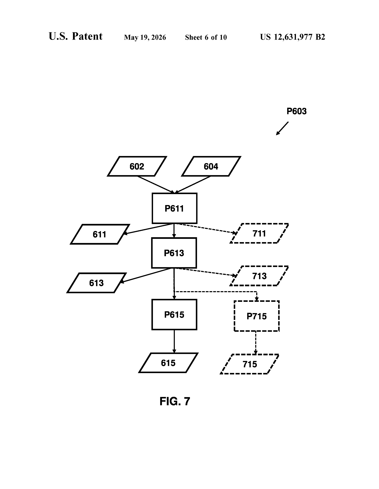
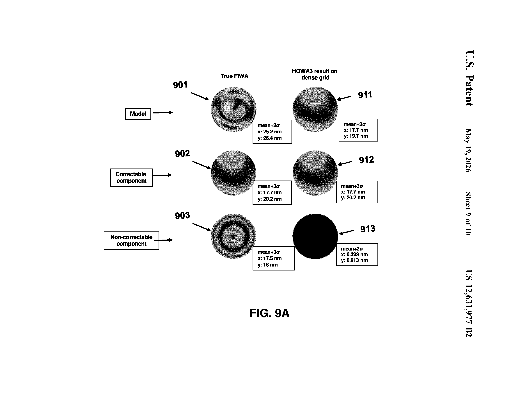
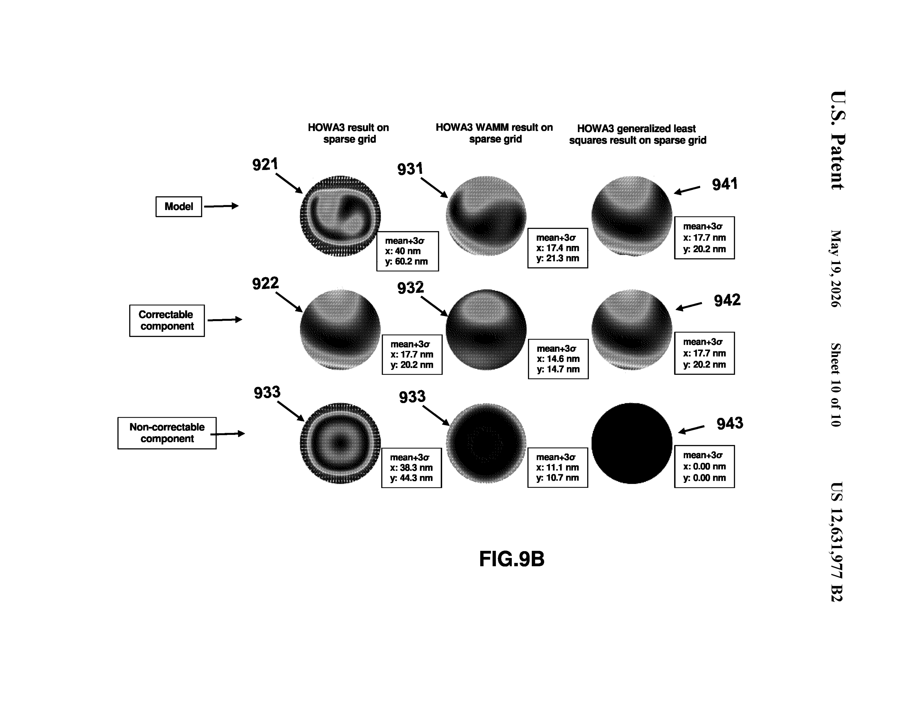

# US 12,631,977 B2 번역: 사선 적합 기법에 기반한 정렬 모델 결정 방법

번역 범위: 전문(요약서, 명세서 본문, 도면 설명, 청구항 12개).
번역 원본
- 원문 PDF: 같은 폴더의 `US12631977B2_ASML_oblique_fitting_alignment_model.pdf` (USPTO 공보, 25쪽). 이 PDF는 스캔 이미지라 `pdftotext -layout`으로 글자가 나오지 않았다(빈 출력).
- 그래서 본문 글자는 Google Patents 공보 페이지(https://patents.google.com/patent/US12631977B2/en)의 본문 텍스트를 썼다. 수식은 그 페이지의 MathML을 옮겨 적었다.
- 서지 사항과 도면 속 숫자는 PDF 표지(1쪽)와 도면 쪽(8, 11, 12쪽)을 직접 보고 확인했다.
- 원문에 있는 오타나 어색한 문장(예: "dense sparse mark layout")은 뜻이 통하게 옮기고, 필요한 곳에 [역주]를 달았다.

---

## 서지 사항 (공보 표지)

- (10) 특허 번호: US 12,631,977 B2
- (45) 등록일: 2026년 5월 19일
- (54) 발명의 명칭: Method for determining an alignment model based on an oblique fitting technique (사선 적합 기법에 기반한 정렬 모델 결정 방법)
- (71) 출원인, (73) 권리자: ASML Netherlands B.V., Veldhoven (NL)
- (72) 발명자: Maria Edo Hulsebos, Bergeijk (NL)
- (*) 존속 기간: 35 U.S.C. 154(b)에 따라 1046일 연장
- (21) 출원 번호: 17/608,750
- (22) PCT 출원일: 2020년 4월 2일
- (86) PCT 번호: PCT/EP2020/059411, 371(c)(1),(2) 일자 2021년 11월 3일
- (87) PCT 공개 번호: WO2020/224879, 공개일 2020년 11월 12일
- (65) 선공개: US 2022/0276575 A1, 2022년 9월 1일
- (30) 외국 우선권: 2019년 5월 3일, EP 19172514
- (51) 국제 분류: G03F 9/00, G03F 7/00
- (52) CPC: G03F 9/7046, G03F 7/70633, G03F 7/70641, G03F 7/70683, G03F 9/7076
- 심사관: Michael P Nghiem. 대리인: Finnegan, Henderson, Farabow, Garrett & Dunner, LLP
- 청구항 12개, 도면 10장

인용 문헌 (표지에 보이는 부분만, 원문 그대로)
- US 6,961,116 B2 * 11/2005 Den Boef
- US 7,583,359 B2 9/2009 Moest
- EP 1744217 A1 1/2007
- JP 2013-074294 4/2013
- Zvonarev et al. ("Iterative algorithms for weighted and unweighted finite-rank time-series approximations." (2015) arXiv preprint arXiv:1507.02751). (Year: 2015).*
- (나머지는 "Continued"로 다음 쪽에 이어짐)

## 요약서 (57)

마크 배치에 관련된 정렬 모델을 결정하는 방법들을 설명한다. 한 방법은 다음을 포함한다.

(a) 상대적으로 조밀한 마크 배치(예: 마크 200개 이상)의 첫째 측정 자료와, 상대적으로 성긴 마크 배치(예: 마크 65개 미만)의 둘째 측정 자료를 얻는다.
(b) 조밀한 (오버레이) 마크 배치에 대해 대상의 변형을 설명하는 첫째 적합 모델을 얻는다.
그리고 성긴 마크 배치에 대해 대상의 변형을 설명하는 둘째 적합 모델에 기반해 정렬 모델을 결정한다. 이때 적합 기법은 사선 내적 행렬(예: W)을 쓰는 일반화 최소제곱 적합, 또는 사선 투영 행렬(예: P)을 쓰는 사선 투영 최소제곱 적합에 기반한다.

---

## 관련 출원 상호 참조

이 출원은 2020년 4월 2일 출원되어 WO 2020/224879 A1로 공개된 국제 출원 PCT/EP2020/059411의 우선권을 주장한다. 그 국제 출원은 2019년 5월 3일 출원된 EP 출원 19172514.2의 우선권을 주장한다. 이 출원들의 내용 전체를 참조로 여기에 포함한다.

## 분야

이 설명은 검사 장치와 방법에 관한 것이다. 이 장치와 방법은 예를 들어 리소그래피 기법으로 소자를 만들 때 계측을 하거나, 패터닝 공정 중에 리소그래피 장치를 제어하는 데 쓸 수 있다. 또한 이런 방법을 구현하는 컴퓨터 프로그램 제품에 관한 것이다.

## 배경

리소그래피 장치는 원하는 패턴을 기판 위에 입히도록 만든 기계다. 예를 들어 집적 회로(IC) 제조에 쓴다. 리소그래피 장치는 패터닝 장치(예: 마스크)의 패턴(“설계 배치” 또는 “설계”라고도 한다)을 기판(예: 웨이퍼) 위의 감광 물질(레지스트) 층에 투영할 수 있다.

반도체 제조 공정이 발전하면서 회로 소자의 크기는 계속 줄었고, 소자 하나에 들어가는 트랜지스터 같은 기능 요소의 수는 수십 년 동안 꾸준히 늘었다. 이 흐름을 흔히 ‘무어의 법칙’이라 부른다. 무어의 법칙을 따라가려고 반도체 업계는 점점 더 작은 형상을 만들 수 있는 기술을 찾고 있다. 리소그래피 장치는 기판에 패턴을 투영할 때 전자기 복사를 쓸 수 있다. 이 복사의 파장이 기판에 새길 수 있는 최소 형상 크기를 정한다. 지금 흔히 쓰는 파장은 365 nm(i-line), 248 nm, 193 nm, 13.5 nm다. 파장이 4~20 nm(예: 6.7 nm 또는 13.5 nm)인 극자외선(EUV)을 쓰는 장치는, 예를 들어 193 nm를 쓰는 장치보다 더 작은 형상을 기판에 만들 수 있다.

리소그래피 장치의 한 예에서는 마스크 또는 레티클이라고도 하는 패터닝 장치로, IC의 한 층에 만들 회로 패턴을 생성한다. 이 패턴은 기판(예: 실리콘 웨이퍼)의 대상 부분(예: 다이 일부, 다이 하나, 또는 여러 다이)에 옮겨진다. 패턴 전사는 보통 기판 위 감광 물질(레지스트) 층에 상을 맺는 방식이다. 일반적으로 기판 하나에는 차례로 패턴이 새겨지는 이웃한 대상 부분들이 그물처럼 있다. 이 대상 부분을 흔히 “필드”라 한다. 웨이퍼는 반도체 공장(팹)의 여러 장치를 묶음(로트) 단위로 거친다. 집적 회로는 층마다 리소그래피 장치의 노광 단계를 거치고, 노광 사이에 다른 팹 공정을 거치며 한 층씩 쌓인다.

기판 위에 패턴을 정확히 놓는 일은 리소그래피로 만드는 회로 부품과 제품의 크기를 줄이는 데 가장 큰 과제다. 특히 이미 깔린 기판 위 형상을 정확히 측정하는 일은, 이어지는 층의 형상을 충분히 정확히 겹쳐 정렬해 높은 수율로 작동하는 소자를 만드는 데 꼭 필요한 단계다. 이른바 오버레이는 오늘날 서브마이크론 반도체 소자에서 보통 수십 nm 안, 가장 중요한 층에서는 몇 nm 안에 맞춰야 한다.

그래서 요즘 리소그래피 장치는 대상 위치에서 기판을 실제로 노광하거나 패터닝하기 전에 많은 측정 또는 ‘매핑’ 작업을 한다. 이른바 고급 정렬 모델이 개발되어 왔고 지금도 개발 중이다. 이 모델은 공정 단계나 리소그래피 장치 자체 때문에 생기는 웨이퍼 ‘격자’의 비선형 왜곡을 더 정확히 모델링하고 보정한다. 하지만 모든 왜곡을 노광 중에 보정할 수는 없으므로, 그런 왜곡의 원인을 되도록 많이 추적하고 없애는 일이 여전히 중요하다.

웨이퍼 격자의 이런 왜곡은 마크 위치에 관련된 측정 자료로 나타난다. 측정 자료는 웨이퍼를 측정해 얻는다. 한 예는 노광 전에 리소그래피 장치의 정렬 시스템으로 정렬 마크를 재는 정렬 측정이다. 다른 예는 노광 후에 계측 시스템으로 오버레이 타깃을 재는 오버레이 측정이다.

공정 때문에 정렬 마크와 오버레이 타깃이 변형되고, 이것이 측정 오차를 낳아 오버레이 손해로 이어진다. 이 변형의 영향을 줄이는 방법으로는 전통적으로 측정에 쓰는 조명 색을 고르거나 가중하는 방법을 쓴다. 예를 들어 기판의 변형을 모델링하도록 만든 기판 모델로 줄일 수도 있다. 일부 응용에서는 리소그래피 공정의 처리량 요구를 지키려고, 이런 기판 모델이 성긴 배치의 측정만으로 변형을 정확히 모델링해야 한다.

## 요약

패터닝 공정에서는 예를 들어 공정 제어와 검증을 위해, 만들어진 구조를 측정하는 것이 바람직하다. 이 개시는 높은 처리량을 유지하면서 리소그래피 공정의 정렬과 오버레이 성능을 높이는 것을 목표로 한다. 정렬 모델로 기판 변형을 정하면, 정렬 개선, 계측 개선, 리소그래피 공정 보정 개선에 쓸 수 있다. 동시에 처리량 유지 같은 관련 문제를 피하거나 적어도 줄인다.

한 실시예에서는 마크 배치에 관련된 정렬 모델을 결정하는 방법을 제공한다. 이 방법은 다음을 포함한다.
- (a) 상대적으로 성긴 마크 배치에 비해 상대적으로 조밀한 마크 배치에 관련된 첫째 측정 자료와, 성긴 마크 배치에 관련된 둘째 측정 자료를 얻는다. [역주: 원문은 "relatively dense sparse mark layout"으로 오타가 있다.]
- (b) 조밀한 마크 배치에 대해 대상의 변형을 설명하는 첫째 적합 모델을 얻는다.
- (c) 성긴 마크 배치에 대해 대상의 변형을 설명하는 둘째 적합 모델에 기반해, 적합 기법(바람직하게는 사선 적합 기법)으로 정렬 모델을 결정한다.

한 실시예에서 마크 배치는 정렬 마크 배치일 수 있다. 그러면 성긴 마크 배치는 성긴 정렬 마크 배치이고, 조밀한 마크 배치는 조밀한 정렬 마크 배치다. 다른 실시예에서 마크 배치는 오버레이 마크 배치일 수 있다. 그러면 성긴 배치와 조밀한 배치가 각각 성긴, 조밀한 오버레이 마크 배치다. 또 다른 실시예에서는 정렬과 오버레이를 함께 써서, 성긴 정렬 마크 배치와 조밀한 오버레이 마크 배치를 쓸 수 있다.

한 실시예에서 적합 기법은 첫째와 둘째 측정 자료를 모두 쓴다.

한 실시예에서 적합 기법은 사선 내적 행렬을 쓰는 일반화 최소제곱 적합(GLSF)이다. 즉 적합 기법은 GLSF 알고리즘이다.

한 실시예에서 사선 내적 행렬을 정하는 일은 다음 단계를 포함한다.
- 첫째 적합 모델과 첫째 측정 자료로 첫째 출력을 정한다.
- 사선 내적 행렬, 둘째 적합 모델, 둘째 측정 자료, 첫째 적합 모델로 둘째 출력을 정한다.
- 첫째 적합 모델과 둘째 적합 모델의 차이가 줄도록 사선 내적 행렬의 계수를 정한다.

한 실시예에서는 첫째 출력과 둘째 출력의 차이를 줄여서 첫째와 둘째 적합 모델의 차이를 줄일 수 있다. 다른 실시예에서는 첫째와 둘째 출력의 차이를 최소로 만든다.

또 다른 실시예에서는 첫째와 둘째 출력의 차이가 줄도록 사선 내적 행렬의 계수를 정한다. 다른 실시예에서는 그 차이를 최소로 만든다.

한 실시예에서 적합 기법은 사선 투영 행렬을 쓰는 사선 투영 최소제곱 적합(OPF)이다. 즉 적합 기법은 OPF 알고리즘이다. 한 실시예에서 OPF 알고리즘은 사선 투영 행렬을 적용한 뒤 보통의 최소제곱 적합을 한다.

한 실시예에서 사선 투영 행렬을 정하는 일은 다음 단계를 포함한다.
- 첫째 적합 모델과 첫째 측정 자료로 첫째 출력을 정한다.
- 사선 투영 행렬, 둘째 적합 모델, 둘째 측정 자료, 첫째 적합 모델로 둘째 출력을 정한다.
- 첫째 적합 모델과 둘째 적합 모델의 차이가 줄도록 사선 투영 행렬의 계수를 정한다.

한 실시예에서는 첫째와 둘째 출력의 차이를 줄여서 첫째와 둘째 적합 모델의 차이를 줄일 수 있다. 다른 실시예에서는 그 차이를 최소로 만든다.

또 다른 실시예에서는 첫째와 둘째 출력의 차이가 줄도록 사선 투영 행렬의 계수를 정한다. 다른 실시예에서는 그 차이를 최소로 만든다.

앞에서 말했듯이, 첫째 출력은 조밀한 마크 배치를 나타낼 수 있고, 측정이 더 많으므로 더 정확한 자료일 수 있다. 성긴 마크 배치의 측정을 모델링한 결과는, 성긴 배치의 정보와 조밀한 배치의 정보 사이의 누설(crosstalk) 때문에 조밀한 배치 측정으로 얻은 모델 결과를 정확히 근사하지 못한다. 그래서 이 발명은 조밀한 배치에서 얻은 측정이나 정보를 고려해 둘째 적합 모델에 쓰는 계수를 고칠 수 있게 한다. 이 발명은 그 누설을 없애, 성긴 마크 배치의 측정 자료에 더 정확한 적합을 주고, 측정 정확도를 높이며, 층 사이 오버레이 오차를 줄이는 이점이 있다.

앞의 실시예와 청구한 실시예는 모두 컴퓨터로 구현하는 방법으로 볼 수 있다. 즉 정렬 마크 배치에 관련된 정렬 모델을 정하는 컴퓨터 구현 방법으로 볼 수 있다.

또한 한 실시예에서는, 명령이 기록된 비일시적 컴퓨터 판독 매체를 포함하는 컴퓨터 프로그램 제품을 제공한다. 그 명령을 컴퓨터가 실행하면 위 실시예들 중 하나의 단계를 구현한다. 다른 실시예에서는 이 컴퓨터 프로그램 제품을 포함하는 측정 시스템을 제공한다. 또 다른 실시예에서는 이 측정 시스템을 포함하는 리소그래피 장치를 제공한다.

## 도면의 간단한 설명

이제 첨부 도면을 참조해 예로서만 실시예를 설명한다.

- 도 1은 한 실시예에 따른 리소그래피 장치의 개략도다.
- 도 2는 한 실시예에 따른 리소그래피 셀 또는 클러스터의 한 실시예를 개략적으로 보인다.
- 도 3은 알려진 방식에 따라 도 1 장치의 측정과 노광 과정을 개략적으로 보인다.
- 도 4는 알려진 방식에 따라 도 1 장치를 제어하는 고급 공정 제어 방법의 개략도다.
- 도 5는 한 실시예에 따라 도 4 방법에서 기판 모델과 공정 모델을 구현하는 모습을 보인다.
- 도 6은 한 실시예에 따라 성긴 배치에 기반해 정렬 모델을 정하는 흐름도다.
- 도 7은 한 실시예에 따라 도 6에서 쓰는 둘째 정렬 모델의 예시 방법이다.
- 도 8A는 한 실시예에 따른 성긴 배치다.
- 도 8B는 한 실시예에 따른 조밀한 오버레이 배치다.
- 도 9A와 도 9B는 한 실시예에 따라 조밀한 배치와 성긴 배치로 각각 적합한 여러 정렬 모델의 결과다.

[역주: 도 2의 실제 내용은 본문에서 정렬 센서로 설명된다. 원문 도면 목록과 본문이 다르다.]

실시예는 이 분야의 숙련자가 실시할 수 있도록 예시로 든 도면을 참조해 자세히 설명한다. 아래의 도면과 예는 범위를 실시예 하나로 한정하려는 것이 아니다. 설명하거나 보인 요소의 일부나 전부를 바꿔 다른 실시예도 가능하다. 편의상 같은 참조 번호는 도면 전체에서 같거나 비슷한 부분을 가리킨다. 실시예의 일부 요소를 알려진 부품으로 부분 또는 전부 구현할 수 있는 경우, 실시예 이해에 필요한 부분만 설명하고 나머지는 실시예 설명을 흐리지 않도록 생략한다. 이 명세서에서 단수 부품을 보인 실시예를 한정으로 보면 안 되며, 따로 명시하지 않는 한 같은 부품이 여럿인 실시예도 범위에 들어가고 그 반대도 같다. 또한 출원인은 명시적으로 밝히지 않는 한 명세서나 청구항의 어떤 용어에도 드물거나 특별한 뜻을 주려 하지 않는다. 범위는 여기서 예시로 든 부품의 현재와 장래의 알려진 균등물도 포함한다.

## 상세한 설명

실시예를 자세히 설명하기 전에, 실시예를 구현할 수 있는 예시 환경을 먼저 보이면 이해에 도움이 된다.

이 문서에서 “복사”와 “빔”은 자외선(예: 파장 365, 248, 193, 157, 126 nm)과 EUV(극자외선, 예: 파장 약 5~100 nm)를 포함한 모든 종류의 전자기 복사를 뜻한다.

이 글에서 “레티클”, “마스크”, “패터닝 장치”는 들어오는 복사 빔에 패턴을 가진 단면을 주는 일반적인 패터닝 장치로 넓게 해석할 수 있다. 그 패턴은 기판의 대상 부분에 만들 패턴에 대응한다. 이 맥락에서 “광 밸브”라는 말도 쓸 수 있다. 전통적인 마스크(투과형 또는 반사형, 이진, 위상 이동, 혼합형 등) 말고도, 프로그래밍 가능한 거울 배열과 프로그래밍 가능한 LCD 배열이 이런 패터닝 장치의 예다.

도 1은 리소그래피 장치 LA를 개략적으로 보인다. 리소그래피 장치 LA는 다음을 포함한다.
- 복사 빔 B(예: UV, DUV, EUV 복사)를 조절하도록 만든 조명 시스템(조명기) IL
- 패터닝 장치(예: 마스크) MA를 받치고, 특정 변수에 따라 MA를 정확히 놓도록 만든 첫째 위치 결정기 PM에 연결된 마스크 지지대(예: 마스크 테이블) MT
- 기판(예: 레지스트를 바른 웨이퍼) W를 잡고, 특정 변수에 따라 기판 지지대를 정확히 놓도록 만든 둘째 위치 결정기 PW에 연결된 기판 지지대(예: 웨이퍼 테이블) WT
- 패터닝 장치 MA가 복사 빔 B에 준 패턴을 기판 W의 대상 부분 C(예: 다이 하나 이상)에 투영하도록 만든 투영 시스템(예: 굴절 투영 렌즈 시스템) PS

작동할 때 조명 시스템 IL은 복사원 SO로부터, 예를 들어 빔 전달 시스템 BD를 거쳐 복사 빔을 받는다. 조명 시스템 IL은 복사를 이끌고, 모양을 잡고, 제어하는 굴절, 반사, 자기, 전자기, 정전기 등 여러 광학 부품이나 그 조합을 포함할 수 있다. 조명기 IL은 패터닝 장치 MA 면에서 복사 빔 B의 단면에 원하는 공간 세기 분포와 각도 세기 분포를 주는 데 쓸 수 있다.

여기서 “투영 시스템” PS는 쓰는 노광 복사나 담금 액체 사용, 진공 사용 같은 요인에 맞게, 굴절, 반사, 반사굴절, 비등방(anamorphic), 자기, 전자기, 정전기 광학 시스템이나 그 조합을 포함하는 여러 종류의 투영 시스템으로 넓게 해석해야 한다. 여기서 “투영 렌즈”는 더 일반적인 용어인 “투영 시스템” PS와 같은 뜻으로 볼 수 있다.

리소그래피 장치 LA는 투영 시스템 PS와 기판 W 사이 공간을 채우도록 기판의 적어도 일부를 굴절률이 비교적 높은 액체(예: 물)로 덮는 형식일 수 있다. 이를 담금(immersion) 리소그래피라고도 한다. 담금 기법은 참조로 포함한 미국 특허 6,952,253에 더 나와 있다.

리소그래피 장치 LA는 기판 지지대 WT가 둘 이상인 형식(“이중 스테이지”라고도 함)일 수도 있다. 이런 “다중 스테이지” 기계에서는 기판 지지대들을 나란히 쓸 수 있다. 또는 한 기판 지지대 위의 기판 W에서 다음 노광 준비 단계를 하는 동안, 다른 기판 지지대 위의 다른 기판 W에 패턴을 노광할 수 있다.

기판 지지대 WT 말고도 리소그래피 장치 LA는 측정 스테이지를 포함할 수 있다. 측정 스테이지는 센서나 세정 장치를 잡도록 되어 있다. 센서는 투영 시스템 PS의 특성이나 복사 빔 B의 특성을 재도록 되어 있을 수 있다. 측정 스테이지는 여러 센서를 잡을 수 있다. 세정 장치는 리소그래피 장치의 일부, 예를 들어 투영 시스템 PS의 일부나 담금 액체를 공급하는 시스템의 일부를 닦도록 되어 있을 수 있다. 기판 지지대 WT가 투영 시스템 PS에서 떨어져 있을 때 측정 스테이지가 PS 아래로 움직일 수 있다.

작동할 때 복사 빔 B는 마스크 지지대 MT에 놓인 패터닝 장치(예: 마스크) MA에 들어오고, MA에 있는 패턴(설계 배치)으로 패턴화된다. 마스크 MA를 지난 빔 B는 투영 시스템 PS를 거쳐 기판 W의 대상 부분 C에 초점을 맺는다. 둘째 위치 결정기 PW와 위치 측정 시스템 IF의 도움으로 기판 지지대 WT를 정확히 움직여, 예를 들어 여러 대상 부분 C를 초점이 맞고 정렬된 위치에서 복사 빔 경로에 놓을 수 있다. 마찬가지로 첫째 위치 결정기 PM과 다른 위치 센서(도 1에 따로 그리지 않음)로 패터닝 장치 MA를 복사 빔 경로에 대해 정확히 놓을 수 있다. 패터닝 장치 MA와 기판 W는 마스크 정렬 마크 M1, M2와 기판 정렬 마크 P1, P2로 정렬할 수 있다. 그림의 기판 정렬 마크 P1, P2는 전용 대상 부분을 차지하지만, 대상 부분 사이 공간에 있을 수도 있다. 대상 부분 C 사이에 있는 기판 정렬 마크 P1, P2를 스크라이브 레인 정렬 마크라 한다.

발명을 분명히 하려고 직교 좌표계를 쓴다. 직교 좌표계에는 x축, y축, z축 세 축이 있고, 각 축은 나머지 두 축과 직교한다. x축 둘레 회전을 Rx 회전, y축 둘레 회전을 Ry 회전, z축 둘레 회전을 Rz 회전이라 한다. x축과 y축은 수평면을 정하고, z축은 수직 방향이다. 직교 좌표계는 발명을 한정하지 않으며 설명을 위해서만 쓴다. 대신 원통 좌표계 같은 다른 좌표계로 설명해도 된다. 직교 좌표계의 방향은 달라도 된다. 예를 들어 z축이 수평면 성분을 가질 수도 있다.

복잡한 소자를 만들 때는 보통 많은 리소그래피 패터닝 단계를 거쳐 기판 위 연속된 층에 기능 형상을 만든다. 그래서 리소그래피 장치 성능의 핵심은, (같은 장치나 다른 리소그래피 장치로) 이전 층에 깔린 형상에 대해 새 패턴을 바르고 정확하게 놓는 능력이다. 이를 위해 기판에는 마크 세트가 하나 이상 있다. 각 마크는 나중에 위치 센서(보통 광학 위치 센서)로 위치를 잴 수 있는 구조다. 위치 센서를 “정렬 센서”, 마크를 “정렬 마크”라 부를 수 있다.

리소그래피 장치는 기판 위 정렬 마크의 위치를 정확히 재는 정렬 센서를 하나 이상(예: 여러 개) 포함할 수 있다. 정렬(또는 위치) 센서는 회절과 간섭 같은 광학 현상으로 기판 위 정렬 마크에서 위치 정보를 얻을 수 있다. 지금 리소그래피 장치에 쓰는 정렬 센서의 한 예는 미국 특허 6,961,116에 나온 자기 참조 간섭계에 기반한다. 위치 센서의 여러 개선과 변형이 개발되었고, 예를 들어 US2015261097A1에 나와 있다. 이 공보들의 내용 전체를 참조로 포함한다.

마크(정렬 마크)는 기판 위에 마련된 층 안이나 위에, 또는 기판 안에 (직접) 만든 일련의 막대를 포함할 수 있다. 막대는 일정한 간격으로 놓여 격자선 역할을 하므로, 마크를 공간 주기(피치)가 잘 알려진 회절 격자로 볼 수 있다. 격자선 방향에 따라 마크는 X축 방향 위치나, X축에 거의 수직인 Y축 방향 위치를 재도록 설계할 수 있다. X축과 Y축 모두에 대해 +45도나 −45도로 놓인 막대를 가진 마크는, 참조로 포함한 US2009/195768A에 나온 기법으로 X와 Y를 함께 잴 수 있다.

정렬 센서는 각 마크를 복사 스폿으로 광학 주사해, 사인파 같은 주기적으로 변하는 신호를 얻는다. 이 신호의 위상을 분석해 정렬 센서에 대한 마크의 위치, 따라서 기판의 위치를 정한다. 정렬 센서는 리소그래피 장치의 기준 프레임에 고정되어 있다. 이른바 거친 마크와 고운 마크를 서로 다른 (거친, 고운) 마크 크기로 둘 수 있다. 그러면 정렬 센서가 주기 신호의 서로 다른 주기를 구별하고, 한 주기 안의 정확한 위치(위상)도 알 수 있다. 같은 목적으로 피치가 다른 마크를 쓸 수도 있다.

마크 위치를 재면, 마크가 놓인 기판의 변형 정보를 예를 들어 웨이퍼 격자 형태로 얻을 수도 있다. 기판 변형은 예를 들어 기판을 기판 테이블에 정전기로 고정할 때나, 기판이 복사에 노광되며 데워질 때 생길 수 있다.

도 2는 예를 들어 참조로 포함한 미국 특허 6,961,116에 나온 것 같은 알려진 정렬 센서의 한 실시예의 개략 블록도다. 복사원 RSO는 파장이 하나 이상인 복사 빔 RB를 내고, 이 빔은 방향 전환 광학계를 거쳐 기판 W 위 마크 AM 같은 마크에 조명 스폿 SP로 비친다. 이 예에서 방향 전환 광학계는 스폿 거울 SM과 대물 렌즈 OL을 포함한다. 마크 AM을 비추는 조명 스폿 SP의 지름은 마크 폭보다 조금 작을 수 있다.

마크 AM에서 회절한 복사는 (이 예에서는 대물 렌즈 OL을 거쳐) 평행광이 되어 정보를 실은 빔 IB가 된다. “회절”에는 마크의 0차 회절(반사라고도 함)도 포함한다. 앞에서 말한 미국 특허 6,961,116 형식의 자기 참조 간섭계 SRI가 빔 IB를 자기 자신과 간섭시키고, 그 빔을 광검출기 PD가 받는다. 복사원 RSO가 파장을 둘 이상 내는 경우 빔을 나누는 추가 광학계(그리지 않음)를 둘 수 있다. 광검출기는 소자 하나일 수도 있고, 원하면 화소 여러 개를 가질 수도 있다. 광검출기는 센서 배열을 포함할 수 있다.

이 예에서 스폿 거울 SM을 포함하는 방향 전환 광학계는 마크에서 반사된 0차 복사를 막는 역할도 할 수 있다. 그러면 정보 빔 IB에는 마크 AM의 고차 회절 복사만 남는다(측정에 꼭 필요하지는 않지만 신호 대 잡음비를 높인다).

세기 신호 SI는 처리 장치 PU로 간다. 블록 SRI의 광학 처리와 장치 PU의 계산 처리를 함께 써서, 기준 프레임에 대한 기판 위 X 위치와 Y 위치 값을 낸다.

그림에 보인 형식의 측정 한 번은 마크의 피치 하나에 해당하는 범위 안에서만 마크 위치를 정한다. 그래서 사인파의 어느 주기에 표시 위치가 들어 있는지 가리기 위해 더 거친 측정 기법을 함께 쓴다. 정확도를 높이거나, 마크 재료와 마크 위아래 재료에 상관없이 마크를 강건하게 검출하려고, 더 거친 수준과 더 고운 수준에서 같은 과정을 서로 다른 파장으로 되풀이할 수 있다. 파장들은 광학적으로 다중화와 역다중화를 해서 동시에 처리하거나, 시분할이나 주파수 분할로 다중화할 수 있다.

이 예에서는 정렬 센서와 스폿 SP가 정지해 있고 기판 W가 움직인다. 그래서 정렬 센서를 기준 프레임에 단단하고 정확하게 붙일 수 있고, 실제로는 기판 W가 움직이는 방향과 반대 방향으로 마크 AM을 주사하는 셈이 된다. 기판 W는 기판 지지대에 실려, 기판 지지대의 움직임을 제어하는 기판 위치 결정 시스템으로 움직임이 제어된다. 기판 지지대 위치 센서(예: 간섭계)가 기판 지지대의 위치를 잰다(그리지 않음). 한 실시예에서는 기판 지지대 위에 (정렬) 마크를 하나 이상 둔다. 기판 지지대 위 마크의 위치를 재면, 위치 센서가 정한 기판 지지대 위치를 (예를 들어 정렬 시스템이 붙은 프레임에 대해) 교정할 수 있다. 기판 위 정렬 마크의 위치를 재면, 기판 지지대에 대한 기판의 위치를 정할 수 있다.

### 정렬 과정 배경

도 3은 도 1의 이중 스테이지 장치에서 기판 W의 대상 부분(예: 다이)을 노광하는 단계를 보인다. 먼저 전통적인 방식의 과정을 설명한다.

왼쪽 점선 상자 안은 측정 스테이션 MEA에서 하는 단계이고, 오른쪽은 노광 스테이션 EXP에서 하는 단계다. 앞에서 말했듯이 때때로 기판 테이블 WTa, WTb 중 하나는 노광 스테이션에, 다른 하나는 측정 스테이션에 있다. 이 설명에서는 기판 W가 이미 노광 스테이션에 실려 있다고 본다. 단계 200에서 새 기판 W′가 (그리지 않은) 기구로 장치에 실린다. 리소그래피 장치의 처리량을 높이려고 두 기판을 나란히 처리한다.

먼저 새로 실린 기판 W′를 보면, 이 기판은 처음 노광하려고 새 포토레지스트를 바른, 아직 처리하지 않은 기판일 수 있다. 하지만 일반적으로 여기서 설명하는 리소그래피 공정은 일련의 노광과 처리 단계 중 한 단계일 뿐이다. 그래서 기판 W′는 이미 이 장치나 다른 리소그래피 장치를 여러 번 거쳤을 수 있고, 뒤에 더 거칠 공정이 있을 수 있다. 특히 오버레이 성능을 높이는 문제에서는, 이미 패터닝과 처리를 한 번 이상 거친 기판 위의 정확히 맞는 자리에 새 패턴을 입히는 것이 과제다. 각 패터닝 단계는 입힌 패턴에 위치 편차를 만들 수 있고, 이어지는 처리 단계는 기판과 그 위 패턴에 점점 왜곡을 더한다. 만족스러운 오버레이 성능을 얻으려면 이를 재서 보정해야 한다.

앞에서 말했듯이 이전이나 다음 패터닝 단계는 다른 리소그래피 장치에서 할 수 있고, 종류가 다른 리소그래피 장치에서 할 수도 있다. 예를 들어 소자 제조 공정에서 해상도와 오버레이 같은 변수에 요구가 매우 높은 층은, 요구가 덜한 층보다 더 앞선 리소그래피 장비에서 할 수 있다. 그래서 어떤 층은 담금형 장비에서, 다른 층은 ‘건식’ 장비에서 노광할 수 있다. 어떤 층은 DUV 파장 장비에서, 다른 층은 EUV 파장으로 노광할 수 있다. 어떤 층은 그림의 리소그래피 장치 노광을 대신하거나 보완하는 단계로 패터닝할 수 있다. 그런 대체, 보완 기법에는 임프린트 리소그래피, 자기 정렬 다중 패터닝, 유도 자기 조립이 있다.

202에서는 기판 마크 P1 등과 (그리지 않은) 이미지 센서로 기판 테이블 WTa/WTb에 대한 기판의 정렬을 재고 기록한다. 또한 정렬 센서 AS로 기판 W′ 전체에 걸친 여러 정렬 마크를 잰다. 한 실시예에서 이 측정으로 기판 모델(“웨이퍼 격자”라고도 함)을 세운다. 기판 모델은 공칭 직사각 격자에 대한 왜곡을 포함해 기판 전체의 마크 분포를 매우 정확히 그린다.

단계 204에서는 수준 센서 LS로 X-Y 위치에 대한 웨이퍼 높이(Z) 지도도 잰다. 높이 지도는 주로 노광 패턴의 초점을 정확히 맞추는 데만 쓴다. 다른 용도에 더 쓸 수도 있다.

기판 W′를 실을 때 레시피 자료 206을 받았다. 레시피 자료는 할 노광과, 웨이퍼 및 그 위에 이미 만든 패턴과 만들 패턴의 특성을 정한다. 이 레시피 자료에 202, 204에서 잰 웨이퍼 위치, 웨이퍼 격자, 높이 지도를 더해, 레시피와 측정 자료의 완전한 묶음 208을 노광 스테이션 EXP로 넘긴다. 정렬 자료 측정은 예를 들어 리소그래피 공정의 산물인 제품 패턴과 고정된(또는 공칭상 고정된) 관계로 만든 정렬 타깃의 X, Y 위치를 포함한다. 노광 직전에 얻은 이 정렬 자료로, 자료에 모델을 맞추는 변수를 가진 정렬 모델을 만든다. 이 변수와 정렬 모델은 노광 작업 중에 현재 리소그래피 단계에서 입히는 패턴의 위치를 보정하는 데 쓴다. 쓰는 모델은 잰 위치들 사이의 위치 편차를 보간한다. 전통적인 정렬 모델은 변수 4개, 5개, 또는 6개로 이루어져, 서로 다른 차원에서 ‘이상’ 격자의 평행 이동, 회전, 배율을 함께 정한다. US 2013230797A1에 더 나와 있듯이, 더 많은 변수를 쓰는 고급 모델도 알려져 있다.

210에서 웨이퍼 W′와 W를 맞바꿔, 측정한 기판 W′가 노광 스테이션 EXP로 들어가는 기판 W가 된다. 도 1의 예시 장치에서는 장치 안에서 지지대 WTa와 WTb를 바꿔 이 교환을 한다. 그래서 기판 W, W′는 그 지지대 위에 정확히 고정되고 놓인 채로 남아, 기판 테이블과 기판 사이의 상대 정렬이 유지된다. 따라서 테이블을 바꾼 뒤에는 투영 시스템 PS와 기판 테이블 WTb(전에는 WTa) 사이 상대 위치만 정하면, 기판 W(전에는 W′)에 대한 측정 정보 202, 204를 노광 단계 제어에 쓸 수 있다. 단계 212에서는 마스크 정렬 마크 M1, M2로 레티클 정렬을 한다. 단계 214, 216, 218에서는 기판 W 전체의 연속된 대상 위치에 주사 운동과 복사 펄스를 가해 여러 패턴의 노광을 마친다.

측정 스테이션에서 얻은 정렬 자료와 높이 지도를 노광 단계에서 쓰면, 이 패턴들은 원하는 위치에 대해, 특히 같은 기판 위에 이전에 깔린 형상에 대해 정확히 정렬된다. 이제 W″라고 표시한 노광된 기판은 단계 220에서 장치에서 내려져, 노광 패턴에 따라 식각이나 다른 공정을 거친다.

### 이력 성능 자료를 쓰는 고급 공정 제어

최고 성능을 얻으려면, 현재 기판을 리소그래피 장치에 실을 때 하는 측정에 더해, 리소그래피 공정에 관한 이력 성능 자료를 보통 함께 쓴다. 이를 위해 계측 시스템 MET(도 2)로 성능을 측정한다. 고급 공정 제어는 여러 형태로 구현할 수 있다. 도 4는 알려진 안정성 제어 방법을 구현한 한 예만 보인다.

도 4는 안정성 모듈 300을 보인다. 이 모듈은 예를 들어 프로세서에서 도는 응용 프로그램이다. 1, 2, 3으로 표시한 주요 공정 제어 고리 세 개가 있다. 첫째 고리는 안정성 모듈 300과 모니터 웨이퍼로 리소그래피 장치를 국소 제어한다. 모니터 웨이퍼 302가 예를 들어 도 2의 리소셀 LC일 수 있는 리소그래피 셀 304에서 넘어오는 모습이 보인다. 모니터 웨이퍼 302는 초점과 오버레이의 ‘기준선’ 변수를 정하는 교정 패턴으로 노광되어 있다. 나중에 계측 장비 306이 이 기준선 변수를 읽고, 안정성 모듈 300이 이를 해석해 이 리소셀에 맞는 안정성 보정 308을 계산한다. 이 성능 자료를 리소그래피 셀 304로 되돌려 다음 노광에 쓸 수 있다. 모니터 웨이퍼 노광은 기준 마크 위에 마크 패턴을 찍는 일을 포함할 수 있다. 위 마크와 아래 마크 사이 오버레이 오차를 재면, 웨이퍼를 장치에서 꺼내 계측 장비에 놓은 뒤에도 리소그래피 장치 성능의 편차를 잴 수 있다.

둘째(APC) 제어 고리는 실제 제품 웨이퍼에서 잰 초점, 선량, 오버레이 같은 성능 변수에 기반한다. 노광된 제품 웨이퍼 320은 계측 장비 322로 간다. 322는 첫째 고리의 계측 장비 306과 같을 수도 다를 수도 있다. 322에서 예를 들어 임계 치수, 측벽 각도, 오버레이 같은 변수 정보를 정해 고급 공정 제어(APC) 모듈 324로 넘긴다. 이 자료는 안정성 모듈 300에도 넘어간다. 공정 보정 326을 계산해 감독 제어 시스템(SCS) 328이 쓰며, SCS는 안정성 모듈 300과 통신하며 리소셀 304를 제어한다.

셋째 제어 고리는 예를 들어 이중 패터닝 응용에서, 계측을 둘째(APC) 제어 고리에 통합하도록 한다. 식각된 웨이퍼 330이 계측 장치 332로 간다. 332도 첫째, 둘째 고리의 계측 장비 306, 322와 같을 수도 다를 수도 있다. 계측 장비 332는 웨이퍼에서 임계 치수, 측벽 각도, 오버레이 같은 성능 변수를 읽어 잰다. 이 변수는 APC 모듈 324로 넘어간다. 고리는 둘째 고리와 같은 방식으로 이어진다.

### 기판 모델 매핑의 배경

오버레이 성능을 위해서는 새 패턴을 공칭상 ‘올바른’ 위치에 놓는 것만이 아니라, 기판 위에 이미 있는 패턴에 대해 바르게 놓아야 한다. 위 설명에서 알 수 있듯이, 오버레이 같은 변수에서 높은 성능을 얻으려고 여러 다른 기구를 쓴다.

도 5는 리소그래피 장치 LA를 제어하는 알려진 방법에서, 현재 기판의 패터닝 작업에 관련된 이 기구들을 정리한다. 402에서 리소그래피 장치는 도 3에서 설명한 방식으로 정렬 센서 AS를 써서 현재 기판의 위치 편차를 잰다. 404에서 현재 기판의 위치 측정으로 기판 모델 SM을 계산한다. 이 모델로 리소그래피 장치는 408에서 패턴을 입힐 때 기판별 보정을 적용할 수 있다.

또한 412에서 이전 기판의 성능 측정을 저장해 이력 성능 자료로 쓴다. 414에서 이 이력 자료로, 현재 기판에 관련된 특정 리소그래피 장치와 다른 처리 장비의 성능을 나타내는 공정 모델 PM을 하나 이상 계산한다. 이 계산은 예를 들어 도 4 예의 제어 고리에서 하는 계산일 수 있다.

416에서 기판 모델과 공정 모델을 합쳐 완전한 기판 및 공정 보정 모델 PSM을 만든다. 이 합친 모델로 리소그래피 장치 408이 보정을 계산해, 새 패턴을 각 기판에 입힐 수 있다. 이 보정은 기판에 이미 있는 형상의 위치 편차뿐 아니라 패터닝과 다른 처리 단계 성능의 편차도 보정한다.

이상적으로는 기판 모델은 공정 모델이 보정하지 않는 편차만 보정하고, 그 반대도 같아야 한다. 발명자들은 알려진 시스템에서, 기판 모델로 보정하는 정렬 편차와 공정 모델로 보정하는 오버레이 오차 사이에 상관이 생길 수 있음을 알아냈다. 이런 상관은 오차를 지나치게 보정하거나 덜 보정하게 만들 수 있다. 이 개시에 따라 이 상관을 찾아 없애면, 리소그래피 공정 전체 성능, 특히 오버레이를 더 높일 수 있다.

공정 모델 PM과 기판 모델 SM을 단수로 부를 수 있지만, 숙련자라면 둘 중 하나나 둘 다가 하위 모델 둘 이상의 중첩일 수 있음을 안다. 공정 모델은 리소그래피 장치 성능과 다른 처리 단계 성능의 하위 모델을 포함할 수 있지만, 이 개시에서는 간단히 이력 성능 자료에 기반한 모든 모델을 공정 모델로 본다. 흔한 예로 공정 모델은 필드 간 모델과 필드 내 모델을 포함할 수 있다. 필드 간 모델은 기판 위 위치에 따른 성능 변화를 나타내고, 필드 내 모델은 기판의 각 대상 부분(필드)에서 되풀이되는 경향의 변화를 나타낸다. 각각을 더 하위 모델로 나눌 수 있다. 둘 중 하나나 둘 다 특정 제품 설계 전용 하위 모델과 여러 제품 설계 공통 하위 모델을 포함할 수 있다. 추가 모델로 렌즈, 레티클, 기판의 가열 같은 일시 효과를 보정할 수 있다. 안정성 모듈은 또 다른 하위 모델을 만든다. 이 모델은 이력 성능 측정에 기반한 공정 모델에서 실제 성능이 날마다 흘러가는(drift) 것을 나타낸다.

마찬가지로 기판 모델도 실제로는 하위 모델 둘 이상의 조합일 수 있다. 흔히 먼저 변수 4개짜리(4PAR) 모델을 맞춘다. 그 다음 고차 변화를 가진 둘째 모델을 4PAR 모델의 잔차에 맞춘다. (잔차에는 4PAR 모델이 모델링하지 못한 위치 편차가 들어 있다.) 고차 모델은 예를 들어 변수 6개짜리(6PAR) 모델, 3차 다항식 모델, 방사 기저 함수에 기반한 모델일 수 있다. 그래서 ‘기판 모델’이라는 말은 하위 모델 둘 이상의 조합을 포함한다. 또한 공정 모델처럼 기판 모델도 필드 내 모델과 필드 간 모델을 포함할 수 있다. 한 예로 현재 기판의 소수 필드에서 정렬 마크를 여러 개 재서 필드 내 기판 모델을 맞춘다. 이 경우 기판 모델은 사실상 하위 모델 세 개, 즉 4PAR 기판 모델, 고차 필드 간 기판 모델, 필드 내 기판 모델의 조합이다. 뒤의 모델일수록 더 작은 편차를 나타내지만, 각각이 오버레이를 조금씩 더 줄인다. 이는 현대 반도체 제조에서 매우 중요하다.

현재의 웨이퍼 정렬 적합은 최소제곱 기법(예: 행렬 계산 (MᵀM)⁻¹Mᵀ로 나타냄)으로, 웨이퍼 마크 배치에 관련된 측정 자료에 맞는 정렬 모델(예: 앞에서 말한 기판 모델)을 정한다. 적합한 모델은 웨이퍼 변형을 나타내는 격자를 만들 수 있다. 한 실시예에서 측정 자료는 앞서 도 4에서 말한 대로 얻을 수 있다. 예를 들어 측정 자료는 웨이퍼 정렬 마크 배치의 마크에서 잰 위치(예: X, Y)와 높이(예: Z)를 포함한다.

어떤 경우에는 패터닝 공정의 처리량 요구를 지키려고 웨이퍼 정렬에 성긴 마크 배치를 쓴다. 한 실시예에서 성긴 마크 배치(성긴 배치라고도 함)는 조밀한 배치보다 마크 수가 비교적 적다. 예를 들어 성긴 배치는 마크가 65개 미만(예: 웨이퍼 다이마다 마크 약 1개)이고, 조밀한 배치는 200개 이상(예: 다이마다 여러 개)이다. 그래서 성긴 배치의 측정 자료는 조밀한 배치보다 비교적 적다. 따라서 성긴 배치 자료로 학습한 모델은 기판을 정확히 나타내지 못할 수 있다.

성긴 마크 배치(예: 도 8A의 배치 800)보다 조밀한 마크 배치(예: 도 8B의 배치 810)로 더 나은 모델을 얻을 수 있다. 조밀한 배치로 맞춘 모델과 성긴 배치로 맞춘 모델 사이 간격을 메우려고, 2016년 9월 15일 출원된 PCT 특허 출원 15/763,780에서 웨이퍼 정렬 모델 매핑(WAMM)을 제안했다. 그 내용 전체를 여기에 포함한다. WAMM을 예를 들어 마크 65개로 쓰면, 마크 쌍 100개와 비슷한 성능을 얻을 수 있다.

하지만 성긴 웨이퍼 마크 배치와 조밀한 배치 사이에는 성능에 관련된 측면이 두 가지 있다.
- (i) 성긴 마크 배치는 잡음 억제(또는 차원 축소)가 덜 된다.
- (ii) 성긴 마크 배치는 보정 불가 성분에서 보정 가능 성분으로 누설이 더 많다.
보정 가능 성분은 웨이퍼 모델로 모델링할 수 있는 성분이고, 보정 불가 성분은 웨이퍼 모델의 잔차다.

한 실시예에서 웨이퍼 모델은 웨이퍼 표면의 변형을 모델링한다. 따라서 보정 가능 성분은 웨이퍼 모델이 설명하는 변형을 말하고, 보정 불가 성분은 웨이퍼 모델의 잔차를 말한다. 실제로 잔차는 웨이퍼 가장자리에서 가장 크고, 변형도 웨이퍼 중심보다 가장자리에서 비교적 클 수 있다.

한 실시예에서 WAMM이나 부분공간 모델링(예: PCT 특허 출원 15/763,780에서 논의)으로 부분적인 잡음 억제를 효과적으로 높일 수 있다. 예를 들어 모델 공간의 차원 수를 줄이면 잡음 억제(스킴 계수)가 좋아진다. 하지만 웨이퍼 정렬 모델을 정할 때 최소제곱 정렬 적합을 쓰면, 보정 가능 성분과 보정 불가 성분 사이에 누설이 있을 수 있다. 그래서 성긴 정렬 배치와 조밀한 정렬 배치 사이 간격을 메우려면 WAMM을 더 개선해야 한다.

알려진 WAMM 최소제곱 적합 과정에서는, 보정 불가 성분(또는 모양)이 WAMM 모델에 의해 보정 가능 성분(또는 모양) 위로 투영된다. 그래서 보정 가능한 모양과 구별하기가 더 어렵다.

조밀한 정렬 격자에서 성긴 정렬 격자로 가면, 보정 가능 성분과 보정 불가 성분 사이 직교 관계가 바뀐다. 조밀한 배치에서는 보정 가능 성분과 보정 불가 성분이 직교하지만, 성긴 배치에서는 직교하지 않는다. 성긴 배치의 이 비직교성이 누설을 낳는다. 이 개시에 따르면 사선 적합 기법으로 누설을 줄일 수 있다. 한 실시예에서 사선 적합 기법은 일반화 최소제곱 적합(예: 뒤에서 설명할 방법 600의 일반화 최소제곱 적합)이나 사선 투영 최소제곱 적합(예: 뒤에서 설명할 방법 700의 사선 투영 최소제곱 적합)을 포함한다.

한 실시예에서 일반화 최소제곱 적합은 성긴 배치에 관련된 내적 요소를 고쳐, 보정 가능 성분과 보정 불가 성분 사이 직교성이 조밀한 배치와 비슷해지도록 한다. 한 실시예에서 이 수정은 성긴 배치의 내적을 다른(직교하지 않는) 기저에 두는 것이다.

한 실시예에서 사선 투영 최소제곱 적합은 최소제곱 적합 안에 사선 투영을 넣어 누설을 막는다.

이 개시에 따른 일반화 최소제곱 적합은 다음과 같다. 내적은 ⟨x, y⟩ = xᵀy로 계산할 수 있다. 여기서 x와 y는 웨이퍼 위 여러 마크 위치의 측정 자료, 즉 정렬 측정 자료나 오버레이 측정 자료를 담은 열 벡터다. 이 내적에 관련된 노름은 ‖x‖ = √⟨x, x⟩ = √(xᵀx)로 계산할 수 있다.

이제 y가 조밀한 배치에 관련된 조밀하게 잰 정렬 자료(또는 보정하지 않은 오버레이 자료), 즉 첫째 측정 자료라고 하자. 그러면 조밀한 배치 자료의 보정 가능 성분 y_correctable은 다음으로 계산할 수 있다.

[역주: Google Patents 본문 텍스트에는 이 자리의 식이 빠져 있다. 바로 뒤에 "앞의 두 식을 합치면"이라는 말과 합친 식이 나오므로, 빠진 식은 y_correctable = M_y c_y로 보인다. PDF 본문 쪽에서는 확인하지 않았다.]

보통 최소제곱의 경우, 적합 계수는 위에서 말한 최소제곱 노름으로 최적화한다. 이 최적화 결과는 다음으로 계산할 수 있음을 보일 수 있다.

  c_y = M_y⁺ y = (M_yᵀ M_y)⁻¹ M_yᵀ y

여기서 ‘+’ 연산자는 행렬의 유사 역행렬을 뜻한다.

y_correctable과 c_y에 관한 앞의 두 식을 합치면

  y_correctable = M_y c_y = M_y M_y⁺ y = M_y (M_yᵀ M_y)⁻¹ M_yᵀ y = P_y y

여기서 P_y는 측정 자료 y를 모델 행렬 M_y의 열들이 펼치는 공간 위로 투영하는 직교 투영 행렬이고, 그 결과가 보정 가능 성분 y_correctable이다. 그래서 개념적으로, 최소제곱 적합을 쓰는 전통적인 웨이퍼 정렬은 내적을 써서 측정 자료를 모델이 펼치는 공간 위로 직교 투영하는 것으로 볼 수 있다.

이 개시에 따르면 두 열 벡터 x와 y 사이 사선 내적은 ⟨x, y⟩_W = xᵀWᵀWy로 계산한다. 그리고 사선 노름은 ‖x‖_W = √⟨x, x⟩_W = √(xᵀWᵀWx)다. 여기서 행렬 W는 기저 변환 행렬(즉 사선 내적 행렬)로 볼 수 있다. 이 내적과 노름은 이 개시에 따라 새 사선 기저 위에 정의한 새 내적과 노름이다.

x가 성긴 웨이퍼 정렬 측정 자료(즉 둘째 측정 자료)를 담고, y가 조밀한 웨이퍼 정렬 자료(또는 보정하지 않은 오버레이 측정 자료, 즉 첫째 측정 자료)를 담는다고 하자. 사선 노름을 쓰는 일반화 최소제곱 적합의 적합 계수는 다음과 같이 쓸 수 있음을 보일 수 있다.

  c_w = (M_xᵀ Wᵀ W M_x)⁻¹ M_xᵀ Wᵀ W x = (W M_x)⁺ W x

한 실시예에서 이 적합 계수 c_w로 조밀한 배치 정렬 자료(또는 보정하지 않은 조밀한 오버레이 자료)를 근사하고, 사선 내적 행렬 W를 최적화한다.

한 실시예에서 성긴 배치에 관련된 웨이퍼 정렬 모델의 근사는, 조밀한 배치에 관련된 모델과 함께 한다. 이 웨이퍼 정렬 모델은 다음 식으로 계산할 수 있다.

  x_correction = M_y c_w = M_y (M_xᵀ Wᵀ W M_x)⁻¹ M_xᵀ Wᵀ W x = M_y (W M_x)⁺ W x

한 실시예에서 행렬 W의 계수는, 성긴 배치에 관련된 웨이퍼 정렬 모델이 조밀한 배치 자료(또는 보정하지 않은 오버레이 자료)의 결과를 가깝게 근사하도록 최적화한다. W의 계수는 다음 식으로 정한다.

  W = argmin_W ‖ y_correctable − x_correction(W) ‖ = argmin_W ‖ M_y M_y⁺ y − M_y (W M_x)⁺ W x ‖

행렬 W가 가역이면, 일반화 최소제곱 적합으로 정렬 모델의 보정 가능 성분과 보정 불가 성분 사이 누설을 억제할 수 있다. 행렬이 가역이 아니면, 일반화 최소제곱 적합은 누설을 억제할 뿐 아니라 차원 축소로 나빠진 잡음 전파도 보정할 수 있다. 최적의 행렬 W는 쓰는 성긴 배치와, 자료에 있는 변형의 종류와 잡음 수준에 달려 있다는 점에 주의한다. 그래서 적합된 모델을 맞추고 검증하려면 학습용 웨이퍼나 이력 자료가 필요할 수 있다. 또한 y가 조밀한 정렬 배치 자료를 담으면, 성긴 정렬 모델 결과는 조밀한 정렬 결과에 되도록 가깝게 맞도록 최적화된다는 점에 주의한다. 반면 y가 보정하지 않은 조밀한 오버레이 자료를 담으면, W는 오버레이에 직접 최적화된다. 이 둘은 서로 다른 두 응용이다.

한 실시예에서 내적 행렬 W는 네 부류로 나눌 수 있다.
- (i) 단위 행렬
- (ii) 대각 행렬. 웨이퍼에서 덜 조밀하게 표본을 뜬 영역의 정렬 마크에 가중을 더 주거나, 잡음이 더 많은 정렬 주사에 가중을 덜 주는 데 쓸 수 있다.
- (iii) 이 개시의 일반화 최소제곱 적합에 쓰는 가역 행렬. 내적과 노름이 기반한 기저가 직교하지 않는다. 여기서 설명한 대로 행렬 W를 고르면, 이 내적으로 보정 불가 성분에서 보정 가능 성분으로 가는 누설을 줄일 수 있다.
- (iv) 비가역 행렬. 일반화 최소제곱과 (사선) 부분공간 모델링을 합친 것으로 볼 수 있다. 비가역 행렬은 자료의 자유도 수를 줄이기 때문이다(예: 자료의 부분공간으로만 사선 투영). 이 방식은 누설과 잡음 전파를 모두 줄일 수 있다. 방식 (iv)는 사선 투영 행렬을 쓰는 사선 투영 최소제곱 적합으로 풀 수 있다.

사선 투영 최소제곱 적합을 아래에서 짧게 설명하고, 도 7A와 7B의 방법 700에서 더 자세히 설명한다. [역주: 공보 도면은 도 7 하나뿐이다. 도 7의 점선 부분(P715, 711, 713, 715)이 방법 700에 해당한다.] 사선 투영 최소제곱 적합에서는 다음 식을 계산한다.

  c_P = (M_xᵀ M_x)⁻¹ M_xᵀ P x = M_x⁺ P x

여기서 P는 사선 투영 행렬이다. 조밀한 정렬 배치의 보정 불가 성분은 성긴 정렬 배치의 보정 가능 성분과 직교하지 않으므로, 성긴 격자 위에서 보정 가능 성분과 보정 불가 성분이 적어도 선형 독립이기만 하면 사선 투영 행렬로 그 성분을 막을 수 있다.

한 실시예에서 행렬 P(즉 사선 투영 행렬)는, 성긴 웨이퍼 정렬 모델 결과가 조밀한 정렬 자료(또는 조밀한 비보정 오버레이 자료)와 되도록 가깝게 맞도록 최적화한다. 예를 들어 사선 투영 행렬이라는 제약(예: 고윳값이 모두 0이나 1인 대각화 가능한 행렬) 아래에서 행렬 P의 계수 값을 정한다. 한 실시예에서 다음 모델을 반복 계산해, P 계수 값이 앞에서 말한 차이를 점점 줄이도록(한 실시예에서는 최소로 만들도록) 최적화한다.

  P = argmin_{P는 사선 투영 행렬} ‖ y_correctable − M_y c_P ‖ = argmin_{P는 사선 투영 행렬} ‖ M_y (M_y⁺ y − M_x⁺ P x) ‖

[역주: 원문 MathML은 마지막 식을 M_y(M_y⁺ y − M_x⁺ P x)로 적었다. 그대로 옮겼다.]

도 6은 마크에 관련된 정렬 모델 610을 정하는 방법 600의 흐름도다. 이 정렬 모델은 앞에서 예를 들어 도 4와 도 5에 대해 말한 대로, 리소그래피 장치가 적용할 기판별 보정을 만드는 데 쓸 수 있다. 한 실시예에서 정렬 모델을 정하는 과정은 자료의 잡음을 억제하고, 정렬 모델의 성분들(예: 보정 가능 성분과 보정 불가 성분) 사이 누설을 크게 줄이도록 되어 있다.

한 실시예에서 정렬 모델에 관련된 누설은 보정 가능 성분과 보정 불가 성분(예: 잔차) 사이의 상관을 말한다. 예를 들어 보정 불가 성분(예: 모델의 잔차)이 적합 모델 610의 보정 가능 성분처럼 나타날 수 있고, 이것이 패터닝 공정에 불필요한 조정(예: 기판 테이블, 초점 등)을 낳을 수 있다.

방법 600은 절차 P601에서 (i) 첫째와 둘째 측정 자료 602를 얻는 일을 포함한다. 첫째 측정 자료는 조밀한 마크 배치(예: 도 8B의 810)에 관련되고, 둘째 측정 자료는 성긴 마크 배치(예: 도 8A의 800)에 관련된다. [역주: 원문 문장은 "dense sparse", "spare sparse" 같은 오타가 섞여 있다. 문맥대로 옮겼다.] 또 이 방법은 (ii) 조밀한 마크 배치에 대해 대상 변형을 설명하는 첫째 적합 모델 604(예: 앞에서 말한 행렬 M_y로 나타냄)를 얻고, (iii) 성긴 마크 배치에 대해 대상 변형을 설명하는 둘째 적합 모델에 기반해, 적합 기법(바람직하게는 사선 적합 기법)으로 정렬 모델을 정하는 일을 포함한다. 앞에서 말했듯이 조밀한 마크 배치는 조밀한 정렬 마크 배치 603이나 조밀한 오버레이 마크 배치 605일 수 있다.

*도 7 (공보 8쪽, 6/10장). 절차 P603의 예. 입력 602(측정 자료), 604(첫째 적합 모델) → P611(첫째 출력 611) → P613(둘째 출력 613) → P615(사선 내적 행렬 계수 615). 점선은 사선 투영 경로(711, 713, P715, 715).*

앞에서 말했듯이 첫째와 둘째 측정 자료 602는 각각 성긴 배치와 조밀한 배치 마크의 X-Y 위치, 마크의 높이(Z), 노광 전후 편차, 오버레이 등을 포함하며 이에 한정되지 않는다. 도 8A는 기판 801의 성긴 배치 800 예를 보인다. 성긴 배치 800은 마크 32개를 포함한다. 성긴 배치 800은 서로 비교적 멀리 떨어진 마크(예: 800a, 800b, 800c, 800d 등)를 포함한다. 한 실시예에서 성긴 배치 800의 마크 수는 예를 들어 리소그래피 장치의 처리량 요구로 제한된다. 보통 패터닝 공정에 쓰는 리소그래피 장치는 매우 비싸서, 패터닝 공정이 이익을 내려면 시간당 충분한 수의 웨이퍼를 노광해야 한다. 예를 들어 최근 기계는 시간당 275장 넘게 노광할 수 있다. 이는 실제로 웨이퍼당 쓸 수 있는 측정 시간이 몇 초라는 뜻이다. 그래서 제한된 수(약 44~65개)의 마크만 잴 수 있을 수 있다. 다시 말해 성긴 배치는 웨이퍼 필드마다 마크 약 1개를 포함할 수 있다. 한 실시예에서 성긴 배치 800은 마크를 100개 미만(예: 40, 44, 65개 등) 포함할 수 있다. 보통 자료는 과적합 영역(예: 측정이 모델 변수 수보다 많고 충분히 퍼져 있음)에 든다. [역주: 원문 "over-fitting region"은 문맥상 "측정 수가 변수보다 많은 과결정(over-determined) 영역"을 뜻하는 것으로 보인다.] 하지만 성긴 배치의 마크 수는 높은 잡음 억제에 이르기에 충분하지 않고, 모델 성분 사이에 누설이 있다. 이 문제를 이기려고, 이 개시는 (성긴 배치에 관련된) 둘째 적합 모델 610을 첫째 적합 모델 604와 함께 정한다.

첫째 적합 모델 604는 조밀한 배치 603(또는 605)에서 얻은 측정 자료로 맞춘 것이어서, 예를 들어 기판 변형을 더 정확히 나타낸다. [역주: 원문은 여기서 "second measurement data"라고 썼지만, 앞뒤 정의상 첫째 측정 자료가 맞다.] 한 실시예에서 첫째 적합 모델 604는 조밀한 정렬 마크 배치 603이나 조밀한 오버레이 마크 배치 605에 관련된 이력 자료로 맞춘 모델이다. 조밀한 마크 배치의 예는 도 8B에 있으며, 조밀한 마크 배치 810은 마크 1024개를 포함한다.

한 실시예에서 첫째 적합 모델 604와 둘째 적합 모델은, 이 개시에 따라 맞출 수 있는 변수 여러 개를 가진 어떤 수학 모델이든 될 수 있다. 예를 들어 둘째 적합 모델(과/또는 첫째 적합 모델 604)은 변수 4개(4PAR) 모델, 변수 6개(6PAR) 모델, 또는 모델 둘 이상의 조합일 수 있고, 이 조합을 하나의 모델(예: 앞에서 말한 기판 모델)로 부를 수 있다. 예를 들어 둘째 적합 모델(과/또는 첫째 모델 604)은 하위 모델 두 개의 조합일 수 있다. 한 하위 모델은 첫째 변수 묶음(예: 변수 4개)을, 다른 하위 모델은 둘째 변수 묶음(예: 변수 6개)을 가진다. 이 개시에 따르면 둘째 적합 모델의 변수 값은, 아래에서 말하듯 이력 자료(예: 오버레이나 정렬 자료)와 사선 투영 자료(예: 사선 투영 행렬이나 사선 투영 연산자)를 함께 써서 모델 적합으로 정한다. 한 실시예에서 사선 투영 자료는 행렬 형태로 나타내고, (행렬 형태로 나타낸) 정렬 모델과 함께 써서 정렬 모델을 맞춘다. 모델 적합에 사선 투영 방식을 쓰면 기존 모델 적합 방식보다 더 정확한 적합 모델을 얻는다.

절차 P603은 성긴 마크 배치(예: 800)에 대해 대상 변형을 설명하는 둘째 적합 모델에 기반해, 사선 적합 기법으로 정렬 모델 610을 정하는 일이다. 한 실시예에서 사선 적합 기법은 첫째와 둘째 측정 자료 602, 첫째 적합 모델 604, 그리고 앞에서 말하고 도 7의 절차 P615에 대해 더 설명할 사선 내적 행렬을 쓰는 일반화 최소제곱 적합에 기반할 수 있다. 다른 실시예에서 사선 적합 기법은 앞에서 말하고 도 7의 절차 P715에 대해서도 더 설명할 사선 투영 행렬을 쓰는 사선 투영 최소제곱 적합에 기반할 수 있다.

한 실시예에서 대상은 패터닝 공정의 웨이퍼이고, 정렬 모델은 웨이퍼 정렬 모델이다. 대상 변형은 패터닝 공정으로 원하는 패턴이 옮겨지는 웨이퍼 표면의 변형이다.

절차 P603의 예시 흐름도는 도 7에서 더 설명한다. 한 실시예에서 사선 내적 행렬을 정하는 일이나 사선 투영 행렬을 정하는 일은 반복 과정일 수 있으며, 한 번의 반복은 절차 P611, P613, P615로 이루어진다. 한 실시예에서 각 반복마다 계수를 조정해 차이를 줄이거나 최소로 만든다(아래에서 더 설명). 한 실시예에서 차이가 최소가 되면, 둘째 적합 모델을 리소그래피 응용에 쓸 수 있는 정렬 모델로 본다.

절차 P611은 첫째 적합 모델 604와 첫째 측정 자료로 첫째 출력 611(예: 앞에서 말한, 첫째 적합 모델 604로 정한 보정 가능 값 y_c)을 정한다. 절차 P613은 사선 내적 행렬 W, 둘째 적합 모델(예: 행렬 M_x로 나타냄), 둘째 측정 자료 x, 첫째 적합 모델 604(예: 행렬 M_y로 나타냄)로 둘째 출력 613(예: x_c(W))을 정한다.

한 실시예에서 절차 P615는 첫째 출력과 둘째 출력의 차이가 줄도록 사선 내적 행렬(예: W)의 계수 615를 정한다. 한 실시예에서 차이가 최소가 될 때까지 반복을 계속한다.

한 실시예에서 첫째와 둘째 측정 자료는 정렬 마크 측정 위치 자료와/또는 오버레이 측정 위치 자료를 포함하고, 사선 내적 행렬 W의 계수 615를 정하는 일은 아래 수학 모델을 계산하는 것이다.

  c_w = (M_xᵀ Wᵀ W M_x)⁻¹ M_xᵀ Wᵀ W x
  x_c = M_y c_w
  y_c = M_y (M_yᵀ M_y)⁻¹ M_yᵀ y
  W = argmin_W ‖ y_c − x_c(W) ‖

여기서
- (a) W는 사선 내적 행렬이다.
- (b) c_w는 둘째 적합 모델에 관련된 W의 적합 계수다.
- (c) M_x는 성긴 마크 배치에 관련된 둘째 적합 모델의 모델 함수를 담는다.
- (d) M_y는 조밀한 마크 배치에 관련된 첫째 적합 모델 604의 모델 함수를 담는다.
- (e) x_c는 둘째 출력 613으로, 첫째 적합 모델 604의 M_y, 둘째 측정 자료 x, 둘째 적합 모델에 관련된 W의 계수에 기반해 조밀한 마크 배치 위에서 계산한 값이다.
- (f) y_c는 첫째 출력 611로, 첫째 적합 모델 604와 첫째 측정 자료 y에 기반한다.

한 실시예에서 사선 내적 행렬을 정하는 첫 반복에서는, 사선 내적 행렬 계수의 초깃값을 무작위로(예: 가우스 분포에서) 고르거나 사용자가 골라 둘째 출력을 만든다. 이어지는 반복에서는 사선 내적 행렬 계수의 현재 값을 고쳐, 첫째 출력과 둘째 출력 (사이의 차이)가 줄도록 한다.

한 실시예에서 첫째 출력 611과 둘째 출력 613 사이 위 차이를 최소로 만든다. 한 실시예에서 둘째 측정 자료는 성긴 정렬 마크 배치의 위치 자료와, 미리 정한 공칭 위치 자료에 대한 변위 자료를 포함한다. 둘째 측정 자료는 앞에서 말한 정렬 센서로 잰 정렬 자료나 오버레이 자료일 수 있다. 첫째 측정 자료도 마찬가지다. 그래서 성긴 마크 배치나 조밀한 마크 배치에서 말하는 자료는 정렬 마크 측정 위치 자료나 오버레이 측정 위치 자료를 포함할 수 있다.

앞에서 말했듯이 성긴 마크 배치(예: 800)는 조밀한 마크 배치보다 마크 수가 훨씬 적다. 예를 들어 성긴 배치는 마크를 65개 이하 포함한다.

한 실시예에서 사선 적합 기법은 사선 투영 행렬을 쓰는 사선 투영 최소제곱 적합에 기반할 수 있다. 그러면 절차 P715로 사선 투영 행렬의 계수를 정할 수 있다.

예를 들어 절차 P715는 첫째 출력 711과 둘째 출력 713의 차이가 줄도록 사선 투영 행렬의 계수 715를 정한다.

한 실시예에서 사선 투영 행렬의 계수를 정하는 일은 아래 수학 모델을 계산하는 것이다. 여기서 x는 (정렬 마크 배치나 오버레이 배치에 기반한) 둘째 측정 자료다.

  c_p = (M_xᵀ M_x)⁻¹ M_xᵀ P x
  P = argmin_{P는 사선 투영 행렬} ‖ y_c − M_y c_p ‖

위 식에서
- (a) P는 사선 투영 행렬이다.
- (b) c_p는 둘째 적합 모델에 관련된 사선 투영 행렬 P의 적합 계수다.
- (c) M_x는 성긴 마크 배치에 관련된 모델 함수를 담는다.
- (d) x는 둘째 측정 자료다.
- (e) M_y는 조밀한 마크 배치에 관련된 첫째 적합 모델 604의 모델 함수를 담는다.
- (f) y_c는 첫째 적합 모델 604와 측정 자료로 나타낸 첫째 출력 711이다.
- (g) M_y c_p는 둘째 출력을 말한다. 둘째 적합 모델 610의 M_x, 둘째 측정 자료 x, 첫째 적합 모델 604의 M_y로 계산하고, 첫째 측정 자료 위에서 평가한다. 특히 c_p는 위 식처럼 둘째 적합 모델의 M_x와 둘째 측정 자료 x로 정한다. [역주: 원문은 둘째 출력에도 "711"이라 썼으나 713이 맞다.]

한 실시예에서 첫째 출력 711과 둘째 출력 713 사이 위 차이를 최소로 만든다. 한 실시예에서 둘째 측정 자료는 성긴 정렬 마크 배치의 위치 자료와, 미리 정한 공칭 위치 자료에 대한 변위 자료를 포함한다. 둘째 측정 자료는 앞에서 말한 정렬 센서로 잰 정렬 자료나 오버레이 자료일 수 있다. 첫째 측정 자료도 마찬가지다.

앞에서 말했듯이 성긴 마크 배치(예: 800)는 조밀한 마크 배치보다 마크 수가 훨씬 적다. 예를 들어 성긴 배치는 마크를 65개 이하 포함한다.

또한 한 실시예에서, 앞에서 말했듯이 조밀한 오버레이 자료, 즉 오버레이 측정 위치 자료로 정렬 모델을 정할 수 있다. 그래서 정렬 마크 배치에 관련된 적합 모델을 정하는 다른 방법(예: 방법 600과 비슷함)을 제공한다. 이 방법은 조밀한 오버레이 마크 배치 605에 비해 성긴 정렬 마크 배치에 관련된 측정 자료(예: 602)와, 조밀한 오버레이 마크 배치에 대해 대상 변형을 설명하는 첫째 정렬 모델 604를 얻는 일을 포함한다.

또한 이 방법은 성긴 정렬 마크 배치에 대해 대상 변형을 설명하는 둘째 적합 모델에 기반해, 사선 적합 기법으로 정렬 모델을 정하는 일을 포함한다. 적합 기법은 위에서 말한 대로 사선 내적 행렬을 쓰는 일반화 최소제곱 적합이거나, 사선 투영 행렬을 쓰는 사선 투영 최소제곱 적합이다.

모델 적합 과정 뒤에, 사선 투영 자료(예: 사선 투영 행렬로 나타냄)를 적합 모델(예: 모델 행렬)과 함께 쓰면, 성긴 배치용 적합 모델에 관련된 잡음과 (예: 보정 가능 성분과 보정 불가 성분 사이) 누설 성분을 억제할 수 있다. 예를 들어 정렬 모델의 성분은 보정 가능 성분(예: 정렬 모델로 정한 기판 보정이나 공정 보정)과 보정 불가 성분(예: 정렬 모델의 잔차)을 포함한다. 잔차는 관측 자료와 모델 예측의 차이다.

모델이 자료(예: 모델 적합에 쓴 이력 정렬 자료나 오버레이 자료)를 정확히 설명하면 잔차는 무시할 만하거나 0이다(예: 도 9A와 9B의 잔차 913과 943). 잔차가 무시할 만하거나 0인 것은 매우 바람직하다. 모델이 기판에 관련된 정확한 예측(예: 기판 변형 예측)을 한다는 뜻이고, 그러면 기판 전체에 대한 보정을 정할 수 있다. 하지만 예를 들어 기판 가장자리에 잔차가 있으면, 모델 예측이 정확하지 않을 수 있다는 뜻이다. 그러면 기판 가장자리에서는 보정(예: 기판 테이블 조정, 리소그래피 장치의 초점 조정 등)을 정할 수 없을 수 있다. 도 9A와 9B는 여러 정렬 모델의 보정 가능 성분과 잔차의 예를 보인다.

도 9A와 9B는 조밀한 배치와 성긴 배치의 측정 자료로 맞춘 여러 모델의 예시 결과를 보인다. 도 9A는 고운 웨이퍼 격자에 관련된 정렬 모델을 계산한 결과다. 한 실시예에서 모델 출력 901은 기판 변형(또는 모양)을 나타내며, 보정 가능 성분 902(또는 모양)와 보정 불가 성분 903(또는 모양)으로 나뉜다. 이 모델은 903에 상당한 잔차 값을 가진다.

*도 9A (공보 11쪽, 9/10장, 읽기 쉽게 90도 돌림). 왼쪽 열 "True FIWA"(901 모델, 902 보정 가능, 903 보정 불가), 오른쪽 열 "HOWA3 result on dense grid"(911, 912, 913). 각 상자는 mean+3σ. 901 x 25.2 nm, y 26.4 nm. 902 x 17.7, y 20.2. 903 x 17.5, y 18. 911 x 17.7, y 19.7. 912 x 17.7, y 20.2. 913 x 0.323, y 0.913 nm.*

한 실시예에서 조밀한 배치 자료에 대한 고차 웨이퍼 모델 결과를 보인다. 예를 들어 모델 출력 911은 기판 변형(또는 모양)을 나타내며, 보정 가능 성분 912와 보정 불가 성분 913으로 나뉜다. 고차 모델과 조밀한 측정 자료로 잔차가 무시할 만한 적합을 얻는다는 점에 주목한다. 예를 들어 보인 예에서 x와 y의 평균 잔차 값은 각각 0.323 nm와 0.313 nm다. [역주: 도면 913 상자에는 "mean+3σ, x 0.323 nm, y 0.913 nm"로 적혀 있다. 본문 y 값 0.313과 도면 0.913이 다르다. 또 도면은 평균이 아니라 mean+3σ다.]

도 9B를 보면, 기존 방법과 성긴 배치 자료로 맞춘 고차 웨이퍼 모델은 그림과 같은 결과를 낸다. 예를 들어 모델 출력 921은 기판 변형(또는 모양)을 나타내며, 보정 가능 성분 922와 보정 불가 성분 923으로 나뉜다. 성긴 배치 자료를 쓰므로 잔차가 상당하다는 점에 주목한다. 예를 들어 933에 보이듯, 가장자리의 잔차가 기판 중심부보다 훨씬 크다. 그래서 성긴 배치로 맞춘 고차 웨이퍼 모델은 기판 변형을 정확히 예측하지 못한다.

*도 9B (공보 12쪽, 10/10장, 읽기 쉽게 90도 돌림). 세 열은 "HOWA3 result on sparse grid"(921, 922, 아래 칸은 도면에 933으로 잘못 적힘), "HOWA3 WAMM result on sparse grid"(931, 932, 933), "HOWA3 generalized least squares result on sparse grid"(941, 942, 943). mean+3σ 값: 921 x 40, y 60.2 nm. 922 x 17.7, y 20.2. 아래 칸(923) x 38.3, y 44.3. 931 x 17.4, y 21.3. 932 x 14.6, y 14.7. 933 x 11.1, y 10.7. 941 x 17.7, y 20.2. 942 x 17.7, y 20.2. 943 x 0.00, y 0.00 nm.*

한 실시예에서 WAMM 방법(앞에서 설명)과 성긴 배치 자료를 쓴 고차 웨이퍼 모델은 그림과 같은 결과를 낸다. 예를 들어 모델 출력 931은 기판 변형(또는 모양)을 나타내며, 보정 가능 성분 932와 보정 불가 성분 933으로 나뉜다. 성긴 배치 자료를 쓰므로 가장자리 잔차는 상당하지만 중심에서는 무시할 만하다는 점에 주목한다. 그래서 기존 방법으로 맞춘 고차 모델 결과 921과 WAMM 기반 결과 931은 크게 다르다. 특히 WAMM 기반 모델의 잔차 933은, 웨이퍼 가장자리 잔차를 빼면 잔차 923보다 훨씬 작다.

위에서 설명한 방법(예: 방법 600과 700)으로 정한 정렬 모델은, 위의 결과 911, 921, 931보다 훨씬 나은 결과 941을 낸다. 예를 들어 이 정렬 모델은 성긴 자료로 맞췄는데도 기판 전체에서 잔차 943이 무시할 만하거나 0이다. 예를 들어 잔차 913, 923, 933과 비교하면 잔차 943은 기판 가장자리에서도 무시할 만하다. 그래서 방법 600과 700으로 정한 정렬 모델은 더 정확하다는 이점이 있다.

한 실시예에 따르면, 이 발명 방법의 어떤 실시예로 얻은 정렬 모델이든 위 도 5에서 말한 대로 리소그래피 장치 LA를 제어하는 데 더 쓸 수 있다. 예를 들어 정렬 모델은 기판 모델 SM이고, 공정 모델 PM과 함께 패터닝 공정에서 리소그래피 장치를 제어한다.

한 실시예에 따르면, 정렬 모델은 계측 장비의 표본 위치를 정하는 데에도 쓸 수 있다. 정렬 모델이 기판 변형을 정확히 정할 수 있으므로, 모델 계산 결과는 웨이퍼에서 잴 위치를 정확히 정하는 데 쓸 변형 정보를 준다.

“값”이라는 말은 숫자, 기호, 문자 등의 자료일 수 있다.

한 실시예에서 여기서 쓰는 “최적화하다”, “최적화하는”, “최적화”는 패터닝 장치(예: 리소그래피 장치), 패터닝 공정 등을 조정해, 결과나 과정이 기판 위 설계 배치 투영 정확도 향상, 더 넓은 공정 창 같은 더 바람직한 특성을 갖게 하는 것을 말한다. 그래서 여기서 “최적화하다”와 “최적화”는, 변수 하나 이상의 초기 값 묶음에 비해 관련 지표 하나 이상에서 개선(예: 국소 최적)을 주는 변수 값 하나 이상을 찾는 과정을 말한다. “최적”과 관련 용어도 이에 맞게 해석한다. 한 실시예에서 최적화 단계를 되풀이해 지표 하나 이상을 더 개선할 수 있다.

여기서 밝힌 개념은 파장보다 작은 형상을 상으로 맺는 어떤 일반 영상 시스템이든 모사하거나 수학적으로 모델링할 수 있다. 특히 점점 더 짧은 파장을 낼 수 있는 새로운 영상 기술에 유용할 수 있다. 이미 쓰는 새로운 기술에는 EUV(극자외선), ArF 레이저로 193 nm 파장을 내고 불소 레이저로는 157 nm 파장까지 낼 수 있는 DUV 리소그래피가 있다. 또한 EUV 리소그래피는 싱크로트론을 쓰거나, 고에너지 전자로 (고체나 플라스마) 물질을 때려 이 범위의 광자를 만들어 20~5 nm 범위의 파장을 낼 수 있다.

여기서 밝힌 개념은 실리콘 웨이퍼 같은 기판에 상을 맺는 데 쓸 수 있지만, 어떤 종류의 리소그래피 영상 시스템, 예를 들어 실리콘 웨이퍼가 아닌 기판에 상을 맺는 시스템에도 쓸 수 있음을 알아야 한다.

이 글에서 IC 제조에 리소그래피 장치를 쓰는 것을 특정해 말했을 수 있지만, 여기서 말한 리소그래피 장치는 다른 응용도 있을 수 있다. 다른 응용에는 집적 광학 시스템, 자기 도메인 메모리의 유도와 검출 패턴, 평판 디스플레이, 액정 디스플레이(LCD), 박막 자기 헤드 등의 제조가 있다.

이 글에서 리소그래피 장치 맥락의 발명 실시예를 특정해 말했을 수 있지만, 발명 실시예는 다른 장치에도 쓸 수 있다. 발명 실시예는 마스크 검사 장치, 계측 장치, 또는 웨이퍼(나 다른 기판)나 마스크(나 다른 패터닝 장치) 같은 대상을 재거나 처리하는 어떤 장치의 일부가 될 수 있다. 이런 장치를 통틀어 리소그래피 도구라 부를 수 있다. 이런 리소그래피 도구는 진공 조건이나 대기(비진공) 조건을 쓸 수 있다.

위에서 광학 리소그래피 맥락의 발명 실시예 사용을 특정해 말했을 수 있지만, 맥락이 허락하는 한 발명은 광학 리소그래피에 한정되지 않으며 다른 응용, 예를 들어 임프린트 리소그래피에도 쓸 수 있다.

맥락이 허락하는 한, 발명 실시예는 하드웨어, 펌웨어, 소프트웨어, 또는 그 조합으로 구현할 수 있다. 발명 실시예는 기계 판독 매체에 저장되어 프로세서 하나 이상이 읽고 실행하는 명령으로도 구현할 수 있다. 기계 판독 매체는 기계(예: 컴퓨팅 장치)가 읽을 수 있는 형태로 정보를 저장하거나 전송하는 어떤 기구든 포함할 수 있다. 예를 들어 읽기 전용 메모리(ROM), 임의 접근 메모리(RAM), 자기 저장 매체, 광 저장 매체, 플래시 메모리 장치, 전기, 광, 음향 또는 다른 형태의 전파 신호(예: 반송파, 적외선 신호, 디지털 신호 등) 등이 있다. 또한 펌웨어, 소프트웨어, 루틴, 명령이 여기서 어떤 동작을 한다고 설명할 수 있다. 하지만 이런 설명은 편의를 위한 것이며, 실제로 그 동작은 펌웨어, 소프트웨어, 루틴, 명령 등을 실행하는 컴퓨팅 장치, 프로세서, 제어기, 다른 장치에서 나오고, 그렇게 하면서 구동기나 다른 장치가 물리 세계와 상호 작용하게 할 수 있음을 알아야 한다.

위에서 발명의 특정 실시예를 설명했지만, 발명은 설명한 것과 다르게 실시할 수 있음을 알 것이다. 위 설명은 예시이지 한정이 아니다. 따라서 숙련자라면 아래 청구항의 범위를 벗어나지 않고 설명한 발명을 고칠 수 있음이 분명하다.

---

## 청구항 (12개)

청구한 발명은 다음과 같다.

**1.** 웨이퍼 위에 놓인 정렬 마크의 마크 배치에 관련된 정렬 모델을 생성하는 방법으로서, 마크 배치는 상대적으로 성긴 마크 배치와 상대적으로 조밀한 마크 배치를 포함하고, 정렬 모델은 웨이퍼의 패터닝 공정 중 웨이퍼 왜곡을 보정하려고 리소그래피 장치가 쓰며, 방법은 다음을 포함한다.
- 성긴 마크 배치에 비해 조밀한 마크 배치에 관련된 첫째 측정 자료와, 성긴 마크 배치에 관련된 둘째 측정 자료를 얻는 단계. 첫째와 둘째 측정 자료는 정렬 마크 측정 위치 자료와 오버레이 측정 위치 자료 중 적어도 하나를 포함한다.
- 조밀한 마크 배치에 대해 웨이퍼 변형을 설명하는 첫째 적합 모델을 모델링하는 단계. 웨이퍼 변형은 패터닝 공정으로 원하는 패턴이 옮겨지는 웨이퍼 표면의 변형을 포함한다.
- 성긴 마크 배치에 대해 웨이퍼 변형을 설명하는 둘째 적합 모델을 모델링하는 단계.
- 정렬 모델을 정하는 단계. 정해진 정렬 모델은 웨이퍼 위에 놓인 마크 배치에 관련되고, 사선 적합 기법으로 첫째 적합 모델과 둘째 적합 모델이 협력하는 데 기반한다. 이 정하는 단계는 다음을 포함한다.
  - 첫째 적합 모델과 첫째 측정 자료로 첫째 출력을 정한다.
  - 사선 적합 기법, 둘째 적합 모델, 둘째 측정 자료, 첫째 적합 모델로 둘째 출력을 정한다.
  - 첫째 적합 모델의 첫째 출력과 둘째 적합 모델의 둘째 출력의 차이가 줄도록 사선 적합 기법의 계수를 조정해, 조정된 계수를 가진 둘째 적합 모델이 정렬 모델이 되게 한다.

**2.** 청구항 1의 방법에서, 사선 적합 기법은 사선 내적 행렬을 쓰는 일반화 최소제곱 적합이다.

**3.** 청구항 2의 방법에서, 사선 내적 행렬의 계수를 조정하는 단계는 아래 수학 모델을 계산하는 것을 포함한다.

  c_w = (M_xᵀ Wᵀ W M_x)⁻¹ M_xᵀ Wᵀ W x
  x_c = M_y c_w
  y_c = M_y (M_yᵀ M_y)⁻¹ M_yᵀ y
  W = argmin_W ‖ y_c − x_c(W) ‖

[역주: 청구항 수식은 Google Patents에서 MathML로 들어 있어 본문 수식과 같은 꼴로 옮겼다.]

여기서 W는 사선 내적 행렬, c_w는 둘째 적합 모델에 관련된 W의 적합 계수, M_x는 성긴 마크 배치에 관련된 둘째 적합 모델의 모델 함수, M_y는 조밀한 마크 배치에 관련된 첫째 적합 모델의 모델 함수, x_c는 첫째 적합 모델의 M_y, 둘째 측정 자료 x, 둘째 적합 모델에 관련된 W의 계수로 조밀한 마크 배치 위에서 계산한 둘째 출력, y_c는 첫째 적합 모델과 첫째 측정 자료 y에 기반한 첫째 출력이다.

**4.** 청구항 1의 방법에서, 사선 적합 기법은 사선 투영 행렬을 쓰는 사선 투영 최소제곱 적합이다.

**5.** 청구항 4의 방법에서, 사선 투영 행렬의 계수를 조정하는 단계는 아래 수학 모델을 계산하는 것을 포함한다.

  c_p = (M_xᵀ M_x)⁻¹ M_xᵀ P x
  P = argmin_{P는 사선 투영 행렬} ‖ y_c − M_y c_p ‖
  y_c = M_y (M_yᵀ M_y)⁻¹ M_yᵀ y

여기서 P는 사선 투영 행렬, c_p는 둘째 적합 모델에 관련된 사선 투영 행렬 P의 적합 계수, M_x는 성긴 마크 배치에 관련된 모델 함수, x는 둘째 측정 자료, M_y는 조밀한 마크 배치에 관련된 첫째 적합 모델의 모델 함수, y_c는 첫째 적합 모델로 나타내고 첫째 측정 자료 위에서 평가한 첫째 출력, M_y c_p는 둘째 적합 모델의 M_x와 둘째 측정 자료 x로 계산하고 첫째 적합 모델의 M_y로 조밀한 마크 배치 위에서 평가한 둘째 출력이다.

**6.** 청구항 4의 방법에서, 사선 적합 기법은 사선 투영 행렬을 쓰도록 되어 있다.

**7.** 청구항 1의 방법에서, 둘째 측정 자료는 미리 정한 공칭 위치 자료에 대한 성긴 마크 배치의 변위 자료를 더 포함한다.

**8.** 청구항 1의 방법에서, 첫째와 둘째 적합 모델은 웨이퍼 적합 모델이다.

**9.** 청구항 1의 방법에서, 둘째 적합 모델과/또는 첫째 모델은 하위 모델 두 개의 조합이다. 첫째 하위 모델은 첫째 변수 묶음(바람직하게는 변수 4개)을, 둘째 하위 모델은 둘째 변수 묶음(바람직하게는 변수 6개)을 포함한다.

**10.** 명령이 기록된 비일시적 컴퓨터 판독 매체를 포함하는 컴퓨터 프로그램 제품으로서, 그 명령을 컴퓨터가 실행하면 컴퓨터가 웨이퍼 위 정렬 마크의 마크 배치에 관련된 정렬 모델을 생성하는 방법을 수행한다. 방법의 내용은 청구항 1과 같다(첫째, 둘째 측정 자료 얻기, 첫째, 둘째 적합 모델 모델링, 첫째 출력과 둘째 출력 계산, 차이가 줄도록 사선 적합 기법의 계수 조정).

**11.** 명령이 기록된 비일시적 컴퓨터 판독 매체를 포함하는 컴퓨터 프로그램 제품을 포함하는 측정 시스템으로서, 그 명령을 컴퓨터가 실행하면 청구항 1과 같은 방법을 수행한다.

**12.** 측정 시스템을 포함하는 리소그래피 장치로서, 측정 시스템은 명령이 기록된 비일시적 컴퓨터 판독 매체를 포함하는 컴퓨터 프로그램 제품을 포함하고, 그 명령을 컴퓨터가 실행하면 청구항 1과 같은 방법을 수행한다. (청구항 12는 측정 자료 조건을 "정렬 마크 측정 위치 자료와/또는 오버레이 측정 위치 자료 중 적어도 하나"로 적었다.)

[역주: 청구항 10~12는 원문에서 청구항 1의 방법 단계를 글자 그대로 되풀이한다. 번역에서는 같은 내용임을 밝히고 줄였다. 원문 전체는 PDF와 Google Patents 페이지에 있다.]
