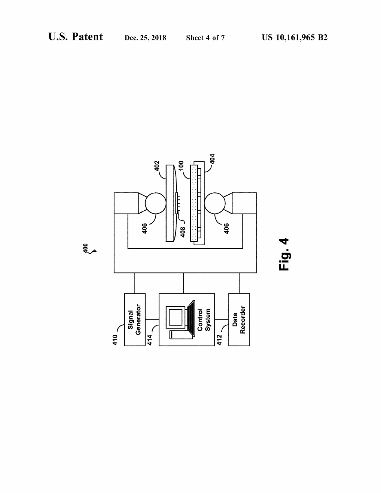
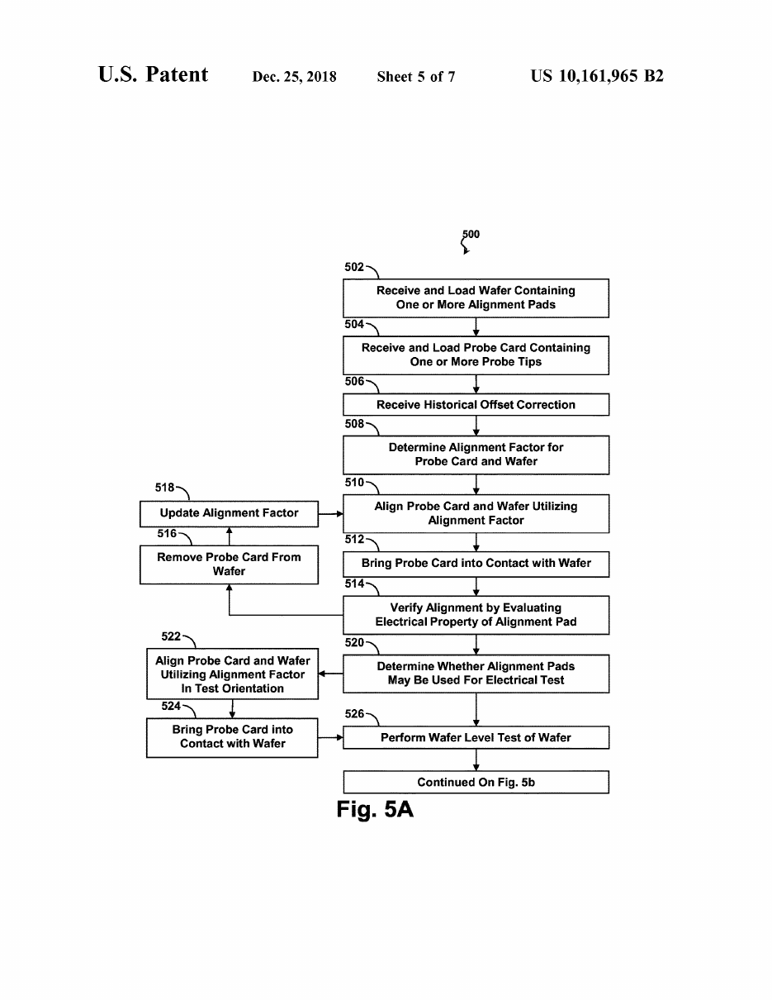
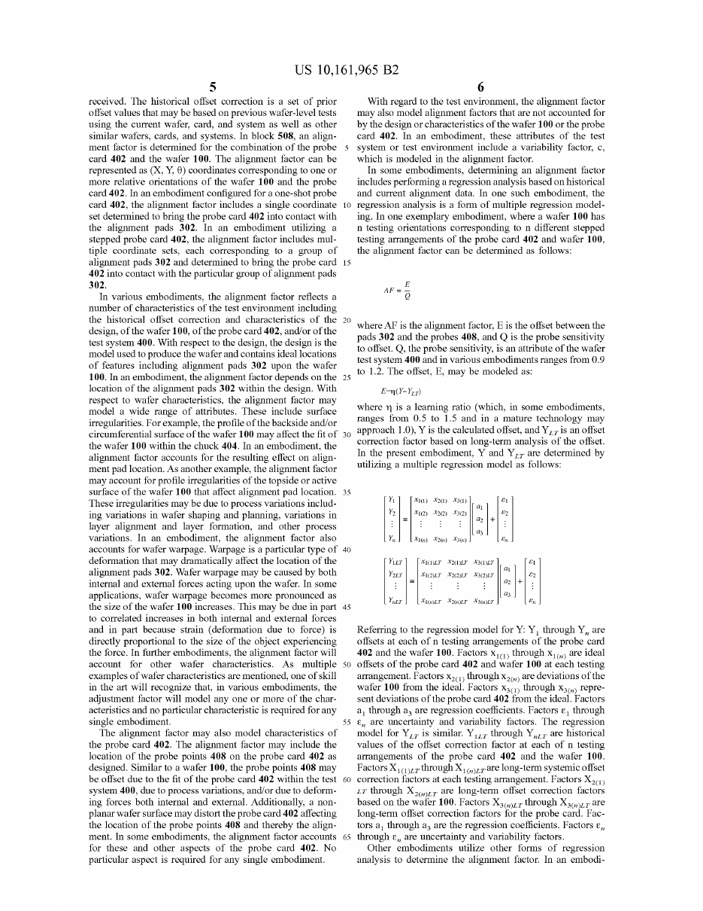

# US 10,161,965 B2 번역: 시험 프로브 정렬 제어 방법

번역 범위: 전문 (서지, 초록, 배경, 도면 설명, 상세 설명, 청구항 1~20). 인용 문헌 목록은 원문 그대로 둔다.
원문: [US10161965B2.pdf](US10161965B2.pdf) (15쪽, Google Patents 공보 PDF). 본문은 `pdftotext -layout`으로 뽑았다. 수식과 일부 깨진 문장은 Google Patents 본문 텍스트(https://patents.google.com/patent/US10161965B2/en)와 PDF 12쪽 이미지로 확인했다.

## 서지

- (12) 미국 특허, Chen 외
- (10) 특허 번호: US 10,161,965 B2
- (45) 등록일: 2018년 12월 25일
- (54) 발명의 명칭: 시험 프로브 정렬 제어 방법 (METHOD OF TEST PROBE ALIGNMENT CONTROL)
- (71) 출원인, (73) 권리자: Taiwan Semiconductor Manufacturing Company, Ltd., Hsin-Chu (TW)
- (72) 발명자: Jui-Long Chen, Chien-Chih Liao, Chin-Hsiang Lin, Hui-yun Chao, Jong-I Mou, Tseng Chin Lo, Ta-Yung Lee
- (*) 고지: 35 U.S.C. 154(b)에 따라 존속 기간이 10일 연장 또는 조정됨
- (21) 출원 번호: 14/659,268
- (22) 출원일: 2015년 3월 16일
- (65) 선행 공개: US 2015/0192616 A1, 2015년 7월 9일
- (62) 관련 출원: 2012년 6월 13일 출원한 13/495,421의 분할 출원. 원출원은 US 9,000,798로 등록됨
- (51) Int. Cl.: G01N 21/956, G01R 1/073, H01L 23/544, G01R 31/28, G01R 1/067
- (52) CPC: G01R 1/07364, G01R 1/06705, G01R 31/2887, G01R 31/2891, H01L 23/544 외
- 심사관: Alesa Allgood. 대리인: Haynes and Boone, LLP
- 청구항 20개, 도면 7장

### (56) 인용 문헌 (원문 그대로)

```
U.S. PATENT DOCUMENTS
4,937,618 A 6/1990 Ayata et al.
5,212,497 A * 5/1993 Stanley ........ B41J 2/04506
5,616,931 A 4/1997 Nakamura et al.
5,644,245 A * 7/1997 Saitoh ........ G01R 1/06794
7,319,337 B2 1/2008 Sakata
8,797,055 B2 * 8/2014 Tashiro ........ G01R 31/2887
2003/0102878 A1 * 6/2003 Montoya ........ G01R 1/07314
2005/0017746 A1 * 1/2005 Matsumoto ........ G01R 31/2884
2006/0028221 A1 * 2/2006 Hasegawa ........ G01R 27/205
2008/0148208 A1 * 6/2008 Jacobsen ........ H05K 3/0005
2010/0117672 A1 * 5/2010 Portune ........ G01R 31/2891
2011/0037492 A1 2/2011 Seubert et al.
2013/0000104 A1 * 1/2013 Chen ........ H01L 22/32
FOREIGN PATENT DOCUMENTS
CN 101568844 * 10/2009 ........ G01R 31/26
JP 2008071199 A 3/2008
JP 02010245508 A * 1/2010 ........ H01L 21/68
KR 20010057335 A 7/2001
* cited by examiner
```

## (57) 초록

프로브(예: 웨이퍼 단위 시험 프로브)를 웨이퍼 접점에 맞추는 시스템과 방법을 개시한다.
예시 방법은 다음과 같다.

- 웨이퍼 시험 시스템에서, 여러 정렬 접점이 있는 웨이퍼와 여러 프로브 점이 있는 프로브 카드를 받는다.
- 이력 오프셋 보정값(historical offset correction)을 받는다.
- 이력 오프셋 보정값을 바탕으로, 웨이퍼에 대한 프로브 카드의 방향값(orientation value)을 정한다.
- 이 방향값으로 프로브 카드를 웨이퍼에 맞춘다. 첫 프로브 점을 첫 정렬 접점에 닿게 하려는 시도다.
- 첫 프로브 점과 첫 정렬 접점의 연결 상태를 평가한다.
- 정렬된 프로브 카드로 웨이퍼의 전기 시험을 한다.
- 방향값을 바탕으로 이력 오프셋 보정값을 갱신한다.

## 관련 출원과의 관계

이 출원은 2012년 6월 13일 Jui-Long Chen 외가 "METHOD OF TEST PROBE ALIGNMENT CONTROL"이라는 이름으로 출원한 미국 특허 출원 13/495,421의 분할 출원이다. 그 출원 전체를 참조로 이 문서에 포함한다.

## 배경

반도체 집적회로(IC) 산업은 빠르게 성장했다. IC가 발전하면서 기능 밀도(칩 면적당 연결된 소자 수)는 대체로 늘었다. 기하 크기(공정으로 만들 수 있는 가장 작은 부품이나 선)는 줄었다. 이런 축소는 대개 생산 효율을 높이고 비용을 낮춘다. 반면 IC 가공과 제조를 더 복잡하게 만든다. 이 발전을 실현하려면 IC 제조에서도 비슷한 발전이 필요하다.

개선 여지가 있는 제조 분야 중 하나가 웨이퍼 시험이다. 웨이퍼 시험은 소자 성능과 제조 결함을 판단하는 수단이다. 다이싱(웨이퍼에서 칩 같은 회로 요소를 떼어 내는 일) 전에, 웨이퍼 위의 시험 구조와 기능 소자의 전기 성능을 평가한다. 웨이퍼 시험 시스템은 보통 프로브 카드로 웨이퍼의 시험 패드에 확실한 전기 연결을 만든다. 프로브와 시험 패드가 어긋나면 시험 결과가 틀어진다. 프로브 카드, 웨이퍼, IC가 손상될 수 있고 수율도 잃는다. 현재 프로브 정렬 방법에서는 작업자가 프로브와 패드의 접촉을 눈으로 확인한다. 프로브와 웨이퍼가 제대로 맞지 않으면, 프로브 카드를 웨이퍼에서 떼고, 조정하고, 다시 댄다.

시험 작업자가 숙련되어 있어도 비효율과 실수 가능성은 남는다. 또한 소자가 작아지고 웨이퍼가 커지면 정렬 시간이 늘어난다. 비싼 현미경 장비 없이는 사람이 눈으로 맞출 수 없는 상황도 생긴다. 따라서 현재 웨이퍼 시험 방법이 좋은 결과를 냈지만, 모든 면에서 만족스럽지는 않다. 정렬 방식의 발전은 효율을 높이고, 웨이퍼 손상을 줄이고, 첨단 기술의 시험을 가능하게 할 수 있어 바람직하다.

## 도면의 간단한 설명

이 개시는 아래 상세 설명을 첨부 도면과 함께 읽을 때 가장 잘 이해된다. 업계 관행에 따라 여러 요소는 축척대로 그리지 않았고 설명용일 뿐이다. 실제로 설명을 분명히 하려고 요소 크기를 임의로 키우거나 줄였을 수 있다.

- 도 1은 이 개시의 여러 측면에 따른 반도체 웨이퍼의 단순화한 평면도다.
- 도 2는 반도체 웨이퍼 한 영역의 단순화한 평면도다.
- 도 3은 반도체 웨이퍼 한 영역 안의 정렬 구조의 단순화한 평면도다.
- 도 4는 웨이퍼 단위 시험 시스템의 개략도다.
- 도 5A와 5B는 웨이퍼 단위 소자 시험 방법의 흐름도다.
- 도 6은 프로브 카드와 웨이퍼의 정렬을 평가하는 방법의 흐름도다.

## 상세한 설명

이 개시는 대체로 웨이퍼 시험 시스템과 절차에 관한 것이다. 더 구체적으로는 프로브 접점을 웨이퍼 접점에 맞추는 시스템과 방법에 관한 것이다.

아래 개시는 발명의 여러 특징을 구현하는 많은 실시예를 제공한다. 부품과 배치의 구체 예는 설명을 단순하게 하려는 것이며, 한정하려는 것이 아니다. 예를 들어 첫 요소를 둘째 요소 위에 형성한다는 말은, 두 요소가 직접 닿는 실시예와 사이에 다른 요소가 있어 직접 닿지 않는 실시예를 모두 포함할 수 있다. 또한 여러 예에서 참조 번호나 글자를 되풀이할 수 있다. 이는 단순함과 명확함을 위한 것이며, 그 자체로 실시예 사이의 관계를 정하지 않는다.

### 웨이퍼 (도 1, 도 2)

도 1은 반도체 웨이퍼 100의 단순화한 평면도다. 웨이퍼 100은 기판 102를 포함한다. 기판은 실리콘이나 저마늄 같은 원소 반도체, 또는 실리콘 저마늄, 탄화 실리콘, 갈륨 비소, 인듐 비소, 질화 갈륨, 인화 인듐 같은 화합물 반도체를 포함할 수 있다. 다른 예시 기판 102로는 실리콘 저마늄 카바이드, 갈륨 비소 인화물, 갈륨 인듐 인화물 같은 합금 반도체가 있다. 기판 102 안에는 하나 이상의 층이 있을 수 있다. 일부 실시예에서 기판 층은 에피택셜층을 포함한다. 한 실시예에서 기판은 벌크 반도체 위에 에피택셜층을 가진다. 다른 적층 기판으로는 SOI(semiconductor-on-insulator) 기판이 있다. 한 SOI 기판에서 기판 102는 SIMOX(산소 주입 분리) 같은 공정으로 만든 매립 산화막(BOX)을 포함한다.

기판 102는 이온 주입이나 확산으로 만든 p형, n형 도핑 영역을 포함할 수 있다. 이 도핑 영역은 MOS 트랜지스터, 이미지 센서 같은 기능 소자를 제공할 수 있다. 기판 102는 얕은 트렌치 소자 분리(STI) 같은 측면 분리 구조를 포함할 수 있다. 이 구조는 리소그래피 패터닝, 식각, 유전체 증착으로 만들며 기판 위 여러 소자를 분리한다. 한 실시예에서 기판 102의 영역에는 패터닝한 유전층과 도전층이 여러 겹 있다. 이들이 합쳐져 p형, n형 도핑 영역과 다른 기능 요소를 잇는 배선을 이룬다. 한 실시예에서 기판 102는 층간 절연막(ILD)이 들어간 다층 배선(MLI) 구조를 포함한다.

웨이퍼 100은 하나 이상의 다이 104를 포함한다. 각 다이 104에는 여러 전기 요소 106이 회로나 소자를 이루도록 연결된 집적회로(IC)가 있다. 여러 실시예에서 IC는 전계효과 트랜지스터(FET), 바이폴라 접합 트랜지스터(BJT), 발광 다이오드(LED), 이미지 센서, 메모리 소자, 고출력 트랜지스터, 블루투스나 3G 통신 소자 같은 고주파 소자를 포함한다. 다른 실시예는 다른 IC 소자를 포함한다. 웨이퍼 100은 다이 104 사이와 둘레에 예비 영역 108(그림에서는 잘 보이게 키움)도 포함한다. 한 실시예에서 예비 영역 108에는 스크라이브 라인, 즉 다이 104를 웨이퍼 100에서 떼어 낼 때 쓰는 영역이 있다.

도 2는 반도체 웨이퍼 100 한 영역의 단순화한 평면도다. 다이 104와 예비 영역 108의 경계를 보여 준다. 다이 104와 예비 영역 108을 포함하는 웨이퍼 100에는 시험 패드 202가 여러 개 있다. 일부 실시예에서 시험 패드 202는 다이 104 영역 안에 있다. 일부 실시예에서는 예비 영역 108 안에 있다. 그런 한 실시예에서는 예비 영역 108 안의 스크라이브 라인 110 안에 있다. 또 다른 실시예에서는 다이 104 영역과 예비 영역 108 모두에 시험 패드 202가 있다.

시험 패드 202는 다이 104 안의 IC 같은 기능 회로에 연결될 수 있다. 이 경우 다이 104가 아직 웨이퍼 100의 일부일 때 웨이퍼 시험 시스템이 기능 회로의 기능과 성능을 평가할 수 있다. 웨이퍼에는 시험 패드 202에 전기적으로 연결된 시험 구조 204(test key)도 있을 수 있다. 여러 실시예에서 시험 구조 204는 다이 104 안이나 예비 영역 108 안에 있다. 시험 구조 204에는 트랜지스터, 저항, 커패시터, 메모리 셀, 배선 패턴, 링 발진기 등 제품 성능과 관련된 소자가 들어 있다. 제조 편차 때문에 회로 요소의 성능은 웨이퍼마다 크게 다를 수 있고, 한 웨이퍼 안에서도 다를 수 있다. 기능 회로 안의 개별 소자를 떼어 분석하기는 어렵다. 시험 구조 204는 저항, 정전용량, 기준 전압, 동작 주파수, 지연 같은 특성을 간단하고 직접 시험하는 수단을 준다.

### 정렬 구조 (도 3)

도 3은 반도체 웨이퍼 100 한 영역 안의 정렬 구조 300의 단순화한 평면도다. 다이 104와 예비 영역 108의 경계를 보여 준다. 일부 실시예에서 웨이퍼 100은 시험 프로브 정렬을 돕는 정렬 구조 300을 포함한다. 정렬 구조 300은 정렬 패드 302를 하나 이상 포함한다. 정렬 패드 302는 구별되는 전기 특성을 가진다. 그래서 웨이퍼 시험 시스템 같은 시스템이 패드 302에 접촉했는지 판단할 수 있다. 예를 들어 정렬 패드 302를 도전 배선 304로 이어 패드 302 사이에 단락(낮은 저항 경로)을 만들 수 있다. 다른 예에서는 정전용량, 저항, 연결성(식별 가능한 소자나 구조와의 전기 연결 등), 그 밖의 측정 가능한 전기 파라미터로 정렬 패드 302를 식별한다. 그림의 실시예에서는 정렬 패드 302를 서로 수직인 두 축을 따라 배치해 다차원 정렬을 돕는다. 다른 실시예는 한 축 배치를 쓸 수 있다.

정렬 패드 302는 시험 패드 202 역할을 할 수 있다. 그러나 일부 실시예에서, 특히 식별 특성이 다른 시험을 방해할 수 있는 실시예에서는, 웨이퍼 100에 정렬 패드 302와 별도의 시험 패드 202가 있다. 그런 일부 실시예에서 정렬 패드 302는 시험 장비를 시험 패드 202에 맞추기 쉽게 배치한다. 예를 들어 한 실시예에서는 시험 프로브 하나를 정렬 패드 302에 제대로 맞추면, 같은 프로브 장치의 다른 시험 프로브가 시험 패드 202에 맞는다. 또 다른 예로 일부 실시예에서는 정렬 패드 302가 시험 패드 202와 평행하거나 수직이다. 또는 시험 패드 202의 위치를 정하는 기준 위치를 준다.

### 웨이퍼 단위 시험 시스템 (도 4)



*도 4. 웨이퍼 단위 시험 시스템 400의 개략도. 프로브 카드 402, 웨이퍼 척 404, 관절형 마운트(시험 헤드) 406, 프로브 점 408, 신호 발생기 410, 데이터 기록기 412, 제어 시스템 414.*

도 4는 웨이퍼 단위 시험 시스템 400의 개략도다. 웨이퍼 시험 시스템 400은 프로브 카드 402와, 웨이퍼 100을 붙였다 뗄 수 있게 고정하는 웨이퍼 척 404를 포함한다. 여러 실시예에서 척 404, 프로브 카드 402, 또는 둘 다 관절형 마운트 406(시험 헤드)에 붙는다. 그래서 프로브 카드 402를 웨이퍼 100에 맞출 수 있다. 일부 실시예에서 시험 시스템 400은 관절형 마운트 406과 프로브 카드 402 사이에 프로브 인터페이스 보드(PIB, 그림 없음)를 포함한다. PIB는 시험 시스템 400을 프로브 카드 402에 전기적으로 잇는다.

프로브 카드 402에는 웨이퍼 100의 시험 패드 202와 닿도록 만든 프로브 점 408이 하나 이상 있다. 프로브 점 408의 예시 재료는 텅스텐, 텅스텐/레늄 합금, 베릴륨, 구리, 팔라듐, 이들의 조합이다. 한 실시예에서 프로브 점 408은 끝이 가늘어져 시험 패드 202와 잘 닿는다. 일부 실시예에서 프로브 카드 402는 원샷(one-shot) 프로브 카드다. 원샷 프로브 카드 402는 웨이퍼 100의 시험 패드 202에 충분히 많이 닿는다. 그래서 프로브 카드 402를 옮기지 않고도 웨이퍼 100과 그 안의 소자를 평가할 수 있다. 다른 실시예에서 프로브 카드 402는 스텝(stepped) 프로브 카드다. 이 구성에서 프로브 카드 402는 웨이퍼의 시험 패드 202 일부에만 닿는다. 여러 실시예에서 그 일부는 다이 104 하나, 여러 다이 묶음(2, 4, 8, 16개 등), 하나 이상의 시험 구조 204에 해당한다. 프로브 카드 402로 웨이퍼 100의 첫 영역을 시험한 뒤, 프로브 카드 402를 떼고 둘째 영역으로 옮겨 추가 시험을 한다.

시험 시스템 400은 시험 신호를 주는 신호 발생기 410과, 웨이퍼 100에서 시험 결과를 모으는 데이터 기록기 412도 포함할 수 있다. 일부 실시예에서 시험 시스템은 제어 시스템 414도 포함한다. 제어 시스템은 시험 절차를 제어하고, 시험 시스템 400과 프로브 카드 402 사이의 시험 동작을 조율하고, 시험 결과를 분석하고, 웨이퍼 100을 평가한다.

### 웨이퍼 단위 소자 시험 방법 (도 5A, 5B)



*도 5A. 방법 500 흐름도 앞부분. 502 정렬 패드가 있는 웨이퍼를 받아 장착, 504 프로브 팁이 있는 프로브 카드를 받아 장착, 506 이력 오프셋 보정값 받기, 508 프로브 카드와 웨이퍼의 정렬 인자 결정, 510 정렬 인자로 정렬, 512 접촉, 514 정렬 패드의 전기 특성으로 정렬 확인, 516 프로브 카드를 웨이퍼에서 떼기, 518 정렬 인자 갱신, 520 정렬 패드를 전기 시험에 쓸 수 있는지 판단, 522 시험 방향으로 정렬, 524 접촉, 526 웨이퍼 단위 시험. 도 5B로 이어짐.*

도 5A와 5B는 웨이퍼 단위 소자 시험 방법 500의 흐름도다. 방법 500은 도 4 시스템이 하는 웨이퍼 단위 시험에 알맞다. 방법 500의 단계 전, 중간, 뒤에 단계를 더할 수 있다. 다른 실시예에서는 일부 단계를 바꾸거나 뺄 수 있다.

블록 502에서 정렬 패드 302가 하나 이상 있는 웨이퍼 100을 받아 웨이퍼 시험 시스템에 장착한다. 블록 504에서 프로브 카드 402도 받아 장착한다. 블록 506에서 이력 오프셋 보정값을 받는다. 이력 오프셋 보정값은 이전 오프셋 값의 집합이다. 지금의 웨이퍼, 카드, 시스템으로 한 이전 웨이퍼 단위 시험과, 비슷한 다른 웨이퍼, 카드, 시스템으로 한 시험을 바탕으로 할 수 있다.

블록 508에서 프로브 카드 402와 웨이퍼 100의 조합에 대한 정렬 인자(alignment factor)를 정한다. 정렬 인자는 웨이퍼 100과 프로브 카드 402의 상대 방향 하나 이상에 해당하는 (X, Y, θ) 좌표로 나타낼 수 있다. 원샷 프로브 카드 402를 쓰는 실시예에서 정렬 인자는 프로브 카드 402를 정렬 패드 302에 닿게 하는 좌표 집합 하나다. 스텝 프로브 카드 402를 쓰는 실시예에서 정렬 인자는 좌표 집합 여러 개다. 각 집합은 정렬 패드 302 묶음 하나에 해당하며, 프로브 카드 402를 그 묶음에 닿게 하도록 정한다.

여러 실시예에서 정렬 인자는 시험 환경의 여러 특성을 반영한다. 이력 오프셋 보정값, 그리고 설계, 웨이퍼 100, 프로브 카드 402, 시험 시스템 400의 특성이다.

설계에 관해: 설계는 웨이퍼를 만드는 데 쓰는 모델이며, 웨이퍼 100 위 정렬 패드 302 등 요소의 이상 위치를 담는다. 한 실시예에서 정렬 인자는 설계상 정렬 패드 302의 위치에 따라 달라진다.

웨이퍼 특성에 관해: 정렬 인자는 다양한 속성을 모델링할 수 있다. 표면 불규칙이 그 예다. 예를 들어 웨이퍼 100 뒷면이나 둘레 면의 형상은 웨이퍼 100이 척 404에 맞물리는 상태에 영향을 줄 수 있다. 한 실시예에서 정렬 인자는 이것이 정렬 패드 위치에 주는 영향을 반영한다. 다른 예로 정렬 인자는 정렬 패드 위치에 영향을 주는 웨이퍼 100 윗면(능동면)의 형상 불규칙을 반영할 수 있다. 이 불규칙은 웨이퍼 성형과 평탄화의 편차, 층 정렬과 층 형성의 편차, 그 밖의 공정 편차 때문에 생길 수 있다. 한 실시예에서 정렬 인자는 웨이퍼 휨(warpage)도 반영한다. 휨은 정렬 패드 302 위치에 크게 영향을 줄 수 있는 특정한 변형이다. 웨이퍼 휨은 웨이퍼에 작용하는 내부 힘과 외부 힘 모두로 생길 수 있다. 일부 응용에서는 웨이퍼 100이 클수록 휨이 두드러진다. 내부 힘과 외부 힘이 함께 커지기 때문이기도 하고, 변형률(힘에 의한 변형)이 힘을 받는 물체의 크기에 비례하기 때문이기도 하다. 다른 실시예에서 정렬 인자는 다른 웨이퍼 특성도 반영한다. 웨이퍼 특성의 예를 여럿 들었지만, 통상의 기술자는 여러 실시예에서 조정 인자가 이 특성 중 하나 이상을 모델링하며 어느 한 실시예에 특정 특성이 꼭 필요하지는 않다는 것을 알 것이다.

정렬 인자는 프로브 카드 402의 특성도 모델링할 수 있다. 정렬 인자는 설계상 프로브 카드 402 위 프로브 점 408의 위치를 포함할 수 있다. 웨이퍼 100과 비슷하게, 프로브 점 408은 프로브 카드 402가 시험 시스템 400에 맞물리는 상태, 공정 편차, 내부와 외부의 변형 힘 때문에 어긋날 수 있다. 또한 평평하지 않은 웨이퍼 면이 프로브 카드 402를 비틀어 프로브 점 408 위치와 정렬에 영향을 줄 수 있다. 일부 실시예에서 정렬 인자는 프로브 카드 402의 이런 측면과 다른 측면을 반영한다. 어느 한 실시예에 특정 측면이 꼭 필요하지는 않다.

시험 환경에 관해: 정렬 인자는 웨이퍼 100이나 프로브 카드 402의 설계나 특성으로 설명되지 않는 정렬 요인도 모델링할 수 있다. 한 실시예에서 시험 시스템이나 시험 환경의 이런 속성에는 변동 인자 c가 있으며, 이를 정렬 인자 안에서 모델링한다.

### 회귀로 정렬 인자 구하기



*원문 5~6단(PDF 12쪽). 정렬 인자 식 AF = E/Q, 오프셋 식 E = η(Y − Y_LT), Y와 Y_LT의 다중 회귀 행렬식.*

일부 실시예에서 정렬 인자를 정하는 일은 이력 정렬 자료와 현재 정렬 자료를 바탕으로 회귀 분석을 하는 것을 포함한다. 그런 한 실시예에서 회귀 분석은 다중 회귀 모델링의 한 형태다. 예시 실시예에서 웨이퍼 100에 시험 방향이 n개 있다고 하자. 이는 프로브 카드 402와 웨이퍼 100의 서로 다른 스텝 시험 배치 n개에 해당한다. 이때 정렬 인자는 다음과 같이 정할 수 있다.

$$AF = \frac{E}{Q}$$

여기서

- AF는 정렬 인자다.
- E는 패드 302와 프로브 408 사이의 오프셋이다.
- Q는 오프셋에 대한 프로브 민감도다. Q는 웨이퍼 시험 시스템 400의 속성이며, 여러 실시예에서 0.9에서 1.2 사이다.

오프셋 E는 다음처럼 모델링할 수 있다.

$$E = \eta\,(Y - Y_{LT})$$

여기서

- η는 학습 비율(learning ratio)이다. 일부 실시예에서 0.5에서 1.5 사이이고, 성숙한 기술에서는 1.0에 가까워질 수 있다.
- Y는 계산한 오프셋이다.
- Y_LT는 오프셋의 장기 분석에 기반한 오프셋 보정 인자다.

이 실시예에서 Y와 Y_LT는 다음 다중 회귀 모델로 정한다.

$$
\begin{bmatrix} Y_1\\ Y_2\\ \vdots\\ Y_n \end{bmatrix}
=
\begin{bmatrix} x_{1(1)} & x_{2(1)} & x_{3(1)}\\ x_{1(2)} & x_{2(2)} & x_{3(2)}\\ \vdots & \vdots & \vdots\\ x_{1(n)} & x_{2(n)} & x_{3(n)} \end{bmatrix}
\begin{bmatrix} a_1\\ a_2\\ a_3 \end{bmatrix}
+
\begin{bmatrix} \varepsilon_1\\ \varepsilon_2\\ \vdots\\ \varepsilon_n \end{bmatrix}
$$

$$
\begin{bmatrix} Y_{1LT}\\ Y_{2LT}\\ \vdots\\ Y_{nLT} \end{bmatrix}
=
\begin{bmatrix} x_{1(1)LT} & x_{2(1)LT} & x_{3(1)LT}\\ x_{1(2)LT} & x_{2(2)LT} & x_{3(2)LT}\\ \vdots & \vdots & \vdots\\ x_{1(n)LT} & x_{2(n)LT} & x_{3(n)LT} \end{bmatrix}
\begin{bmatrix} a_1\\ a_2\\ a_3 \end{bmatrix}
+
\begin{bmatrix} \varepsilon_1\\ \varepsilon_2\\ \vdots\\ \varepsilon_n \end{bmatrix}
$$

Y 회귀 모델에서:

- Y_1부터 Y_n은 프로브 카드 402와 웨이퍼 100의 시험 배치 n개 각각에서의 오프셋이다.
- x_1(1)부터 x_1(n)은 각 시험 배치에서 프로브 카드 402와 웨이퍼 100의 이상(ideal) 오프셋이다.
- x_2(1)부터 x_2(n)은 웨이퍼 100의 이상값 대비 편차다.
- x_3(1)부터 x_3(n)은 프로브 카드 402의 이상값 대비 편차다.
- a_1부터 a_3은 회귀 계수다.
- ε_1부터 ε_n은 불확실성과 변동 인자다.

Y_LT 회귀 모델도 비슷하다.

- Y_1LT부터 Y_nLT는 시험 배치 n개 각각에서 오프셋 보정 인자의 이력값이다.
- x_1(1)LT부터 x_1(n)LT는 각 시험 배치의 장기 계통 오프셋 보정 인자다.
- x_2(1)LT부터 x_2(n)LT는 웨이퍼 100에 기반한 장기 오프셋 보정 인자다.
- x_3(1)LT부터 x_3(n)LT는 프로브 카드에 대한 장기 오프셋 보정 인자다.
- a_1부터 a_3은 회귀 계수다.
- ε_1부터 ε_n은 불확실성과 변동 인자다.

다른 실시예는 다른 형태의 회귀 분석으로 정렬 인자를 정한다. 한 실시예에서는 다변량 분산 분석(MANOVA) 절차로 정렬 인자를 정한다. 한 실시예에서는 부분 최소제곱 회귀(PLS)로 정렬 인자를 정한다.

(번역자 주: 원문은 E, Q, η의 단위, 회귀 자료의 수, 정확도 수치를 밝히지 않는다. PLS와 MANOVA는 이름만 나오고 성분 수나 절차는 없다.)

### 정렬, 확인, 이력 갱신 (도 5A, 5B 이어서)

도 5A와 5B의 블록 510에서 정렬 인자로 프로브 카드 402를 웨이퍼 100에 맞춘다. 블록 512에서 프로브 카드 402를 웨이퍼 100에 접촉시킨다. 블록 514에서 프로브 카드 402와 웨이퍼 100 사이 연결의 전기 특성을 평가해 정렬을 확인한다. 연결 상태가 만족스럽지 않으면 블록 516에서 프로브 카드 402를 웨이퍼 100에서 들어 올린다. 블록 518에서 정렬 인자를 갱신하고 블록 510으로 돌아간다. 블록 514에서 프로브 카드 402와 웨이퍼 100이 제대로 맞았으면, 블록 520으로 가서 지금 연결된 정렬 패드 302가 시험 패드 202이기도 한지 판단한다. 한 실시예에서 정렬 패드 302는 시험 패드 202가 아니어서 검증과 성능 시험에 맞지 않는다. 다른 실시예에서는 정렬 패드 302가 시험 패드 202이기도 하다. 정렬 패드 302를 시험에 쓸 수 없으면 블록 522로 가서 정렬 인자로 프로브 카드 402를 시험 방향으로 웨이퍼 100에 맞춘다. 블록 524에서 프로브 카드 402를 웨이퍼 100에 접촉시킨다. 블록 526에서 전기 파라미터 시험 같은 웨이퍼 단위 시험을 한다. 정렬 패드 302를 시험에 쓸 수 있으면 블록 520에서 바로 블록 526으로 가서 웨이퍼 단위 시험을 한다. 블록 528에서 정렬 인자를 바탕으로 이력 오프셋 보정값을 갱신한다.

*도 5B. 방법 500 흐름도 뒷부분. 528 정렬 인자로 이력 오프셋 보정값 갱신, 530 둘째 웨이퍼를 받아 장착, 532 프로브 카드와 둘째 웨이퍼의 정렬 인자 결정, 534 정렬, 536 접촉, 538 둘째 웨이퍼의 웨이퍼 단위 시험.*

블록 530에서 정렬 패드 302가 여러 개 있는 둘째 웨이퍼를 받아 웨이퍼 시험 시스템 400에 장착한다. 블록 532에서 장기 정렬 인자를 바탕으로 프로브 카드 402와 둘째 웨이퍼 조합의 정렬 인자를 정한다. 한 실시예에서 블록 532에서 쓰는 장기 정렬 인자는 프로브 카드 402와 이전 웨이퍼의 직전 정렬을 바탕으로 갱신된 것이다. 그러면 처음 정렬이 더 정확해지고 재정렬 횟수가 줄 수 있다. 또한 이 과정은 정확도를 높이고, 웨이퍼나 프로브 카드 402의 손상 위험을 줄이고, 시험 시간을 줄일 수 있다. 둘째 웨이퍼의 정렬, 평가, 전기 시험은 이전 웨이퍼와 거의 같은 방식으로 진행한다. 예를 들어 블록 534에서 정렬 인자로 프로브 카드 402를 둘째 웨이퍼 100에 맞춘다. 블록 536에서 프로브 카드 402를 둘째 웨이퍼 100에 접촉시킨다. 블록 538에서 둘째 웨이퍼 100의 웨이퍼 단위 시험을 한다.

### 정렬 평가 방법 (도 6)

*도 6. 방법 600 흐름도. 602 정렬 인자로 프로브 카드와 웨이퍼 방향 맞추기, 604 프로브 카드를 웨이퍼에 접촉, 606 식별 가능한 전기 특성 시험, 608 정렬 인자 조정, 610 추가 전기 시험. (도면 문자가 겹쳐 인쇄되어 블록 이름은 본문 설명으로 옮겼다.)*

도 6은 프로브 카드 402와 웨이퍼 100의 정렬을 평가하는 방법 600의 흐름도다. 방법 600은 예를 들어 방법 500의 블록 508~518 절차를 하는 데 알맞다. 방법 600의 단계 전, 중간, 뒤에 단계를 더할 수 있다. 다른 실시예에서는 일부 단계를 바꾸거나 뺄 수 있다.

블록 602에서 프로브 점 408이 있는 프로브 카드 402의 방향을 웨이퍼 100에 대해 맞춘다. 방향은 정렬 인자로 정한다. 한 실시예에서 정렬 인자는 위에 개시한 것 같은 회귀 분석으로 정한다. 일부 실시예에서 웨이퍼 100은 식별 가능한 전기 특성을 가진 정렬 패드 302를 포함한다. 그런 한 실시예에서 정렬 패드 302는 도전 배선 304로 이어진다. 그래서 식별 특성은 정렬 패드 302 사이의 낮은 전기 저항이다. 다른 예에서는 정전용량, 저항, 연결성(식별 가능한 소자나 구조와의 전기 연결 등), 그 밖의 측정 가능한 전기 파라미터로 정렬 패드 302를 식별한다.

블록 604에서 프로브 카드 402를 웨이퍼 100에 접촉시킨다. 블록 606에서 프로브 카드 402에 전기적으로 연결된 웨이퍼 시험 시스템 400이 식별 가능한 전기 특성을 시험한다. 이로써 프로브 점 408이 정렬 패드 302에 닿았는지 판단한다. 한 실시예에서 웨이퍼 시험 시스템 400은 프로브 점 408 한 쌍 사이의 저항을 잰다. 잰 저항이 문턱값(예: 20Ω)을 넘으면, 웨이퍼 시험 시스템 400은 그 쌍의 프로브 점 408 중 적어도 하나가 정렬 패드 302에 닿지 않았다고 보고한다.

블록 606의 정렬 시험이 제대로 된 정렬을 보이지 않으면 방법 600은 블록 608로 가서 정렬 인자를 조정한다. 그다음 블록 602로 가서 이번에는 조정한 정렬 인자로 프로브 카드와 웨이퍼의 방향을 다시 맞춘다. 반대로 블록 606의 정렬 시험이 프로브 카드 402와 웨이퍼 100이 바르게 맞았음을 보이면, 블록 610으로 가서 그 정렬 인자로 추가 전기 시험을 한다.

### 정리

이와 같이 본 발명은 프로브 장치를 웨이퍼 시험 패드에 맞추는 시스템과 방법을 제공한다.

한 실시예에서 방법은 다음을 포함한다.

- 웨이퍼 시험 시스템에서 정렬 패드 여러 개가 있는 웨이퍼를 받는다.
- 웨이퍼 시험 시스템에서 프로브 점 여러 개가 있는 프로브 카드를 받는다.
- 이력 오프셋 보정값을 받는다.
- 이력 오프셋 보정값을 바탕으로 웨이퍼에 대한 프로브 카드의 방향값을 정한다.
- 방향값으로 프로브 카드를 웨이퍼에 맞춘다. 이 정렬은 첫 프로브 점을 첫 정렬 패드에 닿게 하려는 시도다.
- 이 방법은 첫 프로브 점과 첫 정렬 패드의 연결 상태를 평가하는 단계를 더 포함할 수 있다. 둘이 연결되었다고 판단되면, 정렬된 프로브 카드로 웨이퍼 전기 시험을 하고, 방향값을 바탕으로 이력 오프셋 보정값을 갱신한다.

다른 실시예에서 방법은 다음을 포함한다.

- 반도체 웨이퍼 위 정렬 패드의 위치에 영향을 주는 웨이퍼 특성을 정한다.
- 프로브 카드 위 프로브 점의 위치에 영향을 주는 프로브 카드 특성을 정한다.
- 정렬 패드와 프로브 점을 맞추는 장기 기준 인자(long-term baseline factor)를 받는다.
- 웨이퍼 특성, 프로브 카드 특성, 장기 기준 인자를 바탕으로 프로브 점과 정렬 패드의 방향을 맞출 정렬 인자를 정한다.
- 정렬 인자로 정한 방향에서 프로브 카드와 반도체 웨이퍼를 접촉시킨다.
- 그 뒤 접촉한 프로브 카드로 반도체 웨이퍼의 전기 시험을 한다.
- 정렬 인자를 바탕으로 장기 기준 인자를 갱신한다.

또 다른 실시예에서 웨이퍼는 다음을 포함한다.

- 기판
- 기판 위의 다이 하나 이상
- 기판 위, 다이 바깥의 예비 영역
- 기판 위의 정렬 구조. 정렬 패드를 하나 이상 포함하며, 웨이퍼 시험 시스템 안에서 웨이퍼를 프로브에 맞추도록 구성된다.

앞의 내용은 통상의 기술자가 이 개시의 측면을 더 잘 이해하도록 여러 실시예의 특징을 개략한 것이다. 통상의 기술자는 이 개시를 바탕으로 같은 목적을 이루거나 같은 장점을 얻는 다른 공정과 구조를 설계하거나 고칠 수 있음을 알아야 한다. 또한 그런 동등한 구성은 이 개시의 정신과 범위를 벗어나지 않으며, 정신과 범위를 벗어나지 않고 여러 변경, 치환, 수정을 할 수 있음을 알아야 한다.

## 청구항

1. 방법으로서, 다음을 포함한다.
   - 시험할 부품을 받는다. 부품 위에는 시험 패드가 있다.
   - 프로브 점이 있는 프로브를 받는다.
   - 부품 위 시험 패드의 위치가, 부품을 만드는 데 쓴 설계에 지정된 시험 패드 위치에서 벗어난 편차를 정한다. 이 편차는 부품의 특성이거나, 부품 제조의 공정 편차의 결과다.
   - 편차를 바탕으로 정렬을 정한다.
   - 정한 정렬에 따라 프로브를 부품에 접촉시킨다.
   - 프로브를 써서 부품의 전기 시험을 해 프로브와 부품의 정렬을 확인한다. 이 전기 시험은 프로브와 부품 사이 저항이 문턱값을 넘는지 잰다.
2. 청구항 1의 방법에서, 부품의 특성은 부품의 표면 불규칙, 부품의 휨, 척 안에서 부품이 맞물리는 상태 중 적어도 하나를 포함한다.
3. 청구항 1의 방법에서, 부품의 특성은 부품에 작용하는 변형 힘에 기반하며 이를 반영한다.
4. 청구항 1의 방법에서, 프로브와 부품이 성공적으로 접촉한 것을 감지하면, 정한 정렬을 바탕으로 다음 부품의 정렬을 정하는 단계를 더 포함한다.
5. 청구항 1의 방법에서, 정렬은 시험 패드와 프로브에 관한 이력 정렬 자료에도 기반한다.
6. 청구항 1의 방법에서, 프로브 점은 첫째 프로브 점이고 프로브는 둘째 프로브 점을 더 포함한다. 방법은 첫째와 둘째 프로브 점으로 전기 특성을 재서 프로브와 부품의 성공적인 접촉을 감지하는 단계를 더 포함한다.
7. 청구항 6의 방법에서, 전기 특성은 첫째와 둘째 프로브 점 사이의 전기 저항이다.
8. 청구항 1의 방법에서, 여러 이력 정렬 자료의 회귀 분석을 하는 단계를 더 포함하며, 정한 정렬은 회귀 분석 결과에도 기반한다.
9. 청구항 8의 방법에서, 회귀 분석 결과는 다음 식의 정렬 인자다. AF = E/Q. 여기서 AF는 정렬 인자, E는 시험 패드와 프로브 사이 오프셋, Q는 시험 패드와 프로브 사이 오프셋에 대한 프로브 민감도를 나타내는 값이다.
10. 방법으로서, 다음을 포함한다.
    - 시험 패드가 있는 웨이퍼를 받는다.
    - 프로브 점이 있는 프로브 카드를 받는다.
    - 첫째 편차와 둘째 편차를 정한다. 첫째 편차는 웨이퍼 위 시험 패드 위치가 웨이퍼 설계에 지정된 위치에서 벗어난 정도다. 둘째 편차는 프로브 카드 위 프로브 점 위치가 프로브 카드 설계에 지정된 위치에서 벗어난 정도다. 두 편차는 각각 웨이퍼와 프로브 카드의 표면 또는 형상 불규칙 중 하나 이상의 결과다.
    - 첫째 편차와 둘째 편차로 정한 첫째 정렬로 프로브 점을 시험 패드에 접촉시킨다.
    - 웨이퍼의 첫째 전기 시험으로 프로브 점과 시험 패드의 첫째 정렬을 확인한다. 첫째 전기 시험은 프로브 점과 시험 패드 사이 전기 저항을 잰다.
    - 첫째 정렬이 확인되지 않으면, 첫째 정렬을 조정해 둘째 정렬을 정한 뒤 프로브 점을 시험 패드에 접촉시키고, 웨이퍼의 둘째 전기 시험으로 둘째 정렬을 확인한다. 둘째 전기 시험은 프로브 점과 시험 패드 사이 전기 저항을 잰다.
11. 청구항 10의 방법에서, 첫째와 둘째 정렬은 웨이퍼에 작용하는 변형 힘에도 기반해 정한다.
12. 청구항 10의 방법에서, 첫째와 둘째 정렬을 정하는 일은 다중 회귀 모델 분석, 다변량 분산 분석, 부분 최소제곱 회귀 분석 중 적어도 하나를 포함한다.
13. 청구항 10의 방법에서, 웨이퍼는 첫째 웨이퍼이고 시험 패드는 첫째 시험 패드이며, 방법은 다음을 더 포함한다.
    - 둘째 시험 패드가 있는 둘째 웨이퍼를 받는다.
    - 둘째 시험 패드 위치가 둘째 웨이퍼 설계에 지정된 위치에서 벗어난 셋째 편차를 정한다.
    - 둘째 편차와 셋째 편차로 정한 둘째 정렬로 프로브 점을 둘째 시험 패드에 접촉시킨다.
    - 둘째 웨이퍼의 전기 시험을 한다.
14. 청구항 10의 방법에서, 프로브 점과 시험 패드의 첫째 정렬 확인은 전기 저항이 문턱값을 넘는지 평가하는 것을 포함한다.
15. 청구항 14의 방법에서, 문턱값은 약 20Ω이다.
16. 방법으로서, 다음을 포함한다.
    - 시험할 첫째 웨이퍼를 받는다. 웨이퍼 위에는 첫째 시험 패드가 있다.
    - 프로브 점이 있는 프로브를 받는다.
    - 첫째 시험 패드 위치가 첫째 웨이퍼 설계에 지정된 위치에서 벗어난 편차를 정한다.
    - 여러 이력 오프셋 보정값을 받는다. 이 값들은 프로브와 첫째 웨이퍼로 한 이전 정렬에 기반한 오프셋 값을 포함한다.
    - 편차와 여러 이력 오프셋 보정값을 바탕으로 프로브 점을 첫째 시험 패드에 맞춘다.
    - 프로브로 첫째 웨이퍼의 전기 시험을 해 정렬을 확인한다. 이 전기 시험은 프로브 점과 첫째 시험 패드 사이 저항이 문턱값을 넘는지 평가한다.
    - 첫째 웨이퍼에서 프로브 점과 첫째 시험 패드의 정렬을 성공적으로 확인하면, 첫째 시험 패드 위치가 첫째 웨이퍼 설계 위치에서 벗어난 편차를 바탕으로 프로브 점을 둘째 웨이퍼 위 둘째 시험 패드에 맞춘다.
    - 그 편차를, 이후 하나 이상의 추가 웨이퍼에 대해 프로브 위치를 정하는 데 쓰는 여러 이력 오프셋 보정값 중 하나로 처리한다.
17. 청구항 16의 방법에서, 편차는 첫째 웨이퍼의 표면 불규칙, 첫째 웨이퍼의 휨, 척 안에서 첫째 웨이퍼가 맞물리는 상태로 이루어진 군에서 고른 속성 적어도 하나를 반영한다.
18. 청구항 17의 방법에서, 편차는 첫째 웨이퍼에 작용하는 변형 힘도 반영한다.
19. 청구항 16의 방법에서, 편차 처리는 다중 회귀 모델 분석, 다변량 분산 분석, 부분 최소제곱 회귀 분석 중 적어도 하나를 포함한다.
20. 청구항 19의 방법에서, 다중 회귀 모델 분석의 결과는 다음 식으로 정한 정렬 인자다. AF = E/Q. 여기서 AF는 정렬 인자, E는 시험 패드와 프로브 사이 오프셋, Q는 시험 패드와 프로브 사이 오프셋에 대한 프로브 민감도를 나타내는 값이다.
