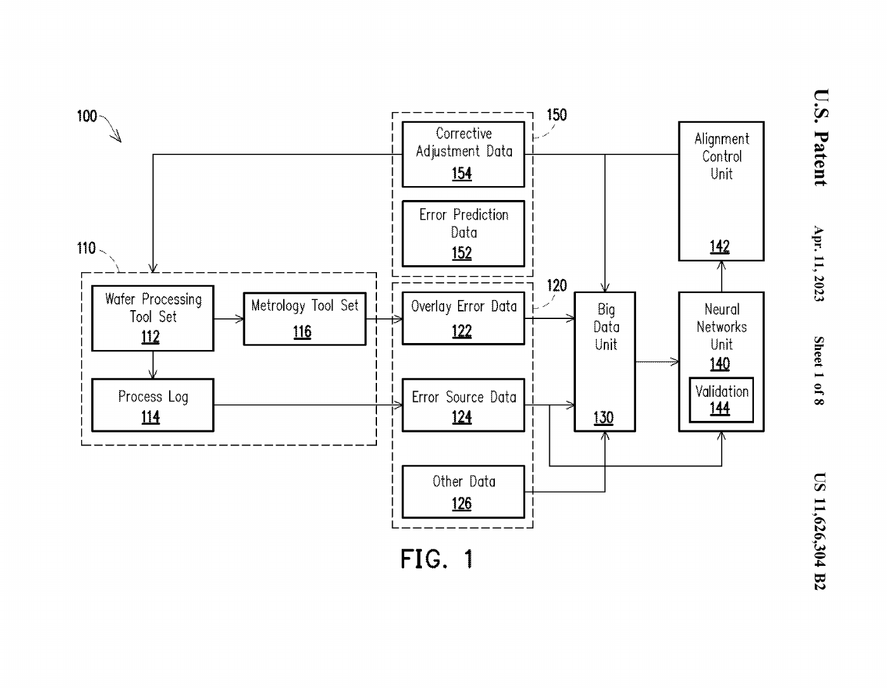
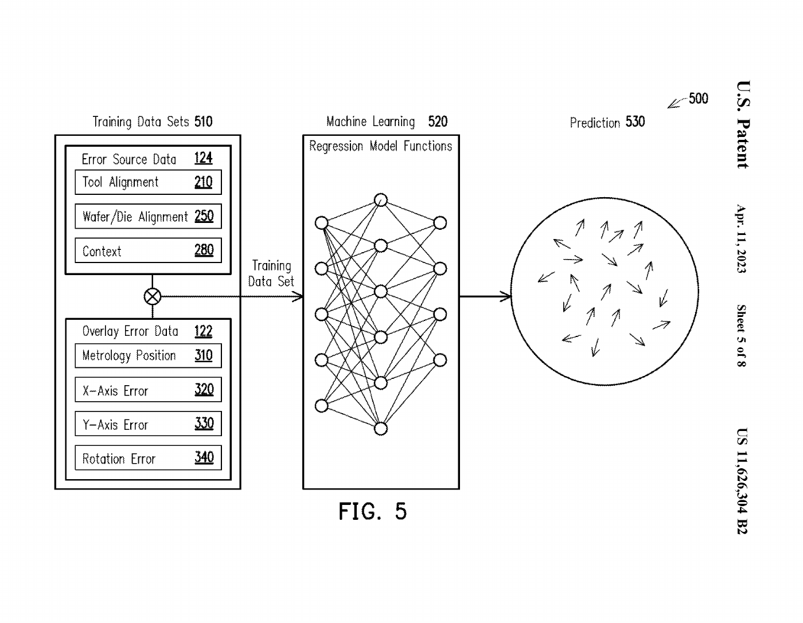
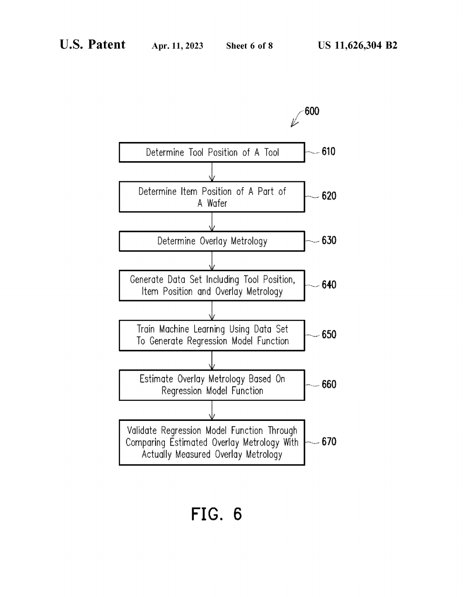

# US 11,626,304 B2 번역: 오버레이 관리에 쓰는 기계 학습

번역 범위: 전문 (서지, 초록, 배경, 도면 설명, 상세 설명, 청구항 1~20). 인용 문헌은 원문 그대로 둔다.

원문 메모
- 원문: 같은 폴더의 `US11626304B2_TSMC_machine_learning_overlay.pdf` (USPTO 공보, 19쪽).
- 공보 PDF는 글자 층이 없는 이미지 PDF다. `pdftotext -layout`으로 글자가 나오지 않아, 쪽을 그림으로 바꾼 뒤 tesseract OCR로 본문을 읽고 번역했다. OCR이 흐린 곳은 쪽 이미지를 직접 보고 맞췄다.
- 도면은 원문 3쪽(FIG. 1), 7쪽(FIG. 5), 8쪽(FIG. 6)을 이미지로 만들었다. 이 공보는 쪽 크기가 2560 x 3300 pt로 커서 `-r 110` 대신 긴 변 1400 px로 맞췄다. 가로로 누운 도면은 읽기 쉽게 90도 돌렸다.
- 원문의 오타("neutrons", "neutral networks", "neural networks application 420")는 뜻에 맞게 옮기고 괄호로 표시했다.

---

## 서지 (표지)

- (12) 미국 특허 (United States Patent), Lin 외
- (10) 특허 번호: US 11,626,304 B2
- (45) 등록일: 2023년 4월 11일 (*존속 기간 단축 표시. 최종 권리 포기(terminal disclaimer) 대상)
- (54) 발명의 명칭: 오버레이 관리에 쓰는 기계 학습 (MACHINE LEARNING ON OVERLAY MANAGEMENT)
- (71) 출원인: Taiwan Semiconductor Manufacturing Co., Ltd., Hsinchu (TW)
- (72) 발명자: Tzu-Cheng Lin, Y. Y. Peng, Jerry Wang, Kewei Zuo, Chien Rhone Wang (모두 Hsinchu, TW)
- (73) 권리자: Taiwan Semiconductor Manufacturing Co., Ltd., Hsinchu (TW)
- (*) 주의: 35 U.S.C. 154(b)에 따른 존속 기간 연장 또는 조정은 0일이다. 이 특허는 최종 권리 포기 대상이다.
- (21) 출원 번호: 17/178,929
- (22) 출원일: 2021년 2월 18일
- (65) 선행 공개: US 2021/0175105 A1, 2021년 6월 10일
- 관련 미국 출원
  - (63) 출원 16/405,702 (2019년 5월 7일 출원, 현재 미국 특허 10,964,566)의 계속 출원
  - (60) 가출원 62/692,208, 2018년 6월 29일 출원
- (51) 국제 특허 분류: G05B 19/19, H01L 21/67, G05B 13/02, G03F 7/20 (모두 2006.01)
- (52) CPC: H01L 21/67259; G03F 7/70633; G05B 13/027; G05B 19/19; G05B 2219/32335; G05B 2219/45028; G05B 2219/45031
- (58) 분류 검색: G05B 19/19
- 심사관: Suresh Suryawanshi. 대리인: Seed IP Law Group LLP
- 청구항 20개, 도면 8장

(56) References Cited (원문 그대로. OCR로 읽은 값이라 일부 기호가 흐릴 수 있다)

```
U.S. PATENT DOCUMENTS
6,850,858 B1*   2/2005  West ............... G03F 1/84   430/30
10,360,477 B2   7/2019  Bhaskar et al.
2005/0095515 A1 5/2005  Pellegrini
2009/0157343 A1 6/2009  Kaushal et al.
2012/0029856 A1 2/2012  Cohen et al.
2013/0035888 A1* 2/2013 Kandel ............. G03F 7/70633  702/81
2015/0067617 A1* 3/2015 Chang .............. G03F 7/70633  716/52
2016/0148850 A1 5/2016  David
2018/0350699 A1 12/2018 Gellineau et al.
2019/0368867 A1 12/2019 Da Costa Assafrao et al.
* cited by examiner
```

## (57) 초록

이 개시는 기계 학습으로 반도체 제조의 수직 정렬, 곧 오버레이를 관리하는 기법을 설명한다. 팬아웃 웨이퍼 레벨 패키징(WLP) 공정에서 상호 연결 구조의 정렬을 이 기법으로 평가하고 관리한다. 빅데이터와 신경망 시스템으로 오버레이 오차 원인 인자와 오버레이 계측 범주의 상관을 찾는다. 오버레이 오차 원인 인자는 다음을 포함한다.

- 장비 관련 오버레이 원인 인자
- 웨이퍼 또는 다이 관련 오버레이 원인 인자
- 공정 상황(context) 관련 오버레이 오차 원인 인자

대표도는 FIG. 6이다.

---

## 배경

반도체 기술이 발전하면서 다이는 점점 작아지고, 한 다이에 더 많은 기능이 들어간다. 그래서 집적 회로(IC) 패키지에는 더 많은 입출력(I/O) 패드를 더 작은 다이 면적과 함께 넣어야 한다. 팬아웃형 웨이퍼 레벨 패키징(WLP)은 이 어려운 상황을 풀 유망한 패키징 기술이 됐다. 팬아웃 WLP에서는 원래의 전공정 웨이퍼에서 다이를 잘라 낸 뒤, 캐리어 웨이퍼에 올려 연결 배선, I/O 패드와 함께 패키징한다. 팬아웃 WLP 공정의 장점은 다이에 딸린 I/O 패드를 다이 표면보다 넓은 면적에 다시 배치할 수 있다는 것이다. 그래서 다이 하나와 함께 넣을 수 있는 I/O 패드 수가 늘어난다.

팬아웃 WLP 패키지는 다이 하나, 나란히 놓인 여러 다이, 또는 패키지 온 패키지(POP) 수직 구성의 여러 다이를 담을 수 있다. 팬아웃 WLP의 POP 구성은 비아 같은 상호 연결 구조로 여러 다이를 수직으로 잇는 방식으로 만든다.

오버레이 계측 공정은 여러 반도체 제조 공정에서 수직 정렬을 감시하고 제어하는 데 쓴다. 오버레이 계측은 보통 첫째 패턴층 또는 그 위의 구조가, 높이가 다른 둘째 패턴층과 얼마나 정확히 맞는지(수직 정렬)를 나타낸다. 오버레이 오차는 첫째 패턴층의 첫째 부분과 둘째 패턴층의 둘째 부분 사이의 어긋남이다. 오버레이 오차 계측(측정값)은 첫째 부분과 둘째 부분 사이의 오프셋, 또는 첫째 부분의 실제 위치와 목표 위치 사이의 오프셋으로 잴 수 있다. 목표 위치는 웨이퍼 공정의 고급 공정 제어(APC)로 정할 수 있다.

팬아웃 WLP에서는 시험을 통과한 다이를 캐리어 웨이퍼에 올린다. 그 위에 상호 연결 구조층을 만들어 다이와 I/O 패드를 잇고, 여러 연결층끼리도 잇는다. 이 연결은 웨이퍼 레벨 공정으로 만들며, 전공정 웨이퍼 제조처럼 포토레지스트와 포토리소그래피 공정을 쓴다. 그래서 연이은 연결층 사이의 수직 정렬을 관리해야 한다.

## 도면의 간단한 설명

이 개시의 여러 측면은 아래 상세 설명을 첨부 도면과 함께 읽을 때 가장 잘 이해된다. 도면에서 같은 참조 번호는 문맥상 다르지 않으면 비슷한 요소나 동작을 가리킨다. 도면의 요소 크기와 상대 위치는 반드시 실제 비율이 아니다. 설명을 분명히 하려고 여러 구조의 치수를 임의로 늘리거나 줄였을 수 있다.

- FIG. 1은 오버레이 정렬을 관리하는 시스템의 예다.
- FIG. 2는 오차 원인 데이터 집합의 예다.
- FIG. 3은 오버레이 오차 데이터 집합의 예다.
- FIG. 4는 신경망 시스템의 예다.
- FIG. 5는 신경망 시스템의 동작 예다.
- FIG. 6은 오버레이 정렬 관리 과정의 예다.
- FIG. 7은 팬아웃 웨이퍼 레벨 패키징 공정에서 다이가 올려진 캐리어 웨이퍼의 예다.
- FIG. 8은 FIG. 7 웨이퍼의 오버레이 계측 예다.

## 상세 설명

### 개요

이 개시는 기계 학습으로 반도체 제조의 수직 정렬, 곧 오버레이를 관리하는 기법을 설명한다. 예를 들어 팬아웃 WLP 공정의 상호 연결 구조 정렬을 이 기법으로 평가하고 관리한다.

한 실시예에서는 빅데이터와 신경망 시스템으로 오버레이 오차 원인 인자와 오버레이 계측 범주의 상관을 찾는다. 오버레이 오차 원인 인자는 장비 관련 인자, 웨이퍼 또는 다이 관련 인자, 공정 상황 관련 인자를 포함한다.

장비 관련 오버레이 원인 인자는 다음을 포함하며 이에 한정되지 않는다.

- 광원 위치
- 레티클 위치
- 렌즈 왜곡
- 주사 방향
- 노광 때 스테퍼 위치
- 웨이퍼 스테이지 위치

웨이퍼 또는 다이 관련 오버레이 오차 원인 인자는 다음을 포함하며 이에 한정되지 않는다.

- 웨이퍼의 위치 오프셋 또는 회전
- 웨이퍼 위 다이의 위치 오프셋 또는 회전
- 크기 편차, 두께 편차 같은 웨이퍼 형상 특성
- 형상 편차, 두께 편차 같은 다이 형상 특성

공정 상황 오버레이 오차 원인 인자는 다음을 포함하며 이에 한정되지 않는다.

- 전역 정렬 영역. 웨이퍼에서 전역 정렬 제어로 처리하는 영역
- 전역 정렬 위치. 향상된 전역 정렬(EGA) 제어에서 전역 정렬 조정값을 정하려고 웨이퍼에서 재는 위치
- 필드 정렬 위치. 웨이퍼에서 사이트별 또는 필드별 정렬 제어로 처리하는 위치
- 웨이퍼 스테이지 형상 같은 장비 특성
- 노광 필드 위치. 예를 들어 레티클의 수직 위치로, 노광 크기로 이어진다
- 초점 심도
- 노광 시간
- 스테퍼 장비의 스텝 속도
- 조명 광원(백색, 녹색, 아이보리, 황색광)과 그 밖의 조명 설정
- 층의 오버레이를 재는 계측 위치

오버레이 계측 정보도 얻는다. 예를 들어 오버레이 오차의 범주는 다음과 같다.

- x축, y축 방향의 오버레이 오차 크기
- 구조 사이의 회전 오프셋
- 웨이퍼 기준 또는 다이 기준의 오버레이 오차 위치

이 오버레이 계측 데이터를 모아 기계 학습에 넣는다.

신경망 방식의 기계 학습으로 오버레이 오차 원인 인자와 오버레이 오차 계측의 상관을 찾는다. 기계 학습의 결과로 회귀 모델 함수를 얻는다. 데이터는 계속 갱신, 보강되어 기계 학습 과정을 계속 훈련하고, 그에 따라 회귀 모델 함수도 계속 훈련된다. 회귀 모델 함수로 팬아웃 WLP 패키징 공정에서 만드는 상호 연결층의 오버레이 계측값을 예측하거나 추정할 수 있다. 회귀 모델 함수를 바탕으로 장비 정렬 설정 또는 웨이퍼 정렬 설정에 대한 보정 조정값을 얻을 수 있다.

### 회귀 모델 함수의 검증

회귀 모델 함수는 여러 방법으로 검증할 수 있다. 예를 들어 추정한 오버레이 계측값을 기준 웨이퍼의 실제 계측값과 비교할 수 있다. 기준 웨이퍼는 새로 처리한 웨이퍼일 수도, 전에 처리한 웨이퍼일 수도 있다. 기준 웨이퍼의 오버레이 오차 원인 데이터와 실제 계측 데이터를 정하거나 데이터베이스에서 꺼낸다. 기준 웨이퍼의 오차 원인 데이터를 회귀 모델 함수에 넣어 오버레이 계측값을 추정한다. 추정값을 실제 계측 데이터와 비교해 추정이 충분히 정확한지 판단한다. 비교에는 임계값을 쓴다. 임계값은 웨이퍼 공정의 구조나 층에 요구되는 오버레이 허용치를 바탕으로 정할 수 있다. 예를 들어 팬아웃 WLP에서는 약 0.1 um의 임계값으로, 팬아웃 WLP로 패키징된 다이 위 상호 연결 구조에서 추정 오버레이 계측값이 실제 계측 데이터에 맞는지 판단할 수 있다.

회귀 모델 함수는 추정한 보정 조정값으로도 검증할 수 있다. 예를 들어 장비 정렬이나 웨이퍼, 다이 정렬에 대해 추정한 보정 조정값을 새로 처리하는 기준 웨이퍼에 적용한다. 그 기준 웨이퍼에 오버레이 계측을 해서, 회귀 모델 함수가 추정한 대로 오버레이 오차가 줄거나 없어졌는지 확인한다. 여기서도 임계값을 쓸 수 있다.

### 효과

개시한 기법을 쓰면 AI 기반 오버레이 계측 덕분에 계측 장비의 실효 처리 능력이 좋아진다. 한 실시예에서 물리 계측 장비의 실효 처리 능력이 약 40배 좋아진다. 예를 들어 개시한 가상 오버레이 계측 기법을 쓰면 오버레이 계측 팀의 처리 능력이 하루 292 WLP에서 하루 약 11400 WLP로 늘었다. 오버레이 계측 측정 정확도는 0.1 um보다 작은 수준으로 좋아졌다. 오버레이 관련 품질 관리의 처리 주기는 약 4시간에서 거의 실시간으로 크게 줄었다. 그래서 팬아웃 WLP의 전체 공정 주기 시간도, 예를 들어 0.1일만큼 좋아졌다.

인공 지능 함수의 교차 검증에서 추정 오버레이 값도 실제 오버레이 값과 비교하므로, 개시한 기법은 모델 과적합 문제를 피할 수 있다.

이 개시에서는 스테퍼 장비 관련 오버레이 계측 공정을 예로 들어 기법을 설명한다. 이것은 개시 범위를 한정하려는 것이 아니다. 개시한 기법은 다른 범핑 정렬 장비의 오버레이 계측 예측에도 쓸 수 있다. 예를 들어 다이 부착의 다이 이동(die shift) 계측이나 볼 마운트 스텐실 정렬 계측이다. 또 개시한 가상 오버레이 계측 기법은 전공정 반도체 공정의 정렬 장비나 공정에도 적용할 수 있다.

### 일반 서술

아래 개시는 설명한 주제의 여러 특징을 구현하는 여러 실시예, 곧 예를 제공한다. 설명을 단순하게 하려고 구성 요소와 배치의 구체 예를 아래에 든다. 이것은 물론 예일 뿐이며 한정하려는 것이 아니다. 예를 들어 아래 설명에서 둘째 구조 위에 첫째 구조를 만든다는 말은, 두 구조가 직접 닿게 만드는 실시예를 포함할 수 있다. 또 두 구조 사이에 다른 구조가 더 만들어져서 두 구조가 직접 닿지 않는 실시예도 포함할 수 있다. 또 이 개시는 여러 예에서 참조 번호나 문자를 반복할 수 있다. 이 반복은 단순성과 명료성을 위한 것이며, 그 자체로 여러 실시예나 구성 사이의 관계를 정하지 않는다.

또 "아래(beneath, below, lower)", "위(above, upper)" 같은 공간 상대어는 도면에 나타낸 한 요소나 구조와 다른 요소나 구조의 관계를 설명하기 쉽게 쓸 수 있다. 공간 상대어는 도면에 그린 방향 외에도 사용, 동작 중 장치의 다른 방향을 포함하려는 것이다. 장치는 다른 방향(90도 회전 또는 다른 방향)으로 놓일 수 있고, 여기 쓴 공간 상대 서술어도 그에 맞게 해석할 수 있다.

아래 설명에서는 여러 실시예를 충분히 이해하도록 일부 구체 사항을 적는다. 그러나 이 분야 기술자는 이런 구체 사항 없이도 개시를 실시할 수 있음을 이해할 것이다. 다른 경우에는 실시예 설명을 불필요하게 흐리지 않으려고 전자 부품과 제조 기법에 관한 잘 알려진 구조를 자세히 설명하지 않았다.

문맥상 달리 필요하지 않으면, 명세서와 청구항 전체에서 "포함하다(comprise)"와 그 변형("comprises", "comprising")은 열린 포괄적 의미, 곧 "포함하지만 이에 한정되지 않는다"로 해석한다.

첫째, 둘째, 셋째 같은 서수 사용은 반드시 순위를 뜻하지 않는다. 동작이나 구조의 여러 사례를 구분하는 것일 수 있다.

명세서에서 "한 실시예" 또는 "실시예"라고 하면, 그 실시예와 관련해 설명한 특징, 구조, 특성이 적어도 하나의 실시예에 포함된다는 뜻이다. 그래서 명세서 여러 곳의 "한 실시예에서", "실시예에서"가 반드시 모두 같은 실시예를 가리키지는 않는다. 또 특징, 구조, 특성은 하나 이상의 실시예에서 적절한 방식으로 결합될 수 있다.

명세서와 첨부 청구항에서 단수형 "a", "an", "the"는 내용상 분명히 달리 정하지 않으면 복수 대상을 포함한다. 또 "또는(or)"은 내용상 분명히 달리 정하지 않으면 보통 "및/또는(and/or)"의 뜻으로 쓴다.

### FIG. 1: 오버레이 관리 시스템



*FIG. 1. 오버레이 관리 시스템 100. 웨이퍼 제조 현장 시스템 110(웨이퍼 처리 장비 세트 112, 공정 로그 114, 계측 장비 세트 116), 입력 데이터 집합 120(오버레이 오차 데이터 122, 오차 원인 데이터 124, 기타 데이터 126), 빅데이터부 130, 신경망부 140(검증 144 포함), 정렬 제어부 142, 출력 데이터 집합 150(오차 예측 데이터 152, 보정 조정 데이터 154). 보정 조정 데이터는 다시 웨이퍼 처리 장비 세트와 빅데이터부로 돌아간다. (원문 3쪽, 가로 도면을 90도 돌림)*

FIG. 1은 오버레이 관리 시스템 100의 예다. FIG. 1처럼 시스템 100은 다음을 포함한다.

- 웨이퍼 제조 현장 시스템 110
- 입력 데이터 집합 120
- 빅데이터부 130
- 신경망부 140
- 출력 데이터 집합 150

웨이퍼 제조 현장 시스템 110은 웨이퍼 처리 장비 세트 112(예: 포토리소그래피 장비 세트 112), 공정 로그 114, 계측 장비 세트 116을 포함한다. 입력 데이터 집합 120은 오버레이 오차 데이터 122, 오차 원인 데이터 124, 기타 데이터 126을 포함한다. 기타 데이터 126은 웨이퍼 공정의 이력 데이터일 수 있다. 이력 오버레이 오차 데이터, 이력 오차 원인 데이터, 그리고 공정 로그 114가 얻고 관리하는 웨이퍼 공정 데이터 외의 다른 웨이퍼 공정 데이터를 포함한다. 신경망부 140은 정렬 제어부 142와 검증부 144를 포함하거나 함께 동작할 수 있다. 출력 데이터 집합 150은 오차 예측 데이터 152, 보정 조정 데이터 154, 그 밖의 출력 데이터를 포함한다.

동작에서 웨이퍼 처리 장비 세트 112는 웨이퍼를 처리하도록 구성된다. 예를 들어 다이가 올려진 캐리어 웨이퍼를 팬아웃 WLP 공정으로 처리해 다이 위에 상호 연결층을 만든다. 웨이퍼 처리 장비 세트 112는 포토리소그래피 장비일 수 있다. 예를 들어 스테퍼 장비(스텝 앤드 리피트 카메라), 웨이퍼 스테이지 또는 척, 갠트리 장비, 그 밖의 적절한 장비를 포함한다. 스테퍼는 빛을 레티클에 통과시켜 레티클 패턴의 상을 만든다. 상은 렌즈로 초점이 맞춰지고 축소되어, 포토레지스트를 바른 웨이퍼 표면에 투영된다. 스테퍼는 스텝 앤드 리피트 방식으로 동작해 레티클의 패턴을 웨이퍼 표면 전체에 격자 모양으로 반복 노광한다. 스테퍼는 웨이퍼 스테이지로 웨이퍼를 한 샷 위치에서 다음 샷 위치로 한 스텝씩 옮긴다. 웨이퍼의 스텝 이동은 스테퍼 렌즈 아래 격자를 따라 앞뒤, 좌우로 할 수 있다. 팬아웃 WLP에서는 갠트리가 다이를 집어 캐리어 웨이퍼의 정해진 격자점이나 영역에 놓는다. 어떤 경우에는 갠트리 장비 둘 이상으로 캐리어 웨이퍼에 다이를 놓는다.

공정 로그 114는 처리 중에 장비 세트 112와, 장비 세트 112에 놓인 웨이퍼에 관한 웨이퍼 공정 변수를 감시, 측정, 결정, 기록하도록 구성된다. 웨이퍼 공정 변수 데이터의 일부 또는 전부는 오버레이 오차의 원인이나 관련 요인으로 분류되어 오차 원인 데이터 124로 모인다.

포토리소그래피 장비 세트 112가 한 층이나 그 층의 구조를 처리한 뒤, 계측 장비 세트 116은 웨이퍼를 재서 그 층이나 구조에 오버레이 오차가 있는지 판단하도록 구성된다. 계측 데이터에는 오버레이 오차의 세부도 들어 있다. 오버레이 오차 계측 세부는 다음 범주로 나뉜다.

- 웨이퍼 또는 다이 위 오버레이 오차의 위치
- x축 또는 y축 방향 오버레이 오차의 오프셋 크기
- 오버레이의 회전 각도

계측 장비 세트 116의 측정 결과 일부는 오버레이 오차 데이터 122로 모인다. 오차 원인 인자와 오버레이 오차 범주의 상관을 모델링하는 데에는 오버레이 오차가 0인 경우도 쓸모가 있어, 오버레이 오차 데이터 122의 일부로 모을 수 있다.

빅데이터부 130은 오버레이 오차 데이터 122, 오차 원인 데이터 124, 기타 데이터 126을 모으고, 이후 분석을 위해 여러 데이터 집합을 결합하거나 조화시키도록 구성된다. 예를 들어 빅데이터부 130은 오버레이 오차 데이터 122, 오버레이 원인 데이터 124, 기타 데이터 126의 서로 다른 범주를 여러 방식으로 잇는다. 웨이퍼 층, 웨이퍼 층 위 위치, 웨이퍼 층 위 구조, 수직으로 겹치도록 설계된 여러 수직 구조, 또는 그 밖의 적절한 연결 방식을 기준으로 잇는다. 여기서 웨이퍼 위 "특징(feature)"은 오버레이 오차 데이터 122와 오차 원인 데이터 124를 함께 잇는 웨이퍼의 모든 부분을 말한다. 예를 들어 웨이퍼 위 특징은 상호 연결 구조일 수 있다. 오버레이 오차 데이터 122의 한 항목은 그 상호 연결 구조의 오버레이 오차이고, 연결된 오차 원인 데이터 124의 항목은 그 상호 연결 구조를 만들 때 기록한 웨이퍼 공정 변수다.

빅데이터부 130은 모은 데이터를 측정 척도, 측정 단위, 시간 척도, 허용 임계값 등에 대해 조화시켜, 데이터 항목을 같은 분석 과정에 쓸 수 있게 한다. 빅데이터부 130은 빠진 데이터 항목과 데이터 항목 보간에 대해서도 모은 데이터를 보강한다. 그 밖의 데이터 처리, 조화, 결합 기법도 가능하며 빅데이터부 130에 포함된다.

기타 데이터 126은 전에 처리한 웨이퍼의 오버레이 오차 데이터나 오차 원인 데이터에 관한 이력 데이터일 수 있다. 이런 이력 데이터는 빅데이터부 130 안에서 오버레이 오차 데이터 122, 오차 원인 데이터 124와 같거나 비슷한 방식으로 처리된다.

### 신경망부 140의 학습

신경망부 140(또는 기계 학습부 140)은 인공 지능 기계 학습부다. 빅데이터부 130이 준 데이터로 지도 학습을 해서, 오버레이 오차 원인 인자와 오버레이 오차 범주의 상관을 나타내는 회귀 모델 함수를 도출하도록 구성된다. 기계 학습의 "지도" 부분은 비교적 느슨하게 둘 수 있다. 예를 들어 인자를 "입력" 범주(예: 오차 원인 인자)와 "출력" 범주(예: 오버레이 오차 범주)로 지정하는 것 외에는, 신경망부 140이 신경망 엔진을 "눈을 가린 채(blindly)" 동작하게 해서 데이터 처리에서 기계 학습의 장점을 최대로 살린다. 또 신경망부 140은 서로 다른 인자 묶음을 "입력"이나 "출력"으로 나눈 여러 지도 학습 과제를 수행하도록 구성될 수 있다. 예를 들어 오버레이 오차 데이터 122에 있는 오버레이 오차 계측 위치는 어떤 학습 과제에서는 출력으로, 다른 학습 과제에서는 입력으로 분류될 수 있다. 학습 과제가 다르면 "입력" 인자와 "출력" 인자를 잇는 회귀 모델 함수도 다르게 나올 수 있다.

"지도 학습"을 할 때 신경망부 140은 "계통(systematic)" 오차 원인 인자와 "무작위(random)" 오차 원인 인자를 구별할 수도 있다. "계통" 오차 원인 인자는 같거나 비슷한 상황에서 같은 데이터 값이나 패턴을 되풀이하는 경향이 있는 인자다. "무작위" 오차 원인 인자는 같거나 비슷한 상황에서도 데이터 값이 무작위로 나오는 경향이 있는 인자, 또는 시스템 100이 값을 제어할 수 없는 인자다. 예를 들어 다이 배치 오프셋은 특정 갠트리 장비 때문에 생기는 계통 인자일 수 있다. 스테퍼 위치 오프셋도 특정 스테퍼 장비의 계통 인자일 수 있다. 다른 예로 다이 두께 변동이나 다이 크기 변동은 무작위 인자일 수 있다. 팬아웃 WLP 공정에서 무작위로 생기거나 제어할 수 없기 때문이다.

지도 기계 학습으로 하나 이상의 회귀 모델 함수를 도출하면, 신경망부 140은 그 회귀 모델 함수로 웨이퍼의 오버레이 계측을 추정하거나 예측한다. 한 실시예에서는 역전파 신경망으로 입력 인자와 출력 인자를 잇는 회귀 모델 함수를 정한다. 예를 들어 회귀 모델 함수를 계산할 때 입력 인자는 "뉴런"(원문 "neutrons")이 "처리"해 출력에 기여하고, 각 뉴런 기여의 가중치는 역전파 알고리즘으로 정한다.

정렬 제어부 142는 회귀 모델 함수나 오버레이 추정, 예측 결과로 웨이퍼 공정의 오버레이 정렬을 제어하도록 구성된다. 예를 들어 팬아웃 WLP의 상호 연결 웨이퍼 공정이다. 구체적으로 정렬 제어부 142는 웨이퍼 공정 작업의 공정 로그 정보를 회귀 모델 함수의 입력으로 넣어 정렬 제어 출력 데이터 150을 만들 수 있다. 정렬 제어 출력 데이터는 웨이퍼 공정을 제어하거나 조정하는 데 쓸 수 있다. 예를 들어 정렬 제어 출력 데이터 150은 오차 예측 데이터 152와 보정 조정 데이터 154 등을 포함한다. 오차 예측 데이터 152는 하나 이상의 웨이퍼 위치에서 예측, 추정한 오버레이 계측을 나타낸다. 보정 조정 데이터 154는 추정, 예측한 오버레이 오차를 없애기 위한 오차 원인 데이터 124의 하나 이상의 오차 원인 인자 변화를 나타낸다.

한 실시예에서 정렬 제어부 142는 신경망부 140의 일부다. 다른 실시예에서 정렬 제어부 142는 신경망부 140과 별개이며, 오버레이 오차를 없애도록 하나 이상의 웨이퍼 처리 장비 설정이나 웨이퍼 위치를 자동으로 조정하거나 조정하게 하는 기구를 포함한다.

### 검증 모듈 144와 학습 자료 갱신

신경망부 140(원문 "neutral networks")의 검증 모듈 144는 관련 기준 웨이퍼에서 얻은 계측 데이터로 회귀 모델 함수를 검증하도록 구성된다. 기준 웨이퍼는 오버레이 오차 데이터와 오차 원인 데이터를 바로 쓸 수 있는, 전에 처리한 웨이퍼일 수 있다. 기준 웨이퍼는 웨이퍼 공정 중인 새 웨이퍼일 수도 있고, 이것은 무엇보다 검증 목적으로 쓴다. 예를 들어 기준 웨이퍼에서 추정한 오버레이 계측(예: 추정 오버레이 오차의 위치와 크기)을 기준 웨이퍼의 실제 계측과 비교한다. 오버레이 계측 추정, 예측이 충분히 정확한지, 곧 실제 계측에 맞는지 평가하는 데 임계값을 쓸 수 있다. 비교 결과는 해당 회귀 모델 함수를 더 훈련하거나 계속 훈련, 학습하는 데 쓸 수 있다.

예를 들어 오버레이 오차 원인 인자와 오버레이 오차를 실제 측정한 데이터로 된 학습 데이터 집합은 장비와 공정의 최신 상태를 반영하도록 계속 갱신된다. 한 실시예에서는 학습 데이터 집합의 데이터 항목 수를 고정해 회귀 모델 함수를 훈련한다. 새로 측정한 데이터 항목이 가장 오래된 데이터 항목을 대신해 고정 개수를 유지한다.

비슷하게 보정 조정 데이터는 본질적으로 "그 보정 조정 데이터로 처리한 기준 웨이퍼에는 오버레이 오차가 없을 것"이라는 예측이다. 기준 웨이퍼의 실제 계측 데이터로 보정 조정 데이터가 오버레이 오차를 실제로 없앴는지 평가할 수 있다. 여기서도 평가에 임계값을 쓸 수 있다. 임계값은 웨이퍼 설계나 웨이퍼 공정을 바탕으로 정할 수 있다. 팬아웃 WLP 공정에서는 예를 들어 상호 연결 구조의 크기를 바탕으로 임계값을 정할 수 있다.

### FIG. 2: 오차 원인 데이터

FIG. 2는 오차 원인 데이터 124의 예다. 오차 원인 데이터 124는 다음 세 부분집합을 포함한다.

- 장비 정렬 오차 원인 인자 부분집합 210
- 웨이퍼/다이 정렬 오차 원인 인자 부분집합 250
- 상황 오차 원인 인자 부분집합 280

장비 정렬 부분집합 210은 오버레이 정렬에 영향을 주는 장비 정렬 변수나 설정의 데이터를 포함한다. 한 실시예에서 장비 정렬 부분집합 210은 다음을 포함한다.

- 이전 장비 정렬 데이터 212
- 웨이퍼 스테이지 위치 데이터 214
- 스텝 위치 데이터 216
- 레티클 키 위치 데이터 218
- 노광 위치 데이터 220
- 그 밖의 적절한 장비 정렬 변수 데이터

웨이퍼/다이 정렬 부분집합 250은 오버레이 정렬에 영향을 주는, 웨이퍼 스테이지 위 웨이퍼 위치나 (팬아웃 WLP의 경우) 웨이퍼 위 다이 위치의 데이터를 포함한다. 한 실시예에서 웨이퍼/다이 정렬 부분집합 250은 웨이퍼 오프셋 데이터 252, 웨이퍼 회전 데이터 254, 다이 오프셋 데이터 256, 다이 회전 데이터 258, 그 밖의 웨이퍼/다이 정렬 데이터를 포함한다.

상황 오차 원인 부분집합 280은 오버레이 계측 측정의 상황 정보를 포함한다. 상황 정보를 넣으면 서로 다른 웨이퍼 종류와 서로 다른 웨이퍼 공정 변수를 구별해 신경망 처리에서 고려할 수 있다. 한 실시예에서는 웨이퍼 종류마다, 또는 웨이퍼 공정 변수마다 회귀 모델 함수를 따로 정하거나 훈련한다. 예를 들어 웨이퍼 종류마다, 또는 웨이퍼 공정 변수 묶음마다 오버레이 오차 원인 인자와 오버레이 오차의 학습 데이터 집합을 따로 둔다. 서로 다른 학습 데이터 집합은 따로 갱신되어 각 학습 데이터 집합의 항목 수를 고정으로 유지한다. 한 실시예에서 상황 오차 원인 부분집합 280은 다음을 포함한다.

- 초점 심도 데이터 282
- 노광 시간 데이터 284
- 스텝 속도 데이터 286
- 조명 설정 데이터 288
- 조명 광원 290
- 향상된 전역 정렬(EGA) 위치 292
- 필드 위치 데이터 294
- 계측 위치 데이터 296
- 그 밖의 적절한 상황 데이터

이전 장비 정렬 데이터 212는 현재 웨이퍼(예: 현재 데이터 항목의 웨이퍼)와 같은 웨이퍼 공정을 거친 이전 웨이퍼에 쓴 웨이퍼 처리 장비 세트 112의 정렬 위치다. 이전 장비 정렬 데이터 212는 현재 웨이퍼와 같은 구조나 공정 단계에 대해, 현재 웨이퍼와 같은 척도로 잰다. 곧 이전 장비 정렬 데이터 212는 현재 데이터 항목과 비교할 수 있다. 예를 들어 현재 웨이퍼의 장비 정렬 데이터가 웨이퍼 스테이지 위치 데이터 214, 스텝 위치 데이터 216, 레티클 키 위치 데이터 218, 노광 위치 데이터 220을 포함하면, 이전 장비 정렬 데이터 212도 이전 웨이퍼에 대해 같은 데이터 범주를 모두 포함한다.

웨이퍼 스테이지 위치 데이터 214는 웨이퍼 스테이지를 고정하는 액추에이터의 위치로 잴 수 있다. 예를 들어 웨이퍼 스테이지는 x축, y축, z축 위치를 고정하는 액추에이터 세 개를 가질 수 있다. x축, y축, z축 액추에이터의 위치를 기록, 로그해 웨이퍼 스테이지 위치를 나타낸다.

스텝 위치 데이터 216은 스테퍼의 위치다. 레티클 키 위치 데이터 218은 레티클 키로 고정된 레티클의 위치를 나타낸다.

노광 위치 데이터 220은 웨이퍼에서 조명 빛에 노광되는 위치나 영역을 나타낸다.

웨이퍼 스테이지 위치 214, 스텝 위치 216, 레티클 키 위치 218, 노광 위치 220은 가로 평면의 x축, y축 위치, 그리고/또는 수직 평면의 z축 위치로 나타낼 수 있다. 일부 실시예에서는 웨이퍼 스테이지 위치 214, 스텝 위치 216, 레티클 키 위치 218, 노광 위치 220을 각각의 목표 위치에 대한 위치 오차로 나타낼 수 있다. 위치 오차를 잴 때는 x축 오프셋, y축 오프셋, z축 오프셋, 회전 오차(각도)를 쓸 수 있다.

장비 정렬 인자 214, 216, 218, 220 각각에 대해 서로 다른 세 종류의 데이터 중 하나 이상을 기록, 로그할 수 있다.

- 첫째 종류: 레이저 장치 같은 측정 장치로 잰 위치. "측정 위치"라 한다.
- 둘째 종류: 고급 공정 제어(APC)의 향상된 전역 정렬(EGA) 시스템이 EGA 조정을 적용하기 전에 정한 위치. "정렬 전 위치" 또는 "EGA 전 위치"라 한다.
- 셋째 종류: EGA 조정을 적용한 뒤 정한 위치. "정렬 후 위치" 또는 "EGA 후 위치"라 한다.

세 종류의 위치 데이터는 각각 장비 세트 112의 실제 위치와 어긋날 수 있다. 장비 세트 위치 결정의 이런 어긋남이 오버레이 오차에 기여할 수 있다. 신경망부 140의 동작에 세 종류의 장비 정렬 위치 데이터를 모두 쓸 필요는 없다. 신경망부 140은 어떤 회귀 모델에는 일부 종류의 데이터를, 다른 회귀 모델에는 다른 종류의 데이터를 골라 쓸 수 있다. 또 세 종류의 데이터를 모두 오차 원인 데이터 124에 넣을 필요도 없다. 어떤 운영 상황에서는 EGA를 하지 않아 EGA 전, EGA 후 위치 데이터가 없다. 다른 상황에서는 측정 위치 데이터가 없거나 오차 원인 데이터 124에 넣지 않는다.

세 종류의 장비 정렬 데이터(측정 위치, EGA 전 위치, EGA 후 위치)는 서로 관련될 수 있다. 예를 들어 EGA 후 위치는 EGA 전 위치를 바탕으로 얻는다. 그러나 각 종류를 얻을 때 추가 요인이나 다른 요인이 들어가, 어긋남에 기여할 수 있다. 예를 들어 EGA는 EGA 조정을 정하려고 웨이퍼에서 고른 EGA 측정점, 곧 "EGA 위치"의 영향을 받을 수 있다. 그래서 장비 정렬 부분집합 210에 세 종류의 위치 데이터 중 하나 이상을 넣으면, 신경망부 140은 장비 정렬 인자와 오버레이 계측 범주의 상관을 더 타당하게 반영하거나 고려하는 회귀 모델 함수를 얻을 수 있다.

장비 정렬을 정하는 다른 방법도 가능하며 이 개시에 포함된다.

웨이퍼/다이 정렬 부분집합 250에서 웨이퍼 오프셋 데이터 252는 웨이퍼 스테이지 위 웨이퍼의 오프셋 양을 나타낸다. 웨이퍼 오프셋은 x축 오프셋과 y축 오프셋을 포함한다. 한 실시예에서 웨이퍼 오프셋은 웨이퍼에 있는 웨이퍼 정렬 마크나 그 밖의 적절한 기구로 정한다.

웨이퍼 회전 데이터 254는 웨이퍼 스테이지 위 웨이퍼의 회전 각도를 나타낸다. 한 실시예에서 웨이퍼 회전은 웨이퍼 정렬 마크나 그 밖의 적절한 기구로 정한다.

다이 오프셋 데이터 256은 캐리어 웨이퍼 위 다이의 오프셋 양을 나타낸다. 다이 오프셋은 x축 오프셋과 y축 오프셋을 포함한다. 한 실시예에서 다이 오프셋은 다이에 있는 다이 정렬 마크나 그 밖의 적절한 기구로 정한다.

다이 회전 데이터 258은 캐리어 웨이퍼 위 다이의 회전 각도를 나타낸다. 한 실시예에서 다이 회전은 다이 정렬 마크나 그 밖의 적절한 기구로 정한다.

장비 정렬 부분집합 210과 비슷하게, 웨이퍼/다이 정렬 부분집합 250의 데이터 범주도 측정 위치, EGA 전 위치, EGA 후 위치의 세 종류 데이터를 포함할 수 있다. 다이 정렬용 EGA 시스템은 웨이퍼 정렬용 EGA 시스템과 다를 수 있다.

측정 위치, EGA 전 위치, EGA 후 위치는 정렬 위치 데이터 범주의 데이터 종류 예로 든 것이다. 이 예는 개시 범위를 한정하지 않는다. 정렬 위치 데이터 범주에는 다른 데이터 종류도 가능하며 모두 이 개시에 포함된다. 예를 들어 웨이퍼나 다이의 필드 정렬도 가능하며, 필드 정렬 전후의 장비, 웨이퍼, 다이 위치를 오차 원인 데이터 124에 쓸 수 있다.

초점 심도 데이터 282, 노광 시간 데이터 284, 조명 설정 데이터 288, 조명 광원 데이터 290은 이름 그대로다. 스텝 속도 데이터 286은 스테퍼의 이동 속도를 나타낸다. 이 데이터는 본질적으로 공정 레시피의 변수이며, 오버레이 계측과 (있다면) 오버레이 오차의 상황을 구별하는 데 쓴다. 이런 상황 데이터를 넣으면 여러 상황 인자가 만드는 복잡성을 없애는 식으로 신경망부 140이 만드는 회귀 모델 함수를 더 좋게 할 수 있다. 곧 상황 변수마다 회귀 모델 함수를 훈련하거나 정할 수 있다.

EGA 위치 데이터 292는 EGA 정렬을 위해 웨이퍼, 다이에서 정한 여러 위치 점을 나타낸다. 웨이퍼의 여러 구조는 보통 모양과 단면이 다양하다. 그래서 EGA 위치(예: EGA 위치에 있는 구조)를 어떻게 고르느냐에 따라 EGA 평가와 조정 결과가 달라진다.

필드 위치 데이터 294는 포토리소그래피 공정에서 빛을 받는 웨이퍼, 다이 영역의 크기를 나타낸다. 한 실시예에서 필드 위치 데이터 294는 레티클 개구의 크기와, 레티클과 웨이퍼 표면 사이 거리로 잰다.

계측 위치 296은 오버레이 계측을 재는 웨이퍼나 다이 위 위치를 나타낸다. 여기 설명한 대로 웨이퍼 위 계측 위치는 오차 원인 인자와 오버레이 오차 범주 중 하나 이상의 역할을 할 수 있다. 오차 원인 인자로서, 웨이퍼 위 계측 위치는 오버레이 오차가 있는지 또는 검출되는지에 영향을 준다.

FIG. 2에 든 오차 원인 데이터 범주는 예이며 개시 범위를 한정하지 않는다. 오버레이 오차의 발생이나 크기에 기여하는 다른 인자도 오차 원인 데이터 124에 쓰고 넣을 수 있으며, 모두 이 개시에 포함된다.

### FIG. 3: 오버레이 오차 데이터

FIG. 3은 오버레이 오차 데이터 122의 예다. FIG. 3처럼 오버레이 오차 데이터 122는 네 가지 오버레이 오차 범주를 포함한다.

- 오버레이 계측 위치 데이터 310
- x축 오버레이 오차 데이터 320
- y축 오버레이 오차 데이터 330
- 오버레이 회전(각도) 데이터 340

오버레이 계측 위치 데이터 310은 웨이퍼나 다이의 어디에서 오버레이 오차가 생기는지, 또는 검출되는지를 나타낸다. x축 오버레이 오차 데이터 320과 y축 오버레이 오차 데이터 330은 각각 x축, y축 방향 오버레이 오차의 크기를 나타낸다. 오버레이 회전(각도) 데이터 340은 구조의 실제 계측이 목표 계측에서 각도만큼 벗어난 오버레이 오차를 나타낸다.

*FIG. 3 도면 글자: Overlay Error Data (오버레이 오차 데이터), Overlay Metrology Position (오버레이 계측 위치), Overlay Error in X-Axis (x축 오버레이 오차), Overlay Error in Y-Axis (y축 오버레이 오차), Overlay Rotation (in Angle) (오버레이 회전, 각도).*

오버레이 오차를 정의하는 방법은 여러 가지다. 한 실시예에서는 구조의 실제 계측과 목표 계측을 바탕으로 오버레이 오차를 정한다. 다른 실시예에서는 위쪽 구조와 아래쪽 구조의 정렬을 바탕으로 오버레이 오차를 정한다. 오버레이 정렬 정확도나 오버레이 오차를 정하는 다른 방법도 가능하며 이 개시에 포함된다.

### FIG. 4: 신경망부

FIG. 4는 신경망부 140의 예다. FIG. 4를 보면 신경망부 140은 다음을 포함한다.

- 처리부 410. 예를 들어 컴퓨터 프로세서, 또는 가상 머신 응용에서 신경망부 140에 배정된 처리 능력
- 신경망 응용 430이 저장된 저장부 420
- 분산 컴퓨팅 환경에서 신경망부 140과 이어진 다른 컴퓨터나 기계와 통신하도록 구성된 통신부 440
- 입력, 출력, 사용자 상호작용을 위한 인터페이스부 450
- 그 밖의 구성 요소 460

신경망 응용 430은 실행 명령어를 포함한다. 처리부 410이 이를 실행하면 처리부 410은 학습 자료 생성 모듈 432, 검증 모듈 436을 포함한 기계 학습 모듈 434, 예측 모듈 438을 구현하도록 구성된다. 한 실시예에서 학습 자료 생성 모듈 432, 기계 학습 모듈 434, 예측 모듈 438 전용 실행 명령어는 저장부 420의 별도 전용 공간에, 또는 구문 분석이나 색인으로 쉽게 구별할 수 있도록 분리, 분석 가능한 방식으로 저장된다.

*FIG. 4 도면 글자: Neural Networks Unit 140, Processing Unit 410, Storage Unit 420, Neural Networks Application 430, Training Set Generation Module 432, Machine Learning Module 434, Validation Module 436, Prediction Module 438, Communication Unit 440, Interfacing Unit 450.*

신경망부 140의 구성 요소 하나 이상은 서버 컴퓨터 같은 물리 장치로, 또는 분산 컴퓨팅 환경의 가상 장치로 구현할 수 있다. 예를 들어 여러 호스트 서버가 웨이퍼 공정 현장이나 작업에 이어질 수 있다. 호스트 서버는 분산 컴퓨팅 방식으로 함께 동작해, 신경망부 140과/또는 빅데이터부 130이 있는 하나 이상의 가상 계층을 지원할 수 있다. 가상 계층은 전체 가상화, OS 수준 가상화, 응용 수준 가상화, 그 밖의 부분 가상화 등 어떤 수준의 가상화든 될 수 있다.

또 신경망부 140의 구성 요소가 모두 같은 가상화 수준에 있을 필요는 없다. 신경망부 140의 일부 구성 요소는 물리 계층으로, 일부는 여러 수준의 가상 계층으로 구현할 수 있으며, 모두 이 개시에 포함된다.

### FIG. 5: 신경망 응용의 동작 구조



*FIG. 5. 동작 구조 500. 학습 데이터 집합 510(오차 원인 데이터 124: 장비 정렬 210, 웨이퍼/다이 정렬 250, 상황 280. 오버레이 오차 데이터 122: 계측 위치 310, x축 오차 320, y축 오차 330, 회전 오차 340)을 묶은 학습 데이터 집합이 기계 학습 520(회귀 모델 함수, 신경망)으로 들어가고, 예측 530은 웨이퍼 전체의 오버레이 오차 벡터 지도로 나온다. (원문 7쪽, 가로 도면을 90도 돌림)*

FIG. 5는 신경망 응용 430(원문 "420")의 동작 구조 500이다. 학습 자료 생성 모듈 432는 빅데이터부 130에서 데이터를 받아, 동작 510에서 학습 데이터 집합을 만들도록 구성된다. 예를 들어 오차 원인 데이터 124와 오버레이 오차 데이터 122를 받아 처리해 기계 학습 동작 520을 훈련할 학습 데이터 집합을 만든다. 학습 데이터 집합은 새 데이터 항목이 더해지고 오래된 항목이 빠지면서 계속 갱신된다. 동작 510의 한 실시예에서 학습 자료 생성 모듈 432는 받은 데이터 집합을 사전 학습 과정으로 처리해 기계 학습 과정 520에 맞게 최적화한다.

한 실시예에서 기계 학습 동작 520에서는 기계 학습 모듈 434가 학습 데이터 집합으로 지도 학습을 한다. 지도 학습에서는 학습 데이터 집합에서 입력으로 분류한 데이터 대상과 출력으로 분류한 데이터 대상을 구체적으로 정하고, 입력 데이터 대상을 해당 출력 데이터 대상과 짝짓는다. 그 다음 입력과 출력 데이터 항목 쌍을 분석해 뉴런 사이 연결을 훈련하는 방식으로 회귀 모델 함수를 만든다. 한 실시예에서 오버레이 원인 인자는 입력("x")으로, 오버레이 계측 오차는 출력("y")으로 분류된다. 결과로 나온 회귀 모델 함수는 각각 하나 이상의 오차 원인 인자를 하나의 오버레이 오차 범주에 잇는다. 오버레이 오차 범주는 예를 들어 오버레이 계측 위치, x축 오버레이 오차, y축 오버레이 오차, 오버레이 회전이다.

예측 동작 530에서는 예측 모듈 438이 만든 회귀 모델 함수로 웨이퍼 공정 중인 웨이퍼의 오버레이 계측을 예측하거나 추정한다. 구체적으로 공정 로그 114에서 웨이퍼 공정 변수를 입력으로 얻어 회귀 모델 함수에 넣고, 오버레이 계측 정보를 출력으로 만든다. 예측 모듈 438은 추정, 예측한 오버레이 오차를 없애거나 줄이도록 웨이퍼 공정 변수, 예를 들어 하나 이상의 장비 정렬 설정과/또는 웨이퍼/다이 정렬 인자에 대한 보정 조정값도 예측할 수 있다.

FIG. 5처럼 오버레이 오차 예측은 웨이퍼 전체에 대해 할 수 있다. 웨이퍼 안에서 오버레이 오차는 일정한 패턴을 따를 수도 있고, 웨이퍼의 필드마다 다를 수도 있다. 웨이퍼 공정에 쓰는 스테퍼 장치로는 웨이퍼 공정 설정을 조정해 웨이퍼의 개별 필드의 오버레이 오차를 따로 보정할 수 있다. 그러나 웨이퍼의 필드 둘 이상의 오버레이 오차를 따로 보정할 수 없고 웨이퍼 공정 작업에서 서로 얽혀 있는 경우가 있다. 이때는 의사 결정 동작으로 웨이퍼 공정 작업의 전체 보정 조정값을 정해, 둘 이상의 필드 사이에서 오버레이 정렬의 균형을 맞출 수 있다.

예측 동작 530의 결과는 정렬 제어부 142로 출력되어 웨이퍼 공정 작업을 그에 맞게 제어한다. 예를 들어 오차 예측 데이터 152는 오버레이 오차 문제를 피하거나 줄이도록 웨이퍼 공정 변수 설정을 수동으로 조정하는 데 쓸 수 있다. 보정 조정 데이터 154는 운영자나 기계가 오버레이 정렬 문제를 피하거나 줄이도록 웨이퍼 공정 변수 설정을 자동으로 조정하는 데 바로 쓸 수 있다. 조정한 공정 변수와 관련 오버레이 계측 데이터는 함께 새 데이터 항목이 되므로, 다시 신경망부 140에 들어가 회귀 모델 함수를 더 훈련하거나 다듬는다. 곧 신경망부 140의 기계 학습 과정은 오차 원인 인자와 오버레이 오차 범주를 잇는 회귀 모델 함수를 계속 갱신하는 동적 과정으로 구성될 수 있다.

검증 모듈 436은 만든 회귀 모델 함수가 오차 원인 인자와 오버레이 오차 범주의 상관을 정확히 나타내는지 평가하도록 구성된다. 예를 들어 예측 오버레이 계측값을 실제 계측 측정과 비교할 수 있다. 추정, 예측 오버레이 계측이 실제 오버레이 계측 데이터에 맞는지 판단하는 데 임계값을 쓸 수 있다. 예를 들어 팬아웃 WLP 웨이퍼 공정 작업에서는 0.1 um 임계값으로 추정 오버레이 오차가 실제 오버레이 계측에 맞는지 판단할 수 있다.

### FIG. 6: 동작 과정 흐름도



*FIG. 6. 동작 과정 600.*
*610 장비의 장비 위치를 정한다.*
*620 웨이퍼 일부의 대상 위치를 정한다.*
*630 오버레이 계측을 정한다.*
*640 장비 위치, 대상 위치, 오버레이 계측을 포함한 데이터 집합을 만든다.*
*650 데이터 집합으로 기계 학습을 훈련해 회귀 모델 함수를 만든다.*
*660 회귀 모델 함수로 오버레이 계측을 추정한다.*
*670 추정 오버레이 계측을 실제 측정한 오버레이 계측과 비교해 회귀 모델 함수를 검증한다.*
*(원문 8쪽)*

FIG. 6은 예시 동작 과정 600의 흐름도다. 예시 동작 610에서 공정 로그 114는 웨이퍼에 상호 연결 구조를 만드는 데 쓰는 웨이퍼 처리 장비(예: 스테퍼)의 장비 위치를 정한다. 장비 위치는 측정 위치, 정렬 전 위치, 정렬 후 위치 중 하나 이상일 수 있다.

예시 동작 620에서 공정 로그 114는 웨이퍼의 구조에 해당하는 웨이퍼 일부의 위치를 정한다. 설명 편의상 이를 "대상 위치(item position)"라 한다. 대상 위치는 측정 위치, 정렬 전 위치, 정렬 후 위치 중 하나 이상일 수 있다.

### FIG. 7: 다이가 올려진 캐리어 웨이퍼

FIG. 7은 예로서 여러 다이 710이 올려진 캐리어 웨이퍼 700을 보여 준다. 공정 로그는 상호 연결 구조에 해당하는 웨이퍼 700의 부분 720(점선 원)의 대상 위치를 정할 수 있다. FIG. 7의 예시처럼 부분 720은 팬아웃 WLP 공정에서 웨이퍼 700 위 다이 710A의 위치를 포함한다. 부분 720의 대상 위치는 여러 방식으로 잴 수 있다. 예를 들어 부분 720의 대상 위치는 웨이퍼 700의 정렬 마크 722와 웨이퍼 스테이지 730의 정렬 마크 724 사이 어긋남으로 나타낸 x축, y축 웨이퍼 오프셋을 포함할 수 있다. 대상 위치는 웨이퍼 700과 웨이퍼 스테이지 730 위 목표 웨이퍼 위치 732(점선 원) 사이의 회전도 포함할 수 있다.

또 대상 위치는 x축, y축 다이 오프셋도 포함할 수 있다. FIG. 7의 예시처럼 캐리어 웨이퍼 700 아래쪽에 놓인 다이 710은 모두 목표 위치 712에 대해 정렬 오프셋을 가진다. 이런 정렬 오프셋은 웨이퍼 700 아래쪽에 다이 710을 집어 놓는 일을 맡은 문제 있는 갠트리 장비 때문에 계통적으로 생길 수 있다. 부분 712에 대해 예시한 것처럼, 해당 다이 710A는 목표 위치 712A에 대해 회전 오차도 가질 수 있다.

웨이퍼 정렬 위치와 다이 정렬 위치는 공정 로그 114가 함께 정할 수 있다.

*FIG. 7 도면 요소: 캐리어 웨이퍼 700, 다이 710, 710A, 목표 위치 712, 712A, 부분 720, 정렬 마크 722, 724, 웨이퍼 스테이지 730, 목표 웨이퍼 위치 732.*

### FIG. 8: 오버레이 계측

예시 동작 630에서 계측 장비 세트 116은 상호 연결 구조에 대한 오버레이 계측을 정한다. FIG. 8은 웨이퍼 700의 오버레이 계측 측정 예를 보여 준다. FIG. 8처럼 웨이퍼 700의 부분마다 오버레이 정렬 계측이 다를 수 있고 일정하지 않을 수 있다. 부분 720의 상호 연결 구조에 대한 계측 데이터 810은 장비 위치 정보, 대상 위치 정보와 관련된 것으로 식별된다. 곧 이 데이터들은 상호 연결 구조를 통해 서로 이어질 수 있다.

### FIG. 6 동작 640~670

예시 동작 640에서 학습 자료 생성 모듈 432는 웨이퍼 700의 부분 720 위 상호 연결 구조에 대한 장비 위치 데이터, 대상 위치 데이터, 오버레이 계측 데이터를 포함한 데이터 집합을 만든다.

예시 동작 650에서 기계 학습 모듈 434는 학습 데이터 집합으로 훈련한 기계 학습으로 회귀 모델 함수를 만든다. 한 실시예에서 기계 학습 모듈 434는 학습 데이터 집합으로, 입력 데이터(예: 웨이퍼 정렬 데이터, 다이 정렬 데이터)와 출력 데이터(예: 오버레이 계측 데이터)를 잇는 회귀 함수의 변수를 정한다. 훈련은 새 데이터 집합이 학습 데이터 집합에 더해져 오래된 데이터 집합을 대신할 때마다 계속 되풀이되고 갱신될 수 있다. 새 데이터 집합은 오버레이 계측 오차가 생기는 제조 공정의 갱신된 상태를 반영한다. 만든 데이터 집합은 기계 학습 과정을 훈련할 많은 데이터 집합 항목 중 하나일 수 있다. 회귀 모델 함수는 기계 학습 모듈 434에 이미 있어서 새 학습 데이터 집합으로 계속 훈련, 보강될 수도 있고, 기계 학습 모듈 434가 새로 만들 수도 있다.

예시 동작 660에서 예측 모듈 438은 훈련한 회귀 모델 함수로 둘째 웨이퍼의 오버레이 계측을 추정한다. 예를 들어 둘째 웨이퍼의 장비 위치와 대상 위치를 회귀 모델 함수에 넣어 오버레이 계측을 추정할 수 있다.

예시 동작 670에서 검증 모듈 436은 둘째 웨이퍼에서 추정한 계측을 실제 측정한 계측과 비교해 회귀 모델 함수를 평가한다.

기법은 팬아웃 WLP 공정을 예로 들어 설명했다. 이 기법은 전공정 웨이퍼 공정과 다른 후공정 웨이퍼 공정 작업에도 비슷하게 적용할 수 있다.

### 실시예 정리

이 개시는 다음 실시예 설명으로 더 잘 이해할 수 있다.

방법 실시예에서는 웨이퍼 처리 장비의 장비 위치를 정한다. 웨이퍼 처리 장비는 첫째 웨이퍼에 첫째 구조를 만드는 데 쓴다. 첫째 웨이퍼의 첫째 부분의 대상 위치를 정한다. 첫째 부분은 첫째 구조에 해당한다. 첫째 구조에 대한 오버레이 계측을 정한다. 장비 위치, 대상 위치, 오버레이 계측을 포함한 데이터 집합을 만든다. 함수의 한쪽에 장비 위치나 대상 위치 중 하나 이상을, 다른 쪽에 오버레이 계측을 두어 서로 잇는 함수를 만든다. 이 함수는 데이터 집합을 쓴 기계 학습으로 만든다.

다른 실시예에서 시스템은 다음을 포함한다.

- 웨이퍼에 구조를 만들도록 구성된 웨이퍼 처리 장비
- 웨이퍼 위 구조의 오버레이 정렬을 재도록 구성된 계측 장비
- 웨이퍼 처리 장비의 정렬 변수나 웨이퍼의 정렬 변수 중 하나 이상을 바탕으로, 웨이퍼 위 구조의 추정 오버레이 정렬 계측을 만들도록 구성된 오버레이 모델링 장비
- 추정 오버레이 정렬 계측을 바탕으로 웨이퍼 처리 장비의 정렬 변수나 웨이퍼의 정렬 변수 중 하나 이상을 조정하도록 구성된 공정 제어 장비

컴퓨팅 시스템은 프로세서와, 실행 명령어가 저장된 저장부를 포함한다. 프로세서가 실행 명령어를 실행하면, 실행 명령어는 프로세서가 다음 동작을 구현하도록 구성한다.

- 첫째 웨이퍼에 첫째 구조를 만드는 것에 관한 웨이퍼 처리 장비의 장비 위치 데이터를 받는다.
- 첫째 웨이퍼에 첫째 구조를 만드는 것에 관한, 웨이퍼 고정 장비 위 첫째 웨이퍼 위치의 대상 위치 데이터를 받는다.
- 첫째 웨이퍼에 첫째 구조를 만드는 것에 관한 상황 데이터를 받는다.
- 장비 위치 데이터, 대상 위치 데이터, 상황 데이터 중 적어도 하나를 회귀 모델 함수에 넣어, 장비 위치나 대상 위치 중 하나 이상을 조정하는 데이터를 만든다. 이 회귀 모델 함수는 장비 위치 데이터, 대상 위치 데이터, 상황 데이터 중 적어도 하나를 첫째 웨이퍼 위 첫째 구조의 오버레이 계측과 잇는다.

위에서 설명한 여러 실시예는 결합해 다른 실시예를 만들 수 있다. 이 명세서에서 언급하거나 출원 데이터 시트에 적힌 모든 미국 특허, 미국 특허 출원 공개, 미국 특허 출원, 외국 특허, 외국 특허 출원, 비특허 문헌은 그 전체가 참조로 여기 포함된다. 실시예의 측면은 필요하면 여러 특허, 출원, 공개의 개념을 써서 다른 실시예를 만들도록 수정할 수 있다.

위 상세 설명에 비추어 실시예에 이런저런 변경을 할 수 있다. 일반적으로 아래 청구항에 쓴 용어는 청구항을 명세서와 청구항에 개시한 구체 실시예로 한정하는 것으로 해석하면 안 된다. 그런 청구항이 누리는 균등물의 전 범위와 함께 가능한 모든 실시예를 포함하는 것으로 해석해야 한다. 따라서 청구항은 이 개시로 한정되지 않는다.

---

## 청구항

청구하는 발명은 다음과 같다.

**1.** 다음을 포함하는 방법.
- 컴퓨팅 장치가 데이터 집합을 받는다. 데이터 집합은 첫째 웨이퍼에 첫째 구조를 만드는 것에 관한 장비의 첫째 장비 위치, 첫째 구조를 만드는 것에 해당하는 첫째 웨이퍼 첫째 부분의 첫째 대상 위치, 첫째 웨이퍼에 만든 첫째 구조의 첫째 오버레이 계측을 포함한다.
- 컴퓨팅 장치가 데이터 집합을 바탕으로 한 기계 학습으로 함수를 만든다. 이 함수는 한쪽의 장비 위치나 대상 위치 중 하나 이상을 다른 쪽의 오버레이 계측과 상관 짓는다.
- 컴퓨팅 장치가 둘째 웨이퍼에 둘째 구조를 만드는 것에 관한 장비의 둘째 장비 위치와, 둘째 구조를 만드는 것에 해당하는 둘째 웨이퍼 둘째 부분의 둘째 대상 위치를 받는다.
- 컴퓨팅 장치가 함수, 둘째 장비 위치, 둘째 대상 위치를 바탕으로 둘째 웨이퍼 둘째 구조의 둘째 오버레이 계측을 추정한다.
- 컴퓨팅 시스템에 연결된 제어기가, 추정한 둘째 오버레이 계측을 바탕으로, 둘째 웨이퍼에 둘째 구조를 만드는 반도체 제조 공정에서 둘째 장비 위치나 둘째 대상 위치 중 하나 이상을 조정한다.

**2.** 청구항 1의 방법에서, 첫째 또는 둘째 장비 위치 각각은 웨이퍼 스테이지 위치, 스테퍼 위치, 레티클 키 위치, 노광 위치 중 하나 이상을 포함한다.

**3.** 청구항 1의 방법에서, 첫째 또는 둘째 대상 위치 각각은 웨이퍼 스테이지에 놓인 첫째 웨이퍼의 웨이퍼 오프셋이나 웨이퍼 회전 중 하나 이상을 포함한다.

**4.** 청구항 3의 방법에서, 첫째 또는 둘째 대상 위치 각각은 첫째 웨이퍼 첫째 부분에 놓인 다이의 다이 오프셋이나 다이 회전 중 하나 이상을 더 포함한다.

**5.** 청구항 1의 방법에서, 첫째 또는 둘째 장비 위치 각각은 측정 위치, 정렬 전 위치, 정렬 후 위치 중 하나 이상을 포함한다.

**6.** 청구항 1의 방법에서, 첫째 또는 둘째 대상 위치 각각은 측정 위치, 정렬 전 위치, 정렬 후 위치 중 하나 이상을 포함한다.

**7.** 청구항 1의 방법에서, 다음을 더 포함한다.
- 첫째 웨이퍼에 첫째 구조를 만드는 상황을 정한다.
- 그 상황을 포함한 데이터 집합을 만든다.

**8.** 청구항 7의 방법에서, 상황은 첫째 웨이퍼에서 향상된 전역 정렬 작업의 측정 위치, 첫째 구조를 만드는 것에 관한 노광 필드, 오버레이 계측을 잰 첫째 웨이퍼 위 계측 위치 중 하나 이상을 포함한다.

**9.** 청구항 1의 방법에서, 다음을 더 포함한다.
- 이전 첫째 웨이퍼에 첫째 구조를 만드는 것에 관한 장비의 이전 장비 위치를 정한다.
- 이전 장비 위치를 포함한 데이터 집합을 만든다.

**10.** 청구항 1의 방법에서, 함수를 만드는 것은 신경망 시스템을 통한 기계 학습으로 함수를 만드는 것을 포함한다.

**11.** 청구항 1의 방법에서, 둘째 웨이퍼의 추정 오버레이 계측을 둘째 웨이퍼의 측정 오버레이 계측과 비교해 함수를 평가하는 것을 더 포함한다.

**12.** 실행 명령어가 저장된 비일시적 저장 매체. 프로세서가 실행하면 프로세서가 다음 동작을 구현하게 한다.
- 데이터 집합을 받는다. 데이터 집합은 첫째 웨이퍼에 첫째 구조를 만드는 것에 관한 장비의 첫째 장비 위치, 첫째 구조를 만드는 것에 해당하는 첫째 웨이퍼 첫째 부분의 첫째 대상 위치, 첫째 웨이퍼에 만든 첫째 구조의 첫째 오버레이 계측을 포함한다.
- 데이터 집합을 바탕으로 한 기계 학습으로, 한쪽의 장비 위치나 대상 위치 중 하나 이상을 다른 쪽의 오버레이 계측과 상관 짓는 함수를 만든다.
- 둘째 웨이퍼에 둘째 구조를 만드는 것에 관한 장비의 둘째 장비 위치와, 둘째 구조를 만드는 것에 해당하는 둘째 웨이퍼 둘째 부분의 둘째 대상 위치를 받는다.
- 함수, 둘째 장비 위치, 둘째 대상 위치를 바탕으로 둘째 웨이퍼 둘째 구조의 둘째 오버레이 계측을 추정한다.
- 추정한 둘째 오버레이 계측을 바탕으로 둘째 장비 위치나 둘째 대상 위치 중 하나 이상을 조정한다.

**13.** 청구항 12의 저장 매체에서, 첫째 또는 둘째 장비 위치 각각은 웨이퍼 스테이지 위치, 스테퍼 위치, 레티클 키 위치, 노광 위치 중 하나 이상을 포함한다.

**14.** 청구항 12의 저장 매체에서, 첫째 또는 둘째 대상 위치 각각은 웨이퍼 스테이지에 놓인 첫째 웨이퍼의 웨이퍼 오프셋이나 웨이퍼 회전 중 하나 이상을 포함한다.

**15.** 청구항 14의 저장 매체에서, 첫째 또는 둘째 대상 위치 각각은 첫째 웨이퍼 첫째 부분에 놓인 다이의 다이 오프셋이나 다이 회전 중 하나 이상을 더 포함한다.

**16.** 청구항 12의 저장 매체에서, 동작은 다음을 포함한다.
- 이전 첫째 웨이퍼에 첫째 구조를 만드는 것에 관한 장비의 이전 장비 위치를 정한다.
- 이전 장비 위치를 포함한 데이터 집합을 만든다.

**17.** 다음을 포함하는 컴퓨팅 시스템.
- 프로세서
- 실행 명령어가 저장된 저장부. 프로세서가 실행하면 프로세서가 다음 동작을 구현하도록 구성한다.
  - 데이터 집합을 받는다. 데이터 집합은 첫째 웨이퍼에 첫째 구조를 만드는 것에 관한 장비의 첫째 장비 위치, 첫째 구조를 만드는 것에 해당하는 첫째 웨이퍼 첫째 부분의 첫째 대상 위치, 첫째 웨이퍼에 만든 첫째 구조의 첫째 오버레이 계측을 포함한다.
  - 데이터 집합을 바탕으로 한 기계 학습으로, 한쪽의 장비 위치나 대상 위치 중 하나 이상을 다른 쪽의 오버레이 계측과 상관 짓는 함수를 만든다.
  - 둘째 웨이퍼에 둘째 구조를 만드는 것에 관한 장비의 둘째 장비 위치와, 둘째 구조를 만드는 것에 해당하는 둘째 웨이퍼 둘째 부분의 둘째 대상 위치를 받는다.
  - 함수, 둘째 장비 위치, 둘째 대상 위치를 바탕으로 둘째 웨이퍼 둘째 구조의 둘째 오버레이 계측을 추정한다.
  - 추정한 둘째 오버레이 계측을 바탕으로 둘째 장비 위치나 둘째 대상 위치 중 하나 이상을 조정한다.

**18.** 청구항 17의 컴퓨팅 시스템에서, 첫째 또는 둘째 장비 위치 각각은 웨이퍼 스테이지 위치, 스테퍼 위치, 레티클 키 위치, 노광 위치 중 하나 이상을 포함한다.

**19.** 청구항 17의 컴퓨팅 시스템에서, 첫째 또는 둘째 대상 위치 각각은 웨이퍼 스테이지에 놓인 첫째 웨이퍼의 웨이퍼 오프셋이나 웨이퍼 회전 중 하나 이상을 포함한다.

**20.** 청구항 17의 컴퓨팅 시스템에서, 첫째 또는 둘째 장비 위치 각각은 측정 위치, 정렬 전 위치, 정렬 후 위치 중 하나 이상을 포함한다.
