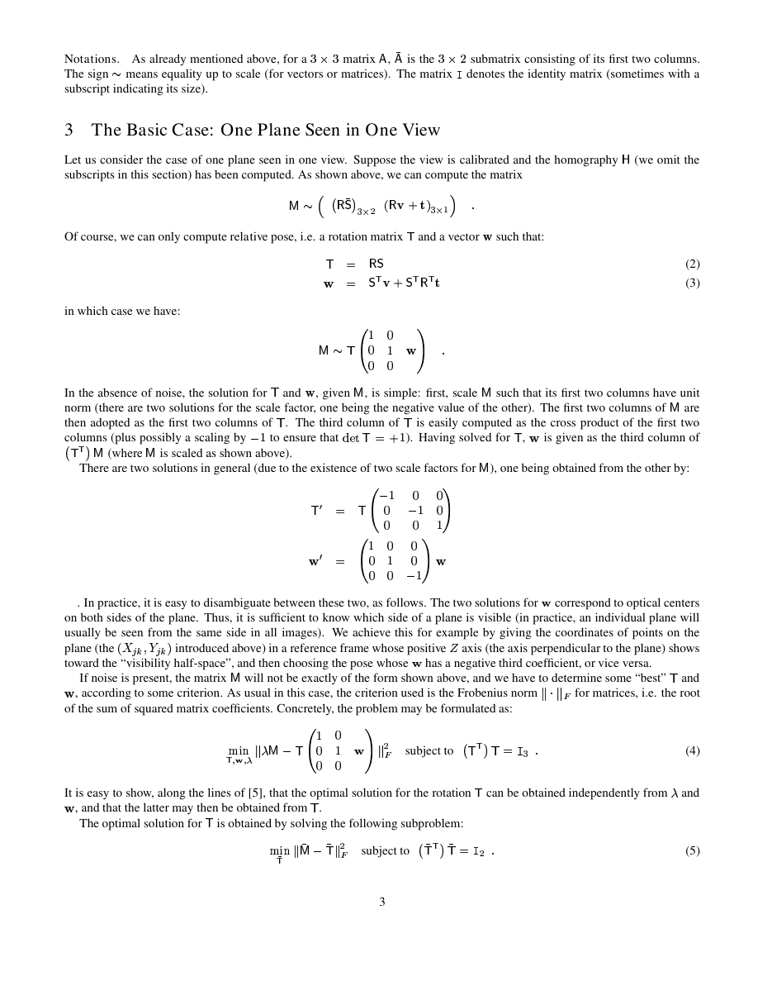
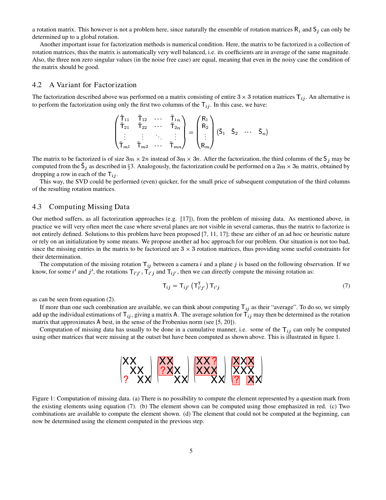
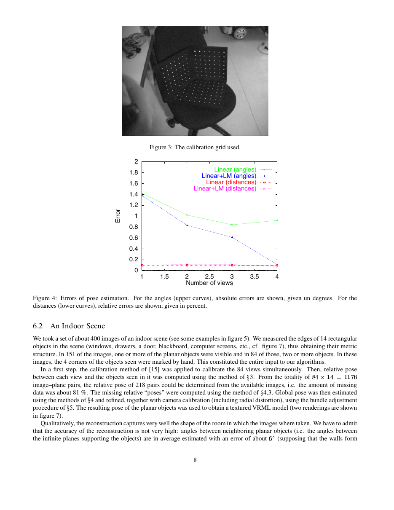

# Sturm 2000 번역: 평면 기반 자세 추정 알고리즘

- 번역 범위: 전문 (초록, 1~7절, 그림 1~7 캡션). 참고문헌은 원문 그대로 두었다.
- 원문: 같은 폴더의 `Sturm2000_CVPR_plane_based_pose_HAL.pdf` (HAL inria-00525671v1, 2011-05-30 등록, 표지 1쪽 + 본문 11쪽). 2026-11-04 HAL API가 알려 준 주 파일 주소(`https://inria.hal.science/inria-00525671/document`)에서 내려받았다.
  - 작업 지시에 적힌 `.../file/Sturm-cvpr00.pdf` 주소는 봇 확인 화면(Anubis)을 돌려줬다. 우회하지 않고, HAL API가 공식으로 알려 준 다른 주소를 썼다.
- 판 차이: 학회 판은 CVPR 2000, pp. 706-711 (6쪽)이다. HAL 판은 본문이 11쪽이고, 초록 끝에 "번들 조정" 문장이 있다. HAL 메타데이터의 초록은 "실제 영상 실험 결과를 보인다"로 끝난다. 학회 판과 문구, 쪽 수가 다를 수 있다. 이 번역은 HAL 판을 옮겼다.
- 본문은 `pdftotext -layout`으로 뽑았다. 수식과 기호는 글자가 깨져서, 원문 쪽 이미지를 보고 다시 적었다.
- 그림은 원문 쪽을 `pdftoppm -r 110`으로 이미지화했다.
  - 원문 4쪽(본문 3쪽, 3절 한 평면 한 시점 해)
  - 원문 6쪽(본문 5쪽, 그림 1)
  - 원문 9쪽(본문 8쪽, 그림 3과 4)
  - 나머지 그림(2, 5, 6, 7)은 캡션만 옮겼다.
- 기호: 원문은 행렬을 sans-serif 대문자(R, S, T, H, M, K), 벡터를 굵은 소문자로 쓴다. 여기서는 LaTeX로 적는다. $\bar{A}$는 3×3 행렬 A의 앞 두 열로 된 3×2 부분 행렬이다. $\sim$는 "배율을 빼고 같다"는 뜻이다.
- 용어: pose는 "자세", homography는 "호모그래피", calibration은 "보정", factorization은 "인수분해", bundle adjustment는 "번들 조정", missing data는 "빠진 자료"로 옮겼다.
- 팀 내부 연구용 번역이다.

---

# 평면 기반 자세 추정 알고리즘

Peter Sturm
INRIA Rhône-Alpes, 655 Avenue de l'Europe, 38330 Montbonnot St Martin, France
Peter.Sturm@inrialpes.fr

## 초록

같은 평면 위에 있는 특징들이 영상에 투영된 것을 이용해, 평면과 카메라 사이의 상대 자세를 추정하는 여러 방법을 내놓는다. 단순한 경우, 특히 평면 하나를 한 장 또는 여러 장에서 보는 경우에는 이런 방법이 이미 있다. 이 논문의 목표는 평면 여러 개를 여러 시점에서 보는 상황, 그것도 서로 겹치는 부분이 적을 수 있는 상황의 해법을 내놓는 것이다. 평면 n개를 시점 m개에서 보는 일반적인 경우를 위해 인수분해 기반 방법을 제안한다. 빠진 자료, 즉 평면 하나 이상이 영상 하나 이상에서 보이지 않을 때 그 값을 계산하는 방법을 설명한다. 마지막으로 카메라 자세, 평면 자세, 카메라 보정을 함께 최적화하는 번들 조정 절차를 만든다.

## 1. 서론

이 논문의 연구는 장면의 규칙성에 기반한 다시점 3D 모델링 프로젝트의 일부다. 점이나 선의 동일 평면성, 선이나 평면의 수직과 평행 같은 장면 규칙성은 사람이 만든 장면의 대화형 3D 모델링에 점점 더 많이 쓰인다 [1, 2, 3, 12, 14, 16]. 보통은 장면 전체(대개 건물)를 사람이 한 장 또는 여러 장의 영상 위에 손으로 그려 표시한다. 장면 규칙성을 나타내는 기하 제약 덕분에 장면의 3D 복원을 얻을 수 있다. 이 방법은 장면이 적은 수의 "기본 요소"로 이루어지고, 그 기하를 앞에서 말한 기하 제약으로 충분히 잘 설명할 수 있으면 쓸 만하고 결과도 매우 좋다.

모델링할 환경이 크고 어수선하면, 3D 모델에 필요한 기본 요소를 모두 손으로 그리기는 보통 어렵다. 또 쓸모 있는 기하 제약도 환경의 일부에서만 얻을 수 있는 경우가 많다. 이런 상황에서 3D 모델링의 자연스러운 해법은 영상 정합으로 얻은 특징 대응을 써서 삼각측량하는 것이다. (장면의 계량 모델이 필요하다면) 정합 말고도 카메라 보정과 카메라 사이 상대 자세를 어떤 방법으로든 얻어야 한다. 이 과정을 완전히 자동으로 하면 좋겠지만, 지금의 시스템이 크고 어수선한 장면에서 충분히 잘 되는지는 의문이다. 또 실패율이 늘 어느 정도 남는다. 그래서 사용자는 결과의 신뢰성을 높이려고 약간의 상호작용을 기꺼이 받아들일 수 있다.

우리는 다음과 같은 다른 길을 따른다. 어떤 환경을 찍은 영상 묶음(또는 연속 영상)이 주어지면, 먼저 장면 규칙성(과 사용자가 영상 위에 표시한 관련 특징)을 써서 시점들을 보정하고 상대 자세를 추정한다. 이것이 끝나면 보정과 자세 정보가 다시점 제약을 준다. 이 제약으로, 장면 규칙성을 잡는 데 쓴 특징 말고 다른 특징을 자동으로 정합하고 삼각측량한다.

보정과 자세 추정에 쓰기 좋은 "기본 요소"는 계량 구조를 아는 평면 물체다. 이런 물체의 영상 한 장은 보정에 제약 두 개를 주고, 보정을 완전히 정할 수 있다면 상대 자세를 일반적으로 해 두 개까지 준다 [6]. 특히 직사각형이 매우 쓸모 있다. 변의 길이만 재면 계량 구조가 정해지고, 사람이 만든 환경에는 직사각형이 아주 많기 때문이다.

평면 물체로 자세를 추정하는 것은 카메라 보정보다 꽤 어렵다. 계량 구조를 아는 평면 물체의 투영에 기반한 보정 제약 [8, 15, 18, 19, 20]은 여러 영상에 걸쳐 쌓을 수 있다. 그러나 자세 추정의 목표는 하나의 전역 기준 좌표계에서 카메라(와 평면)의 상대 자세를 얻는 것이다. 같은 평면을 보는 두 카메라의 상대 자세 추정은 꽤 쉽다(알고리즘은 예를 들어 [6]과 그 참고문헌을 보라). 그러나 카메라마다 평면 하나 또는 몇 개만 보는 상황에서 카메라들의 자세를 동시에 추정하는 일은 쉽지 않다. 우리는 문헌에서 이 일을 하는 일반적인 방법을 알지 못한다. 사진측량 분야에서는 이미 발전이 있었을 가능성이 크다. 다만 사진측량 기법은 카메라 배치 기하가 튼튼한 경우나, 대략의 자세 정보를 이미 아는 경우를 위해 설계된 것이 많다.

이 논문의 구성은 다음과 같다. 2절에서 다시점 다평면 자세 추정 문제를 정식화한다. 3절에서 기본인 한 시점 한 평면 경우의 방법을 준다. 4절에서 다시점 다평면 상황을 위한 인수분해 기반 방법을 내놓는다. 5절에서 자세와 보정의 전역 최적화를 짧게 설명한다. 6절에서 실험 결과를 보이고, 이어서 결론을 맺는다.

## 2. 문제 정식화

다루는 문제는 카메라 m개와 평면 n개의 상대 자세를, (일부) 카메라에 찍힌 평면(즉 평면 위 특징)의 투영으로 추정하는 것이다. 아래에서는 점 특징만 다룬다. 그러나 이 생각은 다른 특징, 특히 선분으로 넓힐 수 있다. 카메라는 보정되어 있다고 가정한다. 예를 들어 [15, 20]에 나온 알고리즘으로 보정할 수 있다. 또 평면의 계량 구조를 안다고 가정한다. 즉 평면 위 점의 좌표를, 평면에 붙은 어떤 유클리드 기준 좌표계에서 안다.

아래에서 평면 위 점의 2D 좌표가 영상에 투영된 좌표로 바뀌는 좌표 변환을 설명한다. $\mathbf{Q}_{jk}$를 j번째 평면 위 k번째 점이라 하고, 좌표를 $(X_{jk}, Y_{jk})$라 하자. j번째 평면의 위치와 방향(이후 간단히 평면의 자세라 부른다)을 어떤 전역 3D 기준 좌표계에 대한 회전 행렬 $\mathsf{S}_j$와 평행이동 벡터 $\mathbf{v}_j$로 나타내자. 그러면 전역 좌표계에서 $\mathbf{Q}_{jk}$의 좌표는 다음과 같다.

$$
\mathbf{Q}^w_{jk} = \begin{pmatrix} \mathsf{S}_j & \mathbf{v}_j \\ \mathbf{0}^\mathsf{T} & 1 \end{pmatrix} \begin{pmatrix} X_{jk} \\ Y_{jk} \\ 0 \\ 1 \end{pmatrix}
$$

카메라 i의 자세를 $\mathsf{R}_i$와 $\mathbf{t}_i$로 나타내자. 그러면 카메라 좌표계에서 $\mathbf{Q}_{jk}$의 좌표는 다음과 같다.

$$
\mathbf{Q}^c_{ijk} = \begin{pmatrix} \mathsf{R}_i & \mathbf{t}_i \\ \mathbf{0}^\mathsf{T} & 1 \end{pmatrix} \mathbf{Q}^w_{jk}
$$

이 논문 전체에서 쓰는 카메라 모델은 원근 투영이다. 즉 투영된 점의 좌표는 다음과 같다.

$$
\mathbf{q}_{ijk} \sim \begin{pmatrix} \mathsf{K}_i & \mathbf{0} \end{pmatrix} \mathbf{Q}^c_{ijk}
\sim \mathsf{K}_i \begin{pmatrix} \mathsf{R}_i\mathsf{S}_j & \mathsf{R}_i\mathbf{v}_j + \mathbf{t}_i \end{pmatrix} \begin{pmatrix} X_{jk} \\ Y_{jk} \\ 0 \\ 1 \end{pmatrix} \qquad (1)
$$

여기서 $\mathsf{K}_i$는 시점 i의 보정 행렬이고 내부 매개변수를 담는다.

이 논문에 나오는 알고리즘의 목표는 카메라와 평면의 자세, 즉 $\mathsf{R}_i, \mathsf{S}_j, \mathbf{t}_i, \mathbf{v}_j$를 보정 행렬 $\mathsf{K}_i$, $(X_{jk}, Y_{jk})$로 나타낸 평면의 계량 구조, 점의 투영 $\mathbf{q}_{ijk}$로부터 정하는 것이다. 계산은 카메라 평면 쌍마다의 호모그래피에 기반한다. 이 호모그래피는 평면이 영상 평면으로 원근 투영되는 것을 나타낸다. 카메라 i와 평면 j의 호모그래피 $\mathsf{H}_{ij}$는 다음과 같이 쓸 수 있다(각주 1).

$$
\mathsf{H}_{ij} \sim \mathsf{K}_i \begin{pmatrix} (\mathsf{R}_i\bar{\mathsf{S}}_j)_{3\times2} & (\mathsf{R}_i\mathbf{v}_j + \mathbf{t}_i)_{3\times1} \end{pmatrix}
$$

여기서 $\bar{\mathsf{S}}_j$는 $\mathsf{S}_j$의 앞 두 열로 된 3×2 부분 행렬이다. 보정을 안다고 가정하므로 다음을 계산할 수 있다.

$$
\mathsf{M}_{ij} \sim \mathsf{K}_i^{-1}\mathsf{H}_{ij} \sim \begin{pmatrix} (\mathsf{R}_i\bar{\mathsf{S}}_j)_{3\times2} & (\mathsf{R}_i\mathbf{v}_j + \mathbf{t}_i)_{3\times1} \end{pmatrix}
$$

아래 알고리즘들은 이 호모그래피 $\mathsf{M}_{ij}$로 자세를 정한다. 쓰는 기본 제약은 어떤 $\mathsf{M}_{ij}$든 앞 두 열이 배율을 빼면 회전 행렬의 앞 두 열이라는 것이다.

쓰는 호모그래피는 평면과 영상 사이의 점 대응으로 계산한다(우리 실험에서 대응은 주로 손으로 얻었다). 기본 행렬의 8점 방법 [4]과 비슷한 선형 방법을 쓴다.

> 각주 1: 식 (1)의 행렬에서 셋째 열을 뺀 것이다.

**표기.** 위에서 이미 말했듯, 3×3 행렬 A에 대해 $\bar{\mathsf{A}}$는 앞 두 열로 된 3×2 부분 행렬이다. 기호 $\sim$는 (벡터나 행렬에서) 배율을 빼고 같다는 뜻이다. 행렬 $\mathtt{I}$는 단위 행렬이다(아래 첨자로 크기를 적기도 한다).

## 3. 기본 경우: 한 시점에서 본 평면 하나

한 시점에서 평면 하나를 보는 경우를 생각하자. 시점이 보정되어 있고 호모그래피 H를 계산했다고 하자(이 절에서는 아래 첨자를 뺀다). 위에서 보였듯 다음 행렬을 계산할 수 있다.

$$
\mathsf{M} \sim \begin{pmatrix} (\mathsf{R}\bar{\mathsf{S}})_{3\times2} & (\mathsf{R}\mathbf{v} + \mathbf{t})_{3\times1} \end{pmatrix}
$$

물론 상대 자세만 계산할 수 있다. 즉 다음을 만족하는 회전 행렬 T와 벡터 $\mathbf{w}$다.

$$
\mathsf{T} = \mathsf{R}\mathsf{S} \qquad (2)
$$
$$
\mathbf{w} = \mathsf{S}^\mathsf{T}\mathbf{v} + \mathsf{S}^\mathsf{T}\mathsf{R}^\mathsf{T}\mathbf{t} \qquad (3)
$$

이때 다음이 성립한다.

$$
\mathsf{M} \sim \mathsf{T}\begin{pmatrix} 1 & 0 & \\ 0 & 1 & \mathbf{w} \\ 0 & 0 & \end{pmatrix}
$$

*원문 본문 3쪽. 3절의 잡음 없는 해, 두 해의 관계, 잡음이 있을 때의 최적화 문제 (4), (5).*

잡음이 없으면 M이 주어졌을 때 T와 $\mathbf{w}$의 해는 간단하다. 먼저 M의 앞 두 열의 노름이 1이 되도록 M의 배율을 맞춘다(배율의 해는 두 개이고, 하나는 다른 하나의 음수다). 그러면 M의 앞 두 열을 T의 앞 두 열로 삼는다. T의 셋째 열은 앞 두 열의 외적으로 쉽게 계산한다(det T = +1이 되도록 −1을 곱해야 할 수도 있다). T를 풀면 $\mathbf{w}$는 $(\mathsf{T}^\mathsf{T})\mathsf{M}$의 셋째 열이다(M은 위처럼 배율을 맞춘 것).

일반적으로 해는 두 개다(M의 배율이 두 가지이기 때문). 하나는 다른 하나에서 다음과 같이 얻는다.

$$
\mathsf{T}' = \mathsf{T}\begin{pmatrix} -1 & 0 & 0 \\ 0 & -1 & 0 \\ 0 & 0 & 1 \end{pmatrix}, \qquad
\mathbf{w}' = \begin{pmatrix} 1 & 0 & 0 \\ 0 & 1 & 0 \\ 0 & 0 & -1 \end{pmatrix}\mathbf{w}
$$

실제로는 이 두 해를 다음과 같이 쉽게 가릴 수 있다. $\mathbf{w}$의 두 해는 평면의 양쪽에 있는 광학 중심에 해당한다. 그래서 평면의 어느 쪽이 보이는지만 알면 된다(실제로 한 평면은 보통 모든 영상에서 같은 쪽에서 보인다). 예를 들어 평면 위 점의 좌표(위에서 도입한 $(X_{jk}, Y_{jk})$)를, 양의 Z축(평면에 수직인 축)이 "보이는 반공간" 쪽을 향하는 기준 좌표계에서 주면 된다. 그다음 $\mathbf{w}$의 셋째 성분이 음수인 자세를 고른다. 또는 그 반대로 정한다.

잡음이 있으면 행렬 M은 위의 꼴과 정확히 같지 않다. 그래서 어떤 기준에 따라 "가장 좋은" T와 $\mathbf{w}$를 정해야 한다. 이런 경우 늘 그렇듯, 기준은 행렬의 프로베니우스 노름 $\|\cdot\|_F$, 즉 행렬 성분 제곱합의 제곱근이다. 구체적으로 문제는 다음과 같이 쓸 수 있다.

$$
\min_{\mathsf{T}, \mathbf{w}, \lambda} \left\| \lambda\mathsf{M} - \mathsf{T}\begin{pmatrix} 1 & 0 & \\ 0 & 1 & \mathbf{w} \\ 0 & 0 & \end{pmatrix} \right\|_F^2 \quad \text{subject to} \quad \mathsf{T}^\mathsf{T}\mathsf{T} = \mathtt{I}_3 \qquad (4)
$$

[5]의 방식을 따르면, 회전 T의 최적해를 $\lambda$와 $\mathbf{w}$와 따로 얻을 수 있고, 그다음 $\lambda$와 $\mathbf{w}$를 T에서 얻을 수 있음을 쉽게 보일 수 있다.

T의 최적해는 다음 부분 문제를 풀어 얻는다.

$$
\min_{\bar{\mathsf{T}}} \|\bar{\mathsf{M}} - \bar{\mathsf{T}}\|_F^2 \quad \text{subject to} \quad \bar{\mathsf{T}}^\mathsf{T}\bar{\mathsf{T}} = \mathtt{I}_2 \qquad (5)
$$

말로 하면, 앞 두 열이 프로베니우스 노름의 뜻으로 M의 앞 두 열에 가장 가까운 회전 행렬 T를 정한다. 이것은 Zhang [20]이 고른 정식화와 다르다는 점에 주의하자. Zhang은 $\bar{\mathsf{M}}$과, 그 두 열의 외적으로 (대략) 계산한 셋째 열로 된 3×3 행렬에 가장 가까운 회전 행렬을 찾는다. 그 방법은 원래 문제 (4)를 최적으로 풀지 않음을 보일 수 있다.

문제 (5)는 특이값 분해(SVD, [9])로 쉽게 풀린다. $(\bar{\mathsf{M}})_{3\times2} = \mathsf{U}_{3\times2}\Sigma_{2\times2}\mathsf{V}^\mathsf{T}_{2\times2}$를 $\bar{\mathsf{M}}$의 SVD라 하자. 최적의 "잘린" 회전 행렬 $\bar{\mathsf{T}}$는 다음과 같다.

$$
\bar{\mathsf{T}} = \mathsf{U}\mathsf{V}^\mathsf{T}
$$

T의 셋째 열은 앞에서 잡음 없는 경우에 설명한 방식대로 계산한다.

T를 풀면, 최적 배율 $\lambda$와 벡터 $\mathbf{w}$는 다음과 같다.

$$
\lambda = \frac{\operatorname{trace}(\bar{\mathsf{T}}^\mathsf{T}\bar{\mathsf{M}})}{\operatorname{trace}(\bar{\mathsf{M}}^\mathsf{T}\bar{\mathsf{M}})} = \frac{\sum_{i=1}^{3}\sum_{j=1}^{2} T_{ij}M_{ij}}{\sum_{j=1}^{2} M_{ij}^2}
$$
$$
\mathbf{w} = (\mathsf{T}^\mathsf{T})\,\mathsf{M}\begin{pmatrix} 0 \\ 0 \\ \lambda \end{pmatrix}
$$

여기서도 일반적으로 해가 두 개이고, 잡음 없는 경우에서 말한 방식으로 가릴 수 있다.

이 절에서 내놓은 방법이 독창적이라고 주장하지 않는다. 다만 다음 절에서 설명하는 방법의 중요한 부분이므로 여기서 설명했다.

> 번역자 메모: 원문 $\lambda$ 식의 분모는 인쇄본 그대로 $\sum_{j=1}^{2} M_{ij}^2$로 적었다. 앞의 trace 식과 맞추면 분모는 $\sum_{i=1}^{3}\sum_{j=1}^{2} M_{ij}^2$이어야 한다. 원문의 표기 누락으로 보인다. $\mathbf{w}$ 식은 M의 셋째 열에 $\lambda$를 곱하고 $\mathsf{T}^\mathsf{T}$로 돌린 것($\lambda\mathsf{T}^\mathsf{T}\mathbf{m}_3$)과 같다.

## 4. 인수분해 기반 다시점 다평면 자세

앞 절의 방법은 카메라 m개가 평면 하나를 보거나, 카메라 하나가 평면 n개를 보는 경우의 상대 자세를 정하는 데 쓸 수 있다. 카메라 평면 쌍마다 따로 적용하고 결과를 이어 붙이면 된다. 그러나 카메라 둘 이상이 평면 둘 이상을 보면 상황이 더 복잡해진다. 아래에서는 카메라 평면 쌍마다 얻은 상대 자세 정보를 동시에 써서 카메라와 평면의 전역 상대 자세를 정하는 방법을 내놓는다. 먼저 모든 평면이 모든 카메라에서 보인다고 가정한다. 빠진 자료, 즉 평면 하나 이상이 시점 하나 이상에서 보이지 않는 경우는 4.3절에서 다룬다.

아래에서는 먼저 카메라와 평면 자세의 회전 부분을 계산하고, 이어서 4.4절에서 평행이동 부분을 계산한다.

### 4.1 자세의 회전 부분

$\mathsf{T}_{ij}$를 앞 절의 방법으로 계산한, 카메라 i와 평면 j 사이 상대 자세의 회전 부분이라 하자. 카메라 평면 쌍마다의 식 (2)를 모두 하나의 연립식으로 묶을 수 있다.

$$
\underbrace{\begin{pmatrix} \mathsf{T}_{11} & \mathsf{T}_{12} & \cdots & \mathsf{T}_{1n} \\ \mathsf{T}_{21} & \mathsf{T}_{22} & \cdots & \mathsf{T}_{2n} \\ \vdots & \vdots & \ddots & \vdots \\ \mathsf{T}_{m1} & \mathsf{T}_{m2} & \cdots & \mathsf{T}_{mn} \end{pmatrix}}_{\mathsf{W}}
= \underbrace{\begin{pmatrix} \mathsf{R}_1 \\ \mathsf{R}_2 \\ \vdots \\ \mathsf{R}_m \end{pmatrix}}_{\mathsf{R}}
\underbrace{\begin{pmatrix} \mathsf{S}_1 & \mathsf{S}_2 & \cdots & \mathsf{S}_n \end{pmatrix}}_{\mathsf{S}} \qquad (6)
$$

이 식은 $\mathsf{R}_i$와 $\mathsf{S}_j$를 인수분해로 푸는 생각으로 이어진다. 행렬 W는 (잡음이 없으면) 계수가 3이고, 0이 아닌 특이값 세 개가 모두 같다. 잡음이 있으면 이 성질을 가지면서 프로베니우스 노름의 뜻으로 W에 가장 가까운 행렬 W′을 다음과 같이 추정할 수 있다. $\mathsf{W} = \mathsf{U}\Sigma\mathsf{V}^\mathsf{T}$를 W의 SVD라 하자. U′(V′)을 U(V)의 앞 세 열로 된 행렬이라 하자. 최적의 W′은 $\mathsf{W}' = \mathsf{U}'\mathsf{V}'^\mathsf{T}$이다.

U′과 V′은 식 (6)의 R과 S와 크기가 같으므로, 여기서 회전 행렬 $\mathsf{R}_i$와 $\mathsf{S}_j$를 뽑아 볼 수 있다. 인수분해는 U′과 V′의 3×3 부분 행렬이 올바른 회전 행렬이라는 것을 보장하지 않는다. 그래서 $\mathsf{R}_i$와 $\mathsf{S}_j$를 U′과 V′의 해당 부분 행렬에 가장 가까운 3×3 회전 행렬로 정한다. 일반 행렬에 가장 가까운 회전 행렬을 정하는 방법은 [5, 20]에 있다.

다뤄야 할 문제 하나는 인수분해의 모호성, 즉 $(\mathsf{U}'\mathsf{A})(\mathsf{A}^{-1}\mathsf{V}'^\mathsf{T})$도 우리 문제의 올바른 해가 되는 행렬 A가 있을 가능성이다. 인수분해로 나온 두 행렬은 식 (6)처럼 회전 행렬의 모음이어야 하므로, 가능한 모호성은 A가 회전 행렬인 경우뿐임을 보일 수 있다. 그러나 여기서 이것은 문제가 아니다. 회전 행렬 $\mathsf{R}_i$와 $\mathsf{S}_j$의 모음은 본래 전역 회전 하나를 빼고만 정해지기 때문이다.

인수분해 방법에서 또 하나 중요한 문제는 수치 조건이다. 여기서 인수분해할 행렬은 회전 행렬의 모음이다. 그래서 행렬이 자동으로 아주 잘 균형 잡혀 있다. 즉 성분이 평균적으로 같은 크기다. 또 (잡음이 없을 때) 0이 아닌 특이값 세 개가 같다. 이것은 잡음이 있는 경우에도 행렬의 조건이 좋아야 함을 뜻한다.

### 4.2 인수분해의 변형

위의 인수분해는 3×3 회전 행렬 $\mathsf{T}_{ij}$ 전체로 된 행렬에서 했다. 다른 길은 $\mathsf{T}_{ij}$의 앞 두 열만 써서 인수분해하는 것이다. 이 경우는 다음과 같다.

$$
\begin{pmatrix} \bar{\mathsf{T}}_{11} & \bar{\mathsf{T}}_{12} & \cdots & \bar{\mathsf{T}}_{1n} \\ \bar{\mathsf{T}}_{21} & \bar{\mathsf{T}}_{22} & \cdots & \bar{\mathsf{T}}_{2n} \\ \vdots & \vdots & \ddots & \vdots \\ \bar{\mathsf{T}}_{m1} & \bar{\mathsf{T}}_{m2} & \cdots & \bar{\mathsf{T}}_{mn} \end{pmatrix}
= \begin{pmatrix} \mathsf{R}_1 \\ \mathsf{R}_2 \\ \vdots \\ \mathsf{R}_m \end{pmatrix}
\begin{pmatrix} \bar{\mathsf{S}}_1 & \bar{\mathsf{S}}_2 & \cdots & \bar{\mathsf{S}}_n \end{pmatrix}
$$

인수분해할 행렬의 크기는 3m×3n 대신 3m×2n이다. 인수분해 뒤 $\mathsf{S}_j$의 셋째 열은 3절에서 설명한 대로 $\bar{\mathsf{S}}_j$에서 계산할 수 있다. 같은 방식으로, 각 $\mathsf{T}_{ij}$에서 행 하나를 빼서 얻은 2m×3n 행렬로 인수분해할 수도 있다.

이렇게 하면 SVD를 (더) 빨리 할 수 있다. 대가는 그 뒤에 결과 회전 행렬의 셋째 열을 계산하는 작은 비용이다.

### 4.3 빠진 자료 계산

*원문 본문 5쪽. 4.2절, 4.3절, 그림 1.*

우리 방법도 모든 인수분해 방법(예: [17])처럼 빠진 자료 문제를 겪는다. 위에서 말했듯, 실제로는 여러 평면이 여러 카메라에서 보이지 않는 경우가 아주 많다. 그래서 인수분해할 행렬이 다 정해지지 않는다. 이 문제의 해법이 제안된 바 있다 [7, 11, 17]. 이들은 임시방편이거나 휴리스틱이거나, 어떤 방식의 초기값에 기댄다. 우리 문제를 위해 또 다른 임시방편을 제안한다. 우리 상황은 나쁘지 않다. 인수분해할 행렬에서 빠진 항목이 3×3 회전 행렬이어서, 그 값을 정하는 데 쓸모 있는 제약을 주기 때문이다.

카메라 i와 평면 j 사이의 빠진 회전 $\mathsf{T}_{ij}$의 계산은 다음 관찰에 기반한다. 어떤 $i'$와 $j'$에 대해 회전 $\mathsf{T}_{i'j'}$, $\mathsf{T}_{i'j}$, $\mathsf{T}_{ij'}$를 알면, 빠진 회전을 바로 계산할 수 있다.

$$
\mathsf{T}_{ij} = \mathsf{T}_{ij'}\left(\mathsf{T}^\mathsf{T}_{i'j'}\right)\mathsf{T}_{i'j} \qquad (7)
$$

이것은 식 (2)에서 알 수 있다.

이런 조합을 둘 이상 쓸 수 있으면, $\mathsf{T}_{ij}$를 그 "평균"으로 계산하는 것을 생각할 수 있다. 이를 위해 $\mathsf{T}_{ij}$의 개별 추정값을 더해 행렬 A를 만든다. 그러면 평균 해 $\mathsf{T}_{ij}$는 프로베니우스 노름의 뜻으로 A에 가장 가까운 회전 행렬로 정할 수 있다([5, 20] 참고).

빠진 자료의 계산은 보통 누적 방식으로 해야 한다. 즉 어떤 $\mathsf{T}_{ij}$는 처음에는 빠져 있었지만 위처럼 계산된 다른 행렬을 써야만 계산할 수 있다. 그림 1이 이것을 보여 준다.

**그림 1:** 빠진 자료의 계산. (a) 물음표로 나타낸 항목은 식 (7)로 있는 항목에서 계산할 방법이 없다. (b) 표시한 항목은 빨간색으로 강조한 항목들로 계산할 수 있다. (c) 표시한 항목을 계산할 조합이 두 개 있다. (d) 처음에는 계산할 수 없던 항목을, 앞 단계에서 계산한 항목으로 이제 정할 수 있다.

### 4.4 자세의 평행이동 부분

카메라와 평면 자세의 회전 부분을 계산했으면, 평행이동 부분은 다음과 같이 정할 수 있다. $\mathbf{w}_{ij}$를 3절의 방법으로 계산한, 카메라 i와 평면 j 사이 상대 자세의 평행이동 부분이라 하자. 식 (3)에서 다음을 얻는다.

$$
\mathbf{w}_{ij} = \mathsf{S}_j^\mathsf{T}\mathbf{v}_j + \mathsf{S}_j^\mathsf{T}\mathsf{R}_i^\mathsf{T}\mathbf{t}_i
$$

$\mathsf{S}_j$를 알므로 다음을 계산할 수 있다.

$$
\mathbf{w}'_{ij} = \mathsf{S}_j\mathbf{w}_{ij} = \mathbf{v}_j + \mathsf{R}_i^\mathsf{T}\mathbf{t}_i
$$

이 식을 바탕으로, 벡터 $\mathbf{v}_j$와 $\mathbf{t}'_i = \mathsf{R}_i^\mathsf{T}\mathbf{t}_i$를 추정하는 비용 함수를 만든다.

$$
c = \sum_{i,j}\left(\mathbf{w}'_{ij} - \mathbf{v}_j - \mathbf{t}'_i\right)^2 \qquad (8)
$$

합은 쓸 수 있는 모든 카메라 평면 쌍에 대해 한다. 기준 (8)을 최소화하려고 미지수에 대한 편미분을 계산한다. $\mathbf{v}_j$의 k번째 성분과 $\mathbf{t}'_i$의 p번째 성분에 대한 편미분은 각각 다음과 같다.

$$
\frac{\partial c}{\partial v_{jk}} = 2\sum_i\left(w'_{ijk} - v_{jk} - t'_{ik}\right) \qquad (9)
$$
$$
\frac{\partial c}{\partial t'_{ip}} = 2\sum_j\left(w'_{ijp} - v_{jp} - t'_{ip}\right) \qquad (10)
$$

기준 (8)은 편미분들의 공통 근을 풀어 최소화할 수 있다. 식 (9)와 (10)에서, 이것은 다음의 간단한 선형 연립식을 풀어 할 수 있음을 알 수 있다(모든 평면이 모든 시점에서 보이는 경우로 적었다).

$$
\left(\begin{array}{ccc|ccc}
m\mathtt{I} & & & \mathtt{I} & \cdots & \mathtt{I} \\
& \ddots & & \vdots & \ddots & \vdots \\
& & m\mathtt{I} & \mathtt{I} & \cdots & \mathtt{I} \\ \hline
\mathtt{I} & \cdots & \mathtt{I} & n\mathtt{I} & & \\
\vdots & \ddots & \vdots & & \ddots & \\
\mathtt{I} & \cdots & \mathtt{I} & & & n\mathtt{I}
\end{array}\right)
\begin{pmatrix} \mathbf{v}_1 \\ \vdots \\ \mathbf{v}_n \\ \mathbf{t}'_1 \\ \vdots \\ \mathbf{t}'_m \end{pmatrix}
=
\begin{pmatrix} \sum_i \mathbf{w}'_{i1} \\ \vdots \\ \sum_i \mathbf{w}'_{in} \\ \sum_j \mathbf{w}'_{1j} \\ \vdots \\ \sum_j \mathbf{w}'_{mj} \end{pmatrix}
$$

이 희소 연립식은 [13]에 나온 특별한 방법으로 푼다. 해는 물론 평행이동 하나를 빼고만 유일하다. 모든 $\mathbf{v}_j$에 같은 3차원 벡터를 더하고 모든 $\mathbf{t}'_i$에서 그것을 빼도 기준 (8)은 바뀌지 않는다.

### 4.5 전체 알고리즘

1. 평면과 영상 사이의 호모그래피를 계산한다.
2. 카메라가 아직 보정되지 않았으면 [8, 15, 18, 19, 20]의 방법 하나로 보정한다.
3. 3절에서 설명한 대로 평면과 카메라 쌍 사이의 상대 자세를 추정한다(가능한 두 해 가운데 맞는 것을 드러내도록 주의한다).
4. 4.3절에서 설명한 대로 빠진 자료를 계산한다.
5. 4.1절에서 설명한 대로 인수분해로 전역 상대 자세의 회전 부분을 추정한다.
6. 4.4절에서 설명한 대로 자세의 평행이동 부분을 추정한다.
7. 선택이지만 권장: 카메라와 평면의 자세, 그리고 동시에 카메라 보정을 최적화한다(5절 참고).

## 5. 최적화

모든 카메라와 평면의 자세를 공통 전역 기준 좌표계에 대해 추정했으면, 번들 조정 방식으로 최적화할 수 있다. 우리는 그런 알고리즘을 구현했다. 최적화는 모든 자세 매개변수뿐 아니라 카메라의 내부 매개변수에 대해서도 한다. 여기에는 방사 왜곡 계수 하나가 들어간다. 우리 구현은 꽤 유연해서, 내부 매개변수(초점거리, 주점, 왜곡 계수)가 바뀌는 경우도 다룬다.

최소화하는 기준은 재투영 오차의 제곱합이다. 번들 조정 방법에서 흔히 그렇듯, 비선형 최적화 중에 푸는 정규 방정식은 특별한 희소 구조를 가진다. 그림 2에 카메라 6대와 평면 2개의 경우를 그렸다. 기본 사진측량 블록을 위해 [13]에서 제안된 희소 해법을 우리 경우에 맞게 바꿨다. 덕분에 (시간과 메모리 면에서) 효율적인 최적화가 가능하다.

최적화는 레벤버그 마쿼트(Levenberg-Marquardt) 방식 [9]으로 한다. 구현에는 최소화할 비용 함수와 그 편미분을 계산하는 절차가 필요하다. 이것들은 투영 식에서 아주 직접 얻으므로 여기에 적지 않는다.

**그림 2:** 최적화 중에 풀어야 하는 정규 방정식의 구조. (그림 위 열 이름: 카메라 자세, 평면 자세, 보정)

## 6. 실험 결과

여러 종류의 영상 묶음으로 방법들을 시험했다. 첫째, 보정 격자 영상으로 알고리즘의 정확성을 시험하고, 쓴 영상 수에 따른 성능을 평가했다. 둘째, 종이에 인쇄한 평면 무늬를 방의 모든 벽에 붙였다. 이 장면은 빠진 자료가 많은 경우에 대한 우리 방법의 시험이다. 셋째 영상 묶음은 둘째와 같은 종류다. 다만 보정과 자세 추정에 쓴 평면 물체가 장면의 일부(창문, 문, 컴퓨터 화면 같은 직사각형 물체)였다.

### 6.1 보정 격자

*원문 본문 8쪽. 그림 3(보정 격자), 그림 4(자세 추정 오차).*

Canon MV-1 캠코더로 보정 격자(그림 3)의 영상을 찍었다. 줌 위치마다 다른 위치에서 영상 4장을 찍었다. 우리 방법의 입력은 보정 격자의 세 평면 각각에 있는 원형 표적의 좌표와, 영상에서 뽑은 표적의 좌표였다. 그래서 줌 설정마다 모두 4 × 3개의 호모그래피를 계산할 수 있었다. 이것으로 카메라를 보정하고, 3절과 4절의 방법으로 자세를 추정했다. 이어서 최적화를 했다.

그림 4에 초점거리가 가장 짧은(그리고 광학 왜곡이 가장 큰) 줌 위치의 결과를 보였다. 위쪽 두 오차 곡선은 추정한 자세에서 얻은 보정 격자 세 평면 사이 각도의 절대 오차(도 단위)다. 최소 경우인 시점 한 장에서는 "선형" 방법(4절)과 그 뒤 최적화("Linear+LM", 그래프의 이름) 모두 오차가 약 1.4°다. 시점을 더하면 선형 방법의 오차는 약 1°가 된다(이것이 한계로 보이며, 광학 왜곡을 무시했기 때문일 수 있다). 최적화 뒤의 오차는 선형으로 줄어, 시점 4장을 쓰면 1/10도에 이른다.

아래쪽 두 곡선은 보정 격자 전체 3D 복원의 평균 거리 오차다. 물체의 세 평면 각각에서 표적의 좌표를 알고, 평면의 자세를 추정하므로, 완전한 3D 복원, 즉 표적의 3D 좌표 전체를 얻을 수 있다. 3D 좌표의 정답은 제조사가 준다. 그래서 복원이 정답과 얼마나 가까운지 계산할 수 있다. 복원과 정답 사이의 "가장 좋은" 강체 변환을 계산하고 [5], 그 잔차를 잰다. 오차는 영상 수와 최적화 여부와 상관없이 사실상 일정하며 0.1%다.

**그림 3:** 사용한 보정 격자.

**그림 4:** 자세 추정 오차. 각도(위쪽 곡선)는 절대 오차를 도 단위로 보인다. 거리(아래쪽 곡선)는 상대 오차를 퍼센트로 보인다. (범례: Linear (angles), Linear+LM (angles), Linear (distances), Linear+LM (distances). 가로축: 시점 수)

### 6.2 실내 장면

실내 장면 영상 약 400장을 찍었다(그림 5에 몇 장의 예). 장면에 있는 직사각형 물체 14개(창문, 서랍, 문, 칠판, 컴퓨터 화면 등, 그림 7 참고)의 변을 재서 계량 구조를 얻었다. 151장에서는 평면 물체가 하나 이상 보였고, 그 가운데 84장에서는 둘 이상 보였다. 이 영상들에서 보이는 물체의 꼭짓점 4개를 손으로 표시했다. 이것이 우리 알고리즘의 입력 전부였다.

첫 단계로 [15]의 보정 방법을 적용해 시점 84장을 동시에 보정했다. 그다음 각 시점과 그 안에서 보이는 물체 사이의 상대 자세를 3절의 방법으로 계산했다. 영상 평면 쌍 모두 84 × 14 = 1176개 가운데, 있는 영상으로 상대 자세를 정할 수 있었던 쌍은 218개였다. 즉 빠진 자료가 약 81%였다. 빠진 상대 "자세"는 4.3절의 방법으로 계산했다. 그다음 4절의 방법으로 전역 자세를 추정하고, 5절의 번들 조정 절차로 카메라 보정(방사 왜곡 포함)과 함께 다듬었다. 이렇게 얻은 평면 물체의 자세로 질감을 입힌 VRML 모델을 만들었다(그림 7에 두 렌더링).

정성적으로 보면 복원은 영상을 찍은 방의 모양을 아주 잘 잡는다. 다만 복원의 정확도가 아주 높지는 않다는 점을 인정해야 한다. 이웃한 평면 물체 사이 각도(즉 물체를 받치는 무한 평면 사이 각도)는 평균 약 6°의 오차로 추정된다(벽들이 90° 각도를 이룬다고 가정할 때). 이것은 사진측량 기준으로는 분명히 부족하다. 그러나 전역 자세는 적응 창을 쓰는 넓은 기선 정합에 쓰는 것을 생각하기에 충분히 좋다. 시점 사이 상대 자세를 알면, 자세(와 보정)로 계산한 사영 변환과 국소적으로 평면인 물체 표면 가정을 바탕으로 정합 창을 시점 사이에 옮길 수 있다. 초기 정합 실험은 우리가 가려는 방향에 고무적이다(7절 참고).

전체적으로 이 실험은 정말 어려운 시험이라고 본다. 입력 자료가 아주 적고(평면당 4점) 질이 나쁘다(물체 일부는 실제로 평면이 아니었고, 영상의 특징 추출이 꽤 부정확했다). 촬영 기하가 매우 약하다(빠진 자료 약 80%). 특별한 조명도 쓰지 않았다. 그래서 우리 결과의 정확도는 이런 조건에서 기대할 수 있는 만큼은 될 것이다.

다른 방에서 종이에 인쇄해 벽에 붙인 무늬로 비슷한 실험을 했다. 찍은 영상 32장 각각에서, 모두 12개(벽마다 3개)인 무늬 가운데 2개가 보였다(그림 6 참고). 즉 빠진 자료가 이번에도 80%가 넘었다. 이웃한 무늬 사이 각도의 평균 오차는 약 3°로, 앞 실험 오차의 절반이었다. 이것은 분명 특징 추출이 더 정확했기 때문이다(그래도 완벽하지는 않았다. 거의 모든 영상에서 두 무늬 중 하나가 약간 초점이 나갔고, 특별한 조명도 없었다).

**그림 5:** 실내 장면 영상.

**그림 6:** 두 번째 실험에 쓴 영상 두 장.

## 7. 결론과 전망

평면 기반 자세 추정 방법들을 내놓았다. 기본인 한 시점 한 평면 경우의 방법 말고, 다시점 다평면 경우를 위한 인수분해 기반 방법을 내놓았다.

실험 결과는 빠진 자료가 아주 많아도 우리 방법을 성공적으로 쓸 수 있음을 시사한다. "보정 상황"에서는 추정한 자세를 보정과 자세 최적화의 출발점으로 분명히 쓸 수 있다. 그러나 우리 연구의 전체 목표는 보정이 아니라 복잡한 인공 환경의 3D 복원이다. 우리 생각은, 이 과정을 제한적이고 견딜 만한 양의 사용자 상호작용으로 시작하고 그 뒤를 자동 과정이 잇게 하자는 것이다. 이 논문에서 설명한 종류의 사용자 상호작용(영상에서 눈에 띄는 물체 몇 개를 표시하는 것)으로 좋은 카메라 보정과, 대략적인 수준에서 좋은 수준까지의 전역 자세 추정을 얻을 수 있다. 특히 (초기 실험에 따르면) 복원한 자세는 적응 창을 쓰는 넓은 기선 정합에 쓸 만큼 좋다. 지금 이것을 연구하고 있다. 우리의 희망(과 확신)은, 영상마다 (손으로 고른 것 말고) 몇 개(아마 10개쯤)의 추가 대응이면 자세의 질을 충분히 높여, 예를 들어 3D 복원을 위한 복셀 채색 방법 [10]을 쓸 수 있게 되리라는 것이다.

**그림 7:** 보정과 자세 추정에 쓴 평면 물체들의 질감 입힌 3D 모델 렌더링.

## References

[1] R. Cipolla, D.P. Robertson, E.G. Boyer, "Photobuilder – 3D models of architectural scenes from uncalibrated images," Conference on Multimedia Computing and Systems, pp. 25-31, June 1999.
[2] A. Criminisi, I. Reid, A. Zisserman, "Duality, Rigidity and Planar Parallax," ECCV, pp. 846-861, June 1998.
[3] P.E. Debevec, C.J. Taylor, J. Malik, "Modeling and Rendering Architecture from Photographs: a Hybrid Geometry-and Image-Based Approach," SIGGRAPH, August 1996.
[4] R. Hartley, "In Defence of the 8-Point Algorithm," ICCV, pp. 1064-1070, June 1995.
[5] B.K.P. Horn, H.M. Hilden, S. Negahdaripour, "Closed-Form Solution of Absolute Orientation Using Orthonormal Matrices," Journal of the Optical Society of America A, Vol. 5, pp. 1127-1135, 1988.
[6] R.J. Holt, A.N. Netravali, "Camera Calibration Problem: Some New Results," CVIU, Vol. 54, No. 3, pp. 368-383, 1991.
[7] D. Jacobs, "Linear Fitting with Missing Data: Applications to Structure-from-Motion and to Characterizing Intensity Images," CVPR, pp. 206-212, June 1997.
[8] R.K. Lenz, R.Y. Tsai, "Techniques for Calibration of the Scale Factor and Image Center for High Accuracy 3-D Machine Vision Metrology," PAMI, Vol. 10, No. 5, pp. 713-720, 1988.
[9] W.H. Press, S.A. Teukolsky, W.T. Vetterling, B.P. Flannery, Numerical Recipes in C - The Art of Scientific Computing, 2nd edition, Cambridge University Press, 1992.
[10] S.M. Seitz, C.R. Dyer, "Photorealistic Scene Reconstruction by Voxel Coloring," CVPR, pp. 1067-1073, June 1997.
[11] H.Y. Shum, K. Ikeuchi, R. Reddy, "Principal Component Analysis with Missing Data and its Application to Polyhedral Object Modeling," PAMI, Vol. 17, No. 9, pp. 854-867, 1995.
[12] H.-Y. Shum, R. Szeliski, S. Baker, M. Han, P. Anandan, "Interactive 3D Modeling from Multiple Images Using Scene Regularities," SMILE Workshop, Freiburg, Germany, pp. 236-252, June 1998.
[13] C.C. Slama (Ed.), "Manual of Photogrammetry," Fourth Edition, American Society of Photogrammetry and Remote Sensing, 1980.
[14] P. Sturm, S.J. Maybank, "A Method for Interactive 3D Reconstruction of Piecewise Planar Objects from Single Images," BMVC, pp. 265-274, September 1999.
[15] P. Sturm, S.J. Maybank, "On Plane-Based Camera Calibration: A General Algorithm, Singularities, Applications," CVPR, Fort Collins, CO, pp. 432-437, June 1999.
[16] R. Szeliski, P.H.S. Torr, "Geometrically Constrained Structure from Motion: Points on Planes," SMILE Workshop, Freiburg, Germany, pp. 171-186, June 1998.
[17] C. Tomasi, T. Kanade, "Shape and Motion from Image Streams under Orthography: A Factorization Method," International Journal on Computer Vision, Vol. 9, No. 2, pp. 137-154, 1992.
[18] R.Y. Tsai, "A Versatile Camera Calibration Technique for High-Accuracy 3D Machine Vision Metrology Using Off-the-Shelf TV Cameras and Lenses," IEEE Journal of Robotics and Automation, Vol. 3, No. 4, pp. 323-344, 1987.
[19] G.-Q. Wei, S.D. Ma, "A Complete Two-Plane Camera Calibration Method and Experimental Comparisons," ICCV, pp. 439-446, 1993.
[20] Z. Zhang, "Flexible Camera Calibration By Viewing a Plane From Unknown Orientations," ICCV, pp. 666-673, 1999.
